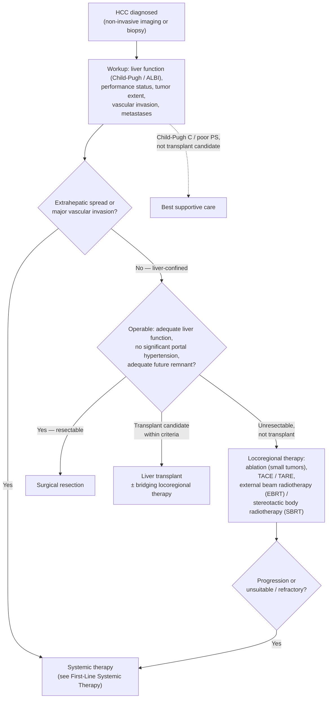

## Contents
- [[#Assessment]]
  - [[#Establishing the Diagnosis]]
  - [[#HCC Surveillance]]
  - [[#Severity Assessment — BCLC Staging]]
- [[#Differential Diagnosis]]
- [[#Diagnostics]]
  - [[#Imaging Diagnosis]]
  - [[#Surveillance Recall Algorithm]]
  - [[#Diagnostic Biomarkers]]
- [[#Therapeutics]]
  - [[#Multidisciplinary Care]]
  - [[#Surgical Resection]]
  - [[#Local Ablative Therapy]]
  - [[#Locoregional Therapy — TACE and TARE]]
  - [[#Systemic Therapy — Advanced HCC]]
    - [[#First-Line Systemic Therapy Dosing]]
    - [[#Second-Line and Beyond Systemic Therapy Dosing]]
  - [[#Liver Transplantation for HCC]]
  - [[#(Neo)Adjuvant Therapy After Resection or Local Ablation]]
  - [[#Management of Recurrence After Resection or Local Ablation]]
  - [[#Post-Transplant Immunosuppression for HCC Recipients]]
  - [[#Advance Care Planning]]
- [[#See Also]]
- [[#Sources]]

---

## Assessment

### Establishing the Diagnosis

- **Hepatocellular carcinoma (HCC):** 75–86% of primary liver cancers; ~80% arise in [[cirrhosis]], most others in chronic hepatitis B virus (HBV) infection. Incidence ~2%/year in Child-Pugh A–B cirrhosis. [[aasld-2023-hcc]]
- **Risk factors:** [[chronic-hepatitis-b|HBV]], [[hepatitis-c|hepatitis C virus (HCV)]] (persists after cure if cirrhotic), [[alcohol-associated-liver-disease|alcohol-associated cirrhosis]], [[nafld-masld|metabolic dysfunction-associated steatotic liver disease (MASLD)]], tobacco, [[obesity]]/metabolic syndrome, aflatoxin B1 (with HBV). [[aasld-2023-hcc]]

### HCC Surveillance

- **Ultrasound (US) + alpha-fetoprotein (AFP) every 6 months** in Child-Pugh A–B cirrhosis, Child-Pugh C **only if a [[liver-transplantation|transplant]] candidate**, and defined noncirrhotic HBV subsets; not in noncirrhotic MASLD or life expectancy <1–2 years. Full indication table: [[hcc-surveillance]]. [[aasld-2023-hcc]], [[aasld-idsa-2025-chb-treatment]]

### Severity Assessment — BCLC Staging

![[hcc-2023-bclc-algorithm-14.png|700x445]]
*Figure 9 — Updated Barcelona Clinic Liver Cancer (BCLC) Staging System 2022: tumor characterization, treatment allocation, and expected survival by stage. ([[aasld-2023-hcc]])*

- **BCLC 2022** (American Association for the Study of Liver Diseases [AASLD]-endorsed): tumor burden + liver function (Child-Pugh, Model for End-Stage Liver Disease [MELD], albumin-bilirubin [ALBI] — cutoffs on [[cirrhosis]]) + Eastern Cooperative Oncology Group performance status (PS) + AFP. [[aasld-2023-hcc]]

| Stage | Definition | Refinement | First treatment | Expected survival |
|---|---|---|---|---|
| **Very early (0)** | Single ≤2 cm; preserved liver function; PS 0 | Liver transplantation (LT) candidate? If not → portal pressure/bilirubin | **Resection** if normal portal pressure/bilirubin; ablation if clinically significant portal hypertension (CSPH)/bilirubin↑ | >5 years |
| **Early (A)** | Single, or ≤3 nodules each ≤3 cm; preserved liver function; PS 0 | Single: LT if CSPH/bilirubin↑, else resect; ≤3 nodules: LT (extended criteria) | **Resection**, **ablation**, or **transplant** | >5 years |
| **Intermediate (B)** | Multinodular; preserved liver function; PS 0 | Well-defined nodules, preserved portal flow → transarterial chemoembolization (TACE); diffuse/infiltrative/bilobar → systemic | **TACE** (transarterial radioembolization [TARE] alternative) | >2.5 years |
| **Advanced (C)** | Portal invasion and/or extrahepatic spread; PS 1–2 | — | **Systemic therapy** (see *Systemic Therapy*) | >2 years |
| **Terminal (D)** | End-stage liver function; PS 3–4 | — | Best supportive care | ~3 months |

---

## Differential Diagnosis

*Workup: see [[focal-liver-lesions]].*

- [[cholangiocarcinoma|Intrahepatic cholangiocarcinoma]] — typically hypovascular; LR-M on [[li-rads|Liver Imaging Reporting and Data System (LI-RADS)]] → biopsy
- [[hepatocellular-adenoma]] — no washout; gadoxetate hepatobiliary-phase uptake; β-catenin subtype can transform
- [[focal-nodular-hyperplasia]] — central scar; gadoxetate uptake; LR-1/LR-2
- [[hepatic-hemangioma]] — T2 bright, centripetal fill-in
- Metastasis — multiple lesions, known primary; LI-RADS not applicable
- Dysplastic nodule — iso/hypovascular precursor; LR-3/LR-4
- Cysts — [[hepatic-cysts]]

---

## Diagnostics

### Imaging Diagnosis

*LI-RADS categories, features, and per-category management: [[li-rads]].*

- **At-risk patients (cirrhosis or chronic HBV):** noninvasive diagnosis by LI-RADS on multiphasic computed tomography (CT) or dynamic contrast-enhanced magnetic resonance imaging (MRI) — **LR-5 = HCC, no biopsy** (Guidance Statement [GS] 16, Level 1, Strong). [[aasld-2023-hcc]]
- **Not at risk:** **pathology required** (GS 17, Level 1, Strong). [[aasld-2023-hcc]]
- **LR-M → biopsy** (GS 22) — mixed tumors and non-HCC malignancy. [[aasld-2023-hcc]]
- **Never diagnose on AFP alone or liquid biopsy** (GS 16c). [[aasld-2023-hcc]]
- **Immunohistochemistry:** ≥2 of 4 positive is highly specific — glypican-3, glutamine synthetase, HSP70, clathrin heavy chain (K19/EpCAM = progenitor features; CD34 = neovascularization). [[aasld-2023-hcc]]

### Surveillance Recall Algorithm

![[hcc-2023-surveillance-recall-algorithm-09.png|700x680]]
*Figure 5 — Recall algorithm for HCC surveillance based on ultrasound (US) visualization score and AFP level. ([[aasld-2023-hcc]])*

| US / AFP result | Next step |
|---|---|
| Visualization score A, no lesion, AFP normal | Repeat US at 6 months |
| Score B or lesion <1 cm, AFP normal | US in 3–6 months — stable ×2 → back to semiannual; growth → diagnostic MRI/CT |
| Score C (limited visualization; no lesion or <1 cm) | Screening contrast-enhanced MRI or multiphasic CT (repeat US can be considered) |
| Lesion ≥1 cm | Diagnostic multiphasic MRI or CT |
| **AFP ≥20 ng/mL** (even without a lesion), or rising on 2 consecutive tests / doubling | Diagnostic multiphasic MRI or CT |

- Visualization score: from the radiology report (American College of Radiology LI-RADS US algorithm).
- **AFP high (≥200 or ≥400 ng/mL may count), no lesion:** other CT/MRI modality ± chest/pelvic CT → then positron emission tomography-CT.
- **Recall by CT/MRI** may be preferred with [[obesity]], alcohol- or steatohepatitis-related cirrhosis, or Child-Pugh B/C (recall only, not routine surveillance). [[aasld-2023-hcc]]

### Diagnostic Biomarkers

| Marker | Performance | Use |
|---|---|---|
| **AFP** | >40% of HCC have normal AFP; also ↑ in intrahepatic cholangiocarcinoma, [[gastric-adenocarcinoma\|gastric cancer]], germ cell tumors | 400 ng/mL diagnostic cutoff abandoned; used for recall (≥20), transplant eligibility, ramucirumab (≥400) |
| **AFP-L3** | Sensitivity 62%, specificity 90% | Food and Drug Administration (FDA)-approved for risk stratification, not diagnosis |
| **Des-gamma carboxyprothrombin (DCP)** | Sensitivity 40%, specificity 81% | FDA-approved for risk stratification, not diagnosis |
| **GALAD** (gender, age, AFP-L3%, AFP, DCP) | Sensitivity 54–72%, specificity 90% | Not yet for routine practice |
| **Circulating tumor DNA** | — | Investigational |

*Source: [[aasld-2023-hcc]]. Surveillance biomarkers and risk scores: [[hcc-surveillance]].*

---

## Therapeutics

### Multidisciplinary Care

- **Every patient through a multidisciplinary tumor board** (GS 27, Level 3, Strong) — it changes the management plan in 41.7%. [[aasld-2023-hcc]]
- **National Comprehensive Cancer Network (NCCN) allocation** — by liver function, PS, tumor burden, vascular invasion/extrahepatic spread (concordant with BCLC):

*Algorithm — NCCN treatment allocation for HCC, recreated in original form (not an NCCN figure). ([[nccn-2026-hcc]])*

---

### Surgical Resection

*Source for this section: [[aasld-2023-hcc]] (GS 28–31).*

- **Noncirrhotic HCC → resection** (Level 2, Strong): 5-year survival >70%, operative mortality <3%.
- **Cirrhotic, BCLC 0/A → resection** if limited tumor burden, well-compensated, **no CSPH**, adequate future liver remnant (FLR) (Level 2, Strong):
  - CSPH = [[hepatic-venous-pressure-gradient|hepatic venous pressure gradient]] ≥10 mmHg; surrogates: varices, splenomegaly, platelets <100 × 10⁹/L ([[portal-hypertension]])
  - FLR **>30%** without cirrhosis, **>40%** with; CT/MRI volumetry; inadequate → portal vein embolization
- **Beyond BCLC 0/A** (high-volume centers, tumor-board decision): select multinodular HCC beyond Milan (vs TACE in BCLC B: hazard ratio 0.56); portal vein tumor thrombus (PVTT) resection controversial — Asian data for **Vp1 (subsegmental)/Vp2 (segmental)**. **Vp4 = main portal vein** → TACE and TARE unsuitable. Vp3 undefined in AASLD — take from the radiology report.
- **Minimally invasive hepatectomy** (GS 30, Weak): minor resection even with mild portal hypertension; major only at experienced centers.
- **After resection:** multiphasic CT or MRI **every 3–6 months**, indefinitely (GS 31, Strong).

### Local Ablative Therapy

*Source: [[aasld-2023-hcc]] (GS 38–40).*

| Tumor (not resecting) | Treatment | Notes |
|---|---|---|
| Solitary **≤5 cm** | Curative-intent ablation (Level 1, Strong) | — |
| **≤3 cm** | **Thermal ablation** — [[radiofrequency-ablation\|radiofrequency ablation (RFA)]] or microwave (Level 1, Strong) | 3-year overall survival (OS) 76%; RFA = resection <2 cm, resection better >2 cm; microwave resists heat-sink near vessels |
| **>3 cm, BCLC A** | Radiation segmentectomy (TARE-yttrium-90 [Y90]) or EBRT (Level 3, Strong) | Also preferred next to large vessels, diaphragm, heart, central ducts; ablation >3 cm → more recurrence, worse OS |

- **EBRT/SBRT:** ≤5 fractions; avoid with Child-Turcotte-Pugh (CTP) ≥8, uncontrolled [[ascites]] or [[hepatic-encephalopathy]], or tumor abutting stomach/bowel.
- **Response:** multiphasic CT/MRI ~6 weeks after ablation; contrast-enhanced US can find residual disease for retreatment.

### Locoregional Therapy — TACE and TARE

*Source: [[aasld-2023-hcc]] (GS 41–45).*

- **BCLC B → TACE** (GS 41, Level 1, Strong); median OS 19.4 months; conventional (lipiodol) = drug-eluting bead.
- **Selective/segmental, not lobar** (GS 43).
- **No systemic therapy combined with TACE/TARE** for BCLC B outside trials (GS 44, Level 2, Strong).
- **TACE-unsuitable or refractory → systemic therapy** (GS 45).
- **TARE (Y90) = alternative to TACE** in BCLC B (GS 42); favored for solitary ≤8 cm, subcapsular, near critical structures; bridge to LT. Personalized dosimetry >205 Gy improves response.

| | TACE unsuitable | Y90 unsuitable |
|---|---|---|
| Tumor | Beyond United Network for Organ Sharing (UNOS) downstaging criteria; multinodular/bilobar >50% liver; infiltrative, poorly defined margins; marked AFP elevation | Lung shunt >25 Gy single / >30 Gy cumulative; uncorrectable nontarget (gastric/duodenal) flow |
| Vessels | Main PVTT (Vp4) or hepatic vein thrombus | Same; or can't deliver boosted PVTT dose on ⁹⁹ᵐTc scan |
| Liver | ALBI 2–3 if beyond segmental zone; deteriorating function | Same |

**Refractory to TACE/TARE:** >50% viable disease after 2 TACE or 1 TARE; new HCC in the treated zone after 2 TACE; no AFP fall after 2 TACE or 1 TARE; new vascular invasion or extrahepatic spread.

**Response imaging:** multiphasic CT/MRI ~6 weeks after TACE, ~12 weeks after TARE/EBRT; modified Response Evaluation Criteria in Solid Tumors (mRECIST) for locoregional, RECIST 1.1 for systemic. Complete response → reimage in 3 months; partial/stable → retreat (>50% residual = refractory); progression → systemic.

---

### Systemic Therapy — Advanced HCC

- **Who:** BCLC C (portal invasion, extrahepatic spread, PS 1–2), or BCLC B that is TACE-unsuitable/refractory. CTP A preferred; selected CTP B. [[aasld-2023-hcc]]
- **Immune checkpoint inhibitor (ICI) contraindications:** active moderate–severe autoimmune disease; post-LT (below); gastrointestinal/esophageal bleed within 6 months with high-risk stigmata → durvalumab + tremelimumab or sorafenib/lenvatinib. [[aasld-2023-hcc]]

> [!pitfall] No checkpoint inhibitors after liver transplant
> ICI-based therapy risks graft loss and death in LT recipients (GS 49, Strong) — post-LT recurrence gets **sorafenib or lenvatinib** only ([[aasld-2023-hcc]]).

- **Before atezolizumab + bevacizumab:** [[upper-endoscopy|esophagogastroduodenoscopy (EGD)]] for high-risk variceal stigmata (GS 46a-i); [[variceal-upper-gi-bleeding|large varices]] → ≥1 band ligation session first ([[nonselective-beta-blockers|carvedilol]] an alternative). [[aasld-2023-hcc]]

**Sequencing (AASLD Figure 16):** [[aasld-2023-hcc]]

| Situation | First line | Second line |
|---|---|---|
| ICI contraindicated (autoimmune, post-LT) | Sorafenib or lenvatinib | Nivolumab + ipilimumab or pembrolizumab |
| High gastrointestinal/esophageal bleed risk | Durvalumab + tremelimumab | Sorafenib or lenvatinib (anti-angiogenic-naïve) |
| Neither | Atezolizumab + bevacizumab (after EGD) | Sorafenib or lenvatinib preferred; or regorafenib, cabozantinib, ramucirumab (AFP ≥400), nivolumab + ipilimumab |

- After sorafenib: regorafenib, cabozantinib, ramucirumab (AFP ≥400 ng/mL), pembrolizumab, or nivolumab + ipilimumab; **third line: cabozantinib**. Clinical trial at any line. [[aasld-2023-hcc]]

> [!pearl] NCCN 2026 made ipilimumab + nivolumab first line
> NCCN 1.2026 lists **three preferred category 1 first-line regimens** — atezolizumab + bevacizumab, durvalumab + tremelimumab, and now **ipilimumab + nivolumab** (CheckMate-9DW, OS benefit vs lenvatinib/sorafenib); durvalumab alone, lenvatinib, sorafenib are other recommended. Counsel on early toxicity: more deaths in the first ~6 months and ~29% needed high-dose steroids ([[nccn-2026-hcc]]; [[immune-checkpoint-inhibitor-hepatitis]]).

- NCCN: subcutaneous atezolizumab/nivolumab/pembrolizumab–hyaluronidase may replace intravenous (IV) forms. [[nccn-2026-hcc]]

#### First-Line Systemic Therapy Dosing

| Drug | Dose | Trial — median OS | Notes |
|---|---|---|---|
| **Atezolizumab + bevacizumab** | Atezolizumab 1200 mg IV + bevacizumab 15 mg/kg IV every 3 weeks | IMbrave150 — 19.2 vs 13.4 mo | CTP A; EGD first; bevacizumab: proteinuria, hypertension, bleeding |
| **Durvalumab + tremelimumab** (STRIDE) | Durvalumab 1500 mg + tremelimumab 300 mg IV once, then durvalumab 1500 mg IV every 4 weeks | HIMALAYA — 16.4 vs 13.8 mo | High bleed risk or anti-vascular endothelial growth factor contraindication |
| **Sorafenib** | 400 mg by mouth (PO) twice daily (BID) (reduce to daily or every other day for toxicity) | SHARP — 10.7 vs 7.9 mo | ICI-contraindicated CTP A (GS 46b, Strong); CTP B (GS 47, Weak); post-LT recurrence |
| **Lenvatinib** | **≥60 kg: 12 mg PO daily; <60 kg: 8 mg** | REFLECT — 13.6 vs 12.3 mo (noninferior) | As sorafenib; monitor thyroid |
| **Durvalumab** | 1500 mg IV every 4 weeks | HIMALAYA — 16.6 vs 13.8 mo | CTP A, can't take a combination |

*Doses: [[aasld-2023-hcc]]. Durvalumab + tremelimumab: serious immune-related events 12.6%; sorafenib: hand-foot skin reaction 48%; lenvatinib: hypertension 42%.*

#### Second-Line and Beyond Systemic Therapy Dosing

| Drug | Dose | Trial — median OS | Eligibility |
|---|---|---|---|
| **Regorafenib** | 160 mg PO daily, 21 days on / 7 off | RESORCE — 10.6 vs 7.8 mo | Post-sorafenib; **tolerated sorafenib ≥400 mg/day on ≥20 of last 28 days** |
| **Cabozantinib** | 60 mg PO daily | CELESTIAL — 10.2 vs 8.0 mo | 2nd or 3rd line post-sorafenib |
| **Ramucirumab** | 8 mg/kg IV every 2 weeks | REACH-2 — 8.5 vs 7.3 mo | Post-sorafenib, **AFP ≥400 ng/mL only** |
| **Pembrolizumab** | 200 mg IV every 3 weeks | KEYNOTE-240/-394 — 13.9 vs 10.6 mo | No prior anti-PD-1/PD-L1; FDA accelerated approval |
| **Nivolumab + ipilimumab** | Nivolumab 1 mg/kg + ipilimumab 3 mg/kg IV every 3 weeks × 4, then nivolumab 240 mg IV every 2 weeks | CheckMate 040 (phase II) — 22.8 mo | Post-sorafenib; 53% serious treatment-related adverse events |

---

### Liver Transplantation for HCC

*Transplant evaluation in general: [[liver-transplantation]]. HCC-specific criteria live here.*

- **LT = treatment of choice** for transplant-eligible early-stage HCC with CSPH and/or decompensated cirrhosis (GS 33, Strong). Median post-LT survival 10 years; recurrence ~10% vs 50–60% after resection/ablation. [[aasld-ast-2025-liver-transplant-candidate-evaluation]], [[aasld-2023-hcc]]
- **Milan criteria** — single lesion **≤5 cm** OR **≤3 lesions each ≤3 cm**; no macrovascular invasion; no extrahepatic spread — guide listing and are the **downstaging goal** (Strong). Beyond Milan only with **favorable tumor biology** (natural MELD or living-donor LT). [[aasld-ast-2025-liver-transplant-candidate-evaluation]]
- **AFP:** must be **<1000 ng/mL** at transplant; if ever ≥1000 → must fall to **<500 ng/mL** with locoregional therapy first. [[aasld-ast-2025-liver-transplant-candidate-evaluation]]

**Expanded criteria (Table 3, [[aasld-2023-hcc]]):**

| Criteria | Definition | Post-LT Survival |
|---|---|---|
| **University of California, San Francisco (UCSF)** | 1 tumor ≤6.5 cm OR 2–3 tumors each ≤4.5 cm with total volume ≤8 cm | 81% 5-year |
| **Total tumor volume <115 cm³** | Sum of volume for each tumor ≤115 cm³ | 75% 4-year |
| **Up-to-seven** | Diameter of largest tumor (cm) + number of tumors ≤7 | 71% 5-year |
| **Extended Toronto** | Biopsy showing well-to-moderate differentiation; PS 0–1 | 68% 5-year |
| **Kyoto** | ≤10 tumors; each ≤5 cm max diameter; DCP ≤400 mAU/mL | 65% 5-year |

**UNOS downstaging (Table 4, [[aasld-2023-hcc]]):**

| Step | Criteria |
|---|---|
| **Eligible** (any one, plus no vascular invasion or extrahepatic disease) | Single 5.1–8 cm; 2–3 lesions each ≤5 cm, sum of diameters ≤8 cm; 4–5 lesions each ≤3 cm, sum ≤8 cm |
| **Success** | Residual **viable** tumor within Milan (necrosis not counted); AFP >1000 fallen to <500 ng/mL |
| **Failure → no LT** | Progression beyond inclusion criteria; major hepatic vessel invasion; nodes or extrahepatic spread; infiltrative growth; AFP persistently >500 (if ever ≥1000) |
| **Timing** | ≥3 months stable after downstaging; within Milan 6 months before MELD exception |

**Workup and waitlist** ([[aasld-ast-2025-liver-transplant-candidate-evaluation]], [[aasld-2023-hcc]]):

- Multiphasic CT/MRI reviewed at the transplant center + chest CT (Strong).
- On the list: abdominal imaging **every 3 months**, chest CT every 6–12 months.
- **MELD exception = median MELD at transplant minus 3 (MMaT-3)** (since May 2019) after a 6-month wait — waived for T1/T2 recurrence 6–60 months after curative therapy (National Liver Review Board review). **AFP ≥1000 blocks it** until <500.
- **Bridging** locoregional therapy (TACE, RFA, SBRT, TARE) — no preferred modality; systemic bridging doesn't preclude listing but isn't routine. **Stop ICIs ≥3 months before LT.**
- **Living-donor LT:** better intention-to-treat survival (less dropout); case-by-case beyond standard criteria.

**T1 HCC (single LR-5 <2 cm; Figure 13, [[aasld-2023-hcc]]):** LT candidate → **wait-and-not-ablate** (multiphasic CT/MRI + AFP every 2–3 months until T2); AFP >100–500 ng/mL or not a candidate → ablate now. Decompensated, needs LT, not yet exception-eligible → ablation first.

**After LT — surveillance and recurrence risk:** multiphasic abdominal CT/MRI **+ chest CT** (± AFP), timing uncertain — risk scores may guide (GS 37, Strong); recurrence sites lung ~40%, liver ~33%. [[aasld-2023-hcc]]

**RETREAT score** (Risk Estimation of Tumor Recurrence After Transplant) — add all three, range 0–8 [[mehta-2017-retreat-hcc-recurrence-post-transplant]]:

| Variable | Category | Points |
|---|---|---|
| **AFP at LT (ng/mL)** | 0–20 | **0** |
| | 21–99 | **1** |
| | 100–999 | **2** |
| | ≥1000 | **3** |
| **Microvascular invasion** | present | **2** |
| **Largest viable tumor diameter (cm) + number of viable tumors** | 0 | **0** |
| | 1.1–4.9 | **1** |
| | 5.0–9.9 | **2** |
| | ≥10 | **3** |

- Predicted recurrence: **0 → 1.0% at 1 y, 2.9% at 5 y**; **≥5 → 39.3% at 1 y, 75.2% at 5 y**. Validated only in patients within Milan on pretransplant imaging (imaging understaged 22%). [[mehta-2017-retreat-hcc-recurrence-post-transplant]]

> [!pitfall] RETREAT counts only viable tumor
> Two viable lesions (4 and 3 cm) plus a fully necrotic 5 cm lesion → tumor sum = largest viable 4 + 2 viable lesions = **6**; the necrotic lesion doesn't count, so a complete pathologic response to locoregional therapy scores 0 on this variable ([[mehta-2017-retreat-hcc-recurrence-post-transplant]]).

**Surveillance by RETREAT** — the derivation authors' protocol, **not AASLD** (most recurrences within 2 years); each visit multiphasic abdominal CT/MRI + chest CT + AFP. RETREAT ≥4 = their adjuvant-trial threshold. [[mehta-2017-retreat-hcc-recurrence-post-transplant]]

| RETREAT | Proposed surveillance |
|---|---|
| **0** | None (~20% of recipients) |
| **1–3** | Every 6 months × 2 years |
| **4** | Every 6 months × 5 years |
| **≥5** | Every 3–4 months × 2 years, then every 6 months to year 5 |

### (Neo)Adjuvant Therapy After Resection or Local Ablation

- **Active surveillance is the standard of care** after curative resection/ablation, even when high-risk — **no FDA-approved adjuvant or neoadjuvant therapy**. AASLD advises **against** adjuvant and neoadjuvant systemic therapy outside trials (**GS 32 revised, Level 1, Strong**). [[aasld-2025-hcc-critical-update]]
- **What changed:** IMbrave050 (adjuvant atezolizumab + bevacizumab; high-risk = >5 cm, >3 tumors, micro/macrovascular invasion, poor differentiation) had a positive first interim recurrence-free survival (RFS) result (hazard ratio 0.72) that was **not sustained** at 35 months (0.90); OS not improved. [[aasld-2025-hcc-critical-update]]
- Also no benefit: adjuvant sorafenib (STORM); **preoperative TACE** for large resectable HCC (no RFS gain, risk of interval progression). [[aasld-2023-hcc]]
- **Treat HCV** with [[direct-acting-antivirals]] — does not raise recurrence and improves survival (co-management, not adjuvant therapy). [[aasld-2023-hcc]]

### Management of Recurrence After Resection or Local Ablation

| Recurrence pattern ([[aasld-2025-hcc-critical-update\|AASLD 2025]] Figure 11) | Approach |
|---|---|
| Within Milan | Salvage LT (if eligible) |
| Liver-only, beyond Milan, within downstaging criteria | TACE/TARE/ablation; LT if downstaged |
| Vascular invasion, extrahepatic spread, or TACE-unsuitable | First-line systemic therapy |

### Post-Transplant Immunosuppression for HCC Recipients

*Source: [[aasld-ast-2025-liver-transplant-graft-complications]] (Rec 32, Weak, Level 3); general immunosuppression on [[liver-transplantation]].*

- **Within Milan → consider mammalian target of rapamycin (mTOR) inhibitor-based immunosuppression** to improve RFS up to 3 years (recurrence relative risk 0.67). **No benefit beyond Milan.** SiLVER (sirolimus): no RFS benefit beyond 5 years overall; within-Milan subgroup benefited.
- **Sirolimus:** 2 mg/day after month 1, trough **4–10 ng/mL** — stronger RFS/OS signal; boxed warning for hepatic artery thrombosis, not borne out in meta-analysis.
- **Everolimus:** 1 mg BID after month 1, trough **3–8 ng/mL** — RFS comparable to calcineurin inhibitors; weaker data.
- **[[calcineurin-inhibitors|Calcineurin inhibitors]]** ([[tacrolimus]], cyclosporine) are linked to more recurrence → early minimization, switch to mTOR-based after month 1.
- Intensified immunosuppression → lymphoma risk: [[post-transplant-lymphoproliferative-disorder]].

### Advance Care Planning

- Offer advance care planning to **everyone on palliative-intent therapy or best supportive care**, regardless of transplant eligibility — **early** with large tumor burden or BCLC D (GS 50, Weak). [[aasld-2023-hcc]]

---

## See Also

[[li-rads]], [[hcc-surveillance]], [[focal-liver-lesions]], [[radiofrequency-ablation]], [[liver-transplantation]], [[portal-hypertension]], [[hepatic-venous-pressure-gradient]], [[variceal-upper-gi-bleeding]], [[chronic-hepatitis-b]], [[hepatitis-c]], [[direct-acting-antivirals]], [[alcohol-associated-liver-disease]], [[nafld-masld]], [[hereditary-hemochromatosis]], [[wilson-disease]], [[acute-hepatic-porphyria]], [[autoimmune-hepatitis]], [[immune-checkpoint-inhibitor-hepatitis]], [[hepatocellular-adenoma]], [[focal-nodular-hyperplasia]], [[hepatic-hemangioma]], [[hepatic-cysts]], [[budd-chiari-syndrome]], [[post-transplant-lymphoproliferative-disorder]], [[cholangiocarcinoma]], [[calcineurin-inhibitors]], [[tacrolimus]], [[liver-biopsy]], [[upper-endoscopy]], [[hepatic-encephalopathy]], [[ascites]], [[obesity]], [[gastric-adenocarcinoma]]

---

## Sources

1. [[aasld-2023-hcc|AASLD 2023 Practice Guidance on Prevention, Diagnosis, and Treatment of Hepatocellular Carcinoma]]
2. [[aasld-2025-hcc-critical-update|AASLD 2025 Critical Update: Practice Guidance on Prevention, Diagnosis, and Treatment of Hepatocellular Carcinoma]]
3. [[aasld-ast-2025-liver-transplant-candidate-evaluation|AASLD AST 2025: Practice Guideline on Adult Liver Transplantation — Candidate Evaluation]]
4. [[aasld-ast-2025-liver-transplant-graft-complications|AASLD/AST 2025: Practice Guideline on Adult Liver Transplantation — Diagnosis and Management of Graft-Related Complications]]
5. [[aga-2022-hcc-systemic|AGA Clinical Practice Guideline: Systemic Therapy for Hepatocellular Carcinoma (2022)]]
6. [[nccn-2026-hcc|NCCN Clinical Practice Guidelines in Oncology: Hepatocellular Carcinoma (Version 1.2026)]]
7. [[aga-2026-hcc-surveillance|AGA Clinical Practice Update on Risk Stratification and Emerging Surveillance Strategies for Hepatocellular Carcinoma: Expert Review]]
8. [[aasld-idsa-2025-chb-treatment|AASLD/IDSA 2025 Practice Guideline on Treatment of Chronic Hepatitis B]]
9. [[mehta-2017-retreat-hcc-recurrence-post-transplant|Validation of a Risk Estimation of Tumor Recurrence After Transplant (RETREAT) Score for Hepatocellular Carcinoma Recurrence After Liver Transplant]]
