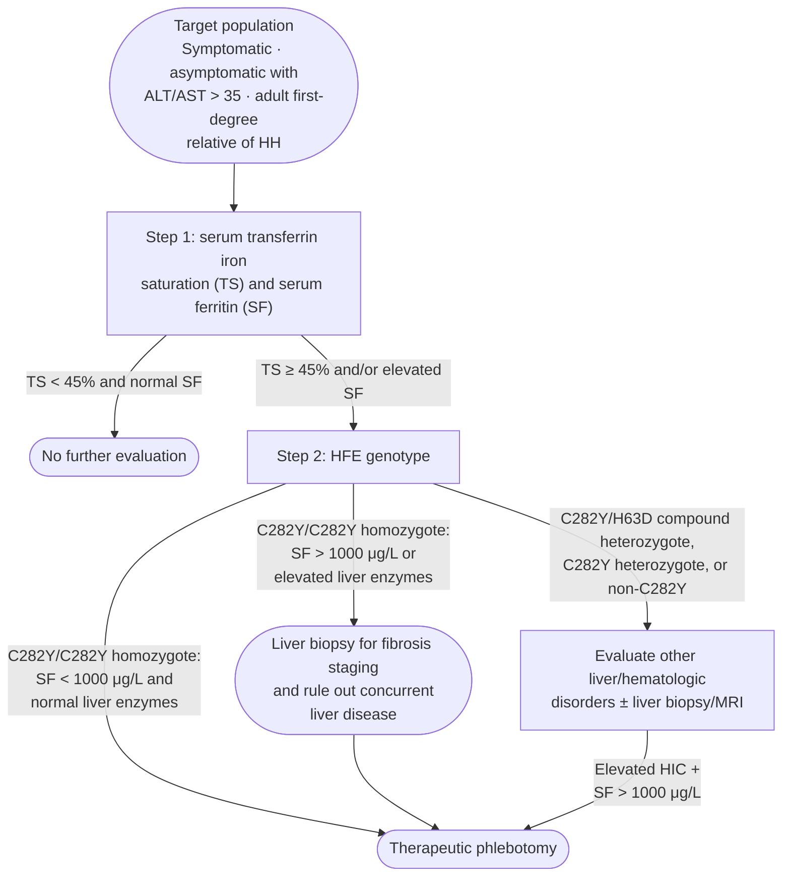

## Contents
- [[#Assessment]]
  - [[#Establishing the Diagnosis]]
  - [[#Severity Assessment]]
  - [[#Classification / Typing]]
- [[#Differential Diagnosis]]
- [[#Diagnostics]]
  - [[#Initial Iron Studies (Step 1)]]
  - [[#HFE Genotyping (Step 2)]]
  - [[#Liver Biopsy]]
  - [[#Magnetic Resonance Imaging (MRI)]]
  - [[#HCC Surveillance]]
- [[#Therapeutics]]
  - [[#When to Initiate Treatment]]
  - [[#Phlebotomy (First-Line)]]
  - [[#Iron Chelation]]
  - [[#Erythrocytapheresis]]
  - [[#Proton Pump Inhibitors]]
  - [[#Treatment of Secondary Iron Overload]]
  - [[#Liver Transplantation]]
  - [[#Monitoring]]
  - [[#Prognosis]]
- [[#See Also]]
- [[#Sources]]

## Assessment

### Establishing the Diagnosis

**Definition:** hereditary hemochromatosis (HH) = inherited iron overload from deficiency of hepcidin, or decreased binding of hepcidin to ferroportin → excessive intestinal iron absorption and progressive organ iron deposition ([[acg-2019-hereditary-hemochromatosis]]). Hepcidin/ferroportin physiology: [[iron-overload-and-iron-metabolism]].

**Who to test:**

- Symptomatic patients, asymptomatic patients with elevated alanine aminotransferase (ALT)/aspartate aminotransferase (AST), and adult first-degree relatives of a patient with HH → serum transferrin saturation (TS) + serum ferritin (SF) ([[acg-2019-hereditary-hemochromatosis]])
- All patients with abnormal liver chemistries in the absence of acute hepatitis → serum iron, TS, SF; *HFE* genotyping if TS ≥45% and/or SF elevated ([[acg-2017-liver-chemistries]], Rec 7, strong/very low)

**Manifestations by organ:**

| Organ | Manifestations |
|---|---|
| Liver | Elevated liver enzymes, hepatomegaly, fibrosis, [[cirrhosis]], [[hepatocellular-carcinoma\|hepatocellular carcinoma (HCC)]] |
| Endocrine | Hyperglycemia, diabetes mellitus, hypogonadism, testicular atrophy, amenorrhea, loss of libido, hypopituitarism |
| Joints | Arthralgia, arthritis, chondrocalcinosis — predominantly 2nd/3rd metacarpophalangeal (MCP) joints; hook-shaped osteophyte of the metacarpal head |
| Skin | Hypermelanotic pigmentation (bronze skin) |
| Heart | Cardiomyopathy, arrhythmias, heart failure |

- Fatigue + arthralgias are the most common early symptoms; men present in the 4th–5th decade, women usually postmenopausal
- Penetrance is incomplete — biochemical (elevated TS ± SF) ~75% of men and ~50% of women, but clinically manifest iron-overload disease only 28.4% of men and 1.2% of women

**Hepatic iron distribution** (Perls' Prussian blue stain):

| Disorder | Where the iron is |
|---|---|
| *HFE*-related (type 1), juvenile (type 2), *TFR2* (type 3) | Periportal hepatocytes, little or no Kupffer cell iron; spreads midzonal then centrilobular as accumulation continues |
| Ferroportin disease (type 4) | Preferentially Kupffer cells |
| Secondary iron overload | Kupffer and reticuloendothelial cells, sparse hepatocyte iron, no periportal-to-pericentral gradient |

- Magnetic resonance imaging (MRI) makes the same distinction non-invasively: splenic iron deposition is **absent** in *HFE*-related HH, **present** in ferroportin disease and secondary iron overload

### Severity Assessment

- SF **>1,000 ng/mL** in a C282Y homozygote → [[liver-biopsy|liver biopsy]] to stage fibrosis
- SF **<1,000 ng/mL** in a C282Y homozygote → biopsy **not** indicated unless a concurrent risk factor for cirrhosis is present; absent such risk factors, <2% have advanced fibrosis or cirrhosis. Biopsy may still be done if exam, labs, or imaging show clinical features of advanced fibrosis
- SF is a more accurate predictor of fibrosis than hepatic iron concentration (HIC). [[liver-stiffness-measurement|Transient elastography]] is not validated in HH — readings did not correlate with SF

> [!pearl] Three findings together, not one, predict cirrhosis
> In C282Y homozygotes, SF >1,000 ng/mL **plus** elevated aminotransferases **plus** a low platelet count predicts cirrhosis in **>80%**; any one alone does not ([[acg-2019-hereditary-hemochromatosis]]). [[aasld-2011-hemochromatosis]] gives the platelet cutoff as <200 × 10⁹/L.

**Histologic criteria for type 1 HH** (hematoxylin and eosin [H&E] + Masson's trichrome + Perls' Prussian blue):

1. Grade 4 stainable iron in hepatocytes with periportal distribution, no stainable iron in Kupffer cells
2. HIC >71 µmol/g dry weight
3. Hepatic iron index (HII = HIC ÷ age in years) >1.9

- **Grade 4 = panlobular iron deposition.** The Batts–Ludwig system grades stainable hepatic iron 1→4 by the proportion and zonal distribution of iron-staining hepatocytes, from zone 1 (periportal) only to inclusion of zones 2 and 3 (pericentral) ([[aasld-2011-hemochromatosis]])
- HII ≥1.9 and/or HIC 71 µmol/g dry weight distinguishes C282Y homozygotes from compound heterozygotes and secondary iron overload

### Classification / Typing

| Type | Gene / mutation | Inheritance | Clinical |
|---|---|---|---|
| 1A | *HFE* C282Y/C282Y | Autosomal recessive (AR) | Most common; arthropathy, skin pigmentation, liver damage, diabetes, hypogonadism, cardiomyopathy |
| 1B | *HFE* C282Y/H63D | AR | Compound heterozygote; same spectrum, penetrance 0.5–2% unless a cofactor is present |
| 1C | *HFE* S65C | AR | Possible rise in serum iron/ferritin; no tissue iron deposition |
| 2A | *HJV* (hemojuvelin) | AR | Juvenile HH; onset <30 y; hypogonadism + cardiomyopathy prevalent |
| 2B | *HAMP* (hepcidin) | AR | Juvenile HH; same phenotype as 2A |
| 3 | *TFR2* | AR | Phenotype as in type 1A |
| 4A | *SLC40A1* (ferroportin), loss of function | Autosomal dominant (AD) | Ferroportin disease; splenic iron deposition very common, lower tolerance of phlebotomy, may have anemia |
| 4B | *SLC40A1*, resistance to hepcidin | AD | Fatigue, joint pain |

- **H63D or S65C without C282Y does not cause pathologic iron overload** — counsel accordingly ([[acg-2019-hereditary-hemochromatosis]], Rec 3, conditional/very low)
- Non-*HFE* disease is very rare (hemojuvelin iron overload ~1 in 5–6 million) — consider at age <30 y or with endocrine/cardiac presentation and no *HFE* mutation

## Differential Diagnosis

*Workup: see [[abnormal-liver-chemistries]].*

| Cause | Clue |
|---|---|
| [[alcohol-associated-liver-disease\|Alcohol use disorder (AUD)]] | Ethanol downregulates the transcription factor regulating hepcidin → raised SF, TS and hepatic iron |
| [[nafld-masld\|Nonalcoholic fatty liver disease (NAFLD)]] / dysmetabolic iron overload syndrome | High SF with **normal serum iron**; hepcidin downregulated by insulin resistance |
| [[hepatitis-c\|Hepatitis C]] | 30–40% have elevated serum iron, SF and TS |
| Other chronic liver disease | Porphyria cutanea tarda, [[chronic-hepatitis-b\|hepatitis B]] |
| Iron-loading anemias | Thalassemia major, hemoglobin H, chronic hemolytic and sickle cell anemia, aplastic anemia, pyruvate kinase deficiency, hereditary spherocytosis |
| Parenteral iron overload | Red blood cell (RBC) transfusions, iron-dextran injections, long-term hemodialysis |
| Chronic inflammation / malignancy | Systemic lupus erythematosus, rheumatoid arthritis; HCC, breast and hematologic malignancy |
| Non-*HFE* HH | Juvenile HH (age <30 y, cardiomyopathy + hypogonadism); *TFR2*; ferroportin disease (splenic iron, may have anemia); African iron overload |
| Miscellaneous | Aceruloplasminemia, congenital atransferrinemia, neonatal iron overload |

> [!pitfall] A high ferritin is usually not hemochromatosis
> Among patients with an elevated SF who are **not** C282Y homozygotes, AUD and NAFLD are far more common than HH ([[acg-2019-hereditary-hemochromatosis]]). SF is an acute-phase reactant and rises without increased iron stores in necroinflammatory liver disease and chronic inflammation; an elevation during acute hepatitis likely does not mean iron overload ([[acg-2017-liver-chemistries]], [[aasld-2011-hemochromatosis]]).

## Diagnostics

### Initial Iron Studies (Step 1)

**Transferrin saturation** — preferred initial screening test; fasting not required.

- TS ≥45% → proceed to *HFE* genotyping
- TS **>45%** identifies **97.9–100%** of C282Y homozygotes
- TS = serum iron ÷ total iron-binding capacity (TIBC) × 100. Unsaturated iron-binding capacity (UIBC) is the inverse and performs comparably: **UIBC <26 µmol/L**, sensitivity 90% and specificity 90% for C282Y homozygosity

**Serum ferritin** — excellent predictor of advanced fibrosis, poor specificity as a screening test.

- Normal SF = **<200 ng/mL** (premenopausal women) or **<300 ng/mL** (men and postmenopausal women); combined with TS <45%, negative predictive value (NPV) **97%** for excluding iron overload
- SF **>2,000 ng/mL** at diagnosis marks particularly high risk (see [[#Prognosis]])

> [!pitfall] A normal transferrin saturation does not exclude iron overload
> Younger patients at an earlier stage may sit below 45%, and iron overload can run with an elevated SF and a *normal* TS — particularly non-*HFE*-related overload ([[acg-2019-hereditary-hemochromatosis]]). Do not stop at a normal TS if the SF is high.

*Diagnosis and treatment of hereditary hemochromatosis*
*Source: redrawn from the ACG 2019 hereditary hemochromatosis diagnosis and treatment algorithm*
*[[acg-2019-hereditary-hemochromatosis|ACG 2019 Hereditary Hemochromatosis Guideline]]*
*ALT = alanine aminotransferase · AST = aspartate aminotransferase · HH = hereditary hemochromatosis · TS = transferrin saturation · SF = serum ferritin · HFE = homeostatic iron regulator gene · MRI = magnetic resonance imaging · HIC = hepatic iron concentration*

### HFE Genotyping (Step 2)

- Standard clinical panel: C282Y, H63D, S65C
- C282Y/C282Y or C282Y/H63D → type 1 HH
- Against further genetic testing in iron overload negative for C282Y **and** H63D (Rec 4, conditional/very low) — exclude AUD and NAFLD first, which are far more common; sequence non-*HFE* genes only in atypical cases (younger patient with endocrine or cardiac involvement)

**Family screening:**

- Screen family members, particularly first-degree relatives, of every patient diagnosed with HH (Rec 1, strong/moderate); [[aasld-2011-hemochromatosis]] does genotype (*HFE*) and phenotype (TS + SF) simultaneously at one visit
- Adult relative who is homozygous or compound heterozygous with raised SF → start phlebotomy; SF normal → yearly iron studies
- **Children of a proband:** test the other parent first — normal → the child is an obligate heterozygote and needs no further testing. Other parent untestable → do not test the child until age 18 y (manifestations rarely present before then)

### Liver Biopsy

**Indications:**

- C282Y homozygote with SF >1,000 ng/mL — stage fibrosis and exclude concurrent liver disease
- Clinical features of advanced fibrosis on exam, labs, or imaging at any SF
- Compound heterozygote or H63D homozygote, particularly with SF >1,000 ng/mL — rule out secondary liver disorders, measure HIC and fibrosis stage
- Non-C282Y homozygote with elevated HIC + SF >1,000 ng/mL
- Preferred over MRI whenever fibrosis staging or evaluation for alternate liver disease is also needed

> [!pitfall] A normal hepatic iron index does not exclude hemochromatosis
> [[aasld-2011-hemochromatosis]] abandoned the HII because phenotypic C282Y homozygosity occurs at much lower HIC and HII than the historic thresholds. [[acg-2019-hereditary-hemochromatosis]] (newer, and what this page follows) still lists HII >1.9 — use it to *support* a diagnosis, never to rule one out.

### Magnetic Resonance Imaging (MRI)

- Non-contrast MRI T2* with HIC-estimation software for non-invasive HIC measurement in the **non-C282Y homozygote** when liver biopsy is not otherwise required (Rec 5, conditional/low)
- Distinguishes *HFE*-related HH from ferroportin disease and secondary iron overload by splenic iron
- Better at ruling out than confirming iron overload — NPV 0.83–0.88 vs positive predictive value (PPV) 0.74–0.81 (meta-analysis, 20 studies, n=819)
- Not validated for fibrosis staging

### HCC Surveillance

- HH + cirrhosis → ultrasound (US) ± alpha-fetoprotein (AFP) every 6 months, the same as cirrhosis of any cause ([[hcc-surveillance]])
- **Continue surveillance after iron depletion is complete** — HCC can develop years after successful iron removal
- Against routine HCC surveillance in HH with **stage 3 fibrosis or less** (Rec 2, conditional/very low); there are no data on screening without cirrhosis. [[aasld-2011-hemochromatosis]] screened advanced fibrosis as well as cirrhosis — follow the newer ACG position

## Therapeutics

### When to Initiate Treatment

**C282Y homozygotes:**

- Treat when SF is elevated — **>300 ng/mL in men, >200 ng/mL in women** — along with **TS ≥45%**
- SF within normal limits at diagnosis → unlikely to develop clinically relevant iron overload later; monitor with serial aminotransferases and SF
- SF <1,000 ng/mL is unlikely to represent end-organ damage, but treat anyway: **13–35% of untreated men and 16–22% of untreated women progress to SF >1,000 ng/mL**

**C282Y/H63D compound heterozygotes and H63D homozygotes:**

- Risk of clinically relevant iron overload is low on genotype alone; fibrosis develops mainly with cofactors (NAFLD, diabetes, excess alcohol) — **evaluate and treat those cofactors before considering iron removal**
- Elevated HIC on biopsy → iron removal can be considered

### Phlebotomy (First-Line)

First-line treatment for C282Y homozygotes and C282Y/H63D compound heterozygotes (Rec 6, strong/moderate).

| Phase | Regimen | Monitoring | Target |
|---|---|---|---|
| Induction | 500 mL whole blood weekly; up to **1,000 mL** if tolerated to expedite iron removal; smaller volume or longer interval if not tolerated (lengthens treatment) | Hemoglobin before and during treatment — keep **>11 g/dL**; SF **monthly** | SF **50–100 ng/mL** |
| Maintenance | **3–4 phlebotomies/year** | See [[#Monitoring]] | SF near **50 ng/mL** |

- [[aasld-2011-hemochromatosis]] adds: one 500 mL unit removes ~200–250 mg of iron, so stores >30 g may need **2–3 years** of induction; keep the hematocrit/hemoglobin from falling >20% below the prior level; individualise maintenance (monthly to 1–2 units/year — not every patient reaccumulates iron); do not drive the patient to iron deficiency
- **No dietary iron restriction needed** — eliminating red meat is unnecessary, though a systematic review suggested dietary iron restriction may reduce the blood removed by 0.5–1.5 L
- **Avoid vitamin C and iron supplements** — ascorbic acid increases iron absorption. Avoid raw shellfish (*Vibrio vulnificus*) ([[aasld-2011-hemochromatosis]])
- Blood donation: many blood banks decline blood from patients with HH, but phlebotomy does not medically prevent a patient from being a donor

**What iron depletion does and does not fix:**

| Improves | Does not improve |
|---|---|
| Liver fibrosis (mainly mild-to-moderate at baseline) and [[portal-hypertension\|portal hypertension]]; abnormal liver tests | Established cirrhosis |
| Cardiomyopathy | Arthropathy — may progress despite treatment, though some report diminished arthralgias |
| Skin pigmentation (slowly regresses) | Diabetes |
| Fatigue and quality of life (randomized trial vs sham) | Hypogonadism (in most cases) |

### Iron Chelation

- **Against** chelation as first-line therapy for HH (Rec 7, strong/low)
- **For** chelation when the patient is intolerant or refractory to phlebotomy, or when phlebotomy has potential for harm — severe anemia, congestive heart failure (Rec 8, strong/low)
- All three agents are approved for **secondary** iron overload; use in HH is **off-label**

| Agent | Route | Dose | Notable toxicity |
|---|---|---|---|
| Deferoxamine | Subcutaneous or intravenous infusion | 20–60 mg/kg over 8–24 h, 5–7×/week | Retinopathy, auditory toxicity |
| Deferiprone | Oral | 75–100 mg/kg/d in 3 divided doses | Neutropenia, agranulocytosis |
| Deferasirox | Oral | 5–15 mg/kg/d in the HH trials | Gastrointestinal (GI) upset, rash, aminotransferase elevation, renal toxicity (>10%) |

- Deferasirox dose-ranging trial (n=49): SF fell 63.5%, 74.8% and 74.1% at 48 weeks on 5, 10 and 15 mg/kg/d, with more aminotransferase and creatinine elevation at 15 mg/kg/d

### Erythrocytapheresis

- Returns plasma proteins, clotting factors and platelets — particularly useful with hypoproteinemia or thrombocytopenia
- Removes up to **1,000 mL of RBCs per procedure** vs 200–250 mL with phlebotomy; RBC volume removed usually **350–800 mL**
- **Every 2–3 weeks**, depending on hemoglobin; minimum targeted post-procedure hemoglobin **≥10 g/dL**
- Removed RBC volume ≤500 mL → no volume expansion; above that, replace **30% of the removed RBC volume with isotonic saline** during the first procedure
- In maintenance it is equally effective, with fewer procedures (**1.9 vs 3.3**/year) but higher cost
- Adverse reactions relate to the citrate anticoagulant — muscle cramps, paresthesias, nausea

### Proton Pump Inhibitors

- **Against** routine use of [[proton-pump-inhibitors|proton pump inhibitors (PPIs)]] as primary treatment of HH (Rec 9, strong/low)
- Gastric acid releases non-heme iron; PPIs reduce its absorption. Randomized controlled trial (RCT) in 30 C282Y homozygotes, phlebotomy whenever SF >100 ng/mL: pantoprazole 40 mg/d for 12 months gave a median **1.3 procedures vs 2.6 on placebo** (P=0.005)
- A PPI taken for another indication may incidentally reduce phlebotomy burden — not a reason to start one

### Treatment of Secondary Iron Overload

- **Iron-loading anemias** — chelation preferred over phlebotomy, which risks exacerbating the anemia. In non–transfusion-dependent iron-loading anemias (e.g. thalassemia intermedia) SF underestimates HIC: treat above **SF >800 ng/mL**
- **AUD** — screen all patients and counsel abstinence rather than proceeding to iron removal
- **Hepatitis C and NAFLD** — indications remain controversial. Phlebotomy improved virologic response to interferon-based therapy, far less relevant with [[direct-acting-antivirals|direct-acting antivirals]]; in NAFLD it lowered SF but did not improve ALT, hepatic fat, or insulin resistance

### Liver Transplantation

- [[liver-transplantation|Liver transplantation (LT)]] for patients with HH who have decompensated cirrhosis or HCC (Rec 10, strong/low)
- LT normalizes hepcidin levels and iron metabolism; recent series show 1- and 5-year survival similar to other etiologies
- Iron depletion before transplant is preferred and should not be deferred where general health permits — but **inability to de-iron preoperatively is not a contraindication** to transplantation

### Monitoring

- **Maintenance:** SF and TS every 3–6 months; once stable, can extend to annually
- **Liver:** US ± AFP every 6 months once cirrhotic, continued indefinitely
- **Joints:** radiographs of the 2nd/3rd MCP joints (hook-shaped osteophyte); symptoms may progress despite treatment
- **Endocrine:** testosterone / luteinizing hormone / follicle-stimulating hormone if hypogonadism is suspected; glucose and hemoglobin A1c for diabetes
- **Cardiac:** electrocardiography/echocardiography for symptoms or SF >1,000 ng/mL — cardiovascular deaths occurred predominantly above that level

### Prognosis

- **Cirrhosis at diagnosis is the critical determinant.** Without cirrhosis, survival does not differ from the general population; with cirrhosis it is significantly reduced, and HCC accounts for as much as **45% of deaths**
- **SF >2,000 ng/mL** at diagnosis: standardized mortality ratio nearly **24** for liver disease, **49** for liver cancer
- Alcohol **>60 g/d** increases cirrhosis risk **9-fold**; >80 g/d significantly reduces survival. Tobacco smoking also worsens iron overload

## See Also

[[abnormal-liver-chemistries]], [[alcohol-associated-liver-disease]], [[nafld-masld]], [[autoimmune-hepatitis]], [[drug-induced-liver-injury]], [[hepatocellular-carcinoma]], [[hcc-surveillance]], [[hepatitis-c]], [[chronic-hepatitis-b]], [[iron-overload-and-iron-metabolism]], [[liver-transplantation]], [[liver-biopsy]], [[liver-stiffness-measurement]], [[noninvasive-liver-disease-assessment]], [[cirrhosis]], [[portal-hypertension]], [[direct-acting-antivirals]], [[proton-pump-inhibitors]]

---

## Sources

1. [[acg-2019-hereditary-hemochromatosis|ACG 2019: Hereditary Hemochromatosis]]
2. [[acg-2017-liver-chemistries|ACG 2017: Evaluation of Abnormal Liver Chemistries]]
3. [[aasld-2011-hemochromatosis|AASLD Practice Guideline: Diagnosis and Management of Hemochromatosis (2011)]]
