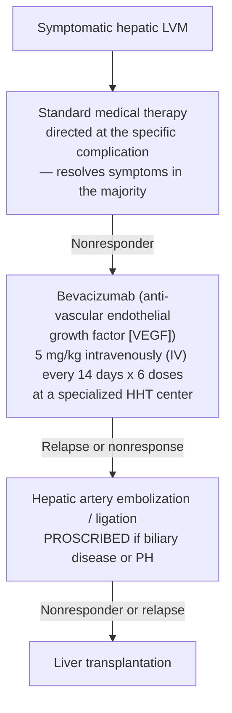

## Contents
- [[#Assessment]]
  - [[#Establishing the Diagnosis]]
  - [[#Severity Assessment]]
- [[#Differential Diagnosis]]
- [[#Diagnostics]]
  - [[#Liver Vascular Malformations]]
  - [[#Extrahepatic AVM Screening (SMAD4 Carriers)]]
- [[#Therapeutics]]
  - [[#Standard Therapy — by Presentation]]
  - [[#Targeted Therapy — Escalation Ladder]]
  - [[#GI Bleeding in HHT]]
- [[#See Also]]
- [[#Sources]]

## Assessment

Hereditary hemorrhagic telangiectasia (HHT) (Osler-Weber-Rendu disease) — autosomal dominant disorder of widespread cutaneous, mucosal, and visceral telangiectases. ([[acg-2020-hepatic-mesenteric-circulation]])

- Prevalence **1 in 5,000–8,000**
- Genetics: ≥80% have a heterozygous mutation in **endoglin (*ENG*)** or **activin receptor-like kinase type 1 (*ALK-1* / *ACVRL1*)** — TGF-β family receptors expressed in vascular endothelium. ***SMAD4*** mutation → combined **HHT + [[juvenile-polyposis-syndrome|juvenile polyposis]]** syndrome

| Genotype label | Gene | Note |
|---|---|---|
| **HHT-1** | ***ENG*** (endoglin) | — |
| **HHT-2** | ***ACVRL1*** (*ALK-1*) | The subtype in which **symptomatic liver involvement is more common** |
| **JP-HHT** | ***SMAD4*** | Combined HHT + [[juvenile-polyposis-syndrome\|juvenile polyposis]] |

- **Liver vascular malformations (LVMs)** on imaging in **55%** of patients with definite HHT (3 large cohorts). Symptomatic liver involvement is more common in **HHT-2** (see genotype table above)

**Three shunt types** (dual hepatic blood supply), each with a different clinical presentation:

| Shunt | Typical presentation |
|---|---|
| Hepatic artery → hepatic vein (**most common**) | High-output heart failure (HOHF) |
| Hepatic artery → portal vein | [[portal-hypertension\|Portal hypertension]] — [[ascites]], varices, variceal hemorrhage |
| Porto-venous | Portosystemic [[hepatic-encephalopathy\|encephalopathy]] |

Other presentations: **biliary ischemia** (secondary sclerosing cholangitis, bilomas) and **mesenteric ischemia** (post-prandial pain from hepatic artery steal). Symptoms can **transition between presentations** (e.g. HOHF → biliary ischemia) and can be precipitated by anemia from gastrointestinal (GI) bleed/epistaxis.

### Establishing the Diagnosis

**Two routes to the diagnosis** ([[hht-2020-second-international-guidelines]] G1): **the Curaçao criteria, or identification of a causative mutation.** **One or more Curaçao criteria should prompt consideration of the diagnosis** (G2). An **asymptomatic child of a parent with HHT is considered to have possible HHT unless excluded by genetic testing** (G3).

**The Curaçao criteria** ([[shovlin-2000-curacao-criteria]]) — count the four; **3 or more = definite · 2 = possible or suspected · fewer than 2 = unlikely**.

| # | Criterion | As specified |
|---|---|---|
| **1** | **Epistaxis** | **Spontaneous, recurrent** nose bleeds |
| **2** | **Telangiectases** | **Multiple**, at characteristic sites — **lips, oral cavity, fingers, nose** |
| **3** | **Visceral lesions** | GI telangiectasia (± bleeding) · **pulmonary**, **hepatic**, **cerebral** or **spinal** AVM |
| **4** | **Family history** | A **first-degree relative** with HHT by these criteria |

- **No numeric threshold for epistaxis** — it need only be **spontaneous and on more than one occasion**; night-time bleeds are particularly suspicious. Telangiectases are defined by **site, not count**.
- **Anemia alone does not contribute** to the diagnosis.
- **Exclude a coagulation disorder** before counting criteria.
- **Within a known HHT family**, a firm diagnosis can rest on **two separate visceral manifestations** — this does **not** apply to the general population.

> [!pitfall] "Unlikely" does not mean unlikely in a child
> Fewer than two criteria rules HHT unlikely **in an adult only** — penetrance is age-dependent and the disease may not manifest until late in life, so every offspring of an affected person stays at risk. That is why G3 above treats an asymptomatic child of an affected parent as **possible HHT until genetic testing excludes it** ([[shovlin-2000-curacao-criteria]], [[hht-2020-second-international-guidelines]]).

**Genetic testing** ([[hht-2020-second-international-guidelines]] G4–G5, all level III, weak):

- **Refer for diagnostic genetic testing** to (1) identify the causative mutation in a family with clinically confirmed HHT; (2) establish a diagnosis in relatives of a person with a known causative mutation — both asymptomatic/minimally symptomatic individuals and those desiring prenatal testing; (3) assist in establishing the diagnosis in individuals who **do not meet clinical diagnostic criteria**
- Test an **affected family member first** to determine the causative mutation, before testing an asymptomatic child who does not meet the Curaçao criteria
- Negative for ***ENG*** and ***ACVRL1*** coding-sequence mutations → **consider *SMAD4* testing**
- A causative mutation is found in **97%** of patients with a definite clinical diagnosis

Routes into the diagnosis sourced from the GI/hepatology guidelines:

- **Via *SMAD4* genetics** — a *SMAD4* mutation carries [[juvenile-polyposis-syndrome|juvenile polyposis syndrome (JPS)]]–HHT overlap. Every *SMAD4* carrier must be screened for HHT, **including a cardiovascular exam** ([[acg-2015-hereditary-gi-cancer]]) — the test-by-test protocol is under [[#Extrahepatic AVM Screening (SMAD4 Carriers)]]. JPS is caused by *SMAD4* or *BMPR1A* mutations (~60% of clinically defined JPS); evaluate for both ([[aga-2022-hamartomatous-polyposis]])
- **Via clinical signs of LVM** — audible **bruit** and/or palpable **thrill** over the liver, and/or abnormal liver tests (typically ↑**alkaline phosphatase**, occasionally ↑bilirubin and/or aminotransferases). These findings are what convert a "don't screen" patient into a "do image" patient (see [[#Diagnostics]])

### Severity Assessment

- **Liver** severity is defined **functionally, not by a score** — management keys off whether LVMs are *symptomatic* vs asymptomatic, and off failure of standard medical therapy. No graded severity classification for HHT liver disease is given
- **HHT-related GI bleeding does have a graded severity framework** (mild / moderate / severe, keyed to iron requirement) — it lives under [[#GI Bleeding in HHT]], where it selects the treatment
- Natural history anchors: symptomatic LVMs occur **only in adults**, mean age **~48 y** at presentation (youngest reported 21 y); **8%–14%** of patients with definite HHT + LVM are symptomatic at HHT diagnosis; **~3.5% per year** of asymptomatic patients develop overt symptoms; 5% died over a median 44 months' follow-up (median age at death 75 y)
- Except for portal hypertension, presentations occur **predominantly in women**. Pregnancy with HHT + LVM can trigger severe heart failure and/or biliary ischemia ("hepatic disintegration syndrome")

## Differential Diagnosis

*Workup: see [[small-bowel-bleeding]] for the diagnostic approach to the GI bleeding presentation.*

- [[angioectasia]] — sporadic GI angioectasias produce the same bleeding phenotype without the arteriovenous malformation (AVM)/telangiectasia syndrome
- **[[cirrhosis]] — the key mimic on histology.** [[porto-sinusoidal-vascular-disorder|Nodular regenerative hyperplasia (NRH)]] is a frequent finding in HHT liver, and the combination of regeneration plus fibrosis around ectatic vessels leads to an **erroneous diagnosis of cirrhosis**
- **[[focal-nodular-hyperplasia|Focal nodular hyperplasia]]** — more common in HHT (prevalence **2.9%** vs **0.3%** in the general population). There are **no reports of [[hepatocellular-carcinoma\|hepatocellular carcinoma (HCC)]]** arising in a liver with LVMs
- Other vascular disorders of the hepatic circulation covered by the same guideline: [[budd-chiari-syndrome]], [[portal-vein-thrombosis]], [[mesenteric-artery-aneurysm]]

> The guideline does not provide a formal differential diagnosis for HHT; the entries above are the adjacent/mimicking entities it addresses.

## Diagnostics

### Liver Vascular Malformations

| Setting | Recommendation | Strength | Evidence |
|---|---|---|---|
| **Asymptomatic HHT** | **Do NOT** routinely screen for LVMs — no evidence that diagnosing an asymptomatic patient benefits outcome or prevents death | Strong | Low |
| **Adults with definite or suspected HHT** | **Offer screening for liver VMs** — *the opposing position; see the note below* | Weak | Low |
| Liver **bruit**, hyperdynamic circulation, **or abnormal liver tests** | Evaluate further for LVMs (exception to the no-screening rule) | Strong | Low |
| Pregnancy with known HHT + LVM | Warrants **special attention** — anticipated hemodynamic stress | Strong | Low |
| Symptoms/signs of **heart failure, biliary ischemia, [[hepatic-encephalopathy\|hepatic encephalopathy]], mesenteric ischemia, or portal hypertension (PH)** | Contrast **computed tomography (CT)** or **[[mri-mrcp\|magnetic resonance imaging (MRI)/magnetic resonance cholangiopancreatography (MRCP)]]** | Strong | Low |
| — | **Doppler ultrasound (US)** may establish the diagnosis with a compatible clinical picture, but is **less accurate** than CT or MRI/MRCP | Strong | Low |
| — | **Angiography and [[liver-biopsy\|liver biopsy]] are NOT recommended** for diagnosing LVMs | Strong | Low |

*(rows 1 and 3–6: [[acg-2020-hepatic-mesenteric-circulation]] recs 21–22. Row 2: [[hht-2020-second-international-guidelines]] D1.)*

> **Two tier-1 guidelines disagree on screening the asymptomatic patient, and neither supersedes the other** — both were published in **2020** (ACG: *Am J Gastroenterol* 2020;115:18–40; HHT: *Ann Intern Med* 2020;173:989–1001), so publication date does not settle it. ACG recommends **against** routine screening, holding that no evidence shows benefit to outcome or mortality. The HHT guideline **offers** screening, with two qualifiers worth weighing: its stated rationale is partly to **improve subsequent management or confirm the HHT diagnosis** rather than to change hard outcomes, and where Doppler ultrasonography is unavailable the "screen" may be **clinical** — history, physical examination, and blood work.

- **Doppler ultrasound is the imaging test of choice when screening** ([[hht-2020-second-international-guidelines]] D1) — accuracy, safety, tolerability, low cost. **Doppler severity grading predicted outcomes**; **anicteric cholestasis, present in one third of patients with liver VMs, correlated with LVM severity and complications**
- **Symptoms or signs of complicated liver VMs** — heart failure, pulmonary hypertension, abnormal cardiac biomarkers, abnormal liver function tests, abdominal pain, portal hypertension, or encephalopathy → **Doppler ultrasound, multiphase contrast CT, or contrast abdominal MRI** (D2; strong, high). **Avoid contrast CT and MRI if kidney dysfunction is present**

- **Hallmark imaging findings:** intrahepatic hypervascularization (telangiectases) + **enlarged common hepatic artery (>6–7 mm)**. More obvious in symptomatic patients
- **CT angiography (CTA) or magnetic resonance angiography (MRA)** are the most-used methods, with no difference in diagnostic accuracy
- Shunt type is determinable in **>2/3** of LVM patients by early/differential enhancement of hepatic veins (arteriovenous) or portal veins (arterioportal) across imaging phases. Arterioportal shunting is more frequent in patients presenting with PH, but CT findings do not correlate with clinical presentation; **porto-venous shunts are difficult to diagnose** noninvasively
- Liver biopsy is additionally hazardous (bleeding risk from widespread LVMs) and unhelpful — histology can produce a false diagnosis of cirrhosis

### Extrahepatic AVM Screening (SMAD4 Carriers)

The liver rules above are **not** the whole surveillance program. [[aga-2022-hamartomatous-polyposis]] (weak recommendation, low quality of evidence): patients with a ***SMAD4*** pathogenic variant should be **clinically evaluated for HHT at the time of [[juvenile-polyposis-syndrome|JPS]] diagnosis**, including screening for and appropriate management of **cerebral and pulmonary AVMs**. The screening schedule it reproduces (HHT Foundation International):

| Target | Test | Timing |
|---|---|---|
| **Cerebral AVM** | **Brain MRI with and without contrast** | At **birth or at the time of diagnosis**; children with possible or confirmed HHT get **≥1 follow-up MRI at puberty** — brain AVM development correlates with times of growth |
| **Pulmonary AVM** | **Pulse oximetry**, with consideration of transthoracic contrast echocardiogram | At diagnosis, then **every 3–5 years** |
| **Pulmonary AVM** | **Transthoracic contrast echocardiogram** | At diagnosis; **within the 5 years preceding a planned pregnancy**; **after pregnancy**; otherwise **every 5–10 years** |
| **Anemia** (telangiectasia bleeding) | **Hemoglobin or hematocrit** | **Annually in adulthood, in all patients older than 35 years** |

- Consider referral to an **HHT Center of Excellence** for this evaluation ([[aga-2022-hamartomatous-polyposis]])
- Anemia is not incidental here — it **precipitates and worsens** the hepatic presentations (see [[#GI Bleeding in HHT]])

## Therapeutics

**No treatment for asymptomatic LVMs.** Treatment of symptomatic LVMs is directed at the **specific presentation** and has a high rate of complete response. ([[acg-2020-hepatic-mesenteric-circulation]] Key Concept 28)

### Standard Therapy — by Presentation

| Presentation | Standard therapy |
|---|---|
| **HOHF** | Sodium restriction, **diuretics**, **beta-blockers**; correct **anemia** and **atrial fibrillation** (both worsen symptoms by ↓O₂ delivery / ↓cardiac output). Pregnant patients: treat medically and **deliver as expeditiously as possible** |
| **[[portal-hypertension\|Portal hypertension]]** | Treat the specific complications ([[ascites]], varices, [[variceal-upper-gi-bleeding\|variceal hemorrhage]]) as for [[cirrhosis]]. **[[tips\|Transjugular intrahepatic portosystemic shunt (TIPS)]] does NOT ameliorate bleeding from GI arteriovenous malformations** |
| **Secondary sclerosing cholangitis** | [[ursodeoxycholic-acid\|Ursodeoxycholic acid]] may be used — **no data support this** |
| **Biloma** | No treatment if asymptomatic; analgesics if painful; **urgent antibiotics** if [[acute-cholangitis\|cholangitis]] or infected biloma; drainage if pain/infection not improving |
| **Mesenteric ischemia** | Smaller, more frequent meals + analgesics |

### Targeted Therapy — Escalation Ladder

For nonresponders to standard therapy, escalate **least-invasive first**, at a **specialized center with a multidisciplinary approach**. Evidence is case reports/small series (conditional recommendation, low level of evidence — rec 23).

- **Bevacizumab** — consider in **HOHF**, and possibly other LVM complications, **before invasive therapies**; not all patients respond
  - Dose used in the prospective HOHF cohort: **5 mg/kg IV every 14 days × 6 doses** (n=24: cardiac index normalized in 12%, improved but not normalized in 71%, no response in 17%). In an ischemic-cholangiopathy case series the same dose was followed by **maintenance infusion every 3 months for 12 months**
  - **Symptoms recur after discontinuation** — gradually, at intervals of **5–26 months**, requiring repeat dosing; **14%** were nonresponders needing more invasive therapy
  - Side effects: arthralgias, headache, proteinuria, arterial hypertension, **poor wound healing** (a concern for post-transplant complications if transplanted while on drug)
- **Hepatic artery occlusion (embolization or surgical ligation)** — rational for HOHF and mesenteric angina, but the effect is **mostly transient** with significant morbidity/mortality from biliary and/or hepatic necrosis (death or urgent transplant in up to **30%**). **Proscribed in patients with biliary disease and in patients with PH** ([[acg-2020-hepatic-mesenteric-circulation]])
  - **[[hht-2020-second-international-guidelines]] D8 goes further and avoids embolization in *any* patient with liver VMs** — only a temporizing procedure, associated with significant morbidity and mortality (level III, strong). The broader prohibition is the HHT-specific position; the ACG carve-out is narrower
- **IV bevacizumab for symptomatic high-output cardiac failure** that has not responded sufficiently to first-line management ([[hht-2020-second-international-guidelines]] D5; strong, moderate) — clinical or cardiac-output improvement in **80%** of patients with severe liver VMs, but an **adverse-event rate of 50 per 100 person-years, including 1 probably drug-related fatal event**
- **Comanagement is specified** for HHT patients with high-output cardiac failure *and* pulmonary hypertension: an HHT Center of Excellence **plus** an HHT cardiologist or a pulmonary hypertension specialty clinic (D3). Symptomatic liver VMs get **at least annual follow-up**
- **[[liver-transplantation|Liver transplantation]]** — an important option for nonresponders to standard treatment or relapse after medical treatment
  - **Refer for consideration of transplantation** when liver VM complications are symptomatic — specifically **refractory high-output cardiac failure, biliary ischemia, or complicated portal hypertension** ([[hht-2020-second-international-guidelines]] D6; strong, moderate)
  - **Pulmonary hypertension does not automatically exclude transplantation: it can be undertaken if pulmonary vascular resistance, estimated by right heart catheterization, is <3 Woods units** (D3 commentary). Timing of listing is based on prognostic predictors and complication severity
  - **Listing criteria are otherwise not clearly defined**
  - Largest series (n=40, European Liver Transplant registry): 1-, 5-, and 10-year patient and graft survival **82.5%**; cardiovascular function improved in 75% and stabilized in the rest
  - **Early complications (within 4 months) in 55%–60%**; 17.5% died during or very early after transplant
  - **LVMs recur in the graft as early as 6 years** after transplant — recurrence in 8/14 (57%) at a mean 127 months; estimated cumulative recurrence risk **48% at 15 years**

### GI Bleeding in HHT

- Recurrent telangiectasia-related bleeding (often gastric/small bowel) is a recognized cause of [[small-bowel-bleeding|small bowel bleeding]]; a detailed dermatologic exam helps identify HHT as the underlying syndrome ([[acg-2015-small-bowel-bleeding]])
- Bleeding-related **anemia can precipitate or worsen** the hepatic presentations (especially HOHF) — correcting it is part of standard LVM therapy
- **[[tips|TIPS]] does not ameliorate bleeding from GI arteriovenous malformations** ([[acg-2020-hepatic-mesenteric-circulation]])

**Diagnostic sequence** ([[hht-2020-second-international-guidelines]] B1–B2):

| Step | Test | Strength / quality |
|---|---|---|
| **First line** for suspected HHT-related bleeding | **EGD** | Strong (low) |
| **Add colonoscopy** if the patient meets colorectal cancer screening criteria, **or has *SMAD4*-HHT** (genetically proven or suspected) | **[[colonoscopy]]** | Strong (low) |
| EGD does **not** reveal significant HHT-related telangiectasia | **[[capsule-endoscopy\|Capsule endoscopy]]** — complementary, not a replacement | Strong (low) |

- Perform EGD **in an experienced center** — unusual intraprocedural complications (such as massive epistaxis) occur, and the precautions for patients with [[#Extrahepatic AVM Screening (SMAD4 Carriers)|pulmonary AVMs]] apply
- Capsule endoscopy is the right next test when **anemia is unexplained by the severity of epistaxis and gastric involvement**, or when EGD findings are negative
- ***SMAD4*-HHT colonoscopy schedule:** start at **age 15 y**, repeat **every 3 y** if no polyps are found, or **annually along with EGD** if colonic polyps are found. Non-*SMAD4* HHT follows general-population [[colorectal-cancer-screening|colorectal cancer screening]]

**Severity grading — this is what selects the drug** ([[hht-2020-second-international-guidelines]] B3; strong, low [expert consensus]):

| Stratum | Definition |
|---|---|
| **Mild** | Meets their **hemoglobin goal** with **oral iron** replacement |
| **Moderate** | Meets their **hemoglobin goal** with **intravenous (IV) iron** treatment |
| **Severe** | **Does not** meet their hemoglobin goal despite adequate iron replacement, **or requires blood transfusions** |

- **Hemoglobin levels are deliberately not specified** — goals reflect the individual patient's age, gender, symptoms, and comorbidities. The classification **applies to patients who have had at least 3 months of iron therapy**

**Treatment by stratum** ([[hht-2020-second-international-guidelines]] B4–B6):

- **Endoscopic [[argon-plasma-coagulation|argon plasma coagulation (APC)]] — use only sparingly** (weak, low [expert consensus]). Best administered **concurrent with the initial endoscopic evaluation** and aimed at **significant 1- to 3-mm nonbleeding lesions**; **repeated sessions are discouraged** to avoid repeated iatrogenic mucosal injury
- **Mild** → consider **oral antifibrinolytics** (weak, low). One case series reported reduced need for endoscopic management with oral tranexamic acid, with a good safety profile
- **Moderate to severe** → consider **IV bevacizumab or other systemic antiangiogenic therapy** (strong, moderate). Small uncontrolled series showed alleviated anemia, reduced transfusion requirements, and improved quality of life

**Iron, transfusion, and anticoagulation** ([[hht-2020-second-international-guidelines]] C1–C6) — see [[iron-deficiency-anemia]] for general management:

- **Test for iron deficiency and anemia in all adults regardless of symptoms**, and in all children with recurrent bleeding and/or symptoms of anemia (strong, high)
- **Oral iron first**, typically **35–65 mg elemental iron once daily, 2 h before or 1 h after meals**; **IV iron** when oral is ineffective, not absorbed, or not tolerated, or when the patient presents with severe anemia (strong, moderate)
- A hemoglobin rise of **<10 g/L is an inadequate response** → try **every-other-day dosing or an alternate oral preparation**. Refractory anemia or severe chronic bleeding → scheduled iron infusions; an initial **total dose of 1 g IV iron** may be given as a single infusion or divided
- **Transfuse** for hemodynamic instability/shock; comorbidities requiring a higher hemoglobin target; need to raise hemoglobin acutely (before surgery, during pregnancy); or inability to maintain adequate hemoglobin despite frequent iron infusions (strong, low)
- **Inadequate response to iron → evaluate for additional causes of anemia** (strong, low): folate, vitamin B₁₂, mean corpuscular volume, thyroid-stimulating hormone, smear, reticulocyte count, hemolysis work-up
- **Anticoagulation and antiplatelet therapy are not contraindicated.** Give them when there is an indication, with consideration of individualized bleeding risk — **bleeding in HHT is not an absolute contraindication** (strong, low). **Unfractionated heparin, low-molecular-weight heparin, and vitamin K antagonists are preferred over direct-acting oral anticoagulants**, which are less well tolerated in HHT
- **Avoid dual antiplatelet therapy, and the combination of antiplatelet therapy with anticoagulation**, where possible (weak, low [expert consensus]); if required, minimize duration and monitor closely

---

## See Also

[[juvenile-polyposis-syndrome]], [[angioectasia]], [[small-bowel-bleeding]], [[capsule-endoscopy]], [[colonoscopy]], [[upper-endoscopy]], [[argon-plasma-coagulation]], [[iron-deficiency-anemia]], [[colorectal-cancer-screening]], [[portal-vein-thrombosis]], [[budd-chiari-syndrome]], [[mesenteric-artery-aneurysm]], [[liver-transplantation]], [[portal-hypertension]], [[mri-mrcp]], [[liver-biopsy]], [[focal-nodular-hyperplasia]], [[cirrhosis]], [[tips]], [[ascites]], [[hepatic-encephalopathy]], [[variceal-upper-gi-bleeding]], [[porto-sinusoidal-vascular-disorder]], [[acute-cholangitis]], [[hepatocellular-carcinoma]]

---

## Sources

1. [[hht-2020-second-international-guidelines|Second International Guidelines for the Diagnosis and Management of Hereditary Hemorrhagic Telangiectasia]]
2. [[acg-2020-hepatic-mesenteric-circulation|ACG Clinical Guideline: Disorders of the Hepatic and Mesenteric Circulation]]
3. [[acg-2015-hereditary-gi-cancer|ACG 2015: Genetic Testing and Management of Hereditary Gastrointestinal Cancer Syndromes]]
4. [[aga-2022-hamartomatous-polyposis|US Multi-Society Task Force Guideline: GI Hamartomatous Polyposis Syndromes (2022)]]
5. [[acg-2015-small-bowel-bleeding|ACG Clinical Guideline: Diagnosis and Management of Small Bowel Bleeding]]
6. [[shovlin-2000-curacao-criteria|Diagnostic Criteria for Hereditary Hemorrhagic Telangiectasia (Rendu-Osler-Weber Syndrome) — the Curaçao Criteria]]
