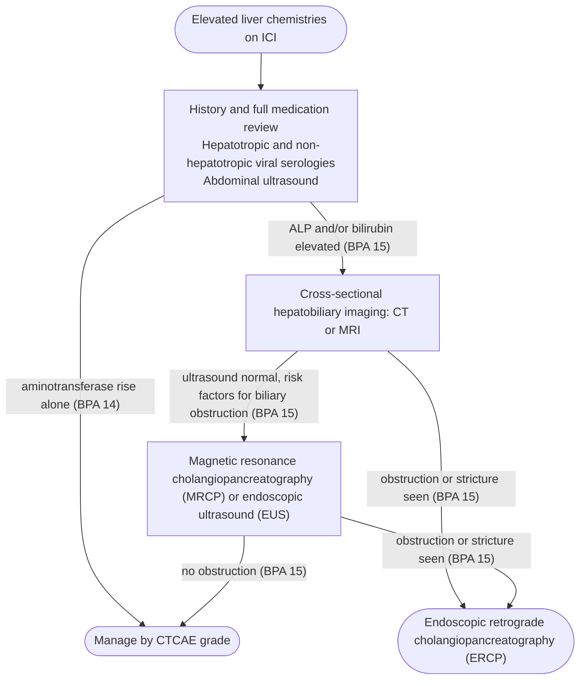

A subtype of [[drug-induced-liver-injury|drug-induced liver injury]] (DILI) with distinct features. Anticancer therapeutics — **particularly immune checkpoint inhibitors** — are among the leading DILI drug classes. [[acg-2021-dili]]

## Contents
- [[#Assessment]]
  - [[#Establishing the Diagnosis]]
  - [[#Severity Assessment]]
- [[#Differential Diagnosis]]
- [[#Diagnostics]]
  - [[#Exclusion Workup]]
  - [[#Liver Biopsy and Histology]]
- [[#Therapeutics]]
  - [[#Grade-Directed Management]]
  - [[#Refractory Disease and Rechallenge]]
- [[#See Also]]
- [[#Sources]]

## Assessment

### Establishing the Diagnosis

Immune checkpoint inhibitor (ICI) hepatotoxicity — **immune-mediated hepatitis (IMH)** — is an **immune-related adverse event (irAE)** of PD-1/PD-L1 inhibitors (nivolumab, pembrolizumab, cemiplimab, atezolizumab, avelumab, durvalumab), the CTLA-4 inhibitor ipilimumab, or combinations. Like all DILI it is a **diagnosis of exclusion** — exclude viral hepatitis, [[autoimmune-hepatitis|autoimmune hepatitis (AIH)]], biliary obstruction, metastases and sepsis, then assess causality. [[acg-2021-dili]] [[aasld-2022-dili]]

**Incidence — combination therapy is the risk multiplier:**

- Liver enzyme elevations in **up to 30%** of patients on an ICI; irAEs of any organ in up to 90%. [[acg-2021-dili]]
- IMH itself: **1%–15%** across clinical trials and observational studies. **<5%** in ICI monotherapy trials, rising to **~25%** with ipilimumab + nivolumab. Greatest risk with a CTLA-4 antagonist, particularly combined with a PD-1/PD-L1 inhibitor. [[aasld-2022-dili]] [[aga-2021-ici-colitis-hepatitis]]
- Moderate or severe hepatotoxicity by Common Terminology Criteria for Adverse Events (CTCAE) criteria occurred in **2%** of >5,000 ICI-treated patients with advanced malignancy. DILI prevalence **9.2%** with combination ICI vs **1.2%** with monotherapy (P<0.001), but **severity of injury did not differ**. [[acg-2021-dili]]
- Also amplified when ICIs are combined with chemotherapy or targeted therapy — suggesting **ICIs sensitize the liver to other forms of drug injury**. Hepatitis is less common than enterocolitis, and far less is known about its etiology, diagnosis and treatment than about [[immune-checkpoint-inhibitor-colitis|ICI colitis]]. [[aga-2021-ici-colitis-hepatitis]]

**Clinical features:**

- **Onset:** 4–12 weeks after starting, or after 1–3 doses ([[acg-2021-dili]]); most patients develop asymptomatic injury in the first **6–12 weeks** ([[aasld-2022-dili]]).
- **Presentation:** usually **incidental in an asymptomatic patient** on routine testing; can present with [[jaundice]], fevers and malaise. Jaundice and liver failure are distinctly uncommon. [[acg-2021-dili]] [[aga-2021-ici-colitis-hepatitis]]
- **Pattern:** generally **mixed at presentation, evolving primarily to hepatocellular** (see R-value on [[drug-induced-liver-injury]]). Cholestatic is rare — consider ICI-related sclerosing cholangitis. [[acg-2021-dili]] [[aasld-2022-dili]]
- **Autoantibodies:** low-titre antinuclear antibody (ANA) in up to **50%**; anti-smooth muscle antibody (SMA) infrequent. Histologically, ICI DILI **does not resemble AIH**. [[acg-2021-dili]]

**Baseline and interval monitoring (Best Practice Advice [BPA] 10) — required in all patients starting an ICI:** [[aga-2021-ici-colitis-hepatitis]]

- **Baseline liver chemistries:** total bilirubin, alkaline phosphatase (ALP), aspartate aminotransferase (AST), alanine aminotransferase (ALT).
- **Pretreatment hepatitis B virus (HBV) serologies:** hepatitis B surface antigen (HBsAg), anti-hepatitis B core (anti-HBc), anti-hepatitis B surface (anti-HBs) — undetected [[chronic-hepatitis-b|hepatitis B]] can complicate ICI therapy or the immunosuppressive management of other irAEs, raising the risk of reactivation and fulminant liver failure. [[acg-2021-dili]] adds **[[hepatitis-c|hepatitis C virus (HCV)]] serology** before initiation, with antiviral treatment or HBV prophylaxis for anyone positive.
- **Repeat liver chemistries before each ICI treatment cycle** (ICIs are given every 2–4 weeks), with management driven by CTCAE grade. Predosing and on-treatment monitoring is standard of care in oncology patients receiving ICIs ([[aasld-2022-dili]] Guidance Statement 60).

### Severity Assessment

**CTCAE grading of IMH — drives every management step.** [[aga-2021-ici-colitis-hepatitis]] (BPA 11–13) defines all four grades.

| Grade | AST/ALT | and/or Total bilirubin |
|---|---|---|
| **1** | 1–3× upper limit of normal (ULN) | 1–1.5× ULN |
| **2** | >3–5× ULN | >1.5–3× ULN |
| **3** | >5–20× ULN | >3–10× ULN |
| **4** | >20× ULN | >10× ULN, **or hepatic decompensation** ([[ascites]], [[hepatic-encephalopathy\|encephalopathy]]) |

> [[aasld-2022-dili]] gives the same grade 1 and 2 bands (using ALT) but stops at a combined **"grade 3 or higher"** band (ALT 5–20× ULN and/or bilirubin 3–10× ULN **or symptomatic liver dysfunction**); the grade 4 row and the hepatic-decompensation qualifier come from BPA 13. Neither document prints grade 5.

- **Fatality is rare — <1% of IMH**, and almost exclusively in patients who are jaundiced. [[aasld-2022-dili]]
- Hepatocellular jaundice carries up to **10% mortality** in DILI generally (Hy's law) — see [[drug-induced-liver-injury]]. [[acg-2021-dili]]
- **Underlying chronic liver disease did not change** the characteristics of liver injury, the response to steroids, or outcomes in the >5,000-patient ICI series. [[acg-2021-dili]]
- Monitor for progression to [[acute-liver-failure]] and refer for [[liver-transplantation|transplant]] evaluation when indicated. [[aasld-2022-dili]]

---

## Differential Diagnosis

*Workup: see [[abnormal-liver-chemistries]].*

- [[autoimmune-hepatitis]] — clinical overlap; biopsy may be needed to distinguish
- Other [[drug-induced-liver-injury|DILI]] from co-medications or herbal/dietary supplements
- Hepatic metastases / disease progression ([[hepatocellular-carcinoma]] and other malignancy)
- Viral hepatitis reactivation — check [[chronic-hepatitis-b|HBsAg]]/anti-HBc before ICI initiation
- Thromboembolic disease, perfusion injury, opportunistic infection, sepsis
- [[biliary-stricture|Biliary obstruction]] or compression — including ICI-related sclerosing cholangitis (cholestatic pattern)

> [!pitfall] Most liver test rises on an ICI are not ICI hepatitis
> Only about **30%** of demonstrable liver injury in advanced cancer is true DILI; hepatic metastases, sepsis and other liver disease account for the rest — image before attributing an elevation to the ICI ([[aasld-2022-dili]]).

---

## Diagnostics

### Exclusion Workup

*Every* patient who develops elevated liver chemistries on an ICI is evaluated for alternative etiologies (BPA 14). [[aga-2021-ici-colitis-hepatitis]]

- **History + full medication review** to exclude other [[drug-induced-liver-injury|DILI]].
- **Hepatotropic viruses:** hepatitis A virus (HAV), [[chronic-hepatitis-b|HBV]], [[hepatitis-c|HCV]], hepatitis E virus (HEV). **Non-hepatotropic viruses:** Epstein-Barr virus (EBV), cytomegalovirus (CMV), herpes simplex virus (HSV).
- **Abdominal ultrasound** — hepatobiliary tree and hepatic vasculature.
- **ANA and SMA** — screen for baseline AIH.
- **Contrast-enhanced computed tomography (CT) or magnetic resonance (MR) imaging** — valuable in any patient at risk for, or with known, hepatic metastases, and essential before attributing elevations to the ICI. [[aasld-2022-dili]]
- Choice between magnetic resonance cholangiopancreatography and endoscopic ultrasound rests on **safety, availability and local expertise**.

*Workup of elevated liver chemistries on an immune checkpoint inhibitor*
*Source: built from AGA 2021 Best Practice Advice 14 and 15 and the text of its hepatitis section (the update's own figure covers management, not the workup)*
*[[aga-2021-ici-colitis-hepatitis|AGA Clinical Practice Update on ICI Colitis and Hepatitis (2021)]]*
*ICI = immune checkpoint inhibitor · BPA = Best Practice Advice · CTCAE = Common Terminology Criteria for Adverse Events · ALP = alkaline phosphatase · CT = computed tomography · MRI = magnetic resonance imaging · MRCP = magnetic resonance cholangiopancreatography · EUS = endoscopic ultrasound · ERCP = endoscopic retrograde cholangiopancreatography*

*Procedure detail: see [[ercp]], [[endoscopic-ultrasound]], [[mri-mrcp]].*

### Liver Biopsy and Histology

- **When to biopsy.** [[aasld-2022-dili]]: **generally not recommended** unless there is **persistent grade 3 hepatotoxicity or jaundice despite corticosteroids**. [[aga-2021-ici-colitis-hepatitis]] biopsies earlier — consider at **grade 2 or higher** once competing etiologies are excluded, ideally **before starting glucocorticoids** to maximise diagnostic utility. The two are not reconciled; the AGA algorithm also lists biopsy as a "consider" step at grade 2 and above.
- **Histology.** Lobular or periportal hepatitis ([[aasld-2022-dili]]). Most cases show a **lymphocytic or granulomatous** pattern of hepatocellular injury; **fibrin ring granulomas** are a specific subset seen with PD-1 blockade. The **plasma cell infiltration characteristic of [[autoimmune-hepatitis|AIH]] is less common**, suggesting a distinct immune etiology. [[aga-2021-ici-colitis-hepatitis]]
- See [[liver-biopsy]] for technique and [[drug-induced-liver-injury]] for Roussel Uclaf Causality Assessment Method (RUCAM) and general DILI biopsy criteria.

---

## Therapeutics

### Grade-Directed Management

**At every grade** ([[aga-2021-ici-colitis-hepatitis]] management algorithm): advise against alcohol and against potentially hepatotoxic medications or dietary supplements; rule out viral hepatitis and other alternative etiologies; consider radiologic evaluation for biliary obstruction; monitor liver enzymes. Stopping the offending agent plus supportive care is the universal first step in DILI ([[aasld-2022-dili]]).

| Grade | ICI | Immunosuppression / monitoring |
|---|---|---|
| **1** | **Continue** if asymptomatic (± delay dosing) | Liver chemistries **1–2× weekly**. Symptoms or labs worsen → treat as the next higher grade |
| **2** | **Withhold** until resolution to grade 1 | Stop potential hepatotoxins if medically feasible; gastrointestinal (GI)/hepatology consult. **Symptomatic → oral prednisone 0.5–1.0 mg/kg/day**. Unresolved after a **1–2 week** ICI delay → systemic glucocorticoids. Taper once improving; **resume ICI** at grade 1 on **≤10 mg prednisone/day** |
| **3** | **Discontinue permanently** | Urgent GI/hepatology consult. **Intravenous (IV) steroids 1–1.5 mg/kg/day** ([[aasld-2022-dili]]) or **methylprednisolone 1–2 mg/kg/day** ([[aga-2021-ici-colitis-hepatitis]]); **hospitalize if jaundiced**; biopsy and admission case-by-case. **No improvement within 3–5 days, or a flare during the taper** → second-line immunomodulator |
| **4** | **Discontinue permanently** | **Hospitalize**, preferably at a centre with expertise in liver failure. **Methylprednisolone 2 mg/kg/day**. **Transaminases falling <50% in 3 days** → second-line immunomodulator |

- **Steroid trigger and duration ([[aasld-2022-dili]] Table 9):** ICI hepatotoxicity with **ALT >5× ULN**, or histology showing AIH-like features → **1 mg/kg/day methylprednisolone equivalent**. Optimal dose and duration are not established, but the course can frequently be tapered over **1–3 months**.
- **Taper:** plan **4–6 weeks** from the grade 3–4 dose in patients who respond; the AGA algorithm states a taper of **≥1 month** once the condition improves. [[aga-2021-ici-colitis-hepatitis]]
- Steroid doses in ICI hepatitis were **empirically determined and have not been rigorously examined**. [[aga-2021-ici-colitis-hepatitis]]
- **After tapering immunosuppression, monitor liver tests every 2–4 weeks** — rebound hepatitis risk. [[aasld-2022-dili]]
- **Rarely, ICI-related sclerosing cholangitis** presents with a cholestatic pattern — see [[biliary-stricture]]. [[aasld-2022-dili]]

### Refractory Disease and Rechallenge

- **Second-line immunomodulators:** mycophenolate mofetil, [[thiopurines|azathioprine]], or [[tacrolimus]]. Triggers: no improvement within **3–5 days** of glucocorticoids, a hepatitis flare during the steroid taper, or (grade 4) transaminases that have not fallen by **≥50% in 3 days**. [[aga-2021-ici-colitis-hepatitis]] [[aasld-2022-dili]]
- **Antithymocyte globulin** has been reported for **fulminant** ICI hepatitis; reserve it for refractory and severe cases, as it may interfere with the antitumour response. [[aga-2021-ici-colitis-hepatitis]]
- Escalate to [[liver-transplantation|transplant]] evaluation if progressing toward [[acute-liver-failure]]. [[aasld-2022-dili]]
- Neither guideline gives a dose for mycophenolate mofetil, azathioprine or tacrolimus in ICI hepatitis, or a taper decrement and endpoint; [[acg-2021-dili]] places ICI treatment algorithms beyond its scope and refers readers to the American Society of Clinical Oncology (ASCO) and Society for Immunotherapy of Cancer (SITC) irAE consensus statements.

> [!pitfall] Infliximab is the wrong reflex in the liver
> Use [[anti-tnf-agents|infliximab]] with **caution in suspected ICI hepatitis** — potential idiosyncratic liver toxicity and no demonstrated benefit. That is the opposite of its role in [[immune-checkpoint-inhibitor-colitis|ICI colitis]], where it is a first-choice rescue; in a patient with **both**, the choice is explicitly case-by-case ([[aga-2021-ici-colitis-hepatitis]]).

> [!pearl] Do not re-expose after a severe injury
> Strongly recommended **against** re-exposure to a drug thought likely to have caused hepatotoxicity, especially when the initial injury carried aminotransferases **>5× ULN, Hy's law, or jaundice** — the only exception is a life-threatening situation with no suitable alternative ([[acg-2021-dili]], strong recommendation, low quality of evidence).

---

## See Also

[[immune-checkpoint-inhibitor-colitis]], [[drug-induced-liver-injury]], [[autoimmune-hepatitis]], [[abnormal-liver-chemistries]], [[jaundice]], [[hepatocellular-carcinoma]], [[biliary-stricture]], [[tacrolimus]], [[thiopurines]], [[anti-tnf-agents]], [[liver-biopsy]], [[liver-transplantation]], [[acute-liver-failure]], [[ibd-in-malignancy]], [[chronic-hepatitis-b]], [[hepatitis-c]], [[endoscopic-ultrasound]], [[ercp]], [[mri-mrcp]], [[ascites]], [[hepatic-encephalopathy]], [[primary-sclerosing-cholangitis]], [[cirrhosis]]

---

## Sources

1. [[acg-2021-dili|ACG 2021 Clinical Guideline: Diagnosis and Management of Idiosyncratic Drug-Induced Liver Injury]]
2. [[aasld-2022-dili|AASLD 2022 Practice Guidance: Drug, Herbal, and Dietary Supplement–Induced Liver Injury]]
3. [[aga-2021-ici-colitis-hepatitis|AGA Clinical Practice Update on Diagnosis and Management of Immune Checkpoint Inhibitor Colitis and Hepatitis: Expert Review]]
