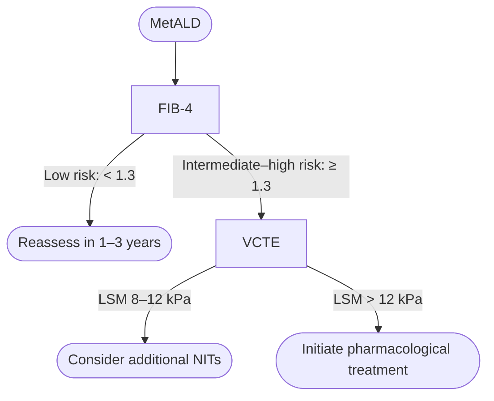

# MetALD (Metabolic Dysfunction– and Alcohol-Associated Liver Disease)

## Contents
- [[#Assessment]]
  - [[#Establishing the Diagnosis]]
  - [[#Severity Assessment]]
- [[#Differential Diagnosis]]
- [[#Diagnostics]]
  - [[#Initial Assessment Algorithm]]
  - [[#Alcohol Quantification and Biomarkers]]
  - [[#Fibrosis Staging Pathway]]
  - [[#Liver Biopsy]]
- [[#Therapeutics]]
  - [[#Alcohol — the First Target]]
  - [[#Cardiometabolic and Lifestyle Management]]
  - [[#Alcohol Use Disorder Pharmacotherapy]]
  - [[#MASLD Drug Therapy in MetALD]]
  - [[#Bariatric and Endobariatric Surgery]]
- [[#See Also]]

## Assessment

### Establishing the Diagnosis

Metabolic dysfunction– and alcohol-associated liver disease (MetALD) = **hepatic steatosis + ≥1 cardiometabolic risk factor (CMRF) + alcohol intake in the intermediate range**. A subclass of steatotic liver disease (SLD) under the 2023 multisociety nomenclature; with [[nafld-masld|metabolic dysfunction–associated steatotic liver disease (MASLD)]] and [[alcohol-associated-liver-disease|alcohol-associated liver disease (ALD)]] it makes up the most common causes of SLD ([[aasld-2023-masld-nomenclature]]). The CMRF criteria are on [[nafld-masld]].

- **10%–15% of all patients with SLD** ([[aga-2026-metald]]).
- **Best Practice Advice (BPA) 1:** classify by CMRFs + **grams of alcohol per week**, ideally **over ≥3 months** ([[aga-2026-metald]]).

| | MASLD | **MetALD** | ALD |
|---|---|---|---|
| Alcohol, women (g/wk) | <140 | **140–350** | >350 |
| Alcohol, men (g/wk) | <210 | **210–420** | >420 |
| CMRF | ≥1 required | ≥1 required | almost always present (97%–98%) |

*Steatotic liver disease subclasses by weekly alcohol intake*
*Source: data from AGA 2026 Figure 1 and BPA 1; daily equivalents from AASLD 2023*
*[[aga-2026-metald|AGA 2026 MetALD Clinical Practice Update]] · [[aasld-2023-masld-nomenclature|AASLD 2023 MASLD nomenclature]]*
*MASLD = metabolic dysfunction–associated steatotic liver disease · MetALD = metabolic dysfunction– and alcohol-associated liver disease · ALD = alcohol-associated liver disease · CMRF = cardiometabolic risk factor*

- **Daily equivalents** ([[aasld-2023-masld-nomenclature]]): MetALD = average **20–50 g/day (women), 30–60 g/day (men)**. MASLD excludes >20 g/30 g per day. **>50 g (women) / >60 g (men) daily, or weekly equivalent → ALD**, not MetALD — alcohol is likely the dominant driver.
- **A continuum within MetALD** ([[aasld-2023-masld-nomenclature]]): **MASLD-predominant** near 140 g/wk (women) / 210 g/wk (men) → **ALD-predominant** at up to 350 / 420 g/wk. The precise cutoffs were provided for research ([[aasld-2023-masld-nomenclature]]); AGA expects them to evolve ([[aga-2026-metald]]).
- One standard drink ≈ **14 g** pure alcohol (12 fl oz of 5% beer, 5 fl oz of 12% wine, 1.5 fl oz of 40% spirits) ([[aga-2026-metald]]).

> [!pitfall] Re-ask about alcohol every year — the category moves
> Up to **30% of patients shift SLD category within 1 year**; misclassification affects management and trial eligibility. **BPA 2:** assess alcohol **initially and at least annually** by interview, validated questionnaire, and/or serum/urine biomarker ([[aga-2026-metald]]).

### Severity Assessment

Metabolic dysfunction plus intermediate alcohol exposure raises the risk of advanced fibrosis, cirrhosis, [[hepatocellular-carcinoma|hepatocellular carcinoma (HCC)]] and all-cause mortality compared with MASLD alone ([[aga-2026-metald]]).

| 5-y risk of liver decompensation | MASLD | **MetALD** | ALD |
|---|---|---|---|
| F1–F2 | <1% | **1%–5%** | 2%–15% |
| F3–F4 | 5%–15% | **10%–30%** | 15%–50% |

*Five-year liver decompensation risk by fibrosis stage across SLD subclasses*
*Source: data from AGA 2026 Figure 1*
*[[aga-2026-metald|AGA 2026 MetALD Clinical Practice Update]]*
*MASLD = metabolic dysfunction–associated steatotic liver disease · MetALD = metabolic dysfunction– and alcohol-associated liver disease · ALD = alcohol-associated liver disease*

- **Alcohol use disorder (AUD) severity** — Diagnostic and Statistical Manual of Mental Disorders, Fifth Edition (DSM-5): ≥2 of 11 criteria within 12 months. AGA 2026 Table 1: **mild 2–3 · moderate 4–5 · severe ≥6**; its text gives **1–2 / 3–5 / 6+**. Moderate or severe AUD triggers pharmacotherapy (BPA 8, below).
- DSM-5 criteria **do not include alcohol quantity** — they are alcohol-associated symptoms and consequences ([[aga-2026-metald]]).

## Differential Diagnosis

*Workup: see [[abnormal-liver-chemistries]].*

- [[nafld-masld|MASLD]] — CMRF present, alcohol below the MetALD range.
- [[alcohol-associated-liver-disease|ALD]] — alcohol above the MetALD range.
- **Specific-etiology SLD** — exclude, especially without overt CMRFs ([[aasld-2023-masld-nomenclature]]): [[drug-induced-liver-injury]], lysosomal acid lipase deficiency, [[wilson-disease]], hypobetalipoproteinemia, inborn errors of metabolism, [[hepatitis-c|hepatitis C]] genotype 3, malnutrition, [[celiac-disease]], human immunodeficiency virus, environmental exposures (e.g., hydrocarbon inhalation).
- **Coexisting liver disease** — e.g., MASLD plus [[autoimmune-hepatitis]] or viral hepatitis ([[aasld-2023-masld-nomenclature]]); atypical serologic or imaging findings → consider autoimmune hepatitis, [[hereditary-hemochromatosis|hemochromatosis]], cholestatic disease ([[aga-2026-metald]]). Alcohol drives dose-dependent fibrosis progression in viral hepatitis (e.g., [[chronic-hepatitis-b]]) and genetic liver diseases too.

> [!pearl] Histology cannot tell you which etiology predominates
> Steatohepatitis and fibrosis features **overlap substantially** across MASLD, ALD and MetALD; biopsy often cannot attribute the predominant cause. Routine biopsy purely to label the SLD subtype is not justified ([[aga-2026-metald]]).

## Diagnostics

### Initial Assessment Algorithm

AGA 2026 Figure 2 runs three parallel tracks from the diagnosis:

| Track | Assessment & screening | Management & treatment |
|---|---|---|
| Cardiometabolic risk factors | ↑ Body mass index and obesity · ↑ blood pressure · ↑ fasting glucose and type 2 diabetes · ↑ triglycerides · ↓ high-density lipoprotein | Weight loss (nutrition and exercise, pharmacological therapies, bariatric surgery — but see [[#Bariatric and Endobariatric Surgery]]) · assess CMRFs · alcohol intake minimization or abstinence |
| Liver fibrosis | Fibrosis-4 Index (FIB-4) → vibration-controlled transient elastography (VCTE) — flowchart in [[#Fibrosis Staging Pathway]] | By liver stiffness measurement (LSM) band (flowchart) |
| Alcohol consumption or AUD | AUD screening questionnaires (Alcohol Use Disorder Identification Test [AUDIT] or AUDIT-C) · harmful alcohol use: self-report (g/week), lifetime alcohol history, drinking patterns · phosphatidylethanol (PEth) **≥20–35 ng/mL = significant alcohol use within the last 4 weeks** | Pharmacological treatment (naltrexone, acamprosate, baclofen, etc.; consider hepatic and renal function) · addiction care: behavioral therapies, brief intervention, motivational interview |

*Three-track initial assessment and management of MetALD*
*Source: redrawn as a table from AGA 2026 Figure 2*
*[[aga-2026-metald|AGA 2026 MetALD Clinical Practice Update]]*
*CMRF = cardiometabolic risk factor · FIB-4 = Fibrosis-4 Index · VCTE = vibration-controlled transient elastography · AUD = alcohol use disorder · AUDIT = Alcohol Use Disorder Identification Test · PEth = phosphatidylethanol*

### Alcohol Quantification and Biomarkers

Questionnaire scoring and the PEth result bands live on [[alcohol-associated-liver-disease|alcohol-associated liver disease → Alcohol Use Screening and Biomarkers]]. What MetALD adds ([[aga-2026-metald]]):

- **AUDIT-C** is recommended in liver disease; positive screen → offer brief intervention, pharmacotherapy and referral to AUD treatment.
- Clinician intuition about who needs alcohol monitoring is **not reliable** — hazardous use is prevalent in the general population and in presumed MASLD; assess everyone.
- **Serum PEth:** forms only in the presence of ethanol; **2–4-week** detection window; levels track exposure. **Urinary ethyl glucuronide (uEtG)** and urinary ethyl sulfate: detectable **3–7 days**; quantitative values do not reliably reflect exposure.
- PEth may be diagnostically redundant when self-report already places the patient in ALD.
- **Positive biomarkers do not diagnose AUD** — they open the conversation and give an objective record.
- **Elevated gamma-glutamyl transferase or mean corpuscular volume** can flag chronic harmful use **even when aminotransferases are mildly elevated or normal**.

### Fibrosis Staging Pathway

**BPA 4:** tiered — routine blood biomarkers + a simple score (FIB-4) to identify low-risk patients; indeterminate or high risk → second-line noninvasive test (NIT) (elastography or serum Enhanced Liver Fibrosis [ELF] test) ([[aga-2026-metald]]).

*Initial fibrosis assessment in MetALD*
*Source: redrawn from the liver fibrosis branch of AGA 2026 Figure 2*
*[[aga-2026-metald|AGA 2026 MetALD Clinical Practice Update]]*
*FIB-4 = Fibrosis-4 Index · VCTE = vibration-controlled transient elastography · LSM = liver stiffness measurement · NIT = noninvasive test*

- Figure 2 does not name the agent for LSM >12 kPa; approved MASLD drugs are not formally studied in MetALD ([[#MASLD Drug Therapy in MetALD]]).
- Text pathway: FIB-4 to exclude advanced fibrosis in primary care (very low scores can defer further workup) → elastography and/or ELF if indeterminate or high → **discordant or high-risk noninvasive profile → hepatology referral and consideration of biopsy**.
- **BPA 5:** [[liver-stiffness-measurement|VCTE]] and magnetic resonance–based techniques objectively assess fibrosis stage and steatosis; interpret stiffness cautiously with active drinking.
- VCTE is **generally preferred over ultrasound shear wave elastography** — more standardized, better-established cutoffs; shear wave is more platform- and operator-dependent.
- Magnetic resonance elastography (MRE) and magnetic resonance imaging–proton density fat fraction perform at least as well, often better.
- **AGILE 3+** (≥F3) = LSM by VCTE + aspartate aminotransferase (AST), alanine aminotransferase (ALT), AST/ALT ratio, platelet count, diabetes (yes/no), age, sex. **AGILE 4** (F4) = the same without age. Both improve rule-in/rule-out over LSM alone.
- Steatosis quantification is **not** linked to liver-related events; a fall in steatosis can serve as an early biomarker of improvement.

| Test | ≥F2 | ≥F3 | F4 |
|---|---|---|---|
| VCTE | 0.74 | 0.83 | 0.93 |
| AGILE 3+ | — | 0.86 (MASLD) · 0.92 (ALD) | 0.96 |
| AGILE 4 | — | 0.911 | 0.89–0.97 (MASLD) · 0.94 (ALD) |
| MRE | 0.92 | 0.92 | 0.94 |
| Two-dimensional shear wave elastography (2D-SWE) | 0.72–0.89 | 0.77–0.88 | 0.70–0.88 |
| FIB-4 | 0.77 | 0.85 | 0.89 |
| ELF | 0.84 (ALD) | 0.80–0.81 · 0.92 (ALD) | 0.94 (ALD) |

*Area under the receiver operating characteristic curve (AUROC) of noninvasive fibrosis tests in MetALD*
*Source: data from AGA 2026 Table 3 (pooled from different cohorts; MASLD/ALD = population studied where stated; 95% confidence intervals omitted)*
*[[aga-2026-metald|AGA 2026 MetALD Clinical Practice Update]]*
*VCTE = vibration-controlled transient elastography · MRE = magnetic resonance elastography · 2D-SWE = two-dimensional shear wave elastography · FIB-4 = Fibrosis-4 Index · ELF = Enhanced Liver Fibrosis · MASLD = metabolic dysfunction–associated steatotic liver disease · ALD = alcohol-associated liver disease*

> [!pitfall] Active drinking inflates liver stiffness
> Alcohol-associated steatohepatitis, severe necroinflammation, extrahepatic cholestasis or hemodynamic congestion can push stiffness into the **cirrhotic range despite only moderate fibrosis on biopsy**. Measure LSM after **≥2–4 weeks** of reduction or abstinence, with serum PEth or uEtG **at the time of LSM**. Discordance (high stiffness with low FIB-4 and ELF, or preserved platelets and synthetic function) → reassess over time, integrate serum scores, biopsy in selected cases ([[aga-2026-metald]]).

### Liver Biopsy

- **Not** for subtyping SLD (pearl above).
- **Reserve for** atypical serologic or imaging findings raising concern for an alternative or additional liver disease (autoimmune hepatitis, hemochromatosis, cholestatic disease) **where histology will meaningfully change management** ([[aga-2026-metald]]).
- Consider with discordant or high-risk noninvasive profiles (Fibrosis Staging Pathway above).

## Therapeutics

### Alcohol — the First Target

- **BPA 3:** alcohol increases steatosis and fibrosis progression **dose-dependently**; advise **all** patients to **discontinue** alcohol, recognizing abstinence may be preceded by periods of reduction and intermittent use ([[aga-2026-metald]]).
- **No identifiable safe alcohol threshold** in SLD, especially once fibrosis is established → counsel **abstinence or near-abstinence, not "safe limits."**
- Alcohol worsens both components: weight gain, hypertension, hypertriglyceridemia, impaired glycemic control, plus hepatic injury.
- **Hazardous use not meeting AUD criteria, or milder AUD → brief intervention**: 10–15 minutes, led by the medical provider — education on alcohol harm, benefits of reducing/abstaining, goal setting.
- **More severe AUD → Screening, Brief Intervention (motivational interviewing), Referral to Specialty Treatment (SBIRT).**

| Behavioral modality | Delivered by |
|---|---|
| SBIRT | Any clinician |
| Cognitive behavioral therapy | Mental health / substance use disorder clinician |
| Motivational enhancement therapy · motivational interviewing | Mental health / substance use disorder clinician · any clinician |
| Mutual aid societies (e.g., Alcoholics Anonymous, SMART) | Community peers |
| Contingency management | Mental health / substance use disorder clinician |
| Community Reinforcement and Family Training (aimed at support persons; no efficacy data in liver disease) | Mental health / substance use disorder clinician |

*Behavioral and psychosocial interventions for AUD*
*Source: data from AGA 2026 Table 5*
*[[aga-2026-metald|AGA 2026 MetALD Clinical Practice Update]]*
*SBIRT = Screening, Brief Intervention, Referral to Treatment · SMART = Self-Management And Recovery Training · AUD = alcohol use disorder*

### Cardiometabolic and Lifestyle Management

**BPA 6:** dietary counseling + replenishment of micronutrient deficiencies + aerobic exercise (body weight, muscle mass) + treatment of concomitant CMRFs ([[aga-2026-metald]]).

| Target | Detail |
|---|---|
| Weight loss | Diet-driven sustained weight loss = first-line for the metabolic component · ≥5% improves steatosis · 7%–10% improves inflammation · ≥10% can improve fibrosis |
| Diet | Mediterranean or similar plant-based (vegetables, legumes, lean protein, nuts); unprocessed/minimally processed poultry or fish preferred over animal protein; avoid ultraprocessed foods (refined carbohydrates, saturated fats, sucrose-/fructose-containing products) |
| Exercise | **150–300 min moderate** or **75–150 min vigorous** weekly, exercising **5 times a week** |
| Micronutrients | Replace **folic acid, thiamine, vitamin A, vitamin D, zinc** in deficient patients; serum vitamin A, vitamin D and zinc guide replacement where available |
| Smoking | Profibrogenic and pro-oncogenic — avoid in all chronic liver disease |

*Lifestyle and cardiometabolic targets in MetALD*
*Source: built from AGA 2026 BPA 6 and its supporting text*
*[[aga-2026-metald|AGA 2026 MetALD Clinical Practice Update]]*
*CMRF = cardiometabolic risk factor · BPA = Best Practice Advice*

> [!pearl] Don't let food replace the drink
> One standard drink of beer / wine / spirits carries **150 / 120 / 100 kCal**. Cutting alcohol cuts calories — advise patients **not to substitute food for alcohol** ([[aga-2026-metald]]).

### Alcohol Use Disorder Pharmacotherapy

**BPA 8:** MetALD with **moderate or severe AUD** (≥4 criteria by Table 1; ≥3 by its text) → AUD pharmacotherapy **plus** behavioral approaches ([[aga-2026-metald]]).

- **Agent choice:** patient and clinician preference, psychiatric comorbidity, **renal and hepatic function**, ease of administration and monitoring — not a structured tiered approach. Pharmacotherapy + psychotherapy is of particular value in moderate-to-severe AUD.
- **Doses, metabolism and per-drug liver cautions (AGA 2026 Table 4) live on [[alcohol-associated-liver-disease|alcohol-associated liver disease → Alcohol Use Disorder Treatment]].**
- **[[hepatic-encephalopathy|Hepatic encephalopathy (HE)]]:** use [[baclofen]] and gabapentin with caution; pregabalin could worsen or confound HE. **Disulfiram is not recommended in advanced liver disease** (severe [[drug-induced-liver-injury]]).
- AUD treatment is increasingly embedded in hepatology care; prescribing in liver disease is still too low.

### MASLD Drug Therapy in MetALD

- **BPA 7:** [[resmetirom]] and [[semaglutide]] (approved for noncirrhotic MASLD) **have not been formally studied in MetALD** — their pivotal trials excluded significant alcohol intake ([[aga-2026-metald]]).
- MAESTRO-NASH subgroup: **~75 patients (9.6%)** met PEth and carbohydrate-deficient transferrin criteria for MetALD and responded to resmetirom similarly to metabolic dysfunction–associated steatohepatitis alone — preliminary; further studies needed.
- **BPA 7:** preliminary data — [[glp-1-receptor-agonists|glucagon-like peptide-1 (GLP-1)]] and glucose-dependent insulinotropic polypeptide receptor agonists **may reduce alcohol cravings and consumption** and improve hepatic parameters. Hypothesis: central GLP-1 receptors (nucleus accumbens, ventral tegmental area) blunt alcohol reward via GABA release.
- Ongoing: **Semaglutide Therapy for Alcohol Reduction (STAR)** (phase II), **SEMALCO**, planned **Cessation or Reduction of Alcohol use in Veterans (CRAVE)** (phase II). Resmetirom + semaglutide combination: no MetALD data.

### Bariatric and Endobariatric Surgery

> [!pitfall] Bariatric surgery is not advisable in MetALD
> **BPA 9:** endobariatric and bariatric surgery — **no safety or efficacy data in MetALD**, and concern for accelerated liver disease progression with continued alcohol use after surgery ([[aga-2026-metald]]).

- **Why:** metabolic [[bariatric-surgery]] speeds gastric emptying of liquids and reduces gastric mucosal alcohol metabolism → **earlier and higher blood alcohol levels**; most pronounced after Roux-en-Y gastrojejunostomy, also with sleeve gastrectomy. Drinkers after surgery have more perioperative complications, intoxication and AUD, and more severe, rapidly progressive SLD with poorer survival.
- **Candidates for metabolic bariatric surgery or [[endoscopic-sleeve-gastroplasty|endoscopic sleeve gastroplasty]]:** abstain **before and after surgery indefinitely**; thorough preoperative medical, psychiatric and substance-use assessment; screen with history, AUD questionnaires and **objective alcohol biomarkers** before and after surgery.
- Known or suspected AUD → **treated and in stable remission ≥2 years** before surgery is considered (binge drinking at surgery is associated with liver disease, suicide and long-term mortality).
- MetALD → **no elective bariatric or endobariatric surgery until sustained alcohol abstinence is demonstrated**.
- Internal inconsistency: AGA 2026 Figure 2 lists bariatric surgery among weight-loss options, and its conclusion asks only that patients reduce or eliminate alcohol before these interventions; BPA 9 and its text advise against surgery as above.

## See Also

[[nafld-masld]], [[alcohol-associated-liver-disease]], [[alcohol-associated-hepatitis]], [[cirrhosis]], [[hepatocellular-carcinoma]], [[hcc-surveillance]], [[liver-stiffness-measurement]], [[noninvasive-liver-disease-assessment]], [[abnormal-liver-chemistries]], [[nutrition-in-liver-disease]], [[glp-1-receptor-agonists]], [[semaglutide]], [[resmetirom]], [[baclofen]], [[obesity]], [[bariatric-surgery]], [[endoscopic-bariatric-therapies]], [[liver-biopsy]], [[hepatic-encephalopathy]], [[drug-induced-liver-injury]]

---

## Sources

1. [[aga-2026-metald|AGA Clinical Practice Update on the Evaluation and Management of Metabolic Dysfunction– and Alcohol-Associated Liver Disease: Expert Review]]
2. [[aasld-2023-masld-nomenclature|MASLD: Update and Impact of New Nomenclature on AASLD NAFLD Guidance]]
