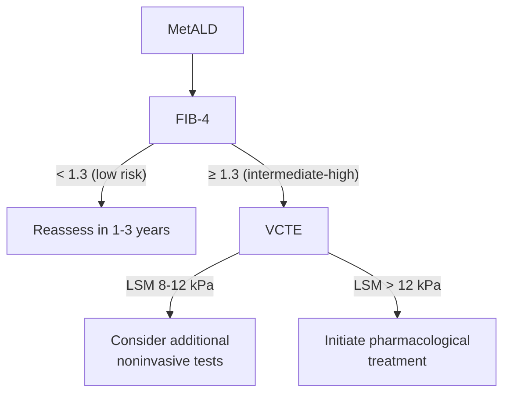

# MetALD (Metabolic Dysfunction– and Alcohol-Associated Liver Disease)

## Contents
- [[#Assessment]]
  - [[#Establishing the Diagnosis]]
  - [[#Severity Assessment]]
- [[#Differential Diagnosis]]
- [[#Diagnostics]]
  - [[#Alcohol Quantification and Biomarkers]]
  - [[#Fibrosis Staging Pathway]]
  - [[#Liver Biopsy]]
- [[#Therapeutics]]
  - [[#Alcohol — the First Target]]
  - [[#Cardiometabolic and Lifestyle Management]]
  - [[#Alcohol Use Disorder Pharmacotherapy]]
  - [[#MASLD Drug Therapy in MetALD]]
  - [[#Bariatric and Endobariatric Surgery]]
- [[#See Also]]

## Assessment

### Establishing the Diagnosis

MetALD = **hepatic steatosis + at least 1 cardiometabolic risk factor (CMRF) + alcohol intake in the intermediate band**. It is one of the three subclasses of steatotic liver disease (SLD) created by the 2023 multisociety consensus nomenclature ([[aasld-2023-masld-nomenclature]]); see [[nafld-masld]] for the full SLD schema and the 5-item CMRF criteria.

- **~10%–15% of all patients with SLD** ([[aga-2026-metald]]).
- Classify by **grams of alcohol per week**, ideally averaged **over ≥3 months** — the weekly expression is what epidemiologic studies and trials stratify on.

| | [[nafld-masld\|MASLD]] | **MetALD** | [[alcohol-associated-liver-disease\|ALD]] |
|---|---|---|---|
| Alcohol, women (g/wk) | <140 | **140–350** | >350 |
| Alcohol, men (g/wk) | <210 | **210–420** | >420 |
| CMRF required | ≥1 | ≥1 | not required (present in 97%–98%) |

*One standard drink ≈ 14 g pure alcohol (12 oz of 5% beer, 5 oz of 12% wine, 1.5 oz of 40% spirits).*

> [!pitfall] Re-ask about alcohol every year — the category moves
> Up to **30% of patients shift SLD category within 1 year**. Classification made once at diagnosis misassigns risk and can cost trial eligibility. Reassess alcohol **initially and at least annually** by interview, validated questionnaire, and/or biomarker ([[aga-2026-metald]]).

### Severity Assessment

Risk sits above MASLD at every fibrosis stage — combining metabolic dysfunction with intermediate alcohol exposure raises advanced fibrosis, cirrhosis, [[hepatocellular-carcinoma|HCC]] and all-cause mortality compared with MASLD alone.

| 5-y risk of hepatic decompensation | MASLD | **MetALD** | ALD |
|---|---|---|---|
| F1–F2 | <1% | **1%–5%** | 2%–15% |
| F3–F4 | 5%–15% | **10%–30%** | 15%–50% |

*([[aga-2026-metald]] Figure 1.)*

- **Alcohol use disorder (AUD) severity** (DSM-5, ≥2 of 11 criteria in 12 months): **mild 2–3 · moderate 4–5 · severe ≥6**. The threshold matters — moderate or severe AUD triggers pharmacotherapy (Therapeutics below).
- DSM-5 AUD criteria **do not include alcohol quantity** — they are 11 alcohol-associated symptoms and consequences. Quantity and category are assessed separately.

## Differential Diagnosis

*Workup: see [[abnormal-liver-chemistries]].*

- [[nafld-masld|MASLD]] — same CMRFs, alcohol below the band.
- [[alcohol-associated-liver-disease|ALD]] — alcohol above the band; AST:ALT ≥2:1, ↑ gamma-glutamyl transferase.
- [[alcohol-associated-hepatitis]] — acute jaundice on a background of heavy use.
- [[hepatitis-c]], [[chronic-hepatitis-b]] — alcohol accelerates fibrosis in both; dual pathology is common.
- [[autoimmune-hepatitis]], [[hereditary-hemochromatosis]], [[wilson-disease]], [[primary-biliary-cholangitis]] — the atypical serologic/imaging findings that justify biopsy.
- [[drug-induced-liver-injury]].

> [!pearl] Histology cannot tell you which etiology predominates
> Steatohepatitis and fibrosis features **overlap substantially** across MASLD, ALD and MetALD, and biopsy specimens often cannot attribute the predominant cause. A biopsy done purely to label the SLD subtype is not justified ([[aga-2026-metald]]).

## Diagnostics

### Alcohol Quantification and Biomarkers

Screening tools (AUDIT, AUDIT-C, NIAAA single-item) and the full biomarker comparison live on [[alcohol-associated-liver-disease]]. What MetALD adds:

- **Quantify in grams per week**, not just "social" vs "heavy" — the category depends on the number. Ideally average over **≥3 months**.
- **Serum phosphatidylethanol (PEth) result bands and the full biomarker comparison are on [[alcohol-associated-liver-disease|alcohol-associated liver disease → Alcohol Use Screening and Biomarkers]].** For MetALD, **PEth ≥20–35 ng/mL indicates significant alcohol within the last 4 weeks** ([[aga-2026-metald]] Figure 2).
- Measure **PEth or urinary ethyl glucuronide at the time of the liver stiffness measurement** — the result is what tells you whether the stiffness reading is trustworthy (see pitfall below).
- A clinician's intuition about who needs alcohol monitoring is **not reliable** — hazardous use is prevalent in the general population and among patients with presumed MASLD, so assess everyone systematically.
- **Elevated gamma-glutamyl transferase or mean corpuscular volume** can flag chronic harmful alcohol use **even when aminotransferases are only mildly elevated or within reference range**.

### Fibrosis Staging Pathway

Tiered: routine blood biomarkers + a simple score first, second-line tests only for the indeterminate and high-risk.

*Figure — initial fibrosis assessment in MetALD, recreated from [[aga-2026-metald]] Figure 2. FIB-4, Fibrosis-4 Index; VCTE, vibration-controlled transient elastography; LSM, liver stiffness measurement.*

- Second-line options: elastography or the serum **Enhanced Liver Fibrosis (ELF)** test.
- **[[liver-stiffness-measurement|VCTE]] is generally preferred over ultrasound shear wave elastography** — more standardized, better-established cutoffs; shear wave performance is more platform- and operator-dependent.
- Magnetic resonance elastography and MRI–proton density fat fraction perform at least as well, often better, for staging fibrosis and quantifying steatosis.
- **AGILE 3+** (targets ≥F3) and **AGILE 4** (targets cirrhosis, F4) combine LSM with routine clinical/laboratory variables and outperform LSM alone.
- Steatosis quantification is **not** linked to liver-related outcomes; a reduction in steatosis is usable as an early biomarker of improvement only.

> [!pitfall] Active drinking inflates liver stiffness
> Alcohol-associated steatohepatitis, severe necroinflammation, cholestasis or hepatic congestion can push stiffness into the **cirrhotic range despite only moderate fibrosis on biopsy**. Measure LSM after **≥2–4 weeks** of alcohol reduction or abstinence, and check serum PEth or uEtG **at the time of the scan**. Discordance (high stiffness with low FIB-4 and ELF, or preserved platelets and synthetic function) → reassess over time, don't act on a single reading ([[aga-2026-metald]]).

### Liver Biopsy

- **Not** for subtyping SLD (see pearl above).
- **Reserve for** atypical serologic or imaging findings raising concern for an alternative or additional liver disease — [[autoimmune-hepatitis]], [[hereditary-hemochromatosis]], cholestatic disease — **where histology would meaningfully change management**.
- Also consider where noninvasive profiles are discordant or high-risk and the result would change the plan.

## Therapeutics

### Alcohol — the First Target

- **There is no identifiable safe alcohol threshold** in SLD, especially once fibrosis is established. Counsel toward **abstinence or near-abstinence, not "safe limits."**
- Advise **discontinuing** alcohol — while recognizing that abstinence is commonly preceded by periods of use reduction and intermittent use, which still count as progress.
- Alcohol worsens both halves of MetALD: it contributes to weight gain, hypertension, hypertriglyceridemia and impaired glycemic control as well as to hepatic injury.
- Behavioural and psychosocial modalities ([[aga-2026-metald]] Table 5): **SBIRT** (screening, brief intervention, referral to treatment — deliverable by any clinician), cognitive behavioural therapy, motivational enhancement therapy and motivational interviewing, mutual aid societies, contingency management, and CRAFT (directed at support persons; no efficacy data in liver disease). Brief interventions are 10–15 minutes and led by the medical provider.

### Cardiometabolic and Lifestyle Management

Medical management = dietary counselling + micronutrient replacement + aerobic exercise + treatment of concomitant CMRFs.

| Target | Detail |
|---|---|
| Weight loss | ≥5% improves steatosis · 7%–10% improves inflammation · ≥10% can improve fibrosis |
| Diet | Mediterranean or similar plant-based — vegetables, legumes, lean protein, nuts; unprocessed/minimally processed poultry or fish over animal protein; avoid ultraprocessed foods, refined carbohydrates, saturated fats, sucrose/fructose |
| Exercise | **150–300 min moderate** or **75–150 min vigorous** weekly, exercising **5 times a week** |
| Micronutrients | Replace **folic acid, thiamine, vitamin A, vitamin D, zinc** where deficient; serum vitamin A, vitamin D and zinc guide replacement where available |
| Smoking | Profibrogenic and pro-oncogenic — avoid in all chronic liver disease |

> [!pearl] Don't let food replace the drink
> One standard drink of beer / wine / spirits carries ≈**150 / 120 / 100 kCal**. Cutting alcohol also cuts calories — advise patients explicitly **not to substitute food for alcohol**, or the metabolic half of MetALD worsens as the alcohol half improves ([[aga-2026-metald]]).

### Alcohol Use Disorder Pharmacotherapy

**Indicated for moderate or severe AUD** (DSM-5 ≥4 criteria), always alongside behavioural approaches ([[aga-2026-metald]]).

- **Agent choice:** individual patient and clinician preference, psychiatric comorbidity, **hepatic and renal function**, and ease of administration and monitoring — not a fixed tier order. Combining pharmacotherapy with psychotherapy is of particular value in moderate-to-severe AUD.
- **Doses, metabolism and the per-drug liver cautions live on [[alcohol-associated-liver-disease|alcohol-associated liver disease → Alcohol Use Disorder Treatment]]** — the same agents, one table.
- **Caution in [[hepatic-encephalopathy|HE]]** with baclofen, gabapentin and pregabalin; **disulfiram is not recommended in advanced liver disease** ([[drug-induced-liver-injury]] risk).
- AUD treatment is increasingly embedded within hepatology service lines rather than referred out; prescribing in the liver disease population remains too low given alcohol prevalence and harm.

### MASLD Drug Therapy in MetALD

- **[[resmetirom]] and [[semaglutide]] have not been formally studied in MetALD** — both pivotal programmes **excluded** patients with significant alcohol intake. Their MASLD approvals do not extend here.
- A MAESTRO-NASH subgroup of **75 patients (9.6%)** who met PEth and carbohydrate-deficient transferrin criteria for MetALD showed a **similar resmetirom response** to MASH alone — hypothesis-generating, not an indication.
- **[[glp-1-receptor-agonists|GLP-1]] and glucose-dependent insulinotropic polypeptide (GIP) receptor agonists may reduce alcohol cravings and consumption** and improve hepatic parameters — preliminary. Proposed mechanism: central GLP-1 receptors in the nucleus accumbens and ventral tegmental area reduce alcohol's rewarding effect via GABA modulation.
- Ongoing, not concluded: **STAR** (phase II), **SEMALCO**, and the planned **CRAVE** trial.

### Bariatric and Endobariatric Surgery

> [!pitfall] Bariatric surgery is not advisable in MetALD
> Not for lack of weight-loss efficacy — because of the alcohol axis. **No safety or efficacy data in MetALD**, plus accelerated liver disease progression with continued alcohol use after surgery ([[aga-2026-metald]] BPA 9).

- **Why:** metabolic bariatric surgery accelerates gastric emptying of liquids and reduces gastric mucosal alcohol metabolism → **earlier and higher blood alcohol levels**. Most pronounced after Roux-en-Y gastric bypass, but also occurs with sleeve gastrectomy. Post-surgical patients who drink are more prone to perioperative complications, intoxication and AUD, and develop more severe, more rapidly progressive SLD with poorer survival.
- **If surgery is being considered anyway:** all candidates for metabolic bariatric surgery and endoscopic sleeve gastroplasty should abstain from alcohol **before and after surgery indefinitely**, undergo thorough preoperative medical, psychiatric and substance-use assessment, and be screened with history, AUD questionnaires and **objective alcohol biomarkers**.
- Known or suspected AUD should be **treated and in stable remission for ≥2 years** before surgery is considered — binge drinking at the time of bariatric surgery is associated with liver disease, suicides and increased long-term mortality.
- Patients with MetALD should **not undergo elective bariatric or endobariatric surgery until sustained alcohol abstinence is demonstrated**.

## See Also

[[nafld-masld]], [[alcohol-associated-liver-disease]], [[alcohol-associated-hepatitis]], [[cirrhosis]], [[hepatocellular-carcinoma]], [[hcc-surveillance]], [[liver-stiffness-measurement]], [[abnormal-liver-chemistries]], [[nutrition-in-liver-disease]], [[glp-1-receptor-agonists]], [[semaglutide]], [[resmetirom]], [[baclofen]], [[obesity]], [[liver-biopsy]], [[hepatic-encephalopathy]], [[drug-induced-liver-injury]]

---

## Sources

1. [[aga-2026-metald|AGA Clinical Practice Update on the Evaluation and Management of Metabolic Dysfunction– and Alcohol-Associated Liver Disease: Expert Review]]
2. [[aasld-2023-masld-nomenclature|MASLD: Update and Impact of New Nomenclature on AASLD NAFLD Guidance]]
