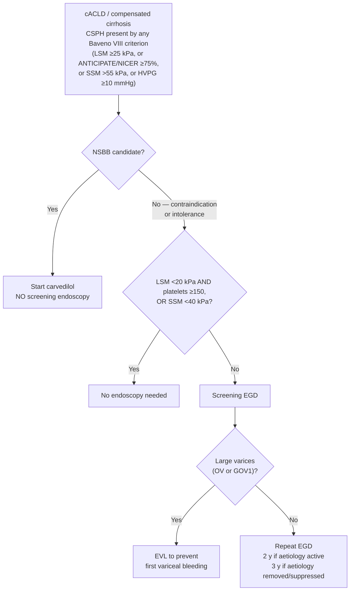

> **[[baveno-viii-2026-portal-hypertension|Baveno VIII (2026)]] supersedes [[baveno-vii-2022-portal-hypertension|Baveno VII (2022)]].** This page states the VIII position and names what changed; the full old → new table is on the Baveno VIII source page.

## Contents
- [[#Assessment]]
  - [[#Establishing the Diagnosis]]
  - [[#Severity Assessment]]
  - [[#Classification / Typing]]
- [[#Differential Diagnosis]]
- [[#Diagnostics]]
  - [[#Noninvasive Staging — cACLD and CSPH]]
  - [[#Screening Endoscopy]]
- [[#Therapeutics]]
  - [[#Prevention of Decompensation (Compensated CSPH)]]
  - [[#Primary Prophylaxis of Variceal Bleeding]]
  - [[#Acute Variceal Bleeding and Secondary Prophylaxis]]
  - [[#Prevention of Further Decompensation]]
  - [[#Gastric and Ectopic Varices]]
  - [[#Portal Hypertensive Gastropathy (PHG) and GAVE]]
  - [[#Special Situations]]
- [[#See Also]]
- [[#Sources]]

## Assessment

### Establishing the Diagnosis

- **Portal hypertension (PH):** portocaval pressure gradient (portal vein − inferior vena cava) **>5 mm Hg**, measured as the [[hepatic-venous-pressure-gradient|hepatic venous pressure gradient (HVPG)]]. Commonest cause **[[cirrhosis]]**; then [[portal-vein-thrombosis|portal vein thrombosis (PVT)]] and hepatic outflow obstruction — see [[#Classification / Typing]].
- **Clinically significant portal hypertension (CSPH): HVPG ≥10 mm Hg** — above it, risk of varices, [[ascites]] and [[hepatic-encephalopathy|hepatic encephalopathy (HE)]] rises substantially (Baveno VII 1.10, changed from >10; retained in VIII) [[baveno-vii-2022-portal-hypertension]] [[aasld-2023-portal-hypertension]].
- **Compensated advanced chronic liver disease (cACLD):** likely cirrhosis on [[liver-stiffness-measurement|liver stiffness measurement (LSM)]] + platelets, no histology needed. **Preferred term when the diagnosis rests on noninvasive tests (NITs)**; not interchangeable with "compensated cirrhosis" (Baveno VIII 1.2). "LSM" = vibration-controlled transient elastography (VCTE) unless stated. Cut-offs: [[#Noninvasive Staging — cACLD and CSPH]] [[baveno-viii-2026-portal-hypertension]].
- **Decompensation:** clinically evident ascites **or hepatic hydrothorax** from PH, [[variceal-upper-gi-bleeding|variceal bleeding]], or overt HE (West Haven ≥II) (Baveno VIII 3.3). Median survival falls from **>12 y to <1.5 y**. Further decompensation (4.1, event-specific) and recompensation (7.1–7.19) criteria: [[cirrhosis]].
- Baveno VIII **favours NITs over routine HVPG** in practice (1.18).

### Severity Assessment

**High-risk varices — the definition behind every "high-risk" recommendation below (any one criterion):**

| Varices | High-risk if |
|---|---|
| Esophageal — [[aasld-2023-portal-hypertension]] | Moderate/large · any size with **red wale marks** · any size in **[[cirrhosis\|Child-Turcotte-Pugh (CTP)]] class C** |
| Esophageal — [[asge-2026-esophageal-gastric-varices]] | Moderate/large · any size with red wale signs or cherry-red spots |
| Gastric — [[asge-2026-esophageal-gastric-varices]] | Actively bleeding · previously bled · high-risk stigmata · **>10 mm** |

- Criteria are alternatives — each independently raises first-bleed risk. **Small** high-risk varices → nonselective beta-blocker (NSBB) only; **large** → NSBB or [[endoscopic-band-ligation|endoscopic variceal ligation (EVL)]] [[aasld-2023-portal-hypertension]].
- Baveno "large" = **≥5 mm** (Baveno VII 7.5); still used for EVL in NSBB-ineligible compensated patients with large esophageal or gastroesophageal varices type 1 (GOV1) (Baveno VIII 3.19).

**HVPG:** strata, technique and pitfalls on [[hepatic-venous-pressure-gradient]]. Values that change management here: **≥10 mm Hg** (CSPH → NSBB) and **≥20 mm Hg at the time of bleeding** (→ pre-emptive [[tips|transjugular intrahepatic portosystemic shunt (TIPS)]], on [[variceal-upper-gi-bleeding]]). 12 mm Hg is only the post-TIPS gradient target, not a bleeding threshold.

**[[interventional-eus-vascular|Endoscopic ultrasound (EUS)-guided portosystemic pressure gradient (EUS-PPG)]]:** direct portal-pressure measurement; favoured **over HVPG when a presinusoidal/noncirrhotic cause is suspected** and in metabolic dysfunction-associated steatohepatitis; pairs with variceal-screening esophagogastroduodenoscopy (EGD) and liver biopsy in one session ([[wang-2026-eus-ppg-delphi-consensus]]).

### Classification / Typing

| Level | Examples |
|---|---|
| Prehepatic | PVT, splenic vein thrombosis |
| Intrahepatic — presinusoidal | Schistosomiasis, [[primary-biliary-cholangitis\|primary biliary cholangitis]], sarcoidosis |
| Intrahepatic — sinusoidal | **Cirrhosis** (most common), [[alcohol-associated-liver-disease\|alcohol-associated hepatitis]] |
| Intrahepatic — postsinusoidal | Sinusoidal obstruction syndrome (veno-occlusive disease) |
| Posthepatic | [[budd-chiari-syndrome\|Budd-Chiari syndrome]], congestive hepatopathy (heart failure, constrictive pericarditis) |

- Clinical stages (compensated ± CSPH → decompensated → further decompensated; recompensation): [[cirrhosis]].

---

## Differential Diagnosis

*Workup: see [[ascites]] for the ascites/portal-hypertension arm and [[abnormal-liver-chemistries]] for the aetiologic liver-test evaluation.*

- [[porto-sinusoidal-vascular-disorder|Porto-sinusoidal vascular disorder (PSVD)/non-cirrhotic portal fibrosis (NCPF)]] — noncirrhotic intrahepatic PH; biopsy required. **Suspect when signs of PH coexist with HVPG <10 mm Hg or LSM <10 kPa** (Baveno VII 1.13; Baveno VIII 1.6)
- PVT — prehepatic; HVPG normal; Doppler ultrasound diagnostic
- [[budd-chiari-syndrome]] — posthepatic; caudate hypertrophy, hepatic vein outflow obstruction
- Congestive hepatopathy — raised jugular venous pressure; echo confirms; false-positive HVPG
- [[primary-sclerosing-cholangitis]] — presinusoidal component; HVPG unreliable with a dominant stricture
- Schistosomiasis — presinusoidal; periportal ("pipestem") fibrosis; travel history; eosinophilia

---

## Diagnostics

| Test | Purpose |
|---|---|
| **HVPG** | Gold standard; prognostic; treatment response |
| **LSM (VCTE) + platelet count** | cACLD and CSPH staging (below); annual monitoring |
| Abdominal ultrasound + Doppler | Portal vein patency, hepatofugal flow, splenomegaly, collaterals, ascites |
| Computed tomography (CT)/magnetic resonance imaging (MRI) | Varices, collaterals, PVT anatomy, [[hepatocellular-carcinoma\|hepatocellular carcinoma (HCC)]] |
| [[upper-endoscopy\|EGD]] | Varices and high-risk features — indications below |

### Noninvasive Staging — cACLD and CSPH

![[portal-hypertension-2023-noninvasive-staging-algorithm-09.png|700x378]]
*Figure 3 — Noninvasive tests for staging and management of compensated advanced chronic liver disease (cACLD): LSM ranges, CSPH probability, endoscopy indications, LSM monitoring, and alternatives to transient elastography (TE). ([[aasld-2023-portal-hypertension]])*

**"Rule of Five" (10-15-20-25 kPa)** — same ladder in American Association for the Study of Liver Diseases (AASLD) 2023 Figure 1B and Baveno VIII 1.3–1.8; risk of decompensation and liver-related death rises up the ladder **independent of aetiology** [[baveno-viii-2026-portal-hypertension]] [[aasld-2023-portal-hypertension]].

| LSM by VCTE (kPa) | Platelets (×10⁹/L) | Interpretation |
|---|---|---|
| <10 | — | Rules out cACLD (≤1% 3-y decompensation/death) — **unless** signs of PH → suspect vascular liver disease (1.6) |
| 10–15 | — | Suggestive of cACLD |
| **≤15** | **≥150** | **Rules out CSPH** (negative predictive value >90%) — both required (1.15) |
| >15 | — | Highly suggestive of cACLD |
| 15–25 without a rule-in/rule-out criterion | — | **Indeterminate** — re-evaluate at 12 mo, or add spleen stiffness measurement (SSM) (1.17) |

**Ruling CSPH in — Baveno VIII 1.16 (any one; new in VIII):**

| Criterion | Threshold | Applies to |
|---|---|---|
| ANTICIPATE / ANTICIPATE-NASH estimated probability | **≥75%** | ANTICIPATE-NASH for metabolic dysfunction-associated steatotic liver disease (MASLD) with **body mass index (BMI) ≥30 kg/m²**; ANTICIPATE otherwise |
| NICER model estimated probability | **≥75%** | Any aetiology |
| LSM (VCTE) | **≥25 kPa** | Viral and/or alcohol-related; **non-obese (BMI <30) MASLD** |
| SSM at 100 Hz | **>55 kPa** | Any aetiology |

- ANTICIPATE/NICER are **model outputs** — use the published calculator.
- Cut-offs less reliable in [[obesity]]/MASLD, primary sclerosing cholangitis with dominant strictures, transaminases >3× upper limit of normal; not validated for non-VCTE elastography.
- **SSM's three cut-offs are not interchangeable:** >55 kPa rules CSPH in (1.16c) · <40 kPa spares screening EGD when NSBB is not possible (1.19) · <25 kPa with LSM <15 kPa rules CSPH out after recompensation (7.19b). Detail: [[liver-stiffness-measurement]].
- **Monitoring:** repeat NITs **every 12 months**; the **most recent value** guides decisions (1.9–1.10). Fasting, confirmation, meaningful-change thresholds: [[liver-stiffness-measurement]].

![[portal-hypertension-2022-baveno7-cacld-csph-algorithm-05.png|750x330]]
*Figure 4 — Baveno VII "rule of 5" LSM ladder (unchanged in VIII); its SSM and ANTICIPATE rule-in thresholds are superseded by the table above. ([[baveno-vii-2022-portal-hypertension]])*

> [!pitfall] Don't carry Baveno VII numbers forward
> The ≥60% ANTICIPATE risk bands (LSM 20–25 + platelets <150, or 15–20 + <110) and SSM <21 / >50 kPa (viral only) are **superseded** by the ≥75% probability and >55 kPa (100 Hz) rules ([[baveno-viii-2026-portal-hypertension]]).

### Screening Endoscopy

**Baveno VIII — the NSBB question comes first** [[baveno-viii-2026-portal-hypertension]]:

- **On an NSBB → no screening EGD** (3.18); AASLD concordant — CSPH by TE → start NSBB, no screening EGD; TE unavailable → screen all cirrhosis (guidance statements [GS] 14–16) [[aasld-2023-portal-hypertension]].
- **Cannot take an NSBB → EGD, unless LSM <20 kPa *and* platelets ≥150 ×10⁹/L (Baveno VI), or SSM <40 kPa** (1.19).
- **No varices on index EGD (NSBB-ineligible) → repeat EGD in 2 y if aetiology active, 3 y if removed/suppressed** (1.20; replaces Baveno VII yearly TE + platelets).
- **PSVD/NCPF:** LSM criteria **do not apply** (8.48); EGD may be avoided if **SSM <40 kPa and bilirubin <1 mg/dL** (8.47).
- **With HCC (1.21–1.23):** macrovascular invasion → NITs may not apply; Barcelona Clinic Liver Cancer (BCLC) 0–C → LSM ≤15 + platelets ≥150 rules out CSPH, EGD may be avoided; BCLC 0–A without a >5 cm right-lobe nodule → ANTICIPATE ≥75% suggests CSPH.

**American Society for Gastrointestinal Endoscopy (ASGE) 2026 on Baveno VI** (conditional, low certainty) [[asge-2026-esophageal-gastric-varices]]:

- LSM <20 kPa **and** platelets >150,000/µL → skip EGD, **reassess annually**. A **rule-out test only** (sensitivity 0.97, specificity 0.32).
- **Do not apply in:** prior decompensation or variceal bleeding · current NSBB · HCC · splenectomy · liver transplant · **BMI ≥40 kg/m²** · children/adolescents.
- ASGE **did not endorse the SSM limb** (prospective miss rate for high-risk varices lower with Baveno VI than Baveno VII).

> [!pitfall] Exactly 150 ×10⁹/L splits the guidelines
> ASGE scopes at platelets **≤150**; Baveno exempts at **≥150** — at exactly 150, ASGE scopes and Baveno does not ([[asge-2026-esophageal-gastric-varices]]; [[baveno-viii-2026-portal-hypertension]]).

*Source: [[baveno-viii-2026-portal-hypertension]] statements 1.19–1.23, 3.18–3.19, 8.47–8.48. OV = oesophageal varices.*

---

## Therapeutics

### Prevention of Decompensation (Compensated CSPH)

- **CSPH → [[nonselective-beta-blockers|NSBB]], carvedilol preferred — *recommended* to prevent decompensation and improve survival** (Baveno VIII 3.15, level of evidence [LoE] 2, strong; Baveno VII 5.14 said "consider"). **No CSPH → no NSBB** (3.16) [[baveno-viii-2026-portal-hypertension]]; AASLD GS 1, 9, 11–12 concordant [[aasld-2023-portal-hypertension]].
- **Carvedilol:** 6.25 mg once daily → twice daily after 3 days; maintenance **6.25–12.5 mg/day**; keep systolic blood pressure **≥90 mm Hg**, no heart-rate target (GS 2) [[aasld-2023-portal-hypertension]]. Titration, contraindications, dose reduction: [[nonselective-beta-blockers]].
- **NSBB stopped or not tolerated → EGD** for high-risk varices needing EVL (GS 24).
- **Treat the aetiology** — [[hepatitis-c|hepatitis C virus (HCV)]] [[direct-acting-antivirals|direct-acting antivirals]], [[chronic-hepatitis-b|hepatitis B virus (HBV)]] nucleos(t)ide analogues, [[autoimmune-hepatitis|autoimmune hepatitis]] immunosuppression, **complete alcohol abstinence (favoured over reduction)** — can lower HVPG (GS 10; Baveno VIII 2.1–2.2). **CSPH can persist after cure → reassess** (3.14b); address obesity, diabetes, alcohol (3.8).
- **After HCV cure** (sustained virological response, no co-factors) with **LSM <12 kPa + platelets >150 ×10⁹/L** → discharge from PH surveillance; **continue [[hcc-surveillance|HCC surveillance]]** (Baveno VII 3.7) [[baveno-vii-2022-portal-hypertension]].
- **Stopping the NSBB:** only on **confirmed CSPH resolution** — HVPG <10 mm Hg *measured off* the NSBB, or LSM <10 kPa, or LSM <15 + SSM <25 kPa (Baveno VIII 7.16–7.19) → [[nonselective-beta-blockers]].
- HCC + CSPH: decompensation prevention stays relevant at every oncological stage (3.17). Regular periodontal care may lower decompensation risk (3.23). Aspirin not discouraged where indicated (Baveno VII 4.3).
- **TIPS: not for preventing decompensation** (3.20a, LoE 5 strong; AASLD GS 21). **Pre-operative TIPS may be considered before major surgery** (3.20b; GS 58; [[acg-2025-perioperative-cirrhosis]] Rec 3) → [[tips]].

> [!pitfall] Statins and anticoagulants are not PH therapy
> Evidence is insufficient to use either to prevent decompensation (Baveno VIII 3.22, 4.11; Baveno VII had "encouraged" statins) — give them **only for their own indications**; statin toxicity is higher in CTP C (simvastatin ≤20 mg/d in CTP B/C, Baveno VII 4.2) ([[baveno-viii-2026-portal-hypertension]]).

- CIRROXABAN (rivaroxaban 10 mg/d, CTP 7–10): primary endpoint **not met** (p = 0.058), more non-PH bleeding ([[puente-2025-cirroxaban-rivaroxaban-cirrhosis]]) → [[cirrhosis-hemostasis]].

### Primary Prophylaxis of Variceal Bleeding

- **Compensated with CSPH:** NSBB (carvedilol), varices or not (GS 14, 23).
- **NSBB-ineligible + large varices (OV/GOV1) → EVL** (Baveno VIII 3.19; GS 19). EVL had more complications and mortality than NSBB in one meta-analysis → NSBB preferred if tolerated. Session/surveillance intervals: [[endoscopic-band-ligation]].
- **Decompensated, never bled, not on NSBB → annual EGD** (GS 22); high-risk varices → NSBB (preferred) or EVL (GS 23) [[aasld-2023-portal-hypertension]].

### Acute Variceal Bleeding and Secondary Prophylaxis

Acute variceal hemorrhage — resuscitation, vasoactive drugs, antibiotics, endoscopy, pre-emptive/salvage TIPS — and secondary prophylaxis (NSBB + EVL, carvedilol preferred): **[[variceal-upper-gi-bleeding]]**.

### Prevention of Further Decompensation

*Ascites management itself: [[ascites]].*

- **Ascites + varices of any size → carvedilol/conventional NSBB (cNSBB), carvedilol preferred** — prevents first bleed (LoE 1 strong) and ascites complications (LoE 3 strong) (Baveno VIII 4.4; Baveno VII size split dropped). **NSBB-ineligible → endoscopic therapy alone** (4.5).
- **Dose-reduce or stop** for persistent systolic blood pressure <90 or mean arterial pressure <65 mm Hg and/or [[aki-in-cirrhosis|hepatorenal syndrome–acute kidney injury]]; **re-titrate once recovered** (4.6–4.7) → [[nonselective-beta-blockers]].
- Treat the aetiology after the first decompensation (4.2, 6.2).
- **No long-term primary antibiotic prophylaxis** after a first decompensation (4.12 — reverses Baveno VII 4.6); post-[[spontaneous-bacterial-peritonitis|spontaneous bacterial peritonitis]] secondary prophylaxis unchanged (6.21).
- **HCC does not change the plan** (4.14); TIPS with HCC/frailty: [[tips]]; nutrition/frailty assessment (4.16–4.18): [[nutrition-in-liver-disease]] [[baveno-viii-2026-portal-hypertension]].

### Gastric and Ectopic Varices

**Sarin classification — formally recommended by Baveno VIII 5.38** (LoE 3, strong) [[aasld-2023-portal-hypertension]] [[baveno-viii-2026-portal-hypertension]]:

| Type | Location | Location group | Behaviour |
|---|---|---|---|
| **GOV1** | Along the **lesser curvature** (continuation of esophageal varices) | Lesser curve | Like esophageal varices; treat comparably |
| **GOV2** | Along the **greater curvature**/fundus | **Cardiofundal** | Higher treatment failure, rebleeding, mortality |
| **IGV1** | Isolated gastric varix (IGV) in the **fundus** | **Cardiofundal** | Higher treatment failure, rebleeding, mortality |
| **IGV2** | Isolated, elsewhere in the stomach (or ectopic) | Distal | — |

*American Gastroenterological Association (AGA) location scheme mapped onto Sarin; both are in use ([[aga-2021-bleeding-gastric-varices]]).*

- **Gastric varices (GV)** ([[aga-2021-bleeding-gastric-varices]]): in **17%–25%** of PH; bleed less often than esophageal but **more severely** (**16%–45% at 3 y**). **Up to 85% of cardiofundal GV drain via a gastrorenal shunt** — basis for transvenous obliteration ([[tips]]). Record Sarin type, **size**, **stigmata** (discolored marks, platelet plugs); evidence weak, advice ungraded.
- **GV = CSPH** → NSBB, particularly carvedilol, for decompensation prevention (Baveno VIII 3.21a); evaluate for PVT (GS 40). **Isolated splenic vein thrombosis** causing GV → splenectomy, splenic vein stenting or splenic artery embolization (GS 47).
- **Primary prophylaxis, high-risk GOV2/IGV1, NSBB contraindicated/not tolerated** — in expert centres consider **endoscopic injection** (LoE 2 strong), **EUS-guided therapy** (LoE 4 weak) or **transvenous obliteration** (LoE 3 weak) (3.21b; new vs Baveno VII; matches AASLD GS 41). **Not on top of an NSBB** (3.21c). No TIPS or balloon-occluded retrograde transvenous obliteration for unbled fundal varices (GS 42).
- **Bleeding GV** (bimodal acute + definitive pathway, technique, follow-up): [[variceal-upper-gi-bleeding]].

### Portal Hypertensive Gastropathy (PHG) and GAVE

*Grading and full treatment: [[portal-hypertensive-gastropathy]] and [[gastric-antral-vascular-ectasia|gastric antral vascular ectasia (GAVE)]].*

- **Greater-than-mild PHG → presume CSPH → consider NSBB** to prevent decompensation (GS 48). Acute severe PHG bleeding: vasoactive therapy 2–5 d (GS 49); NSBB against rebleeding (GS 50); **TIPS if transfusion-dependent despite NSBB** (GS 51; Baveno VIII 5.44) [[aasld-2023-portal-hypertension]].
- **Distinguish PHG from GAVE** — PHG responds to portal-pressure reduction; transfusion-dependent **GAVE → band ligation over [[argon-plasma-coagulation|argon plasma coagulation]]** (Baveno VIII 5.43).

### Special Situations

**HCC (GS 52–54):** manage varices as without HCC; occlusive PVT → screening EGD, NSBB or EVL if varices [[aasld-2023-portal-hypertension]].

**[[liver-disease-in-pregnancy|Pregnancy]] (GS 55–56)** [[aasld-2023-portal-hypertension]]:

- Cirrhosis or noncirrhotic PH planning pregnancy → **EGD within 1 year of conception**; unscreened pregnant patient → **EGD early in the second trimester**.
- Medium/large varices → NSBB or EVL (**EVL if red wale marks**); carvedilol may cause more fetal growth retardation than propranolol.
- Acute variceal bleeding: **avoid [[terlipressin]]** (uterine stimulation); use somatostatin/octreotide.

**Children (Baveno VIII 1.24–1.27):** leading causes are **extrahepatic portal vein obstruction** and **biliary-atresia advanced chronic liver disease**. LSM/SSM cut-offs unvalidated → combine NITs (e.g. **age-adjusted spleen-length Z-score + platelets + albumin**) to predict high-risk varices and time endoscopy [[baveno-viii-2026-portal-hypertension]]. Paediatric PVT: [[portal-vein-thrombosis]].

**Transesophageal echocardiography:** routine EGD beforehand is **not** recommended in cirrhosis (GS 57).

---

## See Also

[[cirrhosis]], [[variceal-upper-gi-bleeding]], [[ascites]], [[hepatic-encephalopathy]], [[portal-vein-thrombosis]], [[budd-chiari-syndrome]], [[porto-sinusoidal-vascular-disorder]], [[hepatic-venous-pressure-gradient]], [[liver-stiffness-measurement]], [[noninvasive-liver-disease-assessment]], [[nonselective-beta-blockers]], [[endoscopic-band-ligation]], [[tips]], [[interventional-eus-vascular]], [[portal-hypertensive-gastropathy]], [[gastric-antral-vascular-ectasia]], [[cirrhosis-hemostasis]], [[hepatocellular-carcinoma]], [[liver-disease-in-pregnancy]], [[hepatopulmonary-syndrome-portopulmonary-hypertension]], [[spontaneous-bacterial-peritonitis]], [[aki-in-cirrhosis]], [[nutrition-in-liver-disease]], [[liver-transplantation]]

---

## Sources

1. [[asge-2026-esophageal-gastric-varices|ASGE Guideline on Management of Esophageal and Gastric Varices in Patients With Cirrhosis (2026)]]
2. [[baveno-viii-2026-portal-hypertension|Baveno VIII — Advancing Consensus in Portal Hypertension (2026)]]
3. [[aasld-2023-portal-hypertension|AASLD 2023 Practice Guidance on Portal Hypertension and Varices in Cirrhosis]]
4. [[baveno-vii-2022-portal-hypertension|Baveno VII — Renewing Consensus in Portal Hypertension (2022)]]
5. [[acg-2025-perioperative-cirrhosis|ACG Clinical Guideline: Perioperative Risk Assessment and Management in Cirrhosis (2025)]]
6. [[wang-2026-eus-ppg-delphi-consensus|International Expert Delphi Consensus on EUS-guided Portosystemic Pressure Gradient: Best Practices and Future Directions (2026)]]
7. [[aga-2021-bleeding-gastric-varices|AGA Clinical Practice Update on Management of Bleeding Gastric Varices: Expert Review (2021)]]
8. [[puente-2025-cirroxaban-rivaroxaban-cirrhosis|Rivaroxaban to prevent complications of portal hypertension in cirrhosis: The CIRROXABAN study (2025)]]
