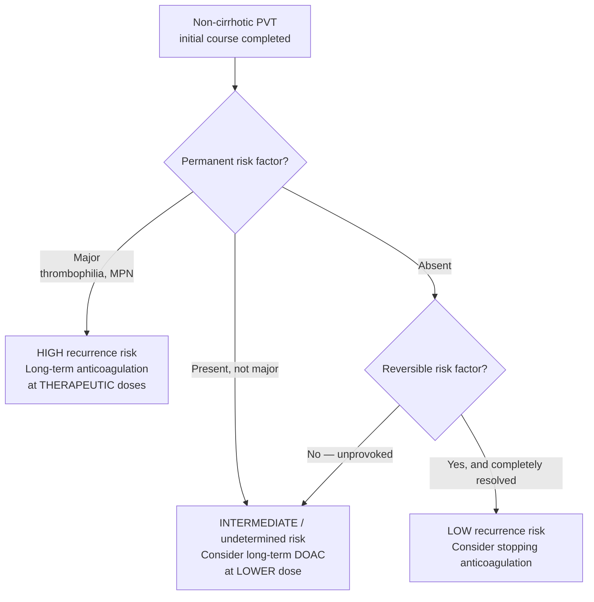

## Contents
- [[#Assessment]]
  - [[#Establishing the Diagnosis]]
  - [[#Severity Assessment]]
  - [[#Classification / Typing]]
- [[#Differential Diagnosis]]
- [[#Diagnostics]]
- [[#Therapeutics]]
  - [[#Noncirrhotic Recent PVT/MVT]]
  - [[#Noncirrhotic Chronic PVT / Cavernoma]]
  - [[#Cirrhotic PVT]]
  - [[#Interventional and Surgical Options]]
  - [[#Paediatric PVT]]
- [[#See Also]]
- [[#Sources]]

---

## Assessment

### Establishing the Diagnosis

Portal vein thrombosis (PVT) = partial or complete occlusion of the portal vein (PV) by thrombus. Mesenteric vein thrombosis (MVT) involves the superior mesenteric vein (SMV) and may extend into or from the PV. Either may occur with [[cirrhosis]] or in noncirrhotic patients (thrombophilia, local abdominal pathology).

**Presentation:**

- **Recent PVT/MVT, noncirrhotic:** crampy periumbilical pain, nausea, fever; MVT → intestinal ischemia (bloody diarrhea, peritoneal signs) if bowel infarcts
- **Recent PVT in cirrhosis:** usually incidental on surveillance imaging; may present as new or worsening [[portal-hypertension|portal hypertension]] ([[ascites]], [[variceal-upper-gi-bleeding|variceal bleeding]])
- **Chronic PVT (cavernous transformation):** portal hypertension with splenomegaly, varices, ascites; biliopathy in ~80% (portal cavernoma cholangiopathy — bile duct compression by the cavernoma)
- Increasingly found incidentally on abdominal computed tomography (CT) done for other indications

**Imaging sequence** — [[baveno-viii-2026-portal-hypertension|Baveno VIII]] 9.2, concordant with [[acg-2020-hepatic-mesenteric-circulation|ACG 2020]]:

1. **Doppler ultrasound — first-line** (Strong, Very Low evidence): solid intraluminal material (PVT) and/or a network of porto-portal collaterals (cavernoma); sensitivity ~90% for main PVT
2. **Multiphase CT to confirm** — extent, other splanchnic veins, local factors, bowel viability, complications and signs of portal hypertension; required whenever MVT or bowel ischemia is suspected
3. **Contrast-enhanced magnetic resonance imaging (MRI) — alternative** when CT contrast is contraindicated; equivalent sensitivity
4. **[[upper-endoscopy|Upper endoscopy]]** once portal hypertension is established → variceal screening (intervals under [[#Therapeutics]])

> [!pitfall] An enhancing thrombus is tumour, not clot
> [[hepatocellular-carcinoma|Hepatocellular carcinoma (HCC)]] tumour thrombus enhances on arterial phase, expands the lumen, and usually has an accompanying mass; anticoagulation gives it no benefit. Conversely, PVT in a patient with HCC is **not** proof of vascular invasion — characterise it on contrast-enhanced imaging using standardised criteria (A-VENA, [[li-rads|Liver Imaging Reporting and Data System (LI-RADS)]]) (Baveno VIII 9.17).

### Severity Assessment

| Feature | Significance |
|---|---|
| Partial vs. complete main PVT | Complete main PVT + MVT: higher ischemia risk; stronger anticoagulation indication |
| Cirrhotic vs. noncirrhotic | Noncirrhotic → thrombophilia workup essential; cirrhotic → concurrent portal hypertension management |
| Bowel viability (MVT) | CT for pneumatosis/bowel-wall thickening; surgical emergency if bowel infarct |
| Recent vs. chronic | Recent: anticoagulation recanalizes 40–75%; chronic: cavernoma established, recanalization unlikely |

These four axes (cirrhotic vs. not × recent vs. chronic, plus mesenteric extension) define the treatment pathways under [[#Therapeutics]].

### Classification / Typing

**Standardised nomenclature — [[baveno-viii-2026-portal-hypertension|Baveno VIII]] / Vascular Liver Disease Interest Group (VALDIG) criteria.** Use these terms when documenting a PVT so course and treatment response can be compared over time.

**Time course and cavernoma (9.1):**

| Term | Definition |
|---|---|
| **Recent PVT** | Thrombus formed **within the last 6 months** |
| **Acute PVT** | **Symptomatic** recent PVT |
| **Chronic PVT** | Persistent portal vein obstruction lasting **>6 months**, with or without cavernoma |
| **Portal cavernoma** | **Multiple dilated peribiliary and/or gallbladder-wall veins (≥2 mm), *irrespective of the patency of the main portal vein***, developing after prior portal vein obstruction |

**Degree of occlusion — VALDIG PVT criteria (9.3).** Measured as the **percentage of *remnant* portal lumen (RL)** relative to the vessel's largest diameter, on **portal-venous-phase CT or MRI**, in a plane **strictly perpendicular to the main portal vein**:

| Term | Remnant lumen |
|---|---|
| **Minimal** | **RL ≥50%** |
| **Partial** | **RL <50%** |
| **Complete** | **RL = 0%** |

**Interval change** (Baveno VII, not revised): **Progressive / Stable / Regressive** — thrombus larger or more occlusive / unchanged / smaller or less occlusive.

> [!pitfall] A bare occlusion percentage is now ambiguous
> Baveno VIII grades **how much lumen remains**; Baveno VII graded **how much lumen the clot obstructed** ("minimally occlusive" = obstructing <50%, "partially occlusive" = >50%, "completely occlusive" = no persistent lumen). The strata map onto each other, so always write "remnant lumen" or "obstructed" explicitly — and note that VIII makes the portal-venous phase and the perpendicular plane part of the definition, so an oblique measurement is not a VALDIG measurement.

Two further definitional changes from Baveno VII: a **cavernoma** is now defined by collateral **calibre and location (≥2 mm, peribiliary/gallbladder wall)** rather than by non-visualisation of the original PV, so it may be reported alongside a patent main PV; and **recent** (time only) is now split from **acute** (recent *and* symptomatic), where VII used "recent" for both.

**Yerdel classification — the transplant-surgical grading behind "Yerdel grade IV" under [[#Interventional and Surgical Options]].** Anatomical + degree of occlusion; the four categories in ascending order, as listed by [[aasld-2021-vascular-pvt]] (Table 6):

| Category (ascending) | Definition |
|---|---|
| 1 | **<50% occlusion** of the portal vein |
| 2 | **>50% occlusion** |
| 3 | **Complete PV *and* splenic vein occlusion** |
| 4 | **Complete PV occlusion with superior mesenteric vein (SMV) extension** |

- [[aasld-2021-vascular-pvt]] Table 6 prints the four categories **without numbering them I–IV**; the numbering above is the order the source lists them in. [[aasld-ast-2025-liver-transplant-candidate-evaluation]] glosses **grade IV as "complete splanchnic vein thrombosis,"** matching the most extensive category. For exact grade boundaries, go to the primary source (Yerdel 2000, *Transplantation* 69:1873).
- Yerdel's limitation (same table): derived **only in patients presenting for liver transplantation (LT)**, so it correlates with post-transplant survival rather than natural history.

---

## Differential Diagnosis

*Workup: see [[ascites]] for the ascites/portal-hypertension arm of the presentation; the vascular diagnosis itself is made on Doppler ultrasound and cross-sectional imaging — see Diagnostics.*

- **Extrinsic portal vein compression** — [[pancreatic-cancer|pancreatic cancer]], lymphadenopathy, [[cholangiocarcinoma]]; no intravenous thrombus on CT
- **[[budd-chiari-syndrome|Budd-Chiari syndrome]]** — hepatic venous outflow obstruction; hepatomegaly, ascites, right upper quadrant pain; caudate lobe hypertrophy
- **[[acute-mesenteric-ischemia|Acute mesenteric ischemia]]** — SMA occlusion (arterial embolism/thrombosis); small bowel ischemia; no portal vein thrombus
- **[[colon-ischemia|Colon ischemia]]** — segmental colonic involvement; CT/[[colonoscopy]] distinguishes
- **Cirrhosis with portal hypertension alone** — no thrombus; variceal bleeding/ascites present; Doppler shows slow or reversed flow without thrombus
- **[[porto-sinusoidal-vascular-disorder|Porto-sinusoidal vascular disorder (PSVD)]]** — noncirrhotic intrahepatic portal hypertension (PH); PVT and PSVD can **coexist**, so finding PVT does not exclude PSVD (Baveno VII 9.15) [[baveno-vii-2022-portal-hypertension]]

---

## Diagnostics

*Imaging sequence: see [[#Establishing the Diagnosis]].*

**Thrombophilia workup — who gets one** [[aasld-2021-vascular-pvt]]:

- **No cirrhosis + no clear provoking factor → full investigation** for myeloproliferative disorders or another thrombophilic condition is warranted, **usually in consultation with hematology**
- **Cirrhosis → an extensive thrombophilia evaluation is *not* necessary**, unless family history or routine laboratory testing raises other concerns
- **Cirrhosis → it is mandatory to rule out malignant venous obstruction attributable to [[hepatocellular-carcinoma|hepatocellular carcinoma (HCC)]]** with appropriate contrast-enhanced imaging

**What the noncirrhotic workup contains:**

- **JAK2 V617F mutation** — myeloproliferative neoplasm (MPN); JAK2 V617F in ~30% of noncirrhotic PVT
- Factor V Leiden, prothrombin G20210A mutation
- Antithrombin III, protein C, protein S (check off anticoagulation)
- Antiphospholipid antibody panel (lupus anticoagulant, anticardiolipin, anti-β2 glycoprotein I)
- Complete blood count and peripheral smear (underlying MPN/polycythemia)
- **JAK2 V617F negative** → somatic **calreticulin (CALR)** and **JAK2 exon 12** mutations, next-generation sequencing (Baveno VII A.1) [[baveno-vii-2022-portal-hypertension]]
- **No MPN driver mutation in primary splanchnic vein thrombosis** → discuss **bone marrow biopsy with haematology irrespective of blood counts** (B.2), especially when no major risk factor is present. After abdominal surgery or pancreatitis, weigh bone-marrow/liver biopsy individually given low yield (C.2)

> [!pearl] One risk factor does not end the workup
> Combinations are common in splanchnic vein thrombosis (Baveno VII A.1), and it is the **classification** of each factor — not the workup itself — that sets anticoagulation duration: **permanent vs. reversible**, and each permanent one **major (thrombophilia, MPN) vs. non-major** (Baveno VIII 9.5). Full risk-factor list: source Supplementary Table S4.

**Excluding underlying liver disease** — [[baveno-viii-2026-portal-hypertension|Baveno VIII]] 9.4: comprehensive workup for cirrhosis / compensated advanced chronic liver disease (cACLD) **including [[liver-stiffness-measurement|liver stiffness measurement (LSM)]]**; reserve [[liver-biopsy|liver biopsy]] and [[hepatic-venous-pressure-gradient|hepatic venous pressure gradient (HVPG)]] for inconclusive cases or suspected [[porto-sinusoidal-vascular-disorder|porto-sinusoidal vascular disorder (PSVD)]] / non-cirrhotic portal fibrosis (NCPF). *(Baveno VII 8.34 sent every dysmorphic liver or persistently abnormal liver test to biopsy + HVPG and proposed no LSM cut-off.)*

**Local/secondary causes:**

- Intra-abdominal inflammation: [[acute-pancreatitis|pancreatitis]], appendicitis, [[diverticulitis]], [[inflammatory-bowel-disease|inflammatory bowel disease]], [[acute-cholecystitis|cholecystitis]]
- Surgery: splenectomy (highest PVT risk), liver resection, bowel surgery
- Pregnancy/postpartum
- Tumour invasion (HCC tumour thrombus)

**Liver synthetic function (if cirrhosis present):** Child-Turcotte-Pugh (CTP) class and Model for End-Stage Liver Disease (MELD) — point table, MELD 3.0 formula and variant comparison on [[cirrhosis]]; both grade anticoagulation safety below.

---

## Therapeutics

### Noncirrhotic Recent PVT/MVT

**American College of Gastroenterology (ACG) 2020 algorithm** [[acg-2020-hepatic-mesenteric-circulation]]:

![[pvt-2020-management-algorithm-13.png|700x430]]
*Figure 1 — Approach to management of PVT, with and without cirrhosis. TP = thrombophilia; MV = mesenteric vein; EVL = endoscopic variceal ligation; NSBB = nonselective beta-blockers. \*No anticoagulation for acute partial thrombosis except in liver transplant–listed candidates. \*\*Duration 3–6 months if a discrete precipitant; indefinite if thrombophilia or transplant-listed. ([[acg-2020-hepatic-mesenteric-circulation]])*

**Anticoagulate every noncirrhotic patient with acute (symptomatic recent) PVT or MVT** absent contraindication — anticoagulation, not thrombolysis, first (Strong, Low evidence) [[acg-2020-hepatic-mesenteric-circulation]]. Recent PVT **rarely resolves spontaneously** and recanalisation correlates with early start, so give **therapeutic-dose anticoagulation immediately at diagnosis** ([[baveno-viii-2026-portal-hypertension|Baveno VIII]] 9.6).

**Agents** (Baveno VIII 8.5–8.6 supersedes ACG 2020's "low-molecular-weight heparin [LMWH] or warfarin, DOAC experience limited"):

- **LMWH first**, then transition to an oral anticoagulant. Avoid unfractionated heparin (heparin-induced thrombocytopenia risk) **except glomerular filtration rate (GFR) <30 mL/min or a pending invasive procedure**
- **Direct oral anticoagulants (DOACs) are now the primary oral choice** — unless **double/triple-positive antiphospholipid syndrome**, **pregnancy**, **severely impaired liver function (Child-Pugh C–equivalent)**, or **GFR <30 mL/min**. *(Baveno VII 8.37 switched to a vitamin K antagonist [VKA] when possible and reserved DOACs for selected cases.)*
- DOAC absorption may fall with intestinal edema; [[anticoagulation-gi-bleeding|reversal-agent availability]] factors into the choice [[acg-2020-hepatic-mesenteric-circulation]]

**Duration — Baveno VIII builds the whole framework on the risk factor** (9.6, 9.8–9.10):

- **≥6 months in all.** ACG 2020 agrees: ≥6 months with no demonstrable thrombophilia and a reversible etiology; **indefinite with thrombophilia** (Conditional, Very Low evidence)
- **Stopping at 3 months may be considered** after **complete recanalisation of the portal vein**, provided a **reversible risk factor has completely resolved** and **no permanent risk factor** is present (9.8, new)
- **Extension into SMV and/or splenic vein with no recanalisation at 6 months → continue full-dose anticoagulation a further 6 months**; delayed recanalisation still occurs (9.9)

**Long-term anticoagulation after the initial course (9.10):**

- "Lower dose" is **not quantified** in statement 9.10. The only figure in the document is in the research agenda (RA9.3), which asks about DOACs other than **rivaroxaban 15 mg/day** — implying that is the studied lower dose, but Baveno VIII does not prescribe it.
- Two Baveno VII rules are gone: 8.39/8.45 gave long-term anticoagulation for a permanent prothrombotic state with **no dose distinction**; and 8.40's **D-dimer <500 ng/mL at 1 month after discontinuation** as a low-recurrence marker has been dropped to the research agenda (RA9.4) — not current guidance.

**Surveillance and complications:**

- **Recent extension into the SMV → assess for clinical and radiological signs of intestinal ischemia** (9.7)
- **Follow-up contrast-enhanced CT at 6 months**, and continued follow-up whether or not anticoagulation is stopped, given recurrence risk (Baveno VII 8.42–8.43, not revised)
- **Variceal screening (9.11):** **upper gastrointestinal endoscopy at diagnosis**; if no high-risk varices, **repeat at 12 months, then every 2 years**. **Spleen stiffness measurement (SSM) <40 kPa spares endoscopy** (new in VIII; VII 8.52 gave the same interval without the stiffness escape)
- **Do not postpone anticoagulation for endoscopic variceal prophylaxis** (8.10) — this reverses Baveno VII 8.47, which sequenced bleeding prophylaxis first in high-risk varices. **[[endoscopic-band-ligation|Band ligation]] is safe without stopping LMWH or VKA; data are lacking for DOACs** (8.11)

> [!pitfall] Reassess the ischemic belly at 24–48 h, don't just continue heparin
> Bowel ischemia **persisting or worsening after 24–48 h of anticoagulation** — judged on clinical reassessment, **lactate** and repeat CT — in a patient not needing immediate resection is an indication for **endovascular treatment at an experienced centre**, to avoid or limit bowel resection (Baveno VIII 9.14). Baveno VII 8.44's red flags still prompt the look: persistent severe pain despite anticoagulation, bloody diarrhoea, lactic acidosis, bowel-loop distention, occlusion of second-order SMV radicles. Frank infarction or gangrene → surgical resection; thrombolysis may be considered for progression threatening ischemia ([[acg-2020-hepatic-mesenteric-circulation]]).

**Intestinal ischemia** with recent PVT: **immediate** consultation with surgery, critical care, interventional radiology (IR) and hematology; **anticoagulation is essential**, surgery for infarction [[aasld-2021-vascular-pvt]].

**Septic pylephlebitis** (suppurative PVT from intra-abdominal infection) [[aasld-2021-vascular-pvt]]: **prolonged antibiotics** adapted to the isolated organism or to anaerobic digestive flora; limited retrospective data favour **concurrent anticoagulation** (higher complete-resolution rates, fewer long-term portal-hypertensive complications).

### Noncirrhotic Chronic PVT / Cavernoma

- **Anticoagulation reserved for** underlying thrombophilia, thrombus extension/progression, or intestinal ischemia (Conditional, Very Low evidence); duration ≥6 months when no thrombophilia and a reversible etiology [[acg-2020-hepatic-mesenteric-circulation]]. Once a cavernoma is established there is **no recanalization benefit**
- **Long-term anticoagulation then follows the same risk-factor stratification as recent PVT** (Baveno VIII 9.10, flowchart above) — replacing Baveno VII 8.45's separate rule for past PVT/cavernoma
- **Portal vein flow restoration should be considered** with **recurrent complications of portal hypertension** or **symptomatic portal cavernoma cholangiopathy** (9.15). Techniques for chronic PVT: **angioplasty ± stenting and/or [[tips|transjugular intrahepatic portosystemic shunt (TIPS)]]** — thrombolysis and thrombectomy are for recent PVT; feasibility depends on thrombus age/extent and local expertise (9.12–9.13, detail on [[tips]])
- **Portal cavernoma cholangiopathy** with obstructive cholestasis: [[ercp|endoscopic retrograde cholangiopancreatography (ERCP)]], biliary stenting, or hepaticojejunostomy
- **Variceal management in vascular liver disease:** screening intervals as above (9.11); acute portal-hypertensive bleeding and secondary prophylaxis handled **as in cirrhosis** (8.12). For primary prophylaxis, no evidence favours band ligation over [[nonselective-beta-blockers|nonselective beta-blockers (NSBBs)]], and evidence is insufficient to prefer carvedilol over other conventional NSBBs (8.8–8.9). TIPS for refractory or recurrent portal-hypertensive bleeding (8.13); **no data support pre-emptive TIPS in vascular liver disease** (8.14)

### Cirrhotic PVT

**American Gastroenterological Association (AGA) 2025 chronicity/occlusion stratification** (Best Practice Advice [BPA], unrated) [[aga-2025-pvt-cirrhosis]]. "Recent" = **<6 months**, "chronic" = **>6 months** (a PVT not recanalized by 6 months is unlikely to recanalize on anticoagulation) — concordant with the VALDIG nomenclature under [[#Classification / Typing]]:

| Scenario | Action |
|---|---|
| **Intestinal ischemia** (any) | **Urgent anticoagulation** + multidisciplinary team (GI/hepatology, IR, hematology, surgery); mortality up to 10–20% (BPA 4) |
| Recent (<6 mo), **<50%** occlusive **or** intrahepatic branches only, no ischemia | **Observe** with cross-sectional imaging **every 3 months** until regression (BPA 5) |
| Recent (<6 mo), **>50%** occlusive **or** main PV / mesenteric involvement | **Consider anticoagulation** (BPA 6). Greater benefit: >1 vascular bed, thrombus progression, transplant candidate, inherited thrombophilia |
| Chronic (>6 mo), **complete occlusion + cavernous transformation** | **Anticoagulation not advised** — recanalization futile (BPA 7) |

- **Do not delay** — delay lowers the odds of recanalization (start within 6 months, ideally <2 weeks); anticoagulation does **not** increase portal-hypertensive bleeding, and must not be deferred for variceal screening (screen and treat as usual; NSBB or band ligation may proceed on anticoagulation) (BPA 8)
- **Monitoring (BPA 10):** reimage **every 3 months**. Clot regressing → continue until transplant, or until resolution if not listed; **stop for futility in nonresponders after 6 months**. Recurrence after withdrawal up to 38% at 2–5 months → in transplant-listed patients continue after resolution. Platelets **<50 × 10⁹/L** carry bleeding risk (individualize)
- **Hemostasis in cirrhosis is rebalanced, not auto-anticoagulated** — no prophylactic fresh frozen plasma, platelets or antifibrinolytics before routine procedures, and the status of viscoelastic testing: [[cirrhosis-hemostasis]]

**ACG 2020 indications, where they add detail** [[acg-2020-hepatic-mesenteric-circulation]]:

- **Acute complete main PVT, MVT, or mesenteric extension** → anticoagulate, weighing bleeding risk (e.g. platelets <50,000/µL, or [[hepatic-encephalopathy|hepatic encephalopathy]] with fall risk) (Strong, Low evidence). **Acute partial PVT:** no anticoagulation except in liver transplant–listed candidates (Figure 1)
- **Duration** for acute PVT/MVT without inherited thrombophilia: **6 months**, continuing beyond that while on the waiting list (Conditional, Very Low evidence)
- **Chronic PVT in cirrhosis:** anticoagulate **only** for inherited thrombophilia, thrombus progression, or prior bowel ischemia from mesenteric extension; also reasonable while awaiting transplant (Conditional, Very Low evidence)
- **Initial agent:** unfractionated heparin with renal insufficiency, LMWH with thrombocytopenia (Conditional, Very Low evidence)

**Preferred agents in cirrhosis** — VKA, LMWH and DOACs are all reasonable; individualize by **CTP class** (BPA 9) [[aga-2025-pvt-cirrhosis]]:

| Agent | CTP class A | CTP class B | CTP class C |
|---|---|---|---|
| VKA (warfarin) | ✔ (international normalized ratio [INR] unreliable in cirrhosis) | ✔ | Avoid (unreliable INR) |
| LMWH | ✔ | ✔ | ✔ (preferred near transplant / high MELD) |
| Apixaban | ✔ | Caution | **Not advised** |
| Rivaroxaban | ✔ | **Not advised** | **Not advised** |
| Dabigatran / Edoxaban | ✔ | Caution / not advised | **Not advised** |

- DOACs offer convenience (no INR monitoring); apixaban has the most CTP-B data; rivaroxaban carries a small hepatotoxicity risk. [[anticoagulation-gi-bleeding|Reversal]]: andexanet alfa / idarucizumab / 4-factor prothrombin complex concentrate (PCC).

**Anticoagulation treats PVT — it does not prevent it.** In patients with Child-Pugh 7–10 cirrhosis and **no** thrombosis at entry, 24 months of double-blind rivaroxaban 10 mg/day vs placebo produced **1/41 (2.4%) vs 1/49 (2.0%)** incident PVT — no prophylactic effect, at an event rate far below the ~28% two-year incidence reported in earlier open-label anticoagulation trials [[puente-2025-cirroxaban-rivaroxaban-cirrhosis]]. There is no indication to anticoagulate a cirrhotic patient for PVT prophylaxis.

- That trial saw **no excess major bleeding or hepatotoxicity** at Child-Pugh 7–10, but minor non-portal-hypertensive bleeding was 2.56× more frequent and clustered at **Child-Pugh ≥8** (details on [[cirrhosis-hemostasis]]). It used a **prophylactic 10 mg dose in patients without thrombosis**, so it does not license therapeutic-dose rivaroxaban in decompensated disease — the agent table above governs that choice.

**[[baveno-viii-2026-portal-hypertension|Baveno VIII]] cirrhotic-PVT statements** (newest tier-1 source; where it and AGA 2025 differ in emphasis, both are guideline-tier and Baveno VIII is newer):

*Screening and characterisation*

- **Screen for PVT simultaneously with radiological [[hcc-surveillance|HCC surveillance]]** (9.16) — Baveno VII 9.3 restricted this to potential transplant candidates; VIII applies it to patients with cirrhosis generally
- PVT with [[hepatocellular-carcinoma|HCC]] is **not proof of vascular invasion** — contrast-enhanced imaging is required, using **standardised criteria (A-VENA, [[li-rads|Liver Imaging Reporting and Data System (LI-RADS)]])** (9.17). VII said only to characterise with CT/MRI/contrast-enhanced ultrasound (CEUS); VIII names the criteria sets

*Who to anticoagulate*

- **Any PVT in a potential liver transplant candidate → anticoagulate** (9.18). The goal is to prevent re-thrombosis or progression so a **porto-portal anastomosis** remains feasible and post-transplant morbidity/mortality falls
- **Consider anticoagulation for** (9.19): (i) **recent partial (<50% remnant lumen) or complete thrombosis of the main portal vein**; (ii) **symptomatic PVT, independently of extension**; (iii) **non-tumoral PVT with HCC, especially where locoregional therapy is indicated** — limb (iii) is new in VIII
  - ⚠ Read limb (i) against the **VALDIG remnant-lumen** convention under [[#Classification / Typing]], not against Baveno VII's "obstructing >50%" wording. They describe the same patients, from opposite ends of the vessel
- Baveno VII 9.7's separate rule for minimally occlusive trunk thrombosis that **progresses at 1–3 months** or **compromises the SMV** is not restated; VIII covers progression through the surveillance rule below

*Duration and surveillance*

- **Transplant candidates: continue anticoagulation until surgery.** Everyone else: **at least 6 months**, and **consider long-term use regardless of recanalisation** (9.20)
- **If anticoagulation is stopped → imaging at 1 month, then every 3 months** to detect recurrence or progression (9.21, new)
- **If never anticoagulated → repeat imaging within 6 weeks of diagnosis** to check for progression; if stable, **imaging every 3 months**, particularly in transplant-listed patients; **progression during follow-up is itself an indication to anticoagulate** (9.22, new)

*Agent choice and bleeding risk*

- **LMWH, VKA and DOACs are all accepted** for cirrhosis with PVT; individualise on the expected benefit–risk balance and **reassess it routinely** (9.23). Higher-bleeding-risk features named: **age, frailty, GFR <30 mL/min, decompensated liver disease, platelets <50 ×10⁹/L**
- **DOACs are safe in Child-Pugh A and may carry a lower bleeding risk than VKA**; use with caution in Child-Pugh B; **not recommended in Child-Pugh C outside research protocols** (9.24). The comparative-safety claim over VKA is new in VIII
- **No recommendation can be made on which DOAC** (9.25)

*Interventional*

- **TIPS for main portal vein thrombosis not improving on anticoagulation**, when there are (i) complications of portal hypertension, or (ii) transplant candidacy where the aim is a physiological anastomosis (9.26)
- **TIPS may be first-line** in main portal vein thrombosis with complications of portal hypertension **and a contraindication to anticoagulation** (9.27, new)
- **Routine anticoagulation after TIPS is NOT recommended** in cirrhosis with PVT (9.28, new — level of evidence [LoE] 2, strong)

**PVR-TIPS** (portal vein revascularization with TIPS) for cirrhotic PVT (Conditional; BPA 11) [[aga-2025-pvt-cirrhosis]]:

- Can achieve portal vein recanalization when anticoagulation insufficient
- Reserved for those with **additional TIPS indications** (refractory [[ascites]], variceal bleeding) or to enable **transplant technical feasibility** (~98% revascularization in complete/near-complete occlusion in expert series; low-MELD, single-center data — limited generalizability)

### Hemostasis in Cirrhosis — Key Principles

Cirrhosis represents [[cirrhosis-hemostasis|rebalanced hemostasis]], not auto-anticoagulation [[acg-2020-hepatic-mesenteric-circulation]]:

- Do NOT use fresh frozen plasma (FFP) prophylactically before routine procedures (Conditional, Low evidence)
- Do NOT give prophylactic platelets for routine procedures outside renal dysfunction/active bleeding (Conditional, Very Low evidence)
- Do NOT use antifibrinolytics without evidence of hyperfibrinolysis (Conditional, Very Low evidence)
- **Thromboelastography (TEG)/rotational thromboelastometry (ROTEM)** (viscoelastic testing) can guide transfusion decisions better than prothrombin time (PT)/INR or platelet count (Conditional, Low evidence)

### Surgical / Interventional Options

- **[[tips|TIPS]]**: portal decompression; facilitates PVT resolution; bridges to transplant
- **Bowel resection**: emergent when MVT causes bowel infarction
- **[[liver-transplantation|Liver transplantation]]**: PVT is not an absolute contraindication but requires surgical planning; cavernoma may require technical modifications
  - **Yerdel grade IV PVT** (complete splanchnic vein thrombosis) **without sufficient collateral veins** (left gastric vein, pericholedochal collaterals) is a **relative contraindication to isolated LT** ([[aasld-ast-2025-liver-transplant-candidate-evaluation]], Rec 47, Weak, Level 2) — grade definitions under [[#Classification / Typing]]
  - Experienced centers may achieve revascularization using interventional radiology techniques; evaluate case-by-case
  - Multivisceral transplantation may be an alternative for Grade IV PVT at specialized centers (Table 6, [[aasld-ast-2025-liver-transplant-candidate-evaluation]])
- **Acute variceal bleeding with cirrhosis + PVT** follows the usual [[variceal-upper-gi-bleeding|acute variceal bleeding (AVB)]] pathway; in selected patients **TIPS ± portal vein recanalisation** may be considered when other portal-hypertension factors are present (ascites, documented PVT progression) or the patient is a transplant candidate ([[baveno-viii-2026-portal-hypertension]] 5.45)

### Paediatric PVT

*New in [[baveno-viii-2026-portal-hypertension|Baveno VIII]] (Panel 9, statements 9.29–9.39) — the first Baveno paediatric statements. **Extrahepatic portal vein obstruction is one of the two leading causes of portal hypertension in children**, alongside advanced chronic liver disease from biliary atresia (1.24).*

**Chronic PVT in children (9.29–9.30):** defined as **complete obstruction to normal portal venous flow to the liver**; may be **congenital or acquired**; typically diagnosed on imaging. Work-up includes standard evaluation for underlying chronic liver disease, **thrombophilia investigation**, and liver biopsy where intrinsic liver disease must be excluded.

**Surgery is first-line prophylaxis, not drugs (9.31–9.35):**

| Setting | Preferred approach |
|---|---|
| **Preprimary (no varices yet) and primary prophylaxis**, with features of portal hypertension | **Meso-Rex bypass** — established criteria must be met to reach a >90% success rate, including **patency of the intrahepatic portal venous system** and surgical expertise (9.31) |
| **Secondary prophylaxis** of variceal haemorrhage | **Meso-Rex bypass preferred.** If not feasible: portal vein recanalisation, endoscopic treatment ± NSBB, or **distal splenorenal shunt** (9.34) |
| **Recurrent variceal haemorrhage** | **Distal splenorenal shunt** — provided there is **no [[hepatopulmonary-syndrome-portopulmonary-hypertension\|hepatopulmonary syndrome or portopulmonary hypertension]] and no [[hepatic-encephalopathy\|hepatic encephalopathy (HE)]]** (9.35) |
| **Life-threatening, otherwise untreatable** portal hypertensive complications | [[liver-transplantation\|Liver transplantation]] (9.37) |

- The role of **pharmacologic, endoscopic, and interventional-radiologic primary prophylaxis is not well established** in children (9.32), and management may need individualising where access to medical care is limited (9.33)
- **Annual surveillance** for children with portal hypertension and/or portosystemic shunts — spontaneous or created — **especially for portopulmonary hypertension** (9.36)
- **Neonatal recent PVT** (e.g. after umbilical catheterisation): **spontaneous resolution can occur**, so the role of anticoagulation is uncertain — **monitor for clot extension**, and consider anticoagulation for an extensive thrombus (9.38)
- **Do not extrapolate the adult cirrhotic-PVT recommendations to children** — PVT with cirrhosis is uncommon in children and the supporting evidence is insufficient (9.39)

---

## See Also

[[budd-chiari-syndrome]], [[porto-sinusoidal-vascular-disorder]], [[colon-ischemia]], [[spontaneous-bacterial-peritonitis]], [[aki-in-cirrhosis]], [[hepatocellular-carcinoma]], [[cirrhosis-hemostasis]], [[portal-hypertension]], [[variceal-upper-gi-bleeding]], [[acute-mesenteric-ischemia]], [[cholangiocarcinoma]], [[pancreatic-cancer]], [[inflammatory-bowel-disease]], [[acute-pancreatitis]], [[diverticulitis]], [[acute-cholecystitis]], [[upper-endoscopy]], [[liver-transplantation]], [[ercp]], [[cirrhosis]], [[ascites]], [[tips]], [[liver-biopsy]], [[hepatic-venous-pressure-gradient]], [[liver-stiffness-measurement]], [[hcc-surveillance]], [[li-rads]], [[hepatic-encephalopathy]], [[hepatopulmonary-syndrome-portopulmonary-hypertension]], [[anticoagulation-gi-bleeding]]

---

## Sources

1. [[baveno-viii-2026-portal-hypertension|Baveno VIII — Advancing Consensus in Portal Hypertension (2026)]]
2. [[acg-2020-hepatic-mesenteric-circulation|ACG Clinical Guideline: Disorders of the Hepatic and Mesenteric Circulation]]
3. [[aga-2025-pvt-cirrhosis|AGA Clinical Practice Update on Management of Portal Vein Thrombosis in Patients With Cirrhosis: Expert Review]]
4. [[aasld-ast-2025-liver-transplant-candidate-evaluation|AASLD AST 2025: Practice Guideline on Adult Liver Transplantation — Candidate Evaluation]]
5. [[aasld-2021-vascular-pvt|AASLD Practice Guidance: Vascular Liver Disorders, Portal Vein Thrombosis, and Procedural Bleeding in Cirrhosis (2021)]]
6. [[baveno-vii-2022-portal-hypertension|Baveno VII — Renewing Consensus in Portal Hypertension (2022)]]
7. [[puente-2025-cirroxaban-rivaroxaban-cirrhosis|Rivaroxaban to prevent complications of portal hypertension in cirrhosis: The CIRROXABAN study (2025)]]
