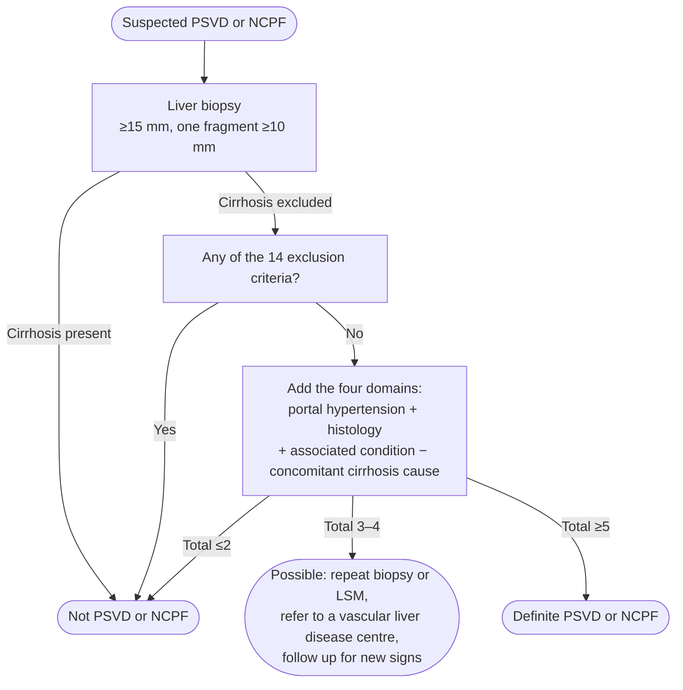

## Contents
- [[#Assessment]]
  - [[#Establishing the Diagnosis]]
  - [[#Severity Assessment]]
  - [[#Classification / Typing]]
- [[#Differential Diagnosis]]
- [[#Diagnostics]]
  - [[#Liver Biopsy]]
  - [[#Exclusion Criteria]]
  - [[#Histological Criteria]]
  - [[#Signs of Portal Hypertension]]
  - [[#Associated Conditions]]
  - [[#Diagnostic Score]]
  - [[#Imaging and Pressure Measurement]]
- [[#Therapeutics]]
  - [[#Variceal Screening and Surveillance]]
  - [[#Portal Hypertension Complications]]
  - [[#Portal Vein Thrombosis]]
  - [[#TIPS and Transplantation]]
  - [[#General Care and Pregnancy]]
- [[#See Also]]
- [[#Sources]]

---

## Assessment

### Establishing the Diagnosis

- **Porto-sinusoidal vascular disorder (PSVD)** and **non-cirrhotic portal fibrosis (NCPF)** are one entity under two accepted names — same definition, same diagnostic criteria; written *PSVD or NCPF* ([[baveno-viii-2026-portal-hypertension|Baveno VIII]] 8.39, following the 2026 multisociety nomenclature agreement, endorsed by thirteen liver, pathology and pediatric hepatology societies).
- Broad clinico-pathological entity of the intrahepatic portal and sinusoidal vasculature that **can cause portal hypertension without [[cirrhosis]]**, overlapping idiopathic portal hypertension / non-cirrhotic intrahepatic portal hypertension (8.38). [[baveno-vii-2022-portal-hypertension|Baveno VII]] 9.14 listed the labels it absorbs: **nodular regenerative hyperplasia (NRH)**, obliterative portal venopathy, hepatoportal sclerosis, incomplete septal cirrhosis.
- Diagnosis is **clinicopathological**: mandatory [[liver-biopsy|liver biopsy]] → cirrhosis excluded → no exclusion criterion → **four-domain score** (see [[#Diagnostic Score]]).

**What does not rule it out (8.40):**

- Absence of portal hypertension.
- A concomitant cause of cirrhosis — viral hepatitis, excessive alcohol, metabolic syndrome; both can coexist (costs **−1** on the score).
- [[portal-vein-thrombosis|Portal vein thrombosis (PVT)]] — both can coexist.

**When to suspect it** (Baveno VII 9.16):

- Signs of portal hypertension alongside features **atypical for cirrhosis** — [[hepatic-venous-pressure-gradient|hepatic venous pressure gradient (HVPG)]] <10 mm Hg; [[liver-stiffness-measurement|liver stiffness measurement (LSM)]] <10 kPa; smooth liver surface with no atrophy of segment IV; hepatic vein-to-vein communications. **None is pathognomonic.**
  - Baveno VIII 1.6 puts it the other way round: LSM <10 kPa with clinical or imaging signs of portal hypertension should raise suspicion of a **vascular liver disease**.
- Abnormal liver blood tests or portal hypertension in a patient with a **condition known to be associated** with PSVD or NCPF.
- **Unexplained liver blood-test abnormalities even without any sign of portal hypertension.**

### Severity Assessment

- Prognosis generally better than cirrhosis while liver function is preserved; morbidity comes from portal hypertension ([[variceal-upper-gi-bleeding|variceal bleeding]], [[ascites]]) and from associated PVT.
- Standard cirrhosis prognostic scores are not validated here.
- **Nodules develop, less often than in [[budd-chiari-syndrome|Budd-Chiari syndrome]]**; most are benign, but **suspected [[hepatocellular-carcinoma|hepatocellular carcinoma (HCC)]] requires histological confirmation** (8.52).

### Classification / Typing

- No stage or subtype. What is graded is **diagnostic certainty** — *no* / *possible* / *definite* by the score below.

---

## Differential Diagnosis

*Workup of portal hypertension and its aetiologies: see [[portal-hypertension]].*

- **[[cirrhosis]]** — the principal mimic; must be excluded on an adequate biopsy before the diagnosis can be made. Favouring PSVD or NCPF: smooth surface, no segment-IV atrophy, HVPG <10 mm Hg, LSM <10 kPa.
- **[[portal-vein-thrombosis|Portal vein thrombosis / cavernoma]]** — pre-hepatic; **may coexist**. Conversely, in non-cirrhotic PVT consider liver biopsy and HVPG when PSVD or NCPF is suspected (Baveno VIII 9.4).
- **[[budd-chiari-syndrome|Budd-Chiari syndrome]]** — post-hepatic outflow obstruction; also a formal exclusion.
- Schistosomiasis, congenital hepatic fibrosis, sarcoidosis and other pre-sinusoidal causes of non-cirrhotic portal hypertension — several appear in [[#Exclusion Criteria]].
- **A competing chronic liver disease is a modifier, not a differential** — it scores **−1** rather than excluding the diagnosis. The question is whether **the vascular component is the main driver** of the portal hypertension and the clinical picture; PSVD or NCPF has been found on explanted livers of patients transplanted under a preoperative clinicoradiological diagnosis of cirrhosis ([[multisociety-2026-psvd-ncpf-criteria]]).

---

## Diagnostics

### Liver Biopsy

- **Mandatory** for the diagnosis (Statement 1, 95% agreement), and **cirrhosis must be excluded on a good-quality biopsy** (Statement 2, 100%) ([[multisociety-2026-psvd-ncpf-criteria]]).
- **Adequate = ≥15 mm total length with at least one fragment ≥10 mm**, or otherwise considered adequate for interpretation by an expert pathologist (Statement 4, 100%; Baveno VIII 8.41).
- ⚠ Baveno VII 9.18 required **>20 mm with minimal fragmentation** (earlier definitions also ≥10 portal tracts). The new standard is shorter and explicitly tolerates fragmentation provided one fragment reaches 10 mm.

> [!pitfall] The 15 mm rule excludes cirrhosis — it does not guarantee you can find PSVD
> It is validated only for **ruling out cirrhosis**. No robust data define the biopsy characteristics needed to identify the histological lesions of PSVD or NCPF themselves, so an adequate-by-this-rule biopsy without major criteria does not settle the question ([[multisociety-2026-psvd-ncpf-criteria]]).

### Exclusion Criteria

**All fourteen must be absent** before the score is applied (Statement 5, 100% agreement) [[multisociety-2026-psvd-ncpf-criteria]]:

| | |
|---|---|
| Abernethy syndrome | [[hereditary-hemorrhagic-telangiectasia\|Hereditary hemorrhagic telangiectasia]] |
| [[budd-chiari-syndrome\|Budd-Chiari syndrome]] or hepatic venous outflow obstruction | Hypervitaminosis A |
| Cardiac failure or Fontan-associated liver disease | Intrahepatic arteriovenous shunts |
| Cholestatic liver diseases | Liver infiltration by tumor cells |
| Congenital hepatic fibrosis | Peliosis hepatis |
| Gaucher disease | **Schistosomiasis** — qualified, see below |
| Hepatic amyloidosis | **Sinusoidal obstruction syndrome (SOS) in the last 6 months** — see below |

**Narrowed or dropped in this revision** — this is where older lists mislead:

- **Portal cavernoma is no longer an exclusion.** Patients can *develop* one — multiple dilated peribiliary and/or gallbladder-wall veins **>2 mm**, **irrespective of whether the main portal vein stays patent**. Every case described has been intrahepatic.
- **SOS excludes only within 6 months.** SOS diagnosed **≥6 months earlier does not preclude** the diagnosis: survivors develop portal hypertension long-term and repeat biopsies beyond 6 months show a PSVD-like pattern. SOS after haematopoietic stem cell transplantation is **not** synonymous with PSVD or NCPF.
- **Schistosomiasis excludes only when hepatosplenic.** In endemic areas a **positive serology or a few incidental parasite eggs in the liver may coexist** and is not an exclusion.

### Histological Criteria

Applied only once the exclusions are cleared. The lesions are **not pathognomonic** — each occurs in other liver diseases, which is why the older term "specific lesions" was abandoned for this major/minor framework.

| **Major** (Statement 6) | **Minor** (Statement 7) |
|---|---|
| NRH | Regenerative changes **in the absence of** NRH |
| Muscularized portal venules | Abnormal distribution of vascular structures |
| Portal venule stenosis in **≥50%** of portal tracts | Portal venule stenosis in **25–49%** of portal tracts |
| **All three minor criteria present together** (Statement 8) | |

- **Sinusoidal dilatation and sinusoidal fibrosis are not criteria** — they occur in the disease but added no discrimination beyond the lesions above.
- **Incomplete septal fibrosis has dropped out** of the criteria (assessable only on explants).

### Signs of Portal Hypertension

The specific / non-specific split is what the score weighs ([[multisociety-2026-psvd-ncpf-criteria]] Table 5; Baveno VIII 8.44).

| **Specific** (+3) | **Non-specific** (+2) |
|---|---|
| Gastrointestinal bleeding due to varices | Clinically overt [[ascites]] |
| Medium or large oesophageal varices | Small oesophageal varices |
| Gastric varices | Platelet count <150 G/L |
| Spontaneous portosystemic shunts / collaterals | Splenomegaly |
| **Spleen stiffness measurement (SSM) >40 kPa**, in the absence of myeloproliferative neoplasm | |
| **HVPG or directly measured portocaval gradient ≥10 mm Hg** | |

### Associated Conditions

- **Screen for them at diagnosis** (8.45) — immune/inflammatory/systemic diseases, haematological disorders, genetic disorders, exposure to specific drugs/toxins. Finding one **adds +1** to the score, so the search is part of making the diagnosis, not an afterthought.
- Present in roughly **70%** of Latin American, **60%** of European and **40%** of Chinese patients; up to a third have more than one, about a third have none — **finding nothing does not argue against the diagnosis** (it simply scores 0).

| Category | Conditions ([[multisociety-2026-psvd-ncpf-criteria]] Table 4) |
|---|---|
| Drugs / toxins | Azathioprine, 6-thioguanine, methotrexate, oxaliplatin, didanosine, stavudine, trastuzumab-emtansine, arsenic, vinyl chloride |
| Haematologic / prothrombotic | Antiphospholipid antibodies and antiphospholipid syndrome; protein C, protein S and antithrombin deficiency; factor V Leiden; prothrombin gene mutation; ADAMTS13 deficiency; myeloproliferative neoplasms; paroxysmal nocturnal haemoglobinuria; aplastic anaemia; idiopathic thrombocytopenic purpura; Hodgkin lymphoma; marginal B-cell lymphoma; chronic lymphoid leukaemia; multiple myeloma; monoclonal gammopathy of undetermined significance |
| Immune / inflammatory | Common variable immunodeficiency, [[inflammatory-bowel-disease\|inflammatory bowel disease]], [[celiac-disease\|celiac disease]], systemic lupus erythematosus, progressive systemic sclerosis, rheumatoid arthritis / Felty syndrome, Still disease, vasculitis, Sjögren syndrome, mixed connective tissue disease, Behçet disease, dermatomyositis, Castleman disease, POEMS syndrome, autoimmune nephropathy, sarcoidosis without biliary or centrilobular involvement |
| Genetic | Telomere biology disorders (*TERT*, *TERC*, *DKC1*), Adams-Oliver syndrome, familial obliterative portal venopathy, retinal vasculopathy with cerebral leukoencephalopathy (*TREX1*), chronic granulomatous disease, X-linked agammaglobulinaemia, activated PI3K delta syndrome, hyper-IgM syndrome, cystic fibrosis, cystinosis, Turner, Williams-Beuren and Pierpont syndromes, deficiency of adenosine deaminase 2 |
| Other | Solid organ transplantation; recurrent or chronic low-grade abdominal infection; human immunodeficiency virus (HIV) |

### Diagnostic Score

Two gates apply before any points are counted: **cirrhosis ruled out on an adequate biopsy**, and **no exclusion criterion present** (Baveno VIII 8.42; [[multisociety-2026-psvd-ncpf-criteria]] Figure 2).

| Domain | Level | Score |
|---|---|---|
| Signs of portal hypertension | ≥1 **specific** sign | **+3** |
| | **Non-specific** signs only | **+2** |
| | No sign | 0 |
| Histological lesions | ≥1 **major** criterion, or all 3 minor | **+5** |
| | 1–2 **minor** criteria | **+2** |
| | Normal histology | 0 |
| Condition known to be associated with PSVD or NCPF | Present | **+1** |
| | Absent | 0 |
| Concomitant cause of cirrhosis | Present | **−1** |
| | Absent | 0 |

*Diagnostic pathway for porto-sinusoidal vascular disorder or non-cirrhotic portal fibrosis*
*Source: redrawn from the gates, point domains and score bands of Figure 2 of the 2026 multisociety consensus*
*[[multisociety-2026-psvd-ncpf-criteria|A Multisociety Consensus Statement on a New Common Definition and Diagnostic Criteria for PSVD or NCPF (2026)]]*
*PSVD = porto-sinusoidal vascular disorder · NCPF = non-cirrhotic portal fibrosis · LSM = liver stiffness measurement*

> [!pitfall] Score the highest criterion in each domain — never add within a domain
> Points are **not cumulative inside a domain**. Major and minor histology together score **+5, not +7**; two major lesions still score +5; several signs of portal hypertension still score once ([[multisociety-2026-psvd-ncpf-criteria]]).

- **Metabolic syndrome without histological evidence of [[nafld-masld|metabolic dysfunction–associated steatotic liver disease (MASLD)]] is not a concomitant cause of cirrhosis** and does **not** trigger the −1.
- **Supportive but unscored:** low LSM combined with high SSM, periportal hyperintensity on magnetic resonance imaging (MRI), and a nodular liver surface with a normal or enlarged segment IV strengthen suspicion but add no points.
- What drove the weighting: major histological criteria were the strongest factor, then specific signs of portal hypertension; a coexisting cause of cirrhosis **reduced** diagnostic confidence.

> [!pearl] The score is expert-derived, not prospectively validated
> It was fitted to reproduce 36 expert-voted scenarios, then endorsed by an independent 42-member Delphi panel (87% agreement). The derivation biopsy cohort was **exclusively European and contained only patients with specific signs of portal hypertension**, and **no pediatric biopsies** — so performance in the portal-hypertension-free and pediatric patients the definition now admits is untested ([[multisociety-2026-psvd-ncpf-criteria]]).

- ⚠ **Baveno VII's criteria are superseded.** VII 9.19 was a three-way rule — exclusion of cirrhosis plus either a **specific** portal-hypertension feature, a **specific** histologic lesion, or a **non-specific** feature **with** a **compatible** lesion. The specific/compatible histology split becomes major/minor, and a competing chronic liver disease now **subtracts** a point instead of being ignored.

### Imaging and Pressure Measurement

- **Contrast-enhanced cross-sectional imaging at diagnosis** (8.49) — anatomy and patency of the portal venous system, spontaneous portosystemic collaterals, **hepatic veno-venous communications**, and nodules.
- **HVPG is typically <10 mm Hg and underestimates portal pressure** — the predominant component is **pre-sinusoidal** and the wedged technique does not capture it. A value ≥10 mm Hg is nonetheless unequivocal evidence of portal hypertension.
- **Directly measured portocaval gradient** by percutaneous puncture without general anaesthesia is the most reliable measurement, but is not widely available.
- [[interventional-eus-vascular|Endoscopic ultrasound (EUS)-guided portosystemic gradient]] is "probably useful" in this setting, but **validated cutoffs have not been established** ([[multisociety-2026-psvd-ncpf-criteria]]).

---

## Therapeutics

### Variceal Screening and Surveillance

- **[[upper-endoscopy|Endoscopic screening]] for gastro-oesophageal varices at diagnosis** (8.46).
- **Surveillance: every 2 years if no varices, every 1 year if small varices** (8.46). Baveno VII 9.23 left the interval undefined.
- **Endoscopy can be safely avoided — at diagnosis *and* in follow-up — if SSM <40 kPa AND serum bilirubin <1 mg/dL (<17 µmol/L)** (8.47). **Both are required**; below both, the likelihood of finding varices is low.
- **LSM-based cirrhosis criteria still cannot be applied** (8.48) — do not use the LSM/platelet Baveno rule here. Baveno VII 9.21–9.22 barred the non-invasive criteria outright; Baveno VIII narrows that ban to the LSM-based ones and puts the spleen-stiffness-plus-bilirubin escape in their place.

### Portal Hypertension Complications

Managed as in [[portal-hypertension|cirrhotic portal hypertension]], with these vascular-liver-disease caveats (Baveno VIII Panel 8):

| Question | Vascular liver disease position |
|---|---|
| Primary prophylaxis of variceal bleeding | No evidence favours [[endoscopic-band-ligation\|endoscopic variceal ligation (EVL)]] over [[nonselective-beta-blockers\|nonselective beta-blockers (NSBBs)]] (8.8); evidence is insufficient to prefer carvedilol over other conventional NSBBs (8.9) — unlike cirrhosis, where carvedilol is preferred |
| Acute portal-hypertensive bleeding, secondary prophylaxis | As in cirrhosis (8.12) |
| Refractory or recurrent portal-hypertensive bleeding | Consider [[tips\|transjugular intrahepatic portosystemic shunt (TIPS)]] (8.13) |
| Pre-emptive TIPS | No data support it (8.14) — do not extrapolate the cirrhosis criteria |
| Timing of [[anticoagulation-gi-bleeding\|anticoagulation]] | Start **without delay**; never postpone it pending endoscopic variceal prophylaxis (8.10) — reverses Baveno VII, which started anticoagulation only after prophylaxis in high-risk varices |
| Anticoagulation around EVL | Safe without stopping low-molecular-weight heparin or vitamin K antagonists; **data lacking for direct oral anticoagulants** (8.11) |

### Portal Vein Thrombosis

- **Doppler ultrasound every 6 months** to screen for PVT **in patients with signs of portal hypertension**; liver nodules can be assessed at the same visit (8.50).
- **No data guide PVT screening in patients without features of portal hypertension** (8.51).
- PVT develops → anticoagulate per the **non-cirrhotic PVT** framework (Baveno VII 9.28). Baveno VIII 9.13 names PSVD explicitly among the conditions with increased intrahepatic resistance in which TIPS is part of endovascular restoration of portal flow.

### TIPS and Transplantation

- **TIPS** can be considered for severe complications of portal hypertension; associated conditions that worsen post-TIPS outcome must be weighed (Baveno VII 9.29, not revised in VIII).
- **[[liver-transplantation|Liver transplantation]]** for severe and refractory complications of portal hypertension, [[hepatopulmonary-syndrome-portopulmonary-hypertension|hepatopulmonary syndrome]], HCC, or advanced liver dysfunction; discuss at transplant centres with vascular-liver-disease expertise (8.53). Hepatopulmonary syndrome and HCC are new indications in Baveno VIII.

### General Care and Pregnancy

- Manage in close collaboration with a **centre experienced in vascular liver disease**, particularly when endovascular treatment is contemplated; encourage **vaccination (including viral hepatitis and SARS-CoV-2)**, physical activity, a healthy diet and alcohol abstinence; systematically assess psychological and social needs (8.1–8.2).
- Contraception and pregnancy follow the vascular-liver-disease rules (8.15–8.20) — non-oestrogen contraception, oral anticoagulants replaced by therapeutic-dose low-molecular-weight heparin once pregnancy is detected, variceal screening in the second trimester unless screened within the preceding year, propranolol for prophylaxis, vaginal delivery preferred provided platelets >20 G/L. Details on [[liver-disease-in-pregnancy]].

---

## See Also

[[portal-hypertension]], [[cirrhosis]], [[portal-vein-thrombosis]], [[budd-chiari-syndrome]], [[liver-biopsy]], [[liver-stiffness-measurement]], [[hepatic-venous-pressure-gradient]], [[variceal-upper-gi-bleeding]], [[tips]], [[liver-transplantation]], [[upper-endoscopy]], [[endoscopic-band-ligation]], [[ascites]], [[hepatocellular-carcinoma]], [[hepatopulmonary-syndrome-portopulmonary-hypertension]], [[interventional-eus-vascular]], [[liver-disease-in-pregnancy]], [[anticoagulation-gi-bleeding]], [[nafld-masld]], [[hereditary-hemorrhagic-telangiectasia]], [[inflammatory-bowel-disease]], [[celiac-disease]]

---

## Sources

1. [[multisociety-2026-psvd-ncpf-criteria|A Multisociety Consensus Statement on a New Common Definition and Diagnostic Criteria for PSVD or NCPF (2026)]]
2. [[baveno-viii-2026-portal-hypertension|Baveno VIII — Advancing Consensus in Portal Hypertension (2026)]]
3. [[baveno-vii-2022-portal-hypertension|Baveno VII — Renewing Consensus in Portal Hypertension (2022)]]
