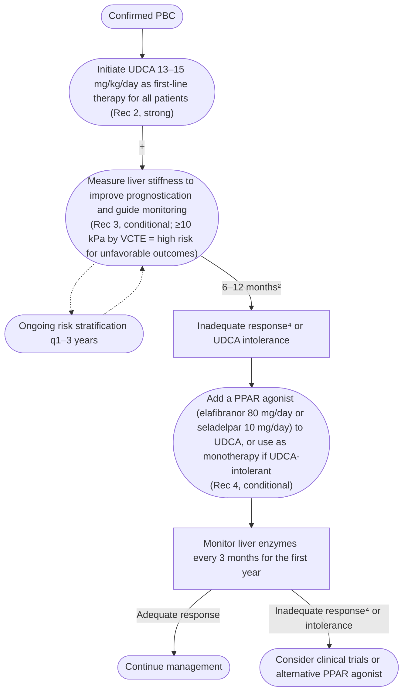

## Contents
- [[#Assessment]]
  - [[#Establishing the Diagnosis]]
  - [[#Severity Assessment]]
  - [[#PBC-AIH Variant]]
- [[#Differential Diagnosis]]
- [[#Diagnostics]]
  - [[#Laboratory Tests]]
  - [[#Autoantibodies]]
  - [[#Imaging]]
  - [[#Liver Biopsy]]
- [[#Therapeutics]]
  - [[#Treatment Pathway]]
  - [[#Ursodeoxycholic Acid (First-Line)]]
  - [[#PPAR Agonists (Second-Line)]]
  - [[#Obeticholic Acid (Second-Line)]]
  - [[#Fibrates (Second-Line, Off-Label)]]
  - [[#Other Agents]]
  - [[#Pruritus]]
  - [[#Fatigue]]
  - [[#Sicca Syndrome]]
  - [[#Bone Disease]]
  - [[#Hyperlipidemia]]
  - [[#Fat-Soluble Vitamins]]
  - [[#Portal Hypertension]]
  - [[#Hepatocellular Carcinoma Surveillance]]
  - [[#Liver Transplantation]]
  - [[#Pregnancy]]
  - [[#Screening First-Degree Relatives]]
  - [[#Monitoring Schedule]]

## Assessment

### Establishing the Diagnosis

Primary biliary cholangitis (PBC; formerly "primary biliary cirrhosis") — chronic autoimmune cholestatic disease; progressive nonsuppurative destruction of interlobular and septal bile ducts. Middle-aged women, 9:1 female predominance.

**Diagnosis = 2 of these 3** ([[aasld-2018-pbc]], Guidance Statement 1):

1. Biochemical cholestasis — elevated alkaline phosphatase (ALP)
2. Anti-mitochondrial antibody (AMA), or PBC-specific autoantibody (sp100 or gp210) if AMA-negative
3. Histology — nonsuppurative destructive cholangitis + destruction of interlobular bile ducts

- Criteria 1 + 2 met → no [[liver-biopsy|liver biopsy]] needed. Biopsy adds little once ALP is ≥1.5× upper limit of normal (ULN) with aspartate aminotransferase (AST) <5× ULN. Indications: [[#Liver Biopsy]].
- **Presentation:** most asymptomatic (incidental ALP rise). Fatigue 50–78%, pruritus 20–70%, right upper quadrant pain ~17%.
- **Exam:** usually normal early; [[jaundice]], hyperpigmentation, [[ascites]], splenomegaly late.

### Severity Assessment

- **Bilirubin** — best predictor of survival; the key component of every prognostic model.
- **Falling albumin and platelets** (with rising bilirubin, globulins) — early signs of [[cirrhosis]]/[[portal-hypertension|portal hypertension]].
- **ALP less than twice the ULN on treatment** — reliable predictor of treatment response.
- **Liver stiffness — 2026 Rec 3 (Conditional, Moderate certainty): measure it for prognostication** ([[aasld-aga-2026-pbc]]).
  - **Liver stiffness measurement (LSM) ≥10 kPa by [[liver-stiffness-measurement|vibration-controlled transient elastography (VCTE)]]** = increased risk of adverse outcomes → closer monitoring and/or possible therapy escalation (panel consensus threshold; published cutoffs 9.3–11.0 kPa).
  - **Annual VCTE** at ≥10 kPa and after any change in therapy; <10 kPa → meaningful change less likely. The most recent LSM predicts better than the change between measurements.
  - Cholestasis (ALP ≥1.5× ULN or raised bilirubin) may make LSM less reliable for portal hypertension.
  - Over 1 year, a **≥20% rise** in LSM is associated with worse and a **≥20% fall** with improved outcomes; LSM predicts independently of biochemistry (EASL–AASLD 2026 Statement 1.2.2; [[easl-aasld-2026-pbc-surrogate-endpoints]]).

| Prognostic model | Variables | Action threshold |
|---|---|---|
| GLOBE | bilirubin, albumin, ALP, platelets after 1 y of [[ursodeoxycholic-acid\|ursodeoxycholic acid (UDCA)]] + age at start of therapy | >0.30 = shorter transplant-free survival than age/sex-matched healthy population |
| UK-PBC | ALP, aminotransferases, bilirubin at 12 mo + baseline albumin and platelets | Predicts [[liver-transplantation\|liver transplantation (LT)]] or liver-related death at 5, 10, 15 y; no cut-point given |
| Mayo risk score | Usable without biopsy | 4.1 → [[upper-endoscopy\|esophagogastroduodenoscopy (EGD)]] and [[hcc-surveillance\|hepatocellular carcinoma (HCC) surveillance]] (exact signs below); >7.8 → LT referral |

*AASLD gives the variables and action thresholds, not the coefficients. GLOBE calculator: <https://www.globalpbc.com/globe>.*

**Response to UDCA — 2026 rules govern** ([[aasld-aga-2026-pbc]], ungraded implementation considerations):
- Assess **after ≥6 months and no later than 12 months**; at **6 months** with high-risk features, including but not limited to **LSM ≥10 kPa and age <62 years** (Figure 1 note 2; the Rec 4 text says ≤62).
- **Inadequate response** (used in most studies) = failure to reach **ALP <1.5–1.67× ULN with normal total bilirubin at 12 months**. **ALP normalization is the ideal goal** where attainable — particularly with LSM ≥10 kPa.
- ALP 1.0–1.5× ULN or bilirubin 0.6–1× ULN: limited evidence to start a second-line agent; favor **risk-based** (LSM, age) over threshold-based decisions.
- Trial endpoints (EASL–AASLD 2026 Recommendation 1.1.1, Strong, level of evidence 2): **complete response = normal ALP + normal total bilirubin**; adequate = ALP <1.5–1.67× ULN + normal total bilirubin ([[easl-aasld-2026-pbc-surrogate-endpoints]]).
- Older rule: assess after 1 year (2018 Guidance Statement 7) by any one binary criterion (Rochester, Barcelona, Paris, Rotterdam, Toronto, Global — cut-points on [[ursodeoxycholic-acid#Biochemical Response to UDCA (Assessed at 12 Months)|ursodeoxycholic acid]]); up to 40% respond inadequately ([[aasld-2018-pbc]]).

### PBC-AIH Variant

Simultaneous [[autoimmune-hepatitis|autoimmune hepatitis (AIH)]] in AMA-positive PBC — not incidental antinuclear antibody (ANA) positivity with mild interface hepatitis, which is common in PBC. Worse outcomes than classic PBC (portal hypertension complications, death, LT) ([[aasld-2018-pbc]]). Paris criteria (and how AASLD 2018 vs 2020 state them), AIH-side workup and regimens: [[autoimmune-hepatitis#Overlap / Variant Syndromes]].

**US guidance** ([[aasld-2018-pbc]]; [[aasld-2020-autoimmune-hepatitis]]):
- PBC with **alanine aminotransferase (ALT) >5× ULN → consider biopsy** to rule out concomitant AIH or other liver disease (2018 Guidance Statement 3).
- Paris criteria **aid** diagnosis but may miss less cholestatic cases; **do not use the revised or simplified International Autoimmune Hepatitis Group (IAIHG) scores** for overlap (2020).
- AMA alone in AIH is insufficient — tissue required (AMA in 8–12% of AIH without duct injury; these do not evolve into PBC) (2020).
- **Treat the predominant histological pattern** (2018 Guidance Statement 4); **consider adding UDCA to prednisone or prednisolone + azathioprine** (2020). No randomized controlled data (2018).
- **Consecutive PBC/AIH:** ~2.5% of PBC later develop acute AIH (AMA may be lost) (2018).

**International Delphi consensus** ([[gerussi-2026-pbc-aih-delphi]]; where US guidance is silent):
- "PBC–AIH **variant**" (one dominant disease presenting atypically), not overlap. Diagnose on the **combination** of transaminase *and* cholestatic elevation, raised immunoglobulin G (IgG), autoantibodies and histology; Paris and Zhang criteria failed to reach consensus (contrast AASLD 2020).
- **Suspect in established PBC:** incomplete UDCA response at 12 months + **disproportionate transaminase rise** (undefined; the authors cite **R ratio = (ALT ÷ ALT ULN) ÷ (ALP ÷ ALP ULN)** — >5 hepatocellular, <2 cholestatic).
- **Liver biopsy is required** when features suggest PBC–AIH.
- **Immunosuppress only for severe interface hepatitis — ≥3/4 on the Ishak modified Histologic Activity Index**, not moderate (≥2/4). Re-evaluate over time; features can appear sequentially.
- Conflict: [[easl-2025-autoimmune-hepatitis]] (non-US) starts immunosuppression at **moderate** hepatitis (UDCA alone for mild). Neither is a US recommendation.

> [!pearl] Second-line PBC drugs lower transaminases too
> Peroxisome proliferator–activated receptor (PPAR) and farnesoid X receptor (FXR) agonists reduce transaminases along with cholestatic markers. The Delphi authors suggest considering optimising anti-cholestatic therapy before immunosuppression in appropriate patients; since UDCA itself can lower ALT/AST, rechecking liver tests 6–12 months (or earlier) after starting it helps separate PBC from PBC–AIH (discussion text, not a voted statement; [[gerussi-2026-pbc-aih-delphi]]).

---

## Differential Diagnosis

*Workup: see [[abnormal-liver-chemistries]] — cholestatic pattern, ALP with gamma-glutamyl transferase (GGT) elevation ([[acg-2017-liver-chemistries]]).*

- [[primary-sclerosing-cholangitis|Primary sclerosing cholangitis (PSC)]] — cholangiographic findings on [[mri-mrcp|magnetic resonance cholangiopancreatography (MRCP)]]; [[inflammatory-bowel-disease|inflammatory bowel disease]]; male predominance; AMA-negative
- [[autoimmune-hepatitis|Autoimmune hepatitis]] — ANA/anti-smooth muscle antibody (SMA) and IgG elevated; interface hepatitis
- [[drug-induced-liver-injury]] — medication/herbal and dietary supplement history; cholestatic R ratio
- Secondary biliary cirrhosis — extrinsic [[biliary-stricture|biliary obstruction]]; MRCP/computed tomography (CT) distinguishes
- Sarcoidosis — granulomatous hepatitis; systemic findings; AMA-negative
- [[igg4-related-cholangitis|Immunoglobulin G4-related sclerosing cholangitis]] — elevated IgG4; may mimic PSC or PBC
- [[nafld-masld|Nonalcoholic/metabolic fatty liver]] — can give a cholestatic pattern; may coexist and blunt UDCA response

---

## Diagnostics

### Laboratory Tests

- **ALP:** elevated in most; diagnostic and monitoring marker. **GGT** confirms hepatic origin.
- **ALT/AST:** mildly elevated; markedly raised ALT → [[#PBC-AIH Variant]].
- **Bilirubin:** may be normal early; a rise signals progression (ductopenia, biliary piecemeal necrosis).
- **Immunoglobulin M (IgM):** typically elevated; raised IgG and aminotransferases mainly reflect periportal and lobular necrosis and inflammation.
- **Thyroid-stimulating hormone (TSH):** autoimmune thyroid disease is more common ([[#Monitoring Schedule]]).

### Autoantibodies

- **AMA** — positive in **95%** (PDC-E2 antigen); presence, not titre, matters. Indirect immunofluorescence is least sensitive (over 15% of sera negative by it react to MIT3 on other assays) → immunoblotting, enzyme immunoassay, Luminex beads or enzyme inhibition.
  - **AMA-positive, normal ALP:** ~1 in 6 develop PBC by 5 years; liver tests every 2–3 years until age 65 seems reasonable (no data).
- **Anti-sp100, anti-gp210** — in >30% of AMA-negative patients; **support the diagnosis without biopsy** (2018 Guidance Statement 2). Anti-gp210 may carry prognostic information.
  - **2026 Rec 1 (Conditional, Very Low certainty): AMA-negative suspected PBC → test sp100 and gp210 before liver biopsy** ([[aasld-aga-2026-pbc]]); a positive result may obviate biopsy. Rule-in, not rule-out: sensitivity 22.7% (sp100) / 19.7% (gp210), specificity 96.5% / 99.0%. **Both negative + strong suspicion → biopsy.** Not for population screening.
- **Anti-kelch-like 12, anti-hexokinase 1** — 35% and 22% of AMA-negative PBC; not widely available.
- **ANA, SMA** — in nearly half of PBC; do not by themselves establish AIH ([[#PBC-AIH Variant]]).

### Imaging

- **Expert noninvasive imaging of the liver and biliary tree** — mandatory in all patients with biochemical cholestasis.
- **MRCP or cholangiography** — diagnosis uncertain; excludes PSC and other biliary disease.
- **Transient elastography** — staging and risk stratification ([[#Severity Assessment]]); stable in noncirrhotic PBC on UDCA, rises significantly once cirrhosis is present.

### Liver Biopsy

- **Indicated when:** AMA-negative *and* sp100/gp210 absent (should show bile duct destruction — ideally a florid duct lesion and/or granulomas) · ALT >5× ULN — consider ([[#PBC-AIH Variant]]) · occasionally, to exclude other concomitant disease such as AIH or nonalcoholic steatohepatitis. **Not** a tool for monitoring treatment response.
- **Histology:** nonsuppurative destructive cholangitis; florid duct lesion; epithelioid granulomas early; biliary-type fibrosis, cholestatic rosettes, feathery degeneration late. **Ductopenia** = fewer than 50% of portal tracts containing bile ducts. Adequate sample: 10–15 portal tracts, multiple sections.
- **Ludwig stages:** I — portal inflammation ± florid duct lesion, confined to portal triads · II — interface hepatitis, periportal extension, ductular proliferation · III — architectural distortion, numerous fibrous septa · IV — cirrhosis with regenerative nodules.

---

## Therapeutics

### Treatment Pathway

*Treatment pathway after confirmed PBC (² assess at 6 months if high-risk features, e.g. LSM ≥10 kPa and age <62 y · ⁴ failure to reach ALP <1.5–1.67× ULN and normal total bilirubin at 12 months)*
*Source: redrawn from Figure 1 (clinical decision support tool) of the AASLD AGA 2026 PBC guideline*
*[[aasld-aga-2026-pbc|AASLD AGA 2026 PBC Guideline]]*
*PBC = primary biliary cholangitis · UDCA = ursodeoxycholic acid · VCTE = vibration-controlled transient elastography · PPAR = peroxisome proliferator–activated receptor · LSM = liver stiffness measurement · ALP = alkaline phosphatase · ULN = upper limit of normal · Rec = recommendation*

### Ursodeoxycholic Acid (First-Line)

**UDCA 13–15 mg/kg/day orally for every patient** — **2026 Rec 2 (Strong, Moderate certainty; [[aasld-aga-2026-pbc]])**: offer at diagnosis. 2018 Guidance Statement 5: abnormal liver enzymes, any histologic stage; superior to 5–7 and 23–25 mg/kg/day ([[aasld-2018-pbc]]).

- **Do not increase above 15 mg/kg/day** for symptoms or persistent ALP elevation.
- **Continue UDCA even when ALP stays high** — inadequate response is not futility; add second-line therapy on top. No subgroup exempted (advanced fibrosis, decompensated cirrhosis, awaiting LT) unless intolerant.
- Improves transplant-free survival and slows progression; does **not** improve fatigue, pruritus, bone disease or autoimmune features. Administration, sequestrant spacing, timing of effect: [[ursodeoxycholic-acid#Administration]].

### PPAR Agonists (Second-Line)

**2026 Rec 4 (Conditional, Low certainty; [[aasld-aga-2026-pbc]]):** inadequate response to or intolerance of UDCA → **PPAR agonist** — **add-on to UDCA** for inadequate response, **monotherapy** if UDCA-intolerant.

| Agent | Dose / status | Certainty |
|---|---|---|
| Elafibranor | **80 mg/day**; accelerated US Food and Drug Administration (FDA) approval | Low |
| Seladelpar | **10 mg/day**; accelerated FDA approval | Low |
| Bezafibrate | **Off-label**; not available in the US | Very low |
| Fenofibrate | **Off-label** | Very low |

- **Liver tests quarterly in year 1** (expert opinion), less often once benefit and tolerability are established.
- **Not in pregnancy, breastfeeding or decompensated cirrhosis** (no efficacy/safety data).
- Elafibranor/seladelpar: no added serious adverse events, discontinuation or muscle toxicity vs placebo. Possible class effect; no head-to-head trials.
- No adequate response after 12 months → **clinical trials or an alternative PPAR agonist** (no data on switching or combinations).

### Obeticholic Acid (Second-Line)

> [!pitfall] Obeticholic acid is no longer second-line
> The 2026 AASLD–AGA guideline suggests PPAR agonists after UDCA and does not address obeticholic acid (OCA) as a therapy ([[aasld-aga-2026-pbc]]). OCA was withdrawn from the European Union market at the end of November 2024 and the US market in September 2025, after its confirmatory trial (COBALT) failed its primary outcomes and post-marketing reports showed serious liver injury with and without cirrhosis ([[easl-aasld-2026-pbc-surrogate-endpoints]]).

- Older guidance: OCA starting at 5 mg/day ([[aasld-2018-pbc]] Guidance Statement 8); **contraindicated in advanced cirrhosis** (2021 Revised Guidance Statement 10; [[aasld-2021-pbc]]). Titration and the advanced-cirrhosis definition: [[ursodeoxycholic-acid#Second-Line Agents]].

### Fibrates (Second-Line, Off-Label)

- **2021 Revised Guidance Statement 9:** fibrates can be considered off-label for inadequate UDCA response; discouraged in decompensated liver disease ([[aasld-2021-pbc]]). **2026:** less studied than elafibranor/seladelpar, sometimes used off-label second-line (Very low certainty); no dose given ([[aasld-aga-2026-pbc]]). Doses used in studies: [[ursodeoxycholic-acid#Second-Line Agents]].
- **Adverse effects:** creatinine rise (increased production, not a fall in glomerular filtration rate; typically reversible), bilirubin rise (deserves evaluation), myalgias, heartburn, transaminase elevation ([[aasld-2018-pbc]]).

### Other Agents

No benefit alone or with UDCA: chlorambucil, penicillamine, [[calcineurin-inhibitors|cyclosporine]], corticosteroids, [[thiopurines|azathioprine]], mycophenolate mofetil, thalidomide, methotrexate, malotilate, colchicine, silymarin. Budesonide may help but is controversial.

### Pruritus

**2026 Rec 5 (Conditional, Low certainty; [[aasld-aga-2026-pbc]]): linerixibat** (ileal bile acid transporter inhibitor) for **moderate to severe** cholestatic pruritus — **40 mg twice daily**, **2- to 12-week trial**; continue if it helps. Patients weighing gastrointestinal side effects (diarrhea, abdominal pain) or cost above variable benefit may reasonably decline.
- Severity set by the patient; insufficient evidence in **mild** itch; decompensated cirrhosis excluded from trials.
- **Inadequate UDCA response + itch → PPAR agonist first** (may reduce pruritus); linerixibat if itch persists (Figure 1).
- Diarrhea (peaks ~week 3): reduce the dose temporarily, or add [[loperamide]] and/or dicyclomine.
- 2026 does not grade the older agents below or order them against linerixibat.
- UDCA and OCA do not relieve itch; worse in the evening, with pregnancy or estrogens. Intractable pruritus can justify LT.

| Step | Treatment | Notes |
|---|---|---|
| 1 | Lifestyle | Avoid tight/itchy clothing, moisturizers for dry skin, tepid (not hot) baths, ice packs |
| 2 | Cholestyramine 4 g/dose up to 16 g/day (Guidance Statement 11) | Initial therapy; give 1 h after or 4 h before other drugs and 20 min before meals. Colestipol, colesevelam are alternatives |
| 3a | Rifampicin 150–300 mg twice daily (Guidance Statement 12) | Avoid if bilirubin >2.5 mg/dL, with close follow-up — drug-induced liver injury (up to [[acute-liver-failure\|acute liver failure]]), hemolysis, renal impairment; many interactions |
| 3b | Naltrexone titrated to 50 mg/day (Guidance Statement 12) | Start 12.5 mg/day, increase by 12.5 mg every 3–7 days; withdrawal-like reaction on initiation (usually self-limited); follow liver tests |
| 3c | Sertraline 75–100 mg/day (Guidance Statement 12) | Effect independent of antidepressant action |

*Stepwise management of cholestatic pruritus in primary biliary cholangitis*
*Built from [[aasld-2018-pbc]] Guidance Statements 11 and 12 plus its lifestyle commentary (the guidance has no figure)*
*[[aasld-2018-pbc|AASLD 2018 Practice Guidance: Primary Biliary Cholangitis]]*

Severe refractory itch: plasmapheresis, albumin dialysis, biliary drainage, light therapy (small series).

### Fatigue

- Most common symptom. Exclude hypothyroidism, depression, anemia, sleep apnea.
- **No effective drug** (ondansetron, fluoxetine, modafinil failed); education, counselling, energy conservation.
- **Not an indication for LT** — usually persists afterwards.

### Sicca Syndrome

Sjögren's syndrome, scleroderma and CREST features are more common in PBC, including [[esophageal-dysfunction-systemic-disease|esophageal dysfunction]].

- **Dry eyes** (Guidance Statement 13): artificial tears → pilocarpine or cevimeline → cyclosporine or lifitegrast ophthalmic emulsion, preferably with an ophthalmologist.
- **Xerostomia** (Guidance Statement 14): saliva substitutes, water sips, sugar-free gum/candy, moisturizing mouthwash → pilocarpine or cevimeline; regular dental review.

### Bone Disease

Fibrotic PBC carries a significantly greater risk of osteopenia and osteoporosis.

- **Calcium 1,000–1,500 mg/day + vitamin D 1,000 IU/day** (diet ± supplements; Guidance Statement 17); avoid with a history of renal stones.
- **Osteoporosis: alendronate 70 mg weekly** or another effective bisphosphonate; monthly ibandronate comparable; etidronate ineffective (Guidance Statement 18).
- **Oral bisphosphonates "should be avoided" with acid reflux or known varices** (2018 Guidance Statement 18). Newer [[acg-2026-preventive-care-cirrhosis|ACG 2026]] disagrees on varices — not by themselves a contraindication (no excess gastrointestinal bleeding in studies); acid reflux not addressed. Comparison on [[cirrhosis]].
- Hormone replacement modestly improves bone density but is seldom used.

### Hyperlipidemia

- Common; cardiovascular risk data conflict; attend to concomitant hypertension.
- **Consider lipid-lowering therapy for elevated lipids plus cardiovascular risk** (Guidance Statement 19); **statins appear safe even with abnormal liver tests**; fibrates used safely.

### Fat-Soluble Vitamins

- Deficiency uncommon unless jaundiced; jaundiced → check levels annually ([[#Monitoring Schedule]]).
- **Deficient:** parenteral or water-soluble supplements (Guidance Statement 20). Prolonged international normalized ratio that responds to a vitamin K trial → subcutaneous vitamin K.

### Portal Hypertension

From biliary cirrhosis or, **precirrhotic**, from [[porto-sinusoidal-vascular-disorder|nodular regenerative hyperplasia]] — 6% of noncirrhotic PBC have varices.

- **[[variceal-upper-gi-bleeding|Variceal]] screening:** EGD when cirrhosis is suspected (Guidance Statement 15).
  - Platelet cutoffs used in studies: **<200,000/mm³** and **<140,000/mm³**. Liver stiffness **≥17 kPa** could also be considered (not yet studied). Varices virtually never found unless the Mayo risk score is at least 4.1.
  - Repeat interval: [[#Monitoring Schedule]].
- Large varices: [[nonselective-beta-blockers|nonselective beta-blockers]] or endoscopic variceal ligation per [[portal-hypertension]]. Non-US [[baveno-viii-2026-portal-hypertension|Baveno VIII (2026)]] restricts screening endoscopy in compensated advanced chronic liver disease to those ineligible for nonselective beta-blockers.
- **Precirrhotic variceal bleeding** refractory to drugs and endoscopy → [[tips|transjugular intrahepatic portosystemic shunt]] rather than LT when synthetic function is good.

### Hepatocellular Carcinoma Surveillance

HCC risk modestly raised (3.9 per 1,000 person-years); highest in men, advanced disease, suboptimal UDCA response.

- **Cross-sectional imaging every 6 months** for **men with PBC** and **patients with cirrhosis** (Guidance Statement 16; modality: [[#Monitoring Schedule]]).
- **No biopsy:** consider surveillance with a low platelet count, Mayo risk score >4.1, or liver stiffness ≥17 kPa (text). Table 2 defines suspected cirrhosis as platelets **<140,000/mm³** or Mayo risk score **≥4.1**.

### Liver Transplantation

**Refer for LT evaluation** with decompensated cirrhosis, [[cirrhosis|Model for End-Stage Liver Disease (MELD)]] score **>14** (Guidance Statement 21; the text says at least 15), total bilirubin **>6 mg/dL**, or Mayo risk score **>7.8**. Severe intractable pruritus is an exceptional indication; fatigue is not.

- **Recurrent PBC:** 20–30% by 10 years, up to 50% by 20 years; median 3–6 years ([[aasld-2018-pbc]]; [[aasld-aga-2026-pbc]]). Risk factors: [[tacrolimus]], advanced donor age, higher MELD at listing ([[aasld-2018-pbc]]). ⚠ 2018 said recurrence infrequently affects patient or graft survival; 2026 associates it with **graft loss (hazard ratio 2.01) and lower patient survival (hazard ratio 1.72)** ([[aasld-aga-2026-pbc]]).
- **2026 Rec 6 (Conditional, Very Low certainty): UDCA prophylaxis after LT for PBC** to prevent recurrence and graft failure — **13–15 mg/kg/day, started as soon as possible after LT** ([[aasld-aga-2026-pbc]]). Cyclosporine-based immunosuppression may reduce recurrence (unproven; [[aasld-2018-pbc]]).
- **After LT:** pruritus improves; fatigue (nearly half at 2 years) and sicca persist; AMA may persist or reappear without signalling recurrence.

### Pregnancy

- Estrogens promote cholestasis — oral contraceptives and estrogen supplements may induce or worsen pruritus; itch may become severe early in pregnancy and not fully resolve after delivery ([[aasld-2018-pbc]]). PBC flare after delivery reported ([[acg-2016-liver-disease-pregnancy]]).
- **Continue UDCA in pregnancy** ([[acg-2016-liver-disease-pregnancy]] Rec 32 — strong, very low level of evidence): potential UDCA risks appear small vs the benefit to maternal and fetal outcomes; safety supported by use in [[intrahepatic-cholestasis-of-pregnancy|intrahepatic cholestasis of pregnancy]].
- **With cirrhosis:** check for varices in the second trimester (blood volume rises markedly); beta-blockers are safe; keep the second stage of labor short (Valsalva can precipitate variceal hemorrhage) ([[aasld-2018-pbc]]). More: [[liver-disease-in-pregnancy]].

### Screening First-Degree Relatives

Risk raised in first-degree relatives (FDRs), especially sisters and daughters. Screening is usually recommended for female FDRs from **age 30**: ALP, then AMA if ALP elevated; AMA-negative → repeat at 5-year intervals. Value not firmly established.

### Monitoring Schedule

| Parameter | Interval |
|---|---|
| Liver tests | Every 3–6 months |
| TSH | Annually |
| Bone mineral density | Every 2 years |
| Vitamins A, D, E + prothrombin time | Annually if bilirubin >2.0 (unit not printed) |
| EGD — cirrhotic, Mayo risk score >4.1, or transient elastography ≥17 kPa | Every 1–3 years (interval set by the previous EGD) |
| Ultrasound ± alpha-fetoprotein — known or suspected cirrhosis (platelets <140,000/mm³ or Mayo ≥4.1), and men | Every 6 months |

*Follow-up of primary biliary cholangitis*
*Recreated from Table 2 of [[aasld-2018-pbc]]*
*[[aasld-2018-pbc|AASLD 2018 Practice Guidance: Primary Biliary Cholangitis]]*
*TSH = thyroid-stimulating hormone · EGD = esophagogastroduodenoscopy*

- The guidance text gives a different EGD rule from its table: known cirrhosis with Mayo risk score greater than 4.1 or transient elastography at least **7 kPa** → EGD every **2–3 years**.

**General advice:** avoid excessive alcohol, [[obesity]] and smoking (promote progression, may jeopardize transplant candidacy); avoid uncooked seafood and unpasteurized milk. With cirrhosis: caution with nonsteroidal anti-inflammatory drugs, benzodiazepines, aminoglycosides; tell surgeons and anesthesiologists before any operation.

---

## See Also

[[ursodeoxycholic-acid]], [[primary-sclerosing-cholangitis]], [[autoimmune-hepatitis]], [[drug-induced-liver-injury]], [[abnormal-liver-chemistries]], [[jaundice]], [[portal-hypertension]], [[nonselective-beta-blockers]], [[hepatocellular-carcinoma]], [[hcc-surveillance]], [[liver-transplantation]], [[liver-disease-in-pregnancy]], [[tacrolimus]], [[cholangiocarcinoma]], [[nafld-masld]], [[mri-mrcp]], [[noninvasive-liver-disease-assessment]], [[liver-biopsy]], [[upper-endoscopy]], [[ascites]], [[obesity]], [[variceal-upper-gi-bleeding]], [[intrahepatic-cholestasis-of-pregnancy]], [[liver-stiffness-measurement]], [[porto-sinusoidal-vascular-disorder]], [[cirrhosis]], [[biliary-stricture]], [[calcineurin-inhibitors]], [[thiopurines]], [[esophageal-dysfunction-systemic-disease]], [[acute-liver-failure]], [[inflammatory-bowel-disease]], [[igg4-related-cholangitis]], [[tips]]

---

## Sources

1. [[aasld-2018-pbc|AASLD 2018 Practice Guidance: Primary Biliary Cholangitis]]
2. [[aasld-2021-pbc|AASLD 2021 Practice Guidance Update: Primary Biliary Cholangitis]]
3. [[acg-2017-liver-chemistries|ACG 2017: Evaluation of Abnormal Liver Chemistries]]
4. [[acg-2016-liver-disease-pregnancy|ACG Clinical Guideline: Liver Disease and Pregnancy (2016)]]
5. [[aasld-2020-autoimmune-hepatitis|AASLD Practice Guidance on Autoimmune Hepatitis (2020)]]
6. [[baveno-viii-2026-portal-hypertension|Baveno VIII — Advancing Consensus in Portal Hypertension (2026)]]
7. [[acg-2026-preventive-care-cirrhosis|ACG Clinical Guideline: Preventive Care for Patients With Cirrhosis (2026)]]
8. [[gerussi-2026-pbc-aih-delphi|Definition, Diagnosis, and Treatment of Primary Biliary Cholangitis–Autoimmune Hepatitis (PBC–AIH) Variant: An International Expert Delphi Consensus (2026)]]
9. [[easl-2025-autoimmune-hepatitis|EASL Clinical Practice Guidelines on the management of autoimmune hepatitis (2025)]]
10. [[aasld-aga-2026-pbc|AASLD AGA Clinical Practice Guideline on Management of Primary Biliary Cholangitis (2026)]]
11. [[easl-aasld-2026-pbc-surrogate-endpoints|EASL-AASLD Delphi Consensus Statement on Surrogate Endpoints and Real-World Evidence in Primary Biliary Cholangitis (2026)]]
