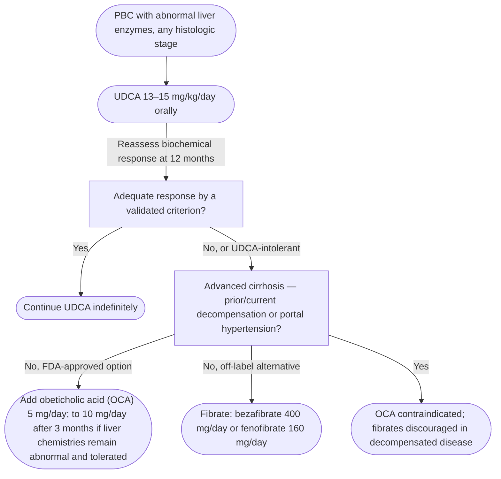

## Contents
- [[#Assessment]]
  - [[#Establishing the Diagnosis]]
  - [[#Severity Assessment]]
  - [[#PBC-AIH Variant]]
- [[#Differential Diagnosis]]
- [[#Diagnostics]]
  - [[#Laboratory Tests]]
  - [[#Autoantibodies]]
  - [[#Imaging]]
  - [[#Liver Biopsy]]
- [[#Therapeutics]]
  - [[#Treatment Pathway]]
  - [[#Ursodeoxycholic Acid (First-Line)]]
  - [[#Obeticholic Acid (Second-Line)]]
  - [[#Fibrates (Second-Line, Off-Label)]]
  - [[#Other Agents]]
  - [[#Pruritus]]
  - [[#Fatigue]]
  - [[#Sicca Syndrome]]
  - [[#Bone Disease]]
  - [[#Hyperlipidemia]]
  - [[#Fat-Soluble Vitamins]]
  - [[#Portal Hypertension]]
  - [[#Hepatocellular Carcinoma Surveillance]]
  - [[#Liver Transplantation]]
  - [[#Pregnancy]]
  - [[#Screening First-Degree Relatives]]
  - [[#Monitoring Schedule]]

## Assessment

### Establishing the Diagnosis

Primary biliary cholangitis (PBC; formerly "primary biliary cirrhosis") — chronic autoimmune cholestatic disease; progressive nonsuppurative destruction of interlobular and septal bile ducts. Middle-aged women, 9:1 female predominance.

**Diagnosis = 2 of these 3** ([[aasld-2018-pbc]], Guidance Statement 1):

1. Biochemical cholestasis — elevated alkaline phosphatase (ALP)
2. Anti-mitochondrial antibody (AMA), or PBC-specific autoantibody (sp100 or gp210) if AMA-negative
3. Histology — nonsuppurative destructive cholangitis + destruction of interlobular bile ducts

- Criteria 1 + 2 met → no [[liver-biopsy|liver biopsy]] needed. Biopsy adds little once ALP is ≥1.5× upper limit of normal (ULN) with aspartate aminotransferase (AST) <5× ULN.
- **Presentation:** most asymptomatic at diagnosis (incidental ALP rise). Symptomatic — fatigue 50–78%, pruritus 20–70%, right upper quadrant pain ~17%. [[jaundice|Jaundice]] is late.
- **Exam:** normal early. Late — hepatomegaly, xanthelasma, xanthomas, jaundice, splenomegaly, [[ascites]], excoriations. Limited scleroderma (CREST) features if coexistent: sclerodactyly, telangiectasias.

### Severity Assessment

- **ALP** — cardinal marker, diagnosis and monitoring. Alanine aminotransferase (ALT)/AST mildly elevated; immunoglobulin M (IgM) typically elevated.
- **Bilirubin** — best single predictor of survival and the key component of every prognostic model; a rise means advanced disease.
- **Albumin + platelet count** — early indicators of [[cirrhosis]]/[[portal-hypertension|portal hypertension]].
- **ALP <2× ULN on treatment** is a reliable predictor of treatment response.
- **[[liver-stiffness-measurement|Transient elastography]]** — liver stiffness >9.6 kPa → 5× more likely to progress to decompensation, death, or transplant; serial measurements risk-stratify. ≥17 kPa triggers [[hcc-surveillance|hepatocellular carcinoma (HCC) surveillance]] and variceal screening even without confirmed cirrhosis.

| Prognostic model | Variables | Action threshold |
|---|---|---|
| GLOBE | bilirubin, albumin, ALP, platelets after 1 y of [[ursodeoxycholic-acid\|ursodeoxycholic acid (UDCA)]] + age at start of therapy | >0.30 = shorter transplant-free survival than age/sex-matched healthy population |
| UK-PBC | ALP, aminotransferases, bilirubin at 12 mo + baseline albumin and platelets | Predicts liver transplantation (LT) or liver-related death at 5, 10, 15 y; no cut-point given |
| Mayo risk score | Usable without biopsy | ≥4.1 → [[upper-endoscopy\|esophagogastroduodenoscopy (EGD)]] and HCC surveillance; >7.8 → LT referral |

*AASLD gives the variables and the action thresholds but not the coefficients or point values. Compute GLOBE at <https://www.globalpbc.com/globe>; the Mayo and UK-PBC formulas are in their derivation papers.*

**Biochemical response to UDCA — assess at 12 months** (Guidance Statement 7). Several validated binary criteria exist (Rochester I/II, Barcelona, Paris I/II, Rotterdam, Toronto, Global); any one may be used and **the cut-points are on [[ursodeoxycholic-acid]]** ([[aasld-2018-pbc]], Table 1). Table 1's "Global" row is a binary ALP criterion, not the continuous GLOBE score above. Up to 40% of patients respond inadequately and should be assessed for second-line therapy.

**Histologic staging (Ludwig):** I — portal inflammation ± florid duct lesion, confined to portal triads · II — interface hepatitis, periportal extension, ductular proliferation · III — bridging fibrosis, numerous fibrous septa · IV — cirrhosis with regenerative nodules. Adequate biopsy needs 10–15 portal tracts and multiple sections.

### PBC-AIH Variant

Simultaneous [[autoimmune-hepatitis|autoimmune hepatitis (AIH)]] in a patient with AMA-positive PBC. Not applicable to incidental antinuclear antibody (ANA)/anti-smooth muscle antibody (SMA) positivity or mild interface hepatitis — both are common in PBC itself. Reported in 1–14.2% of patients with PBC (higher in Hispanic patients), with worse outcomes than classic PBC (portal hypertension, death, LT).

Now termed a **variant**, not an overlap syndrome, and diagnosed on the overall picture ([[gerussi-2026-pbc-aih-delphi]], international Delphi consensus):

- **"PBC–AIH" is the agreed term.** A *variant* = subtype of one dominant disease presenting atypically; *overlap* = meeting two full sets of criteria, which is real but rare.
- **Diagnosis rests on a combination of laboratory, serological and histological findings — no single parameter and no strict criteria:** concurrent transaminase *and* cholestatic elevation, raised immunoglobulin G (IgG), relevant autoantibodies and compatible histology, together. The Paris and Zhang criteria, and any rule on clinical judgement or histology alone, failed to reach consensus.
- **Liver biopsy is required** when clinical or biochemical features suggest PBC–AIH.
- **Immunosuppression threshold: severe interface hepatitis, ≥3/4 on the Ishak modified Histologic Activity Index** — *not* moderate (≥2/4); treating any grade of interface hepatitis was judged inappropriate. Drug choice follows the AIH recommendations and local practice; endpoints follow current AIH and PBC guidance. No timing rule was agreed. See [[autoimmune-hepatitis]].
- **Re-evaluate over time** — the phenotype evolves and features can appear sequentially.
- Untreated, PBC–AIH has a **worse natural history than PBC alone**; whether treatment alters prognosis reached no consensus.
- **Consecutive PBC/AIH:** ~2.5% of patients with PBC later develop acute AIH (AMA may be lost; histology becomes typical AIH).

> [!pitfall] Escalate anti-cholestatic therapy before reaching for immunosuppression
> Suspect PBC–AIH when a patient has an **incomplete response to UDCA at 12 months plus a disproportionate transaminase rise relative to cholestasis** — but peroxisome proliferator–activated receptor (PPAR) and farnesoid X receptor (FXR) agonists lower transaminases along with cholestatic markers, so optimise them first and **recheck liver biochemistry at 6–12 months or sooner** ([[gerussi-2026-pbc-aih-delphi]]).

"Disproportionate" is explicitly undefined; the consensus cites the conventional **R ratio = (ALT ÷ ALT ULN) ÷ (ALP ÷ ALP ULN)** — **>5 hepatocellular, <2 cholestatic** — while noting some patients with PBC simply have a hepatitic biochemical profile without PBC–AIH.

The **Paris criteria table lives on [[autoimmune-hepatitis]]** — [[aasld-2018-pbc]] requires 2 of 3 AIH criteria (ALT >5× ULN · IgG ≥2× ULN and/or SMA-positive · moderate/severe interface hepatitis on biopsy), while the newer [[aasld-2020-autoimmune-hepatitis]], which this page follows, also requires 2 of 3 PBC criteria and treats interface hepatitis as a prerequisite rather than a countable criterion. Score it there.

**Guidance Statement 4:** in suspected PBC/AIH overlap, treatment is targeted at the predominant histological pattern of injury — UDCA with or without immunosuppression; no randomized trial data on the optimal regimen.

---

## Differential Diagnosis

*Workup: see [[abnormal-liver-chemistries]] — cholestatic pattern, ALP with gamma-glutamyl transferase (GGT) elevation ([[acg-2017-liver-chemistries]]).*

- [[primary-sclerosing-cholangitis|Primary sclerosing cholangitis (PSC)]] — cholangiographic findings on [[mri-mrcp|magnetic resonance cholangiopancreatography (MRCP)]]; [[inflammatory-bowel-disease|inflammatory bowel disease]] association; male predominance; AMA-negative
- [[autoimmune-hepatitis|Autoimmune hepatitis]] — ANA/SMA and IgG elevated; interface hepatitis on biopsy
- [[drug-induced-liver-injury]] — medication/herbal and dietary supplement history; cholestatic R ratio
- Secondary biliary cirrhosis — extrinsic [[biliary-stricture|biliary obstruction]]; MRCP/computed tomography (CT) distinguishes
- Sarcoidosis — granulomatous hepatitis; systemic findings; AMA-negative
- [[igg4-related-cholangitis|Immunoglobulin G4-related sclerosing cholangitis]] — elevated IgG4; may mimic PSC or PBC
- [[nafld-masld|Nonalcoholic/metabolic fatty liver]] — can give a cholestatic pattern, may coexist and cause suboptimal UDCA response

---

## Diagnostics

### Laboratory Tests

- **ALP:** elevated in virtually all patients; diagnostic and monitoring marker
- **GGT:** elevated — confirms hepatic origin of the ALP rise
- **ALT/AST:** mild elevation typical; **ALT >5× ULN → biopsy to evaluate for concomitant AIH** (Guidance Statement 3)
- **Bilirubin:** may be normal early; a rise signals progression
- **Albumin, platelet count:** early surrogates for cirrhosis and portal hypertension
- **IgM:** typically elevated (IgG elevation suggests AIH features instead)
- **Thyroid-stimulating hormone (TSH):** annually — autoimmune thyroid disease is far more common in PBC

### Autoantibodies

- **AMA** — positive in **95%**; targets the PDC-E2 antigen. Presence, not titre, is what matters. Indirect immunofluorescence has the lowest sensitivity (>15% false-negative); enzyme-linked immunosorbent assay, immunoblotting, Luminex and enzyme-inhibition assays are more sensitive.
- **Anti-sp100, anti-gp210** — present in >30% of AMA-negative patients; **support the diagnosis without biopsy** (Guidance Statement 2). Anti-gp210 may also carry prognostic information.
- **Anti-kelch-like 12, anti-hexokinase 1** — 35% and 22% of AMA-negative PBC; not widely available.
- **ANA, SMA** — present in nearly 50% of patients with PBC; do not by themselves establish AIH features (see [[#PBC-AIH Variant]]).

### Imaging

- **Ultrasound** — first-line and mandatory: excludes biliary obstruction, assesses for cirrhosis/portal hypertension.
- **MRCP or cholangiography** — when the diagnosis is uncertain; excludes PSC and other biliary disease.
- **Transient elastography** — fibrosis staging, risk stratification, treatment monitoring. Stiffness stays stable in noncirrhotic PBC on UDCA and rises significantly once cirrhosis is present.

### Liver Biopsy

- **Not required** when 2 of 3 diagnostic criteria are met.
- **Indicated when:** AMA-negative *and* sp100/gp210 absent (biopsy must show florid duct lesion and/or granulomatous cholangitis) · ALT >5× ULN (concomitant AIH — Guidance Statement 3) · steatohepatitis suspected as the cause of a suboptimal treatment response.
- **Histology:** nonsuppurative destructive cholangitis of interlobular/septal ducts; florid duct lesion (intense periductal inflammation and necrosis with plasma cells, macrophages, eosinophils); epithelioid granulomas early; biliary-type fibrosis with cholestatic rosettes and feathery degeneration late. Ludwig stages above. Biopsy is **not** a tool for monitoring treatment response.

---

## Therapeutics

### Treatment Pathway

*Drug therapy for primary biliary cholangitis after diagnosis*
*Built from [[aasld-2018-pbc]] Guidance Statements 5, 7, 8 and 9 and [[aasld-2021-pbc]] Revised Guidance Statements 9 and 10 (the guidance has no flowchart)*
*[[aasld-2018-pbc|AASLD 2018 Practice Guidance: Primary Biliary Cholangitis]]*
*PBC = primary biliary cholangitis · UDCA = ursodeoxycholic acid · OCA = obeticholic acid · FDA = US Food and Drug Administration*

### Ursodeoxycholic Acid (First-Line)

**UDCA 13–15 mg/kg/day orally** — for every patient with PBC and abnormal liver enzyme values, regardless of histologic stage (Guidance Statement 5). Superior to 5–7 and 23–25 mg/kg/day.

- Usually 2 divided doses (or once at bedtime); no adjustment for renal or hepatic impairment; continued indefinitely.
- Liver tests improve within weeks; 90% of the improvement by 6–9 months; 20% normalize biochemistries by 2 years.
- Improves transplant-free survival, delays histologic progression, reduces the risk of developing varices (16% vs 58% at 4 years). Does **not** improve fatigue, pruritus, bone disease or autoimmune comorbidities.
- **Bile acid sequestrants:** give UDCA ≥1 hour before or 4 hours after the sequestrant (Guidance Statement 6).

### Obeticholic Acid (Second-Line)

**OCA 5 mg/day**, increased to 10 mg/day after 3 months if liver chemistries remain abnormal and the drug is tolerated (Guidance Statement 8).

- **Indication:** inadequate response after ≥1 year of UDCA, or UDCA intolerance (monotherapy). FXR agonist, 100× more potent than chenodeoxycholic acid.
- **Pruritus** is the main adverse effect — dose-dependent, less frequent with 5 mg titration.
- **Contraindicated in advanced cirrhosis** = cirrhosis with current or prior decompensation (encephalopathy, coagulopathy) or portal hypertension (ascites, gastroesophageal varices, persistent thrombocytopenia); US Food and Drug Administration warning May 2021 ([[aasld-2021-pbc]], Revised Guidance Statement 10).
- **Monitor liver function carefully in any patient with cirrhosis on OCA, even compensated** ([[aasld-2021-pbc]]).

### Fibrates (Second-Line, Off-Label)

PPAR agonists, approved only as lipid-lowering agents, with anticholestatic activity in PBC. **Revised Guidance Statement 9 (2021):** fibrates can be considered as off-label alternatives for inadequate response to UDCA, although they are discouraged in decompensated liver disease.

- **Bezafibrate 400 mg/day** (not available in the US) — added to UDCA: 67% normalized ALP, 30% normalized all liver tests, vs 0% on placebo; pruritus and fibrosis markers also improved.
- **Fenofibrate 160 mg/day** — ALP fell ~50% in incomplete UDCA responders.
- **Adverse effects:** creatinine rise (competitive transporter inhibition, not a true fall in glomerular filtration rate; reversible), bilirubin rise (same mechanism), myalgias, heartburn, transaminase elevation (usually reversible — monitor).

### Other Agents

Chlorambucil, penicillamine, [[calcineurin-inhibitors|cyclosporine]], corticosteroids, [[thiopurines|azathioprine]], mycophenolate mofetil, thalidomide, methotrexate, malotilate, colchicine and silymarin — none of benefit as monotherapy or added to UDCA. Budesonide may help but is controversial. Avoid uncooked seafood and unpasteurized milk; aim for ideal body weight where steatohepatitis may be superimposed.

### Pruritus

UDCA and OCA do not relieve it. Circadian rhythm (worse in the evening); worsens with pregnancy or estrogens; paradoxically may wane in very advanced disease. **Intractable pruritus is a valid indication for [[liver-transplantation|liver transplantation]].**

| Step | Treatment | Notes |
|---|---|---|
| 1 | Lifestyle | Avoid tight/itchy clothing, moisturizers for dry skin, tepid (not hot) baths, ice packs |
| 2 | Cholestyramine 4 g/dose up to 16 g/day (Guidance Statement 11) | Anion-exchange resin, initial therapy; 1 h before or 4 h after other drugs (especially UDCA); bloating, constipation, diarrhea. Colestipol, colesevelam are alternatives |
| 3a | Rifampicin 150–300 mg twice daily (Guidance Statement 12) | Avoid if bilirubin >2.5 mg/dL — hepatotoxicity up to [[acute-liver-failure\|acute liver failure]]; monitor liver tests; enzyme inducer, many interactions |
| 3b | Naltrexone titrated to 50 mg/day (Guidance Statement 12) | Opiate antagonist; start 12.5 mg/day, increase by 12.5 mg every 3–7 days; opioid-withdrawal-like reaction on initiation (self-limited); intravenous naloxone is an alternative |
| 3c | Sertraline 75–100 mg/day (Guidance Statement 12) | Effect independent of antidepressant action |

*Stepwise management of cholestatic pruritus in primary biliary cholangitis*
*Built from [[aasld-2018-pbc]] Guidance Statements 11 and 12 plus its lifestyle commentary (the guidance has no figure)*
*[[aasld-2018-pbc|AASLD 2018 Practice Guidance: Primary Biliary Cholangitis]]*

For severe refractory itch: plasmapheresis, albumin dialysis, biliary drainage and light therapy are reported in small series.

### Fatigue

- Most common symptom (50–78%). Exclude hypothyroidism, depression, anemia and sleep apnea first.
- **No effective pharmacotherapy** — ondansetron, fluoxetine and modafinil all failed. Education, counselling and energy conservation.
- **Intractable fatigue is not a valid indication for liver transplantation** — it usually persists afterwards.

### Sicca Syndrome

Sjögren's syndrome, scleroderma and CREST features coexist significantly more often in PBC, including [[esophageal-dysfunction-systemic-disease|esophageal dysfunction]].

- **Dry eyes** (Guidance Statement 13): artificial tears (hydroxypropyl methylcellulose or carboxymethylcellulose) → pilocarpine or cevimeline if refractory → cyclosporine or lifitegrast ophthalmic emulsion, preferably under an ophthalmologist.
- **Xerostomia** (Guidance Statement 14): saliva substitutes, frequent sips of water, sugar-free gum/candy, moisturizing mouthwash → pilocarpine or cevimeline if still symptomatic. Regular dental review (caries risk).
- Muscarinic agonist side effects: nausea, sweating, flushing, urinary frequency.

### Bone Disease

Fibrotic PBC carries a significantly greater risk of osteopenia and osteoporosis than age/sex-matched controls.

- **Calcium 1,000–1,500 mg/day + vitamin D 1,000 IU/day**, diet plus supplements if needed (Guidance Statement 17); avoid if there is a history of renal stones. Vitamin D level annually in advanced disease.
- **Osteoporosis: alendronate 70 mg weekly** or another effective bisphosphonate; monthly ibandronate is comparable; etidronate ineffective (Guidance Statement 18). Parenteral bisphosphonates if oral is not possible.
- **Avoid oral bisphosphonates with acid reflux or known varices** (Guidance Statement 18). [[acg-2026-preventive-care-cirrhosis|ACG 2026]] disagrees for cirrhosis generally — esophageal or gastric varices are not by themselves a contraindication, citing studies showing no excess gastrointestinal bleeding. This page keeps the PBC-specific AASLD rule; see [[cirrhosis]] for the comparison.
- Hormone replacement therapy modestly improves bone density but is seldom used (safety, cholestasis/pruritus).

### Hyperlipidemia

- Cholesterol elevation is common and usually of little consequence; retrospective data show no excess cardiovascular risk (one meta-analysis: pooled risk ratio 1.57, 95% confidence interval 1.21–2.06).
- UDCA lowers low-density lipoprotein cholesterol. **Statins are safe even with abnormal liver tests**, and fibrates have been used safely.
- Consider lipid-lowering therapy for elevated lipids plus cardiovascular risk (Guidance Statement 19).

### Fat-Soluble Vitamins

- Deficiency is uncommon unless the patient is jaundiced.
- **Jaundiced:** measure vitamins A, D, E and K annually (with prothrombin time if bilirubin >2.0 mg/dL).
- **Deficient:** treat with parenteral or water-soluble supplements (Guidance Statement 20). Prolonged international normalized ratio that responds to a vitamin K trial → give subcutaneous vitamin K.

### Portal Hypertension

May arise from biliary cirrhosis or, **precirrhotic**, from [[porto-sinusoidal-vascular-disorder|nodular regenerative hyperplasia]] — 6% of patients with PBC without cirrhosis have varices.

- **[[variceal-upper-gi-bleeding|Variceal]] screening:** EGD at the time cirrhosis is first suspected (Guidance Statement 15). Also consider if platelets are **<200,000/mm³** or liver stiffness is **≥17 kPa**. Varices are virtually never found with a Mayo risk score below 4.1.
- Management follows standard AASLD portal hypertension guidance (nonselective beta-blockers or endoscopic variceal ligation for large varices) — see [[portal-hypertension]]. [[baveno-viii-2026-portal-hypertension|Baveno VIII (2026)]] restricts screening endoscopy in compensated advanced chronic liver disease generally to patients ineligible for [[nonselective-beta-blockers|nonselective beta-blockers]]; the PBC-specific thresholds above are the only PBC ones, so check the Baveno rule before ordering.
- **Precirrhotic variceal bleeding** refractory to drugs and endoscopy is a specific problem — transplantation is undesirable with preserved synthetic function; [[tips|transjugular intrahepatic portosystemic shunt]] is the therapeutic alternative. Distal splenorenal shunts are rarely used but have not accelerated liver failure in PBC.

### Hepatocellular Carcinoma Surveillance

HCC risk is modestly raised (3.9 cases per 1,000 person-years) — lower than viral hepatitis or [[hereditary-hemochromatosis|hemochromatosis]]. Highest in men, advanced disease, and suboptimal UDCA response. Surveillance imaging is associated with better outcomes.

- **Cross-sectional imaging ± alpha-fetoprotein every 6 months** for **men with PBC** and **patients with cirrhosis** (Guidance Statement 16).
- **Without a biopsy, suspected cirrhosis** = platelets **<140,000/mm³**, Mayo risk score **≥4.1**, or liver stiffness **≥17 kPa** → surveil. Note the two platelet thresholds belong to different decisions: <140,000/mm³ defines suspected cirrhosis for HCC surveillance, <200,000/mm³ is the softer trigger for variceal screening.

### Liver Transplantation

**Refer** for decompensated cirrhosis, [[cirrhosis|Model for End-Stage Liver Disease (MELD)]] score **>14** (Guidance Statement 21; the text also gives MELD ≥15), total bilirubin **>6 mg/dL**, or Mayo risk score **>7.8**. Severe intractable pruritus is an exceptional indication; chronic fatigue is not.

- **Outcomes** are among the best of any transplant indication.
- **Recurrent PBC:** 20–30% by 10 years, up to 50% by 20 years; median 3–6 years; rarely affects patient or graft survival. Risk factors include [[tacrolimus]] therapy, advanced donor age, higher MELD at listing.
- **UDCA post-transplant** — lower recurrence (21% vs 62%); continue indefinitely. Cyclosporine-based immunosuppression may reduce recurrence (unproven).
- **After transplant:** pruritus improves; moderate-severe fatigue persists in nearly half at 2 years; sicca syndrome unchanged; bone disease worsens for ~6 months then recovers past baseline; AMA may persist or reappear without signalling recurrence.

### Pregnancy

- Estrogens promote cholestasis — oral contraceptives and estrogen supplements may induce or worsen pruritus; itch can become severe early in pregnancy and may not fully resolve after delivery. Postpartum flares reported — monitor closely.
- **Continue UDCA through pregnancy** ([[acg-2016-liver-disease-pregnancy]] Rec 32 — strong, very low quality evidence): flare and decompensation risks outweigh drug risk, supported by safety data in [[intrahepatic-cholestasis-of-pregnancy|intrahepatic cholestasis of pregnancy]].
- **Varices:** screen in the second trimester, when maternal blood volume rises sharply; beta-blockers are safe. Keep the second stage of labor short — Valsalva can precipitate variceal hemorrhage. Full context on [[liver-disease-in-pregnancy]].

### Screening First-Degree Relatives

Risk is increased among first-degree relatives (FDRs), especially female: sisters 20.7%, mothers 15.1%, daughters 9.8%; AMA positivity 13.1% vs 1% in controls. Consider screening female FDRs from **age 30** with serum ALP, then AMA if ALP is elevated; if AMA-negative, repeat every 5 years until age 65. The value of systematic screening is not formally established.

### Monitoring Schedule

| Parameter | Interval |
|---|---|
| Liver tests | Every 3–6 months |
| TSH | Annually |
| Bone mineral density | Every 2 years |
| Vitamins A, D, E + prothrombin time | Annually if bilirubin >2.0 mg/dL |
| EGD — cirrhosis, Mayo risk >4.1, or liver stiffness ≥17 kPa | Every 1–3 years (interval set by the previous EGD) |
| Ultrasound ± alpha-fetoprotein — men, known or suspected cirrhosis | Every 6 months |

*Follow-up of primary biliary cholangitis*
*Recreated from Table 2 of [[aasld-2018-pbc]]*
*[[aasld-2018-pbc|AASLD 2018 Practice Guidance: Primary Biliary Cholangitis]]*
*TSH = thyroid-stimulating hormone · EGD = esophagogastroduodenoscopy*

**General advice:** avoid excessive alcohol, [[obesity]] and cigarette smoking — all promote progression and may jeopardize transplant candidacy. With cirrhosis: caution with nonsteroidal anti-inflammatory drugs, benzodiazepines and aminoglycosides, and tell surgeons and anesthesiologists about the cirrhosis before any operation.

---

## See Also

[[ursodeoxycholic-acid]], [[primary-sclerosing-cholangitis]], [[autoimmune-hepatitis]], [[drug-induced-liver-injury]], [[abnormal-liver-chemistries]], [[jaundice]], [[portal-hypertension]], [[nonselective-beta-blockers]], [[hepatocellular-carcinoma]], [[hcc-surveillance]], [[liver-transplantation]], [[liver-disease-in-pregnancy]], [[tacrolimus]], [[cholangiocarcinoma]], [[nafld-masld]], [[mri-mrcp]], [[noninvasive-liver-disease-assessment]], [[liver-biopsy]], [[upper-endoscopy]], [[ascites]], [[obesity]], [[variceal-upper-gi-bleeding]], [[intrahepatic-cholestasis-of-pregnancy]], [[liver-stiffness-measurement]], [[porto-sinusoidal-vascular-disorder]], [[cirrhosis]], [[biliary-stricture]], [[calcineurin-inhibitors]], [[thiopurines]], [[esophageal-dysfunction-systemic-disease]], [[hereditary-hemochromatosis]], [[acute-liver-failure]], [[inflammatory-bowel-disease]], [[igg4-related-cholangitis]], [[tips]]

---

## Sources

1. [[aasld-2018-pbc|AASLD 2018 Practice Guidance: Primary Biliary Cholangitis]]
2. [[aasld-2021-pbc|AASLD 2021 Practice Guidance Update: Primary Biliary Cholangitis]]
3. [[acg-2017-liver-chemistries|ACG 2017: Evaluation of Abnormal Liver Chemistries]]
4. [[acg-2016-liver-disease-pregnancy|ACG Clinical Guideline: Liver Disease and Pregnancy (2016)]]
5. [[aasld-2020-autoimmune-hepatitis|AASLD Practice Guidance on Autoimmune Hepatitis (2020)]]
6. [[baveno-viii-2026-portal-hypertension|Baveno VIII — Advancing Consensus in Portal Hypertension (2026)]]
7. [[acg-2026-preventive-care-cirrhosis|ACG Clinical Guideline: Preventive Care for Patients With Cirrhosis (2026)]]
8. [[gerussi-2026-pbc-aih-delphi|Definition, Diagnosis, and Treatment of Primary Biliary Cholangitis–Autoimmune Hepatitis (PBC–AIH) Variant: An International Expert Delphi Consensus (2026)]]
