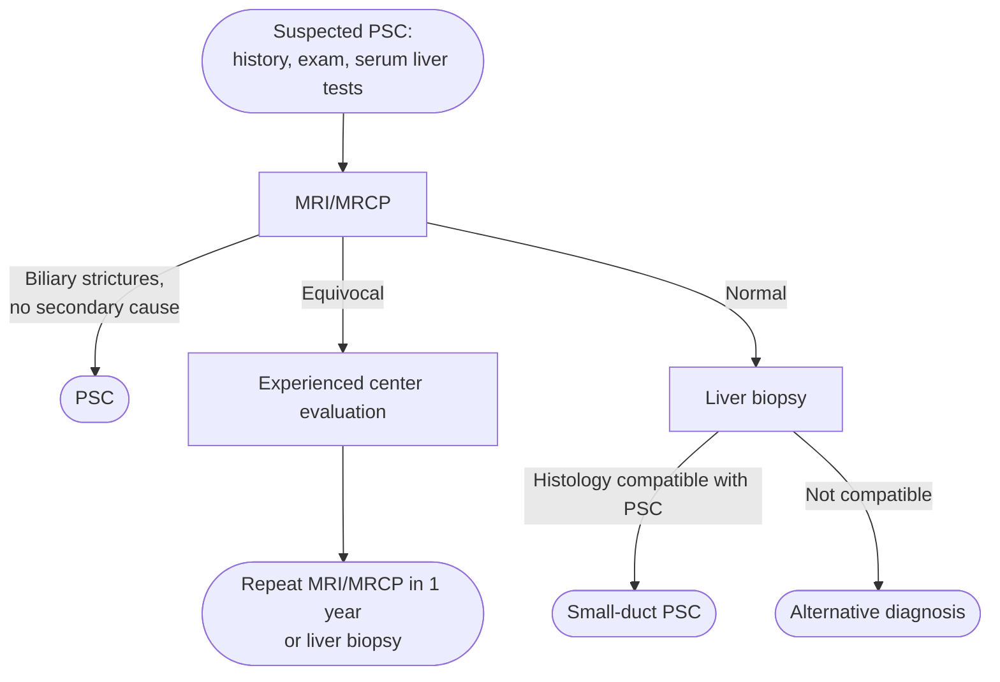
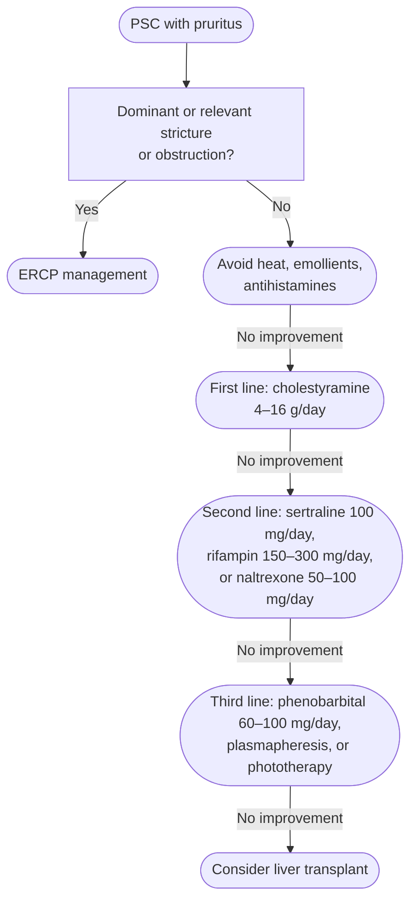
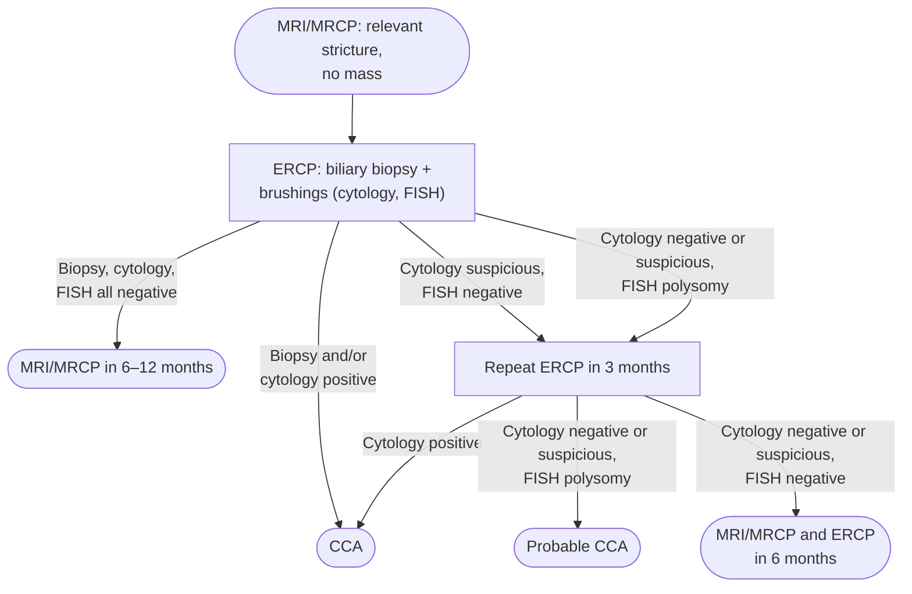
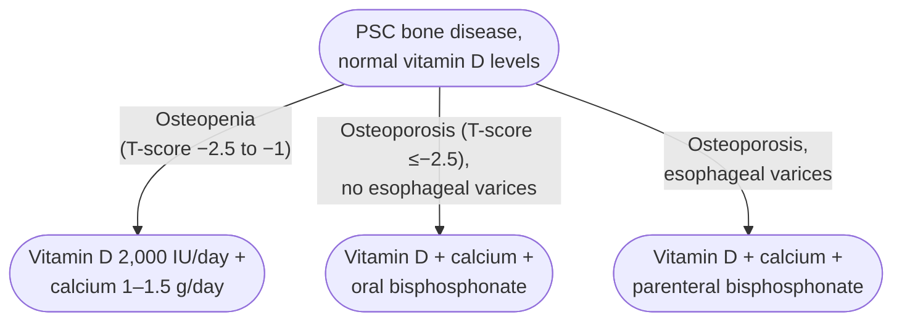

## Contents
- [[#Assessment]]
  - [[#Establishing the Diagnosis]]
  - [[#Severity Assessment]]
  - [[#Classification / Typing]]
- [[#Differential Diagnosis]]
- [[#Diagnostics]]
- [[#Therapeutics]]
  - [[#Medical Management]]
  - [[#Pruritus Management]]
  - [[#Endoscopic Management]]
  - [[#Cancer Surveillance]]
  - [[#Surgical / Liver Transplantation]]
  - [[#Recurrent PSC (rPSC)]]
  - [[#Nutrition and Bone Disease]]
  - [[#Pregnancy]]

## Assessment

### Establishing the Diagnosis

- **Definition:** primary sclerosing cholangitis (PSC) = chronic cholestatic liver disease, likely autoimmune, with inflammation and fibrosis of intrahepatic and/or extrahepatic bile ducts → bile duct strictures; frequently associated with [[inflammatory-bowel-disease|inflammatory bowel disease (IBD)]] ([[aasld-2022-psc]] Table 1)
- **Diagnosis** = cholestatic liver tests + characteristic strictures on cholangiogram ([[mri-mrcp|magnetic resonance cholangiopancreatography (MRCP)]]) + exclusion of secondary sclerosing cholangitis (see [[#Differential Diagnosis]]), especially without IBD
- Consider PSC in every patient with cholestasis, especially with IBD
- IBD in ≥70–80% of PSC: two-thirds [[ulcerative-colitis|ulcerative colitis (UC)]], one-third [[crohns-disease|Crohn's disease]] or indeterminate colitis
- PSC–[[autoimmune-hepatitis|autoimmune hepatitis (AIH)]] overlap: up to 35% of children, 5% of adults
- **From the IBD side** ([[ecco-2024-eim-ibd|European Crohn's and Colitis Organisation (ECCO) 2024]] Statement 9, *EL2*): persistent cholestatic enzyme elevation **plus** cholestatic symptoms (e.g. pruritus) **or** prominent perihilar lymphadenopathy → high-quality MRCP. Liver-test schedule in IBD: [[extraintestinal-manifestations-ibd]]
- PSC-IBD → hepatologist with PSC expertise at diagnosis, then joint care (ECCO Statement 11, *EL5*)

**Labs** ([[aasld-2022-psc]] unless noted):

- Alkaline phosphatase (ALP) / gamma-glutamyl transferase (GGT) elevated in ~75%; children → use GGT (ALP varies with bone growth)
- Aminotransferases often elevated; suggest AIH overlap only if predominant or >5× upper limit of normal (ULN)
- Antinuclear, anti-smooth muscle and perinuclear antineutrophil cytoplasmic antibodies: variable, minimal diagnostic value
- Antimitochondrial antibody (AMA): not found in PSC ([[acg-2015-psc]])
- **Immunoglobulin G4 (IgG4): measure in all patients with possible PSC** to exclude [[igg4-related-cholangitis|IgG4-sclerosing cholangitis (IgG4-SC)]] (Guidance Statement [GS] 4)
  - Elevated in up to 15% of PSC — elevation alone does not reclassify
  - IgG4 >5.6 g/L (rare) suggests IgG4-SC
  - IgG4/IgG1 ratio <0.24 excludes IgG4-SC **only when serum IgG4 is 1.4–2.8 g/L**

**Imaging and biopsy:**

- Magnetic resonance imaging (MRI)/MRCP first (GS 1): 3D, T1-weighted + T2-weighted axial + contrast; ≥1.5 Tesla; T2-weighted 3D MRCP with 1-mm slices preferred over 2D
- High pretest probability + negative MRCP → **30% probability of PSC remains**; repeat a suboptimal or equivocal study at an experienced center with 3D reconstruction
- [[ercp|Endoscopic retrograde cholangiopancreatography (ERCP)]]: **avoid for diagnosis** (GS 3)
- [[liver-biopsy|Liver biopsy]]: not with typical MRCP findings unless AIH overlap is suspected (GS 5); consider after a normal high-quality MRCP to rule out small-duct PSC (GS 2). Concentric "onion-skin" periductal fibrosis is infrequent and also seen in other obstructive cholangiopathies

*Diagnostic algorithm for suspected PSC*
*Source: redrawn from American Association for the Study of Liver Diseases (AASLD) 2022 Figure 2*
*[[aasld-2022-psc|AASLD 2022 PSC Practice Guidance]]*
*PSC = primary sclerosing cholangitis · MRI = magnetic resonance imaging · MRCP = magnetic resonance cholangiopancreatography*

### Severity Assessment

- Risk stratification + fibrosis staging at diagnosis and regularly thereafter; risk tools can be used, but interpret event probabilities cautiously in the individual (GS 8)

| Model | Variables | Endpoint | Lower / higher risk | Use in (Figure 4) |
|---|---|---|---|---|
| **Amsterdam-Oxford 2017** ([calculator](https://sorted.co/psc-calculator/)) | Age, bilirubin, albumin, aspartate aminotransferase (AST), ALP, platelets, PSC subtype | Liver transplantation (LT) or liver-related death by 15 y | <1.58 / ≥1.58 | Adults: large-duct, small-duct, AIH overlap |
| **UK-PSC 2019** ([calculator](http://www.uk-psc.com/resources/the-uk-psc-risk-scores/)) | Age, bilirubin, albumin, ALP, platelets, extrahepatic biliary disease, variceal hemorrhage history | Death or LT by 2 y (short term) / 10 y (long term) | <1.46 / ≥1.46 | Adults: large-duct, small-duct |
| **PREsTo 2020** ([calculator](https://rtools.mayo.edu/PRESTO_calculator/)) | Age, bilirubin, albumin, AST, ALP, platelets, hemoglobin, sodium, years since diagnosis | Hepatic decompensation (ascites, variceal hemorrhage, encephalopathy) by 5 y | <20% / ≥20% | Adults: large-duct |
| **SCOPE 2020** ([calculator](https://Scopeindex.net)) | Bilirubin, albumin, platelets, GGT, cholangiography (large- or small-duct) | Portal hypertensive or biliary complications, cholangiocarcinoma, LT listing, or liver death by 5 y | 0–5 / 6–11 | Children <18 y |

- Source: [[aasld-2022-psc]] Table 3 and Figure 4. Lower-risk cutoffs mark ≈≤10% risk of transplant or death within 5 y. No coefficients printed → use the calculators
- Adult models cannot predict cholangiocarcinoma. Decompensated cirrhosis → [[cirrhosis|Model for End-Stage Liver Disease (MELD)]] / Pediatric End-Stage Liver Disease score (Figure 4)
- Persistently ALP <1.5× ULN (adults) or GGT <50 U/L (children) = better prognosis
- **[[liver-stiffness-measurement|Liver stiffness (LS)]] by transient elastography (TE) or magnetic resonance elastography (MRE)** = preferred fibrosis staging (GS 9); **liver biopsy not recommended for staging** — sampling variability (GS 10)
  - TE 9.6 kPa = F3, 14.4 kPa = F4 (accuracy >0.80); MRE 4.6 kPa → area under the curve 0.82 for cirrhosis
  - LS is also affected by blood flow, inflammation and cholestasis — transient obstruction may skew results
  - Serial MRE: LS worsening >0.34 kPa/year = highest risk of decompensation
- Enhanced Liver Fibrosis test: tracks transplant-free survival; not widely available commercially

### Classification / Typing

| Type | Features | Course / management |
|---|---|---|
| **Large-duct PSC** | Multifocal strictures on cholangiogram | Standard surveillance ([[#Cancer Surveillance]]) |
| **Small-duct PSC** (≈5%, [[acg-2015-psc]]) | Normal cholangiogram + typical cholestatic and histologic PSC features | Longer time to cirrhosis, lower hepatobiliary malignancy risk; 23% progress to large-duct over 5–14 y → **MRI/MRCP every 3–5 y** (GS 7); no cholangiocarcinoma surveillance |
| **PSC–AIH overlap** | PSC cholangiography + clinical, biochemical and histologic AIH features | Treat per AASLD AIH guidance (GS 14) — [[autoimmune-hepatitis]] |
| **IgG4-SC** | IgG4-positive plasma cells in tissue + serum IgG4 elevation, often pancreatic involvement | Immunosuppression — [[igg4-related-cholangitis]] |

- Suspect PSC–AIH overlap in AIH with IBD, unexplained cholestatic labs, or no response to glucocorticoids ([[aasld-2022-psc]])

---

## Differential Diagnosis

*Workup: see [[biliary-stricture]].*

**Secondary sclerosing cholangitis** — exclude before diagnosing PSC ([[aasld-2022-psc]] Table 2):

| Category | Causes |
|---|---|
| Infectious | Human immunodeficiency virus (HIV) cholangiopathy, recurrent pyogenic cholangitis, cholangitis lenta, parasitic (hydatid cyst, echinococcosis, clonorchiasis/opisthorchiasis, ascariasis, fascioliasis, schistosomiasis) |
| Ischemic | Critically ill patients, [[hereditary-hemorrhagic-telangiectasia\|hereditary hemorrhagic telangiectasia]], intra-arterial chemotherapy, hepatic artery thrombosis |
| Malignant | [[cholangiocarcinoma\|Cholangiocarcinoma (CCA)]], diffuse intrahepatic metastasis, Langerhans cell histiocytosis, lymphoma |
| Autoimmune | Eosinophilic cholangitis, hepatic inflammatory pseudotumor, IgG4-SC, mast cell cholangiopathy, sarcoidosis |
| Anatomic | [[choledocholithiasis\|Choledocholithiasis]], intrahepatic lithiasis, cystic fibrosis liver disease, surgical biliary trauma, anastomotic stricture, [[portal-vein-thrombosis\|portal hypertensive biliopathy]], recurrent pancreatitis, sickle cell cholangiopathy, choledochal cyst |
| Drug-induced | [[immune-checkpoint-inhibitor-hepatitis\|Checkpoint inhibitors]] (pembrolizumab, nivolumab, atezolizumab) |

- **CCA** — any new or relevant stricture; risk 160–400× general population
- **[[primary-biliary-cholangitis|Primary biliary cholangitis (PBC)]]** — AMA-positive
- **AIH** — aminotransferase-predominant or >5× ULN → consider overlap

---

## Diagnostics

| Test | When | Notes |
|---|---|---|
| **MRI/MRCP** | Diagnosis (GS 1); annual CCA surveillance (GS 18); before ERCP (GS 23) | Surveillance: sensitivity 89% / specificity 75% vs ultrasound (US) 57% / 94% |
| **ERCP** | Tissue sampling or therapy of relevant strictures only | Post-ERCP pancreatitis 1–9%; post-ERCP bacterial cholangitis 2–8% |
| **[[brush-cytology\|Brushings]] + biopsy, [[fish\|fluorescence in situ hybridization (FISH)]]** | Routinely at ERCP for relevant strictures (GS 19) | Polysomy = ≥5 cells with gains in ≥2 probes; pancreaticobiliary probe set 93% sensitive / 100% specific for malignancy |
| **Carbohydrate antigen 19-9 (CA 19-9)** | With surveillance imaging (GS 18) | Never alone to diagnose CCA (GS 32) — see [[#Cancer Surveillance]] |
| **[[colonoscopy\|Ileocolonoscopy]] with biopsies** | New PSC without known IBD (GS 6) | Intervals: [[#Cancer Surveillance]] |
| **[[upper-endoscopy\|Upper endoscopy]] for varices** | LS >20 kPa by TE **or** platelets ≤150,000/mm³ (GS 17) | LS ≤20 kPa **and** platelets >150,000/mm³ → screening can be avoided (Baveno VI criteria) |
| **Fat-soluble vitamins A, D, E, K** | At diagnosis, then yearly (GS 28) | Dosing: [[#Nutrition and Bone Disease]] |
| **Dual-energy X-ray absorptiometry (DEXA)** | At diagnosis, then every 2–3 y (GS 29) | Treatment: [[#Nutrition and Bone Disease]] |

**Stricture terminology** ([[aasld-2022-psc]] Table 1):

- **Dominant stricture** — on ERCP: ≤1.5 mm in the common bile duct or ≤1 mm in a hepatic duct ([[aga-2019-psc-cancer-surveillance|AGA 2019]]: hepatic duct within 2 cm of the confluence). Present in up to half at diagnosis; up to 45% develop one. **Not for MRI reports** (resolution; ERCP injects under pressure)
- **High-grade stricture** — MRI/MRCP counterpart: >75% lumen reduction in the common bile or hepatic ducts
- **Relevant stricture** — any common bile or hepatic duct stricture with signs/symptoms of obstructive cholestasis and/or bacterial cholangitis

---

## Therapeutics

### Medical Management

- **No approved drug therapy**; consider every patient for clinical trials (GS 11)
- **[[ursodeoxycholic-acid|Ursodeoxycholic acid (UDCA)]]:**
  - **High dose — do not use:** ≥28 mg/kg/day avoided ([[aasld-2022-psc]]); >28 mg/kg/day recommended against, *strong recommendation, high quality of evidence* ([[acg-2015-psc]]). Trial of 28–30 mg/kg/day stopped for futility; more serious adverse events; more colorectal neoplasia in PSC-UC
  - **13–23 mg/kg/day can be considered** if not in a trial and ALP/GGT persistently elevated (GS 12): observe 6 months first (ALP/GGT can normalize spontaneously); continue only if tolerated **and** ALP (GGT in children) meaningfully falls or normalizes and/or symptoms improve within 12 months
  - Changes tied to better outcomes: ALP <1.5× ULN, 40% reduction, or normalization; children: 75% GGT reduction or GGT <50 IU. No data favor 13–15 over 17–23 mg/kg/day
  - Withdrawal → more fatigue, pruritus, worse liver biochemistries and Mayo PSC risk score
- **Oral vancomycin:** insufficient evidence to recommend (GS 13)
- **Bacterial cholangitis:** antibiotics + consider MRCP for a relevant stricture (GS 15); ERCP if inadequate response (GS 16); rotating antibiotics in rare recurrent cases
- **AIH-side screening for PSC** ([[easl-2025-autoimmune-hepatitis|European Association for the Study of the Liver (EASL) 2025]]):
  - Every child with AIH → magnetic resonance cholangiography at diagnosis regardless of cholestatic enzymes (not needed <6 y with normal GGT); repeat if activity or cholestasis persists. Young adults with cholestasis or incomplete biochemical response → same
  - Adults with AIH + cholestatic features → PBC-specific autoantibodies first; magnetic resonance cholangiography if negative
  - AIH/PSC variant treatment: [[autoimmune-hepatitis]]
- **[[portal-hypertension|Portal hypertension]] / [[cirrhosis]]:** managed as in other chronic liver disease
  - Varix screening per GS 17 ([[#Diagnostics]]): Baveno VI criteria had 0% false negatives for varices needing treatment in 80 PSC patients with compensated cirrhosis; 30% of esophagogastroduodenoscopies avoidable
  - [[baveno-viii-2026-portal-hypertension|Baveno VIII (2026)]], a non-US consensus, uses a different rule (no screening on a [[nonselective-beta-blockers|nonselective beta-blocker]]; spleen stiffness option) and notes LS cut-offs are less reliable in PSC with dominant strictures; the AASLD PSC rule stands here — Baveno VIII thresholds on [[portal-hypertension]]
  - [[porto-sinusoidal-vascular-disorder|Noncirrhotic portal hypertension]] and infected [[tips|transjugular intrahepatic portosystemic shunt]] occur rarely
- Hepatitis A and B vaccination if not immune; alcohol abstinence counseling in cirrhosis

### Pruritus Management

*Stepwise pruritus management in PSC*
*Source: redrawn from AASLD 2022 Figure 6*
*[[aasld-2022-psc|AASLD 2022 PSC Practice Guidance]]*
*PSC = primary sclerosing cholangitis · ERCP = endoscopic retrograde cholangiopancreatography*

- Rule out a stricture with MRI/MRCP first. Cholestyramine ~20 min before a meal
- **Rifampin dose:** GS 26 says **150–300 mg twice daily**; Figure 6 and the text print 150–300 mg/day. Monitor for hepatotoxicity, hemolytic anemia, renal failure, thrombotic thrombocytopenic purpura
- Phenobarbital, plasmapheresis, phototherapy: small case series only
- UDCA not effective for pruritus; obeticholic acid can induce it

### Endoscopic Management

- **[[ercp|ERCP]] indications (GS 23):** relevant stricture with new/worsening pruritus, unexplained weight loss, worsening liver tests, rising CA 19-9, recurrent bacterial cholangitis, or progressive duct dilation; cholangitis failing antibiotics (GS 16)
- MRI/MRCP before ERCP to confirm need and plan approach (GS 23). Failed ERCP → repeat by a more experienced endoscopist, percutaneous drainage, or rendezvous ERCP
- **[[antibiotic-prophylaxis-endoscopy|Antimicrobial prophylaxis]] for every PSC ERCP** (GS 24), unless already on therapy covering biliary flora; usually 1–3 days ([[acg-2015-psc]]: 3–5-day post-ERCP course)
- **Dilation vs stent: endoscopist's discretion** (GS 25)
  - Balloon no wider than the ducts immediately flanking the stricture
  - Plastic stent, if placed → remove within 4 weeks; self-expanding metal stents: role unclear, select cases
  - [[esge-2026-biliary-strictures|European Society of Gastrointestinal Endoscopy (ESGE) 2026]] (non-US) differs: balloon dilation alone for high-grade strictures, stent only in rare cases and removed within 1–2 weeks (*conditional, low quality*)
- Sphincterotomy: controversial; for difficult cannulation or anticipated repeat ERCPs; weigh bleeding risk with portal hypertension/coagulopathy
- **Post-ERCP pancreatitis prophylaxis:** rectal indomethacin 100 mg (or diclofenac) considered in all without contraindication; lactated Ringer's i.v. periprocedurally; prophylactic pancreatic duct stent whenever the pancreatic duct is accessed or injected. Portal hypertension, coagulopathy, renal dysfunction and volume overload may affect the choice
- Persistent relevant stricture → repeat therapy if it causes symptoms or significant liver test abnormalities; refractory → experienced center or LT

*Work-up of a relevant stricture in PSC*
*Source: redrawn from AASLD 2022 Figure 5*
*[[aasld-2022-psc|AASLD 2022 PSC Practice Guidance]]*
*MRI = magnetic resonance imaging · MRCP = magnetic resonance cholangiopancreatography · ERCP = endoscopic retrograde cholangiopancreatography · FISH = fluorescence in situ hybridization · CCA = cholangiocarcinoma*

- Dominant stricture + FISH polysomy → 73% had CCA; serial polysomy → ~70% eventually CCA (vs 18% after nonpolysomy)
- FISH polysomy + CA 19-9 ≥129 U/ml → high likelihood of CCA even without a mass

### Cancer Surveillance

| Cancer | Who | What and how often |
|---|---|---|
| **CCA + [[gallbladder-cancer\|gallbladder cancer]]** | PSC, **not** <18 y or small-duct | **Annual** imaging, preferably MRI/MRCP, ± CA 19-9 (GS 18) |
| **[[gallbladder-polyps\|Gallbladder polyp]] ≤8 mm** | PSC | May be monitored by US every 6 months (GS 20) |
| **Gallbladder polyp >8 mm** | PSC | **Cholecystectomy should be considered**, at an experienced center if advanced disease (GS 20) |
| **[[hcc-surveillance\|Hepatocellular carcinoma (HCC)]]** | PSC + cirrhosis | Per AASLD HCC guidance (GS 21); US, computed tomography (CT) or MRI ± alpha-fetoprotein every 6 months ([[aga-2019-psc-cancer-surveillance\|American Gastroenterological Association (AGA) 2019]] Best Practice Advice [BPA] 8) |
| **[[colorectal-cancer\|Colorectal cancer (CRC)]]** | PSC + IBD | High-definition colonoscopy with biopsies from **age 15**, every **1–2 y** (GS 22); American Society for Gastrointestinal Endoscopy (ASGE) 2025: yearly (below) |
| **CRC** | PSC without IBD | Ileocolonoscopy with biopsies at PSC diagnosis; consider repeat at 5-year intervals or with IBD symptoms (GS 6) |

**CCA and gallbladder:**

- [[aga-2019-psc-cancer-surveillance|AGA 2019]] (older): US, CT or MRI ± CA 19-9 every 6–12 months in all adults regardless of stage (BPA 1–2); none if small-duct or <20 y (BPA 6); ERCP with brush cytology **not** for routine surveillance (BPA 3) but for worsening symptoms, cholestasis or a dominant stricture (BPA 4); annual gallbladder US for all patients with PSC. AASLD 2022 governs interval, age and modality; [[acg-2015-psc|American College of Gastroenterology (ACG) 2015]] also advises gallbladder US at least annually
- **CA 19-9:** 129 U/ml → sensitivity 78%, specificity 98%; 20 U/ml → 78% / 67%. Up to one-third of elevations are not CCA; up to 10% of people do not express CA 19-9; fucosyltransferase 2/3 genotype shifts levels
- CCA risk highest in year 1 (2.5%), then 1–1.5%/y. Risk factors: older age (most consistent), male sex, dominant stricture, IBD, elevated bilirubin; rare in children and small-duct PSC
- Polyp >8 mm: weigh liver function and perioperative decompensation risk (40% postoperative complications in advanced PSC); adenocarcinoma in 18–56% of cholecystectomy specimens with a polyp or mass
- The [[sru-2022-gallbladder-polyps|Society of Radiologists in Ultrasound 2022]] incidental-polyp algorithm does not apply to PSC

**CRC in PSC-IBD:**

- Risk 5–12× general population, **4–5× IBD without PSC**; endoscopically invisible dysplasia more frequent; low-grade dysplasia progresses faster. Children develop CRC at rates similar to adults (5% at 10 years); 5% of children with PSC and no known IBD have quiescent colitis → ileocolonoscopy at diagnosis includes children
- Chromoendoscopy when only standard-definition (640×480 pixels) colonoscopy is available; biopsy-proven invisible low-grade dysplasia → high-definition colonoscopy with chromoendoscopy
- [[asge-2025-ibd-endoscopy-consensus|ASGE 2025]] (newer, ungraded consensus): **yearly** colonoscopy in PSC with UC or large-bowel Crohn's, regardless of IBD extent and duration, with narrow-band imaging or chromoendoscopy **and** targeted plus random biopsies (invisible nonconventional dysplasia). Take the annual interval. Technique and interval grid: [[ulcerative-colitis#Colorectal Cancer Surveillance]]

> [!pitfall] CA 19-9 alone never diagnoses CCA
> Up to one-third of PSC patients with a raised CA 19-9 have no cancer, and up to 10% of people cannot make it (GS 32, [[aasld-2022-psc]]).

### Surgical / Liver Transplantation

- **[[liver-transplantation|LT]] indications (GS 30):** complications of end-stage liver disease, recurrent cholangitis, intractable pruritus, early-stage hepatobiliary cancer
- **MELD exception points:**
  - **Cholangitis:** PSC with cirrhosis + ≥2 admissions within 1 year for acute cholangitis with documented bloodstream infection or sepsis with hemodynamic instability requiring vasopressors
  - **CCA:** malignant-appearing stricture and cytology/biopsy, CA 19-9 >100 U/ml without cholangitis, aneuploidy, or hilar mass <3 cm radial diameter
- LT after neoadjuvant therapy for perihilar CCA ≤3 cm, unresectable or arising in PSC (GS 48); no percutaneous or [[endoscopic-ultrasound|endoscopic ultrasound]]-guided aspiration of a perihilar mass in LT candidates (GS 44) — protocol on [[cholangiocarcinoma]]
- Living donor LT: an option; does not appear to raise recurrence risk, even with first-degree relative donors
- Outcomes comparable to other indications; quality of life improves; fatigue persists in many women; rejection more frequent and steroid-refractory
- **Biliary reconstruction:** Roux-en-Y choledochojejunostomy preferred (stricture and CCA risk in the remnant duct); some centers use duct-to-duct if the duct looks normal **or** high-grade dysplasia is absent — less post-LT cholangitis, same graft outcomes
- After LT: keep treating IBD and continue CRC surveillance (GS 27); [[anti-tnf-agents|anti-tumor necrosis factor]] and anti-integrin agents effective and safe in small series
- Elevated liver enzymes after LT → histology + cholangiography to separate recurrence from rejection or biliary complications (GS 31)

### Recurrent PSC (rPSC)

- 10–37% of recipients, mean 0.5–5 y after LT
- **Criteria (all ≥90 days post-LT):** confirmed PSC before LT + cholestatic enzymes + multifocal nonanastomotic strictures on cholangiography + no chronic ductopenic rejection, hepatic ischemia, or donor–recipient blood type incompatibility
- Risk factors: male sex, extended-criteria grafts, steroid-free antithymocyte globulin induction, [[tacrolimus]]-based primary immunosuppression, rejection, poorly controlled or de novo IBD; pretransplant colectomy may protect
- Retransplantation 12.4% at 10 y (PBC 8.5%)

### Nutrition and Bone Disease

- Nutritional assessment + fat-soluble vitamins at diagnosis and yearly (GS 28). Deficiency of A / D / E: 40% / 14% / 2% in early PSC; 82% / 57% / 43% in advanced
- Water-miscible formulas; vitamin D₃ preferred

| Vitamin | Deficiency signs | Children: repletion / maintenance | Adults: repletion | Adults: maintenance |
|---|---|---|---|---|
| A | Night blindness, xerophthalmia | 5,000–10,000 / 1,500–5,000 IU daily | 5,000–100,000 IU daily × 2 weeks | 1,500–5,000 IU daily; monitor for hypervitaminosis A |
| D | Osteomalacia, osteoporosis; rickets, tetany in children | 4,000–8,000 / 400–2,000 IU daily | 25(OH)D <12 ng/ml: 50,000 IU weekly × 8 weeks · 12–20: 800–1,000 IU daily · 20–30: 600–800 IU daily | <12: 800 IU · 12–20: 800–1,000 IU · 20–30: 600–800 IU daily; may need higher doses or hydroxylated metabolites |
| E | Neuropathy, ataxia, neuromuscular disorder, hemolytic anemia | 100–200 / 15–25 mg daily | 200–2,000 mg daily | 15 mg daily |
| K | Hypoprothrombinemia, bone disease | 2–5 mg i.v. × 3 days / 2–5 mg daily | 2.5–10 mg daily | 5–10 mg oral weekly to daily; monitor international normalized ratio or plasma phylloquinone |

- Source: [[aasld-2022-psc]] Table 4
- **Bone:** DEXA at diagnosis, then every 2–3 y if bone density normal (GS 29)

*Bone disease treatment in PSC*
*Source: redrawn from AASLD 2022 Figure 7*
*[[aasld-2022-psc|AASLD 2022 PSC Practice Guidance]]*
*PSC = primary sclerosing cholangitis*

- [[acg-2026-preventive-care-cirrhosis|ACG 2026]] (newer, cirrhosis in general): varices are **not by themselves a contraindication** to oral bisphosphonates. Full comparison: [[cirrhosis]]

### Pregnancy

- Maternal and fetal outcomes similar to the general population; more preterm birth and cesarean section with raised maternal bile acids and alanine aminotransferase
- UDCA safe in pregnancy and may be continued
- Suspected obstruction: US first; MRCP without gadolinium if US inconclusive; ERCP only if intervention likely, preferably 2nd or 3rd trimester
- Portal hypertension in pregnancy: managed as in other chronic liver diseases

---

## See Also

[[ursodeoxycholic-acid]], [[abnormal-liver-chemistries]], [[primary-biliary-cholangitis]], [[autoimmune-hepatitis]], [[igg4-related-cholangitis]], [[biliary-stricture]], [[cholangiocarcinoma]], [[gallbladder-cancer]], [[gallbladder-polyps]], [[ulcerative-colitis]], [[crohns-disease]], [[inflammatory-bowel-disease]], [[extraintestinal-manifestations-ibd]], [[ercp]], [[brush-cytology]], [[fish]], [[mri-mrcp]], [[liver-biopsy]], [[liver-stiffness-measurement]], [[colonoscopy]], [[colorectal-cancer]], [[hcc-surveillance]], [[liver-transplantation]], [[cirrhosis]], [[portal-hypertension]], [[upper-endoscopy]], [[antibiotic-prophylaxis-endoscopy]], [[endoscopic-ultrasound]], [[tacrolimus]], [[anti-tnf-agents]]

---

## Sources

1. [[aasld-2022-psc|AASLD 2022 Practice Guidance on Primary Sclerosing Cholangitis and Cholangiocarcinoma]]
2. [[acg-2015-psc|ACG 2015 Clinical Guideline: Primary Sclerosing Cholangitis]]
3. [[aga-2019-psc-cancer-surveillance|AGA Clinical Practice Update on Surveillance for Hepatobiliary Cancers in Patients With Primary Sclerosing Cholangitis: Expert Review (2019)]]
4. [[asge-2025-ibd-endoscopy-consensus|Endoscopic diagnosis and management of adult inflammatory bowel disease: a consensus document from the American Society for Gastrointestinal Endoscopy IBD Endoscopy Consensus Panel (2025)]]
5. [[acg-2026-preventive-care-cirrhosis|ACG Clinical Guideline: Preventive Care for Patients With Cirrhosis (2026)]]
6. [[baveno-viii-2026-portal-hypertension|Baveno VIII — Advancing Consensus in Portal Hypertension (2026)]]
7. [[ecco-2024-eim-ibd|ECCO Guidelines on Extraintestinal Manifestations in Inflammatory Bowel Disease (2024)]]
8. [[esge-2026-biliary-strictures|Biliary Stricture Management: European Society of Gastrointestinal Endoscopy (ESGE) Guideline (2026)]]
9. [[easl-2025-autoimmune-hepatitis|EASL Clinical Practice Guidelines on the management of autoimmune hepatitis (2025)]]
10. [[sru-2022-gallbladder-polyps|Management of Incidentally Detected Gallbladder Polyps: Society of Radiologists in Ultrasound Consensus Conference Recommendations (2022)]]
