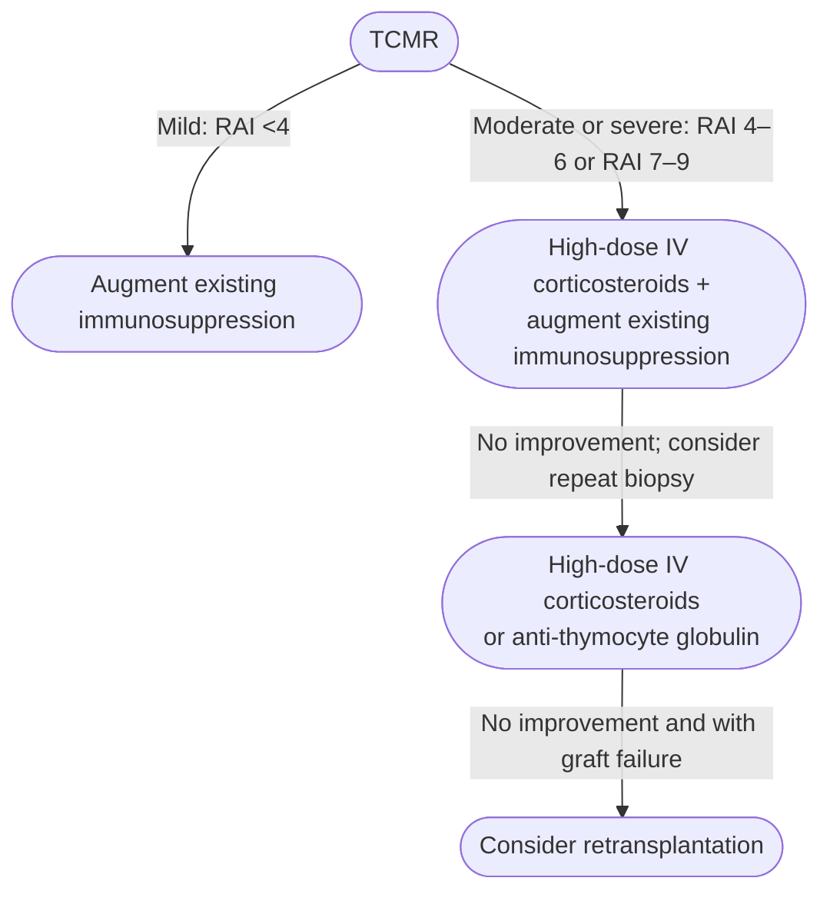
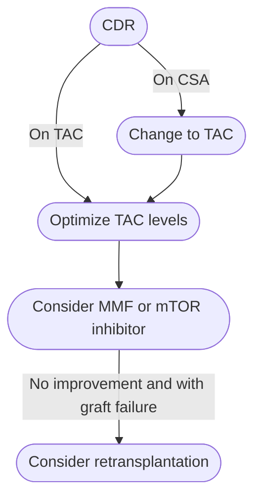

Cellular rejection of a [[liver-transplantation|liver allograft]]. **Acute T-cell–mediated rejection (TCMR)**, also called acute cellular rejection, occurs in **10%–30%** of liver transplant (LT) recipients, usually within the **first 3 months**. For comparison, acute [[antibody-mediated-rejection-liver-transplant|antibody-mediated rejection (AMR)]] is rare in ABO-compatible recipients, chronic AMR occurs in <10%, and plasma cell-rich rejection (PCR) is reported in 3%–5% of recipients transplanted for indications other than autoimmune hepatitis (AIH) ([[aasld-ast-2025-liver-transplant-graft-complications]]). This page also covers **chronic ductopenic rejection (CDR)**, which can follow severe or recurrent acute rejection.

## Contents
- [[#Assessment]]
  - [[#Establishing the Diagnosis]]
  - [[#Severity Assessment]]
  - [[#Classification / Typing]]
  - [[#Risk Factors]]
- [[#Differential Diagnosis]]
- [[#Diagnostics]]
  - [[#Liver Biopsy]]
  - [[#Peripheral Blood Biomarkers]]
- [[#Therapeutics]]
  - [[#Acute and Late TCMR]]
  - [[#Chronic Ductopenic Rejection]]
- [[#See Also]]
- [[#Sources]]

## Assessment

### Establishing the Diagnosis

- **Histology is required.** Rejection can be reliably diagnosed only on liver histology; take a biopsy **before starting treatment** and classify it by the Banff criteria (Rec 8, grade 1, level A; [[aasld-2012-liver-transplant-long-term]]).
- **Presentation:** late-onset cellular rejection and ductopenic rejection are asymptomatic until the late stages and are found by investigating abnormal liver tests ([[aasld-2012-liver-transplant-long-term]]).
  - Late-onset cellular rejection: nonspecific rise in bilirubin and aminotransferases.
  - Ductopenic rejection: insidious, progressive cholestatic rise — alkaline phosphatase and gamma-glutamyl transpeptidase first, then bilirubin; pruritus and jaundice in late cases.
- **Blood tests cannot make or exclude the diagnosis:** peripheral blood biomarkers alone should not be used to diagnose or exclude TCMR and other forms of allograft injury (Rec 41, Strong, Level 4; [[aasld-ast-2025-liver-transplant-graft-complications]]).

> [!pitfall] Abnormal liver tests are not rejection until the biopsy says so
> Do not assume, without histological confirmation, that abnormal liver tests represent immune-mediated damage ([[aasld-2012-liver-transplant-long-term]]).

### Severity Assessment

- Graded by the Banff **rejection activity index (RAI)** on the biopsy ([[aasld-ast-2025-liver-transplant-graft-complications]], Table 6 and Figure 3):

| Grade | RAI | What it triggers |
|---|---|---|
| Mild | <4 | Augment existing immunosuppression |
| Moderate or severe | ≥4 (4–6 or 7–9) | High-dose intravenous (IV) corticosteroids + augment existing immunosuppression |

- AASLD/AST 2025 does not give the RAI component scoring; read the RAI off the pathology report.
- **Late TCMR** carries the worse outlook: response to corticosteroids may be lower, and it has been associated with lower graft survival and with ductopenic rejection in those who respond poorly ([[aasld-ast-2025-liver-transplant-graft-complications]]).

### Classification / Typing

**By timing**

- **Acute (early) TCMR** — usually within the first 3 months of LT.
- **Late TCMR** — defined as occurring 6 months after LT (others define it as 3–12 months after LT) ([[aasld-ast-2025-liver-transplant-graft-complications]]). The 2012 guideline defined late rejection as onset more than 90 days after transplantation ([[aasld-2012-liver-transplant-long-term]]).
- **CDR** — also called vanishing bile duct syndrome; seen most commonly in the first year but may occur at any time ([[aasld-2012-liver-transplant-long-term]]).

**By histology** — Banff criteria ([[aasld-ast-2025-liver-transplant-graft-complications]], Table 6):

| Type | Histologic features on liver biopsy |
|---|---|
| Acute TCMR | 1. Diffuse lymphohistiocytic or polymorphous infiltrate in the portal or perivenular areas 2. Bile duct inflammation and damage; absent or rare small bile duct loss 3. Subendothelial inflammation or endotheliitis of veins 4. Fibrosis is uncommon |
| Late TCMR (>6 months after LT) | Compared with acute TCMR: 1. Fewer blastic lymphocytes, greater interface and perivenular necroinflammation 2. Less venous endotheliitis 3. Slightly more lobular activity |
| CDR | 1. Bile duct atrophy/pyknosis affecting the majority of bile ducts, with or without bile duct loss 2. Foam cell obliterative arteriopathy or bile duct loss in >50% of the portal tracts 3. Perivenular fibrosis Associated with progression: centrilobular necroinflammation; hepatocyte necrosis and apoptosis; loss of hepatic artery branches from portal tracts |

- **CDR versus TCMR:** less inflammation, more fibrosis, less reversible. Small bile duct damage and loss plus perivenular fibrosis are essential for the diagnosis.
- **Early CDR** = <50% bile duct loss. **Late CDR** = ≥50% bile duct loss and progression of perivenular fibrosis.

*See Figure 2 in [[aasld-ast-2025-liver-transplant-graft-complications]] for example histology of each rejection pattern.*

### Risk Factors

| | Risk factors |
|---|---|
| Late-onset cellular rejection ([[aasld-2012-liver-transplant-long-term]]) | Reduction of immunosuppression (iatrogenic or from noncompliance); pre-LT autoimmune liver disease; concurrent interferon |
| CDR ([[aasld-ast-2025-liver-transplant-graft-complications]]) | Severe or recurrent episodes of acute rejection; young recipient age; male-to-female sex mismatch; history of AIH or biliary disease; non-Caucasian race; donor age older than 40 years; presence of donor-specific antibodies (DSA) |

- TCMR and CDR occur more commonly in recipients transplanted for [[autoimmune-hepatitis|AIH]] than for other liver diseases.
- Recipients transplanted for [[primary-biliary-cholangitis|primary biliary cholangitis (PBC)]] are at higher risk of rejection, including late TCMR, which may complicate the diagnosis of recurrent PBC ([[aasld-ast-2025-liver-transplant-graft-complications]]).

## Differential Diagnosis

*Workup: see [[abnormal-liver-tests-after-liver-transplant]].*

- **AMR** — acute and chronic criteria on its own page. Assess DSA in severe or steroid-resistant rejection (Rec 54, Strong, Level 3; [[aasld-ast-2025-liver-transplant-graft-complications]]).
- **PCR** (formerly de novo AIH) — compared with acute TCMR: significantly greater plasma cell infiltrate, more common enrichment by immunoglobulin G4 (IgG4)-positive plasma cells, more prevalent central perivenulitis, increased incidence of DSA, and higher incidence of portal microvascular endothelial complement 4d deposition ([[aasld-ast-2025-liver-transplant-graft-complications]]). Criteria and treatment: [[liver-transplantation#Graft Rejection]].
- **Late cellular rejection** — infection, recurrent and de novo autoimmune disease, and drug toxicity. It can be hard to tell from [[hepatitis-c|hepatitis C virus]] infection, and the two often coexist ([[aasld-2012-liver-transplant-long-term]]).
- **Ductopenic rejection** — recurrent PBC or [[primary-sclerosing-cholangitis|primary sclerosing cholangitis]], and drug toxicity ([[aasld-2012-liver-transplant-long-term]]).

## Diagnostics

### Liver Biopsy

- [[liver-biopsy|Liver biopsy]] is the diagnostic test; protocol biopsies in stable recipients are not recommended ([[liver-transplantation#Diagnostics]]).
- **Suspected ductopenia:** a sample with **at least 10 portal tracts** is advisable to establish with confidence that bile ducts are injured and lost ([[aasld-2012-liver-transplant-long-term]]).
- **Suboptimal response to treatment:** a repeat biopsy may be necessary to exclude other developing causes of graft dysfunction; work closely with the pathologist ([[aasld-ast-2025-liver-transplant-graft-complications]]).

### Peripheral Blood Biomarkers

- Not a substitute for biopsy (Rec 41, above). Most are not approved for LT recipients and have not been validated.
- **Intracellular ATP after CD4 cell activation** may be considered to determine the recipient's immunological status, risk of infection, and need for adjustment of immunosuppression (Rec 42, Weak, Level 3). For detecting acute rejection against liver biopsy, a meta-analysis reported sensitivity 65.6%, specificity 80.4%, and summary receiver operator curve 0.835, with significant heterogeneity among studies ([[aasld-ast-2025-liver-transplant-graft-complications]]).

## Therapeutics

### Acute and Late TCMR

*Management ladder for T-cell–mediated rejection*
*Source: redrawn from the AASLD/AST 2025 rejection management algorithm, panel A*
*[[aasld-ast-2025-liver-transplant-graft-complications|AASLD/AST 2025 Liver Transplant Graft Complications]]*
*TCMR = T-cell–mediated rejection · RAI = rejection activity index · IV = intravenous*

- **Augmenting existing immunosuppression** on every rung includes switching cyclosporine → [[tacrolimus]], with or without adding another class of immunosuppressant (antimetabolite or mammalian target of rapamycin [mTOR] inhibitor). Late TCMR is treated the same as acute TCMR.
- **Mild, early or late — Rec 37 (Strong, Level 3):** augment existing immunosuppression, including cyclosporine → tacrolimus if applicable. Mild acute TCMR may resolve without additional immunosuppression.
- **Moderate or severe, early or late — Rec 38 (Strong, Level 3):** high-dose IV corticosteroids on top of augmentation, and consider adding another class if applicable.
  - Dose: eg, methylprednisolone **500–1000 mg IV daily for 1–3 days**, then a taper that varies among centers (eg, prednisone 40–80 mg daily, decreased by 10–20 mg decrements until tapered off).
  - Give infection prophylaxis concurrently with high-dose corticosteroids ([[liver-transplantation#Infection Prophylaxis and Treatment]]).
  - Response: approximately **60%–90%** of acute TCMR responds to high-dose corticosteroids; rates may be lower for late TCMR.
- **Refractory — Rec 39 (Strong, Level 4):** consider a second course of corticosteroids or lymphocyte-depleting therapy when there is no response to the initial course.
- Reinforce adherence to immunosuppression ([[aasld-ast-2025-liver-transplant-graft-complications]]).
- **2012 figures for late-onset cellular rejection:** the short course was methylprednisolone 500 mg/day or prednisolone 200 mg/day for 3 days, followed by an increase in baseline immunosuppression. A full response (return to normal liver tests) was seen in only about half; about 25% had a further episode of cellular rejection and about 25% developed ductopenic rejection ([[aasld-2012-liver-transplant-long-term]]).

### Chronic Ductopenic Rejection

*Management ladder for chronic ductopenic rejection*
*Source: redrawn from the AASLD/AST 2025 rejection management algorithm, panel C*
*[[aasld-ast-2025-liver-transplant-graft-complications|AASLD/AST 2025 Liver Transplant Graft Complications]]*
*CDR = chronic ductopenic rejection · CSA = cyclosporine · TAC = tacrolimus · MMF = mycophenolate mofetil · mTOR = mammalian target of rapamycin*

- **Treat early — Rec 43 (Strong, Level 4):** augment existing immunosuppression while there is **<50% bile duct loss or ductopenia** on biopsy, to maximize response and reversibility.
- **On cyclosporine — Rec 44 (Strong, Level 3):** switch to tacrolimus if there are no contraindications. In a multicenter cohort, 70% of patients with CDR responded to the conversion.
- **On tacrolimus monotherapy — Rec 45 (Weak, Level 4):** [[mycophenolate-mofetil|mycophenolate mofetil]] or an mTOR inhibitor may be added.
- **Progressive despite adjustment — Rec 46 (Strong, Level 3):** consider retransplantation.
- **Steroids and anti-thymocyte globulin have not been shown to be effective.**
- **Prevention:** prevention and effective treatment of acute TCMR may reduce the risk of CDR. Reinforce adherence ([[aasld-ast-2025-liver-transplant-graft-complications]]).

> [!pearl] Reversibility is decided on the biopsy
> Response is more likely with bile duct loss in <50% of portal tracts, mild perivenular fibrosis, and portal tract hepatic arteriole loss in <25% of portal tracts ([[aasld-ast-2025-liver-transplant-graft-complications]]).

---

## See Also

[[liver-transplantation]], [[abnormal-liver-tests-after-liver-transplant]], [[antibody-mediated-rejection-liver-transplant]], [[liver-biopsy]], [[tacrolimus]], [[calcineurin-inhibitors]], [[mycophenolate-mofetil]], [[operational-tolerance]], [[autoimmune-hepatitis]], [[primary-biliary-cholangitis]], [[primary-sclerosing-cholangitis]], [[hepatitis-c]]

---

## Sources

1. [[aasld-ast-2025-liver-transplant-graft-complications|AASLD/AST 2025: Practice Guideline on Adult Liver Transplantation — Diagnosis and Management of Graft-Related Complications]]
2. [[aasld-2012-liver-transplant-long-term|AASLD/AST 2012: Long-Term Management of the Successful Adult Liver Transplant]]
