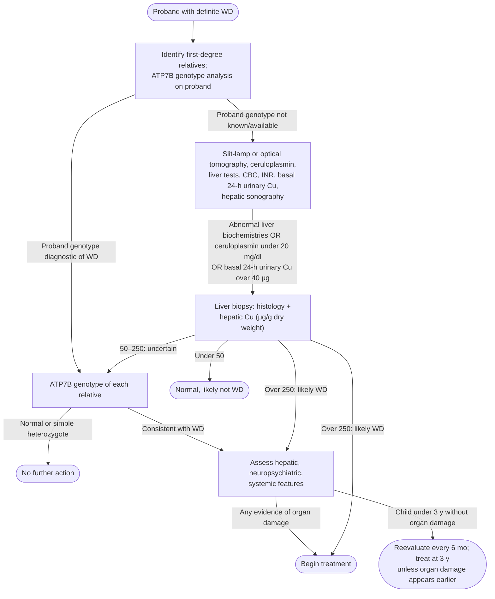

# Wilson's Disease

---

## Contents
- [[#Assessment]]
  - [[#Establishing the Diagnosis]]
  - [[#Severity Assessment]]
- [[#Differential Diagnosis]]
- [[#Diagnostics]]
- [[#Therapeutics]]
  - [[#General Principles]]
  - [[#Initial Treatment (GS 16–17)]]
  - [[#Maintenance Therapy (GS 18)]]
  - [[#Treatment Monitoring Targets (Table 10, GS 21–24)]]
  - [[#Special Clinical Situations]]
  - [[#Nutrition (GS 19–20)]]
  - [[#Neurological Adjuncts (GS 36–37)]]
  - [[#Psychiatric Management (GS 38)]]
  - [[#Wilson's Disease in Pregnancy (GS 33–35)]]
- [[#See Also]]
- [[#Sources]]

---

## Assessment

### Establishing the Diagnosis

Wilson disease (WD; hepatolenticular degeneration) — autosomal recessive disorder of copper metabolism from pathogenic *ATP7B* variants (a copper-transporting P-type ATPase); impaired biliary copper excretion → hepatic, then brain, kidney and corneal copper accumulation ([[aasld-2022-wilson-disease]]). Guidance statements (GS) below are American Association for the Study of Liver Diseases (AASLD) 2022 and carry no evidence grade.

- Prevalence ~1:30,000 (1:20,000 in one study); simple carriers ~1:90
- At least 380 pathogenic *ATP7B* variants (up to 732 by database); most patients compound heterozygotes; more than half of Northern, Central and Eastern European patients carry ≥1 p.H1069Q allele (older [[acg-2017-liver-chemistries]] text described no predominant mutation)
- **No firm genotype–phenotype correlations** — genotype does not predict disease course

**Clinical patterns (Table 1)** — symptomatic presentation mainly, not exclusively, age 3–55 y; most patients <18 y present with liver disease:

| System | Manifestations |
|---|---|
| **Hepatic** | Asymptomatic hepatomegaly; isolated splenomegaly; persistently elevated aspartate aminotransferase (AST)/alanine aminotransferase (ALT); fatty liver; acute hepatitis incl. acute liver injury (ALI); picture resembling autoimmune hepatitis (AIH); [[cirrhosis]] (compensated or decompensated); acute liver failure (ALF) |
| **Neurological** | Dysarthria; movement disorders (tremor, involuntary movements); pseudobulbar palsy; drooling, transfer [[dysphagia]]; rigid dystonia; dysautonomia; seizures; sleep disorders — frequencies and treatments under [[#Neurological Adjuncts (GS 36–37)]] |
| **Psychiatric** | Depression; bipolar disorder/spectrum; neurotic behaviors; personality changes; psychosis; subtle cognitive deficits |
| **Other** | Kayser–Fleischer (KF) rings, sunflower cataracts; renal (aminoaciduria, nephrolithiasis); premature osteoporosis, arthritis; cardiomyopathy, dysrhythmias; [[acute-pancreatitis\|pancreatitis]]; hypoparathyroidism; infertility, repeated miscarriages |

**When to suspect WD:**

- Liver abnormalities of uncertain cause at any age — age alone never excludes WD (GS 1)
- Persistently elevated AST/ALT, especially age <55 y → screen with serum ceruloplasmin; if low → 24-h urinary copper + slit-lamp exam for KF rings (American College of Gastroenterology [ACG] 2017 Rec 9; strong recommendation, very low evidence) ([[acg-2017-liver-chemistries]])
- Unexplained liver disease + neurological or psychiatric disorder → WD **must** be excluded (GS 2)
- ALF with nonimmune (Coombs-negative) hemolytic anemia → suspect WD; urgent [[liver-transplantation|liver transplantation (LT)]] evaluation (GS 3)
- Recurrent self-limited nonimmune hemolysis → evaluate for WD (GS 4)
- Children with apparent AIH; any presumed AIH not responding rapidly to corticosteroids
- Children/adolescents with hepatic steatosis, especially with normal body mass index and waist circumference

**Initial evaluation (GS 6)** — personal + family history; exam for liver, neurological and psychiatric disease; then:

1. Liver biochemistries
2. Complete blood count (CBC) + international normalized ratio (INR)
3. Serum ceruloplasmin (± serum copper in some)
4. Basal 24-h urinary copper excretion
5. Slit-lamp or optical tomography exam for KF rings
6. Neurological evaluation
7. *ATP7B* molecular genetic testing (depending on logistics)

**Leipzig score** (diagnostic; Table 7) — aids diagnosis when the presentation is not classic (GS 12):

| Parameter | Points |
|---|---|
| KF rings (slit-lamp): present / absent | 2 / 0 |
| Neuropsychiatric symptoms suggestive of WD (or typical brain magnetic resonance imaging [MRI]): present / absent | 2 / 0 |
| Coombs-negative hemolytic anemia (+ high serum copper): present / absent | 1 / 0 |
| 24-h urinary copper (no acute hepatitis): normal | 0 |
| — 1–2× upper limit of normal (ULN) | 1 |
| — >2× ULN | 2 |
| — normal but >500 μg/day 1 day after 2 × 500 mg D-penicillamine challenge | 2 |
| Liver copper, quantitative: normal (<50 μg/g dry weight) | −1 |
| — up to 5× ULN | 1 |
| — >5× ULN | 2 |
| Rhodanine-positive hepatocytes (only if quantitative copper unavailable): present / absent | 1 / 0 |
| Serum ceruloplasmin (nephelometric; lower limit of normal [LLN] 20 mg/dl): normal | 0 |
| — 10–20 mg/dl | 1 |
| — <10 mg/dl | 2 |
| *ATP7B* disease-causing mutations: both chromosomes / one / none | 4 / 1 / 0 |
| Any parameter not available | 0 |

**Total ≥4** = WD highly likely · **2–3** = probable, do more investigations · **0–1** = unlikely.

- **24-h urinary copper ULN = 40 μg/day** (modified first for children; appropriate for adults too)
- D-penicillamine criterion (>500 μg/day) is **likely not stringent enough** — the original publication used >1,600 μg/24 h
- Liver copper ULN 50 μg/g → "up to 5× ULN" = 50–250 μg/g; ">5× ULN" = >250 μg/g
- Oxidase-assay ceruloplasmin uses other cutoffs
- Liver biopsy not mandatory with exclusively neurological findings
- Some mimics (multidrug-resistance protein 3 [MDR3] deficiency) can reach a "diagnostic" score — see [[#Differential Diagnosis]]

### Severity Assessment

**New Wilson Index (NWI)** — predicts failure of medical therapy (Table 8):

| Points | 0 | 1 | 2 | 3 | 4 |
|---|---|---|---|---|---|
| Bilirubin (mg/dl) | 0–5.8 | 5.9–8.7 | 8.8–11.7 | 11.8–17.5 | >17.5 |
| INR | 0–1.29 | 1.3–1.6 | 1.7–1.9 | 2.0–2.4 | ≥2.5 |
| AST (IU/L) | 0–100 | 101–150 | 151–200 | 201–300 | >300 |
| White blood cell count (×10⁶/ml) | 0–6.7 | 6.8–8.3 | 8.4–10.3 | 10.4–15.3 | ≥15.4 |
| Albumin (mg/dl) | >4.5 | 3.4–4.4 | 2.5–3.3 | 2.1–2.4 | ≤2.0 |

- Sum the five; **NWI ≥11 = strong predictor of mortality without LT**
- Breakpoint **10–11** is unreliable (especially children, [[acute-on-chronic-liver-failure|acute-on-chronic]] pattern, severe ALI without encephalopathy) → **score serially**; the trend is highly informative (GS 13)
- **Nazer score** (bilirubin, AST, prothrombin time) — superseded by NWI: **≥7 predicted death, ≤6 predicted survival with chelation**; unreliable around 6–7
- How the score drives LT decisions: [[#Special Clinical Situations]]

---

## Differential Diagnosis

*Workup: see [[abnormal-liver-chemistries]].*

- [[autoimmune-hepatitis]] — clinically and histologically indistinguishable in some (elevated serum immunoglobulins and nonspecific autoantibodies in both); rarely coexists → treat both
- [[nafld-masld|Nonalcoholic fatty liver disease (NAFLD)]] — steatosis can be as severe in WD; NAFLD has low basal urinary copper, strikingly low hepatic copper, ceruloplasmin rarely subnormal
- Chronic cholestasis ([[primary-sclerosing-cholangitis]], [[primary-biliary-cholangitis]]) — urinary copper can run 100–200 μg/24 h, hepatic copper accumulates (typically not to WD levels), KF rings rarely; primary sclerosing cholangitis can be hard to separate by urinary copper
- Other causes on the persistent AST/ALT screen — viral hepatitis, [[alcohol-associated-liver-disease]], [[hereditary-hemochromatosis]], alpha-1 antitrypsin deficiency, [[drug-induced-liver-injury]] (ACG 2017 Rec 16, [[acg-2017-liver-chemistries]])
- [[acute-liver-failure]] of other causes — Korman ratios under [[#Diagnostics]]
- Simple heterozygotes — ceruloplasmin may be subnormal, urinary copper 50–120 μg/24 h, hepatic copper usually <250 μg/g

**Rare genetic mimics (Table 5)** — distinguish by genetic analysis:

| Disorder (gene) | Serum ceruloplasmin | Hepatic copper | 24-h basal urinary copper | Clue |
|---|---|---|---|---|
| Aceruloplasminemia (*CP*) | Absent | Normal; ↑ iron | Normal | Adult-onset neurological disease |
| MDR3 deficiency (*ABCB4*) | Normal | ↑ | May be ↑ | Chronic cholestasis; can meet Leipzig thresholds |
| MEDNIK syndrome — intellectual (Mental) disability, enteropathy, deafness, neuropathy, ichthyosis, keratoderma (*AP1S1*) | Very low | May be ↑ | ↑ (2.5 μmol/24 h) | Neurology atypical for WD |
| Niemann–Pick type C (*NPC1*, *NPC2*) | Low or slightly low | Mildly ↑ (100–250 μg/g) | Normal | Mainly neurological |
| PGM1–congenital disorder of glycosylation (CDG) (*PGM1*) | Low | Mildly ↑ (50–250 μg/g) | Normal | Features unlike WD |
| CCDC115-CDG (*CCDC115*) | Low or very low | Slightly ↑ | Normal or mildly ↑ | Hepatosplenomegaly, psychomotor disability |
| TMEM119-CDG (*TMEM199*) | Low | Not reported | Normal or mildly ↑ | Neurodevelopmental abnormality, dyslipidemia |

Two manganese-retention disorders (*SLC30A10*, *SLC39A14*) present with childhood parkinsonism; brain MRI differentiates.

---

## Diagnostics

| Test | Interpretation |
|---|---|
| **Serum ceruloplasmin** | Cutoff changes the answer: **<20 mg/dl** positive predictive value (PPV) 48.3%, negative predictive value (NPV) 98.7%; **<14 mg/dl** PPV 100%, NPV 97.1% (100% sensitivity and specificity in the validation group; all simple heterozygotes with subnormal values were >14); **<10 mg/dl** PPV 100%, NPV 91.9% (Leipzig cutoff). **<5 mg/dl** more strongly suggests WD; ceruloplasmin alone is insufficient, and a normal value does not exclude WD (GS 7). Raised by inflammation, pregnancy, estrogen; immunoassays overestimate; physiologically very low to age 6 mo, uninformative in children. Also low with renal or enteric protein loss, severe chronic liver disease, copper deficiency, the mimics above (Table 3) |
| **Serum copper + non-ceruloplasmin-bound copper (NCC)** | Total serum copper usually low in proportion to ceruloplasmin; normal/high copper with low ceruloplasmin implies raised NCC. **NCC (μg/dl) = serum copper (μg/dl) − 3.15 × ceruloplasmin (mg/dl)**; >25 μg/dl in most untreated (normal 10–15). Never validated for diagnosis (also ↑ in liver failure, cholestasis, copper poisoning); immunoassay ceruloplasmin can make it zero or negative. Serum copper usually >200 μg/dl in ALF due to WD |
| **Basal 24-h urinary copper** | **>100 μg/24 h (>1.6 μmol)** typical in symptomatic WD — misses 16–23%; **>40 μg/24 h (>0.6 μmol)** may indicate WD in asymptomatic patients or children → correlate and investigate (GS 8). Overlap: cholestatic disease/AIH 100–200, heterozygotes 50–120, nonselective proteinuria >100. Check completeness (volume, creatinine); spot urine unsuitable except in ALF. Never the sole screening test for relatives. D-penicillamine challenge: standardized only in children, insensitive in asymptomatic patients |
| **KF rings** | Slit-lamp exam by an experienced observer (± gonioscopy; optical coherence tomography emerging). Almost always present in neurological WD (absent in a few); 44–62% of mainly hepatic WD; usually absent in children with liver disease; absent in 50% of ALF due to WD. Also rarely in chronic cholestasis and neonatal cholestasis |
| **[[liver-biopsy\|Liver biopsy]]** | Hepatic copper **>250 μg/g dry weight** in most; **<50 μg/g** in an untreated patient almost always excludes WD; above normal but <250 → other confirmatory testing (GS 9); 209 μg/g proposed (sensitivity 99%, specificity 96%). Submit ≥3 mg dry weight or a 1–2 cm core, copper-free container; stains insensitive → quantify. Histology steatosis to cirrhosis, can mimic AIH; mitochondrial electron microscopy helps, notably in children |
| ***ATP7B* genetic testing** | Whole-gene sequencing incl. promoter: >99% sensitive for base changes and small insertions/deletions in the coding region; can miss large deletions. Confirms WD with pathogenic variants on both alleles (in trans); efficient for relatives once the proband is genotyped (GS 11); variant of unknown significance → clinical geneticist |
| **Brain MRI** | Signal change in basal ganglia, thalami, pons, white matter; "face of the giant panda" (midbrain T2). Consider if neurological evaluation is abnormal — baseline + exclude other causes (GS 10). Repeat MRI not useful for prognosis |
| **Serum uric acid** | May be low (renal tubular dysfunction); predictive value unknown |

> [!pitfall] Normal ceruloplasmin does not exclude WD
> Ceruloplasmin is an acute-phase reactant and normal values occur in WD; it never makes or excludes the diagnosis alone (GS 7, [[aasld-2022-wilson-disease]]).

**ALF due to WD — pattern:** severe Coombs-negative hemolysis; coagulopathy unresponsive to parenteral vitamin K; modest aminotransferases (typically <2,000 IU/L); normal or markedly subnormal alkaline phosphatase (ALP; typically <40 IU/L); rapid renal failure; female:male >2:1 to 4:1; AST > ALT in most (not diagnostic).

| Korman criterion (adults) | Sensitivity | Specificity |
|---|---|---|
| ALP : total bilirubin **<4** | 94% | 96% |
| AST : ALT **>2.2** | 94% | 86% |
| **Both** | 100% | 100% |

Works less well in children.

**Family screening (GS 14)** — all first-degree relatives must be screened; anyone in the pedigree with consistent signs or symptoms is evaluated regardless of relationship.

*Screening first-degree relatives of a patient with Wilson disease*
*Source: redrawn from AASLD 2022 Figure 4, with the Table 6 action for an entirely healthy affected infant/toddler*
*[[aasld-2022-wilson-disease|AASLD 2022 Wilson Disease Guidance]]*
*WD = Wilson disease · ATP7B = ATPase copper transporting beta gene · CBC = complete blood count · INR = international normalized ratio · Cu = copper*

- Clinical testing inconclusive and genetic testing unavailable → repeat the noninvasive panel at 6–12 months; treatment trial may be considered
- No KF rings + subnormal ceruloplasmin + abnormal liver tests → liver biopsy to confirm
- Prenatal genotype testing is possible; newborn screening not yet established

---

## Therapeutics

### General Principles

- **Lifelong medical therapy for every newly diagnosed patient** (GS 15); only exception after LT (GS 30)
- Children <3 y: timing individualized to organ damage (GS 15); asymptomatic patients need treatment, more urgently with any organ damage
- Oral chelators need adequate renal function
- Vaccinate against hepatitis A and B (unless immune), varicella, COVID-19, pneumococcus
- Most stabilize within 6–18 months; stopping therapy has led to liver failure 1–12 months later

**Drugs (Table 9):**

| Drug | Mechanism | Neurological worsening | Key adverse effects | Surgery / pregnancy |
|---|---|---|---|---|
| **D-Penicillamine** | Chelator → renal copper excretion | 10–20% initially | Early (first 1–3 weeks) fever, rash, lymphadenopathy, cytopenias, proteinuria → **stop immediately**; later nephrotoxicity, lupus-like reaction, aplastic anemia, elastosis perforans serpiginosa, serous retinitis, hepatotoxicity, colitis; ~30% stop for severe effects | Reduce dose |
| **Trientine** | Chelator → renal copper excretion | 10–15% initially | Gastritis, aplastic anemia (rare), sideroblastic anemia, colitis; chelates iron → do not co-administer iron | Reduce dose |
| **Zinc** | Induces enterocyte metallothionein → blocks copper absorption | Can occur initially (uncommon) | Gastric irritation (~one-third), biochemical pancreatitis, zinc accumulation, possible immune changes | No dose reduction |

- Trientine: preferred if intolerant of D-penicillamine or with severe thrombocytopenia/neutropenia from splenomegaly
- **Trientine tetrahydrochloride** — Food and Drug Administration (FDA)-approved 2022 for **previously treated, D-penicillamine–tolerant** patients; stable at room temperature; bioequivalence with the dihydrochloride not established → adjust dose individually by 24-h urinary copper

### Initial Treatment (GS 16–17)

- **Symptomatic:** chelator (D-penicillamine or trientine); trientine may be better tolerated (GS 16)
- **Asymptomatic:** chelator at a lower dose than initial therapy, or zinc (GS 17); starting dose may equal the maintenance dose; zinc appears preferable in very young asymptomatic children

| Drug | Adult initial | Adult maintenance | Children | How to take |
|---|---|---|---|---|
| D-Penicillamine | 250–500 mg/day, ↑ 250 mg every 4–7 days to ~1,000–1,500 mg/day (15–20 mg/kg/day; max 2,000 mg/day) in 2–4 doses | 10–15 mg/kg/day (~750–1,000 mg/day) in 2 doses | 20 mg/kg/day rounded to nearest 250 mg in 2–3 doses, started incrementally; 10–15 mg/kg maintenance | 1 h before or 2 h after meals; pyridoxine 25–50 mg daily |
| Trientine dihydrochloride | ~15–20 mg/kg/day (max 2,000 mg/day) in 2–3 doses, ramped over 2–3 weeks | 10–15 mg/kg/day in 2–3 doses | 20 mg/kg/day rounded to nearest 250 mg in 2–3 doses, incremental; >20 mg/kg/day ↑ adverse effects; maintenance 10–15 mg/kg/day | 1 h before or 2 h after meals; ample fluid; store refrigerated |
| Zinc (elemental) | 150 mg/day in 3 doses | Full dose (GS 18) | <50 kg: 75 mg/day in 3 doses; <5 y: not well defined (50 mg/day in 2 doses postulated) | Away from food; must be taken at least twice daily |

- Once-daily trientine in clinically stable patients may be safe but needs confirmatory studies

> [!pitfall] Start chelators low and go slow
> Paradoxical neurological worsening with D-penicillamine or trientine is more likely when the initial dose is too high or increased too fast — monitor neurology closely at initiation ([[aasld-2022-wilson-disease]]).

### Maintenance Therapy (GS 18)

- Transition after generally **>1 year** of therapy plus favorable clinical and biochemical response → **lower-dose chelator or full-dose zinc** (GS 18)
- Typical candidates: 1–5 y on treatment (some after 6–12 mo), clinically well, normal or near-normal aminotransferases and synthetic function, urinary copper repeatedly in range
- Monitor clinically and biochemically at 2–6 months after switching (vs standard 6-month intervals)

### Treatment Monitoring Targets (Table 10, GS 21–24)

**Schedule:**

- At least twice yearly: liver biochemistries, INR, CBC, urinalysis (chelators), exam (GS 21); chelator patients need CBC + urinalysis indefinitely
- **24-h urinary copper yearly** — on drug, or after 48 h off D-penicillamine/trientine; more often if adherence is in question or the dose changes (GS 22)
- Serum copper and ceruloplasmin for trends (GS 22); repeat KF-ring exam if adherence is in question
- More frequent monitoring at initiation, with worsening symptoms or drug side effects, and with suspected nonadherence (GS 25 covers suspected nonadherence)

| Drug | Initiation: urinary copper | Maintenance 24-h copper (μg/24 h) | Overtreatment 24-h copper | Failure on chronic therapy: 24-h copper |
|---|---|---|---|---|
| D-Penicillamine | Increases | ~200–500 (≈3–8 μmol) | <100 | >500 (previously in range) |
| Trientine | Increases | ~150–500 (≈2.4–8 μmol) | <100 | >500 (previously in range) |
| Zinc | No change, then ↓ | <100 (<1.6 μmol) | <20 | >100 (previously normal/near-normal) |
| **All** | — | NCC 5–15 μg/dl; AST/ALT trend to normal; total bilirubin, INR ↓ | NCC <5 μg/dl; ↓↓ ceruloplasmin, ↓↓ copper; sideroblastic anemia; ↓ white cells; ↑ iron indices | NCC >15 μg/dl; AST/ALT ↑ |

- Failure on chronic therapy: urinary copper may first drop below target, then rise; recurrent aminotransferase rise after normalization suggests loss of drug efficacy or intercurrent injury, not necessarily nonadherence
- Urinary copper >500 μg/24 h on chelators previously at 200–500 → nonadherence or dietary copper excess (also poor absorption, underdosing, ALI)
- Zinc adherence: urinary zinc >1–2 mg/24 h; serum zinc >125 μg/dl

**Overtreatment (GS 23):** cytopenias or tissue iron retention with raised ferritin; confirmed by low serum copper + very low urinary copper (chelators <100 μg/24 h; zinc <20 μg/24 h) → reduce dose or briefly interrupt, then reassess closely.

**Treatment failure (GS 24)** — at initiation or on chronic therapy, with any drug:

- Clinical: progressive hepatic, neurological (paradoxical acceleration, new symptoms) or psychiatric disease; new ascites, encephalopathy or variceal bleeding; or a decompensated patient who cannot be stabilized
- Biochemical: aminotransferases not falling to <2× ULN over time; synthetic function (INR, albumin, bilirubin) usually responds over 3–18 months
- Model for End-stage Liver Disease (MELD) should improve over 3–18 months; **MELD >15 and worsening or not improving after 3 months → LT evaluation may be necessary**
- On maintenance: worsening, new symptoms or progressive fibrosis ([[liver-stiffness-measurement|elastography]], Fibrosis-4 index, AST/platelet ratio; biopsy is the gold standard)
- Exclude concurrent disease and nonadherence first — undertreatment may need only dose change and closer supervision; true pharmacological failure → switch drugs immediately, no weaning; advanced disease or liver failure → LT

**Adherence (GS 25):** team-based support; adolescence and asymptomatic patients are high risk; a rise in aminotransferases after normalization, erratic refills or missed visits suggest nonadherence; **reappearance of KF rings typically signals nonadherence**; stopping therapy can be catastrophic.

### Special Clinical Situations

**Decompensated cirrhosis (GS 26–27):**

- Intensive regimen: chelator + zinc spread over ≥4 doses/day, usually 4–5 h apart, **never together** (chelator binds zinc) — e.g. elemental zinc 50 mg (children 25 mg) as doses 1 and 3, trientine ~10 mg/kg as doses 2 and 4
- **Evaluate for LT at the same time** (GS 26); follow NWI serially
- Responders → full-dose zinc or chelator monotherapy after ~3–6 months; regimen remains investigational
- Failing or not tolerating medical therapy → prompt LT referral (GS 27)

**ALI (severe coagulopathy, no [[hepatic-encephalopathy|hepatic encephalopathy]]) (GS 29):**

- May respond to the same intensive regimen — survival with chelation especially (not only) with NWI <11
- Consider LT, more so if **NWI >10 and not falling**; early transplant referral for all (GS 29)

**ALF due to WD (GS 28):**

- **Refer immediately for LT evaluation** (GS 28); mortality 80–99% without LT; <10% recover without it
- Oral chelators may help if renal function is intact or renal support provided (concern: hypersensitivity, marrow suppression if LT imminent); zinc if chelation cannot be used
- Copper removal as a bridge: plasmapheresis/plasma exchange, albumin dialysis, molecular adsorbent recirculating system (MARS), exchange transfusion, renal replacement therapy — may stabilize, rarely eliminates LT
- United Network for Organ Sharing (UNOS) status 1A

**LT indications (GS 30–31):** decompensated disease unresponsive to therapy, ALI progressing to ALF, classic ALF; progressive chronic liver failure; unresectable [[hepatocellular-carcinoma|hepatocellular carcinoma (HCC)]] within Milan criteria. Neurologic WD alone is controversial. No WD-specific therapy after LT; heterozygous family members can be living donors.

**[[hcc-surveillance|HCC surveillance]] (GS 32):**

- Cirrhosis or regressed cirrhosis → HCC screening and surveillance per HCC guidelines; not for noncirrhotic patients
- [[cholangiocarcinoma|Cholangiocarcinoma]] surveillance not indicated, but consider it for any liver tumor not meeting strict HCC radiologic criteria

### Nutrition (GS 19–20)

- Avoid high-copper foods and water, especially in the first year: nuts, chocolate, most shellfish, soy products, mushrooms, organ meats, most nondairy milk alternatives (GS 19)
- Aim for copper intake at the recommended dietary allowance (RDA), <0.9 mg/day; maintenance diet built on low- (<0.08 mg/serving) and moderate-copper (0.08–0.2 mg/serving) foods
- Water copper >100 μg/L is elevated → treat the water; test well water; run the tap ≥30 seconds
- Avoid **unlined** copper or bronze cookware, bowls and mugs
- Registered dietitian (RD) input avoids overly restrictive diets; patients unable to eat enough → supplements formulated to avoid excess copper (GS 20); standard tube feeds give ~3 mg copper/day

### Neurological Adjuncts (GS 36–37)

Copper removal may improve neurological features (GS 36); adjuncts may relieve parkinsonism, dystonia and chorea (GS 37).

| Manifestation at onset | % of patients | Treatments (Table 2) |
|---|---|---|
| Dysarthria | 46–97 | Speech therapy |
| Gait abnormality/ataxia | 28–75 | Physical therapy, assistive device |
| Dystonia | 38–69 | Trihexyphenidyl, [[botulinum-toxin\|botulinum toxin]] (focal), clonazepam |
| Parkinsonism | 12–58 | Carbidopa/levodopa, dopamine agonist |
| Postural tremor | 55 | Primidone, propranolol, clonazepam |
| Dysphagia | 50 | Swallow therapy, thickeners |
| Chorea/athetosis | 6–30 | Neuroleptics, vesicular monoamine transporter-2 (VMAT2) inhibitors |
| Seizures | 6–28 | Anticonvulsants |
| Rest tremor | 4 | Carbidopa/levodopa, dopamine agonist |

- Carbidopa/levodopa not necessarily effective; limits: trihexyphenidyl (anticholinergic), clonazepam (sedation), baclofen (abnormal liver tests); patients are sensitive to neuroleptics
- Swallow studies identify aspiration risk; deep brain stimulation has had variable success

### Psychiatric Management (GS 38)

- About one-third with psychiatric symptoms improve with copper removal alone
- Persistent or severe features despite adequate WD treatment → psychotropics or counseling (GS 38)
- Antipsychotics work but patients are prone to extrapyramidal symptoms → lower-potency agents (e.g. quetiapine), slow titration; clozapine, quetiapine, olanzapine used effectively
- Clozapine may be unsuitable (agranulocytosis risk with hypersplenism or D-penicillamine marrow suppression)
- Bipolar disorder: lithium preferred (renal excretion, stimulates granulocytes); may worsen tremor
- Electroconvulsive therapy only for select patients (acute psychosis with extrapyramidal symptoms)

### Wilson's Disease in Pregnancy (GS 33–35)

- **Preconception (GS 33):** genetic counseling, medication safety; stable WD before conception; partner *ATP7B* genotyping optional; folate; current or previous decompensated cirrhosis → counsel against pregnancy
- **Continue treatment throughout pregnancy** (GS 34; ACG 2016 Rec 33 — continue penicillamine, trientine or zinc, with dose reduction if possible; strong recommendation, very low evidence, [[acg-2016-liver-disease-pregnancy]]) — interruption has caused ALF or deterioration, and fetal copper deposition
- **Zinc:** safe, dose unchanged (AASLD 2022; ACG 2016 Rec 33 lists zinc among drugs to dose-reduce if possible — AASLD is newer and governs); switching to zinc before pregnancy is an option only once stability on zinc is shown (GS 34)
- **Chelators:** reduce to the minimum that keeps stability — a reduction of approximately 25%–50% of the pre-pregnancy dose (ACG 2016: reduce *by* 25–50%) — ideally in the first trimester, otherwise any time, preferably by the start of the third trimester; especially important if cesarean is anticipated (wound healing); keep the lower dose 2–3 weeks after delivery, then resume the pre-pregnancy dose. ACG 2016 calls the evidence for pre-cesarean reduction very limited
- Teratogenicity: D-penicillamine FDA category D (thyroid abnormalities, diffuse cutis laxa reported); trientine category C, data sparse
- Monitor WD about once per trimester; [[portal-hypertension|portal hypertension]] → high-risk obstetric unit; varices → [[nonselective-beta-blockers|nonselective beta-blocker]] or banding
- **Breastfeeding (GS 35):** weigh pros and cons individually — D-penicillamine enters breast milk (check infant CBC); few data on trientine; little known about pharmacological zinc doses
- WD first presenting in pregnancy can resemble hemolysis–elevated liver enzymes–low platelets syndrome, acute fatty liver of pregnancy, thrombotic thrombocytopenic purpura — see [[liver-disease-in-pregnancy]]

> [!pitfall] Never stop WD therapy in pregnancy
> Stopping treatment has caused ALF; zinc continues unchanged and chelators are dose-reduced, not stopped (GS 34, [[aasld-2022-wilson-disease]]).

---

## See Also

[[autoimmune-hepatitis]], [[drug-induced-liver-injury]], [[nafld-masld]], [[acute-liver-failure]], [[hereditary-hemochromatosis]], [[primary-biliary-cholangitis]], [[primary-sclerosing-cholangitis]], [[alcohol-associated-liver-disease]], [[hepatocellular-carcinoma]], [[hcc-surveillance]], [[liver-transplantation]], [[liver-disease-in-pregnancy]], [[abnormal-liver-chemistries]], [[cholangiocarcinoma]], [[cirrhosis]], [[liver-biopsy]], [[dysphagia]], [[acute-pancreatitis]], [[botulinum-toxin]], [[nonselective-beta-blockers]], [[portal-hypertension]], [[hepatic-encephalopathy]], [[acute-on-chronic-liver-failure]], [[liver-stiffness-measurement]]

---

## Sources

1. [[acg-2017-liver-chemistries|ACG 2017: Evaluation of Abnormal Liver Chemistries]]
2. [[acg-2016-liver-disease-pregnancy|ACG Clinical Guideline: Liver Disease and Pregnancy (2016)]]
3. [[aasld-2022-wilson-disease|AASLD 2022 Practice Guidance on Wilson Disease]]
