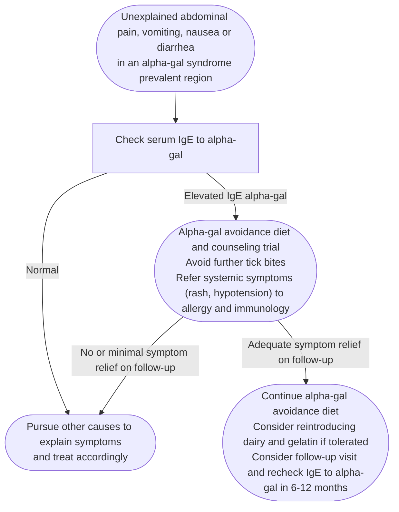

Immunoglobulin E (IgE)-mediated allergy to **galactose-alpha-1,3-galactose (alpha-gal)**, an oligosaccharide on the cells of all nonprimate mammals. Reactions occur **1 to several hours after** ingesting mammalian meat or mammalian-derived products. Sensitization follows a **tick bite** (US: Lone Star tick, *Amblyomma americanum*, whose principal host is deer) or parasitic infection. An increasingly recognized **gastrointestinal (GI) phenotype** presents with abdominal pain, diarrhea, [[nausea-and-vomiting|nausea and vomiting]] **without** predominant skin, respiratory, or circulatory symptoms — and is frequently mislabeled as [[irritable-bowel-syndrome]].

**Why the reaction is delayed:** ingested alpha-gal binds fat in a glycolipid → absorbed and incorporated into chylomicrons → enters the circulation in ~2 h → binds IgE on the mast cells that richly populate the GI tract → degranulation releases histamine and other mediators acting on sensory nerves (pain), smooth muscle (contraction), and mucous glands (secretion).

*Evidence quality: the [[aga-2023-alpha-gal-syndrome|American Gastroenterological Association (AGA) 2023 Clinical Practice Update (CPU) on Alpha-Gal Syndrome for the GI Clinician]] is a commentary — no systematic review was performed, so it carries **no Grading of Recommendations Assessment, Development and Evaluation (GRADE) strength or evidence quality**. Treat every threshold below as expert opinion.*

## Contents
- [[#Assessment]]
  - [[#Establishing the Diagnosis]]
  - [[#Severity Assessment]]
- [[#Differential Diagnosis]]
- [[#Diagnostics]]
- [[#Therapeutics]]
  - [[#Dietary avoidance (cornerstone)]]
  - [[#Acute / accidental exposure]]
  - [[#Tick-bite avoidance & medical products]]
  - [[#Follow-up & re-challenge]]
  - [[#Referral to allergist]]
- [[#See Also]]
- [[#Sources]]

## Assessment

*Diagnosis and management of suspected alpha-gal syndrome in a patient with unexplained GI symptoms*
*Source: redrawn from the suggested diagnostic and management algorithm (Figure 2)*
*[[aga-2023-alpha-gal-syndrome|AGA 2023 Clinical Practice Update on Alpha-Gal Syndrome for the GI Clinician]]*
*IgE = immunoglobulin E*

### Establishing the Diagnosis

**Clinical diagnosis with supporting labs.** Requires all three:

1. **Consistent symptoms** — unexplained GI symptoms (abdominal pain, diarrhea, nausea, vomiting), typically hours after eating mammalian meat/products.
2. **Increased serum alpha-gal IgE titer.** The update gives no numeric cutoff — "increased" plus symptom response is the standard.
3. **Symptom resolution/improvement after an alpha-gal–avoidance diet** trial (≥1 month).

> [!pitfall] A positive alpha-gal IgE alone is not a diagnosis
> Especially with isolated GI distress: sensitized people are commonly asymptomatic — seroprevalence was 31% in a North Carolina screening [[colonoscopy]] cohort and 35% in German hunters/forest workers, most tolerating meat ([[aga-2023-alpha-gal-syndrome]]).

- **When to consider it:** unexplained GI symptoms in a patient who lives/has lived in an alpha-gal–prevalent area. Features raising likelihood:
  - **Nighttime awakening from sleep with GI distress** (fits the hours-long ingestion-to-reaction delay)
  - History of **tick bites** or outdoor pursuits
- **Geography (US):** range of *Amblyomma americanum* — Southeast, mid-Atlantic, Midwest, East Central regions (New York/Iowa → Texas/Florida). International: Australia, South Africa, Western Europe, Japan.
- Oral food challenge is the formal allergy diagnostic but is **impractical** here (hours-long delay, inconsistent reactions between exposures).

### Severity Assessment

| Phenotype | Features | Timing after mammalian meat | Implication |
|---|---|---|---|
| Asymptomatic sensitization | alpha-gal IgE positive, tolerates mammalian meat; the majority of sensitized people | — | Not a diagnosis. Continued mammalian-meat intake associated with coronary artery disease (CAD): noncalcified plaque and obstructive CAD |
| GI only | Abdominal pain, diarrhea, nausea, vomiting without predominant skin, respiratory, or circulatory symptoms | 1 to several hours | Focus of this update; avoidance-diet trial |
| Delayed urticaria / anaphylaxis | Hives, many with a fall in blood pressure; abdominal pain often also present | Hives 3–5 h | Allergist referral, epinephrine-autoinjector counseling |

- Among 91 oral-food-challenge–proven alpha-gal–allergic patients: abdominal pain 71%, vomiting 22%; **40.7% had GI symptoms alone**.
- **Reactions are inconsistent** — a sensitized person who tolerates meat once can still be allergic. **Cofactors** raising reaction risk/severity: fatty cuts of meat, nonsteroidal anti-inflammatory drugs (NSAIDs), exercise, alcohol.
- **Systemic features mandate allergist referral** — triggers listed under [[#Referral to allergist]].

## Differential Diagnosis

*Workup of unexplained diarrhea: see [[chronic-diarrhea]].*

- [[irritable-bowel-syndrome]] and other functional GI illness — the most common misdiagnosis; recognizing alpha-gal as an IgE-mediated cause of GI illness is a departure from functional-GI paradigms.
- Other food allergies and intolerances.
- Organic disease suggested by red flags — anemia, GI bleeding, or weight loss (see [[#Diagnostics]]).

## Diagnostics

- **Serum alpha-gal IgE antibody** — the key specific test; send in the right clinical/geographic context. Positive alone is non-diagnostic (see [[#Establishing the Diagnosis]]).
- **Diagnostic avoidance-diet trial** — eliminate mammalian meat (beef, pork, venison) and related products (lard, dairy, ice cream) for **at least a month**; avoid restaurants (cross-contamination) and processed foods (additives); **re-evaluate after the trial** for symptom improvement.

> [!pitfall] Red flags argue against alpha-gal — consider not testing
> Anemia, GI bleeding, or weight loss: the allergy does not cause them, so pursue an organic workup instead. Urticaria and angioedema may or may not be present ([[aga-2023-alpha-gal-syndrome]]).

## Therapeutics

### Dietary avoidance (cornerstone)

**Eliminate all mammalian meat and mammalian-derived products** — "any animal with hair":

| Avoid | Notes |
|---|---|
| Beef, pork, venison, other mammalian meat | Fatter cuts carry higher reaction risk |
| Lard, butter, milk, **dairy** | Higher alpha-gal in **high-fat dairy**: ice cream, cream, cream cheese |
| **Gelatin** (pig/cow bone collagen) | Marshmallows, gummy bears, gelatin candies/desserts |
| Processed foods; restaurant meals | Animal-derived additives; cross-contamination |
| Aerosolized alpha-gal | Some react to inhaling fumes from frying bacon/beef products |

- **Expected response:** in two GI observational cohorts (16 patients in North Carolina; 359 in Virginia) **~three-quarters** of alpha-gal IgE–positive GI patients improved on an avoidance diet.
- **Acceptable:** fish, seafood, turkey, chicken, and other fowl.
- Work with **dieticians**; raise their awareness of alpha-gal before referral.
- No prospective controlled study supports **acupuncture** as treatment.

### Acute / accidental exposure

- Inform a reliable person.
- Take **1–2 diphenhydramine 25 mg tablets**.
- Ensure access to **self-injectable [[epinephrine]]**, especially if there is concern for respiratory compromise.

### Tick-bite avoidance & medical products

- **Avoid further tick bites** — additional bites drive alpha-gal IgE titers higher and worsen the allergy: perform tick checks and shower soon after wooded areas, pull tight mesh socks over pant cuffs, treat clothes/boots with **permethrin**.
- **Alpha-gal–containing medical products** (can react in sensitized patients):
  - **Cetuximab** — the original signal: severe infusion reactions in 1 of every 5 patients treated in North Carolina and Tennessee for metastatic [[colorectal-cancer]] (2007), none with a known prior mammalian-product allergy.
  - Porcine **[[exocrine-pancreatic-insufficiency|pancreatic enzymes]]**.
  - Bioprosthetic (bovine/porcine) **cardiac valves, patches, veins** — strong in-vitro IgE affinity, ≥2 reports of anaphylaxis after valve placement; early device failure not demonstrated.
  - Alpha-gal–free medical devices and alpha-gal–free pork (Revivicor) exist; the pork is approved for human consumption but not yet widely available.

### Follow-up & re-challenge

- Dynamic condition — symptoms fluctuate; sensitization may fade if tick bites are avoided, while further bites heighten it.
- If tick bites are avoided, **repeat alpha-gal IgE at 6–12 months** after diagnosis.
- As alpha-gal IgE falls or turns negative, may resume **first dairy (and gelatin, if tolerated), then mammalian meat**, in small portions.
- **Self-challenge:** modest doses only (**quarter serving of meat**), antihistamines + autoinjectable epinephrine available, and another person present to notice progressing symptoms. Patients with significant systemic symptoms (itching, hives) should work with an **allergist first** (anaphylaxis risk).

### Referral to allergist

- Refer when skin/systemic changes occur with reactions: facial/throat swelling, voice changes, difficulty breathing, hives, fainting — at risk for anaphylaxis; need formal epinephrine-autoinjector counseling.
- No desensitization protocol has been established for alpha-gal syndrome.

## See Also

[[irritable-bowel-syndrome]], [[chronic-diarrhea]], [[nausea-and-vomiting]], [[mast-cell-activation-syndrome]], [[colonoscopy]], [[colorectal-cancer]], [[exocrine-pancreatic-insufficiency]], [[epinephrine]]

---

## Sources

1. [[aga-2023-alpha-gal-syndrome|AGA Clinical Practice Update on Alpha-Gal Syndrome for the GI Clinician: Commentary]]
