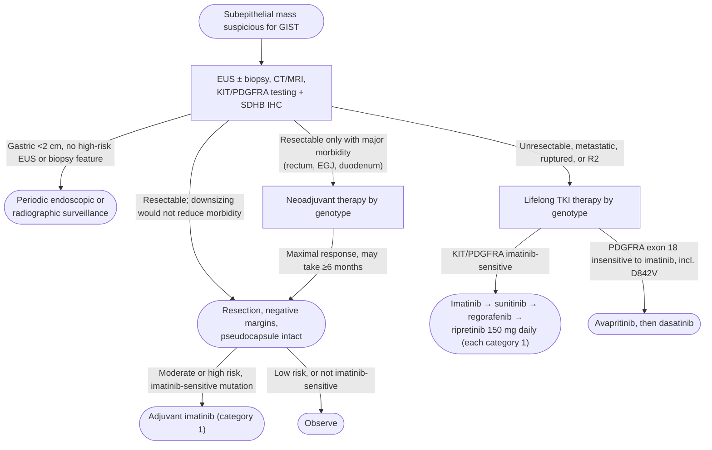

## Contents
- [[#Assessment]]
  - [[#Establishing the Diagnosis]]
  - [[#Severity Assessment]]
  - [[#Classification / Typing]]
- [[#Differential Diagnosis]]
- [[#Diagnostics]]
- [[#Therapeutics]]
  - [[#Localized Disease]]
  - [[#Neoadjuvant Therapy]]
  - [[#Adjuvant Imatinib]]
  - [[#Unresectable or Metastatic Disease]]
  - [[#Monitoring and Follow-Up]]
  - [[#Treatment Algorithm]]
- [[#See Also]]
- [[#Sources]]

## Assessment

### Establishing the Diagnosis

- Presents as a subepithelial mass (most often gastric), sometimes with gastrointestinal (GI) bleeding, early satiety, or as an incidental finding.
- Diagnosis is **morphologic on histologic sections**, supported by immunohistochemistry (IHC) for **KIT (CD117), DOG1 and SDHB**, plus molecular testing for KIT and PDGFRA and other potential drivers (BRAF, NF1, NTRK and FGFR fusions) ([[nccn-2026-gist]]).
- **Biopsy route:** endoscopic transmural biopsy is favored over percutaneous transperitoneal biopsy — lower peritoneal seeding risk. Percutaneous image-guided biopsy may be appropriate to confirm locally advanced or metastatic disease. **Incisional biopsy before or during the operation should be strictly avoided** ([[nccn-2026-gist]]).
- **Tissue before drugs:** biopsy is necessary to confirm primary GIST before starting preoperative therapy. A symptomatic or bleeding subepithelial lesion may be resected without a preresection diagnosis — the exception is a large GIST, where tissue confirmation is needed to permit neoadjuvant imatinib ([[acg-2023-subepithelial-lesions]]).
- **Mutational testing whenever tyrosine kinase inhibitor (TKI) therapy is part of the plan** — it selects the drug, not the prognosis ([[#Classification / Typing]]).
- Refer complex or unusual histopathology to a center with GIST/sarcoma expertise; manage with a multidisciplinary team ([[nccn-2026-gist]]).

### Severity Assessment

Malignant potential is estimated from **tumor size, mitotic rate, and primary site**. Small-intestinal lesions are more aggressive than gastric ones — **40%–50% of small-intestine GISTs are malignant vs 20%–25% of gastric lesions**; less is known about other sites, which are treated like small-intestine lesions ([[asge-2017-subepithelial-lesions]]).

**[[endoscopic-ultrasound|Endoscopic ultrasound (EUS)]] features associated with malignancy** ([[acg-2023-subepithelial-lesions]]): heterogeneous echotexture, large size (variably defined as >3 cm or >5 cm depending on the study), increasing size, irregular margins. Findings specifically associated with malignant GIST: anechoic or cystic-appearing spaces, echogenic foci, irregular borders, malignant-appearing lymph nodes.

- **≥2 of irregular border, echogenic foci and cystic spaces** → sensitivity for malignancy **80%–100%**; with **all three absent**, malignancy was found in only **0%–11%**.

**Malignant potential by size × mitotic rate × site (Armed Forces Institute of Pathology [AFIP]/Miettinen data).** This is the table that assigns the **risk stratum** — and the stratum is the decision, because adjuvant imatinib is offered at **moderate *or* high** risk ([[#Adjuvant Imatinib]]). Two caveats from the National Comprehensive Cancer Network (NCCN): the assessment applies best to **KIT- or PDGFRA-positive** GIST (**succinate dehydrogenase (SDH)-deficient GIST are more unpredictable**), and it assumes **no prior exposure to TKI therapy**. Mitotic rate is counted in the most proliferative area and reported **per 50 high-power fields (HPFs) = 5 mm²** (20–25 HPFs at 40× on most modern microscopes); the single cut-point throughout is **≤5 vs >5 mitoses/50 HPFs**. Mitotic rate may be inaccurate in small biopsies, and after neoadjuvant therapy (necrosis, reduced cellularity) — then stratify on clinical parameters, size and location instead ([[nccn-2026-gist]]).

*Gastric GIST — [[nccn-2026-gist]] Table 1, with the College of American Pathologists (CAP) risk category:*

| Tumor size | Mitotic rate | Metastasis rate | **Risk per CAP** |
|---|---|---|---|
| ≤2 cm | ≤5/50 HPFs | 0% | **None** |
| ≤2 cm | >5/50 HPFs | 0%\* | **None** |
| >2–≤5 cm | ≤5/50 HPFs | 1.9% | **Very low** |
| >2–≤5 cm | >5/50 HPFs | 16% | **Moderate** |
| >5–≤10 cm | ≤5/50 HPFs | 3.6% | **Low** |
| >5–≤10 cm | >5/50 HPFs | 55% | **High** |
| >10 cm | ≤5/50 HPFs | 12% | **Moderate** |
| >10 cm | >5/50 HPFs | 86% | **High** |

\* *Predicted rate based on a tumor category with very small numbers.*

*Non-gastric GIST (small bowel **and** colorectal) — [[nccn-2026-gist]] Table 2. For sites not listed (esophagus, mesentery, peritoneum), and for cells marked insufficient data, **use the jejunum/ileum criteria**.*

| Tumor size | Mitotic rate | Metastasis rate | **Risk per CAP** |
|---|---|---|---|
| ≤2 cm | ≤5/50 HPFs | 0% | **None** |
| ≤2 cm | >5/50 HPFs | 50%–54% | *Insufficient data* — **High** |
| >2–≤5 cm | ≤5/50 HPFs | 1.9%–8.5% | **Low** |
| >2–≤5 cm | >5/50 HPFs | 50%–73% | **High** |
| >5–≤10 cm | ≤5/50 HPFs | 24% | *Insufficient data* — **Moderate** |
| >5–≤10 cm | >5/50 HPFs | 85% | *Insufficient data* — **High** |
| >10 cm | ≤5/50 HPFs | 34%–57% | **High** |
| >10 cm | >5/50 HPFs | 71%–90% | **High** |

- NCCN's footnote records that in the original series these percentages counted the **proportion of patients with progressive disease** — read a cell as a band assignment, not as a transferable metastasis probability.
- **Older figures on the record:** [[asge-2017-subepithelial-lesions]] Tables 3–4 print the same AFIP dataset in coarser bands (gastric ≤2 cm with >5 mitoses **<4%** vs the NCCN 0%; gastric >2–≤10 cm with ≤5 mitoses pooled as **<4%**). Same guideline tier; **NCCN 2026 is newer and governs**, and only NCCN carries the CAP risk category.
- **Tumor rupture** — spontaneous or at surgery — carries a much higher recurrence risk, and **preoperative or intraoperative rupture, and gross residual disease (R2), are managed as metastatic disease** ([[nccn-2026-gist]]). Neither NCCN nor the subepithelial-lesion guidelines assign a ruptured tumor to a named risk stratum.

> [!pearl] Site moves the stratum at identical size and mitotic rate
> A 4 cm GIST with >5 mitoses/50 HPFs is **Moderate** risk in the stomach and **High** risk in the small bowel or rectum; a 3 cm low-mitosis lesion is **Very low** gastric but **Low** non-gastric. Hence all nongastric GISTs are resected regardless of size, and colorectal GIST **<2 cm with mitotic activity can still recur and metastasize** ([[nccn-2026-gist]]).

### Classification / Typing

About **80%** of GIST carry a KIT mutation and another **5%–10%** a PDGFRA mutation; the **10%–15%** with neither are mostly SDH-deficient, detectable as loss of SDHB on IHC. **All GIST lacking a KIT or PDGFRA mutation are tested for SDH deficiency and alternative drivers by next-generation sequencing (NGS)**; a negative profile warrants confirming with the laboratory that the assay covered the aberrations of interest ([[nccn-2026-gist]]).

| Driver | What it changes |
|---|---|
| **KIT exon 11** — majority of KIT-mutant GIST | Imatinib-sensitive at standard dose |
| **KIT exon 9** | Lower response rate and progression-free survival (PFS) at imatinib 400 mg/day → **400 mg twice daily**; dose escalation at progression may be most effective here |
| **PDGFRA**, other than imatinib-insensitive exon 18 | Most respond to imatinib |
| **PDGFRA exon 18 D842V** | Unlikely to respond to imatinib or most other approved TKIs → **avapritinib** |
| **SDH-deficient** ("wild-type") | Typically gastric, younger patients; usually slow-growing but frequently metastasize and may involve lymph nodes; usually imatinib-resistant — sunitinib or regorafenib may help. **Refer to a genetic counselor**; germline SDH carriers risk paraganglioma → **24-hour urine catecholamine/metanephrine testing before surgery** |
| **NF1-associated** | Typically small bowel, may be multifocal, often indolent; test KIT/PDGFRA anyway and refer for genetic counseling; TKI data are limited without a KIT/PDGFRA mutation |

Germline KIT/PDGFRA testing is considered for a family history of GIST and/or melanoma, multifocal GIST, and NF1 or SDH-deficient GIST ([[nccn-2026-gist]]).

## Differential Diagnosis

*Workup: see [[subepithelial-lesion]].*

Other subepithelial lesions: leiomyoma, schwannoma, [[gastroenteropancreatic-neuroendocrine-tumors|neuroendocrine tumor]], lipoma, glomus tumor, ectopic pancreas, and metastasis; gastric [[gastric-adenocarcinoma|adenocarcinoma]] or lymphoma when the lesion is not clearly subepithelial.

## Diagnostics

- **EUS** — layer of origin is the **4th (muscularis propria), rarely the 2nd or 3rd**; GIST is **hypoechoic and indistinguishable from leiomyoma on standard EUS**. **Contrast-enhanced EUS and EUS elastography separate them with accuracy >95%** — GIST **hyperenhances**, leiomyoma **hypoenhances** ([[aga-2022-subepithelial-lesions]]).
- **Sample the muscularis propria lesion** — preferably **fine-needle biopsy (FNB)**, or fine-needle aspiration (FNA) — to separate GIST from leiomyoma; EUS imaging alone is operator-dependent and does not settle malignant potential. Sampling accuracy by target size: [[subepithelial-lesion]].
- **EUS-FNA often cannot provide the mitotic index** ([[aga-2022-subepithelial-lesions]]).
- **Computed tomography (CT)/magnetic resonance imaging (MRI)** define extent and metastatic disease.
- **IHC** (KIT/CD117, DOG1, SDHB) confirms the diagnosis; **mutational analysis (KIT, PDGFRA, NGS where indicated)** guides therapy.

> [!pitfall] EUS cannot grade the mitotic rate
> In 2–5 cm pathology-confirmed GIST, no EUS imaging finding correlated with mitotic index — **tumor size is the only feature associated with a higher mitotic index**, and tissue taken by EUS-FNA does not assess the mitotic rate accurately. Final malignant potential is set by surgical pathology ([[acg-2023-subepithelial-lesions]], [[asge-2017-subepithelial-lesions]]).

## Therapeutics

### Localized Disease

- **Gastric <2 cm** — [[acg-2023-subepithelial-lesions|American College of Gastroenterology (ACG) 2023]] found **insufficient evidence to recommend surveillance vs resection** (conditional recommendation, very low quality of evidence). NCCN: **no high-risk EUS or biopsy feature → periodic endoscopic or radiographic surveillance**, EUS surveillance only after a thorough risk/benefit discussion; **any high-risk feature → complete surgical resection**.
  - **High-risk EUS features:** irregular border, cystic spaces, ulceration, echogenic foci, heterogeneity. **High-risk pathologic biopsy features:** presence of mitoses and/or tumor necrosis.
  - If the decision is to resect a GIST <2 cm, **endoscopic methods are an acceptable alternative to surgery**; no single endoscopic method is established as superior (ACG).
  - **Surveillance test and interval:** EUS — [[aga-2022-subepithelial-lesions|American Gastroenterological Association (AGA) 2022]] advises EUS surveillance for any gastric muscularis propria lesion <2 cm, tissue diagnosis or not. The optimal interval **has not been established** and practice varies by region; **annual surveillance is what is commonly done**, while [[asge-2017-subepithelial-lesions|American Society for Gastrointestinal Endoscopy (ASGE) 2017]] describes **6–12-month** intervals.
- **Gastric >2 cm** — resect (ACG: conditional, very low quality of evidence), **if resection can be achieved with minimal morbidity**; if not, neoadjuvant therapy may be indicated.
- **All nongastric GIST** (esophageal, small-bowel, colorectal) — **resect regardless of size** (ACG).
- **Symptomatic, ulcerated or bleeding lesions** — resection regardless of size (ACG, AGA).
- **Mandatory surgical evaluation** ([[aga-2022-subepithelial-lesions]]): any **small-intestinal** GIST; a **symptomatic** gastric GIST; a gastric GIST with **high-risk EUS features**.
- **Gastric 2–4 cm without high-risk features** may go to advanced endoscopic resection — [[endoscopic-submucosal-dissection|endoscopic submucosal dissection (ESD)]] and related techniques — rather than surgery, but only as a **multidisciplinary decision**, with a confirmed **low mitotic index (or Ki-67)** and **no metastatic disease on cross-sectional imaging**. Unfavorable location, or expertise unavailable → **surgery is the modality of choice** ([[aga-2022-subepithelial-lesions]]).
- **Surgical principles** ([[nccn-2026-gist]]): segmental or wedge resection to **histologically negative margins** — extended anatomic resection (e.g., total gastrectomy) is rarely indicated. **Do not violate the pseudocapsule** — no spillage, fracture or piecemeal resection; a laparoscopic specimen comes out in a plastic bag. **Lymphadenectomy is usually not required** (resect enlarged nodes in SDH-deficient GIST). **Re-resection is generally not indicated for microscopically positive (R1) margins.** Rectal GIST: sphincter-sparing, with preoperative imatinib considered if abdominoperineal resection would otherwise be needed.

### Neoadjuvant Therapy

- **Only when downsizing would reduce surgical morbidity** — locally advanced disease at a difficult site (rectum, esophagus and esophagogastric junction [EGJ], duodenum), where multivisceral resection would otherwise be required, or comorbidity making surgery unsafe.
- **Mutation testing (NGS) + SDHB IHC first**, to confirm a genotype likely to respond; it is acceptable to start imatinib while awaiting the result.
- By genotype: **imatinib** for KIT or PDGFRA mutations other than imatinib-insensitive exon 18 · **avapritinib** for imatinib-insensitive PDGFRA exon 18 including D842V · NTRK-directed therapy for NTRK fusions · **SDH-deficient:** sunitinib, regorafenib, observation (category 2B) or clinical trial · dabrafenib/trametinib for BRAF V600E · **forgo neoadjuvant therapy for other mutations**.
- **Maximal response may take ≥6 months** — operate after maximal response if feasible; bleeding, a symptomatic tumor or poor tolerance → straight to surgery. Neoadjuvant therapy may prevent accurate postoperative recurrence-risk assessment.

### Adjuvant Imatinib

- **Who** — completely resected (R0/R1) with **no** preoperative therapy: **moderate *or* high recurrence risk** (not high risk alone) **and an imatinib-sensitive mutation** → adjuvant imatinib, preferred, **category 1**. Assign the stratum from the size × mitotic-rate × site tables under [[#Severity Assessment]]. **Low-risk disease or a non-imatinib-sensitive tumor → observe.**
- **After neoadjuvant imatinib:** consider continuing adjuvant imatinib (preferred) for moderate- or high-risk disease — **category 2A**. After neoadjuvant therapy with an agent other than imatinib: observe.
- **Duration:** optimal duration is **unknown**. Data support **≥3 years** for high-risk disease on an **overall survival (OS)** benefit, **or ≥6 years** on a **disease-free survival (DFS)** benefit; 5 years has been shown feasible in imatinib-sensitive GIST.
- **Not supported:** routine adjuvant use in GIST **without a KIT mutation**, or with an **imatinib-resistant PDGFRA mutation**.

### Unresectable or Metastatic Disease

- **Lifelong systemic therapy** in TKI-sensitive GIST; line sequence in [[#Treatment Algorithm]]. **Do not stop the TKI even when disease is progressing** — discontinuation may accelerate progression and worsen symptoms.
- **Dosing:** imatinib **400 mg daily** standard; **KIT exon 9 → 400 mg twice daily**. On progression at standard dose, escalate **to 400 mg twice daily as tolerated** or switch to sunitinib. Ripretinib may be escalated to **150 mg twice daily** on progression at 150 mg daily.
- **Substitutions:** sunitinib intolerance → ripretinib 150 mg daily. **Imatinib-insensitive PDGFRA exon 18 (incl. D842V):** avapritinib first-line, dasatinib second-line, ripretinib after both.
- **Other drivers:** NTRK fusion — larotrectinib, entrectinib or repotrectinib · SDH-deficient — sunitinib, regorafenib, pazopanib, or binimetinib/imatinib (category 2B) · BRAF V600E — dabrafenib/trametinib · tumor mutational burden-high — ipilimumab + nivolumab (category 2B). **Clinical trial referral is strongly recommended** when the mutation is resistant to imatinib, sunitinib, regorafenib, ripretinib and avapritinib.
- **Progression on therapy:** limited progression → continue the same TKI dose and consider resection, ablation/embolization, or palliative radiation for symptomatic lesions (category 2B). Generalized progression → switch TKI, or escalate imatinib if on standard dose. Progression despite prior therapies → clinical trial, repeat biopsy for an uncommon targetable mutation, or best supportive care with imatinib continued for palliation.
- **Surgery in metastatic disease** (after systemic therapy): favorable response with complete cytoreduction achievable; unifocal TKI-refractory progression while other sites respond; low-volume resectable multifocal progression; or symptomatic bleeding, obstruction or perforation.
- **Perioperative TKI:** imatinib may be stopped immediately before surgery and restarted once oral intake is tolerated; **sunitinib, regorafenib, ripretinib and avapritinib are stopped at least 1 week preoperatively**.

### Monitoring and Follow-Up

- **On therapy:** CT and/or MRI **every 8–12 weeks** after starting; fluorodeoxyglucose positron emission tomography (FDG-PET)/CT may show TKI efficacy at **2–4 weeks** when a rapid readout is needed, but FDG-PET/CT with a non-diagnostic CT is not a substitute for a diagnostic CT. Imaging may be spaced out in responding disease.
- **After resection:** history, physical and imaging **every 3–6 months — every 3 months if high risk — for 5 years, then annually**; individualize after 10 years. Less frequent surveillance may be acceptable for tumors <2 cm unless the mitotic rate is high.

> [!pitfall] A tumor that grows on treatment may still be responding
> **An increase in tumor size together with a decrease in tumor density is consistent with drug efficacy** — size alone is misleading. FDG-PET/CT may clarify an ambiguous CT or MRI ([[nccn-2026-gist]]).

### Treatment Algorithm

*Pathway for a newly diagnosed gastrointestinal stromal tumor*
*built from the NCCN 2026 GIST statements on workup, surgery, neoadjuvant and adjuvant therapy, and systemic therapy (the document numbers no statements; this is not an NCCN figure)*
*[[nccn-2026-gist|NCCN Clinical Practice Guidelines in Oncology: Gastrointestinal Stromal Tumors (GIST) (Version 1.2026)]]*
*GIST = gastrointestinal stromal tumor · EUS = endoscopic ultrasound · CT = computed tomography · MRI = magnetic resonance imaging · IHC = immunohistochemistry · EGJ = esophagogastric junction · R2 = gross residual disease · TKI = tyrosine kinase inhibitor*

---

## See Also

[[subepithelial-lesion]], [[gastric-adenocarcinoma]], [[gastroenteropancreatic-neuroendocrine-tumors]], [[endoscopic-ultrasound]], [[endoscopic-submucosal-dissection]], [[endoscopic-full-thickness-resection]], [[upper-endoscopy]], [[esophageal-cancer]]

---

## Sources

1. [[nccn-2026-gist|NCCN Clinical Practice Guidelines in Oncology: Gastrointestinal Stromal Tumors (GIST) (Version 1.2026)]]
2. [[acg-2023-subepithelial-lesions|ACG 2023: Diagnosis and Management of Gastrointestinal Subepithelial Lesions]]
3. [[asge-2017-subepithelial-lesions|ASGE 2017: The Role of Endoscopy in Subepithelial Lesions of the GI Tract]]
4. [[aga-2022-subepithelial-lesions|AGA Clinical Practice Update on Management of Subepithelial Lesions Encountered During Routine Endoscopy: Expert Review]]
