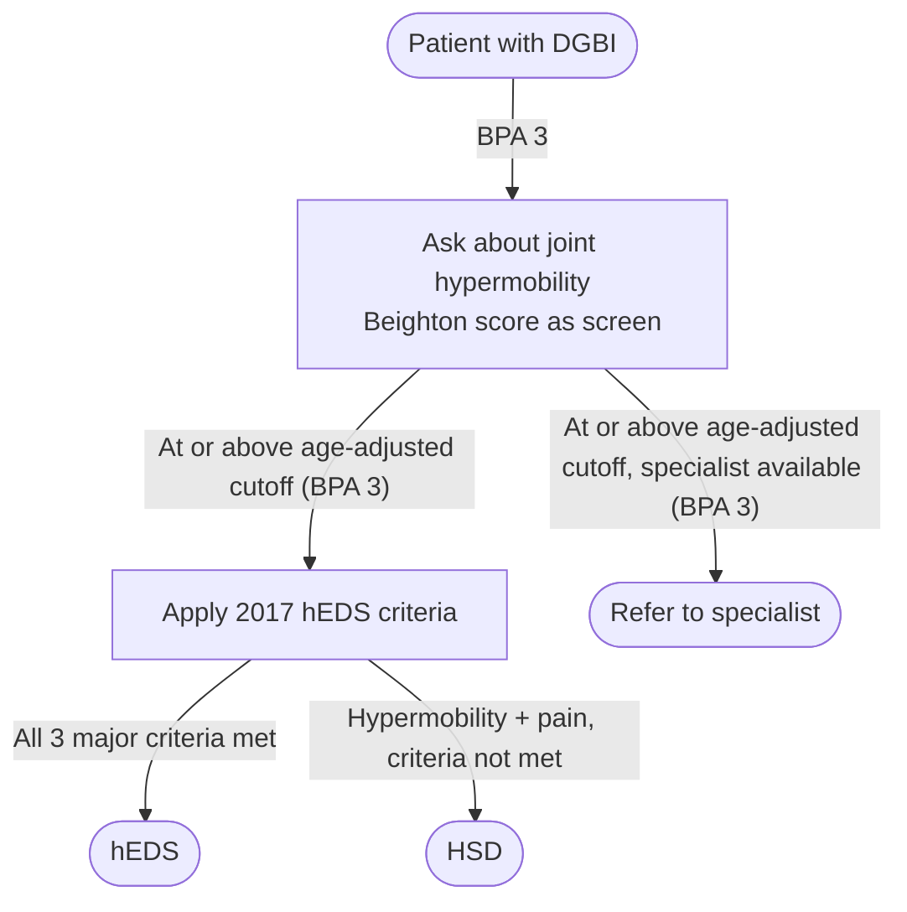

Inherited connective tissue disorder; most common Ehlers-Danlos syndrome (EDS) subtype (80–90% of patients with EDS). Characterized by joint hypermobility, tissue fragility, musculoskeletal symptoms. Part of a broader group, **hypermobility spectrum disorders (HSD)** — pain + joint hypermobility that does not meet full hypermobile EDS (hEDS) criteria. Gastrointestinal (GI) symptoms are frequent and impair quality of life — in a cross-sectional survey of >600 hEDS/HSD patients, **98% met criteria for a [[disorders-of-gut-brain-interaction|disorder of gut-brain interaction (DGBI)]]**. Often coexists with [[postural-orthostatic-tachycardia-syndrome|postural orthostatic tachycardia syndrome (POTS)]] and [[mast-cell-activation-syndrome|mast cell activation syndrome (MCAS)]]; GI symptoms are prevalent in each and more so when they overlap. [[aga-2025-heds-gi]]

## Contents
- [[#Assessment]]
  - [[#Establishing the Diagnosis]]
  - [[#Beighton Score]]
  - [[#Coexisting POTS and MCAS]]
- [[#Differential Diagnosis]]
- [[#Diagnostics]]
- [[#Therapeutics]]
  - [[#GI Symptom Management]]
  - [[#POTS and MCAS Treatment]]
  - [[#Nutrition and Diet]]
- [[#See Also]]
- [[#Sources]]

---

## Assessment

### Establishing the Diagnosis

**hEDS — 2017 international consensus criteria (3 major criteria).** [[aga-2025-heds-gi]]

| # | Criterion | Operative detail |
|---|---|---|
| 1 | Generalized joint hypermobility | **Beighton score** at or above the age-adjusted cutoff — see [[#Beighton Score]] |
| 2 | **≥2 of 3** feature groups | (a) other connective-tissue manifestations — soft/velvety skin, striae, or pelvic organ or [[rectal-prolapse\|rectal prolapse]] in children, men, or nulliparous women; (b) positive family history; (c) musculoskeletal complications — joint instability or widespread pain |
| 3 | **Absence** of unusual skin fragility | Skin fragility prompts exclusion of other EDS forms, other heritable/acquired connective tissue disorders, and other joint disorders involving hypotonia and/or connective tissue laxity |

- **HSD** = joint hypermobility + pain that does **not** satisfy the full hEDS criteria.

**Screening in the GI clinic — Best Practice Advice (BPA) 3:** gastroenterologists seeing patients with DGBI should **inquire about joint hypermobility** and strongly consider the Beighton score as a screening tool; if positive, they may consider applying the 2017 criteria (Ehlers-Danlos Society hEDS diagnostic criteria checklist) or offer referral to a specialist where resources are available.

*Joint-hypermobility screening of patients with DGBI*
*Source: built from AGA 2025 BPA 3 and the 2017 criteria as summarized in the text (the update has no flowchart)*
*[[aga-2025-heds-gi|AGA 2025 Clinical Practice Update: GI Manifestations in hEDS]]*
*DGBI = disorder of gut-brain interaction · hEDS = hypermobile Ehlers-Danlos syndrome · HSD = hypermobility spectrum disorder · BPA = Best Practice Advice*

### Beighton Score

Nine points; **test both sides** for A–D (1 point per side), spine scores 1. [[aga-2025-heds-gi]] (Figure 1, reproduced from the Ehlers-Danlos Society)

| Maneuver | How to test | Points |
|---|---|---|
| **A. 5th finger / pinkies** | Rest palm and forearm on a flat surface, palm down, fingers straight. Can the fifth finger be bent/lifted upwards at the knuckle **beyond 90°**? | 1 per hand |
| **B. Thumbs** | Arm out straight, palm facing down, wrist fully bent downward. Can the thumb be pushed back **to touch the forearm**? | 1 per thumb |
| **C. Elbows** | Arms outstretched, palms up. Does the elbow extend **>10° beyond** a normal outstretched position? | 1 per side |
| **D. Knees** | Standing, knees locked/bent backwards as far as possible. Does the lower leg extend **>10° forward**? | 1 per side |
| **E. Spine** | Bend forward — can the **palms** be placed **flat on the floor** in front of the feet **without bending the knees**? | 1 |

**Positive Beighton score — age-adjusted cutoff (≥):**

| Age band | Cutoff |
|---|---|
| Children (pre-puberty) | **6/9** |
| Puberty up to age 50 | **5/9** |
| ≥50 years | **4/9** |

### Coexisting POTS and MCAS

- **BPA 1:** be aware of the observed associations of hEDS/HSD with POTS and/or MCAS and their overlapping GI manifestations; theoretical explanations exist (altered collagen/extracellular matrix, mast-cell–mediated visceral sensitization, autonomic dysfunction, autoimmunity), but experimental evidence for the mechanisms is limited and evolving.
- **Association data (observational):** among 139 patients with MCAS and refractory GI symptoms, 23.7% had EDS, 25.2% POTS, 15.1% both; 37.5% of 616 surveyed hEDS/HSD patients reported a POTS diagnosis; in another study >60% of hEDS/HSD patients had ≥1 GI symptom, and those with POTS more often had fibromyalgia, [[irritable-bowel-syndrome|irritable bowel syndrome (IBS)]], [[gerd|gastroesophageal reflux disease (GERD)]], or dysmotility. In these studies hEDS/HSD was often **not** diagnosed by the 2017 criteria, and POTS/MCAS were not always categorically established.

| | POTS | MCAS |
|---|---|---|
| **Clues** | Orthostatic intolerance; in POTS, **nausea, abdominal pain and early satiety** are the GI symptoms most predictive of abnormal GI motility | Allergic reactions plus systemic symptoms — fatigue, tinnitus, conjunctivitis, headache/migraine, brain fog, palpitations, flushing, pruritus, urticaria, myalgias, lymphadenopathy. GI symptoms (nausea, vomiting, heartburn, [[dysphagia]], abdominal pain, atypical chest pain, bowel dysfunction) overlap DGBI |
| **Criteria, typing, confirmatory tests** | [[postural-orthostatic-tachycardia-syndrome]] | [[mast-cell-activation-syndrome]] |
| **When to test** | [[#Diagnostics]] (BPA 4) | [[#Diagnostics]] (BPA 5–7) |

- A history of an infectious insult may prompt further consideration of POTS/MCAS.

> [!pitfall] Don't screen every hEDS patient for POTS/MCAS
> **BPA 2:** target POTS/MCAS testing to patients with clinical manifestations of those conditions — universal testing of all hEDS/HSD patients is not supported ([[aga-2025-heds-gi]]).

---

## Differential Diagnosis

*Workup follows the general [[disorders-of-gut-brain-interaction|DGBI]] approach (positive symptom-based diagnosis, limited noninvasive testing), with the hEDS-specific additions below.*

- Other EDS forms (esp. **vascular EDS** — see endoscopy safety under [[#Diagnostics]]) and the other disorders that unusual skin fragility should prompt you to exclude (criterion 3 above).
- IBS and [[dyspepsia|functional dyspepsia]] — DGBI overlap.
- [[gastroparesis]] / GI dysmotility — EDS gene variants enriched in idiopathic gastroparesis; reports of increased dysmotility in hEDS/HSD are inconsistent.
- [[celiac-disease]] — risk elevated in hEDS/HSD and/or POTS.
- [[defecation-disorders|Functional defecation disorders]] / pelvic floor dysfunction.

---

## Diagnostics

*BPA from [[aga-2025-heds-gi]]; the update gives no evidence grades.*

| Question | Population | Action |
|---|---|---|
| **GI symptom workup (BPA 8)** | hEDS/HSD with comorbid POTS and/or MCAS and DGBI-type symptoms | As for DGBI in the general population — positive symptom-based diagnostic strategy, limited noninvasive testing |
| **Celiac disease (BPA 9)** | hEDS/HSD with a variety of GI symptoms — **not only diarrhea** | Consider [[celiac-disease\|celiac]] testing **earlier** (serology, then endoscopic biopsies). Insufficient research to support routine testing for disaccharidase deficiencies or other diet-mediated mechanisms |
| **Functional defecation disorders (BPA 10)** | hEDS/HSD with lower-GI symptoms such as **incomplete evacuation** | Consider [[anorectal-manometry]], balloon expulsion test, or defecography — pelvic floor dysfunction is common, **especially rectal hyposensitivity** |
| **Gastric motor testing (BPA 11)** | hEDS/HSD with comorbid POTS and **chronic upper-GI symptoms** | Consider **timely** gastric emptying and/or accommodation testing **after excluding anatomical and structural disease** — abnormal gastric emptying may be more common than in the general population |
| **POTS (BPA 4)** | hEDS/HSD with **refractory GI symptoms who also report orthostatic intolerance**, after excluding medication side effects and trying lifestyle/behavioral changes (e.g., adequate hydration, physical exercise) | Consider postural vital signs (e.g., symptomatic heart rate rise ≥30 beats/min within 10 minutes of standing — active stand or head-up tilt table test — without orthostasis) and referral to cardiology or neurology for autonomic testing. **Not required** for all hEDS/HSD patients with GI symptoms alone |
| **MCAS (BPA 5–7)** | hEDS/HSD and DGBI with **episodic** symptoms suggesting a generalized mast cell disorder, involving **≥2 physiological systems** (cutaneous, GI, cardiac, respiratory, neuropsychiatric) | Consider testing for mast cell disorders (serum tryptase protocol on [[mast-cell-activation-syndrome]]); if MCAS is supported → refer to an allergy specialist or mast cell disease research center. **Not** for routine evaluation of GI symptoms without clinical or laboratory evidence of a primary or secondary mast cell disorder |

> [!pearl] Endoscopy is not riskier — except vascular EDS
> Endoscopy-related complications such as perforation do not appear increased in adults with hEDS/HSD, except in vascular EDS; perform age- and indication-appropriate endoscopy ([[aga-2025-heds-gi]]).

---

## Therapeutics

- **BPA 12 (with POTS/MCAS):** treat the **most prominent GI symptoms and abnormal GI function test results** with general DGBI/GI motility treatment, **plus** treatment of any symptoms attributable to POTS and/or MCAS.
- **BPA 16 (without POTS/MCAS symptoms):** manage chronic GI symptoms as for DGBI and GI motility disorders in the general population, with integrated multidisciplinary care where appropriate (e.g., cardiology, rheumatology, dietitian, psychology).
- Management is largely supportive and symptom-focused; few clinical trials guide it.

### GI Symptom Management

*Treatment considerations for hEDS/HSD with POTS and/or MCAS.* [[aga-2025-heds-gi]] (Table 2; erythromycin, pregabalin and gabapentin from the text)

| Symptom | Treatment options |
|---|---|
| **[[nausea-and-vomiting\|Nausea / vomiting]]** | Antiemetics (ondansetron, prochlorperazine, promethazine, aprepitant, off-label carbidopa); prokinetics (metoclopramide, domperidone, pyridostigmine, off-label [[prucalopride]], erythromycin); complementary (aromatherapy, ginger tea, STW5). *Multiple agents are often needed — monitor for QT prolongation.* |
| **Abdominal pain** | Acid suppression (histamine-2 receptor antagonist [H2RA], [[proton-pump-inhibitors\|proton pump inhibitor (PPI)]]); antispasmodics (dicyclomine, hyoscyamine, peppermint oil); neuromodulators (tricyclic antidepressant [TCA], selective serotonin reuptake inhibitor [SSRI], serotonin-norepinephrine reuptake inhibitor [SNRI], neuroleptics, anticonvulsants — incl. pregabalin, gabapentin); psychological therapies (cognitive behavioral therapy [CBT], hypnotherapy, relaxation). **Opioids: avoid in chronic pain; never use specifically to treat abdominal pain; if already prescribed, careful multidisciplinary management with cessation where possible.** |
| **[[chronic-idiopathic-constipation\|Constipation]]** | Fiber (psyllium, methylcellulose); osmotic laxatives (polyethylene glycol [PEG] 3350, lactulose, milk of magnesia); stimulants (bisacodyl, senna); chloride-channel activator [[lubiprostone]]; guanylate cyclase-C agonists [[linaclotide]] and [[plecanatide]]; 5-hydroxytryptamine-4 (5-HT4) agonist [[prucalopride]]; sodium hydrogen exchanger 3 inhibitor [[tenapanor]] |
| **[[chronic-diarrhea\|Diarrhea]]** | Dietary (low fermentable oligosaccharide, disaccharide, monosaccharide, and polyol [FODMAP], gluten-free, soluble fiber); microbiome ([[rifaximin]], *Bifidobacterium infantis* 35624 — see [[probiotics]]); antidiarrheals ([[loperamide]], diphenoxylate); bile acid sequestrants (cholestyramine, colesevelam, colestipol); [[eluxadoline]]*; 5-hydroxytryptamine-3 (5-HT3) receptor antagonist [[alosetron]] (female patients only) |
| **MCAS** | Agent list on [[mast-cell-activation-syndrome]] |
| **POTS** | Agent list on [[postural-orthostatic-tachycardia-syndrome]] |
| **Autoimmunity** | Corticosteroids or immunoglobulins — GI providers may need to refer to allergy/immunology or mast cell specialists to manage these medications |

\* [[eluxadoline]] is contraindicated with ≥3 alcoholic beverages/day, post-cholecystectomy, and moderate-to-severe hepatic insufficiency.

- Symptoms that worsen with stress **and** maladaptive coping behaviors → **early** referral for brain-gut hypnotherapy (see [[brain-gut-behavioral-therapy]]).
- Pelvic floor symptoms are common: treat per general anorectal disorder principles.

### POTS and MCAS Treatment

- **POTS (BPA 13):** conservative measures first, pharmacologic treatment with integrated cardiology–neurology care only if they fail — targets and agents on [[postural-orthostatic-tachycardia-syndrome]].
- **MCAS (BPA 14):** trigger avoidance plus histamine receptor antagonists and/or mast cell stabilizers — the line-by-line ladder and the trigger list are on [[mast-cell-activation-syndrome]].

### Nutrition and Diet

- Screen for **weight loss and disordered eating**; frequently involve a dietitian (undernutrition and dehydration may be a problem in a proportion of patients).
- **BPA 15:** besides general nutritional support, special diets can be considered; deliver them with nutritional counseling to avoid overly restrictive eating. Studies of their efficacy in these patient groups are lacking.

| Setting | Diet |
|---|---|
| Upper GI (nausea, vomiting) | [[gastroparesis\|Gastroparesis]] / **small-particle diet** (modified food composition, consistency, volume) |
| Lower GI | IBS diets — **low-FODMAP** or wheat-/gluten-free |
| MCAS | Low-histamine, gluten- and dairy-free (recommended from clinical experience; no formal studies) |

- Severe symptoms with weight loss or dehydration despite optimal medical management → parenteral fluid and/or enteral or parenteral nutrition as a stabilizing measure, delivered through a multidisciplinary model.

---

## See Also

[[postural-orthostatic-tachycardia-syndrome]], [[mast-cell-activation-syndrome]], [[disorders-of-gut-brain-interaction]], [[gastroparesis]], [[irritable-bowel-syndrome]], [[celiac-disease]], [[gerd]], [[rectal-prolapse]], [[anorectal-manometry]], [[defecation-disorders]], [[dysphagia]], [[dyspepsia]], [[nausea-and-vomiting]], [[chronic-diarrhea]], [[chronic-idiopathic-constipation]], [[brain-gut-behavioral-therapy]], [[proton-pump-inhibitors]], [[lubiprostone]], [[linaclotide]], [[plecanatide]], [[tenapanor]], [[prucalopride]], [[alosetron]], [[eluxadoline]], [[loperamide]], [[rifaximin]], [[probiotics]]

---

## Sources

1. [[aga-2025-heds-gi|AGA Clinical Practice Update on GI Manifestations and Autonomic or Immune Dysfunction in Hypermobile Ehlers-Danlos Syndrome: Expert Review]]
