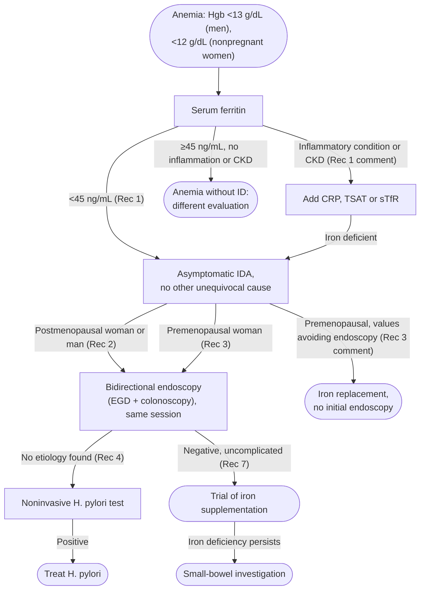

## Contents
- [[#Assessment]]
  - [[#Establishing the Diagnosis]]
  - [[#Severity Assessment]]
- [[#Differential Diagnosis]]
- [[#Diagnostics]]
  - [[#GI Structural Evaluation]]
  - [[#Small-Bowel Evaluation]]
- [[#Therapeutics]]
  - [[#Oral Iron]]
  - [[#Intravenous Iron]]
  - [[#Condition-Specific Repletion]]
  - [[#Anaemia in IBD]]
- [[#See Also]]
- [[#Sources]]

---

## Assessment

### Establishing the Diagnosis

- **Iron deficiency (ID):** the most common nutritional deficiency worldwide. **Iron-deficiency anemia (IDA)** = ID with anemia. [[aga-2024-ida-management]]
- **Anemia:** hemoglobin (Hgb) **<13 g/dL in men, <12 g/dL in nonpregnant women**. Deciding whether anemia is from ID comes first — evaluation of anemia without ID differs substantially. [[aga-2020-ida]]
- **Ferritin cutoff <45 ng/mL** in a patient with anemia — American Gastroenterological Association (AGA) 2020 recommends 45 over 15 ng/mL (**Strong recommendation, high-quality evidence**). [[aga-2020-ida]]

| Ferritin cutoff | Sensitivity for ID | Specificity |
|---|---|---|
| <45 ng/mL | 85% (95% confidence interval [CI] 82–87%) | 92% (91–94%) |
| <15 ng/mL | 59% (55–62%) | 99% (89–99%) |

*Ferritin cutoffs for diagnosing iron deficiency*
*Source: data from the systematic review of 55 studies, cited in AGA 2020*
*[[aga-2020-ida|AGA 2020 Iron-Deficiency Anemia Guideline]]*
*ID = iron deficiency · CI = confidence interval*

- 45 chosen to maximize sensitivity (fewer missed diagnoses, e.g. gastrointestinal [GI] malignancy) at an acceptable false-positive rate. AGA 2020 did not address ferritin thresholds in **non-anemic** patients. [[aga-2020-ida]]
- **Inflammation or chronic kidney disease (CKD):** ferritin is an acute-phase reactant and may not reflect iron stores.
  - AGA 2020: add C-reactive protein (CRP), serum iron, transferrin saturation (TSAT) or soluble transferrin receptor (sTfR) to ferritin. [[aga-2020-ida]]
  - AGA 2024: ID/IDA can occur with ferritin **>45 (usually <100)**; TSAT, sTfR or reticulocyte hemoglobin equivalent may help confirm. [[aga-2024-ida-management]]
  - AGA gives no cutoffs for these tests; the European Crohn's and Colitis Organisation (ECCO) criteria for inflammatory bowel disease (IBD) are under [[#Anaemia in IBD]].
- GI symptoms may warrant endoscopy whatever the iron status. [[aga-2020-ida]]
- After ID is identified: dietary iron intake, menstrual losses (premenopausal women), and a search for GI causes of poor absorption or blood loss, including [[helicobacter-pylori-infection|*H. pylori*]]. [[aga-2024-ida-management]]

### Severity Assessment

| Finding | Implication |
|---|---|
| Severity of ID, symptoms, tolerance of oral iron, likelihood oral iron will work | Sets oral vs intravenous (IV) route ([[aga-2024-ida-management]]) |
| Hgb <10 g/dL in [[inflammatory-bowel-disease\|IBD]] | ECCO consensus (cited by AGA 2024): IV over oral iron first-line ([[aga-2024-ida-management]]) |
| Profound IDA with [[portal-hypertensive-gastropathy\|portal hypertensive gastropathy]] | IV iron reasonable ([[aga-2024-ida-management]]) |

---

## Differential Diagnosis

*Workup of occult GI blood loss: see [[small-bowel-bleeding]].*

**Causes of IDA** [[aga-2020-ida]]:
- **GI malignancy** — the most serious cause ([[colorectal-cancer]]; upper GI cancer).
- [[peptic-ulcer-disease|Peptic ulcer disease]], erosive esophagitis, [[celiac-disease|celiac disease]], [[inflammatory-bowel-disease|IBD]], other GI lesions.
- *H. pylori* infection; autoimmune [[atrophic-gastritis|atrophic gastritis]] (hypochlorhydria impairs absorption).
- Non-GI: menstrual or other non-GI blood loss, frequent blood donation, nutritional deficiency (e.g. vegan/vegetarian diet), malabsorption syndromes.
- After bariatric surgery: impaired duodenal absorption, anastomotic ulcers ([[aga-2024-ida-management]]).

**Anemia not (only) from ID** — causes of IBD-related anemia, ECCO 2024 Table 2 [[ecco-2024-eim-ibd]]:
- Very common: IDA, **anaemia of chronic disease (ACD)** — often together.
- Common: vitamin B12 or folate deficiency; drug-induced (sulfasalazine, 5-aminosalicylic acid, thiopurines, calcineurin inhibitors, Janus kinase inhibitors).
- Less common: autoimmune haemolysis, myelodysplastic syndrome, aplastic anaemia, glucose-6-phosphate dehydrogenase deficiency.

> [!pitfall] Red-cell size does not settle it
> A normal mean corpuscular volume (MCV) does not exclude ID — up to 40% of pure IDA is normocytic. Microcytosis does not prove ID: ACD, sideroblastic anaemia and thalassaemia cause it too ([[ecco-2024-eim-ibd]]).

---

## Diagnostics

### GI Structural Evaluation

Bidirectional endoscopy = [[upper-endoscopy|esophagogastroduodenoscopy (EGD)]] **and** [[colonoscopy]] in the same setting. [[aga-2020-ida]]

*Gastrointestinal evaluation of iron-deficiency anemia*
*Source: built from AGA 2020 Recommendations 1, 2, 3, 4 and 7 (numbering as on the source page; the guideline document has no flowchart)*
*[[aga-2020-ida|AGA 2020 Iron-Deficiency Anemia Guideline]]*
*Hgb = hemoglobin · CKD = chronic kidney disease · CRP = C-reactive protein · TSAT = transferrin saturation · sTfR = soluble transferrin receptor · ID = iron deficiency · IDA = iron-deficiency anemia · EGD = esophagogastroduodenoscopy · H. pylori = Helicobacter pylori*

**Bidirectional endoscopy** — strength depends on the patient [[aga-2020-ida]]:

| Population (asymptomatic IDA) | Recommendation | Strength / quality |
|---|---|---|
| **Postmenopausal women and men** | Bidirectional endoscopy **over no endoscopy** | **Strong**, moderate |
| **Premenopausal women** | Bidirectional endoscopy **over iron replacement alone** | **Conditional**, moderate |

- Applies to **asymptomatic** patients with no other unequivocal explanation after history and exam (particularly young men and younger women); GI symptoms → evaluate by integrating the symptoms.
- Premenopausal women: a patient who places high value on avoiding the small risk of endoscopy — particularly if young with another plausible cause — and low value on the very small risk of a missed GI malignancy **would reasonably choose initial iron replacement and no endoscopy**. No age or ferritin cutoff defines who; shared decision making.
- **[[celiac-disease|Celiac disease]] — serology first, biopsy only if positive**, over routine small-bowel biopsies, in asymptomatic adults with IDA and plausible celiac disease (Conditional, very low).
  - Favored unless celiac prevalence in the population is >5%.
  - **Routine small-bowel biopsies reasonable** (shared decision) with higher-risk features: family history, autoimmune disease (e.g. type 1 diabetes), GI symptoms.
  - **Biopsy if the duodenum looks abnormal** at EGD.
  - Negative serology but ID persists despite an adequate iron trial → reconsider celiac disease.
- **Routine gastric biopsies for [[atrophic-gastritis|atrophic gastritis]] — suggested *against*** (Conditional, very low).
- **Noninvasive *H. pylori* [[test-and-treat]]** when bidirectional endoscopy finds no etiology (Conditional, low).
- **After bariatric surgery:** EGD to exclude anastomotic ulcer ([[aga-2024-ida-management]]).

### Small-Bowel Evaluation

- **Uncomplicated asymptomatic IDA, negative bidirectional endoscopy → trial of iron supplementation over routine [[capsule-endoscopy|video capsule endoscopy]]** (Conditional, very low); small-bowel investigation only if ID persists. [[aga-2020-ida]]
- **Does not apply — capsule may be indicated** [[aga-2020-ida]]:
  - Symptoms suggesting small-bowel disease, or higher risk of small-bowel pathology (e.g. propensity for small-bowel [[angioectasia|angioectasias]]).
  - Small-bowel findings would change management — e.g. anticoagulant or antiplatelet therapy.
  - Anemia refractory to adequate iron supplementation.
  - Hospitalized patients with acute or acute-on-chronic anemia.
- Small-bowel bleeding workup: [[small-bowel-bleeding]].

---

## Therapeutics

Management = **replete iron stores** and, where possible, **treat the underlying etiology**. AGA 2024 Best Practice Advice (BPA) statements carry no evidence ratings. [[aga-2024-ida-management]]

### Oral Iron

- **No formulation is superior; ferrous sulfate preferred** as least expensive (BPA 1). Ferrous salts (sulfate, fumarate, gluconate) are a reasonable start. [[aga-2024-ida-management]]
- **Once a day at most** (BPA 2): an oral dose raises [[iron-overload-and-iron-metabolism|hepcidin]] for up to 48 h, blocking further absorption — more doses add side effects, not iron. Every-other-day dosing may be better tolerated with similar absorption; AGA 2024 says it needs more study before routine use.
- **Vitamin C** (BPA 3): 80 mg ascorbic acid with iron on an empty stomach improved absorption (isotope study); 500 mg allows absorption even when the meal contains calcium or fiber. Supporting evidence is mixed.
- **Other absorption tips:** empty stomach absorbs best, but some tolerate iron better with meals; meat protein improves absorption; **no tea or coffee within an hour after** iron.
- **Side effects** (meta-analysis): constipation 12%, nausea 11%, diarrhea 8%.
- **Response (adherent, anemic):** Hgb ↑ **1 g/dL within 2 weeks**, ferritin ↑ within a month; not met → IV iron. [[aga-2024-ida-management]] No response → also assess nonadherence, malabsorption, or ongoing blood loss exceeding intake ([[aga-2020-ida]]).

| Oral agent | Elemental iron | Cost of 30 pills |
|---|---|---|
| Ferrous sulfate | 65 mg/tablet | $0.30–$4.50 |
| Ferrous gluconate | 27–38 mg/tablet | $1.50–$3.30 |
| Ferrous fumarate | 106–150 mg/tablet | $3.90 |
| Polysaccharide–iron complex | Varies (listed in product name) | $4.20 |
| Ferrous bisglycinate | 25 mg/tablet | $2.40 |

*Common oral iron preparations*
*Source: recreated from AGA 2024 Table 1*
*[[aga-2024-ida-management|AGA 2024 Iron-Deficiency Anemia Management Update]]*

### Intravenous Iron

- **Indications (BPA 4):** oral iron not tolerated; ferritin or counts do not improve on a trial of oral iron; or oral iron unlikely to be absorbed — after [[bariatric-surgery|bariatric surgery]], active IBD, or loss exceeding oral absorption. IV iron is substantially more expensive. [[aga-2024-ida-management]]
- **Prefer formulations that replete the deficit in 1–2 infusions** (BPA 5).
- **Reactions (BPA 6):** all formulations carry similar risk; true anaphylaxis is very rare — almost all reactions are **complement activation–related pseudo-allergy**. Mild reactions ~1:200; major ~1:200,000.
  - **Mild:** stop the infusion, restart 15 min later at a slower rate.
  - **More severe:** corticosteroids may be of benefit.

> [!pitfall] No diphenhydramine for iron infusion reactions
> Its mouth dryness, tachycardia, diaphoresis, somnolence and hypotension can be mistaken for a worsening reaction ([[aga-2024-ida-management]]).

- **Agent cautions:** ferric carboxymaltose → **hypophosphatemia**, particularly with repeated dosing; can be prolonged (fatigue, osteomalacia) — use only with great care in poor absorption or nutrition. **Ferumoxytol** is also a magnetic resonance imaging (MRI) contrast agent → notify radiology if MRI within 3 months.

| IV agent | Single dose | Schedule | Note | Cost (schedule) |
|---|---|---|---|---|
| Ferric carboxymaltose | 750–1000 mg | 750 mg ×2 one week apart, or 1000 mg ×1 | Hypophosphatemia risk | $3470 |
| Ferric gluconate | 125 mg | 125 mg ×8, no closer than every other day | — | $610 |
| Ferric derisomaltose | 1000 mg | 1000 mg ×1 | — | $3896 |
| Ferumoxytol | 510–1020 mg | 510 mg ×2 or 1020 mg ×1 | MRI contrast agent | $1963 |
| Iron sucrose | 100 mg | 200 mg ×5 or 300 mg ×3 weekly | — | $441.50 |
| Low-molecular-weight iron dextran | 1000 mg | 1000 mg ×1 | — | $405 |

*Intravenous iron preparations*
*Source: recreated from AGA 2024 Table 2 (medication cost only, not infusion visits)*
*[[aga-2024-ida-management|AGA 2024 Iron-Deficiency Anemia Management Update]]*
*IV = intravenous · MRI = magnetic resonance imaging*

### Condition-Specific Repletion

| Condition | Approach [[aga-2024-ida-management]] |
|---|---|
| **After [[bariatric-surgery\|bariatric surgery]]** (esp. Roux-en-Y gastric bypass) | **IV iron** after any bariatric procedure — particularly those likely to disrupt duodenal absorption — when IDA has **no identifiable chronic GI blood-loss source** (BPA 7); preferred especially if severe or oral iron fails. Slow recovery → check other micronutrient deficiencies or blood-loss sources |
| **[[inflammatory-bowel-disease\|IBD]]** | First determine intake/absorption vs loss; **treat active inflammation** (BPA 8). Iron for all with IBD and IDA. **IV iron with active inflammation and compromised absorption** (BPA 9) — more effective (Hgb ↑2.0 g/dL: odds ratio [OR] 1.57) and better tolerated (discontinuation OR 0.27). Oral may suit **mild anemia, clinically inactive disease, oral iron tolerated** — close follow-up. Monitoring: [[#Anaemia in IBD]] |
| **[[portal-hypertensive-gastropathy\|Portal hypertensive gastropathy (PHG)]]** | **Oral iron first** — no malabsorptive defect (BPA 10). **IV iron for ongoing bleeding that does not respond to oral iron.** No other chronic blood-loss source → **nonselective β-blockers can be considered** (BPA 11; [[portal-hypertension]]). Endoscopic therapy rarely helps (diffuse mucosal bleeding) |
| **[[gastric-antral-vascular-ectasia\|Gastric antral vascular ectasia (GAVE)]]** | Iron repletion, oral or IV by severity and tolerance. **Inadequate response → consider endoscopic therapy:** [[endoscopic-band-ligation\|endoscopic band ligation (EBL)]] or thermal, e.g. [[argon-plasma-coagulation\|argon plasma coagulation (APC)]] (BPA 12); comparative data favor EBL — numbers on the GAVE page |
| **[[celiac-disease\|Celiac disease]]** | **Ensure gluten-free diet adherence** (BPA 13); oral iron by ID severity and tolerance, then **IV if stores do not improve**. IV may be indicated with more severe villous atrophy or ID symptoms. Up to 20% stay ID despite strict diet → evaluate micronutrients, blood loss, anemia of chronic inflammation |
| **Small-bowel [[angioectasia\|angioectasias]]** | **[[device-assisted-enteroscopy\|Deep enteroscopy]] with a distal attachment** (BPA 14); treat with **APC or hemostatic clips**, always **with iron replacement** (BPA 15). Small-bowel rebleeding 45% (meta-analysis). Medical therapy — [[somatostatin-analogs\|somatostatin analogues]] (octreotide more effective than lanreotide), thalidomide (by experienced providers) — **reserved for compassionate treatment of refractory cases** when iron and endoscopic therapy fail |

### Anaemia in IBD

*[[ecco-2024-eim-ibd|ECCO 2024]] adds IBD-specific criteria and intervals that AGA does not give; route and dosing follow AGA (above).*

**Iron status when inflammation is present** (Statement 5.2, evidence level (EL) 2):

| Serum ferritin | Transferrin saturation | Interpretation |
|---|---|---|
| **>100 µg/L** | **<16%** | **ACD** |
| **30–100 µg/L** | — | **Combination of true ID and ACD likely** |

*Anaemia of chronic disease vs iron deficiency in active inflammation*
*Source: ECCO 2024 Statement 5.2*
*[[ecco-2024-eim-ibd|ECCO 2024 Extraintestinal Manifestations in IBD]]*
*ACD = anaemia of chronic disease · ID = iron deficiency*

- With biochemical inflammation, the lower limit of ferritin consistent with normal iron stores rises to **100 µg/L**. If initial tests are inconclusive, **TSAT <16%** or mean reticulocyte Hgb content **<29 pg** supports ID.
- **Initial panel:** complete blood count with MCV, reticulocytes, ferritin, TSAT, CRP, vitamin B12, folate.
- **Screening interval** (Statement 5.2, EL5): every **6–12 months** in remission or mild activity; **at least every 3 months** in active disease.
- **Vitamin B12 and folate at least annually** if at risk — especially small-bowel [[crohns-disease|Crohn's disease]] or resection, or macrocytosis (Statement 5.3, EL4).
- **Iron-deficiency anaemia in IBD → iron supplementation** (Statement 6.1). **Non-anaemic ID** — treatment advisable, with clinical status and patient preference factoring in; reduced physical performance and cognition, fatigue, headache, sleep disorders, loss of libido and restless legs can precede anaemia (Statement 6.1 commentary).
- **Oral route:** check the Hgb response over the **first 4 weeks**; continue **~3 months after Hgb normalizes** to replete stores.
- **After repletion** (Statement 6.3): Hgb and ferritin every **3–6 months for ≥1 year**, then every **6–12 months** (EL4). Anaemia recurs in ~50% within 10 months.
- **Retreat** when **ferritin <100 µg/L** or **Hgb <12 or 13 g/dL depending on sex** (EL2).
- **Erythropoiesis-stimulating agents (ESAs)** can be considered for inadequate response to IV iron, **target Hgb not above 12 g/dL**, only once IBD therapy is optimized (Statement 6.4, EL5).

---

## See Also

[[small-bowel-bleeding]], [[celiac-disease]], [[helicobacter-pylori-infection]], [[test-and-treat]], [[atrophic-gastritis]], [[peptic-ulcer-disease]], [[colorectal-cancer]], [[inflammatory-bowel-disease]], [[crohns-disease]], [[angioectasia]], [[capsule-endoscopy]], [[device-assisted-enteroscopy]], [[argon-plasma-coagulation]], [[endoscopic-band-ligation]], [[somatostatin-analogs]], [[colonoscopy]], [[upper-endoscopy]], [[bariatric-surgery]], [[obesity]], [[cirrhosis]], [[portal-hypertension]], [[portal-hypertensive-gastropathy]], [[gastric-antral-vascular-ectasia]], [[iron-overload-and-iron-metabolism]], [[extraintestinal-manifestations-ibd]]

---

## Sources

1. [[aga-2020-ida|AGA Clinical Practice Guideline: Gastrointestinal Evaluation of Iron-Deficiency Anemia (2020)]]
2. [[aga-2024-ida-management|AGA Clinical Practice Update on Management of Iron Deficiency Anemia: Expert Review]]
3. [[ecco-2024-eim-ibd|ECCO Guidelines on Extraintestinal Manifestations in Inflammatory Bowel Disease (2024)]]
