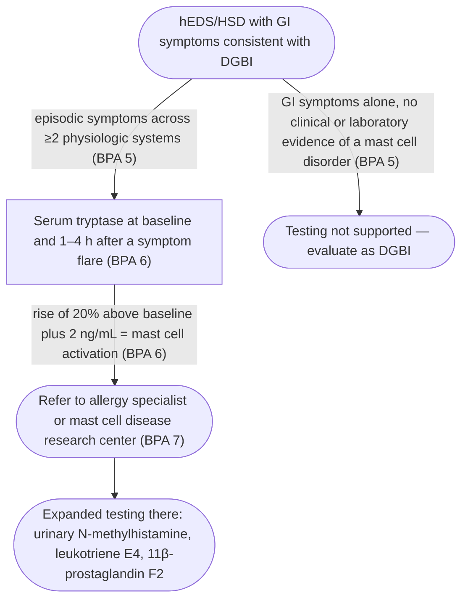

Mast cell activation syndrome (MCAS) is a subtype of mast cell activation disorder: mast cell activation driven by triggers (food, heat, emotion, mechanical stimuli) through **abnormal sensitivity of mast cells without mast cell proliferation**. Symptoms typically occur in **2 or more organ systems** — classically gastrointestinal (GI) tract, skin, cardiac and/or nervous system. Mast cells derive from multipotential hematopoietic stem cells, migrate into connective tissue and mucosa, and on degranulation release granules of histamine, heparin and cytokines into surrounding tissue; early or excessive degranulation produces the multisystemic picture. Heavily overlaps [[hypermobile-ehlers-danlos-syndrome|hypermobile Ehlers-Danlos syndrome (hEDS)]] / hypermobility spectrum disorder (HSD) and [[postural-orthostatic-tachycardia-syndrome|postural orthostatic tachycardia syndrome (POTS)]]. [[aga-2025-heds-gi]]

## Contents
- [[#Assessment]]
  - [[#Establishing the Diagnosis]]
  - [[#Classification / Typing]]
  - [[#Clinical Features]]
- [[#Differential Diagnosis]]
- [[#Diagnostics]]
- [[#Therapeutics]]
  - [[#Trigger Avoidance]]
  - [[#Drug Therapy]]
  - [[#Diet]]
- [[#See Also]]
- [[#Sources]]

---

## Assessment

### Establishing the Diagnosis

**Consensus criteria — A *and* B *and* C, all three required.** [[aga-2025-heds-gi]] (Table 1, modified from Valent et al)

| | Criterion | Operative detail |
|---|---|---|
| **A** | Clinical | Typical clinical signs of **severe, recurrent (episodic), systemic** mast cell activation involving **≥2 organ systems** — often in the form of anaphylaxis |
| **B** | Biochemical | Mast cell involvement documented by a rise in **serum tryptase** from the individual's own baseline to **baseline + 20% + 2 ng/mL**. Tryptase is the preferred marker; histamine and histamine metabolites, prostaglandin D2 and leukotriene C4 metabolites have been proposed but are **less specific** |
| **C** | Therapeutic | **Response of symptoms** to mast cell-stabilizing agents, drugs directed against mast cell mediator production, or drugs blocking mediator release or the effects of mast cell-derived mediators |

- Criterion C means the diagnosis cannot be fully established before a therapeutic trial.

> [!pitfall] One high tryptase does not meet criterion B
> Criterion B is a **percentage rise above the patient's own baseline plus an absolute increment**, not a single elevated value — so get a baseline tryptase whenever symptoms of mast cell activation are present ([[aga-2025-heds-gi]]).

### Classification / Typing

Once the criteria are met, MCAS is divided into three types — a global classification the update describes as **much debated**. [[aga-2025-heds-gi]] (Table 1)

| Type | Main diagnostic features |
|---|---|
| **Primary (clonal)** | Most mast cells display **CD25 and** the ***KIT* D816V** mutation is detected (rarely, other *KIT* mutations) — either **(A)** with confirmed cutaneous mastocytosis or systemic mastocytosis, or **(B)** with only **2 minor systemic mastocytosis criteria** (most patients have cutaneous or systemic mastocytosis; in some cases only 2 minor criteria are detected and full criteria are not fulfilled) |
| **Secondary** | **Immunoglobulin E (IgE)-mediated**, or related to another hypersensitivity reaction or immunologic disorder inducing MCAS — with **absence of neoplastic mast cells and absence of *KIT* D816V** |
| **Idiopathic** | MCAS criteria met with **neither** clonal mast cells **nor** IgE-mediated allergy |

### Clinical Features

- **GI:** nausea, vomiting, heartburn, [[dysphagia]], abdominal pain, atypical chest pain, bowel dysfunction, abdominal cramping, [[chronic-diarrhea|diarrhea]] — heavily overlapping [[disorders-of-gut-brain-interaction|disorders of gut-brain interaction (DGBI)]].
- **Systemic:** fatigue, tinnitus, conjunctivitis, headache including migraine, brain fog, palpitations, tachycardia, flushing, sweating, pruritus, urticaria/angioedema, myalgias, lymphadenopathy, wheezing, nasal congestion, hypotension, and urogynecological and neurological complaints.
- **The episodic, multisystem pattern is the point** — these are the features that distinguish a generalized mast cell disorder from the GI-only presentation that should *not* be tested (see Diagnostics).

> **Overlap with hEDS/HSD and POTS is common but the data are observational and limited** — prevalence figures and their caveats are on [[hypermobile-ehlers-danlos-syndrome]].

---

## Differential Diagnosis

*Workup: see [[disorders-of-gut-brain-interaction]] — MCAS is reached from a DGBI evaluation, not instead of one.*

- **Cutaneous mastocytosis / systemic mastocytosis** — the clonal disorders; their presence defines primary MCAS rather than excluding it.
- IgE-mediated food allergy, including [[alpha-gal-syndrome|alpha-gal syndrome]].
- [[irritable-bowel-syndrome]], [[dyspepsia|functional dyspepsia]] and other DGBI — GI symptoms of MCAS overlap DGBI symptoms directly, so the two are expected to coexist.
- [[eosinophilic-esophagitis]] and other eosinophilic GI diseases.
- [[postural-orthostatic-tachycardia-syndrome]] and [[hypermobile-ehlers-danlos-syndrome]] — coexisting rather than alternative diagnoses.

---

## Diagnostics

- **The episodic symptoms that suggest a generalized mast cell disorder (Best Practice Advice [BPA] 5):** visceral and somatic pain, pruritus, flushing, sweating, urticaria, angioedema, wheezing, tachycardia, abdominal cramping, vomiting, nausea, diarrhea, urogynecological and neurological complaints — across **cutaneous, GI, cardiac, respiratory and neuropsychiatric** systems.

*Who to test for mast cell disorders, how to draw the tryptase, and where to refer*
*Source: built from AGA 2025 Best Practice Advice 5, 6 and 7 (the update has no flowchart)*
*[[aga-2025-heds-gi|AGA Clinical Practice Update on GI Manifestations and Autonomic or Immune Dysfunction in Hypermobile Ehlers-Danlos Syndrome: Expert Review]]*
*hEDS = hypermobile Ehlers-Danlos syndrome · HSD = hypermobility spectrum disorder · GI = gastrointestinal · DGBI = disorder of gut-brain interaction · BPA = Best Practice Advice*

- **Intestinal biopsies.** Counting mast cells per high-power field on intestinal biopsies has been proposed, but **the threshold separating normal from abnormal is debated**; **CD-117 immunohistochemical staining** is thought to be a much more sensitive marker in the **second portion of the duodenum or the ileum**. Consensus on these guidelines, even among allergists, is controversial.
- There is **limited evidence** to guide use of MCAS-specific tests (serum tryptase, mast cell staining on endoscopic biopsies) for evaluating isolated GI symptoms without evidence of a generalized mast cell disorder, and validated clinical tests for mast cell-mediated mechanisms of abdominal pain in hEDS/HSD are lacking.

---

## Therapeutics

**BPA 14.** When MCAS is suspected, treatment combines **histamine receptor antagonists and/or mast cell stabilizers** with **trigger avoidance**. Recommendations rest on expert opinion — reliable estimates from well-designed randomized trials are lacking. [[aga-2025-heds-gi]]

### Trigger Avoidance

- **Foods**, alcohol, strong smells, temperature changes, ultraviolet radiation.
- **Mechanical stimuli** (friction).
- **Antigens** — pollen, mold.
- **Emotional distress.**
- **Specific drugs** — opioids, nonsteroidal anti-inflammatory drugs, iodinated contrast.

### Drug Therapy

| Line | Agents |
|---|---|
| **First line** | **Nonsedating histamine-1 (H1) + histamine-2 (H2) receptor antagonists** — second-generation H1 antagonist (cetirizine, levocetirizine, fexofenadine, loratadine) **plus** an H2 receptor antagonist (famotidine, nizatidine, ranitidine) |
| **Second line** | **Oral mast cell stabilizers** (cromolyn sodium; ketotifen — not approved by the Food and Drug Administration but can be compounded) and/or a **leukotriene receptor antagonist** (montelukast) |

- **Autoimmunity:** corticosteroids or immunoglobulins — gastroenterology providers may need to refer to allergy and immunology or a mast cell specialist to manage these medications.
- **Estimated response rates to antimediator treatment: 75% for diarrhea and 82% for abdominal pain**, respectively — uncontrolled data, not trials.
- The role of **immunotherapy remains under active study**.
- The update gives no doses for any of these agents.

### Diet

- **Low-histamine diet** is the MCAS-specific option, recommended on clinical experience; **formal studies are absent**. Low-gluten and low-dairy diets are likewise recommended on experience alone.
- Where GI symptoms predominate, standard DGBI dietary therapy applies — low fermentable oligosaccharide, disaccharide, monosaccharide and polyol (FODMAP), or wheat- or gluten-free for lower-GI symptoms.
- Deliver every diet with **nutritional counseling** to avoid the pitfalls of restrictive eating; screen for weight loss and disordered eating and involve a dietitian (BPA 15).

---

## See Also

[[hypermobile-ehlers-danlos-syndrome]], [[postural-orthostatic-tachycardia-syndrome]], [[disorders-of-gut-brain-interaction]], [[alpha-gal-syndrome]], [[irritable-bowel-syndrome]], [[dyspepsia]], [[eosinophilic-esophagitis]], [[chronic-diarrhea]], [[dysphagia]], [[nausea-and-vomiting]]

---

## Sources

1. [[aga-2025-heds-gi|AGA Clinical Practice Update on GI Manifestations and Autonomic or Immune Dysfunction in Hypermobile Ehlers-Danlos Syndrome: Expert Review]]
