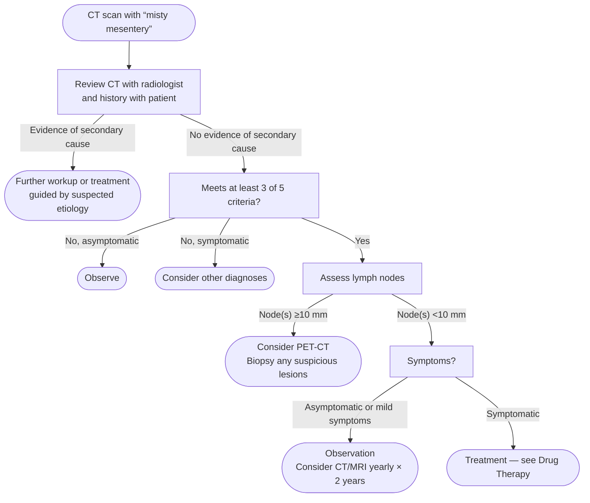

Idiopathic disorder of the bowel mesentery: **inflammation, fat necrosis and fibrosis**. Historical names — mesenteric panniculitis, retractile mesenteritis, "misty mesentery," mesenteric lipodystrophy, liposclerotic mesenteritis, mesenteric Weber-Christian disease, xanthogranulomatous mesenteritis, idiopathic mesenteric fibrosis, inflammatory pseudotumor, systemic nodular panniculitis — are one **continuum** with differing ratios of fibrosis, fat necrosis and inflammation; "sclerosing mesenteritis" (SM) is the proposed unifying term. Found on **0.6%–1.1%** of retrospective computed tomography (CT) series; mean age 55 y, more often male and White. Most cases are asymptomatic and need no treatment ([[aga-2025-sclerosing-mesenteritis]]).

## Contents
- [[#Assessment]]
  - [[#Establishing the Diagnosis]]
  - [[#Severity Assessment]]
- [[#Differential Diagnosis]]
- [[#Diagnostics]]
  - [[#Evaluation Algorithm]]
  - [[#When to Biopsy]]
  - [[#Follow-Up Imaging]]
- [[#Therapeutics]]
  - [[#Drug Therapy]]
  - [[#Severe Disease and Complications]]
- [[#See Also]]
- [[#Sources]]

## Assessment

### Establishing the Diagnosis

**Coulier CT criteria — ≥3 of 5 = suggestive of SM:**

| # | Feature |
|---|---|
| 1 | Hazy mesenteric fat mass **displacing intestine** |
| 2 | **Higher attenuation** in the mesenteric fat mass than adjacent mesentery, but **no enhancement** with intravenous contrast |
| 3 | Lymph nodes **<1 cm** |
| 4 | **Hypoattenuated halo sign** around central vessels ("fat halo" sign) |
| 5 | Thin surrounding **fibrotic pseudocapsule** |

> [!pitfall] A hazy mesentery alone is not SM
> Without nodes, halo sign or pseudocapsule it is **not diagnostic** and, without other symptoms, typically needs **no follow-up** ([[aga-2025-sclerosing-mesenteritis]]).

> [!pearl] Classic CT + no alarm features → no biopsy
> Definitive diagnosis needs biopsy, but with characteristic imaging and **no alarm features (fever, night sweats, unintentional weight loss)** malignancy risk is very low → **presumptive diagnosis without biopsy** in most cases ([[aga-2025-sclerosing-mesenteritis]]).

- **Calcifications + retraction of surrounding bowel** = more severe disease and possible malignancy → typically **biopsy**, unless an immunoglobulin G4 (IgG4) association can be established.
- **Fever → evaluate for infection** before attributing it to SM.

**Symptoms** — up to **60%** with SM on CT are asymptomatic (likely an underestimate). Among the symptomatic:

| Symptom | Frequency |
|---|---|
| Abdominal pain (most common) | up to **75%** |
| [[abdominal-bloating-and-distention\|Bloating]] | 10%–25% |
| [[chronic-diarrhea\|Diarrhea]] or [[chronic-constipation\|constipation]] | 10%–25% |
| [[nausea-and-vomiting\|Nausea and vomiting]] | 5%–15% |
| Weight loss | 20% |

- **Palpable abdominal mass** often not found.
- No higher prevalence of autoimmunity; possibly more metabolic syndrome, [[obesity]], coronary artery disease, urolithiasis.
- **Labs:** erythrocyte sedimentation rate (ESR) and C-reactive protein (CRP) may be elevated, not in all cases; role in management/follow-up **uncertain**.

### Severity Assessment

- Only **1%–6%** of patients with SM imaging findings required treatment in several studies; may be higher in referral centers — ~**50%** treated initially in 2 large observational studies, more over time.
- **Features suggesting a more severe course:**
  1. Omental, retroperitoneal, pelvic fat or **colonic mesentery** involvement
  2. Bowel obstruction/ischemia, venous thrombosis/thromboembolism, sepsis, protein-losing enteropathy or renal failure
  3. **Marked** CRP or ESR elevation
  4. Coexisting autoimmune disease
  5. Arterial narrowing
  6. [[ascites|Ascites]]
- Except the most severe cases, most patients — treated or not — reach **stable disease without radiologic progression after 2 years**.
- **Most severe cases → consider referral to a tertiary center** with expertise.

## Differential Diagnosis

*Workup: see [[#Evaluation Algorithm]].*

**Secondary causes of a "misty mesentery" to exclude first (Figure 2):** extra-mesenteric lymphadenopathy · splenomegaly · [[ascites]] or anasarca · [[portal-hypertension|portal hypertension]] · [[acute-pancreatitis|pancreatitis]], appendicitis, diverticulitis, cholecystitis · extra-mesenteric mass · vasculitis · mesenteric vein thrombosis · small intestinal wall thickening · trauma/hemorrhage · heart or renal failure, [[cirrhosis]] · infection · IgG4-associated disease · immune checkpoint inhibitor therapy → further workup or treatment guided by the suspected cause.

| Condition | Distinguishing features |
|---|---|
| **Non-Hodgkin lymphoma** | Mesenteric infiltration or mass hard to separate from SM on imaging alone; mesenteric node enlargement ± enlarged non-mesenteric nodes or splenomegaly |
| **Peritoneal carcinomatosis** | Ascites + multiple enhancing mesenteric/peritoneal/omental nodules; a desmoplastic reaction with fibrotic retraction can mimic SM |
| **Carcinoid / [[gastroenteropancreatic-neuroendocrine-tumors\|neuroendocrine tumor]]** | Often focal bowel and liver lesions; atypical mesentery-only cases occur |
| **Mesenteric fibromatosis (desmoid)** | Common in [[familial-adenomatous-polyposis\|familial adenomatous polyposis]]; multifocal, non-inflamed, mass-like or infiltrative, encases vessels and bowel. **[[mri-mrcp\|Magnetic resonance imaging (MRI)]] preferred** |
| **Encapsulating peritoneal sclerosis** | Mostly peritoneal dialysis (can be idiopathic); bowel encased in thickened peritoneum ("cocoon"), cauliflower appearance; ascites pockets 90%, peritoneal calcification 70% |
| **Retroperitoneal fibrosis** | Fibrotic mass from distal aorta (L4–L5) to iliacs encasing ureters; hydronephrosis, medial deviation of proximal ureters; lower back/flank pain. Can look identical histologically and can coexist |
| **Pseudomyxoma peritonei** | Mucinous ascites loculated along peritoneal surfaces; scalloped organ contours |
| **IgG4-related disease** | Rare; atypical — on CT can look malignant (indistinct margins, apparent invasion, multiple enlarged nodes). Only **half** have elevated serum IgG4. **Biopsy generally required** |
| Other | [[gastrointestinal-stromal-tumor\|Gastrointestinal stromal tumor]], sarcoma, mesenteric edema (hypoalbuminemia, cirrhosis, congestive heart failure, trauma), infections (mycobacteria, cryptococcus, schistosomiasis, human immunodeficiency virus, cholera) |

**Relationship to cancer**
- Evidence does **not** support SM as paraneoplastic, but findings overlap with lymphoma, gynecologic malignancy and carcinoid.
- **Mesenteric mass or intra-abdominal node >10 mm** → suspect underlying malignancy.
- Prospective study, >400 SM patients: subsequent malignancy **1%** — all B-cell lymphomas, all with a soft-tissue nodule >10 mm or abdominopelvic lymphadenopathy.
- SM (often asymptomatic) also reported after **immune checkpoint inhibitor** therapy; generally steroid-responsive.

## Diagnostics

- **CT** — primary test; apply the Coulier criteria ([[#Establishing the Diagnosis]]).
- **¹⁸F-fluorodeoxyglucose positron emission tomography (¹⁸FDG-PET)/CT** — when features concern for malignancy: characterizes the lesion and finds accessible nodes for biopsy.
- **Serum IgG4** — normal IgG4 **and** imaging not diagnostic for SM → **surgical biopsy with IgG4 staining** may be required.

### Evaluation Algorithm

*Evaluation of a CT “misty mesentery”*
*Source: redrawn from Figure 2 of the American Gastroenterological Association (AGA) 2025 update (evaluation half; treatment strategies are in the Drug Therapy table)*
*[[aga-2025-sclerosing-mesenteritis|AGA 2025 Clinical Practice Update on Sclerosing Mesenteritis]]*
*CT = computed tomography · PET = positron emission tomography · MRI = magnetic resonance imaging*

- Figure 2 lists the 5 criteria in short form (mass encasing or displacing adjacent structures but not infiltrating; hyper-attenuating fat; soft-tissue nodules; "fat halo" sign; pseudocapsule) — same set as the Coulier table above.
- Figure uses **≥10 mm** for the node branch; the text's biopsy trigger is nodes **>1 cm** ([[#When to Biopsy]]).

### When to Biopsy

**Not needed** if imaging is classic for SM and there is no concern for cancer. **Consider biopsy** with any malignancy-concerning feature:

1. Associated lymph nodes **>1 cm**
2. Lymph nodes with **maximum standardized uptake value (SUVmax) ≥3.0** on ¹⁸FDG-PET/CT
3. Lymphadenopathy in **another intra-abdominal location**
4. **Spiculated, necrotic, calcified or invasive** appearance — including **absence of the central halo sign**

### Follow-Up Imaging

- Published advice ranges from **no repeat imaging** to **annual imaging up to 5 years**. Meta-analysis of 4 case-control studies: no detectable increased cancer risk; another study: small long-term increased lymphoma risk in those without initial malignant features, **80% detectable in the first year**.
- **Asymptomatic, no initial malignancy-concerning features → "we suggest" annual CT for 2 years** to confirm stability; thereafter imaging for concerning symptoms (Figure 2: CT/MRI yearly × 2 years, or CT if new symptoms arise).
- **Significant growth of the mesenteric mass or new lymphadenopathy during follow-up → biopsy.**

## Therapeutics

Aim = **symptom relief**; limited evidence that treatment improves imaging or prevents complications. **No controlled trials** — choices rest on open-label studies and case reports; optimal regimen and duration not established. The AGA document is an expert commentary with no graded statements.

- **Asymptomatic → usually no treatment**; follow per [[#Follow-Up Imaging]].
- **General measures:** treat concomitant gastrointestinal (GI) disorders — constipation, [[gerd|gastroesophageal reflux disease (GERD)]], [[irritable-bowel-syndrome|irritable bowel syndrome (IBS)]]. One author routinely uses tricyclic antidepressants for mild SM pain.

### Drug Therapy

| Regimen | Dose | Notes |
|---|---|---|
| **Prednisone + tamoxifen** (Figure 2) | **Tamoxifen 10 mg twice daily** + prednisone **30–40 mg/day**; prednisone tapered after **3 months**, tamoxifen continued for maintenance (duration undetermined). Tamoxifen also used alone | Most commonly used therapy. Responders with mild side effects: **10 mg daily** may maintain response |
| **Prednisone + colchicine** (Figure 2) | **Colchicine 0.6 mg twice daily** + prednisone **40 mg/day** (Figure 2: 30–40 mg), prednisone tapered after **3 months** | ~**50%** response in a small series. GI side effects may limit use. **Contraindicated in renal insufficiency** |
| **Prednisone monotherapy** | **30–40 mg/day**; large retrospective series: **40 mg/day for 3–4 months, then taper 5 mg/week** | May improve **short-term** symptoms; **long-term use not advised** (side effects); benefit typically lost after stopping |
| **[[thiopurines\|Azathioprine]]** — 2nd line (Figure 2) | **2–2.5 mg/kg/day** ([[inflammatory-bowel-disease\|inflammatory bowel disease]]-type dosing) in normal thiopurine methyltransferase (TPMT) metabolizers; Figure 2 pairs it with prednisone **30 mg** (tapered after 3 months) and/or **referral to a specialty center** | Slow onset → give prednisone early |
| **Other immunosuppressants** | Rituximab, thalidomide, cyclophosphamide, [[methotrexate]], [[anti-tnf-agents\|infliximab]], [[il-23-and-il-12-23-inhibitors\|ustekinumab]] — no doses given | Limited data; significant side-effect potential → typically **second line for severe, refractory disease** |

- **Response:** maximal response to prednisone and tamoxifen at **4–6 months**; **50%–60%** respond.
- **Tamoxifen side effects:** antiestrogenic (hot flashes, sweating, vaginal bleeding), alopecia, fatigue, thrombosis, thrombocytopenia, elevated liver enzymes. Originally chosen for antifibrotic activity against transforming growth factor-β; actual mechanism unknown.

> [!pitfall] Tamoxifen contraindications
> History of **venous thrombosis or pulmonary embolism**, or significant **cerebrovascular, cardiovascular or peripheral vascular disease**; **active tobacco use = relative contraindication** ([[aga-2025-sclerosing-mesenteritis]]).

### Severe Disease and Complications

- **Bowel obstruction** — nonoperative when feasible; **surgical bypass** if that fails. Complete resection usually impossible (vascular compromise, disease extent).
- **Surgery only for persistent or recurrent mechanical obstruction** (Figure 2).
- **Surgery does not cure SM** — in 1 study only **10%** of surgical patients needed no further treatment. Recurrence shows as radiologic findings or new symptoms.
- **Persistent/recurrent symptoms after surgery → "we suggest" medical management** as for nonobstructive symptoms.
- **Chronic mesenteric ischemia** from mesenteric vascular obstruction — considered for revascularization, but **few are candidates**: endovascular limited by long-segment or distal vessel involvement; surgical revascularization rarely feasible (extensive inflammation). (Contrast [[acute-mesenteric-ischemia]].)
- **Radiation therapy** — equivocal success.

---

## See Also

[[ascites]], [[portal-hypertension]], [[acute-pancreatitis]], [[cirrhosis]], [[gastroenteropancreatic-neuroendocrine-tumors]], [[familial-adenomatous-polyposis]], [[gastrointestinal-stromal-tumor]], [[mri-mrcp]], [[abdominal-bloating-and-distention]], [[chronic-diarrhea]], [[chronic-constipation]], [[nausea-and-vomiting]], [[obesity]], [[gerd]], [[irritable-bowel-syndrome]], [[thiopurines]], [[inflammatory-bowel-disease]], [[methotrexate]], [[anti-tnf-agents]], [[il-23-and-il-12-23-inhibitors]], [[acute-mesenteric-ischemia]]

---

## Sources

1. [[aga-2025-sclerosing-mesenteritis|AGA Clinical Practice Update on Sclerosing Mesenteritis: Commentary]]
