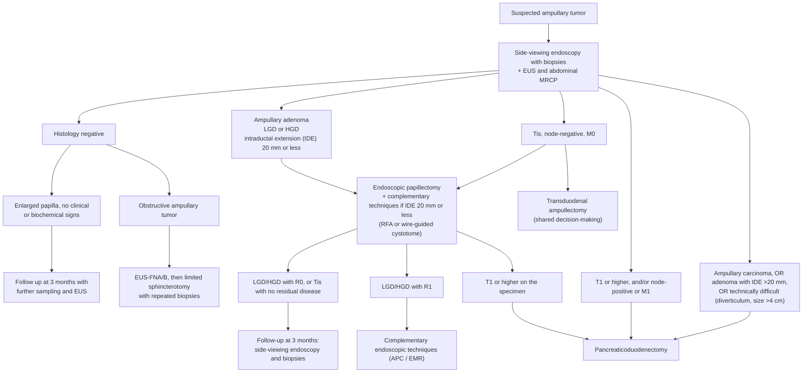

# Ampullary & Duodenal Adenoma

Adenomas of the **major duodenal papilla (ampullary adenomas)** and of the **nonampullary duodenum** are premalignant lesions that follow an adenoma–carcinoma sequence. Both occur sporadically or in polyposis syndromes ([[familial-adenomatous-polyposis|familial adenomatous polyposis (FAP)]], [[peutz-jeghers-syndrome|Peutz-Jeghers]]). Endoscopic resection is a viable alternative to surgery in selected cases.

## Contents
- [[#Assessment]]
  - [[#Establishing the Diagnosis]]
  - [[#Severity Assessment]]
    - [[#What decides endoscopy versus surgery — the thresholds with their numbers]]
    - [[#Staging]]
    - [[#Diagnostic and therapeutic algorithm]]
- [[#Differential Diagnosis]]
- [[#Diagnostics]]
- [[#Therapeutics]]
  - [[#Ampullary Adenoma — Endoscopic Papillectomy]]
    - [[#Biliary obstruction from an ampullary tumor]]
  - [[#Nonampullary Duodenal Adenoma]]
  - [[#Surveillance]]
- [[#See Also]]
- [[#Sources]]

---

## Assessment

### Establishing the Diagnosis

- **Ampullary adenoma** = adenoma of the major duodenal papilla; **[[nonampullary-duodenal-adenoma|nonampullary duodenal adenoma]]** = duodenal polyp not involving the papilla.
- Both may be **sporadic** or syndromic ([[familial-adenomatous-polyposis|FAP]], [[peutz-jeghers-syndrome|Peutz-Jeghers]]); endoscopic screening/surveillance of FAP has increased recognition of ampullary adenomas.
- **Side-viewing duodenoscope** generally required to visualize the papilla — adenomatous change may not be apparent by forward-view inspection alone.
- **Cap-assisted esophagogastroduodenoscopy** when the papilla cannot be seen on forward-viewing endoscopy. ([[esge-2021-ampullary-tumors]])
- **Biopsy is required** before attempted resection to confirm adenoma and exclude cancer. **Papillectomy — diagnostic or therapeutic — is not performed until adenoma is proven** (strong recommendation). Low grade dysplasia (LGD) on biopsy also needs **histological confirmation before any treatment is started**. ([[esge-2021-ampullary-tumors]])
  - Sample **away from the pancreatic duct orifice** (post-biopsy [[acute-pancreatitis|pancreatitis]] reported).
  - Orient forceps **parallel to folds** to limit submucosal fibrosis (preserves later resectability).
- ⚠ **Know how badly a single biopsy can mislead — the numbers are why the rules above exist:** accuracy **38.3%–85%**, **underestimation up to 30%**, **overestimation 15% overall and 21% when the initial read is LGD**. In two large series, post-papillectomy histology showed **normal intestinal mucosa in 8%** and **inflammatory tissue in 13.8%** — lesions that never needed resecting. **Repeating the biopsies improves the diagnosis by 14%.** ([[esge-2021-ampullary-tumors]])

> [!pitfall] Do not biopsy just after a sphincterotomy
> Post-sphincterotomy cytoarchitectural atypia drives sensitivity down to **21%–37%**, and overall accuracy from **81.25% to 56.25%**. **Wait at least 10 days** after sphincterotomy before sampling — and if [[endoscopic-ultrasound|EUS]]-guided fine-needle aspiration/biopsy (**sensitivity 82.4%, specificity 100%, accuracy 88.8%**) is going to be done for a suspected invasive cancer, **do it before the sphincterotomy, not after**. ([[esge-2021-ampullary-tumors]])

- **When the first histology is negative, the next step depends on whether the papilla is obstructing:** ([[esge-2021-ampullary-tumors]])
  - **Enlarged papilla, no clinical or biochemical signs** → follow up with **EUS, side-viewing endoscopy and repeated biopsies** (strong).
  - **Obstructive ampullary tumor suspected** → **EUS-FNA/B first, then limited sphincterotomy with repeated biopsies** (strong).
- For nonampullary lesions, **first confirm the polyp does not involve the major papilla** (side-viewing scope or endoscopic ultrasound [EUS]) — if it does, manage ducts as for an ampullary lesion.

### Severity Assessment

- **Endoscopic/EUS features suggesting malignancy** (consider surgery even if biopsy benign):
  - Firmness, ulceration, friability
  - **Non-lifting** of the periampullary component with submucosal injection (failure to lift = strongest predictor of malignancy in one study)
  - Intraductal extension; regional adenopathy
- **Size thresholds:**
  - Many authors avoid endoscopic resection of ampullary lesions **≥4 cm** (though larger successful resections reported).
  - Duodenal lesions with **>33% luminal circumference** involvement → consider surgery.
- High-grade dysplasia warrants therapy to prevent progression and to exclude missed cancer.

#### What decides endoscopy versus surgery — the thresholds with their numbers
*Source: [[esge-2021-ampullary-tumors]], which supplies the cut-points [[asge-2015-ampullary-duodenal-adenomas|ASGE 2015]] leaves as "many authors avoid".*

| Finding | Decision | Grade |
|---|---|---|
| **Ampullary adenoma, no intraductal extension** | **Endoscopic papillectomy** | Strong; moderate |
| **Up to 20–30 mm** | Resect **en bloc** — for R0, complete resection, optimal histopathology and lower recurrence | Strong; low |
| **Intraductal extension ≤20 mm** | Papillectomy **plus complementary intraductal ablation** (radiofrequency ablation [RFA] or wire-guided cystotome) with **temporary biliary stenting** — **expert centers only** | Weak; low |
| **Intraductal involvement >20 mm**, *or* **size >4 cm**, *or* technically infeasible (e.g. **periampullary diverticulum**) | **Surgery**. ⚠ **Surveillance afterwards is still mandatory** | Weak; low |
| **Laterally spreading tumor involving the papilla (LST-p)** — **≥10 mm extension beyond the ampullary mound**, or an extrapapillary component involving the duodenal wall | **Endoscopic resection is still appropriate** — but expect **higher intraprocedural *and* delayed bleeding** | Strong; low |
| **Tis (carcinoma in situ)** | Transduodenal ampullectomy **or** endoscopic papillectomy **may be sufficient — if final pathology shows no residual disease** | Strong; low |
| **T1 or higher** (including a T1 adenocarcinoma found only on the papillectomy specimen) | **Pancreaticoduodenectomy with lymphadenectomy** | Strong; low |

- **The surgical comparator, for the consent conversation:** pancreaticoduodenectomy carries **postoperative morbidity 34%–59%, mortality 1%–2%**, with 5-year survival after resection from about **40%**. ⚠ **No prospective study compares endoscopic papillectomy with surgery.** ([[esge-2021-ampullary-tumors]])

#### Staging
- **EUS and abdominal [[mri-mrcp|MRCP]]** are the staging pair (strong). Pooled performance of morphological criteria for **nodal** involvement: **sensitivity 70%, specificity 74%** — enough to inform, not to decide alone. **[[intraductal-ultrasound|IDUS]] is for selected patients**, balanced against training, cost and its pancreatitis risk (weak). Stage with the **latest TNM** classification. ([[esge-2021-ampullary-tumors]])
- **High-resolution virtual chromoendoscopy** aids endoscopic diagnosis and staging (weak); narrow-band imaging against biopsy pathology gave **sensitivity 89%, specificity 97%, negative predictive value 97%** in one single-center retrospective study. ([[esge-2021-ampullary-tumors]])
- ⚠ **Do not send biopsies for molecular work to guide treatment.** Immunohistochemistry, K-ras and p53, polymerase chain reaction and microsatellite instability testing **are not routinely applied** to ampullary biopsies for prognosis or treatment response — biopsy tissue is too heterogeneous for reliable intestinal-vs-pancreaticobiliary subtyping, which is why the panel confines that work to resected specimens. ([[esge-2021-ampullary-tumors]])

#### Diagnostic and therapeutic algorithm

*Figure 1 — Diagnostic and therapeutic algorithm for ampullary tumor, recreated from the source. LGD, low grade dysplasia; HGD, high grade dysplasia; IDE, intraductal extension. ([[esge-2021-ampullary-tumors]])*

---

## Differential Diagnosis

*Workup: see [[subepithelial-lesion]] for the EUS-based approach to mucosal mounds at the papilla.*

- **Ampullary carcinoma** (adenocarcinoma of the papilla) — may be indistinguishable endoscopically; false-negative biopsy for carcinoma 16–60%.
- **Non-adenomatous papillary lesions:** [[gastroenteropancreatic-neuroendocrine-tumors|carcinoid (neuroendocrine) tumor]], gangliocytic paraganglioma.
- **Nonampullary duodenal lesions:** inflammatory polyp, Brunner's gland hyperplasia, [[subepithelial-lesion|subepithelial lesion]] (e.g. lipoma, neuroendocrine tumor [NET]), heterotopic pancreas.
- **Syndromic vs sporadic adenoma** ([[familial-adenomatous-polyposis|FAP]], [[peutz-jeghers-syndrome|Peutz-Jeghers]]).

---

## Diagnostics

| Modality | Role | Notes |
|---|---|---|
| Side-viewing duodenoscopy | Visualize/biopsy papilla | Standard forward-view esophagogastroduodenoscopy (EGD) ([[upper-endoscopy]]) may miss adenomatous change |
| Forceps biopsy | Confirm adenoma, exclude cancer | Diagnostic (adenoma+carcinoma) rate 45–80%; false-negative for carcinoma 16–60%; ≥6 specimens or sample ≤10 d post-sphincterotomy |
| [[endoscopic-ultrasound\|EUS]] / [[intraductal-ultrasound\|intraductal ultrasound (IDUS)]] | Large lesions or features concerning for malignancy | Superior to computed tomography (CT)/magnetic resonance imaging (MRI)/transabdominal ultrasound for **T staging**; assesses intraductal extension and depth beyond muscularis propria. IDUS visualizes the tumor better but can overstage — figures on [[intraductal-ultrasound]] |
| [[mri-mrcp\|MRI]] | Nodal (N) staging | Superior to EUS for nodal staging |
| CT / positron emission tomography (PET) | Detect distant metastases | May detect small mets missed by EUS/IDUS |
| [[ercp\|Endoscopic retrograde cholangiopancreatography (ERCP)]] (biliary + pancreatic duct) | At time of papillectomy | Assess ductal extension; ductography important if EUS not done |

- **[[brush-cytology|Brush cytology]]** may aid detection of malignancy in selected cases.
- K-ras/p53/immunohistochemical and microRNA/flow-cytometry markers remain **investigational**.
- EUS may be omitted for small (<1 cm) ampullary lesions without malignant features (ulceration, induration, bleeding).
- **Intraductal extension <1 cm** into the common bile duct (CBD) or pancreatic duct (PD) does not necessarily preclude endoscopic therapy (tissue may be exposed/ablated; balloon dilation can expose intraductal tissue).

---

## Therapeutics

Endoscopic resection has lower adverse-event rates (~14%) than local surgical excision (~29%). Surgical options: pancreaticoduodenectomy (Whipple) or transduodenal ampullectomy (morbidity: anastomotic dehiscence/fistula up to 9%/14%; mortality 1–9%).

### Ampullary Adenoma — Endoscopic Papillectomy

- **Terminology:** endoscopic removal of the papilla = **papillectomy** (true "ampullectomy" is a surgical term requiring ductal reimplantation).
- **Resection technique:**
  - **En bloc** snare + [[electrosurgery|electrocautery]] preferred when the lesion can be fully ensnared — shorter time, complete pathology, less residual fibrosis. (No PD stent before en bloc resection, as the snare would transect it.)
  - **Piecemeal** resection for lesions >2 cm or residual tissue after en bloc attempt.
  - No proven superiority of snare type, current (cut vs blended), or snare orientation; larger-channel therapeutic duodenoscope eases instrument passage.
  - Retrieve specimens immediately (avoid migration/fragmentation); glucagon may reduce peristalsis; **CO₂ insufflation** advantageous if perforation.
- **Adjuncts:**
  - Chromoendoscopy (indigo carmine) to define flat-lesion margins.
  - "Underwater" endoscopic mucosal resection (EMR) also described ([[asge-2015-ampullary-duodenal-adenomas]]).

> [!pitfall] Inject the laterally spreading part, not the papilla
> **Do not inject submucosally before the papillectomy itself** — ESGE 2021 recommends **direct snare resection without submucosal injection** (strong, moderate). But **do inject before resecting a laterally spreading component** extending onto the duodenal wall, exactly as for a nonampullary duodenal [[endoscopic-mucosal-resection|EMR]] (strong, moderate). One lesion, two techniques. ⚠ This reverses [[asge-2015-ampullary-duodenal-adenomas|ASGE 2015]], which treated injection as optional and used **non-lifting as the strongest predictor of malignancy**; ESGE 2021 is the newer same-tier document and governs. ([[esge-2021-ampullary-tumors]])

- **Sphincterotomy — after, not before.** ⚠ **Avoid biliary, pancreatic or biductal sphincterotomy *prior* to papillectomy** (weak, very low) — this supersedes ASGE 2015's "often performed, no consensus". **Afterwards**, perform biliary sphincterotomy and/or stenting for **delayed biliary drainage, intraprocedural bleeding or a high risk of early post-procedural bleeding, or intraductal extension** (treated by complementary techniques or not) (weak, very low). ([[esge-2021-ampullary-tumors]])
- **Current:** **endocut**, to reduce intraprocedural and early post-procedural bleeding (weak, low) — there is still **no consensus on optimal power output**. ([[esge-2021-ampullary-tumors]]; physics and generator settings: [[electrosurgery]])
- **Post-procedure pancreatitis prophylaxis:** **prophylactic pancreatic duct stent** (strong, moderate) **plus rectal diclofenac or indomethacin 100 mg immediately before the procedure** in anyone without an NSAID contraindication (weak, low). ⚠ **If the pancreatic stent cannot be placed, substitute high-volume hydration with lactated Ringer's** rather than nothing (weak, low). Prophylactic biliary stent not routinely recommended unless inadequate biliary drainage or microperforation concern ([[asge-2015-ampullary-duodenal-adenomas]]). ([[esge-2021-ampullary-tumors]])
- **Prophylactic hemostasis is a judgement call, not a protocol** — the decision and the technique are **individualized** (strong, very low). The data genuinely conflict: a propensity-matched retrospective study found adjunctive [[argon-plasma-coagulation|APC]] cut delayed bleeding **7.3% vs 31.7%** (odds ratio [OR] 0.180, *P* < 0.01), while a 54-patient randomized trial did not agree. ([[esge-2021-ampullary-tumors]])
- **Ablation** (residual/recurrent superficial tissue): [[argon-plasma-coagulation|APC]] most common (50–60 W); place PD stent before ablating near the PD orifice; biopsy suspicious areas before ablating (ablated tissue not available for pathology) ([[asge-2015-ampullary-duodenal-adenomas]]).
- **Treating post-papillectomy bleeding:** standard techniques — epinephrine injection, electrocoagulation, clips, noncontact methods, APC (strong, low); **angiographic embolization for massive bleeding unresponsive to endoscopy** (strong, very low). ([[esge-2021-ampullary-tumors]])

**Outcomes — pooled (29 studies, 1,751 patients):** ([[esge-2021-ampullary-tumors]])

| Outcome | Rate (95% CI) | | Adverse event | Rate (95% CI) |
|---|---|---|---|---|
| Complete endoscopic resection | **94.2%** (90.5–96.5) | | **Overall** | **24.9%** (21.2–29.0) |
| Curative endoscopic resection | **87.1%** (83.0–90.3) | | Pancreatitis | **11.9%** (10.4–13.6) |
| En bloc resection | **82.4%** (74.7–88.1) | | Bleeding | **10.6%** (5.2–13.6) |
| Recurrence | **11.8%** (8.4–16.5) | | Perforation | **3.1%** (2.2–4.2) |
| | | | Cholangitis | **2.7%** (1.9–4.0) |
| | | | Papillary stenosis (late) | **2.4%** (1.6–3.4) |
| | | | **Mortality** | **0.3%** |

> [!pearl] En bloc is the only thing that predicted a curative resection
> Across the pooled analysis, **en bloc resection was the single factor affecting curative resection** (OR 3.55, 95% CI 1.11–5.99, *P* = 0.004), and in one of the largest series it also predicted complete resection (OR 4.05, 1.71–9.59, *P* < 0.001). That — not a technical preference — is why the ceiling for en bloc papillectomy is set at **20–30 mm** and why lesions above it go to surgery. ([[esge-2021-ampullary-tumors]])

- **Older predictors of long-term success** ([[asge-2015-ampullary-duodenal-adenomas]]): age >48 y, lesion ≤24 mm, male sex, absence of a polyposis syndrome (e.g. [[familial-adenomatous-polyposis|FAP]]). Intraductal growth → lower cure, more surgery.
- **Adverse events also include** [[endoscopy-sedation|sedation]] events and late pancreatic/biliary stenosis.
- Endoscopic removal of frank **ampullary adenocarcinoma is not endorsed** for routine management — see the stage-by-stage table above.

#### Biliary obstruction from an ampullary tumor
- **Palliative:** [[ercp|ERCP]] with a **self-expandable metal stent (SEMS)** (strong, **high quality** — the document's only high-quality recommendation), by the **ERCP route rather than percutaneous**. ([[esge-2021-ampullary-tumors]])
- ⚠ **Do not drain routinely before surgery** in a patient with ampullary cancer who is operable (strong, moderate). Reserve preoperative drainage for **[[acute-cholangitis|cholangitis]], severe symptomatic [[jaundice]] (e.g. intense pruritus), delayed surgery, or before neoadjuvant chemotherapy in a jaundiced patient** — and when it is indicated, drain **endoscopically with a SEMS** (strong, moderate). ([[esge-2021-ampullary-tumors]])

### Nonampullary Duodenal Adenoma

**The full resection, complication, surveillance and FAP/Spiegelman framework lives on [[nonampullary-duodenal-adenoma]]** — it is built on the newer [[aga-2025-nonampullary-duodenal|American Gastroenterological Association (AGA) 2025 Clinical Practice Update (CPU)]] and governs where the two guidelines differ. Points specific to this page's source ([[asge-2015-ampullary-duodenal-adenomas]]) and not duplicated there:

- Approach mirrors **right-colon [[polypectomy|polypectomy]]** given the thin duodenal wall ([[endoscopic-mucosal-resection|EMR]] is the mainstay); submucosal injection cushion for flat lesions, and **lack of lift suggests malignancy or prior manipulation**.
- **>33% circumferential** involvement → consider surgery. Giant (>3 cm) hemicircumferential laterally spreading tumors (LSTs) carry a higher bleeding rate (**26.3% vs 3.2%** for lesions <3 cm).
- **Minor papilla / [[pancreas-divisum|pancreas divisum]] adenomas:** dorsal PD stenting reported during resection.
- Adjuvant [[argon-plasma-coagulation|APC]]/electrocoagulation for residual or recurrent superficial tissue.

> ⚠ **Superseded — periprocedural orders.** American Society for Gastrointestinal Endoscopy (ASGE) 2015 described one high-volume protocol (observe ~4 h; clear liquids the day of the procedure → normal diet next day; hold antiplatelets 7 days; twice-daily [[proton-pump-inhibitors|proton pump inhibitor (PPI)]] × 2 weeks). The newer [[aga-2025-nonampullary-duodenal|AGA 2025 CPU]] instead advises **twice-daily PPI × 6–8 weeks**, diet advanced as tolerated over the same window, and holding **antithrombotics ≥48 h**. Same guideline tier, newer publication date — **follow AGA 2025** (see [[nonampullary-duodenal-adenoma]]).

### Surveillance

- **All** patients who undergo endoscopic papillectomy or duodenal adenoma resection should enter a **surveillance program** to confirm complete removal and detect recurrence (recurrence often grows across the post-resection scar — photograph and biopsy the scar).
- **Ampullary schedule after endoscopic papillectomy *or* surgical ampullectomy** — **duodenoscopy with biopsies of the scar and of any abnormal area**: ([[esge-2021-ampullary-tumors]], strong recommendation)
  - **within the first 3 months** (in practice 4–8 weeks, which also retrieves the prophylactic pancreatic stent)
  - **at 6 months and at 12 months**
  - **yearly thereafter for at least 5 years**
  - ⚠ This **replaces** the older "1–6 months, then every 3–12 months for ≥2 years" range ([[asge-2015-ampullary-duodenal-adenomas]]), which left the endpoint unstated.
- **Why the first look matters most, and why 5 years is still not an endpoint:** recurrence is **11.8%** pooled, median time to recurrence **14.2 months** (range 6–27) — shorter for adenoma confined to the papilla (**9.2 months**) than for an LST-p (**13.1 months**) — and **up to two-thirds of recurrences are found at the first follow-up session**. But a small number of patients developed **recurrence and adenocarcinoma beyond 5 years**, which is why the guideline asks for long-term, indefinite monitoring. **Under an established protocol, the vast majority of recurrences were benign and no interval cancer has been described.** ([[esge-2021-ampullary-tumors]])
- **On recurrence, restage before treating** — endoscopic examination with biopsies, **plus EUS and MRCP**, before any therapy (strong). **Benign residual or recurrent lesions are managed endoscopically**, including [[argon-plasma-coagulation|APC]] and [[endoscopic-mucosal-resection|EMR]] (weak); pooled oncological cure with endoscopic retreatment is **80.9%** (95% CI 73–87), often over several sessions. ([[esge-2021-ampullary-tumors]])
- Duodenal surveillance intervals: limited data — individualize.
- **Offer screening [[colonoscopy]]** — sporadic ampullary/duodenal adenomas are associated with increased colorectal neoplasia risk.

---

## See Also

[[nonampullary-duodenal-adenoma]], [[familial-adenomatous-polyposis]], [[peutz-jeghers-syndrome]], [[ercp]], [[endoscopic-ultrasound]], [[intraductal-ultrasound]], [[jaundice]], [[upper-endoscopy]], [[polypectomy]], [[endoscopic-mucosal-resection]], [[endoscopic-submucosal-dissection]], [[electrosurgery]], [[argon-plasma-coagulation]], [[colonoscopy]], [[subepithelial-lesion]], [[brush-cytology]], [[mri-mrcp]], [[acute-pancreatitis]], [[acute-cholangitis]], [[pancreas-divisum]], [[gastroenteropancreatic-neuroendocrine-tumors]], [[proton-pump-inhibitors]], [[endoscopy-sedation]]

---

## Sources

1. [[esge-2021-ampullary-tumors|ESGE 2021: Endoscopic Management of Ampullary Tumors — European Society of Gastrointestinal Endoscopy Guideline]]
2. [[asge-2015-ampullary-duodenal-adenomas|ASGE 2015: The Role of Endoscopy in Ampullary and Duodenal Adenomas]]
3. [[aga-2025-nonampullary-duodenal|AGA 2025 Clinical Practice Update on Nonampullary Duodenal Lesions]]
