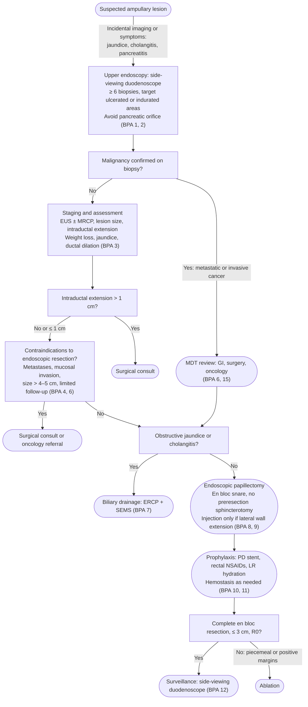

# Ampullary & Duodenal Adenoma

Adenomas of the **major duodenal papilla (ampullary adenomas)** and of the **nonampullary duodenum** are premalignant; both occur sporadically or in genetic syndromes — ampullary adenomas in [[familial-adenomatous-polyposis|familial adenomatous polyposis (FAP)]]; nonampullary duodenal polyps also in [[peutz-jeghers-syndrome|Peutz-Jeghers]]. Endoscopic resection is a viable alternative to surgery in selected cases ([[asge-2015-ampullary-duodenal-adenomas]]).

*[[aga-2026-ampullary-neoplasms|AGA 2026]] Best Practice Advice (BPA) 1–15 are ungraded. [[esge-2021-ampullary-tumors|ESGE 2021]] (European) fills gaps; differences from US guidance are stated.*

## Contents
- [[#Assessment]]
  - [[#Establishing the Diagnosis]]
  - [[#Severity Assessment]]
    - [[#Endoscopy or surgery]]
    - [[#Diagnostic and therapeutic algorithm]]
- [[#Differential Diagnosis]]
- [[#Diagnostics]]
- [[#Therapeutics]]
  - [[#Ampullary Adenoma — Endoscopic Papillectomy]]
    - [[#Biliary obstruction from an ampullary tumor]]
  - [[#Nonampullary Duodenal Adenoma]]
  - [[#Surveillance]]
- [[#See Also]]
- [[#Sources]]

---

## Assessment

### Establishing the Diagnosis

- **Scope: side-viewing duodenoscope** — a forward-viewing gastroscope gives limited ampullary view and biopsy access; the duodenoscope lets you biopsy **away from the pancreatic orifice** (postprocedure pancreatitis) (AGA 2026 BPA 1).
  - Papilla not seen on forward view → cap-assisted esophagogastroduodenoscopy (EGD) can aid inspection, but the duodenoscope stays preferred ([[aga-2026-ampullary-neoplasms|AGA 2026]]; [[esge-2021-ampullary-tumors|ESGE]] weak, moderate).
- **≥6 biopsies, especially from ulcerated or indurated areas** — **20%–40% of ampullary adenomas harbor malignancy** (BPA 2). Ampullary cancer 5-year survival **20%–75%** by stage.
- **Biopsy before any attempted resection** to confirm adenoma and exclude cancer ([[asge-2015-ampullary-duodenal-adenomas|ASGE 2015]] Recommendation 1, moderate quality). [[esge-2021-ampullary-tumors|ESGE]] adds: no diagnostic or therapeutic papillectomy until adenoma is proven (strong, low); confirm a low grade dysplasia (LGD) biopsy histologically before any treatment (strong, low).
  - Orient forceps **parallel to the folds** — biopsy of flat lesions spanning >1 fold can cause submucosal fibrosis that impedes later resection (ASGE 2015).
- **A benign biopsy does not clear the lesion:** false-negative for carcinoma in **16%–60%** (ASGE 2015); accuracy **38.3%–85%**, underestimation up to **30%**, overestimation **21%** when the first read is LGD; repeat histology improves diagnosis by **14%** (ESGE 2021).
- **Biopsy timing around a sphincterotomy — the guidelines disagree:**
  - ASGE 2015 (US, governs): false negatives are minimized by sampling **within 10 days after sphincterotomy**, or by taking **≥6 specimens**.
  - ESGE 2021: post-sphincterotomy atypia drops sensitivity to **21%–37%** (accuracy **56.25% vs 81.25%**); further sampling **at least 10 days after** sphincterotomy "can be useful" (narrative, ungraded).
  - Suspected invasive cancer → [[endoscopic-ultrasound|endoscopic ultrasound (EUS)]]-guided fine-needle aspiration/biopsy (FNA/B) "might be another option"; if considered, do it **before** sphincterotomy (sensitivity **82.4%**, specificity **100%**) ([[esge-2021-ampullary-tumors|ESGE 2021]]).
- **First histology negative** (ESGE 2021):
  - Enlarged papilla, no clinical or biochemical signs → follow up with **EUS, side-viewing endoscopy and repeat biopsies** (strong, low).
  - Obstructive ampullary tumor suspected → **EUS-FNA/B first, then limited sphincterotomy with repeat biopsies** (strong, low).

### Severity Assessment

- **Concerning features, even with benign biopsies** — weigh surgery:
  - Endoscopic: **firmness, ulceration, friability, non-lifting** of the periampullary component (ASGE 2015); lesions **>4 cm that are friable, ulcerated or fixed**; **irregular or nonstructured villi** on narrow-band imaging (NBI) — sample them (benign adenoma = pinecone/leaf-shaped villi) (AGA 2026).
  - Clinical/imaging: **notable weight loss and jaundice**; **substantial ductal dilation with an abrupt cutoff at the ampulla** (AGA 2026).
- **High-grade dysplasia (HGD)** usually warrants therapy — to prevent progression and exclude missed cancer (ASGE 2015).

#### Endoscopy or surgery

**Favor endoscopic papillectomy** (AGA 2026 BPA 4): **well-defined margins · size <4–5 cm · nonfriable · soft to probing · intraductal extension ≤1 cm**.

| Definitive contraindications (BPA 6) | Relative contraindications (BPA 6) |
|---|---|
| Metastatic spread | Lesion **over 5 cm** |
| Invasive cancer **beyond the mucosal layer** | **Early-stage/T1 cancer** |
| **>1 cm intraductal extension in a surgically fit patient** | Concern about **limited follow-up adherence** |

- AGA's narrative also lists **inadequate pancreaticobiliary endoscopy expertise** among factors warranting further consideration.
- **Intraductal extension (BPA 5):** **>1 cm** → suggest surgical consultation; **<1 cm** → may be treated endoscopically **with close surveillance**. Measured by EUS (BPA 3), with magnetic resonance cholangiopancreatography (MRCP) as adjunct.
- **Robust evidence-based criteria are not established** — individualize on lesion, clinical status, preference and local expertise (AGA 2026).

> [!pitfall] Intraductal extension: 1 cm (AGA), not 20 mm (ESGE)
> AGA 2026 sends **>1 cm** intraductal extension in a surgically fit patient to surgery. ESGE 2021 allows **≤20 mm** in expert centres — papillectomy **plus** complementary cystotome thermal ablation or radiofrequency ablation (RFA) with temporary biliary stenting (weak, low) — and surgery for **>20 mm**. AGA records the ESGE threshold; the US 1 cm rule governs.

- **Size is unsettled.** AGA: <4–5 cm favors endoscopy; >5 cm relative contraindication. ESGE: en bloc feasible to ~3 cm, surgery **>4 cm**, **3–4 cm case by case**.

**Gap-filling ESGE 2021 rules** (no US statement covers these):

| Finding | Management | Grade |
|---|---|---|
| Adenoma **without intraductal extension** | Endoscopic papillectomy | Strong; moderate |
| Adenoma **up to 20–30 mm** | Resect **en bloc** (R0, histology, lower recurrence) | Strong; low |
| Technically infeasible (e.g. **diverticulum**, size >4 cm) | Consider surgery; **surveillance still mandatory** afterwards | Weak; low |
| **Laterally spreading tumor involving the papilla (LST-p)** — **≥10 mm** beyond the ampullary mound, or an extrapapillary duodenal-wall component **larger than the papillary adenoma** | Endoscopic resection appropriate; expect **more intraprocedural and delayed bleeding** | Strong; low |
| **Tis** (carcinoma in situ) | Transduodenal ampullectomy or papillectomy may suffice **if final pathology shows no residual disease** | Strong; low |
| **T1 or higher** (incl. T1 found on the papillectomy specimen) | **Pancreaticoduodenectomy with lymphadenectomy** | Strong; low |

- Endoscopic removal of frank adenocarcinoma is **not endorsed for routine management** (ASGE 2015).
- **Intramucosal malignancy on biopsy:** unsettled (nodal spread and vascular invasion reported) → **surgical consultation and joint decision-making** (AGA 2026).
- **Surgery, for consent:** local surgical excision adverse events **29%**, higher than endoscopy (not directly compared) (ASGE 2015). Pancreaticoduodenectomy for ampullary cancer: morbidity **34%–59%**, mortality **1%–2%**, 5-year survival after resection **40%–60%**; no prospective study compares papillectomy with surgery (ESGE 2021).

#### Diagnostic and therapeutic algorithm

*Approach to a suspected ampullary lesion, from first endoscopy to surveillance*
*Source: redrawn from Figure 1 of AGA 2026 (algorithm for approaching ampullary neoplasms)*
*[[aga-2026-ampullary-neoplasms|AGA 2026 Ampullary Neoplasms Clinical Practice Update]]*
*BPA = best practice advice · MDT = multidisciplinary team · GI = gastroenterology · EUS = endoscopic ultrasound · MRCP = magnetic resonance cholangiopancreatography · ERCP = endoscopic retrograde cholangiopancreatography · SEMS = self-expandable metal stent · PD = pancreatic duct · NSAIDs = nonsteroidal anti-inflammatory drugs · LR = lactated Ringer's · R0 = microscopically negative margins*

---

## Differential Diagnosis

*Workup: see [[subepithelial-lesion]] for the EUS-based approach to mucosal mounds at the papilla.*

- **Ampullary carcinoma** — may be endoscopically indistinguishable from adenoma ([[asge-2015-ampullary-duodenal-adenomas]]).
- **Non-adenomatous papillary lesions:** [[gastroenteropancreatic-neuroendocrine-tumors|carcinoid (neuroendocrine) tumor]], gangliocytic paraganglioma ([[asge-2015-ampullary-duodenal-adenomas]]).
- **Nonampullary duodenal lesions:** metaplastic foveolar epithelium, gastric heterotopia, inflammatory polyps, Brunner gland hamartoma; [[subepithelial-lesion|subepithelial lesions]] (gastrointestinal stromal tumor, neuroendocrine tumor, lipoma) ([[aga-2025-nonampullary-duodenal]]).
- **Syndromic vs sporadic adenoma** ([[familial-adenomatous-polyposis|FAP]], [[peutz-jeghers-syndrome|Peutz-Jeghers]]).

---

## Diagnostics

| Test | Role | Source |
|---|---|---|
| [[endoscopic-ultrasound\|EUS]] | Staging and intraductal extension; consider for **every adenoma potentially amenable to endoscopic resection**, except **<1 cm with no worrisome clinical or endoscopic features** | AGA 2026 BPA 3 (broadens ASGE 2015 Recommendation 2: large lesions or concerning features) |
| EUS **+ abdominal** [[mri-mrcp\|MRCP]] | Staging pair; EUS nodal criteria pooled sensitivity **70%**, specificity **74%** | ESGE strong; low |
| MRCP | First imaging when obstruction, cholangitis or pancreatitis is the presentation; adjunct for intraductal extent | AGA 2026 |
| [[intraductal-ultrasound\|Intraductal ultrasound (IDUS)]] | **Selected patients**; balance training, cost and pancreatitis risk | ESGE weak; low |
| Computed tomography (CT), magnetic resonance imaging (MRI), positron emission tomography (PET) | EUS beats CT/MRI for **T** staging; MRI beats EUS for **N** staging; CT/PET find small metastases missed by EUS/IDUS | ASGE 2015 |
| [[ercp\|ERCP]] ductography | Biliary **and** pancreatic duct evaluation at papillectomy to assess ductal extension — especially if EUS not done; during surveillance detects subtle intraductal extension | ASGE 2015 Recommendation 3 (low); AGA 2026 |
| Virtual chromoendoscopy / NBI | Diagnosis and staging; NBI villous pattern (see *Severity Assessment*) | ESGE weak; low; AGA 2026 |

- **[[brush-cytology|Brush cytology]]** may aid detection of malignancy in selected cases (ASGE 2015).
- **Molecular markers** (immunohistochemistry, K-ras/p53, polymerase chain reaction, microsatellite instability): **not routinely on biopsies** to inform prognosis or treatment (ESGE weak; low) — biopsy subtyping is inconsistent; subtyping panels are for resected specimens.

---

## Therapeutics

### Ampullary Adenoma — Endoscopic Papillectomy

- **En bloc snare resection when feasible** (AGA 2026 BPA 9) — more complete histopathology, less residual tissue. ESGE: en bloc was the **only factor affecting curative resection** (odds ratio 3.55).
- **Piecemeal** for lesions **>2 cm** or tissue left after an en bloc attempt; **no pancreatic duct stent before en bloc resection** (the snare would transect it) (ASGE 2015).

> [!pitfall] Don't inject the papilla — inject only the lateral spread
> AGA 2026 BPA 9: submucosal injection is **generally not required** (injected 50% vs non-injected 80% complete resection in a 50-patient multicentre study), but helps for **laterally spreading components along the duodenal wall**. ESGE agrees (both strong; moderate). ASGE 2015 treated injection as optional and non-lifting as a malignancy sign.

- **No sphincterotomy before papillectomy** (biliary or pancreatic) — cautery artifact impairs histology and causes bleeding before resection (AGA 2026 BPA 8; ESGE weak, very low). A preresection cholangiogram/pancreatogram is at the endoscopist's discretion.
- **After papillectomy**, biliary sphincterotomy and/or stenting for delayed biliary drainage, intraprocedural bleeding or high risk of early bleeding, or intraductal extension (ESGE weak; very low).
- **Current:** endocut, to reduce intraprocedural and early bleeding (ESGE weak; low); no consensus on power; ASGE 2015 found no basis to prefer pure-cut vs blended. Generator physics: [[electrosurgery]].
- **Practical points** (ASGE 2015): retrieve specimens immediately, not suctioned into a trap; therapeutic-channel duodenoscope; carbon dioxide insufflation; indigo carmine for flat margins.
- **Post-papillectomy pancreatitis prophylaxis — all three** (AGA 2026 BPA 10): **prophylactic pancreatic duct stent + rectal NSAID + high-volume lactated Ringer's** (intravenous, matched to cardiac status).
  - Dose: **rectal diclofenac or indomethacin 100 mg immediately before**, if no NSAID contraindication (ESGE weak; low). ASGE 2015 Recommendation 4: stent + rectal indomethacin (moderate).
  - ESGE treats lactated Ringer's as the **alternative when stenting fails**; AGA (US) gives hydration to everyone.
  - Prophylactic biliary stent **not routine** — only for perceived inadequate biliary drainage or microperforation concern (ASGE 2015).
- **Bleeding** (pooled **10.6%**; endoscopic treatment effective in **96%**): epinephrine injection, electrocoagulation, hemoclips, [[argon-plasma-coagulation|argon plasma coagulation (APC)]], hemostatic sprays (AGA 2026 BPA 11); hemostatic gel beat epinephrine for primary hemostasis in one randomized controlled trial. Prophylactic hemostasis: **individualize** (ESGE strong; very low). Massive bleeding unresponsive to endoscopy → **consider angiographic embolization** (ESGE strong; very low).
- **Ablation** — for piecemeal or positive-margin resections (AGA Figure 1, BPA 13) and residual/recurrent superficial tissue:
  - APC most used (**50–60 W**); **pancreatic duct stent before ablating near its orifice**; **biopsy suspicious areas first** (ablated tissue is lost to pathology) (ASGE 2015).
  - Intraductal RFA for limited ductal extension: **~76%** clinical success, biliary strictures **~22%** → expert centres, prophylactic stenting when indicated (AGA 2026).
- **Consider post-procedure hospitalization** — high-risk procedure; especially after extensive resection of large lesions, comorbidity, or poor access to care (ASGE 2015).

**Outcomes — pooled 29 studies, 1,751 patients** ([[esge-2021-ampullary-tumors]]):

| Outcome | Rate (95% CI) |
|---|---|
| Complete / curative / en bloc resection | **94.2%** (90.5–96.5) / **87.1%** (83.0–90.3) / **82.4%** (74.7–88.1) |
| Any adverse event | **24.9%** (21.2–29.0) |
| Pancreatitis / bleeding / perforation | **11.9%** / **10.6%** / **3.1%** |
| Cholangitis / late papillary stenosis | **2.7%** / **2.4%** |
| Mortality | **0.3%** |

*Endoscopic papillectomy outcomes*
*Source: data from the Spadaccini 2020 pooled analysis (29 studies, 1,751 patients), cited in ESGE 2021*
*[[esge-2021-ampullary-tumors|ESGE 2021 Endoscopic Management of Ampullary Tumors]]*
*CI = confidence interval*

**FAP:**
- **ACG 2026 Recommendation 11:** adenomatous polyposis with an ampullary adenoma, no indication for duodenectomy → **endoscopic over surgical ampullectomy** for (i) adenoma **≥10 mm**, (ii) **HGD**, or (iii) **pancreatico-biliary symptoms** — **provided no intraductal extension >10 mm** (conditional; very low certainty) ([[acg-2026-adenomatous-polyposis]]).

> [!pearl] In FAP, surveillance can replace excision
> FAP brings higher adverse-event and recurrence rates after papillectomy, and removal does not substantially reduce new upper GI malignancy; ampullary adenoma progression is low (**11%–14%**). Some experts survey with biopsies instead, if no rapid growth or HGD — accepting missed unsampled HGD or cancer. [[aga-2026-ampullary-neoplasms|AGA 2026]] leaves the choice individual.

#### Biliary obstruction from an ampullary tumor
- **Resection not feasible + significant jaundice or cholangitis** → biliary drainage ± sphincterotomy with **SEMS**, at the surgeon's discretion (AGA 2026 BPA 7). **ERCP with SEMS should be considered over percutaneous drainage**; SEMS over plastic stents; EUS-guided biliary drainage is an option after failed ERCP or as primary therapy ([[aga-2026-ampullary-neoplasms]]). [[esge-2021-ampullary-tumors|ESGE]]: ERCP + SEMS in the palliative setting (strong; high).
- **Operable ampullary cancer:** **no routine preoperative drainage** (ESGE strong; moderate); reserve it for [[acute-cholangitis|cholangitis]], severe symptomatic [[jaundice]] (e.g. intense pruritus), delayed surgery, or before neoadjuvant chemotherapy in a jaundiced patient — then **endoscopic drainage with SEMS** (strong; moderate) ([[esge-2021-ampullary-tumors]]).

### Nonampullary Duodenal Adenoma

Lives on **[[nonampullary-duodenal-adenoma]]** (description, resection technique, complications, surveillance, FAP/Spigelman). First confirm the polyp does not involve the major papilla (side-viewing scope or EUS); if it does, manage the ducts as for an ampullary lesion ([[asge-2015-ampullary-duodenal-adenomas]]).

### Surveillance

- **Every patient after papillectomy enters surveillance** (ASGE 2015 Recommendation 5). First look **at 3 months**, side-viewing duodenoscope, **biopsy the scar even if it looks normal** plus any abnormal mucosa; the same visit reviews pathology, resection method, size, margins, residual adenoma, intraductal concerns and FAP status, and sets the track (AGA 2026 BPA 12–15):

| Track | Enter it when | Schedule |
|---|---|---|
| **Default** | No residual adenoma at 3 months | **3 → 6 → 12 months, then annually for at least 5 years** |
| **Low-risk option** | Adenoma **≤3 cm** resected en bloc *or* piecemeal **with clear margins**, and a negative 3-month biopsy | Every **6–12 months for at least 2 years**, then every **3–5 years** |
| **Intensified eradication** | **>3 cm resected piecemeal**, **positive or indeterminate margins**, or **any residual adenoma** | Adjunct **thermal ablation and ductography**; repeat **every 2–3 months until eradication is confirmed histologically**. Fails, or cancer suspected → multidisciplinary review and surgical planning |
| **Immediate escalation** | **HGD, incomplete resection, or suspected malignancy** — or, at any time, biopsy/scar/imaging suggesting recurrent dysplasia or cancer | **Multidisciplinary team** (gastroenterology, surgery, oncology, radiology, pathology); restage with EUS and/or MRCP when depth, intraductal extension or operative fitness is uncertain |
| **[[familial-adenomatous-polyposis\|FAP]]** | Always | Individualize by **ampullary, gastric and duodenal disease burden**: **6–12 months** for advanced polyposis, **3–5 years** for minimal disease |

*Surveillance tracks after endoscopic papillectomy*
*Source: table built from Figure 2 and BPA 12–15 of AGA 2026*
*[[aga-2026-ampullary-neoplasms|AGA 2026 Ampullary Neoplasms Clinical Practice Update]]*
*HGD = high-grade dysplasia · EUS = endoscopic ultrasound · MRCP = magnetic resonance cholangiopancreatography · FAP = familial adenomatous polyposis · BPA = best practice advice*

- ESGE 2021 gives the same default schedule (strong; low), also after **surgical ampullectomy**; first look commonly at 4–8 weeks, to retrieve the pancreatic stent. Supersedes ASGE 2015's "1–6 months, then every 3–12 months for ≥2 years".
- **Beyond 5 years:** not suggested for average-risk patients after durable negative exams; **extend (annual or biannual)** for piecemeal resection, positive/indeterminate margins, intraductal extension, HGD or FAP (AGA 2026 BPA 14 — individualize; specifics from its narrative).
- **Recurrence timing:** most within the **first 2–3 years** (AGA 2026); median **14.2 months**, **up to two-thirds found at the first follow-up** (ESGE). Pooled recurrence **11.8%** (95% CI 8.4–16.5) in the same Spadaccini 2020 review (23 studies / 1,130 patients with recurrence data) ([[esge-2021-ampullary-tumors]]).
- **On recurrence, restage first** — biopsies **plus EUS and MRCP** (ESGE strong; low); benign residual/recurrent lesions → endoscopic treatment incl. APC and [[endoscopic-mucosal-resection|endoscopic mucosal resection (EMR)]] (weak; low); pooled cure **80.9%**, often over several sessions.
- **Offer screening [[colonoscopy]]** to patients with sporadic ampullary or duodenal adenomas (ASGE 2015 Recommendation 6, suggest; low).

---

## See Also

[[nonampullary-duodenal-adenoma]], [[familial-adenomatous-polyposis]], [[peutz-jeghers-syndrome]], [[ercp]], [[endoscopic-ultrasound]], [[intraductal-ultrasound]], [[jaundice]], [[upper-endoscopy]], [[polypectomy]], [[endoscopic-mucosal-resection]], [[endoscopic-submucosal-dissection]], [[electrosurgery]], [[argon-plasma-coagulation]], [[colonoscopy]], [[subepithelial-lesion]], [[brush-cytology]], [[mri-mrcp]], [[acute-pancreatitis]], [[acute-cholangitis]], [[pancreas-divisum]], [[gastroenteropancreatic-neuroendocrine-tumors]], [[endoscopy-sedation]]

---

## Sources

1. [[aga-2026-ampullary-neoplasms|AGA Clinical Practice Update on Management of Ampullary Neoplasms: Expert Review (2026)]]
2. [[acg-2026-adenomatous-polyposis|ACG Clinical Guideline: Diagnosis and Management of Adenomatous Colorectal Polyposis Syndromes (2026)]]
3. [[esge-2021-ampullary-tumors|ESGE 2021: Endoscopic Management of Ampullary Tumors — European Society of Gastrointestinal Endoscopy Guideline]]
4. [[asge-2015-ampullary-duodenal-adenomas|ASGE 2015: The Role of Endoscopy in Ampullary and Duodenal Adenomas]]
5. [[aga-2025-nonampullary-duodenal|AGA 2025 Clinical Practice Update on Nonampullary Duodenal Lesions]]
