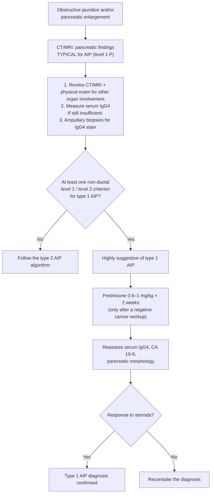
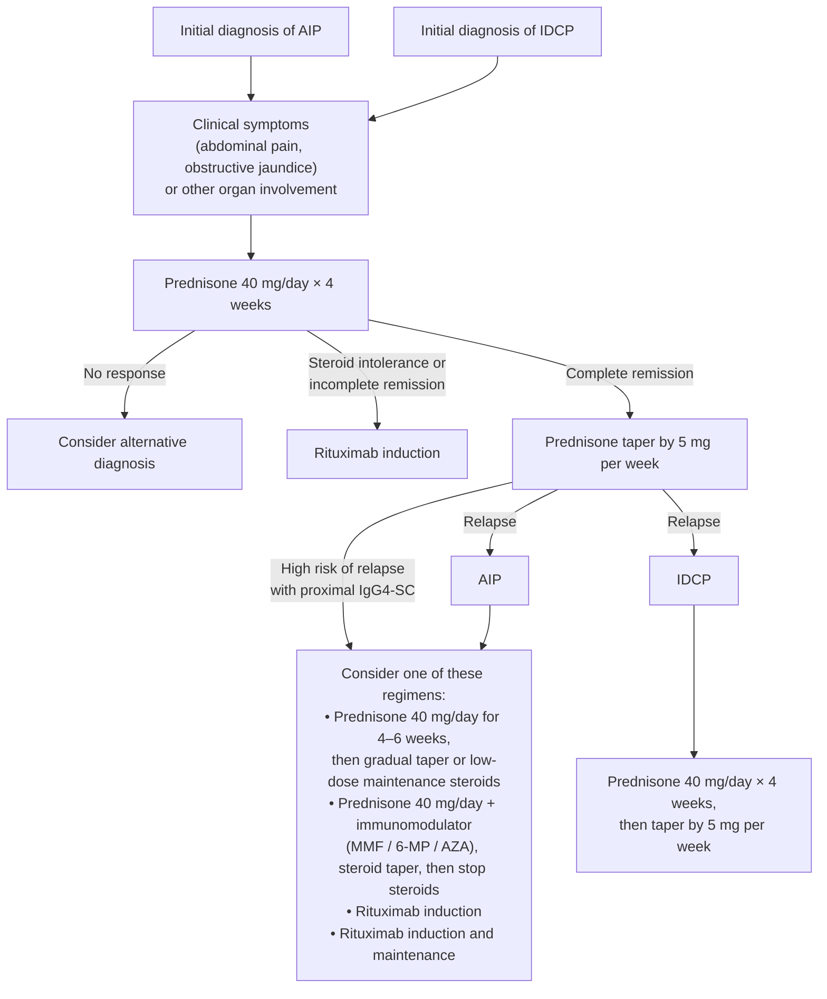

A **chronic, steroid-responsive fibroinflammatory disease of the pancreas** whose whole clinical problem is that it **mimics [[pancreatic-cancer|pancreatic cancer]]** — found in **2%–3% of surgical resections done for presumed pancreatic cancer**. Two distinct diseases sit under the name, and this page keeps the source's nomenclature: **autoimmune pancreatitis (AIP) = type 1** (lymphoplasmacytic sclerosing pancreatitis [LPSP], an immunoglobulin G4 [IgG4]-related disorder) and **IDCP = type 2** (idiopathic duct centric pancreatitis).

## Contents
- [[#Assessment]]
  - [[#Establishing the Diagnosis]]
    - [[#ICDC Level 1 vs Level 2 — Type 1 AIP]]
    - [[#How the Levels Combine — Type 1]]
    - [[#Type 2 (IDCP) and AIP–NOS]]
    - [[#ICDC Diagnostic Algorithm — Typical Imaging]]
    - [[#The Diagnostic Steroid Trial]]
    - [[#AIP vs Pancreatic Cancer on CT/MRI]]
  - [[#IgG4-Related Disease and Other Organ Involvement]]
  - [[#Severity Assessment]]
  - [[#Classification / Typing]]
- [[#Differential Diagnosis]]
- [[#Diagnostics]]
  - [[#Serum IgG4]]
  - [[#Cross-Sectional Imaging]]
  - [[#Ductal Imaging]]
  - [[#Histology and Tissue Acquisition]]
- [[#Therapeutics]]
  - [[#Who Is Treated]]
  - [[#Corticosteroids]]
  - [[#Management Algorithm]]
  - [[#Biliary Drainage and Surgery]]
  - [[#Monitoring After Treatment]]
  - [[#Relapse and Maintenance]]
- [[#See Also]]
- [[#Sources]]

## Assessment

### Establishing the Diagnosis

**Suspect it from the presentation — it is a *painless* obstructive picture.**

| | AIP (type 1) | IDCP (type 2) |
|---|---|---|
| Usual presentation | **Obstructive jaundice** (most common) | **[[acute-pancreatitis\|Acute pancreatitis]] in 50%** |
| Abdominal pain | **No or mild pain despite intense inflammation** | — |

- Obstructive jaundice in AIP comes from either **distal biliary ductal compression by pancreatic head swelling** or a **proximal [[biliary-stricture\|biliary stricture]]**.
- Diagnosis is **never a single test** — serology + cross-sectional imaging (computed tomography [CT] / magnetic resonance imaging [MRI]) + ductal imaging + other organ involvement + histology + steroid response.

**Criteria set — the International Consensus Diagnostic Criteria (ICDC)**, the most sensitive of the published sets. **Five cardinal features:**

| # | ICDC cardinal feature |
|---|---|
| 1 | **Pancreatic imaging** — parenchyma **or** ducts |
| 2 | **Serology** (serum IgG4) |
| 3 | **Other organ involvement** (OOI) |
| 4 | **Histology of the pancreas** |
| 5 | **Response to steroid therapy** |

- Output: **type 1 AIP**, **type 2 AIP (IDCP)**, or **AIP not otherwise specified**.
- Each feature scores **level 1** (higher reliability) or **level 2**; combined with whether parenchymal imaging is *typical* or *indeterminate*, this gives **definitive** or **probable** disease. An optional sixth criterion, **Rt (response to steroid)**, applies only in the indeterminate-imaging rows ([[shimosegawa-2011-icdc-autoimmune-pancreatitis]]).
- **Burnt-out AIP is outside these criteria.**

#### ICDC Level 1 vs Level 2 — Type 1 AIP

| | Criterion | **Level 1** | **Level 2** |
|---|---|---|---|
| **P** | Parenchymal imaging | **Typical:** diffuse enlargement with delayed enhancement (± rim-like enhancement) | **Indeterminate** (incl. atypical): segmental/focal enlargement with delayed enhancement |
| **D** | Ductal imaging (endoscopic retrograde pancreatography, ERP) | **Long (>1/3 the main pancreatic duct) or multiple strictures**, without marked upstream dilatation | Segmental/focal narrowing without marked upstream dilatation (**duct <5 mm**) |
| **S** | Serology | **IgG4 >2× upper limit of normal (ULN)** — see [[#Serum IgG4]] | IgG4 **1–2× ULN** |
| **OOI** | Other organ involvement | **a** Extrapancreatic histology, **any 3 of:** marked lymphoplasmacytic infiltration with fibrosis and no granulocytic infiltration · storiform fibrosis · obliterative phlebitis · **>10 IgG4-positive cells/high-power field (HPF)**. **b** Typical radiology, **≥1 of:** segmental/multiple proximal (hilar/intrahepatic), or proximal **and** distal, bile duct stricture · retroperitoneal fibrosis | **a** Extrapancreatic histology **including endoscopic bile-duct biopsy**, **both of:** marked lymphoplasmacytic infiltration without granulocytic infiltration · >10 IgG4-positive cells/HPF. **b** Physical/radiological, **≥1 of:** symmetrically enlarged salivary/lachrymal glands · renal involvement of the type described with AIP |
| **H** | Pancreatic histology | **LPSP (core biopsy or resection), ≥3 of:** periductal lymphoplasmacytic infiltrate without granulocytic infiltration · obliterative phlebitis · storiform fibrosis · >10 IgG4-positive cells/HPF | **LPSP (core biopsy), any 2** of the same four |
| **Rt** | Response to steroid | **Rapid (≤2 weeks) radiologically demonstrable resolution or marked improvement** of pancreatic/extrapancreatic manifestations | — |

#### How the Levels Combine — Type 1

| Diagnosis | Basis | Imaging | Collateral evidence |
|---|---|---|---|
| **Definitive type 1** | Histology | Typical / indeterminate | **Histologically confirmed LPSP (level 1 H)** |
| **Definitive type 1** | Imaging | **Typical** | **Any non-D level 1 or level 2** |
| **Definitive type 1** | Imaging | **Indeterminate** | **≥2 from level 1** (+ level 2 D, which counts as level 1 here) |
| **Definitive type 1** | Steroid response | Indeterminate | **Level 1 S/OOI + Rt**, or **level 1 D + level 2 S/OOI/H + Rt** |
| **Probable type 1** | — | Indeterminate | **Level 2 S/OOI/H + Rt** |

#### Type 2 (IDCP) and AIP–NOS

| | Criterion | **Level 1** | **Level 2** |
|---|---|---|---|
| **OOI** | Other organ involvement | — | **Clinically diagnosed [[inflammatory-bowel-disease\|inflammatory bowel disease]]** |
| **H** | Pancreatic histology | **IDCP — both of:** granulocytic infiltration of the duct wall (granulocytic epithelial lesion, GEL) ± granulocytic acinar inflammation; **absent or scant (0–10 cells/HPF) IgG4-positive cells** | **Both of:** granulocytic **and** lymphoplasmacytic acinar infiltrate; absent/scant (0–10 cells/HPF) IgG4-positive cells |

*P, D and Rt are defined identically to type 1.*

| Diagnosis | Imaging | Collateral evidence |
|---|---|---|
| **Definitive type 2** | Typical / indeterminate | **Histologically confirmed IDCP (level 1 H)**, OR **clinical inflammatory bowel disease + level 2 H + Rt** |
| **Probable type 2** | Typical / indeterminate | **Level 2 H / clinical inflammatory bowel disease + Rt** |
| **AIP–not otherwise specified** | Typical / indeterminate | **D1/2 + Rt** — ductal evidence only |

> [!pearl] Type 2 is the one that needs tissue
> Definitive **type 1** can be reached on surrogate criteria with no histology; **definite IDCP requires histological confirmation**. Imaging and steroid response do not separate the types — only **serology, other organ involvement and histology** do, and all three are type-1 features, so a seronegative patient without other organ involvement is **not thereby type 2** ([[shimosegawa-2011-icdc-autoimmune-pancreatitis]]).

#### ICDC Diagnostic Algorithm — Typical Imaging

*Figure 1 recreated — ICDC algorithm for type 1 AIP presenting with obstructive jaundice and/or pancreatic enlargement (typical, level 1 parenchymal findings). ([[shimosegawa-2011-icdc-autoimmune-pancreatitis]])*

#### The Diagnostic Steroid Trial

- **Prednisone 0.6–1 mg/kg**; reassess **imaging and CA 19-9 at 2 weeks** ([[shimosegawa-2011-icdc-autoimmune-pancreatitis]]).
- **Endpoint is radiological, not symptomatic** — definite improvement of imaging abnormalities including biliary strictures and pancreatic enlargement. Symptomatic improvement and a sense of well-being do not count.
- **A rising CA 19-9 means the diagnosis is wrong.**
- Full resolution may take **weeks to months**, sometimes with gland atrophy.
- **Only after a negative cancer workup including [[endoscopic-ultrasound|endoscopic ultrasound (EUS)]]-guided fine-needle aspiration, and only by pancreatologists.**

> [!pitfall] "If steroids work, it must be AIP" is not a diagnosis
> The consensus says to use the trial **sparingly**; it is no substitute for a thorough search for an etiology, and the strategy is *"fraught with problems"* without collateral evidence ([[shimosegawa-2011-icdc-autoimmune-pancreatitis]]).

#### AIP vs Pancreatic Cancer on CT/MRI

| CT/MRI pattern | What to do |
|---|---|
| **Diffusely enlarged pancreas (especially capsule-like rim), no ductal dilatation/cutoff, no mass**, with obstructive jaundice | **Highly likely AIP** — less collateral evidence required |
| **Low-density mass, ductal dilatation/cutoff, ± distal atrophy** | **Manage as [[pancreatic-cancer\|pancreatic cancer]]** unless the cancer workup is negative *and* collateral evidence for AIP is strong |
| Neither pattern | **Investigate for cancer first**; consider AIP only if that workup is negative and collateral evidence is strong |

- **Not suggestive of AIP:** marked cachexia, inability to eat, narcotic-requiring pain — these point to cancer and are rare in AIP. Typical idiopathic pancreatitis and painful [[chronic-pancreatitis|chronic pancreatitis]] are likewise uncommon in histologically confirmed AIP.
- A biopsy with **some but not all** features of LPSP or IDCP is **supportive**, not diagnostic.
- The **D criterion rests on ERP**, which Western endoscopists generally avoid in suspected AIP — a level 1 D finding is often unobtainable in US practice.

### IgG4-Related Disease and Other Organ Involvement

AIP belongs to the spectrum of **IgG4-related disorders**: **~50% have OOI, ~50% isolated pancreatic involvement.** OOI matters twice — ICDC cardinal feature, and marker of relapse risk ([[#Relapse and Maintenance]]). Manifestations:

- Bile duct stricture ([[igg4-related-cholangitis|IgG4-sclerosing cholangitis (IgG4-SC)]])
- Interstitial nephritis
- Orbital pseudotumor
- IgG4-related plasmacytic exocrinopathy of the salivary gland
- Pulmonary interstitial fibrosis or nodules
- Mediastinal or retroperitoneal fibrosis

**IDCP has no IgG4-related disease association** — its systemic association is **[[inflammatory-bowel-disease|inflammatory bowel disease (IBD)]]**, especially **[[ulcerative-colitis|ulcerative colitis]]**: a **majority of IDCP patients are diagnosed with IBD before or concurrently with IDCP**.

### Severity Assessment

**No severity score or stage is given for AIP or IDCP.** Disease burden is carried by three things instead:

- **Relapse risk** — the dominant long-term problem and the only stratified feature ([[#Relapse and Maintenance]]).
- **Long-term sequelae of persistent inflammation** — **[[exocrine-pancreatic-insufficiency|exocrine insufficiency]] and diabetes**, as in other causes of chronic pancreatitis. No screening test, interval or treatment is given for either in this population.
- **Future malignancy risk is *not* elevated** — no clear evidence of increased pancreatic cancer risk; data suggest a risk similar to other causes of chronic pancreatitis. This does **not** relax the need to exclude a *prevalent* cancer at diagnosis.

### Classification / Typing

The type determines the serology, the histology to ask the pathologist for, the systemic associations, and — above all — the relapse risk, and therefore whether maintenance therapy is on the table.

| Feature | **AIP** (type 1, lymphoplasmacytic sclerosing) | **IDCP** (type 2, idiopathic duct centric) |
|---|---|---|
| Age at presentation | **7th decade** | **5th decade** |
| Male sex | 75% | 50% |
| Other organ involvement / IgG4-related disease | Present in **~50%** | **None** |
| Association with [[inflammatory-bowel-disease\|IBD]] | Low | **High (10%–20%)** |
| Serum IgG4 elevation | Present in **~66%** | Present in ~25% |
| *Histology —* lymphoplasmacytic infiltration | Present | Present |
| *Histology —* storiform fibrosis | Present | Present |
| *Histology —* obliterative phlebitis | **Characteristic** | Rarely noted |
| *Histology —* **granulocyte epithelial lesion** | **Absent** | **Characteristic** |
| *Histology —* periductal inflammation | Present | Present |
| *Histology —* IgG4 staining | **≥10 cells/high-power field (HPF)** | **<10 cells/high-power field** |
| Response to steroids | **~100%** | **~100%** |
| **Relapse risk** | **Up to 60%** | **<10%** |

*Table 1 of [[aga-2019-autoimmune-pancreatitis]], recreated.*

- **The two discriminating histologic findings are the granulocyte epithelial lesion (IDCP only) and obliterative phlebitis (AIP).** The other four are present in both and do not separate them.
- **No reliable serologic marker exists for IDCP** — type 2 is a tissue diagnosis. The table gives IgG4 elevation in ~25% of IDCP while the prose states an elevated IgG4 is not characteristic of it: a minority have one, and it carries no diagnostic weight.
- Beyond the IgG4 cells/HPF cutoff, **no counts, thresholds or definitions** are given for the histologic features (e.g. what constitutes a granulocyte epithelial lesion).

## Differential Diagnosis

*Workup: see [[jaundice]] and [[recurrent-acute-pancreatitis]].*

- **[[pancreatic-cancer|Pancreatic adenocarcinoma]]** — the differential that defines this disease ([[#AIP vs Pancreatic Cancer on CT/MRI]]). **Assume the mimic until excluded**; management warrants close follow-up and monitoring for underlying malignancy, and **surgery is indicated when malignancy is suspected**.
- **Chronic pancreatitis of other cause** — shares the long-term sequelae (exocrine insufficiency, diabetes).
- **AIP vs IDCP** — the two types are each other's differential; separated by age, sex, serology, OOI, IBD association and histology ([[#Classification / Typing]]).
- **Other causes of a biliary stricture** — AIP produces both a distal stricture (head swelling) and a proximal one, so it enters that differential from both ends.

> [!pitfall] A mildly raised IgG4 does not exclude cancer
> Pancreatic cancer can elevate serum IgG4; **only 1% exceed 2× ULN (280 mg/dL)**, which is what gives the ≥2× cutoff its 99% specificity. Focal mass-like lesions are also **more common in IDCP (~35%)** — the type with no serologic marker ([[shimosegawa-2011-icdc-autoimmune-pancreatitis]], [[aga-2019-autoimmune-pancreatitis]]).

## Diagnostics

### Serum IgG4

| | Value |
|---|---|
| ICDC **level 1** cutoff (AIP) | **≥2× ULN = 280 mg/dL** |
| Sensitivity / specificity | **53% / 99%** |
| Elevated in AIP overall | **~66%** |
| False positives in pancreatic cancer | Elevated IgG4 can occur; **only 1% exceed 280 mg/dL** |
| Utility in **IDCP** | **None** — no reliable serologic marker exists for type 2 |
| Utility **after** treatment | **None** — no value for predicting relapse or diagnosing recurrence |

- **The 53% sensitivity is the operative number:** a normal IgG4 does not exclude AIP, and about half of AIP patients never reach level 1 on serology — hence the four other cardinal features.
- Biliary IgG4 cut-points (in g/L, for excluding IgG4-SC during a [[primary-sclerosing-cholangitis|primary sclerosing cholangitis (PSC)]] workup) answer a different question and live on [[igg4-related-cholangitis]] — **do not merge the thresholds**.

### Cross-Sectional Imaging

| Finding | Description | Frequency |
|---|---|---|
| **Diffuse parenchymal enlargement** | the **"sausage shape"** pancreas | Characteristic |
| **Low-attenuating capsule** | the **capsule-like "rim enhancement"** | Characteristic |
| **Focal mass-like lesion** | the dangerous one — overlaps pancreatic cancer, triggers the tissue pathway | **Less common** overall; **~35% in IDCP** |
| **Diffuse pancreatic atrophy** | | Less common |

### Ductal Imaging

- **[[mri-mrcp|Magnetic resonance cholangiopancreatography (MRCP)]] or [[ercp|endoscopic retrograde cholangiopancreatography (ERCP)]]** may show **diffuse or multifocal narrowing of the pancreatic duct *without upstream dilatation*.**
- **Absent upstream dilatation is the discriminator** — it separates inflammatory duct narrowing from an obstructing tumour.
- ERCP here is diagnostic imaging, not therapy ([[#Biliary Drainage and Surgery]]).

### Histology and Tissue Acquisition

- **Needle choice decides the diagnosis.** EUS-guided fine-needle **aspiration** (cytology) has **poor sensitivity even with larger-diameter needles** — the diagnosis is architectural (storiform fibrosis, obliterative phlebitis, periductal inflammation, granulocyte epithelial lesions) and an aspirate does not preserve architecture.
- **EUS-guided fine-needle *biopsy* (core) is what is needed** — preserves gland architecture; despite concern for post-procedure complications, smaller cohort studies showed safety and efficacy in AIP.
- **When the ICDC ask for core biopsy:** **focal mass and/or obstructive jaundice, cancer excluded, diagnosis unclear.**
- **IgG4 immunostaining** separates the types: **≥10 cells/HPF (AIP)** vs **<10 cells/HPF (IDCP)**.
- **Do not re-biopsy after treatment** ([[#Monitoring After Treatment]]).

## Therapeutics

Management of both AIP and IDCP is **primarily medical**, with **close follow-up and monitoring for occult malignancy**.

### Who Is Treated

| Patient | Treat? |
|---|---|
| **Symptomatic** — obstructive jaundice, [[acute-pancreatitis\|acute pancreatitis]], abdominal pain, back pain | **Considered for treatment** |
| **Asymptomatic** | **Only** in the setting of a **persistent pancreatic mass on imaging**, **or** persistent liver function test abnormalities in the setting of **IgG4-sclerosing cholangitis / other organ involvement** |

### Corticosteroids

- **Response to steroids is ~100% in both AIP and IDCP** — near-universal steroid responsiveness is the defining therapeutic feature of the disease.
- **Steroids alone treat the jaundice** in the mild, uninfected case — no stent (see below).

**Induction and taper ([[aga-2019-autoimmune-pancreatitis]], Figure 1):**

| Step | Regimen |
|---|---|
| **Induction** (AIP and IDCP alike) | **Prednisone 40 mg/day × 4 weeks** |
| **Taper**, after complete remission | **Reduce by 5 mg per week** |
| **No response** to induction | **Consider an alternative diagnosis** — not dose escalation |
| **Steroid intolerance, or incomplete remission** | **Rituximab induction** |

- **The entry condition is symptoms or OOI**, not the diagnosis alone — the algorithm starts the steroid only once there are clinical symptoms (abdominal pain, obstructive jaundice) or OOI, consistent with [[#Who Is Treated]].
- **Failure to respond is a diagnostic event, not a dosing one.** The algorithm's only branch for non-response is to reconsider the diagnosis — in a disease whose chief mimic is [[pancreatic-cancer|pancreatic cancer]], that is the point.
- The article prints the agent, dose and taper **only in Figure 1**; its prose names no milligram or interval.

**Induction and taper ([[okazaki-2017-aip-treatment-consensus]], recommendation level in brackets):**

| Step | Regimen |
|---|---|
| **Starting dose** | **Prednisone 0.6–1.0 mg/kg/day** [A], **minimum 20 mg/day** — below that the remission rate suffers [B]. Held **2–4 weeks** before tapering |
| **Taper** | **5–10 mg every 1–2 weeks down to 20 mg/day, then 5 mg every 2 weeks** [B] |
| **Alternative taper** | **40 mg/day × 4 weeks, then 5 mg/week until off** [B] — the regimen [[aga-2019-autoimmune-pancreatitis]] prints |
| **Total induction** | **Generally 12 weeks** [A] |
| **Not acceptable** | Induction **shorter than 4 weeks** at a high dose (**≥20 mg**) [C] |
| **Refractory induction** | **Steroid mini-pulse — methylprednisolone 500 mg × 3 days, two courses 4 days apart** |

- **Reassess imaging and serology within 1–2 weeks** of starting; taper against symptoms, liver enzymes, IgG/IgG4 and repeat imaging.
- **Remission rates:** 98% treated vs 88% untreated; **99.6% in type 1, 92.3% in type 2**.
- **Rituximab can induce remission as a single agent** where steroids are contraindicated [B]; **thiopurines and other steroid-sparing agents cannot** [C]. In a jaundiced patient, rituximab's onset is delayed enough that **4–6 weeks of steroid cover may be needed first**.

### Management Algorithm

*Figure 1 — management of initial presentation and of relapse in AIP and IDCP. MMF, mycophenolate mofetil; 6-MP, 6-mercaptopurine; AZA, azathioprine. ([[aga-2019-autoimmune-pancreatitis]])*

### Biliary Drainage and Surgery

- **[[ercp|ERCP]] and biliary stenting are *rarely* indicated in the setting of obstructive jaundice.** This is the counterintuitive call and the reason the diagnosis is worth making.
  - The case *for* stenting, which the source acknowledges: it **reduces the risk of [[acute-cholangitis|cholangitis]]** and **facilitates [[brush-cytology|cytologic brushings]]** to distinguish benign from malignant strictures.
  - **The ICDC recommendation nonetheless: treat mild jaundice with no signs of infection with steroid therapy alone.**
  - **The decision hinges on two qualifiers — *mild* jaundice and *no signs of infection*.** The guideline does **not** define "mild" (no bilirubin threshold) and does not state what to do for non-mild jaundice.
- **Surgical interventions are indicated in the setting of suspected malignancy.**

### Monitoring After Treatment

- **Do not follow serum IgG4.** After treatment there is **no value** in following serum IgG4 levels to predict relapse or diagnose recurrence.
- **Do not re-biopsy.** **Histologic re-evaluation is not recommended after treatment.**
- **Expect imperfect restitution.** Despite the efficacy of corticosteroid therapy, **normal pancreatic morphology and function may not be restored** — resolution of the inflammation makes the **fibro-atrophic component of the disease more prominent**. Persistent abnormal morphology after successful treatment is therefore not, by itself, treatment failure.
- **No surveillance schedule is given.** The source requires "close follow-up and monitoring for the possibility of underlying malignancy" but specifies **no modality, no interval, and no duration**.

### Relapse and Maintenance

**Relapse is the dominant long-term problem in AIP and is largely absent in IDCP.**

- **Frequency:** recurrence or relapse after initial response occurs in **up to 60% of AIP patients** — vs **<10% in IDCP**.
- **Timing:** **during the steroid taper, or after discontinuation of corticosteroids.**
- **Who is at higher risk (the two stated markers):**
  1. **Elevated pre-treatment immunoglobulin E (IgE) levels**
  2. **Other organ involvement with a proximal bile duct stricture, or IgG4-sclerosing cholangitis**
- **What high risk buys:** these patients **can be considered for long-term maintenance with steroids or immunomodulator regimens** — one of four, below.
- **Treatment of relapse or steroid intolerance:** **a combination of steroids and immunomodulators, or rituximab.**

**The four maintenance / relapse regimens — choose one** (Figure 1; offered to the high-relapse-risk group and to relapsed AIP alike):

| # | Regimen |
|---|---|
| 1 | **Prednisone 40 mg/day for 4–6 weeks**, then gradual taper **or** low-dose maintenance steroids |
| 2 | **Prednisone 40 mg/day + an immunomodulator** (mycophenolate mofetil [MMF], 6-mercaptopurine [6-MP] or azathioprine [AZA]), steroid taper, then **discontinuation of steroids** |
| 3 | **Rituximab induction** |
| 4 | **Rituximab induction and maintenance** |

- ⚠ **Relapsed IDCP is handled differently** — it goes back to **prednisone 40 mg/day × 4 weeks and taper by 5 mg per week**, i.e. a repeat of induction, not one of the four regimens above. The four are the AIP branch.
- [[aga-2019-autoimmune-pancreatitis]] gives no immunomodulator or rituximab dose and **no criterion for choosing among the four** — it presents them as alternatives.
- ⚠ Note the asymmetry that makes IgE and OOI worth checking: **serum IgG4 is useless for predicting relapse**, so the relapse-risk decision rests on the pre-treatment IgE and the OOI phenotype, not on the marker that made the diagnosis.

**Who needs maintenance, and who does not ([[okazaki-2017-aip-treatment-consensus]]):**

| | |
|---|---|
| **No maintenance** | **Type 1 with low disease activity before treatment, and all type 2** [C]. Low activity = pancreas-only segmental/focal lesion, **no OOI**, complete radiological remission with normalized IgG/IgG4, rapid steroid response → **taper off within 3 months** |
| **Maintenance** | Type 1 with **diffuse pancreatic enlargement** · **delayed radiological remission** · **persistently high serum IgG4 (>2× ULN) after treatment** · **≥2 OOI** · **proximal IgG4-SC before treatment** [B] |
| **Maintenance regimen** | **Low-dose glucocorticoid 2.5–7.5 mg/day, up to 3 years**, stopping once radiological and serological improvement is established — or a steroid-sparing agent / rituximab |
| **Relapse treatment** | No gold standard [B]. **Re-administer or increase steroid — usually the same dose as the initial course, tapered more slowly.** Immunomodulators (thiopurines, mycophenolate mofetil, methotrexate) **require 6–8 weeks of overlap with steroids** and are **not effective as single agents**; azathioprine added for relapse induced remission in **85%** |

- **Relapse timing relative to the steroid course:** **67% after discontinuation**, 15% during the taper, 18% on maintenance. **56% of relapses occur within 1 year, 76% within 2, 92% within 3.**
- **Type 1 relapses hit the biliary system or pancreas; type 2 relapses are confined to the pancreas** (31% vs 9% of patients).
- **Proximal IgG4-SC is the strongest marker:** 56.1% relapsed with IgG4-related sclerosing cholangitis vs 25.7% without. **69% of relapsing patients re-elevate serum IgG4 before the relapse.**

> [!pitfall] Check hepatitis B before immunosuppression
> Anti-HBs or anti-HBc positive with a negative HBs antigen → **monitor HBV DNA** during rituximab, immunomodulator or steroid therapy; the virus can reactivate ([[okazaki-2017-aip-treatment-consensus]]).

- **Surgery:** medical therapy first, but **resection or bypass may be useful in refractory cases** — realistically, where poor medical response would otherwise mean long-term biliary stenting for continuing obstructive jaundice [B].

---

## See Also

[[pancreatic-cancer]], [[chronic-pancreatitis]], [[acute-pancreatitis]], [[recurrent-acute-pancreatitis]], [[jaundice]], [[biliary-stricture]], [[exocrine-pancreatic-insufficiency]], [[endoscopic-ultrasound]], [[ercp]], [[mri-mrcp]], [[brush-cytology]], [[ulcerative-colitis]], [[inflammatory-bowel-disease]], [[primary-sclerosing-cholangitis]], [[cholangiocarcinoma]], [[acute-cholangitis]]

---

## Sources

1. [[aga-2019-autoimmune-pancreatitis|Akshintala VS, Singh VK. Management of Autoimmune Pancreatitis. Clin Gastroenterol Hepatol 2019;17:1937–1939]]
2. [[shimosegawa-2011-icdc-autoimmune-pancreatitis|International Consensus Diagnostic Criteria for Autoimmune Pancreatitis: Guidelines of the International Association of Pancreatology (ICDC, 2011)]]
3. [[okazaki-2017-aip-treatment-consensus|International Consensus for the Treatment of Autoimmune Pancreatitis (2017)]]
