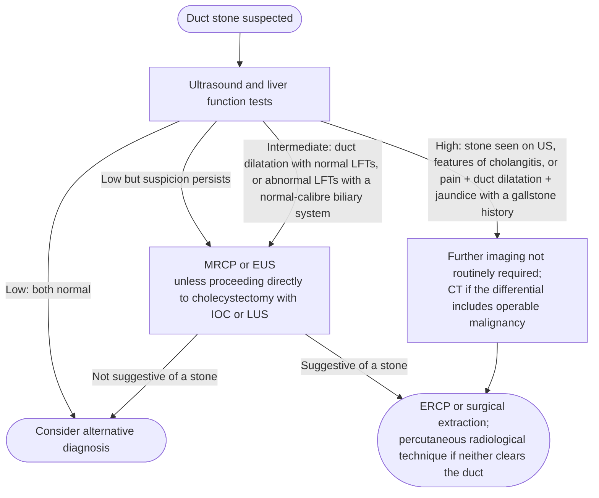

## Contents
- [[#Assessment]]
  - [[#Establishing the Diagnosis]]
  - [[#Risk Stratification — ASGE 2019]]
  - [[#Risk Stratification — BSG 2017]]
- [[#Differential Diagnosis]]
- [[#Diagnostics]]
- [[#Therapeutics]]
  - [[#Stone Clearance]]
    - [[#Stents]]
    - [[#Gall Bladder After Duct Clearance]]
  - [[#Gallstone Pancreatitis]]
  - [[#Acute Cholangitis]]
  - [[#In Pregnancy]]
- [[#See Also]]
- [[#Sources]]

## Assessment

- Gallstones in the **common bile duct (CBD)** — most common cause of obstructive [[jaundice]] in adults; precipitates [[acute-cholangitis|acute cholangitis]] and gallstone [[acute-pancreatitis|pancreatitis]].
- **Secondary** stones migrate from the gall bladder via the cystic duct — the majority in Western practice. **Primary** stones form de novo in the ducts, most prevalent in Asian populations, and cause recurrent pyogenic cholangitis. ([[bsg-2017-common-bile-duct-stones]])
- **Prevalence:** CBD stones in **10%–20%** of patients with symptomatic gallstones, but **<5%** where there was no clinical suspicion before surgery. **2%–4%** of people with gall bladder stones become symptomatic per year. ([[bsg-2017-common-bile-duct-stones]])

### Establishing the Diagnosis
- Clinical + biochemical ([[abnormal-liver-chemistries|cholestatic liver chemistries]], ↑ total bilirubin) + imaging.
- **Transabdominal ultrasound (US)** first — CBD diameter plus direct view of a duct stone (specific, insensitive).
- A stone seen on any imaging test is already high risk → [[ercp|endoscopic retrograde cholangiopancreatography (ERCP)]]. Confirmatory [[endoscopic-ultrasound|endoscopic ultrasound (EUS)]] or [[mri-mrcp|magnetic resonance cholangiopancreatography (MRCP)]] is for **intermediate-probability** patients.

### Risk Stratification — ASGE 2019
*Stone probability sets the pathway; the point is to avoid a purely diagnostic ERCP — adverse events **6%–15%** (1%–2% severe: death or hospitalization >10 days) for no benefit. The 2010 American Society for Gastrointestinal Endoscopy (ASGE) criteria sent **20%–30%** of patients to ERCP without a stone.* ([[asge-2019-choledocholithiasis]])

| Risk | Stone probability | Criteria | Pathway |
|---|---|---|---|
| **High** | >50% | **Any one of:** CBD stone on US or cross-sectional imaging · total bilirubin **>4 mg/dL** ***and*** dilated CBD on US/cross-sectional imaging · clinical ascending cholangitis | Straight to [[ercp\|ERCP]] for stone extraction |
| **Intermediate** | 10%–50% | **Any one of** (no high-risk criterion met): abnormal liver biochemical tests · age **>55 years** · dilated CBD on US/cross-sectional imaging | Confirm first — [[endoscopic-ultrasound\|EUS]], MRCP, laparoscopic intraoperative cholangiogram (IOC) or laparoscopic intraoperative US |
| **Low** | <10% | No predictors present | Cholecystectomy for symptomatic cholelithiasis, ± IOC or intraoperative US |

- **Dilated CBD** = **>6 mm** with the gall bladder in situ, **>8 mm** after cholecystectomy.
- **Bilirubin and dilation count only as a pair.** Either finding alone is **intermediate** risk; requiring both raised specificity from **74% to 94%** and positive predictive value (PPV) from **64% to 85%** in validation.
- **What changed from ASGE 2010** (readers carry the old version): 2010 counted *total bilirubin 1.8–4.0 mg/dL plus duct dilation*, **or** *total bilirubin >4 mg/dL alone*, as high-risk; 2019 requires **both** >4 mg/dL and dilation. **Gallstone pancreatitis is no longer an intermediate-risk criterion** — the panel dropped it for lack of correlation with persistent CBD stones.
- The 2019 high-risk category performs well (sensitivity **96.87%**, PPV **89.57%**), but the way to drive diagnostic-only ERCP toward zero is **definitive visualization of the stone** — US, IOC, MRCP or EUS. Do **EUS before any ERCP in which a stone has not been confidently identified** on prior imaging, where EUS is available. ([[acg-asge-2026-ercp-quality-indicators]])

### Risk Stratification — BSG 2017
*The British Society of Gastroenterology (BSG) uses the same three strata but assigns them from ultrasound + liver function tests (LFTs) rather than a criteria table, and names the step most pathways leave implicit — what to do when the confirmatory test is negative.*

*Investigation of a suspected common bile duct stone*
*Source: redrawn from the BSG 2017 suspected-stone algorithm*
*[[bsg-2017-common-bile-duct-stones|BSG 2017: Updated Guideline on the Management of Common Bile Duct Stones (CBDS)]]*
*US = ultrasound · LFTs = liver function tests · MRCP = magnetic resonance cholangiopancreatography · EUS = endoscopic ultrasound · IOC = intraoperative cholangiography · LUS = laparoscopic ultrasound · CT = computed tomography · ERCP = endoscopic retrograde cholangiopancreatography*

## Differential Diagnosis

*Workup: see [[biliary-stricture]] for the obstructive/malignant differential and [[jaundice]] for the broader cholestasis algorithm.*

- [[biliary-stricture|Biliary stricture]] (benign or malignant) — malignant-obstruction differential.
- Mirizzi syndrome (extrinsic CBD compression by an impacted cystic-duct stone).
- [[pancreatic-cancer|Pancreatic head]] / periampullary tumor.
- [[primary-sclerosing-cholangitis|Primary sclerosing cholangitis]], [[autoimmune-pancreatitis|immunoglobulin G4 (IgG4) cholangiopathy]].

## Diagnostics

- **Transabdominal US and LFTs** are the first tests in everyone not previously investigated; what they are worth depends on pre-test probability (Cochrane data, ≥6 months of clinical follow-up in patients not explored): ([[bsg-2017-common-bile-duct-stones]])

| Test (cut-off) | Sensitivity | Specificity | Pre-test probability | Positive → | Negative → |
|---|---|---|---|---|---|
| **US** (echogenic material in the CBD *or* CBD dilatation) | 0.73 | 0.91 | 9.5% | **45%** | **3%** |
| **US** | " | " | 40.8% | **85%** | **17%** |
| **US** | " | " | 65.8% | **94%** | **37%** |
| **Bilirubin >22.23 µmol/L** | 0.84 | 0.91 | 9.5% | 49% | 2% |
| **Bilirubin > twice normal** | 0.42 | 0.97 | 9.5% | 63% | 6% |
| **Alkaline phosphatase >125 IU/L** | 0.92 | 0.79 | 9.5% | 32% | 1% |
| **Alkaline phosphatase > twice normal** | 0.38 | 0.97 | 9.5% | 61% | 6% |

> [!pitfall] A negative ultrasound only means something at low pre-test probability
> At a 9.5% pre-test probability a negative US leaves a **3%** stone risk; at 65.8% the same negative US still leaves **37%**. Normal LFTs and a normal US **do not preclude further investigation** when clinical suspicion is high. ([[bsg-2017-common-bile-duct-stones]])

- **Intermediate risk → either EUS or MRCP** (conditional recommendation, low quality of evidence): comparable accuracy, so choose by patient preference, local expertise and availability (Rec 1). ([[asge-2019-choledocholithiasis]])
- **Measured:** at a median pre-test probability of **41%**, summary sensitivity **0.95 (EUS) vs 0.93 (MRCP)** and specificity **0.97 vs 0.96**; head-to-head studies in the same patients show no clear superiority of either. These figures do **not** transfer to low pre-test probability (more false positives) or high (watch false negatives). Choose by patient: ([[bsg-2017-common-bile-duct-stones]])

| Favours EUS | Favours MRCP |
|---|---|
| Intracranial metallic clips, pacemaker, mechanical heart valve | Wide availability, non-invasive |
| Claustrophobia | Images the intrahepatic ducts |
| Morbid obesity | Altered gastric or duodenal anatomy |
| — | Every image captured for later review |

- **CT** is not the test for stones — sensitivity **69%–87%**, specificity **68%–96%** on modern multislice scanners, falling further for small stones and stones isodense with bile. Its place is where stone and malignancy coexist. ([[bsg-2017-common-bile-duct-stones]])
- **ERCP** — therapeutic; reserve it as a purely diagnostic test only when EUS and MRCP are unavailable.

## Therapeutics

### Stone Clearance
- Patients with CBD stones are **offered extraction if fit for treatment**; evidence of benefit is greatest in symptomatic patients (low quality; strong). ([[bsg-2017-common-bile-duct-stones]])
- **ERCP with sphincterotomy** — mainstay for high-probability stones.
- **Large stones:** **endoscopic papillary large-balloon dilation after sphincterotomy** rather than sphincterotomy alone (Rec 3; conditional, moderate quality).
- **Large and difficult stones:** intraductal therapy — [[cholangioscopy|cholangioscopy-guided]] electrohydraulic or laser lithotripsy — **or** conventional therapy with papillary dilation; mechanical lithotripsy is the other adjunct. Choose by local expertise, cost and patient/physician preference (Rec 4). *Both guidelines' definitions of a "difficult" stone live on [[cholangioscopy]].*
- **Timing around cholecystectomy:** pre-operative ERCP, post-operative ERCP or laparoscopic duct clearance are all acceptable for high-risk patients or a positive IOC — decided by local surgical and endoscopic expertise (Rec 7).
- **Surgery is co-equal, not a fallback.** Transcystic or transductal **laparoscopic bile duct exploration (LBDE)** at laparoscopic cholecystectomy shows **no difference in efficacy, mortality or morbidity versus perioperative ERCP**, with a **shorter hospital stay** — the two are **equally valid** (high quality; strong). Most surgeons use the **transductal** approach (transcystic reaches only small stones and gives poor access to the common hepatic duct), and **primary duct closure beats planned T-tube insertion** (same bile-leak and recurrent-stone rates, shorter stay and operating time, return to work ~8 days sooner). ([[bsg-2017-common-bile-duct-stones]])
- **When the whole ladder fails:** percutaneous radiological extraction or open duct exploration — **major complications 3.6%–6.8%**; for the few in whom endoscopic and laparoscopic routes fail or are impossible. ([[bsg-2017-common-bile-duct-stones]])
- **Mirizzi syndrome:** per-oral [[cholangioscopy|cholangioscopic]] therapy may substitute for surgical stone management where expertise exists, but **gall bladder resection is required regardless of strategy**. **Hepatolithiasis** needs a multidisciplinary approach — endoscopy + interventional radiology + surgery (Rec 8).

> [!pearl] Extract the stone even when it is small
> In 34,200 intraoperative cholangiograms, **11.6%** had a duct stone. Leaving stones in situ gave an unfavourable outcome in **25.3%** vs **12.7%** when extraction was planned (odds ratio [OR] 0.44, 95% confidence interval [CI] 0.35–0.55), and the benefit **persisted for stones <4 mm** (8.9% vs 15.9%). The natural history of a stone found incidentally in an asymptomatic patient has never been studied — advice to extract there rests on symptomatic-patient evidence and expert opinion, and the patient should be told so. ([[bsg-2017-common-bile-duct-stones]])

#### Stents
- Plastic and covered metal stents may facilitate removal of difficult stones but **require planned exchange or removal** (Rec 9) — never left indefinitely.
- **Short-term stenting of a duct that could not be cleared is correct** (moderate quality; strong): drain, then further endoscopy or surgery. **A stent as the definitive treatment is not**, except for **limited life expectancy and/or prohibitive surgical risk** (moderate quality; strong).
- At least a quarter of long-term-stent patients develop recurrent cholangitis. Over a mean 14 months: **on-demand exchange → 36% cholangitis, 8% mortality**; **elective 3-monthly exchange → 8% and 2%**. If a stent must stay, exchange it on a schedule, not on symptoms. ([[bsg-2017-common-bile-duct-stones]])

#### Gall Bladder After Duct Clearance
- **Gall bladder stones present → cholecystectomy** (high quality; strong). Meta-analysis of 5 trials (662 patients): mortality **14.1% wait-and-see vs 7.9%** with prophylactic cholecystectomy (relative risk [RR] 1.78, 95% CI 1.15–2.75), with recurrent pain, jaundice and cholangitis also more frequent in the wait-and-see arm; the benefit held in higher-surgical-risk patients, and a later trial in patients **over 70** found fewer total biliary events with elective surgery.
- **Operative risk prohibitive** → biliary sphincterotomy and endoscopic clearance alone is an acceptable alternative (low quality; weak).
- **An *empty* gall bladder is a different question.** Recurrent CBD stones ran **15%–23.7%** with residual gall bladder stones versus **5.9%–11.3%** with an empty gall bladder in large Asian series (smaller Asian and European studies did not confirm the gap), and an empty gall bladder carries lower risk of cholecystitis and later cholecystectomy — so a wait-and-see approach may reasonably be discussed there.
- **Post-cholecystectomy stones:** biliary sphincterotomy with endoscopic extraction is the primary treatment (low quality; strong). ([[bsg-2017-common-bile-duct-stones]])

### Gallstone Pancreatitis
- **Recommend *against* urgent (<48 h) ERCP** in gallstone pancreatitis **without** cholangitis or biliary obstruction/choledocholithiasis (Rec 2; strong recommendation, low quality) — no mortality, systemic- or local-complication benefit, including in predicted-severe disease.
- **Do** proceed with early ERCP when **cholangitis** or **persistent biliary obstruction/choledocholithiasis** coexists — those patients were explicitly excluded from the recommendation against early ERCP.
- **Same-admission cholecystectomy for mild gallstone pancreatitis** (Rec 5) — interval cholecystectomy leaves a substantial readmission risk for recurrent pancreatitis and other biliary events.
- **ERCP with prophylactic sphincterotomy is not a substitute for cholecystectomy** — reserve it for patients in whom surgery is absolutely contraindicated. ([[asge-2019-choledocholithiasis]])

### Acute Cholangitis
- Drain within **48 h** of presentation, ERCP as first-line modality ([[asge-2021-cholangitis]]). Diagnostic criteria, severity grading, antibiotics and the timing evidence: [[acute-cholangitis]].

### In Pregnancy
- Confirm the stone with **[[mri-mrcp|MRCP]]** (no contrast) or **EUS** before ERCP — CT involves radiation and is not typically needed for gallstone evaluation, and EUS can obviate ERCP by excluding a duct stone. ([[aga-2024-pregnancy-gi-liver]])
- **ERCP is an urgent indication** in pregnancy for choledocholithiasis, cholangitis and some gallstone pancreatitis — ideally in the **2nd trimester**, with fetal-radiation minimization and pre-/post-procedure fetal monitoring; if deferring would harm mother or fetus, convene a multidisciplinary team (best practice advice [BPA] 8).
- **Cholecystectomy is safe in pregnancy** — laparoscopic is the standard of care regardless of trimester, ideally the second (BPA 9).
- Full pregnancy context: [[liver-disease-in-pregnancy]].

---

## See Also

[[acute-cholangitis]], [[jaundice]], [[autoimmune-pancreatitis]], [[abnormal-liver-chemistries]], [[ercp]], [[endoscopic-ultrasound]], [[mri-mrcp]], [[cholangioscopy]], [[acute-pancreatitis]], [[acute-cholecystitis]], [[biliary-stricture]], [[pancreatic-cancer]], [[primary-sclerosing-cholangitis]], [[liver-disease-in-pregnancy]]

---

## Sources

1. [[asge-2019-choledocholithiasis|ASGE Guideline: Endoscopic Management of Choledocholithiasis (2019)]]
2. [[bsg-2017-common-bile-duct-stones|BSG 2017: Updated Guideline on the Management of Common Bile Duct Stones (CBDS)]]
3. [[aga-2024-pregnancy-gi-liver|AGA Clinical Practice Update on Pregnancy-Related Gastrointestinal and Liver Disease: Expert Review]]
4. [[asge-2021-cholangitis|ASGE Guideline: Management of Acute Cholangitis (2021)]]
5. [[acg-asge-2026-ercp-quality-indicators|ACG/ASGE 2026: Quality Indicators for ERCP]]
