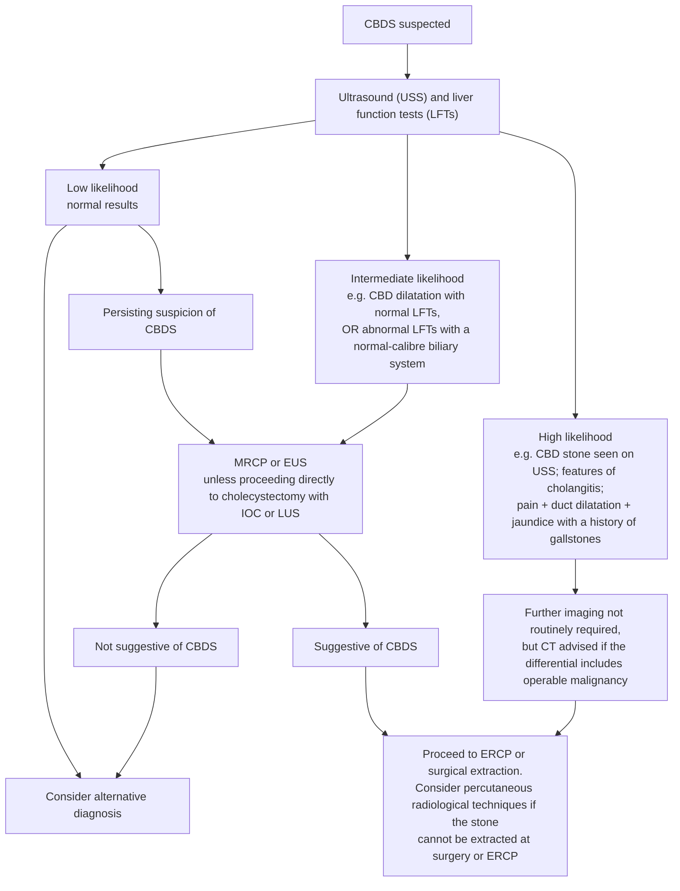

## Contents
- [[#Assessment]]
  - [[#Establishing the Diagnosis]]
  - [[#Risk Stratification (ASGE 2019)]]
    - [[#The British Society of Gastroenterology (BSG) pathway — the same three strata, drawn as an algorithm]]
- [[#Differential Diagnosis]]
- [[#Diagnostics]]
- [[#Therapeutics]]
  - [[#Stone Clearance]]
    - [[#Stent as definitive treatment — and why it is a last resort]]
    - [[#After duct clearance — does the gall bladder come out?]]
  - [[#Acute Cholangitis — Drainage Timing]]
  - [[#Gallstone Pancreatitis]]
  - [[#In Pregnancy]]
- [[#See Also]]
- [[#Sources]]

## Assessment

- Gallstones in the **common bile duct (CBD)** — most common cause of **obstructive jaundice** in adults.
- Precipitant of **[[acute-cholangitis|acute cholangitis]]** and gallstone [[acute-pancreatitis|pancreatitis]].
- Suspect cholangitis on **any one** of fever, chills, abdominal pain, [[jaundice]], nausea, vomiting, or disturbance of consciousness → grade it, then drain. Diagnostic and Tokyo Guidelines 2018 (TG18) severity criteria: [[acute-cholangitis]]. *("Charcot's triad" is not defined in the guidelines and is not used here — see [[acute-cholangitis]].)*
- **Primary** stones form de novo in the ducts (most prevalent in Asian populations; cause recurrent pyogenic cholangitis). **Secondary** stones migrate from the gall bladder and are the majority in Western practice. ([[bsg-2017-common-bile-duct-stones]])
- **Prevalence:** CBD stones in **10%–20%** of patients with symptomatic gallstones, but **<5%** where there was no clinical suspicion before surgery. **2%–4%** of people with gall bladder stones become symptomatic per year. ([[bsg-2017-common-bile-duct-stones]])

> [!pearl] Extract the stone even when it is small
> In 34,200 intraoperative cholangiograms (GallRiks), **11.6%** had a duct stone. Leaving stones in situ gave an unfavourable outcome in **25.3%** vs **12.7%** when extraction was planned (odds ratio [OR] 0.44, 95% confidence interval [CI] 0.35–0.55) — and the benefit **persisted for stones <4 mm** (8.9% vs 15.9%, OR 0.52, 0.34–0.79). ⚠ The same document notes the other side: some stones pass spontaneously, and **the natural history of an incidentally found stone in an asymptomatic patient has never been studied** — advice to extract there rests on symptomatic-patient evidence and expert opinion, and the patient should be told so. ([[bsg-2017-common-bile-duct-stones]])

### Establishing the Diagnosis
- Clinical + biochemical (cholestatic [[abnormal-liver-chemistries|liver chemistries]], ↑total bilirubin) + imaging.
- Transabdominal ultrasound (US): assess CBD diameter and look for a visualized duct stone (specific but insensitive).
- Confirmatory imaging (endoscopic ultrasound [EUS]/[[mri-mrcp|magnetic resonance cholangiopancreatography (MRCP)]]) reserved for **intermediate-probability** patients (see below).

### Risk Stratification (ASGE 2019)
*Probability of CBD stones determines the pathway — avoids unnecessary diagnostic [[ercp|endoscopic retrograde cholangiopancreatography (ERCP)]] (diagnostic ERCP carries a 6–15% adverse-event rate; the 2010 criteria sent 20–30% of patients to ERCP without stones).*

| Risk | Stone probability | Criteria | Pathway |
|---|---|---|---|
| **High** | >50% | **Any one of:** (1) CBD stone on US or cross-sectional imaging; (2) total bilirubin **>4 mg/dL** ***and*** **dilated CBD**; (3) clinical **[[acute-cholangitis\|ascending cholangitis]]** | Proceed directly to **[[ercp\|ERCP]]** for stone extraction |
| **Intermediate** | 10–50% | **Any one of** (without meeting a high-risk criterion): abnormal liver biochemical tests; age **>55 years**; **dilated CBD** on US | Confirm first with **[[endoscopic-ultrasound\|EUS]], MRCP**, laparoscopic intraoperative cholangiogram (IOC), or laparoscopic intraoperative US |
| **Low** | <10% | No predictors present | Cholecystectomy (for symptomatic cholelithiasis) ± intraoperative cholangiogram or intraoperative US as needed |

- **Dilated CBD** = **>6 mm** in adults with gallbladder in situ; **>8 mm** after cholecystectomy. ([[asge-2019-choledocholithiasis]])
- Bilirubin >4 mg/dL *alone* or a dilated duct *alone* is only **intermediate** risk — it's the **combination** that is high-risk (the combined criterion raised specificity from 74% to 94% and positive predictive value (PPV) from 64% to 85% in validation).
- **What changed from American Society for Gastrointestinal Endoscopy (ASGE) 2010** (readers carry the old version): 2010 counted **total bilirubin 1.8–4.0 mg/dL *plus* duct dilation**, *or* **total bilirubin >4 mg/dL alone**, as high-risk; 2019 requires **both** bilirubin >4 mg/dL **and** duct dilation. The 2010 criteria sent 20–30% of patients to diagnostic ERCP. ([[asge-2019-choledocholithiasis]])
- **How well each version performs**, measured: the **2010** criteria had a positive predictive value of just **62%**, and in one retrospective study the high-risk category actually held a stone only **73.6%** of the time. The **2019** revision achieves **sensitivity 96.87% (95% CI 95.37–97.98)** and **positive predictive value 89.57% (95% CI 85.20–92.75)**. Even so, the surest way to drive diagnostic-only ERCP toward zero is **definitive visualization of the stone** — transabdominal ultrasound, intraoperative cholangiogram, [[mri-mrcp|MRCP]] or [[endoscopic-ultrasound|EUS]] — and **EUS before any ERCP in which a stone has not been confidently identified** on prior imaging, where EUS is available. ([[acg-asge-2026-ercp-quality-indicators]])
- **Gallstone [[acute-pancreatitis|pancreatitis]] was removed** as an **intermediate**-risk criterion in the 2019 revision — the panel cited a lack of correlation with persistent CBD stones. (It was an intermediate-risk criterion in 2010.)
  - ⚠ *Provenance note:* the guideline's own sentence is internally contradictory as printed — "**The exception was** that gallstone pancreatitis **did** correlate with increased risk of choledocholithiasis in these series" — after stating that the very strong/strong predictors *were* associated with increased odds. Read with its "the exception was" framing and with the panel's action (dropping the criterion), the intended sense is **did *not* correlate**; a "not" appears to be missing in the published text.
- **EUS and MRCP have comparable high accuracy** for detecting CBD stones — choose by local availability/expertise. ([[asge-2019-choledocholithiasis]])

#### The British Society of Gastroenterology (BSG) pathway — the same three strata, drawn as an algorithm
*BSG 2017 uses the identical low / intermediate / high framing but assigns the strata from USS + LFTs rather than a criteria table, and names the step most pathways leave implicit — what to do when the confirmatory test is negative.*

*Figure 1 — Investigation of suspected common bile duct stone, recreated from the source's algorithm. ([[bsg-2017-common-bile-duct-stones]])*

- **What the test is actually worth, by pre-test probability** — BSG prints the numbers the strata are built on (Cochrane data, ≥6 months of clinical follow-up in patients not explored): ([[bsg-2017-common-bile-duct-stones]])

| Test (cut-off) | Sensitivity | Specificity | Pre-test probability | Positive → | Negative → |
|---|---|---|---|---|---|
| **USS** (echogenic material in the CBD *or* CBD dilatation) | 0.73 | 0.91 | 9.5% | **45%** | **3%** |
| **USS** | " | " | 40.8% | **85%** | **17%** |
| **USS** | " | " | 65.8% | **94%** | **37%** |
| **Bilirubin >22.23 µmol/L** | 0.84 | 0.91 | 9.5% | 49% | 2% |
| **Bilirubin > twice normal** | 0.42 | 0.97 | 9.5% | 63% | 6% |
| **Alkaline phosphatase >125 IU/L** | 0.92 | 0.79 | 9.5% | 32% | 1% |
| **Alkaline phosphatase > twice normal** | 0.38 | 0.97 | 9.5% | 61% | 6% |

> [!pitfall] A negative ultrasound only means something at low pre-test probability
> At a 9.5% pre-test probability a negative USS leaves a **3%** stone risk; at 65.8% the same negative USS still leaves **37%**. Normal LFTs and a normal USS **do not preclude further investigation** when clinical suspicion is high. ([[bsg-2017-common-bile-duct-stones]])

- **MRCP vs EUS, measured:** at a median pre-test probability of **41%**, summary **sensitivity 0.95 (EUS) vs 0.93 (MRCP)** and **specificity 0.97 vs 0.96** — and head-to-head studies in the same patients show **no clear superiority of either**. ⚠ These figures **do not transfer** to low pre-test probability (more false positives) or high (watch false negatives). **Choose by patient, not by accuracy:** EUS for intracranial metallic clips, pacemaker, mechanical valve, claustrophobia or morbid obesity; MRCP for availability, non-invasiveness, intrahepatic duct imaging, altered gastric/duodenal anatomy, and because every image is captured for later review. ([[bsg-2017-common-bile-duct-stones]])
- **Computed tomography (CT)** is not the test for stones — **sensitivity 69%–87%, specificity 68%–96%** on modern multislice scanners, falling further for small stones or stones isodense with bile. Its place is where **stone and malignancy coexist**. ([[bsg-2017-common-bile-duct-stones]])

## Differential Diagnosis

*Workup: see [[biliary-stricture]] for the obstructive/malignant differential and [[jaundice]] for the broader cholestasis algorithm.*

- [[biliary-stricture|Biliary stricture]] (benign or malignant) — malignant-obstruction differential.
- Mirizzi syndrome (extrinsic CBD compression by an impacted cystic-duct stone).
- [[pancreatic-cancer|Pancreatic head]] / periampullary tumor.
- [[primary-sclerosing-cholangitis|Primary sclerosing cholangitis]], [[autoimmune-pancreatitis|immunoglobulin G4 (IgG4) cholangiopathy]].

## Diagnostics

- **Transabdominal ultrasound** — first-line; CBD dilation + visualized stone raise probability.
- **EUS or MRCP** — confirm in intermediate-probability patients; equivalent diagnostic performance. ([[asge-2019-choledocholithiasis]])
- **ERCP** — diagnostic and therapeutic; reserve as a purely diagnostic test only when EUS/MRCP unavailable (procedural risk).

## Therapeutics

### Stone Clearance
- **[[ercp|ERCP]] with sphincterotomy** — mainstay for high-probability stones.
- **Large/difficult stones:** **endoscopic papillary large-balloon dilation after sphincterotomy** improves clearance over sphincterotomy alone.
- Adjuncts for large/difficult stones: **mechanical lithotripsy** or **[[cholangioscopy|cholangioscopy-guided]] (electrohydraulic [EHL]/laser) lithotripsy**. Intraductal therapy and conventional therapy with papillary dilation are both acceptable — choose by local expertise, cost, and preference (Rec 4). ([[asge-2019-choledocholithiasis]])
- **Bile duct stents** (plastic or covered metal) may facilitate removal of difficult stones but **require planned exchange or removal** — never leave them indefinitely (Rec 9).
- *What counts as a **difficult stone** — two guidelines use the word at two different rungs of the ladder; both definitions are on [[cholangioscopy]]. Size, shape and number are the determinants, and altered anatomy compounds them. ([[bsg-2017-common-bile-duct-stones]])*
- **Timing vs cholecystectomy:** pre-operative ERCP, post-operative ERCP, or laparoscopic bile-duct clearance are all acceptable for high-risk patients or a positive intraoperative cholangiogram — decided by local surgical/endoscopic expertise (Rec 7).
- **Surgical clearance is a co-equal option, not a fallback.** Transcystic or transductal **laparoscopic bile duct exploration (LBDE)** at laparoscopic cholecystectomy shows **no difference in efficacy, mortality or morbidity versus perioperative ERCP**, with a **shorter hospital stay** — the two are **equally valid** (High quality; strong). Most surgeons use the **transductal** approach (transcystic reaches only small stones and gives poor access to the common hepatic duct), and **primary duct closure beats planned T-tube insertion** (same bile-leak and recurrent-stone rates, shorter stay and operating time, return to work ~8 days sooner). ([[bsg-2017-common-bile-duct-stones]])
- **When the whole ladder fails:** percutaneous radiological extraction (usually via a transhepatic fistula, with antegrade push into the duodenum ± lithotripsy) or open duct exploration — **major complications 3.6%–6.8%**. Reserve for the small number in whom endoscopic and laparoscopic routes fail or are impossible. ([[bsg-2017-common-bile-duct-stones]])

#### Stent as definitive treatment — and why it is a last resort
- **Short-term stenting of a duct that could not be cleared is correct** — adequate drainage, then further endoscopy or surgery. **Leaving the stent as the treatment is not**, except for **limited life expectancy and/or prohibitive surgical risk**. ([[bsg-2017-common-bile-duct-stones]])
- **At least a quarter of long-term-stent patients develop recurrent cholangitis.** In a series followed a mean of 14 months: **on-demand exchange → 36% cholangitis, 8% mortality**; **elective 3-monthly exchange → 8% cholangitis, 2% mortality**. If a stent must stay, **exchange it on a schedule, not on symptoms**. ([[bsg-2017-common-bile-duct-stones]])

#### After duct clearance — does the gall bladder come out?
- **Gall bladder stones present → cholecystectomy** (High quality; strong). Meta-analysis of 5 trials (662 patients): **mortality 14.1% wait-and-see vs 7.9% prophylactic cholecystectomy** (relative risk 1.78, 95% CI 1.15–2.75), with recurrent pain, jaundice and cholangitis also more frequent in the wait-and-see arm; the benefit held in higher-surgical-risk patients, and a later trial in patients **over 70** found fewer total biliary events with elective surgery. **Where operative risk is prohibitive, sphincterotomy and endoscopic clearance alone is an acceptable alternative** (Low; weak). ([[bsg-2017-common-bile-duct-stones]])
- ⚠ **An *empty* gall bladder is a different question.** Recurrent CBD stones ran **15%–23.7%** with residual gall bladder stones versus **5.9%–11.3%** with an empty gall bladder in situ in large Asian series (smaller Asian and European studies did not confirm the gap), and an empty gall bladder carries lower risk of cholecystitis and later cholecystectomy — so **a wait-and-see approach may reasonably be discussed** there. ([[bsg-2017-common-bile-duct-stones]])
- **Post-cholecystectomy stones:** biliary sphincterotomy with endoscopic extraction is the primary treatment. ([[bsg-2017-common-bile-duct-stones]])
- **Mirizzi syndrome:** per-oral [[cholangioscopy|cholangioscopic]] therapy may substitute for surgical stone management where expertise exists, but **gallbladder resection is still required regardless of strategy**. **Hepatolithiasis** needs a multidisciplinary approach (endoscopy + interventional radiology [IR] + surgery) (Rec 8).

### Acute Cholangitis — Drainage Timing
- **Biliary drainage within 48 h** of presentation ([[asge-2021-cholangitis]]); **[[ercp|ERCP]] over percutaneous transhepatic biliary drainage (PTBD)** as first-line modality.
- **ASGE does *not* recommend <24 h for severe (Tokyo Grade III) cholangitis.** Its own reading: "ERCP in <24 hours or 24 to 48 hours versus >48 hours appears to shorten the length of hospitalization but **does not impact inpatient or 30-day mortality, organ failure, or other core clinical outcomes.**" The single carve-out is narrower than "severe" — **in septic shock *not responding to fluid resuscitation*, ERCP <24 h "may be considered"** (a suggestion, conditioned on refractoriness, not on Tokyo grade). ([[asge-2021-cholangitis]]) Grade definitions and the grade-driven flowchart: [[acute-cholangitis]].
  - *Under question in septic shock:* in **Tokyo Grade (TG) III cholangitis with septic shock**, ERCP **<24 h of vasopressor initiation** gave **no survival advantage** over 24–48 h (30-d mortality hazard ratio [HR] 1.07, 95% confidence interval [CI] 0.81–1.42) and looked worse than 48–72 h (HR 1.47, 1.00–2.16) — likely the sickest patients drained first. Elderly, comorbid cohort (mean age 73). ⚠ **Digestive Disease Week (DDW) 2026 abstract, retrospective TriNetX** — below guideline and randomized controlled trial (RCT) evidence; hypothesis-generating, does **not** change the emergent-drainage recommendation. ([[aloysius-2026-ercp-timing-septic-shock-cholangitis]])
- **Mild-to-moderate** cholangitis: **do not reflexively rush to <24 h.** Urgent (<24 h) drainage is **not superior** to early (24–48 h) — 30-day mortality 3.95% vs 6.58% (HR 0.70, 95% CI 0.25–1.93) and day-30 organ failure 11.8% vs 17.1%, neither significant — while post-ERCP adverse events were **more frequent with urgent ERCP (17.1% vs 9.2%; relative risk [RR] 2.03, 95% CI 1.02–4.07, unadjusted)**, mainly **haemorrhage** (10.5% vs 3.3%), from sphincterotomy on an oedematous papilla in an under-resuscitated septic patient. ⚠ The adverse event (AE) difference was **nominal (p=0.042) and did not survive the trial's Holm-Bonferroni correction** across secondary outcomes. Resuscitate (fluids, coagulopathy correction, antibiotics) then drain within 24–48 h. ([[jagtap-2026-urgent-vs-early-ercp-cholangitis]])
- **Malignant** biliary obstruction is the dominant predictor of 30-day mortality in cholangitis (HR ~5), not timing. ([[jagtap-2026-urgent-vs-early-ercp-cholangitis]])

### Gallstone Pancreatitis
- **Recommend *against* urgent (<48 h) [[ercp|ERCP]]** in gallstone [[acute-pancreatitis|pancreatitis]] **without** cholangitis or biliary obstruction/choledocholithiasis (Rec 2) — no mortality/systemic/local-complication benefit, including in predicted-severe disease. ([[asge-2019-choledocholithiasis]])
- **Do** proceed with early ERCP when **cholangitis** or **persistent biliary obstruction/choledocholithiasis** coexists — those patients were explicitly excluded from the recommendation against early ERCP.
- **Same-admission cholecystectomy is recommended for mild gallstone pancreatitis** (Rec 5) — interval cholecystectomy leaves a substantial readmission risk for recurrent pancreatitis and other biliary events. ([[asge-2019-choledocholithiasis]])
- **ERCP with prophylactic sphincterotomy is not a substitute for cholecystectomy** — reserve it for patients in whom surgery is absolutely contraindicated. ([[asge-2019-choledocholithiasis]])

### In Pregnancy
- Confirm the stone with **[[mri-mrcp|MRCP]]** (no contrast) or **[[endoscopic-ultrasound|EUS]]** before ERCP (computed tomography [CT] involves radiation and is not typically needed). ([[aga-2024-pregnancy-gi-liver]])
- **[[ercp|ERCP]] is an urgent indication** in pregnancy for choledocholithiasis, cholangitis, and some gallstone pancreatitis — ideally in the **2nd trimester**, with fetal-radiation minimization (see [[ercp]]). ([[aga-2024-pregnancy-gi-liver]] best practice advice [BPA] 8)
- Full pregnancy context: [[liver-disease-in-pregnancy]].

---

## See Also

[[acute-cholangitis]], [[jaundice]], [[autoimmune-pancreatitis]], [[abnormal-liver-chemistries]], [[ercp]], [[endoscopic-ultrasound]], [[mri-mrcp]], [[cholangioscopy]], [[acute-pancreatitis]], [[acute-cholecystitis]], [[biliary-stricture]], [[pancreatic-cancer]], [[primary-sclerosing-cholangitis]], [[liver-disease-in-pregnancy]]

---

## Sources

1. [[asge-2019-choledocholithiasis|ASGE Guideline: Endoscopic Management of Choledocholithiasis (2019)]]
2. [[bsg-2017-common-bile-duct-stones|BSG 2017: Updated Guideline on the Management of Common Bile Duct Stones (CBDS)]]
3. [[aga-2024-pregnancy-gi-liver|AGA Clinical Practice Update on Pregnancy-Related Gastrointestinal and Liver Disease: Expert Review]]
4. [[asge-2021-cholangitis|ASGE Guideline: Management of Acute Cholangitis (2021)]]
5. [[jagtap-2026-urgent-vs-early-ercp-cholangitis|Urgent versus Early ERCP in Mild-to-Moderate Acute Cholangitis: A Randomised Controlled Trial (Jagtap 2026)]]
6. [[aloysius-2026-ercp-timing-septic-shock-cholangitis|Vasopressor-Indexed Timing of ERCP and Survival in Septic Shock from Tokyo Grade III Cholangitis (Aloysius 2026, DDW abstract)]]
7. [[acg-asge-2026-ercp-quality-indicators|ACG/ASGE 2026: Quality Indicators for ERCP]]
