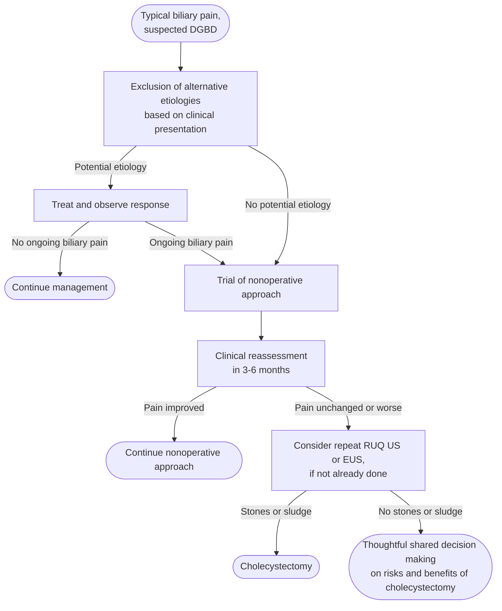

## Contents
- [[#Assessment]]
  - [[#Establishing the Diagnosis]]
  - [[#Typical Biliary Pain (Rome V definition)]]
- [[#Differential Diagnosis]]
- [[#Diagnostics]]
- [[#Therapeutics]]
- [[#See Also]]
- [[#Sources]]

## Assessment

- **Dysfunctional gallbladder disorder (DGBD)** = biliary-type pain believed to originate from gallbladder dysfunction, **without gallstones or other structural pathology**. ([[rome-v-2026-gallbladder-sphincter-of-oddi]])
- **The name is deliberate.** [[rome-v-2026-gallbladder-sphincter-of-oddi|Rome V]] replaced *functional gallbladder disorder*, *biliary dyskinesia*, *chronic acalculous gallbladder dysfunction* and *chronic acalculous cholecystitis* with one term, because those older labels all imply a pathologic or pathophysiologic process that is **not always demonstrable**: not all gallbladders resected for this indication have motor abnormalities, and the dysmotility seen in gallstones, obesity and diabetes does not always cause pain.
- **Sits alongside the [[disorders-of-gut-brain-interaction|disorders of gut–brain interaction (DGBI)]].** Gallbladder and sphincter of Oddi disorders are not traditionally seen as classic DGBI (the defect is assumed to be in the organ, and the cure is removing it), but Rome V's position is that **most patients traditionally diagnosed with gallbladder or sphincter of Oddi dysfunction have instead had a more classic DGBI**, and that the two are at least strongly interconnected.
- **It is benign.** DGBD does not predispose to serious complications, and symptoms resolve spontaneously in **up to 50%**. The only reason to operate is symptom relief and quality of life.

> [!pitfall] The operation is massively overused for this indication
> Cholecystectomy for suspected DGBD in the US rose from **43 to 89 per 1,000,000 population** (1991–2011), against **<25 per 1,000,000** in international cohorts — while the Rome Global Epidemiology Study found functional biliary pain (Rome IV definition) in **<1%** overall, only a fraction of that being DGBD. Biliary dyskinesia is the stated reason for up to **~40% of adult and ~60% of pediatric** cholecystectomies ([[rome-v-2026-gallbladder-sphincter-of-oddi]]).

### Establishing the Diagnosis

**Rome V criteria — must include *all* of:**

1. **Typical biliary pain** (defined below)
2. **Absence of gallstones or other structural pathology**

**Supportive criteria:**

1. **Normal liver enzymes, conjugated bilirubin and pancreatic enzymes during the pain episode**
2. **Persistence of symptoms despite a trial of nonoperative therapy**

- **Strictly meeting the definition of typical biliary pain is the most important criterion** — it is by far the most likely to predict response to surgery.
- **Supportive criterion 2 is new in Rome V** (expert opinion plus natural history): DGBD causes pain stochastically and does so for longer than a short period (weeks to months) before abating completely, so watchful waiting separates patients who will benefit from those whose symptoms are transient.
- **Gallbladder ejection fraction (GBEF) was removed from the supportive criteria** in Rome V — see *Diagnostics*.

### Typical Biliary Pain (Rome V definition)

The cardinal symptom, and **by far the strongest predictor of response to cholecystectomy**. Rome V renamed this from "criteria" to **definition** (pain is a symptom, not a diagnosis) and added **typical** to denote the pattern seen in patients who actually respond to therapy.

**Pain located in the epigastrium and/or right upper quadrant, and *all* of the following:**

1. **Acute onset, lasting at least 20 minutes and up to several hours**
2. **Episodic**, with varying intervals between attacks
3. **Severe enough to interrupt daily activities or lead to acute medical evaluation**
4. **Unrelated to bowel movements, and not relieved by acid suppression or positional changes**

**Supportive characteristics** (not required):

1. Nausea and vomiting
2. Radiation to the back and/or right shoulder blade
3. Postprandial occurrence
4. Awakens the patient from sleep

> [!pearl] Biliary pain is steady, not colicky — and usually epigastric
> It reaches maximal intensity **quickly and then remains steady**, unlike the undulating pain of renal colic or the intermittent pain of bowel obstruction, and **most commonly involves the epigastrium** rather than the right upper quadrant. Experimental distension of the esophagus, duodenum, ileum and colon reproduces the same kind of pain, which is why characterization is the hard part ([[rome-v-2026-gallbladder-sphincter-of-oddi]]).

![[dgbd-2026-biliary-pain-pattern-02.png|700x394]]
*Pain intensity over time — biliary pain is sustained, renal pain undulates, true intestinal colic is intermittent*
*Source: Figure 1 of the Rome V gallbladder and sphincter of Oddi chapter, open access (CC BY-NC-ND 4.0)*
*[[rome-v-2026-gallbladder-sphincter-of-oddi|Rome V (2026): Gallbladder and Sphincter of Oddi Disorders]]*

## Differential Diagnosis

*Workup: see [[dyspepsia]] for the epigastric-pain algorithm; exclude gallstones and structural pathology on imaging before invoking DGBD.*

- **Gallstones, microlithiasis and biliary sludge** — including stones missed on a first ultrasound. The commonest thing found when DGBD pain persists.
- [[acute-cholecystitis|Cholecystitis]], acute or chronic.
- [[sphincter-of-oddi-dysfunction|Biliary sphincter of Oddi disorder (SOD)]] — distinguished by **elevated liver tests and/or biliary dilation**, which DGBD lacks.
- [[peptic-ulcer-disease|Peptic ulcer disease]] and [[gerd|gastroesophageal reflux disease]].
- [[gastroparesis|Gastroparesis]] and other gastroduodenal [[disorders-of-gut-brain-interaction|DGBI]].
- [[chronic-pancreatitis|Minimal-change chronic pancreatitis]].
- [[nafld-masld|Steatotic liver disease]].
- Small bowel pathology; musculoskeletal syndromes of the abdominal wall.

> In principle none of these needs specific exclusion in a patient without suggestive symptoms who meets the definition of typical biliary pain — but whether more intense testing improves cholecystectomy outcomes is unclear ([[rome-v-2026-gallbladder-sphincter-of-oddi]]).

## Diagnostics

- **Right upper quadrant (RUQ) ultrasound (US)** — the first test, to exclude stones and structural pathology. **Repeat it (or add [[endoscopic-ultrasound|endoscopic ultrasound (EUS)]]) if pain persists**, since occult stones and sludge are the commonest thing missed.
- **Liver enzymes, conjugated bilirubin, amylase and lipase during the pain episode** — normal values are supportive. Abnormal liver tests or a dilated duct move the patient to [[sphincter-of-oddi-dysfunction|biliary SOD]] instead.
- **Additional testing as symptoms direct** — physical examination, laboratory evaluation, cross-sectional imaging (US, computed tomography, magnetic resonance imaging), [[upper-endoscopy|upper endoscopy]]/EUS, gastric-emptying study, and reassessment of medications.
- **Cholescintigraphy (CS) with GBEF — no longer a diagnostic criterion.** CS after pharmacologic stimulation is the most popular way of measuring gallbladder emptying. Rome V removed GBEF because the evidence that it predicts response to cholecystectomy is very limited, and **typical biliary pain consistently and strongly outperforms it**. Existing CS data are described as highly inconsistent and subject to bias and confounding.
  - **Reproducibility is poor:** of cholecystectomy candidates with a low ejection fraction who had two studies, **more than half** improved into the normal range on the second.
  - Recent systematic reviews found clinical response occurred in most patients with **typical** biliary symptoms **regardless of emptying parameters**.
  - **Rome V does not set a GBEF cut-point for "low."** The only value it quotes is **<35%**, from a 23-patient series of atypical pain in which more than half responded to cholecystectomy.
  - CS can still inform the **surgical** decision in defined situations — see the table in *Therapeutics*.
- **No other imaging modality has a role** in this condition, on inadequate evidence.

## Therapeutics

*Evaluation of typical biliary pain with no gallbladder stones or other structural abnormality*
*Source: redrawn from Figure 3 of the Rome V gallbladder and sphincter of Oddi chapter*
*[[rome-v-2026-gallbladder-sphincter-of-oddi|Rome V (2026): Gallbladder and Sphincter of Oddi Disorders]]*
*DGBD = dysfunctional gallbladder disorder · RUQ = right upper quadrant · US = ultrasound · EUS = endoscopic ultrasound*

**Nonoperative trial first — 3 to 6 months** ([[rome-v-2026-gallbladder-sphincter-of-oddi]]):

- Counseling about the **lack of progression to complicated disease** — this is the therapeutic lever, since the fear of "something being missed" drives much of the demand for surgery.
- Lifestyle modification.
- Pharmacologic treatment, **e.g. neuromodulators**, as for other DGBI.

**Cholecystectomy:**

- **Indicated when significant symptoms remain after the period of watchful waiting**, in a patient who meets the criteria on **typical biliary pain**.
- Outcomes in patients meeting Rome criteria for typical biliary pain who underwent cholecystectomy: **84%–93% improvement** in pain scores and quality of life (interim analysis of a prospective cohort).
- **Early surgical intervention is unwarranted** — up to half resolve without it, and the delay will reduce unnecessary operations.

**Where GBEF changes the surgical decision** — *atypical* here means pain in the epigastrium and/or right upper quadrant that is **missing one or more of the four required features** of typical biliary pain:

| Clinical picture | What CS adds | Decision |
|---|---|---|
| Typical pain, **mild-to-moderate** symptoms | Complete pain resolution more likely with **reduced GBEF (81% vs 70%; P = .01)**; markedly elevated GBEF also responds well | Reasonable — the result may shift the decision curve |
| Typical pain, clearly **mild** or clearly **severe** symptoms | Outcome differences between low, normal and high GBEF are small | Unlikely to help — mild favors conservative care, severe favors surgery either way |
| **Atypical** pain, **normal** GBEF | Outcomes equalled nonoperative care | **Cholecystectomy certainly not indicated** |
| **Atypical** pain, **low** GBEF | >half of 23 patients with GBEF <35% responded | May be contemplated; **shared decision making mandatory** |
| Pain **not predominantly upper abdominal** | Nothing — very unlikely to be a gallbladder disorder | **Not a cholecystectomy candidate, regardless of GBEF** |

---

## See Also

[[sphincter-of-oddi-dysfunction]], [[acute-cholecystitis]], [[disorders-of-gut-brain-interaction]], [[dyspepsia]], [[endoscopic-ultrasound]], [[gallbladder-cancer]], [[biliary-stricture]], [[choledocholithiasis]]

---

## Sources

1. [[rome-v-2026-gallbladder-sphincter-of-oddi|Rome V (2026): Gallbladder and Sphincter of Oddi Disorders]]
