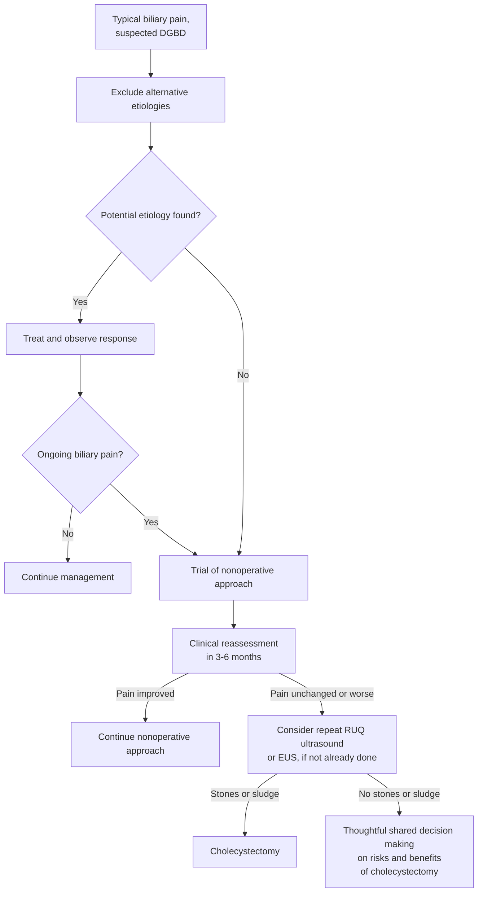

## Contents
- [[#Assessment]]
  - [[#Typical Biliary Pain (Rome V definition)]]
  - [[#Establishing the Diagnosis]]
- [[#Differential Diagnosis]]
- [[#Diagnostics]]
- [[#Therapeutics]]
- [[#See Also]]
- [[#Sources]]

## Assessment

- **Dysfunctional gallbladder disorder (DGBD)** = biliary-type pain believed to originate from gallbladder dysfunction, **without gallstones or other structural pathology**. ([[rome-v-2026-gallbladder-sphincter-of-oddi]])
- **The name is deliberate.** [[rome-v-2026-gallbladder-sphincter-of-oddi|Rome V]] replaced *functional gallbladder disorder*, *biliary dyskinesia*, *chronic acalculous gallbladder dysfunction* and *chronic acalculous cholecystitis* with one term, because those older labels all imply a pathologic or pathophysiologic process that is **not always demonstrable**: not all gallbladders resected for this indication have motor abnormalities, and the dysmotility seen in gallstones, obesity and diabetes does not always cause pain.
- A [[disorders-of-gut-brain-interaction|disorder of gut–brain interaction (DGBI)]] — Rome V's position is that most patients historically labelled with gallbladder dysfunction have visceral hypersensitivity and gut–brain dysregulation rather than a primary motor disease.
- **It is benign.** DGBD does not predispose to serious complications, and symptoms resolve spontaneously in **up to 50%**. The only reason to operate is symptom relief and quality of life.

> [!pitfall] The operation is massively overused for this indication
> Cholecystectomy for suspected DGBD in the US rose from **43 to 89 per 1,000,000 population** (1991–2011), against **<25 per 1,000,000** in international cohorts — while the Rome Global Epidemiology Study put true DGBD prevalence at **<1%**. Biliary dyskinesia is the stated reason for up to **~40% of adult and ~60% of pediatric** cholecystectomies ([[rome-v-2026-gallbladder-sphincter-of-oddi]]).

### Typical Biliary Pain (Rome V definition)

The cardinal symptom, and **by far the strongest predictor of response to cholecystectomy**. Rome V renamed this from "criteria" to **definition** (pain is a symptom, not a diagnosis) and added **typical** to denote the pattern seen in patients who actually respond to therapy.

**Pain located in the epigastrium and/or right upper quadrant, and *all* of the following:**

1. **Acute onset, lasting at least 20 minutes and up to several hours**
2. **Episodic**, with varying intervals between attacks
3. **Severe enough to interrupt daily activities or lead to acute medical evaluation**
4. **Unrelated to bowel movements, and not relieved by acid suppression or positional changes**

**Supportive characteristics** (not required):

1. Nausea and vomiting
2. Radiation to the back and/or right shoulder blade
3. Postprandial occurrence
4. Awakens the patient from sleep

> [!pearl] Biliary pain is steady, not colicky — and usually epigastric
> It reaches maximal intensity **quickly and then remains steady**, unlike the undulating pain of renal colic or the intermittent pain of bowel obstruction, and **most commonly involves the epigastrium** rather than the right upper quadrant. Experimental distension of the esophagus, duodenum, ileum and colon reproduces the same kind of pain, which is why characterization is the hard part ([[rome-v-2026-gallbladder-sphincter-of-oddi]]).

### Establishing the Diagnosis

**Rome V criteria — must include *all* of:**

1. **Typical biliary pain** (above)
2. **Absence of gallstones or other structural pathology**

**Supportive criteria:**

1. **Normal liver enzymes, conjugated bilirubin and pancreatic enzymes during the pain episode**
2. **Persistence of symptoms despite a trial of nonoperative therapy**

- **Strictly meeting the definition of typical biliary pain is the most important criterion** — it is by far the most likely to predict response to surgery.
- **Supportive criterion 2 is new in Rome V**, and reflects natural history: DGBD causes pain stochastically and will do so for longer than a short period (weeks to months) before abating completely. A period of watchful waiting separates patients who will benefit from those whose symptoms are transient.
- **Gallbladder ejection fraction (GBEF) was removed from the supportive criteria** in Rome V — see *Diagnostics*.

## Differential Diagnosis

*Workup: see [[dyspepsia]] for the epigastric-pain algorithm; exclude gallstones and structural pathology on imaging before invoking DGBD.*

- **Gallstones, microlithiasis and biliary sludge** — including stones missed on a first ultrasound. The commonest thing found when DGBD pain persists.
- [[acute-cholecystitis|Cholecystitis]], acute or chronic.
- [[sphincter-of-oddi-dysfunction|Biliary sphincter of Oddi disorder]] — distinguished by **elevated liver tests and/or biliary dilation**, which DGBD lacks.
- [[peptic-ulcer-disease|Peptic ulcer disease]] and [[gerd|gastroesophageal reflux disease]].
- [[gastroparesis|Gastroparesis]] and other gastroduodenal [[disorders-of-gut-brain-interaction|DGBI]] — Rome V names **DGBI as the most common alternative explanation**.
- [[chronic-pancreatitis|Minimal-change chronic pancreatitis]].
- [[nafld-masld|Steatotic liver disease]].
- Small bowel pathology; musculoskeletal syndromes of the abdominal wall.

> In principle none of these needs specific exclusion in a patient without suggestive symptoms who meets the definition of typical biliary pain — but whether more intense testing improves cholecystectomy outcomes is unclear ([[rome-v-2026-gallbladder-sphincter-of-oddi]]).

## Diagnostics

- **Right upper quadrant ultrasound** — the first test, to exclude stones and structural pathology. **Repeat it (or add [[endoscopic-ultrasound|EUS]]) if pain persists**, since occult stones and sludge are the commonest thing missed.
- **Liver enzymes, conjugated bilirubin, amylase and lipase during the pain episode** — normal values are supportive. Abnormal liver tests or a dilated duct move the patient to [[sphincter-of-oddi-dysfunction|biliary SOD]] instead.
- **Additional testing as symptoms direct** — cross-sectional imaging, [[upper-endoscopy|upper endoscopy]]/EUS, gastric-emptying study, and reassessment of medications.
- **Cholescintigraphy (CS) with GBEF — no longer a diagnostic criterion.** Rome V removed GBEF because the evidence that it predicts response to cholecystectomy is very limited, and **typical biliary pain consistently and strongly outperforms it**. Existing CS data are described as highly inconsistent and subject to bias.
  - **Reproducibility is poor:** of cholecystectomy candidates with a low ejection fraction who had two studies, **more than half** improved into the normal range on the second.
  - **CS may still inform the *surgical* decision in two groups**: (1) typical biliary pain with **mild-to-moderate** symptoms, where the result can shift the decision curve; (2) **atypical pain, where a normal GBEF should strongly discourage cholecystectomy**.
  - Apply CS only where it will actually shift the decision — the outcome differences between low, normal and high GBEF are small, so it changes little in patients with mild symptoms (who favor conservative management anyway) or severe symptoms (who favor surgery).
- **No other imaging modality has a role** in this condition, on inadequate evidence.

## Therapeutics

*Figure — evaluation and management of typical biliary pain with no gallbladder stones or other structural abnormality. ([[rome-v-2026-gallbladder-sphincter-of-oddi]])*

**Nonoperative trial first — 3 to 6 months** ([[rome-v-2026-gallbladder-sphincter-of-oddi]]):

- Counseling about the **lack of progression to complicated disease** — this is the therapeutic lever, since the fear of "something being missed" drives much of the demand for surgery.
- Lifestyle modification.
- Pharmacologic treatment, **e.g. neuromodulators**, as for other DGBI.

**Cholecystectomy:**

- **Indicated when significant symptoms remain after the period of watchful waiting**, in a patient who meets the criteria on **typical biliary pain**.
- Outcomes in patients meeting Rome criteria for typical biliary pain who underwent cholecystectomy: **84%–93% improvement** in pain scores and quality of life.
- Where symptoms are typical, complete pain resolution is more likely with a **reduced GBEF (81% vs 70%; P = .01)**.
- **Early surgical intervention is unwarranted** — up to half resolve without it, and the delay will reduce unnecessary operations.

> [!pitfall] Two situations where cholecystectomy should not happen
> **Atypical pain with a normal GBEF — certainly not indicated.** And **patients whose predominant symptom is not upper abdominal pain are very unlikely to have a gallbladder disorder at all, whatever the GBEF** ([[rome-v-2026-gallbladder-sphincter-of-oddi]]). Atypical pain with a *low* GBEF can be contemplated, but shared decision making is mandatory.

---

## See Also

[[sphincter-of-oddi-dysfunction]], [[acute-cholecystitis]], [[disorders-of-gut-brain-interaction]], [[dyspepsia]], [[endoscopic-ultrasound]], [[gallbladder-cancer]], [[biliary-stricture]], [[choledocholithiasis]]

---

## Sources

1. [[rome-v-2026-gallbladder-sphincter-of-oddi|Rome V (2026): Gallbladder and Sphincter of Oddi Disorders]]
