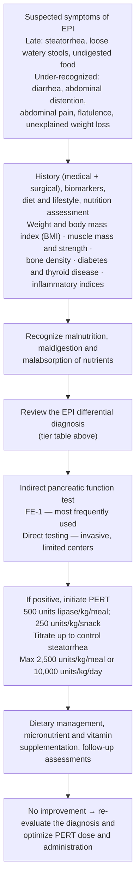

# Exocrine Pancreatic Insufficiency (EPI)

Failure of the pancreas to deliver a threshold level of digestive enzymes to the intestine → maldigestion of fat (and other macronutrients), fat-soluble vitamin deficiency, and protein-calorie malnutrition. Frequently underdiagnosed and undertreated ([[aga-2023-epi]]).

## Contents
- [[#Assessment]]
  - [[#Establishing the Diagnosis]]
  - [[#Severity Assessment]]
  - [[#Classification / Typing]]
- [[#Differential Diagnosis]]
- [[#Diagnostics]]
- [[#Therapeutics]]
- [[#See Also]]
- [[#Sources]]

## Assessment

### Establishing the Diagnosis

**Whom to test** — exocrine pancreatic insufficiency (EPI) is a clinical suspicion confirmed by a pancreatic function test; imaging cannot diagnose it.

- **Suspect (high-risk conditions, best practice advice [BPA] 1):** [[chronic-pancreatitis|chronic pancreatitis (CP)]], relapsing [[acute-pancreatitis|acute pancreatitis (AP)]], [[pancreatic-cancer|pancreatic ductal adenocarcinoma (PDAC)]], cystic fibrosis, previous pancreatic surgery.
- **Consider (moderate-risk conditions, BPA 2):** duodenal diseases — [[celiac-disease|celiac]] and [[crohns-disease|Crohn's disease]]; previous intestinal surgery; longstanding diabetes mellitus; hypersecretory states (e.g., [[peptic-ulcer-disease|Zollinger–Ellison syndrome]]).
- **Clinical features (BPA 3):** steatorrhea ± diarrhea, weight loss, [[abdominal-bloating-and-distention|bloating]], excessive flatulence, fat-soluble vitamin (A, D, E, K) deficiencies, protein-calorie malnutrition. In [[chronic-pancreatitis|CP]], symptoms build gradually and may be mild until late stage.

**Pre-test probability — how likely is EPI in each high-risk condition** (this is what decides whether a normal fecal elastase-1 (FE-1) is believable):

| Condition | Prevalence of EPI |
|---|---|
| [[chronic-pancreatitis\|CP]] overall | **>50%**; typically emerges after **5–10 y** of disease |
| CP with chronic alcohol use, smoking, ductal obstruction, atrophy, duct calcifications, or diabetes | **>80%** |
| [[acute-pancreatitis\|AP]] and [[recurrent-acute-pancreatitis\|relapsing AP]] (pooled, on follow-up) | **27%–62%** — similar for both |
| [[pancreatic-cancer\|PDAC]], unresectable | **50%–92%** |
| PDAC, resectable — before treatment / after treatment | **40%–50%** / **75%** |
| Cystic fibrosis | **85%**, presenting at birth or in infancy |

- Abstinence from smoking and alcohol **may delay onset** in CP.
- Ampullary cancer and main-duct [[pancreatic-cysts\|intraductal papillary mucinous neoplasm (IPMN)]] can also cause EPI by obstructing the pancreatic duct.
- [[autoimmune-pancreatitis|Autoimmune pancreatitis]] is often associated with EPI (no prevalence figure given).

> Diagnosis rests on **FE-1** — see [[#Severity Assessment]] for the bands and [[#Diagnostics]] for test performance. Response to an empiric pancreatic enzyme replacement therapy (PERT) trial is **unreliable** for diagnosis (BPA 7).
>
> **Exception — when to skip the test:** with a **high pre-test probability** (e.g. steatorrhea in a patient with known pancreatic disease), **PERT may be started without FE-1 testing**. With those conditions but **no symptoms**, measure FE-1 to confirm.

**Whether to test at all — the differential tier decides** ([[aga-2023-epi]]):

| Tier | Conditions | Action |
|---|---|---|
| **Expected and definite** | severe [[chronic-pancreatitis\|CP]], cystic fibrosis, pancreatic head malignancy, total pancreatectomy | **No further testing — initiate PERT** |
| **Possible** | mild-to-moderate CP, severe [[acute-pancreatitis\|AP]], pancreatic malignancy of body/tail, bariatric surgery | Test with FE-1 |
| **Less likely / overlapping** | [[celiac-disease\|celiac disease]], [[inflammatory-bowel-disease\|inflammatory bowel disease (IBD)]], diabetes mellitus | Test, and weigh the alternative diagnosis |

**Approach to suspected EPI — overall algorithm** ([[aga-2023-epi]]):

### Severity Assessment

**FE-1 bands — the test grades severity, not just presence** ([[aga-2023-epi]]):

| FE-1 (µg/g stool) | Interpretation |
|---|---|
| **<50** | **Severe EPI** — most reliable band for severe disease (stated as "some investigators suggest") |
| **<100** | **Good evidence of EPI** (BPA 4) |
| **100–200** | **Indeterminate** for EPI (BPA 4) |
| **<200** | Considered **abnormal**; <100 is "more consistent with EPI" |

- Under controlled conditions FE-1 **distinguishes normal, moderate, and severe EPI**.
- **Key limitation: FE-1 is insensitive to mild EPI** — a normal value does not exclude early disease in a high-risk patient.
- **Repeat an indeterminate result**, especially with known pancreatic disease and a high probability of EPI.
- *Unit:* the FE-1 thresholds in [[aga-2023-epi]] are in **µg/g**.

### Classification / Typing

| Type | Pathomechanism | Example conditions |
|------|----------------|--------------------|
| **Loss of pancreatic parenchyma** | ↓ enzyme synthesis/secretion, ↓ bicarbonate | [[chronic-pancreatitis\|CP]], [[pancreatic-cancer\|pancreatic cancer]], cystic fibrosis, pancreatic resection |
| **Ductal obstruction** | ↓ enzyme delivery | ampullary tumors, ductal stenosis, pancreatic cancer |
| **↓ endogenous stimulation** | reduced cholecystokinin (CCK)-mediated secretion; enteropathy | [[crohns-disease\|Crohn's]], [[celiac-disease\|celiac]], duodenal resection, [[gastroenteropancreatic-neuroendocrine-tumors\|somatostatinoma]] |
| **Intraluminal inactivation / asynchrony** | enzymes destroyed or mistimed vs. meal | hypersecretory states ([[peptic-ulcer-disease\|gastrinoma]]), dumping syndrome, gastric/short-gut surgery |

## Differential Diagnosis

*Workup: see [[chronic-diarrhea]] (fatty-diarrhea arm).*

Conditions that mimic EPI or blunt the response to enzyme therapy (consider when PERT fails):
- [[celiac-disease]]
- [[small-intestinal-bacterial-overgrowth|small intestinal bacterial overgrowth (SIBO)]]
- longstanding diabetes mellitus
- [[crohns-disease]]
- disaccharidase deficiencies
- [[bile-acid-diarrhea]]
- [[giardiasis]]

## Diagnostics

| Test | Role | Notes / thresholds |
|------|------|--------------------|
| **FE-1** | **Initial test of choice** | Must be on a **semi-solid or solid** stool. **<100 µg/g = good evidence of EPI**; **100–200 µg/g = indeterminate**. Valid **while on PERT** (assay measures chymotrypsin-like elastases 3A/3B; humans do not secrete elastase-1, so no cross-reaction with porcine enzymes). False-positive with watery/diarrheal stool (dilution). **Do not repeat FE-1 to judge treatment response — PERT does not change it and serial values are not informative.** |
| Fecal fat (quantitative) | Rarely needed | Must be done **on a high-fat diet** (BPA 6): known-fat diet **5 days**, stool collected over the **final 3 days**. **Steatorrhea = coefficient of fat absorption <93%** (>7% of ingested fat in stool). Burdensome; impractical for routine use. |
| Qualitative stool fat (Sudan stain) | Adjunct only | **Nonspecific for EPI.** Use when clinical features are inconclusive or to assess an inadequate response to PERT. |
| Serum pancreatic enzymes (e.g. trypsin) | Alternative indirect test | **Not affected by PERT**, but **unreliable during ongoing pancreatic inflammation**. |
| Cross-sectional imaging (computed tomography [CT]/[[mri-mrcp\|magnetic resonance imaging (MRI)]]/[[endoscopic-ultrasound\|endoscopic ultrasound (EUS)]]) | **Cannot diagnose EPI** | Used to diagnose underlying benign/malignant pancreatic disease. |
| Direct pancreatic function tests | Confirmatory (specialized) | Most accurate but invasive; mainly for early-stage CP. Not widely available in the US. |
| Breath tests | Promising | Not widely available in the US. |
| Fat-soluble vitamins (A, D, E, K) | Nutritional assessment | Establish deficiency and baseline. |

## Therapeutics

**PERT — required once EPI is diagnosed (BPA 10).** All commercially available products are porcine-derived and equipotent at similar lipase doses.

**Dosing**
- **Starting dose (BPA 12):** **≥40,000 United States Pharmacopeia (USP) units of lipase with each meal** in adults, **one-half that amount with snacks**; **40,000–50,000 units per meal** is described as a reasonable initial dosage. Adjust **up** for larger or higher-fat meals, **down** for smaller or low-fat meals.
- **Weight-based dose — 500 units lipase/kg/meal** and **250 units lipase/kg/snack** (≈40,000 and 20,000 units for an 80-kg patient). The approach figure gives this as the typical **adult** starting dose; the text gives the same figures for **children and adults with advanced [[chronic-pancreatitis|CP]], as in cystic fibrosis**. Titrate up as needed to reduce steatorrhea or gastrointestinal (GI) symptoms of maldigestion.
- **Maximum dose — 2,500 units lipase/kg/meal, or 10,000 units lipase/kg/day** (approach figure). For **cystic fibrosis** the text states the maximum as **<10,000 units lipase/kg/day, or <4,000 units per gram of dietary fat per day** — the same daily ceiling, with a fat-based limit added.
- Doses **>120,000 USP units of lipase per meal are seldom required.**
- *Why these numbers:* a normal pancreas makes ≈**900,000 USP units of lipase during an average meal**, and ≈**90,000 units (10% of normal)** are needed to prevent steatorrhea. Even at high doses PERT is less efficient than native secretion and does not correct steatorrhea entirely.

**Administration and choice of product**
- **Timing:** take **during** the meal (not before/after) to maximize mixing and digestion — PERT treats the meal, not the pancreas.
- **Acid suppression:** the non–enteric-coated preparation (Viokace) requires co-treatment with an acid-reducing agent — **histamine-2 (H2) receptor antagonist or [[proton-pump-inhibitors|proton pump inhibitor (PPI)]]** — to prevent acid denaturing of lipase. **Not required with enteric-coated preparations**, though many of those patients are on one anyway for other reasons, including to improve PERT efficacy.
- **Brand choice:** products are equipotent at similar lipase doses — **generally no reason to switch brands based on response**; switching is usually driven by the pharmaceutical benefit plan and out-of-pocket cost. **Do not use over-the-counter pancreatic enzyme products** — classified as dietary supplements only, with dosing and efficacy neither standardized nor regulated, so utility and safety are unknown.
- **Duration:** generally **lifelong**; dosage adjustment and even reduction can be considered in patients who are doing well and have acceptable nutritional parameters.
- **Adverse effects:** nausea, abdominal cramping, bloating, diarrhea, constipation. Rare — **fibrosing colonopathy**, allergic reaction to porcine proteins, hyperuricosuria. No nonporcine product is currently available.
- **Diet (BPA 13):** low-to-moderate fat with frequent smaller meals; **avoid very-low-fat diets** — they risk deficiencies of essential fatty acids and vitamins A, D, E, and K. Routine fat-soluble vitamin supplementation. Frequent small, high-protein meals; avoid alcohol and tobacco.
- Endoscopic or surgical pancreatic **ductal drainage is not effective in preventing or improving EPI** (useful for pain only).

**US Food and Drug Administration (FDA)-approved PERT formulations** ([[aga-2023-epi]]):

| Brand | Type | Available lipase strengths (USP units) |
|---|---|---|
| Creon | Enteric-coated microspheres | 3,000 / 6,00 / 12,000 / 24,000 / 36,000 |
| Zenpep | Enteric-coated beads | 3,000 / 5,000 / 10,000 / 15,000 / 20,000 / 25,000 / 40,000 |
| Pancreaze | Enteric-coated microtablets | 2,600 / 4,200 / 10,500 / 16,800 / 21,000 / 37,00 |
| Pertzye | Enteric-coated microspheres | 4,000 / 8,000 / 16,000 / 24,000 |
| Viokace | Non–enteric-coated tablets | 10,444 / 20,880 |
| Relizorb | In-line lipase cartridge | For enteral feeding formulas |

*Two strengths are printed as "6,00" (Creon) and "37,00" (Pancreaze) in the published table; confirm the strength on the product label before prescribing.*

**Monitoring**
- **Response markers (BPA 14):** ↓ steatorrhea and associated GI symptoms; gain of weight, muscle mass, and muscle function; improvement in fat-soluble vitamin levels. Also track stool frequency and visible steatorrhea.
- **Baseline (BPA 15):** BMI, a quality-of-life measure, fat-soluble vitamin levels, and a **dual-energy x-ray absorptiometry (DXA) scan — repeat every 1–2 years** (metabolic bone disease is common in CP). The update's figure and its closing bone-health summary instead say **every 2 years**.
- **Screen at diagnosis and annually:** vitamins **A, D, E, K, B12**, **folate, magnesium, selenium, zinc, iron**. In stable CP also measure **prealbumin and retinol-binding protein, thiamine**, and **hemoglobin A1c** (diabetes screening). Reassess pancreatic disease state and treatment effectiveness **at least annually**; baseline nutritional measures generally repeat annually.
- **Anthropometrics / muscle:** height, weight, **handgrip strength**, muscle mass (computed tomography or other techniques), BMI; other muscle assessments may be considered — psoas muscle size at L3, or a timed up-and-go test. Patients with EPI of any etiology may be obese and still sarcopenic.
- Osteopenia/osteoporosis on DXA → calcium and vitamin D intake, regular weight-bearing exercise, avoidance of alcohol and smoking. **Deficiencies of vitamins D and K are associated with osteopathy and fracture in CP, and treatment reduces bone fracture rates.**
- **Referrals:** certified dietitian at diagnosis for nutritional assessment; endocrinologist if prediabetes or diabetes.
- Untreated EPI → fat malabsorption, malnutrition, sarcopenia, osteoporosis/fracture, reduced quality of life, higher surgical complication and mortality rates.
- **Cost is a real barrier** — prescription PERT can be very expensive, especially at higher doses; without drug coverage it may be hard to obtain even with manufacturer patient-assistance programs.

> [!pitfall] Re-check dose and administration before calling PERT a failure
> No improvement on PERT → re-evaluate the diagnosis and optimize dosing and administration: confirm an adequate dose, taken correctly **during** meals, assess the need for an H2 receptor antagonist or PPI, and reconsider the overlapping diagnoses above ([[aga-2023-epi]]).

---

## See Also

[[chronic-pancreatitis]], [[acute-pancreatitis]], [[endoscopic-ultrasound]], [[mri-mrcp]], [[recurrent-acute-pancreatitis]], [[pancreatic-cancer]], [[pancreatic-cysts]], [[hereditary-pancreatitis]], [[autoimmune-pancreatitis]], [[celiac-disease]], [[crohns-disease]], [[inflammatory-bowel-disease]], [[peptic-ulcer-disease]], [[small-intestinal-bacterial-overgrowth]], [[chronic-diarrhea]], [[abdominal-bloating-and-distention]], [[bile-acid-diarrhea]], [[giardiasis]], [[gastroenteropancreatic-neuroendocrine-tumors]], [[proton-pump-inhibitors]]

---

## Sources

1. [[aga-2023-epi|AGA Clinical Practice Update on the Epidemiology, Evaluation, and Management of Exocrine Pancreatic Insufficiency (2023)]]
