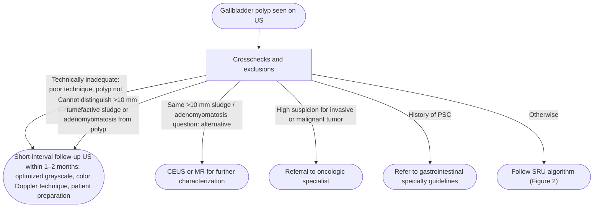

Common incidental finding on ultrasound (US): ~3%–6% of the general population ([[sru-2022-gallbladder-polyps]]); ~4%–7% of healthy subjects ([[asge-2013-biliary-neoplasia]]). Most are benign cholesterol polyps (cholesterol pseudopolyps) or inflammatory polyps ([[sru-2022-gallbladder-polyps]]). Management of incidental polyps follows the Society of Radiologists in Ultrasound (SRU) 2022 consensus; the older American Society for Gastrointestinal Endoscopy (ASGE) 2013 thresholds are shown beside it. SRU numbers none of its statements; the S1–S20 labels below refer to the statement table on [[sru-2022-gallbladder-polyps]].

## Contents
- [[#Assessment]]
  - [[#Establishing the Diagnosis]]
  - [[#Severity Assessment]]
  - [[#Classification / Typing]]
- [[#Differential Diagnosis]]
- [[#Diagnostics]]
  - [[#Applicability of the SRU Algorithm]]
  - [[#Ultrasound]]
  - [[#CEUS, CT and MRI]]
  - [[#Endoscopic Ultrasound]]
- [[#Therapeutics]]
  - [[#SRU Management by Risk Category and Size]]
  - [[#Follow-up Rules]]
  - [[#Surgery]]
  - [[#ASGE 2013 Recommendations (older)]]
  - [[#Polyps in PSC]]
- [[#See Also]]
- [[#Sources]]

## Assessment

### Establishing the Diagnosis

SRU definitions ([[sru-2022-gallbladder-polyps]], Definitions table):

| Term | Definition |
|---|---|
| **Gallbladder polyp** | Solid, **nonmobile, nonshadowing** protrusion from the gallbladder mucosa, not attributable to gallstones, inspissated bile (sludge), a mucosal fold, or diffuse or focal wall thickening; pedunculated or sessile |
| Pedunculated | Attached to the wall via a stalk or pedicle |
| Sessile | Flat or dome-shaped mass extending from the mucosal layer with no stalk; broad-based attachment |
| **Focal wall thickening adjacent to polyp** | Localized wall thickening **≥4 mm** thick adjacent to the polyp, not attributable to edema, adenomyomatosis, mucosal fold, or gallbladder underdistention |
| "Ball-on-the-wall" appearance | Pedunculated polyp, typically round or ovoid, barely attached to the wall — like a ball resting on a flat surface |
| Sludge | Inspissated bile precipitated out of solution; often echogenic, nonshadowing, **mobile**, layering dependently |
| Tumefactive sludge | Biliary precipitate coalesced into a more solid appearance ("sludge ball"); can mimic a mass or polyp |
| Adenomyomatosis | Diffuse, focal or segmental mural hyperplasia with comet-tail artifact (gray-scale) or twinkling artifact (color Doppler) from intramural cholesterol crystals; Rokitansky-Aschoff sinuses may appear as intramural cysts |
| Gallstone | Solid, **shadowing**, hyperechoic, nonvascular structure in the lumen; generally mobile |

- **Round polyp size to the nearest millimeter** (Figure 2 footnote a) ([[sru-2022-gallbladder-polyps]]).

### Severity Assessment

**SRU risk categories — by morphology alone** (Statements S2, S11, S14; Figure 2) ([[sru-2022-gallbladder-polyps]]):

| Risk category | Morphology |
|---|---|
| **Extremely low risk** | Pedunculated **"ball-on-the-wall"**; pedunculated with **thin stalk** |
| **Low risk** | Pedunculated with **thick or wide stalk**; **sessile** |
| **Indeterminate risk** | **Focal wall thickening ≥4 mm** adjacent to the polyp (not attributable to wall edema, mucosal fold(s), adenomyomatosis or gallbladder underdistention) |

- **Unsure between categories → choose low risk** (Figure 2 footnote e; S11: shape uncertain → low risk category may be used).
- **Ethnicity/geography:** if known, may raise the category **up to low risk** — North Indian, North/South American Indigenous, local incidence (S3; footnote d).
- **Do NOT change the category** ([[sru-2022-gallbladder-polyps]]):
  - Patient age (S5) · coexisting gallstones (S6) · smoking, diabetes mellitus, obesity, female sex (S7)
  - Polyp vascularity (S12) · echogenicity (S13) · number of polyps (S15)

**Size** — ASGE 2013: polyp size is "an important predictor" of gallbladder carcinoma ([[asge-2013-biliary-neoplasia]]); SRU: size may be associated with neoplasia risk (S8) ([[sru-2022-gallbladder-polyps]]). Size bands → [[#Therapeutics]].

**ASGE 2013 "other risk factors"** for gallbladder cancer in a polyp patient: **age ≥60 y, coexisting gallstones, sessile morphology** — with polyps ≥6 mm these patients *may* benefit from cholecystectomy, but ASGE calls the evidence insufficient to advocate it ([[asge-2013-biliary-neoplasia]]).
- ⚠ Contradiction: SRU 2022 (newer) says age and gallstones should **not** influence risk stratification; sessile shape → low risk only ([[sru-2022-gallbladder-polyps]]).

### Classification / Typing

- **Nonneoplastic:** cholesterol or inflammatory polyps ([[sru-2022-gallbladder-polyps]]).
- **Neoplastic:** intracholecystic papillary neoplasm (ICPN) or pyloric gland adenoma ([[sru-2022-gallbladder-polyps]]).
  - ICPN: mass-forming noninvasive epithelial neoplasm **≥10 mm** in the mucosa projecting into the lumen; low- or high-grade dysplasia.
  - Pyloric gland adenoma: may be associated with [[familial-adenomatous-polyposis]] or [[peutz-jeghers-syndrome|Peutz-Jeghers syndrome]].
  - ASGE: gallbladder adenoma = most common neoplastic polyp; can progress to adenocarcinoma ([[asge-2013-biliary-neoplasia]]).
- Only **6%** of [[gallbladder-cancer|gallbladder cancers]] arise from a polypoid precursor; mean size neoplastic **18–21 mm** vs nonneoplastic **4–7.5 mm** ([[sru-2022-gallbladder-polyps]]).

## Differential Diagnosis

Mimics excluded by the SRU polyp definition (see table above) ([[sru-2022-gallbladder-polyps]]):
- **Gallstone** — shadowing, generally mobile
- **Sludge** / **tumefactive sludge** ("sludge ball") — mobile; can mimic a mass or polyp
- **Adenomyomatosis** — comet-tail or twinkling artifact; Rokitansky-Aschoff sinuses
- Mucosal fold; diffuse or focal wall thickening
- **Invasive [[gallbladder-cancer|gallbladder cancer]]** — suggested by wall invasion, concurrent liver masses, malignant biliary obstruction, or pathologic lymph node enlargement at the porta hepatis or para-aortic chain (Figure 1 footnote)

## Diagnostics

### Applicability of the SRU Algorithm

Apply the crosschecks and exclusions of SRU Figure 1 before using the risk categories (S1) ([[sru-2022-gallbladder-polyps]]). Options include contrast-enhanced US (CEUS) or magnetic resonance (MR); patients with [[primary-sclerosing-cholangitis|primary sclerosing cholangitis (PSC)]] are excluded.

*Who the SRU gallbladder polyp algorithm applies to*
*Source: redrawn from Figure 1 of the SRU 2022 gallbladder polyp consensus*
*[[sru-2022-gallbladder-polyps|SRU 2022 Gallbladder Polyp Consensus]]*
*US = ultrasound · CEUS = contrast-enhanced ultrasound · MR = magnetic resonance · PSC = primary sclerosing cholangitis · SRU = Society of Radiologists in Ultrasound*

- Frank liver invasion and suspected malignant invasion → **SRU algorithm should not be used**; oncologic referral (Figure 8 caption) ([[sru-2022-gallbladder-polyps]]).

### Ultrasound

- Transabdominal US (TUS) detects polyps with sensitivity 90%, specificity 94%, but is **inaccurate for typing** them ([[asge-2013-biliary-neoplasia]]).
- Higher-sensitivity Doppler (power Doppler, B-Flow, microvascular Doppler) may help separate a polyp from tumefactive sludge (Figure 1 footnote) ([[sru-2022-gallbladder-polyps]]).
- Lesion **>10 mm** where tumefactive sludge vs mass, polyp or adenomyomatosis is hard to distinguish → **short-interval follow-up US within 1–2 months**, optimized technique and patient preparation (S16) ([[sru-2022-gallbladder-polyps]]).

### CEUS, CT and MRI

- Same >10-mm question: **alternatively CEUS**; CEUS not readily available → **magnetic resonance imaging (MRI)** may be considered (S16) ([[sru-2022-gallbladder-polyps]]).
- Computed tomography (CT) may help, but its **diagnostic accuracy is inferior to CEUS or MRI** for this purpose (S17) ([[sru-2022-gallbladder-polyps]]).
- ASGE: on CT, size ≥10 mm, sessile shape and visibility on unenhanced images are more common in neoplastic polyps, but CT is not accurate for benign vs malignant; on [[mri-mrcp|MRI]], sessile shape and diameter ≥10 mm favor neoplasia ([[asge-2013-biliary-neoplasia]]).

### Endoscopic Ultrasound

- **SRU 2022: [[endoscopic-ultrasound|endoscopic ultrasound (EUS)]] should not be part of the typical evaluation** of gallbladder polyps, because it is invasive (S18) ([[sru-2022-gallbladder-polyps]]).
- ASGE 2013 (older) ([[asge-2013-biliary-neoplasia]]):
  - EUS types the polyp better than TUS (97% vs 71% correct type assignment).
  - **Echogenic spots** — pathognomonic for a **cholesterol polyp**; **comet-tail artifact** — pathognomonic for **adenomyomatosis**. Neither feature → predicts adenoma or adenocarcinoma.
  - Three EUS variables predict a **neoplastic** polyp: (1) continuous maximum diameter **≥11 mm**, (2) **heterogeneous** internal echo pattern, (3) **absence** of hyperechoic spots.
  - Data conflict — one series found TUS *more* sensitive than EUS for gallbladder cancer (90% vs 86%) and superior to both CT and EUS for staging.
- ⚠ SRU cites the same 97% vs 71% study but concludes against routine EUS; SRU (newer) leads for incidental polyps ([[sru-2022-gallbladder-polyps]]).

## Therapeutics

### SRU Management by Risk Category and Size

SRU Figure 2 ([[sru-2022-gallbladder-polyps]]).

| Risk category | ≤6 mm | 7–9 mm | 10–14 mm | ≥15 mm |
|---|---|---|---|---|
| **Extremely low risk** | No follow-up | No follow-up | Follow-up US at **6, 12, 24 months** (surgical consult an acceptable alternative) | Surgical consult |
| **Low risk** | No follow-up | Follow-up US at **12 months** | Follow-up US at **6, 12, 24, 36 months** vs surgical consult | Surgical consult |
| **Indeterminate risk** | Follow-up US at **6, 12, 24, 36 months** vs surgical consult | Surgical consult | Surgical consult | Surgical consult |

*SRU risk category × polyp size → management*
*Source: redrawn from Figure 2 of the SRU 2022 gallbladder polyp consensus (as printed: extremely low ≤9 mm / 10–14 mm / ≥15 mm; low ≤6 / 7–9 / 10–14 / ≥15 mm; indeterminate ≤6 / ≥7 mm)*
*[[sru-2022-gallbladder-polyps|SRU 2022 Gallbladder Polyp Consensus]]*
*US = ultrasound*

- Risk categories: see [[#Severity Assessment]].
- **≥15 mm → surgical consultation** (S8). **10–14 mm** → surgical consultation may be decided by **patient factors or evidence of growth** at follow-up imaging (S8; footnote c: consult acceptable alternative for 10–14-mm extremely low risk) ([[sru-2022-gallbladder-polyps]]).

### Follow-up Rules

On every follow-up cell of Figure 2 (footnote b; S9, S10) ([[sru-2022-gallbladder-polyps]]):

| Finding on follow-up US | Action |
|---|---|
| **Increase ≥4 mm within 12 months** (rapid growth) | Surgical consult |
| Polyp **reaches the threshold size of its category** — **15 mm** extremely low/low risk; **7 mm** indeterminate risk (Figures 3–7 captions) | Surgical consult |
| **Decrease ≥4 mm** | Stop following |
| Growth **up to 3 mm** | May be part of the natural history of nonmalignant polyps |
| Surveillance length | **Maximum 3 years** — extended follow-up is not productive |

> [!pearl] Small growth is expected — stop by 3 years
> Growth up to 3 mm can be natural history; only ≥4 mm within 12 months is rapid growth. Surveillance beyond 3 years is not productive ([[sru-2022-gallbladder-polyps]]).

### Surgery

- Patient selection for surgery is **multifactorial**, requires **shared decision-making**, and accounts for patient health status as well as the imaging risk profile (S19) ([[sru-2022-gallbladder-polyps]]).
- Cholecystectomy morbidity **2%–8%**; bile duct injury **3–6 per 1000**; weigh surgical risk carefully in [[cirrhosis]] (e.g., polyps found on [[hcc-surveillance|hepatocellular carcinoma surveillance]] US) ([[sru-2022-gallbladder-polyps]]).

### ASGE 2013 Recommendations (older)

[[asge-2013-biliary-neoplasia]]; Grading of Recommendations Assessment, Development and Evaluation (GRADE) quality of evidence in parentheses:

| Scenario | Recommendation |
|---|---|
| Symptomatic gallbladder polyp | Recommend cholecystectomy (Moderate) |
| Asymptomatic polyp **>10 mm** | Suggest cholecystectomy (Low) |
| Asymptomatic polyp **6–10 mm, no other risk factors** for gallbladder cancer (see [[#Severity Assessment]]) | Suggest surveillance — TUS every 12 months (Low) |
| Any polyp, **any size**, in PSC | Recommend cholecystectomy (Moderate) |

- ASGE 2013 makes no recommendation for asymptomatic polyps <6 mm ([[asge-2013-biliary-neoplasia]]).

- ⚠ **Contradiction for incidental, non-PSC polyps** — SRU 2022 is newer and leads this page:
  - Surgery: ASGE **>10 mm → cholecystectomy**; SRU **surgical consult at ≥15 mm** (extremely low/low risk), **10–14 mm → US surveillance** or consult, **≥7 mm** only for indeterminate risk ([[sru-2022-gallbladder-polyps]]).
  - 6–10 mm: ASGE **TUS every 12 months**; SRU **no follow-up** up to 9 mm if extremely low risk, US **once at 12 months** for 7–9 mm low risk, surveillance **stops by 3 years** ([[sru-2022-gallbladder-polyps]]).
  - Symptomatic polyps are outside SRU's scope (incidental polyps) — ASGE stands.

### Polyps in PSC

- **SRU guidelines should not be applied to patients with PSC**; refer to specialty guidelines for management and surgical thresholds (S4) ([[sru-2022-gallbladder-polyps]]).
- ASGE 2013: any polyp in PSC → cholecystectomy (above) ([[asge-2013-biliary-neoplasia]]).
- PSC polyp management: see [[primary-sclerosing-cholangitis#Cancer Surveillance|PSC — cancer surveillance]].

> [!pitfall] Do not apply SRU size rules in PSC
> SRU excludes PSC — its thresholds and growth rule do not apply; use the PSC specialty guidelines ([[sru-2022-gallbladder-polyps]]).

---

## See Also

[[gallbladder-cancer]], [[primary-sclerosing-cholangitis]], [[acute-cholecystitis]], [[endoscopic-ultrasound]], [[mri-mrcp]], [[cirrhosis]], [[hcc-surveillance]], [[familial-adenomatous-polyposis]], [[peutz-jeghers-syndrome]]

---

## Sources

1. [[sru-2022-gallbladder-polyps|Management of Incidentally Detected Gallbladder Polyps: Society of Radiologists in Ultrasound Consensus Conference Recommendations (2022)]]
2. [[asge-2013-biliary-neoplasia|ASGE Guideline: The Role of Endoscopy in the Evaluation and Treatment of Patients With Biliary Neoplasia (2013)]]
