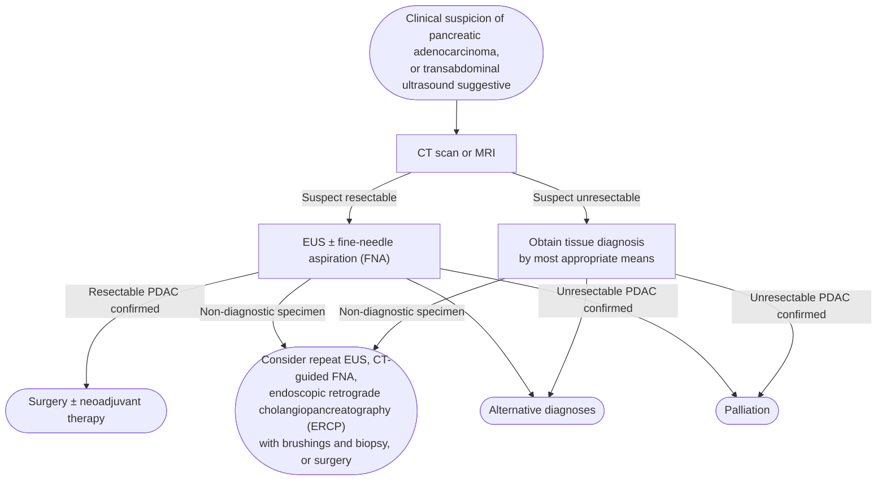

Pancreatic ductal adenocarcinoma (PDAC) is the dominant malignancy of the exocrine pancreas and the disease meant by "pancreatic cancer" in most clinical contexts. Biologically aggressive, usually diagnosed late; lifetime incidence ~1.6%, ~10% 5-year survival; ~3% of new US cancers and ~8% of cancer deaths in 2020 ([[asge-2022-pancreatic-cancer-screening]]). Stage at diagnosis dominates prognosis: 93% 10-year survival for stage 0 and 34%–39% 5-year survival for stage I, versus ~80% of patients presenting with advanced/inoperable disease.

## Contents
- [[#Assessment]]
  - [[#Establishing the Diagnosis]]
  - [[#Staging and Resectability]]
  - [[#Risk Stratification / Genetic Susceptibility]]
  - [[#High-Risk Surveillance]]
- [[#Differential Diagnosis]]
- [[#Diagnostics]]
  - [[#Diagnostic Algorithm]]
  - [[#Imaging]]
  - [[#EUS Tissue Acquisition]]
  - [[#Tumor Markers]]
- [[#Therapeutics]]
  - [[#Surgery and Systemic Therapy]]
  - [[#Endoscopic Palliation]]
  - [[#Harms of a Surveillance Program]]
- [[#See Also]]
- [[#Sources]]

## Assessment

### Establishing the Diagnosis

- **Presentation:** obstructive [[jaundice]], abdominal pain, anorexia, weight loss, acute pancreatitis, new-onset or poorly controlled diabetes, or steatorrhea; sometimes found incidentally on imaging ([[asge-2016-solid-pancreatic-neoplasia]]).
  - **Head lesions** → most present with obstructive jaundice; cholestatic liver tests (↑ bilirubin, ↑ alkaline phosphatase).
  - **Body/tail lesions** → normal liver biochemistry (no biliary obstruction); symptoms generally not until advanced disease, so less often resectable.
- **Screening yield** (high-risk individuals) is measured as detection of high-risk lesions, pancreatic cancer, high-grade dysplasia, or grade III pancreatic intraepithelial neoplasia ([[asge-2022-pancreatic-cancer-screening]]).
- **Sequence:** cross-sectional imaging (pancreas-protocol multidetector computed tomography [CT]; [[mri-mrcp|magnetic resonance imaging (MRI)]] selectively) first — detects, localizes, judges resectability — then [[endoscopic-ultrasound|endoscopic ultrasound (EUS)]] for staging and tissue when the patient is not going directly to surgery ([[asge-2016-solid-pancreatic-neoplasia]]).
- **Biopsy is individualized** by need for preoperative chemotherapy, resectability, and feasibility of surgery (American Society for Gastrointestinal Endoscopy [ASGE] 2016, ⊕⊕⊕⊕):
  - CT strongly suggests resectable carcinoma + operative candidate → direct referral for resection (e.g. pancreaticoduodenectomy) is reasonable.
  - Nonoperative tissue diagnosis is worth getting when a mimic is possible ([[autoimmune-pancreatitis|autoimmune pancreatitis]], lymphoma), for enrollment in a neoadjuvant chemotherapy protocol, or for preoperative counseling.

### Staging and Resectability

TNM staging of pancreatic adenocarcinoma (American Joint Committee on Cancer [AJCC] 7th ed., as reproduced in [[asge-2016-solid-pancreatic-neoplasia|ASGE 2016]] Table 3):

| | Criterion |
|---|---|
| **Tx** | Primary tumor cannot be assessed |
| **T0** | No evidence of primary tumor |
| **Tis** | Carcinoma in situ |
| **T1** | Limited to the pancreas, **≤2 cm** greatest dimension |
| **T2** | Limited to the pancreas, **>2 cm** greatest dimension |
| **T3** | Extends beyond the pancreas **without** involvement of the celiac axis or superior mesenteric artery (SMA) |
| **T4** | Involves the **celiac axis or the SMA** — *unresectable primary tumor* |
| **NX / N0 / N1** | Nodes not assessable / no regional nodal metastasis / regional nodal metastasis |
| **M0 / M1** | No distant metastasis / distant metastasis |

| Stage | T | N | M |
|---|---|---|---|
| 0 | Tis | N0 | M0 |
| IA | T1 | N0 | M0 |
| IB | T2 | N0 | M0 |
| IIA | T3 | N0 | M0 |
| IIB | T1–T3 | N1 | M0 |
| III | T4 | Any N | M0 |
| IV | Any T | Any N | M1 |

- **Unresectable primary in this system = celiac-axis or SMA involvement (T4).**
- **Borderline-resectable disease is not defined here.** ASGE 2016 assesses resectability on CT by tumor extension, liver metastases, and invasion of vascular structures, but gives no degree-of-vessel-contact thresholds separating resectable, borderline-resectable, and locally advanced disease.
- Table is the AJCC **7th** edition; ASGE 2016 does not give the 8th.

### Risk Stratification / Genetic Susceptibility

[[brca-pathogenic-variants|BRCA1/2]] germline pathogenic variants are present in up to 7% of all pancreatic cancer patients. **High risk** = lifetime risk **>5%** or relative risk (RR) **>5** (threshold adopted by [[asge-2022-pancreatic-cancer-screening|ASGE 2022]]). Genetic-susceptibility conditions ASGE 2022 addresses:

- **BRCA2** — pooled RR 5.1 → lifetime risk to age 80 ~5.2% (~7.4% by standardized incidence ratio).
- **BRCA1** — pooled RR 1.9 → lifetime risk ~3.5%–3.8%; does not clearly cross the 5% threshold, screening still suggested (start with caution, counsel on harms).
- **PALB2** pathogenic variant.
- **[[familial-pancreatic-cancer|Familial pancreatic cancer (FPC)]]** — kindred with ≥2 first-degree relatives with pancreatic cancer, no known hereditary cancer syndrome.
- **[[fammm-syndrome|Familial atypical multiple mole melanoma (FAMMM)]]** and **[[peutz-jeghers-syndrome|Peutz-Jeghers syndrome]]** — very high risk.
- **ATM** heterozygotes and **[[lynch-syndrome|Lynch syndrome]]** — only **with a first- or second-degree relative with pancreatic cancer**.
- **[[hereditary-pancreatitis|Autosomal-dominant hereditary pancreatitis]]**.

Per-syndrome relative risks ([[acg-2015-hereditary-gi-cancer|American College of Gastroenterology (ACG) 2015]]) are tabulated on [[pancreatic-cancer-screening]].

- **BRCA1/2 carriers qualify regardless of family history** — ~2 of 3 BRCA-associated cancers would be missed if screening required one (ASGE 2022).
- **Not screening indications on their own:** family history not meeting FPC criteria (~2-fold risk); diabetes, older age, smoking, [[obesity]], [[chronic-pancreatitis|chronic pancreatitis]] (lesser risk than the genetic conditions).

### High-Risk Surveillance

Who, how, how often, and per-condition starting ages: [[pancreatic-cancer-screening|high-risk pancreatic cancer surveillance]] (ASGE 2022). In brief — screening suggested for the conditions above (Rec 1); EUS, MRI, or EUS alternating with MRI (Rec 2); **annual** (Rec 4); start age by condition (Recs 5–6).

## Differential Diagnosis

*Workup: see [[jaundice]].*

Other solid pancreatic neoplasms ([[asge-2016-solid-pancreatic-neoplasia|ASGE 2016]] Table 2):

- **[[gastroenteropancreatic-neuroendocrine-tumors|Neuroendocrine tumor]]** — nonfunctioning tumors can mimic adenocarcinoma, but biliary obstruction is uncommon; on CT, enhances in the arterial phase (adenocarcinoma is typically hypointense after contrast).
- Acinar cell carcinoma, solid pseudopapillary tumor, metastasis.
- **Lymphoma or autoimmune pancreatitis** mimicking cancer — a correct pathologic diagnosis may spare surgery.
- Cystic neoplasms — see [[pancreatic-cysts|pancreatic cysts]].

## Diagnostics

### Diagnostic Algorithm

*Evaluation of suspected pancreatic adenocarcinoma*
*Source: redrawn from ASGE 2016 Figure 1*
*[[asge-2016-solid-pancreatic-neoplasia|ASGE 2016 Solid Pancreatic Neoplasia Guideline]]*
*CT = computed tomography · MRI = magnetic resonance imaging · EUS = endoscopic ultrasound · FNA = fine-needle aspiration · PDAC = pancreatic ductal adenocarcinoma · ERCP = endoscopic retrograde cholangiopancreatography*

### Imaging

ASGE 2016: imaging of a suspected solid pancreatic neoplasia should include **EUS and multidetector pancreas-protocol CT**, with MRI and positron emission tomography (PET)-CT selectively (⊕⊕⊕⊕); **EUS particularly when CT detection or resectability is equivocal** (⊕⊕⊕⊕).

- **CT** — most widely available for resectability and liver metastases; stages by tumor extension, liver metastases, and vascular invasion. **Insensitive for lesions <2 cm.**
- **MRI** — performed similarly to CT for resectability (one study superior for detection); better for small, non-contour-deforming tumors and small hepatic metastases. Choice of CT vs MRI depends on availability and local expertise.
- **EUS** — most sensitive test in expert hands, especially for lesions equivocal on CT or <2 cm; more sensitive than CT for detection (91%–100% vs 53%–91%, 9 studies), equivalent for locoregional staging.
- **Percutaneous (CT-guided) biopsy** — sensitivity up to 95%, but **needle-track seeding is reported** and peritoneal carcinomatosis was more common after percutaneous than EUS-guided sampling (16.3% vs 2.2%, *P* < .025).

### EUS Tissue Acquisition

[[asge-2024-solid-pancreatic-masses|ASGE 2024]] recommendations for EUS-guided tissue acquisition (EUS-TA) of a solid pancreatic mass:

| Rec | Recommendation | Strength / evidence |
|---|---|---|
| 1 | **Fine-needle biopsy (FNB) over FNA needles** | Strong / moderate |
| 2 | **22-gauge over 25-gauge** needles | Conditional / moderate |
| 3 | **Fork-tip or Franseen** FNB needles over alternative designs | Strong / moderate |
| 4 | **Against routine rapid on-site evaluation (ROSE)** | Conditional / low |

- **Changed since ASGE 2016**, which found FNB not shown superior to FNA (FNB only if FNA nondiagnostic and histology needed) and credited ROSE with 10%–15% higher yield; ASGE 2024 governs.
- **Technique (ASGE 2024 Table 1):** linear echoendoscope; color Doppler to avoid interposed vessels; fanning technique; suction with slow stylet withdrawal and/or a 5–20 mL syringe; keep the needle tip echoendoscopically visible; express tissue with an air flush (reinsert stylet if that fails).
- **Passes:** FNB → **2–4 passes**, sample directly into a **10% formalin** jar; FNA → **4–7 passes**, into **CytoLyt** (or use ROSE). Macroscopic on-site evaluation can guide pass number.
- **Switch to 25-gauge** if the 22-gauge needle cannot be advanced into the lesion, or when manipulability will be limited (e.g. excessive endoscope torquing).
- **When ROSE is still worth considering:** prior nondiagnostic EUS; lesion unclear or obscured by artifact (stent, pancreatitis); a preliminary diagnosis would drive an immediate decision (biliary stent selection, [[celiac-plexus-block|celiac plexus neurolysis (CPN)]], management of [[gastric-outlet-obstruction|gastric outlet obstruction]]).

### Tumor Markers

- **CA 19-9** — the only US Food and Drug Administration (FDA)-approved biomarker for routine PDAC management; used for **prognosis and disease burden (recurrence/progression)**, *not* early detection or diagnosis — elevated in most patients, but false positives and false negatives ([[asge-2016-solid-pancreatic-neoplasia]]).

## Therapeutics

### Surgery and Systemic Therapy

- **Confirmed resectable PDAC → surgery ± neoadjuvant therapy**; unresectable → palliation (ASGE 2016 Figure 1, flowchart above).
- **Stage at detection drives resectability:** 60% of screen-detected cancers were resectable/borderline-resectable vs ~20% of symptom-detected ([[asge-2022-pancreatic-cancer-screening]]).
- BRCA-deficient / homologous-recombination-deficient tumors respond to platinum-based chemotherapy and poly(ADP-ribose) polymerase (PARP) inhibitors (ASGE 2022).

### Endoscopic Palliation

**Biliary obstruction.** Symptomatic, unresectable PDAC with biliary and/or gastroduodenal obstruction → attempt endoscopic stent placement as the preferred palliation (ASGE 2016, ⊕⊕⊕◯). General drainage algorithm: [[biliary-stricture]]. Stent choice ([[asge-2024-solid-pancreatic-masses|ASGE 2024]]):

| Situation | Stent | Rec / strength |
|---|---|---|
| Distal malignant biliary obstruction, [[ercp\|ERCP]] planned | **Self-expandable metal stent (SEMS) over plastic** | Rec 5, conditional / low |
| SEMS being placed | **Covered over uncovered** | Rec 6a, conditional / low |
| Pancreatic mass with **unconfirmed** malignancy | **Against uncovered SEMS** | Rec 6b, strong / low |
| Simultaneous EUS-TA + high suspicion of malignancy | Consider covered SEMS | Table 1, ungraded |
| No simultaneous EUS-TA | Consider ERCP with tissue acquisition + plastic stent | Table 1, ungraded |
| **Pancreatic head** cancer with liver metastasis, or expected survival **<3 mo** | Consider plastic | Table 1, ungraded |
| Surgical resection planned **within 3 mo** | Consider plastic | Table 1, ungraded |

- Technique: native papilla → consider biliary sphincterotomy first; **10-mm** fully or partially covered SEMS; **shortest length that bridges the stricture by ≥10 mm and sits ≥2 cm below the hepatic hilum**; gallbladder intact → proximal end **below the cystic duct take-off** when possible.

> [!pitfall] No routine preoperative ERCP for resectable PDAC
> Obstructive jaundice from resectable PDAC without [[acute-cholangitis|cholangitis]] → no preoperative ERCP unless a substantial delay in resection of a symptomatic patient is expected (ASGE 2016, ⊕⊕⊕◯). Preoperative drainage raises post-pancreaticoduodenectomy adverse events; drain for cholangitis, severe pruritus, possible delay in resection, or when neoadjuvant chemotherapy and radiation are being considered ([[asge-2016-solid-pancreatic-neoplasia]]).

- **After preoperative drainage, bile culture guides surgical prophylaxis** ([[sis-2024-intra-abdominal-infection|Surgical Infection Society (SIS) 2024]]): hepatopancreatobiliary cancer surgery → prophylaxis **targeted to a positive preoperative bile culture** (Grade 1-A); pancreaticoduodenectomy with positive bile cultures after preoperative biliary drainage → prophylaxis **≥24 hours** to prevent organ-space surgical site infection (Grade 2-C).

**Gastroduodenal obstruction.** Roughly **15–20% of patients with pancreatic adenocarcinoma develop gastric outlet obstruction** ([[kastelijn-2023-enduro-protocol]]) — the pancreas was the site of the underlying cancer in 28 of 39 patients in the SUSTENT trial. **ASGE 2016 recommends endoscopic stent placement as the preferred palliation** for symptomatic, unresectable PDAC with gastroduodenal obstruction (⊕⊕⊕◯, no survival threshold). The SUSTENT randomized controlled trial (RCT; lower tier) instead keyed the choice to expected survival, because the options fail in opposite directions:

- **Expected survival <2 months** → **enteral (duodenal) stent** — faster relief (median 5 vs 8 days to soft solids), shorter stay, lower initial hospital cost.
- **Expected survival ≥2 months** → **surgical gastrojejunostomy** — more durable, with fewer recurrent obstructions, reinterventions, and late major complications. Survival and quality of life did not differ between arms ([[jeurnink-2010-sustent-goo]]).
- **Watch the biliary consequence:** a duodenal stent placed across the ampulla can foreclose later ERCP access to the bile duct — consider the common bile duct (CBD) stent up front.

The full outcome table, its statistical caveats, the Gastric Outlet Obstruction Scoring System (GOOSS) score, and EUS-guided gastroenterostomy (EUS-GE) technique live on [[gastric-outlet-obstruction]].

**Pain — CPN.** In unresectable pancreatic cancer with abdominal pain, ASGE 2024 suggests CPN as an **adjunct to** medical analgesic therapy (Rec 7, conditional/low):

- **When:** pain refractory to medical therapy, or opioid adverse effects not well tolerated.
- **How:** by EUS or percutaneously. If EUS — use a **22-gauge or larger FNA needle** (not the needle used for EUS-TA); central or bilateral injection of **10–20 mL of 99% alcohol**; give **1 L intravenous (IV) normal saline** periprocedurally; monitor **~2 hours** post-procedure with vital signs and orthostatic parameters.

**Other.** **EUS-guided fiducial placement** when image-guided radiotherapy is planned ([[asge-2016-solid-pancreatic-neoplasia]]).

### Harms of a Surveillance Program

Weigh before enrolling a high-risk individual: across screened cohorts, low-yield pancreatic surgery occurred in **2.8% overall but 46.6% of those operated**, with a **~19.9% perioperative adverse-event rate** among operated patients ([[asge-2022-pancreatic-cancer-screening]]). Counsel on benefits and harms before enrollment.

## See Also

[[pancreatic-cancer-screening]], [[endoscopic-ultrasound]], [[ercp]], [[mri-mrcp]], [[jaundice]], [[biliary-stricture]], [[pancreatic-cysts]], [[chronic-pancreatitis]], [[autoimmune-pancreatitis]], [[exocrine-pancreatic-insufficiency]], [[cholangiocarcinoma]], [[gastroenteropancreatic-neuroendocrine-tumors]], [[brca-pathogenic-variants]], [[familial-pancreatic-cancer]], [[fammm-syndrome]], [[peutz-jeghers-syndrome]], [[lynch-syndrome]], [[hereditary-pancreatitis]], [[obesity]], [[gastric-outlet-obstruction]], [[acute-cholangitis]], [[celiac-plexus-block]]

---

## Sources

1. [[asge-2022-pancreatic-cancer-screening|ASGE Guideline on Screening for Pancreatic Cancer in Individuals with Genetic Susceptibility: Summary and Recommendations (2022)]]
2. [[asge-2024-solid-pancreatic-masses|ASGE Guideline: Role of Endoscopy in Solid Pancreatic Masses (2024)]]
3. [[asge-2016-solid-pancreatic-neoplasia|ASGE Guideline: The Role of Endoscopy in the Evaluation and Management of Patients With Solid Pancreatic Neoplasia (2016)]]
4. [[acg-2018-pancreatic-cysts|ACG 2018: Diagnosis and Management of Pancreatic Cysts]]
5. [[acg-2015-hereditary-gi-cancer|ACG 2015: Genetic Testing and Management of Hereditary Gastrointestinal Cancer Syndromes]]
6. [[jeurnink-2010-sustent-goo|Surgical gastrojejunostomy or endoscopic stent placement for the palliation of malignant gastric outlet obstruction (SUSTENT study): a multicenter randomized trial]]
7. [[kastelijn-2023-enduro-protocol|Endoscopic ultrasonography-guided gastroenterostomy versus surgical gastrojejunostomy for palliation of malignant gastric outlet obstruction (ENDURO): study protocol for a randomized controlled trial]]
8. [[sis-2024-intra-abdominal-infection|The Surgical Infection Society Guidelines on the Management of Intra-Abdominal Infection: 2024 Update]]
