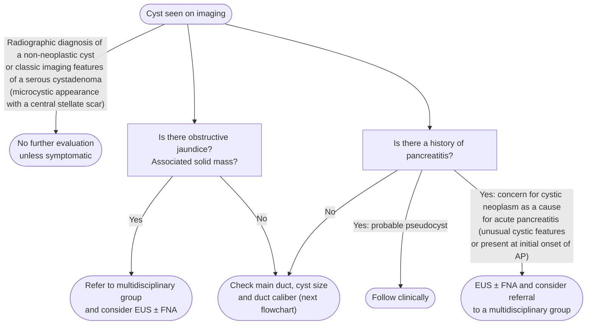
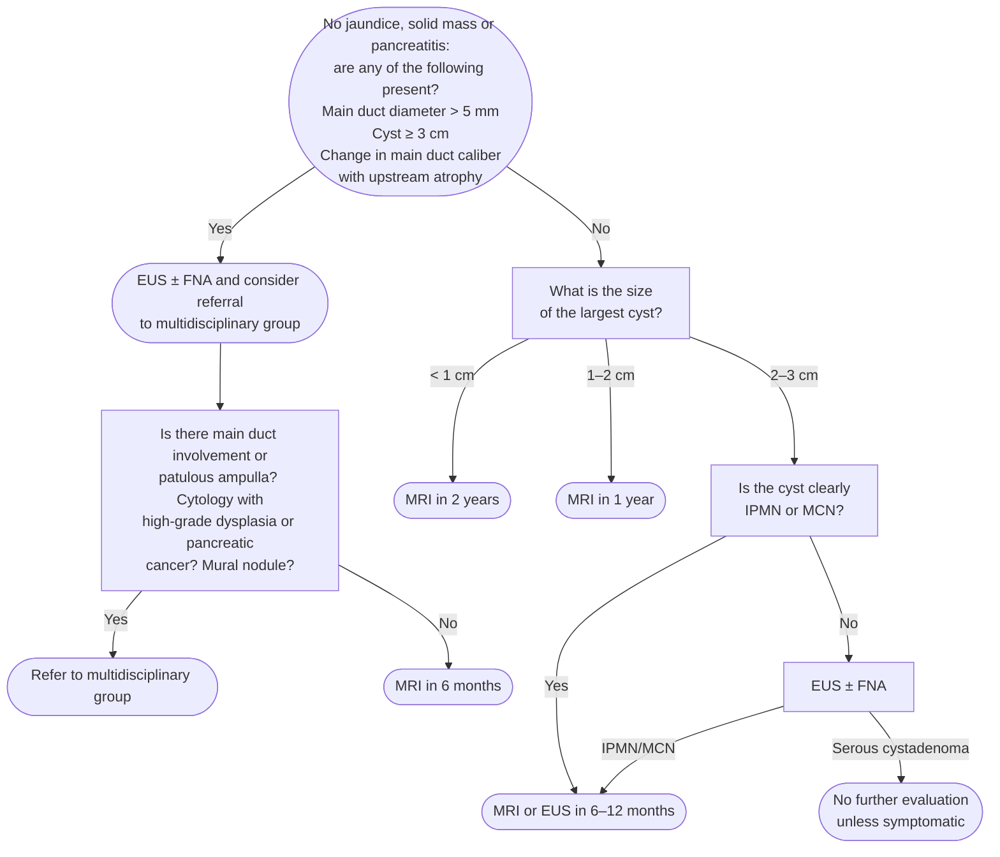

Pancreatic cysts are a heterogeneous group of lesions, most detected incidentally on cross-sectional imaging. They range from non-neoplastic (pseudocysts) to mucinous neoplasms with malignant potential (intraductal papillary mucinous neoplasms [IPMNs], mucinous cystic neoplasms [MCNs]) to benign neoplasms (serous cystadenomas [SCAs]) to solid-cystic tumors with generally favorable prognosis (solid pseudopapillary neoplasms [SPNs]). Management hinges on accurate cyst typing and risk stratification. [[acg-2018-pancreatic-cysts]]

## Contents
- [[#Assessment]]
  - [[#Establishing the Diagnosis]]
  - [[#Classification / Typing]]
  - [[#Severity Assessment]]
- [[#Differential Diagnosis]]
- [[#Diagnostics]]
  - [[#Imaging]]
  - [[#EUS-FNA and Cyst Fluid Analysis (Rec 6 — Conditional/VLow)]]
  - [[#Cyst Ablation]]
- [[#Therapeutics]]
  - [[#Who Does Not Need Further Evaluation or Surveillance (Recs 4 & 5)]]
  - [[#Surveillance Program — Who, What, How Often (Recs 9, 13, 14)]]
  - [[#When to Refer to Multidisciplinary Group and Consider Surgery (Rec 11 — Strong/VLow)]]
  - [[#When to Stop Surveillance (Recs 15 & 16)]]
  - [[#Where AGA 2015 Differs — and Why This Page Follows ACG]]
  - [[#Post-Surgical Surveillance (Recs 17–20)]]
- [[#See Also]]
- [[#Sources]]

---

## Assessment

### Establishing the Diagnosis

**Epidemiology:**

- Prevalence on screening magnetic resonance imaging (MRI): 2.4–13.5% in asymptomatic populations; 40% in patients >70 years old
- Prevalence of cysts >2 cm: only 0.8% (n=25,195 subjects, five studies)
- Majority are incidentally found side-branch IPMNs
- Estimated malignancy probability at time of imaging: 0.25% (Surveillance, Epidemiology, and End Results [SEER] database); conversion rate to invasive cancer: 0.24% per year

*Approach to a patient with a pancreatic cyst: first branch points*
*Source: redrawn from the ACG 2018 pancreatic cyst approach algorithm, with its footnotes*
*[[acg-2018-pancreatic-cysts|ACG 2018 Pancreatic Cysts Guideline]]*
*EUS = endoscopic ultrasound · FNA = fine-needle aspiration · AP = acute pancreatitis*

Occasionally benign lesions can have a solid appearance; where the diagnosis is unclear, EUS ± FNA should be performed ([[acg-2018-pancreatic-cysts]]).

*Approach to a pancreatic cyst without jaundice, solid mass or pancreatitis*
*Source: redrawn from the ACG 2018 pancreatic cyst approach algorithm*
*[[acg-2018-pancreatic-cysts|ACG 2018 Pancreatic Cysts Guideline]]*
*EUS = endoscopic ultrasound · FNA = fine-needle aspiration · MRI = magnetic resonance imaging · IPMN = intraductal papillary mucinous neoplasm · MCN = mucinous cystic neoplasm*

**Initial questions:**

1. Is the patient medically fit for surgery? (If not — Rec 4: no further evaluation regardless of size; Strong/Low)
2. Does imaging suggest a clearly benign, non-neoplastic cyst (pseudocyst in setting of pancreatitis, classic SCA with microcystic/honeycomb pattern and central scar)?
3. Are there any high-risk features (see Table 3 below)?
4. What is the cyst size?

**Imaging:** MRI/[[mri-mrcp|magnetic resonance cholangiopancreatography (MRCP)]] is first-line, with [[endoscopic-ultrasound|EUS]] ± FNA reserved for unclear diagnoses and high-risk features — modality-by-modality performance and the accuracy caveat live under [[#Imaging]].

### Classification / Typing

#### Non-Neoplastic Cysts

**Pseudocyst**

- Associated with history of [[acute-pancreatitis]] or [[chronic-pancreatitis]]
- Aspirate: brown fluid, high amylase/lipase, low carcinoembryonic antigen (CEA)
- No malignant potential; no surveillance required when asymptomatic
- Symptomatic pseudocysts → endoscopic drainage preferred over surgery
- Caveat: a cystic neoplasm can cause pancreatitis in up to 20% of individuals over age 40; if diagnosis is uncertain, EUS-FNA is helpful to rule out neoplastic cyst as cause of pancreatitis

#### Neoplastic Cysts — Mucinous (Malignant Potential)

**IPMN** — *full page: [[intraductal-papillary-mucinous-neoplasm]]* (risk criteria, surveillance intervals, resection and post-resection follow-up)

- Most common pancreatic cyst overall; most common incidental cyst
- Men = Women; 7th decade peak
- Three subtypes by duct involvement — **side-branch** (most common; low but real malignancy risk), **main duct** (less common, higher risk; patulous "fish-mouth" ampulla in ~50%), and **mixed** (risk similar to main duct)
  - Side-branch cumulative incidence of cancer: 0.02% at 1 yr, 3.12% at 5 yr, 7.77% at 10 yr (low-risk); up to 24.68% at 10 yr (high-risk) — meta-analysis of 3,236 patients
- Aspirate: high CEA, high amylase
- Also at risk for **"concomitant"** [[pancreatic-cancer|pancreatic cancer]] arising separately from the cyst — evaluate the entire parenchyma on imaging

**MCN**

- Almost exclusively women (>95%); 5th–7th decade
- Typically body/tail; unilocular ± septations or wall calcification
- No communication with main pancreatic duct (key distinguishing feature from IPMN)
- Columnar epithelium with surrounding ovarian-type stroma (pathognomonic)
- Malignancy risk lower than previously thought: only 10% of 90 resected MCNs contained high-grade dysplasia or cancer; no cases of high-grade dysplasia or cancer in MCNs <3 cm with normal CA 19-9
- Aspirate: high CEA, variable amylase

#### Neoplastic Cysts — Non-Mucinous

**SCA**

- 75% women; 6th decade
- Classic imaging: microcystic/honeycomb appearance with central stellate scar (present in <30%)
- Risk of serous cystadenocarcinoma: extremely low at 0.1% (multicenter study of over 2,500 SCAs)
- Aspirate: low CEA, low amylase/lipase
- Asymptomatic with classic imaging → no further evaluation, no surveillance (Conditional/Low)
- Macrocystic SCAs may mimic IPMN or MCN → EUS-FNA to confirm

**SPN**

- Rare; 10:1 women:men; most common in women in 20s (wide age range)
- Any part of pancreas; smaller lesions are more solid, larger have cystic degeneration
- 5-year disease-specific survival >98%; aggressive behavior: vascular involvement 4.6%, lymph node (LN) 1.6%, distant mets 7.7%
- All SPNs: refer to multidisciplinary group for surgical resection (Strong/Low)
- Post-resection: follow yearly for at least 5 years (Conditional/VLow)

**Cystic Pancreatic [[gastroenteropancreatic-neuroendocrine-tumors|Neuroendocrine Tumor]] (Cystic PNET)**

- Men = Women; peak 5th–6th decade
- Sporadic or in multiple endocrine neoplasia type 1 (MEN I)
- Usually non-functioning; may be solid, cystic, or mixed
- EUS-FNA often required for diagnosis
- Aspirate: low CEA, low amylase/lipase; cytology shows neuroendocrine features

### Severity Assessment

**High-Risk Features (Table 3) — Warrant EUS±FNA and/or Multidisciplinary Referral (Rec 11 — Strong/VLow):**

*Symptoms/signs:*

- [[jaundice|Jaundice]] secondary to the cyst
- [[acute-pancreatitis|Acute pancreatitis]] secondary to the cyst
- Significantly elevated serum CA 19-9 (no benign cause found)
  - CA 19-9 >37 U/mL: pooled sensitivity 40%, specificity 89%, odds ratio (OR) 4.34 for high-grade dysplasia/cancer

*Imaging findings:*

- Mural nodule or solid component within the cyst or pancreatic parenchyma
  - OR for malignancy: 9.3 (95% confidence interval [CI] 5.3–16.1) — meta-analysis >1,400 patients
- Main pancreatic duct (MPD) diameter >5 mm
  - MPD >6 mm: OR 7.27 (95% CI 3.0–17.4) for high-grade dysplasia/cancer
- Focal change in MPD caliber with upstream atrophy — equivalently, *focal dilation of the pancreatic duct concerning for main-duct IPMN, or an obstructing lesion* (Rec 11b wording)
- Size **≥3 cm** (Rec 11b: "mucin-producing cysts measuring ≥3 cm in diameter"; Table 3 prints ">3 cm" — the source is internally inconsistent by 1 mm)
- Increase in cyst size **>3 mm/year** (Table 3)

*Cytology:*

- High-grade dysplasia or pancreatic cancer

**Which of these actually triggers referral — the two lists are not the same:** Table 3's "high-risk features" and **Rec 11**'s referral triggers differ in one place. **Rec 11 does *not* include growth rate.** A cyst growing >3 mm/year without any other feature is a **Rec 10** trigger (short-interval imaging), *not* a Rec 11 trigger (EUS±FNA / multidisciplinary referral).

**Intermediate Concern (Rec 10 — Conditional/VLow) — Warrant Short-Interval Surveillance (MRI or EUS±FNA at 6 months):**

- New-onset or worsening diabetes mellitus (DM; ~1% of adults >50 with new-onset DM will develop pancreatic cancer within 3 years; ~2/3 of patients with pancreatic cancer have DM)
- Rapid increase in cyst size **>3 mm/year** (Rec 10 and Table 3 both print `>`; **the surveillance algorithm's footnote and the discussion print `≥3 mm/year`** — the surveillance table below follows the algorithm)

---

## Differential Diagnosis

*No diagnostic schema covers the incidentally found pancreatic cyst — the workup algorithm for this page is the pair of flowcharts under [[#Establishing the Diagnosis]] above.*

| Cyst Type | Key Distinguishing Feature | Cancer Risk |
|---|---|---|
| Pseudocyst | History of pancreatitis; brown aspirate, high amylase, low CEA | None |
| Serous cystadenoma | Microcystic/honeycomb + central scar; low CEA, low amylase | ~0.1% |
| Side-branch IPMN | MPD communication; high CEA + amylase | Low (3% at 5 yr) to high (25% at 10 yr) |
| Main duct IPMN | Dilated MPD; patulous orifice | High (38–68% in resected specimens) |
| MCN | Women; body/tail; no MPD communication; high CEA | ~10% overall; near zero if <3 cm + normal CA 19-9 |
| SPN | Young women; solid-cystic mixed | Low (surgery curative in >98%) |
| Cystic PNET | Low CEA; neuroendocrine cytology | Variable by grade |

Other cysts to consider: simple cysts with true epithelial lining, lymphoepithelial cysts, mucinous non-neoplastic cysts — no malignancy risk; pancreatic ductal adenocarcinoma and acinar cell carcinoma with cystic degeneration — mimic pancreatic cysts on imaging.

---

## Diagnostics

### Imaging

**MRI/MRCP (preferred):**

- First-line for diagnosis and surveillance
- Superior for assessing MPD communication (critical for IPMN vs. MCN distinction)
- Better mural nodule detection vs. computed tomography (CT)
- Avoids radiation — preferred for long-term surveillance
- Accuracy for cyst type: 40–50%; benign vs. malignant: 55–76%

**CT (pancreatic protocol):**

- Excellent alternative when MRI unavailable/contraindicated
- Good for calcifications, vascular involvement
- Accuracy for benign vs. malignant: 71–80%
- Accuracy for IPMN communication with MPD: 80% sensitivity by CT

**EUS (with or without FNA):**

- Not first-line for small, clearly benign cysts
- Preferred when: (1) diagnosis unclear, (2) high-risk features present, (3) FNA/fluid analysis needed to alter management
- Higher sensitivity for mural nodule detection than MRI
- Contrast-enhanced EUS can differentiate true mural nodule from mucin (ill-defined borders vs. smooth hyperechoic rim with hypoechoic center); not FDA-approved for this indication
- Adding EUS to CT or MRI increases overall diagnostic accuracy for cystic neoplasms by 36% and 54%, respectively
- See [[endoscopic-ultrasound]]

### EUS-FNA and Cyst Fluid Analysis (Rec 6 — Conditional/VLow)

Indicated when diagnosis is unclear and results are likely to alter management. Not needed for classic pseudocyst or SCA.

**Cyst fluid CEA:**

- Best marker for identifying mucinous cysts (IPMNs/MCNs)
- Sensitivity 63% (95% CI 59–67), specificity 93% (95% CI 90–95%) for IPMN/MCN — standard cutoff 192 ng/mL
- Very high (>800 ng/mL) or very low (<5 ng/mL) levels increase specificity to >95%
- Cannot distinguish high-grade dysplasia or cancer from low-grade

**Cyst fluid amylase:**

- Low (<250 IU/L) excludes pseudocyst in 98% of cases
- Not helpful for malignancy risk

**Cyst fluid cytology (Rec 7 — Conditional/VLow):**

- Send when imaging features alone are insufficient to warrant surgery
- Sensitivity 64.8% (95% CI 0.44–0.82) — limited by low cellularity (only 34% of samples adequate)
- Specificity 90.6% (95% CI 0.81–0.96) for pancreatic cancer — excellent
- Pooled sensitivity 65% and specificity 66% for identifying high-grade dysplasia or cancer in IPMNs/MCNs specifically

**Molecular markers (Rec 8 — Conditional/VLow):**

- **KRAS *and/or* GNAS mutation** (a single combined test characteristic in the source, not two separate markers): **sensitivity 84%–96%, specificity 80%–100%** for identifying an IPMN or MCN, using highly sensitive techniques.
- Integrating molecular testing with the cyst's clinical features raises both sensitivity and specificity further.
- **Limits:** costly, and **has not helped determine cancer risk** — molecular testing identifies cyst *type*, not grade. Use when diagnosis is unclear and the result would change management; not routine standard of care.

**Antibiotics for EUS-FNA of pancreatic cysts:**

- Guidelines ([[asge-2015-antibiotic-prophylaxis|American Society for Gastrointestinal Endoscopy (ASGE) 2015]]) *suggest* peri-procedural antibiotics (often continued 3–5 days) — see [[antibiotic-prophylaxis-endoscopy]].
- However, the first randomized controlled trial (RCT) ([[colan-hernandez-2020-eus-fna-panc-cyst-antibiotics|Colán-Hernández 2020]], 226 pts, ciprofloxacin vs placebo) found infection risk **low (0.44%)** and **not increased without prophylaxis** (only infection was in the placebo arm; non-inferior). No difference in fever or adverse events. → antibiotics **not routinely required**.
- Consider prophylaxis anyway in: immunosuppressed patients, multiple comorbidities, incomplete cyst aspiration, [[ascites]]; RCT excluded mediastinal/enteric **duplication cysts** (higher infection risk — still cover these).

### Cyst Ablation

- Ethanol alone or combined with paclitaxel: cyst resolution in 33–79% of cases; adverse events ~12% (fever, abdominal pain, pancreatitis, peritonitis, splenic/[[portal-vein-thrombosis|portal vein thrombosis]])
- Does not eliminate cancer risk (one case of cancer following ethanol ablation)
- IPMN patients remain at risk for concomitant cancer elsewhere in the parenchyma
- **Insufficient evidence for routine use** — should ideally be offered only in clinical trials
- May be considered in patients who refuse surgery or are not surgical candidates

---

## Therapeutics

### Who Does Not Need Further Evaluation or Surveillance (Recs 4 & 5)

- Medically unfit for surgery: **no further evaluation** regardless of size (Strong/Low)
- Asymptomatic pseudocyst (confirmed by imaging + clinical context): no treatment or surveillance (Conditional/Low)
- Classic SCA with microcystic/honeycomb appearance + central scar: no surveillance (Conditional/Low)
  - If macrocystic SCA (mimics IPMN/MCN): EUS-FNA to confirm, then no surveillance if confirmed

### Surveillance Program — Who, What, How Often (Recs 9, 13, 14)

**Candidates:** Surgically fit patients with asymptomatic presumed IPMNs or MCNs (Conditional/VLow)

**Preferred modality:** MRCP (Conditional/VLow); EUS for patients who cannot/prefer not to have MRI

⚠ **For IPMN specifically, the newer [[iap-2024-kyoto-ipmn|IAP 2024 Kyoto guideline]] sets different intervals and governs** (same tier, newer publication date): three size bands of **<20 mm · ≥20 and <30 mm · ≥30 mm**, with 6-month then 18-month, 6-month ×2 then 12-month, and 6-monthly imaging respectively — and it permits **stopping** for a stable cyst <20 mm with no worrisome features after 5 years, which ACG 2018 declines to endorse (Rec 16 below). The ACG table here remains the protocol for **MCN and the other cyst types**. Full IPMN protocol: [[intraductal-papillary-mucinous-neoplasm]].

**Surveillance intervals by largest cyst size — in absence of high-risk features:**

| Largest Cyst Size | Initial Surveillance Interval | If Stable Size and Appearance | If Growth ≥3 mm/year |
|---|---|---|---|
| <1 cm | MRI q2 years × 4 years | Consider lengthening of interval imaging | Consider shorter interval with MRI or EUS±FNA within 6 months; if stable → MRI in 1 year, then return to original surveillance based on cyst size |
| 1–2 cm | MRI q1 year × 3 years | MRI q2 years × 4 years; if stable, consider lengthening of interval | Consider shorter interval with MRI or EUS±FNA within 6 months; if stable → MRI in 1 year, then return to original surveillance based on cyst size |
| 2–3 cm | MRI or EUS q6–12 months × 3 years | MRI q1 year × 4 years; if stable, consider lengthening of interval | Refer to multidisciplinary group and consider EUS±FNA |
| >3 cm | Consider referral to multidisciplinary group, and MRI alternating with EUS q6 months × 3 years | MRI alternating with EUS q year × 4 years; if stable, consider lengthening of interval | Refer to multidisciplinary group and consider EUS±FNA |

*Surveillance of presumed IPMN or MCN by largest cyst size*
*Source: table from the ACG 2018 pancreatic cyst surveillance algorithm*
*[[acg-2018-pancreatic-cysts|ACG 2018 Pancreatic Cysts Guideline]]*
*MRI = magnetic resonance imaging · EUS = endoscopic ultrasound · FNA = fine-needle aspiration · IPMN = intraductal papillary mucinous neoplasm · MCN = mucinous cystic neoplasm*

*Note: Use the same imaging modality consistently to minimize measurement variability (kappa for MRI size agreement among radiologists only 0.59; median size difference CT vs. MRI: 1.5 mm)*

**New-onset DM during surveillance:** Short-interval MRI or EUS at 6 months (Conditional/VLow)

### When to Refer to Multidisciplinary Group and Consider Surgery (Rec 11 — Strong/VLow)

Triggered by **any** Rec 11 feature — symptom/sign (a), imaging (b), or cytology (c). The full list with its supporting odds ratios is under [[#Severity Assessment]]; do not re-derive it here. **Growth rate alone is not on the Rec 11 list** — see the note there.

Note: Surgery should be performed at a tertiary referral center by experienced surgeons performing large numbers of pancreatic operations. Mortality for pancreaticoduodenectomy is ~11–15% at low-volume centers vs. ~1–5% at high-volume centers.

### When to Stop Surveillance (Recs 15 & 16)

- **Stop when patient is no longer a surgical candidate** (Strong/VLow)
- **Age >75:** Reasonable to reassess utility of ongoing surveillance (Conditional/VLow)
- **Age 76–85:** Individualized approach; informed discussion about surgery, personal morbidity/mortality, and risk of cyst progression
- Currently insufficient evidence to recommend stopping surveillance after 5 years in still-surgically-fit patients — ⚠ **superseded for IPMN** by [[iap-2024-kyoto-ipmn|IAP 2024]], which makes stopping an acceptable option for a stable cyst <20 mm after 5 years, and also stops surveillance for a life expectancy <10 years ([[intraductal-papillary-mucinous-neoplasm]])

### Where AGA 2015 Differs — and Why This Page Follows ACG

[[aga-2015-asymptomatic-neoplastic-pancreatic-cysts|American Gastroenterological Association (AGA) 2015]] is the other major US guideline on this problem and it reaches materially different thresholds. **[[acg-2018-pancreatic-cysts|American College of Gastroenterology (ACG) 2018]] is newer in the same tier and is what this page follows**; AGA is recorded here because a patient managed under it will have been surveilled differently, and because the divergence is the clinical controversy, not a technicality.

| Decision | [[acg-2018-pancreatic-cysts\|ACG 2018]] — this page | [[aga-2015-asymptomatic-neoplastic-pancreatic-cysts\|AGA 2015]] |
|---|---|---|
| Trigger for [[endoscopic-ultrasound\|EUS]]-FNA | **Any one** high-risk feature (Rec 11) | **At least 2** of: size ≥3 cm, dilated MPD, solid component (Rec 3, Cond/VLow) |
| Surveillance interval | Size-stratified, q2 years (<1 cm) → q6 months alternating MRI/EUS (>3 cm) | **1 year, then q2 years — for a cyst of any size** (Rec 2, Cond/VLow) |
| Stopping | Stop when no longer a surgical candidate; reassess at >75 | **Stop at 5 years** if no change in size or characteristics (Rec 6, Cond/VLow) |
| Post-resection, no high-grade dysplasia (HGD)/cancer | All resected IPMN need surveillance (Recs 17–20) | **Against** routine surveillance (Rec 10, Cond/VLow) — but only if no mixed-duct IPMN and no strong family history |
| Surgery threshold | Multidisciplinary referral on any Rec 11 feature | Solid component **and** dilated MPD, and/or concerning EUS-FNA (Rec 7, Cond/VLow) |
| High-volume centre for surgery | Yes — mortality ~1–5% vs ~11–15% | Yes — the **only Strong** recommendation in the AGA document (Rec 8) |

**Effect sizes behind the three AGA high-risk features**, from its technical review of *unselected* cysts:

- Size **≥3 cm** — ~**3×** malignancy risk
- **Solid component** — ~**8×** malignancy risk
- **Dilated main pancreatic duct** — **no statistically significant association** in AGA's own review; retained as a risk factor only on the strength of resected-IPMN series. Weight it accordingly.

**Read every AGA 2015 number as soft.** All ten recommendations rest on **very low quality** evidence, the panel states the 1-then-2-year interval "is not based on any evidence," and it concedes "it is unclear that the benefits of surveillance outweigh the risks for most patients." AGA also puts a number on the trade-off this page's surveillance program is buying: malignant transformation ~**0.24%/year**, against **2%** postoperative mortality and **30%** major morbidity (**6.6%** postoperative mortality in SEER, i.e. across all US centres), and ~**28%** 5-year survival once invasive cancer is present.

⚠ **AGA 2015 cannot be cited for parts of this page.** Its scope is *asymptomatic* cysts only, and it explicitly excludes **main-duct IPMN without side-branch involvement**, [[gastroenteropancreatic-neuroendocrine-tumors|neuroendocrine tumors]], SPN, and cystic degeneration of adenocarcinoma — for those it defers to resection in a fit candidate. It also gives **no cyst-fluid CEA or amylase cutoffs and no cyst-typing criteria**; those come from ACG 2018 alone.

### Post-Surgical Surveillance (Recs 17–20)

| Resected Cyst Type | Post-Op Surveillance |
|---|---|
| SCA, pseudocyst, other benign cysts | None required (Strong/VLow) |
| MCN without pancreatic cancer | None required (Strong/Low) |
| MCN with invasive carcinoma | Standard pancreatic cancer surveillance guidelines for 5 years; no new MCN surveillance after 5 years |
| IPMN (all resected) | Required (Strong/VLow) |
| IPMN with pancreatic cancer | High recurrence (17–65%); follow per pancreatic cancer guidelines |
| IPMN with high-grade dysplasia | Recurrence 13–31%; MRI or EUS q6 months |
| IPMN with low-/intermediate-grade dysplasia | Insufficient evidence; MRI q24 months is reasonable if no remnant IPMN; if remnant IPMN present, follow by size of largest remaining cyst (size-based surveillance table above) |
| SPN | Yearly imaging for at least 5 years (Conditional/VLow) |

---

## See Also

[[intraductal-papillary-mucinous-neoplasm]], [[acute-pancreatitis]], [[chronic-pancreatitis]], [[pancreatic-cancer]], [[pancreatic-cancer-screening]], [[endoscopic-ultrasound]], [[ercp]], [[mri-mrcp]], [[antibiotic-prophylaxis-endoscopy]], [[gastroenteropancreatic-neuroendocrine-tumors]], [[ascites]], [[portal-vein-thrombosis]], [[jaundice]]

---

## Sources

1. [[acg-2018-pancreatic-cysts|ACG 2018: Diagnosis and Management of Pancreatic Cysts]]
2. [[colan-hernandez-2020-eus-fna-panc-cyst-antibiotics|Colán-Hernández 2020: Antibiotic Prophylaxis Is Not Required for EUS-FNA of Pancreatic Cystic Lesions (RCT)]]
3. [[asge-2015-antibiotic-prophylaxis|ASGE Guideline: Antibiotic Prophylaxis for GI Endoscopy (2015)]]
4. [[aga-2015-asymptomatic-neoplastic-pancreatic-cysts|AGA Institute Guideline on the Diagnosis and Management of Asymptomatic Neoplastic Pancreatic Cysts (2015)]]
5. [[iap-2024-kyoto-ipmn|International Evidence-Based Kyoto Guidelines for the Management of Intraductal Papillary Mucinous Neoplasm of the Pancreas (2024)]]
