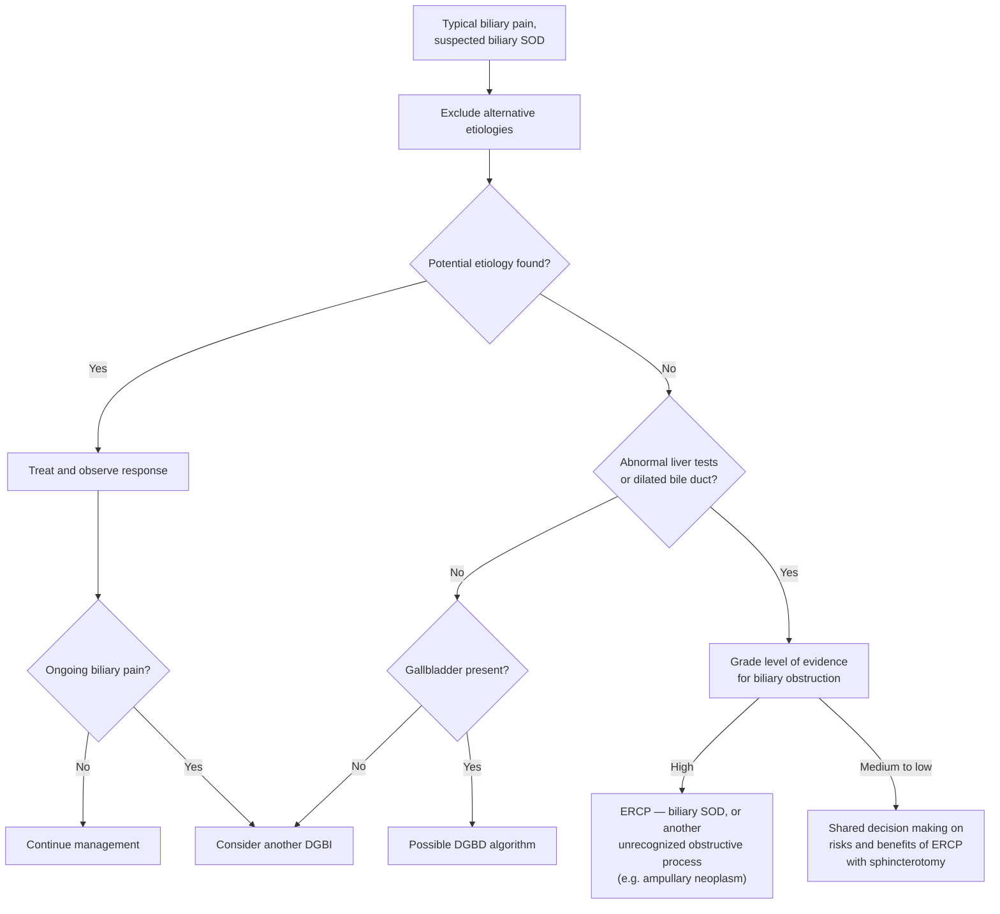

## Contents
- [[#Assessment]]
  - [[#Establishing the Diagnosis]]
  - [[#Classification / Typing]]
- [[#Differential Diagnosis]]
- [[#Diagnostics]]
- [[#Therapeutics]]
  - [[#Biliary SOD]]
  - [[#Pancreatic SOD]]
  - [[#Post-ERCP Pancreatitis Prophylaxis]]
- [[#See Also]]
- [[#Sources]]

## Assessment

- **Sphincter of Oddi (SO) disorder** = abnormality of the sphincter complex at the ampulla associated with episodes of biliary pain, elevated liver enzymes, bile duct dilation, or attacks of pancreatitis. ([[rome-v-2026-gallbladder-sphincter-of-oddi]])
- The sphincter complex has three parts: a **biliary sphincter**, a **pancreatic sphincter**, and a **common sphincter** — SOD may present with biliary and/or pancreatic signs and symptoms. ([[asge-2015-ercp-benign-biliary]])
- Presents as **typical biliary pain**, classically **post-cholecystectomy**, or as **idiopathic [[recurrent-acute-pancreatitis|recurrent acute pancreatitis (RAP)]]**.
- **Two phenotypes, not mutually exclusive** ([[rome-v-2026-gallbladder-sphincter-of-oddi]]):
  - **SO stenosis** (*ampullary stenosis*) — an organic condition from fibrosis and/or inflammation causing **static** obstruction: unequivocal, persistent liver-test elevation with a dilated biliary system. Treatment by biliary drainage is **not controversial**.
  - **SO dyskinesia** — intermittent sphincter **spasm**. Harder to diagnose and treat, and the risk-to-benefit ratio of [[ercp|endoscopic retrograde cholangiopancreatography (ERCP)]] remains uncertain in many of these patients.
- Up to **40%** of patients have persistent or recurrent pain after cholecystectomy, but SOD accounts for only **2%–31%** of it — **gastric pathology is the commonest cause in the first 3 years, bile duct stones after 3 years**. ([[rome-v-2026-gallbladder-sphincter-of-oddi]])

> [!pitfall] Biliary pain is not colicky and not right-sided
> Typical biliary pain reaches maximal intensity **quickly and then stays steady** — unlike the fluctuating pain of renal colic or bowel obstruction — and most commonly sits in the **epigastrium**, not the right upper quadrant. Getting this wrong is the main way patients without pancreaticobiliary disease end up in the SOD pathway ([[rome-v-2026-gallbladder-sphincter-of-oddi]]).

### Establishing the Diagnosis

**Typical biliary pain is the cardinal criterion** for both the gallbladder and the biliary sphincter disorders. Definition, and the criteria sets built on it, live on [[dysfunctional-gallbladder-disorder#Typical Biliary Pain (Rome V definition)|dysfunctional gallbladder disorder]].

**Biliary SOD — [[rome-v-2026-gallbladder-sphincter-of-oddi|Rome V]] criteria. Must include *all* of:**

1. **Typical biliary pain**
2. **Elevated liver tests and/or biliary dilation**
3. **Absence of bile duct stones or other structural abnormalities**

**Pancreatic SOD — Rome V criteria. Must include *both* of:**

1. **Documented recurrent episodes of acute pancreatitis** — each episode satisfying **≥2 of 3**: typical pain; pancreatic enzymes **>3× the upper limit of normal**; characteristic imaging of pancreatic inflammation
2. **Other etiologies excluded** — gallstones, alcohol, hypertriglyceridemia, autoimmune, hypercalcemia, medications, pancreatic mass, ampullary lesion, [[pancreas-divisum|pancreas divisum]], anomalous pancreaticobiliary junction, genetic causes, and acute exacerbation of underlying [[chronic-pancreatitis|chronic pancreatitis (CP)]]

- **There is no pancreatic SOD without pancreatitis.** Rome V restricts the diagnosis to unexplained RAP; no evidence supports SOD as a cause of pancreatic pain in the absence of acute or chronic pancreatitis. A dilated pancreatic duct with "unexplained epigastric pain" is far more likely CP or main-duct intraductal papillary mucinous neoplasm.
- **Exclude structural disease first** — stones, sludge, CP, malignancy — with cross-sectional imaging, [[mri-mrcp|magnetic resonance cholangiopancreatography (MRCP)]], and/or [[endoscopic-ultrasound|endoscopic ultrasound (EUS)]] before invasive testing. ([[asge-2015-benign-pancreatic-disease]])
- **Do not pursue diagnostic ERCP for biliary-type pain with normal labs and imaging** — the former "type III" scenario, where ERCP has no benefit and real harm. ([[asge-2015-ercp-benign-biliary]], [[rome-v-2026-gallbladder-sphincter-of-oddi]])

**Bile duct diameter — the threshold is unsettled, and the page carries both standards** ([[rome-v-2026-gallbladder-sphincter-of-oddi]]):

| | Conventional upper limit | Population MRI reference (awaiting validation) |
|---|---|---|
| **Gallbladder in situ, <65 y** | 6 mm | 8 mm |
| **Gallbladder in situ, ≥65 y** | 6 mm | 11 mm |
| **Post-cholecystectomy, <65 y** | 9 mm | 13 mm |
| **Post-cholecystectomy, ≥65 y** | 9 mm | 14 mm |

Rome V reports the age-dependent reference range but states it needs replication and prospective validation. The difference is not academic: a 75-year-old with biliary pain, normal liver tests, prior cholecystectomy and an **11 mm** duct **meets no criteria** under the new standard, yet would have been labelled SOD II under the old one. A dilated duct also follows **increasing age, cholecystectomy and chronic opioid use** without obstruction.

### Classification / Typing

**[[rome-v-2026-gallbladder-sphincter-of-oddi|Rome V]] abandoned the Milwaukee / Rome III type I–III subtyping.** Readers trained on it will still meet it in older documents, so what changed:

| Old subtype (Milwaukee / Rome III) | What it required | Rome V position |
|---|---|---|
| **Type I** | Biliary pain **+** liver tests >2× normal on ≥2 occasions **+** bile duct >8 mm | Folded into **biliary SOD**; this is the group most likely to be **SO stenosis**, where drainage is uncontroversial |
| **Type II** | Biliary pain **+ one** of those two abnormalities | Also **biliary SOD** — the type I/II split has **fallen out of favor**, because subtype does not correlate strongly with outcome |
| **Type III** | Biliary pain **alone**, nothing objective | **Abandoned.** These patients likely have **another [[disorders-of-gut-brain-interaction\|DGBI]]** and are managed as such (EPISOD) |

- **"Biliary SOD" now applies to every patient** with biliary-type pain and at least **transient** evidence of biliary obstruction.
- ⚠ **Do not map stenosis onto old type I and spasm onto old type II.** Spasm can raise liver tests *and* dilate the duct (looking like type I) or do just one (looking like type II). Most studies of sphincterotomy response stratified by **subtype**, not by **phenotype** — which is why their results do not transfer cleanly.
- **Pancreatic SOD was never usefully subtyped and now is not at all** — Rome V defines it solely by unexplained RAP (criteria above). The old pancreatic "type 1/2/3" scheme from [[asge-2015-benign-pancreatic-disease]] carried no enzyme multiple and no millimetre duct cutoff, and is superseded.

## Differential Diagnosis

*Workup: exclude structural pancreaticobiliary disease before invoking SOD — see [[jaundice]] for the cholestasis algorithm and [[biliary-stricture]] for the obstructive differential.*

- [[choledocholithiasis|Common bile duct (CBD) stones]] / microlithiasis / biliary sludge.
- [[biliary-stricture|Biliary stricture]] (benign or malignant).
- [[chronic-pancreatitis|Chronic pancreatitis]] and pancreatic-duct stones.
- [[pancreas-divisum|Pancreas divisum]] (a structural cause of recurrent pancreatitis, evaluated separately).
- [[dysfunctional-gallbladder-disorder|Dysfunctional gallbladder disorder]] (gallbladder still in situ, no stones).
- Biliary-type pain without SOD — the former "type III" population, now managed as a [[disorders-of-gut-brain-interaction|disorder of gut–brain interaction]].
- **Gastric pathology** — the commonest cause of pain in the first 3 years after cholecystectomy.

## Diagnostics

- **Noninvasive first:** cross-sectional imaging, [[mri-mrcp|MRCP]], and [[endoscopic-ultrasound|EUS]] to exclude stones, sludge, strictures, [[chronic-pancreatitis|CP]], and malignancy. **EUS is the preferred low-risk test** for interrogating idiopathic disease, especially in older patients where occult malignancy must be excluded. ([[asge-2015-benign-pancreatic-disease]])
- **EUS is the principal test for unexplained RAP** — yield ~**30%–90%**; most often finds occult biliary stone disease, but detects ampullary or pancreaticobiliary malignancy in up to **5% after one episode** and **12%** with RAP. MRCP is a reasonable complementary or alternative test, better for [[pancreas-divisum|pancreas divisum]] and anomalous pancreaticobiliary union. ([[rome-v-2026-gallbladder-sphincter-of-oddi]])
- **Sphincter of Oddi manometry (SOM) has been essentially abandoned** — on performance as well as logistics and safety ([[rome-v-2026-gallbladder-sphincter-of-oddi]]):
  - A brief measurement cannot capture **intermittent** spasm, so sensitivity is inherently limited.
  - Repeat manometry is abnormal in **40%–60%** of persistently symptomatic patients whose first study was normal.
  - In EPISOD it was **neither reproducible nor predictive of any outcome**.
  - ⚠ Supersedes [[asge-2015-ercp-benign-biliary]], which reserved SOM for suspected type II.
- **Cholescintigraphy and stimulated ultrasound do not play a role** in biliary SOD — they lack the accuracy to drive clinical decisions.
- **Suspected SOD carries a significantly higher post-ERCP pancreatitis risk**, whether or not manometry is performed — this shapes the risk/benefit of any invasive workup. ([[asge-2015-ercp-benign-biliary]])

## Therapeutics

### Biliary SOD

**The decision is graded on how strong the evidence of biliary obstruction is, not on a subtype number** ([[rome-v-2026-gallbladder-sphincter-of-oddi]] Figure 5):

*Figure — evaluation of typical biliary pain with suspected biliary sphincter of Oddi disorder. ([[rome-v-2026-gallbladder-sphincter-of-oddi]])*

- **What moves a case from "medium to low" toward "high":** degree of liver-test elevation · degree of bile duct dilation · **liver tests and duct size changing in step with the pain episodes** · absence of chronic opioid use · absence of evidence of somatization.
- **Endoscopic biliary sphincterotomy remains the primary treatment** for suspected SO stenosis and spasm. Manometry-era studies reported pain relief in **>90%** of patients with the old type I phenotype regardless of documented hypertension; **the evidence in patients with less concrete obstruction is not strong** — mostly retrospective, open-label, subjective outcomes. ([[rome-v-2026-gallbladder-sphincter-of-oddi]])
- **Predictors of response**, where reported: better with **intermittent rather than continuous pain**, pain **accompanied by nausea and vomiting**, and a **pain-free interval of ≥1 year after cholecystectomy**; worse with **daily opioid use**, **delayed gastric emptying**, normal pancreatic manometry, and **age <40 y**. ⚠ RESPOnD (213 patients, prospective multicenter) found **no association between SOD subtype and response to ERCP**.
- **Medical therapy directed at the sphincter has no primary role.** Nifedipine, nitrates, trimebutine and duloxetine all have signals in small or uncontrolled studies — 75% on short-term nifedipine had statistically less pain — but **slow-release nifedipine gave no benefit and more cardiovascular adverse effects**. ([[rome-v-2026-gallbladder-sphincter-of-oddi]])
- **If biliary sphincterotomy fails, the likeliest explanation is that the pain was never pancreaticobiliary.** Repeat ERCP after a prior biliary sphincterotomy carries a lower post-ERCP pancreatitis risk and is justified where there was a significant prior response, though outcomes have not been rigorously studied.
- ⚠ **Superseded:** [[asge-2015-ercp-benign-biliary]] graded sphincterotomy by subtype — type I without SOM (Moderate), type II with abnormal manometry, type III **not at all** (High). The type III prohibition stands; the type I/II framing does not.

> **EPISOD trial** (randomized controlled trial [RCT], National Institutes of Health [NIH], multicenter; 214 post-cholecystectomy patients with pain but no imaging/lab abnormality, no prior sphincter intervention or pancreatitis, randomized 2:1 to sphincterotomy vs sham). Treatment success (< 6 days pain-related disability over 90 days, no narcotics, no further intervention) was **23% with sphincterotomy vs 37% with sham** (adjusted risk difference 15.6% *favoring sham*, P < .01). Dual vs single sphincterotomy made no difference. Pancreatitis occurred in 11% (sphincterotomy) vs 15% (sham). **Conclusion: manometry and sphincterotomy do not benefit type III SOD and carry significant adverse-event rates.** ([[asge-2015-ercp-benign-biliary]])

- **The result held at 5 years**, and **manometry was neither reproducible nor predictive of any outcome** in the trial. Type III is now regarded as a **[[disorders-of-gut-brain-interaction|disorder of gut–brain interaction]]**, not a sphincter disease. ([[acg-asge-2026-ercp-quality-indicators]])
- **The one carve-out that remains:** **papillary stenosis obstructing the bile duct outlet** may be considered an indication for biliary sphincterotomy in a patient with biliary-type pain **and** elevated liver enzymes **or** a dilated bile duct. Evaluate such patients judiciously — the bile duct also dilates without obstructive pathology with **increasing age, cholecystectomy and opioid use**, and liver tests rise for many other reasons. ([[acg-asge-2026-ercp-quality-indicators]])

### Pancreatic SOD

- **Conservative management and watchful waiting are always reasonable** in a patient whose RAP has not yet shown an aggressive clinical course — the evidence supporting ERCP here is weak and the procedure is risky. ([[rome-v-2026-gallbladder-sphincter-of-oddi]])
- **Sphincterotomy prevents further attacks in 60%–80%** in observational series, and a small open-label randomized trial found **pancreatic duct stent placement cut RAP from 53% to 11% (P < .02)**. ⚠ **RESPOnD found recurrent-pancreatitis rates after sphincterotomy similar to historical controls who had no intervention** — the contradiction is unresolved.
- **Do the biliary sphincterotomy alone first.** Many endoscopists now perform empiric biliary sphincterotomy at the first ERCP and consider pancreatic endotherapy only for inadequate response, because pancreatic sphincterotomy carries higher acute and long-term risk — notably **papillary restenosis, which can be significantly worse than the original problem**. A biliary sphincterotomy also ablates the common sphincter and so lowers pancreatic sphincter pressure. ([[rome-v-2026-gallbladder-sphincter-of-oddi]], [[asge-2015-benign-pancreatic-disease]])
- In [[recurrent-acute-pancreatitis|idiopathic RAP]], biliary sphincterotomy alone (~51%) performed similarly to combined biliary + pancreatic sphincterotomy (~53%). ([[asge-2015-benign-pancreatic-disease]])
- **Pancreas divisum is not a sphincter disorder**, and the **SHARP trial** — international, multicenter, randomized, **sham-controlled** — found **no benefit from minor papilla sphincterotomy** for RAP with [[pancreas-divisum|pancreas divisum]]. ([[rome-v-2026-gallbladder-sphincter-of-oddi]])
- **No randomized trial has yet established whether sphincterotomy works for pancreatic SOD at all**, or which approach — biliary, pancreatic or dual — is preferred. Proceed by individualized decision weighing disease burden against iatrogenic risk.
- **Do NOT use ERCP** for recurrent or chronic abdominal pain in the absence of documented pancreatitis (**High**). ([[asge-2015-benign-pancreatic-disease]], [[rome-v-2026-gallbladder-sphincter-of-oddi]])

### Post-ERCP Pancreatitis Prophylaxis
- Suspected SOD is a **high-risk indication** for post-ERCP pancreatitis. Give **rectal indomethacin with or without a pancreatic-duct stent** when ERCP is performed in these patients (Moderate/High). ([[asge-2015-ercp-benign-biliary]], [[asge-2015-benign-pancreatic-disease]])
- SOD's status as a *suboptimal* ERCP indication post-EPISOD is itself a reason the "high-risk" definition for prophylaxis has evolved. ([[asge-2023-post-ercp-pancreatitis]])

---

## See Also

[[ercp]], [[endoscopic-ultrasound]], [[mri-mrcp]], [[acute-pancreatitis]], [[recurrent-acute-pancreatitis]], [[chronic-pancreatitis]], [[pancreas-divisum]], [[choledocholithiasis]], [[biliary-stricture]], [[jaundice]], [[dysfunctional-gallbladder-disorder]], [[disorders-of-gut-brain-interaction]]

---

## Sources

1. [[asge-2015-ercp-benign-biliary|ASGE Guideline: The Role of ERCP in Benign Diseases of the Biliary Tract (2015)]]
2. [[asge-2015-benign-pancreatic-disease|ASGE Guideline: The Role of Endoscopy in Benign Pancreatic Disease (2015)]]
3. [[asge-2023-post-ercp-pancreatitis|ASGE Guideline: Post-ERCP Pancreatitis Prevention (2023)]]
4. [[rome-v-2026-dgbi|Disorders of Gut–Brain Interaction and the Rome V Process]]
5. [[acg-asge-2026-ercp-quality-indicators|ACG/ASGE 2026: Quality Indicators for ERCP]]
6. [[rome-v-2026-gallbladder-sphincter-of-oddi|Rome V (2026): Gallbladder and Sphincter of Oddi Disorders]]
