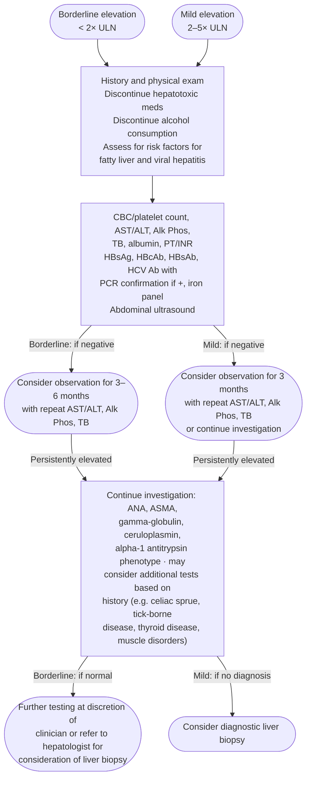
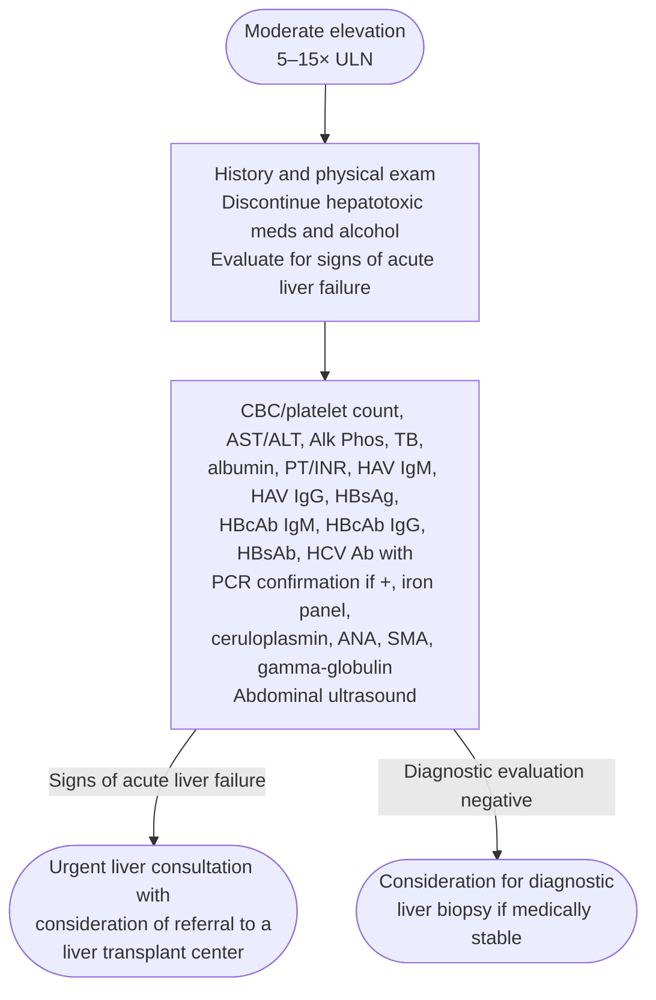
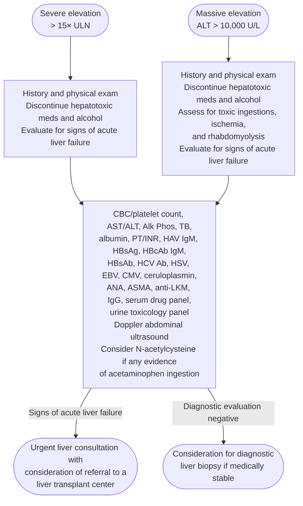
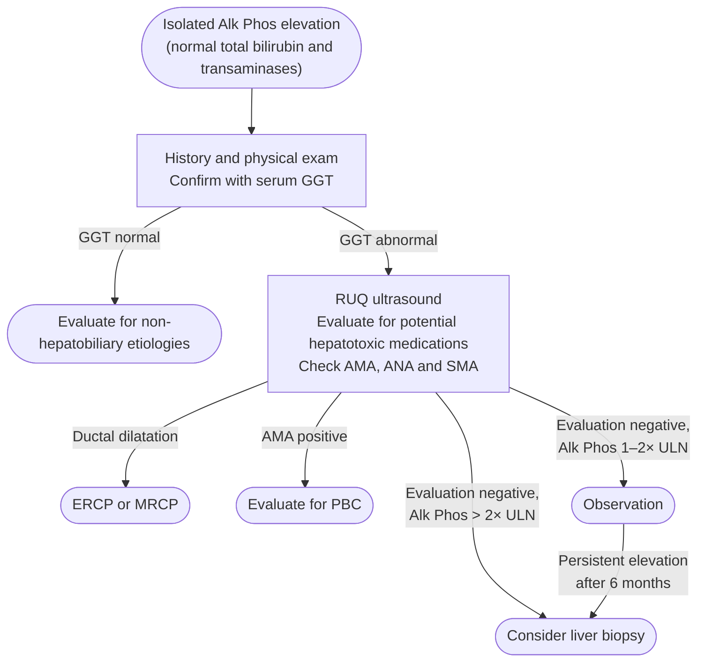
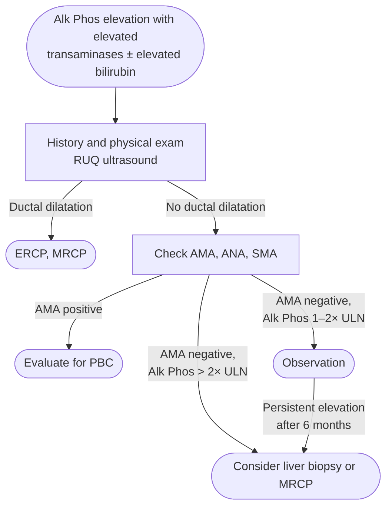

## Contents
- [[#Definition / Scope]]
  - [[#What Are Truly Normal ALT Values?]]
- [[#Differential Diagnosis]]
  - [[#Patterns of Elevation]]
  - [[#Causes of Elevated AST and ALT]]
  - [[#Causes of Elevated Alkaline Phosphatase]]
  - [[#Causes of Elevated Bilirubin]]
- [[#Diagnostic Algorithm]]
  - [[#Step 1 — Repeat/Confirm]]
  - [[#Step 2 — Pattern Recognition]]
  - [[#Step 3 — AST/ALT Elevation]]
  - [[#Step 4 — Alkaline Phosphatase Elevation]]
  - [[#Step 5 — Bilirubin Elevation]]
- [[#Key Tests]]
  - [[#Etiology-Specific Tests]]
  - [[#Imaging]]
  - [[#Liver Biopsy Indications]]
- [[#Red Flags / Alarm Features]]
- [[#See Also]]
- [[#Sources]]

---

## Definition / Scope

- **Liver chemistries** (liver tests) — alanine aminotransferase (ALT), aspartate aminotransferase (AST), alkaline phosphatase (Alk Phos), bilirubin — are markers of liver **injury, not function**; not "liver function tests" ([[acg-2017-liver-chemistries]], Summary statement 1)
- Albumin, bilirubin and prothrombin time (PT) mark hepatocellular function but can be influenced by extrahepatic factors (Summary statement 2)
- Liver transplant recipients: [[abnormal-liver-tests-after-liver-transplant]]

| Marker | Notes |
|--------|-------|
| ALT | Mainly liver → more specific for hepatocellular injury than AST |
| AST | Also cardiac and skeletal muscle, kidney, brain; AST rise without ALT rise suggests cardiac or muscle disease |
| Alk Phos | Rises with bile duct obstruction, even when too minor to raise bilirubin; also bone, placenta, intestine, kidney |
| Gamma-glutamyl transferase (GGT) | Confirms hepatic origin of Alk Phos; not liver-specific |
| Bilirubin | Total usually <1.1 mg/dl, ~70% unconjugated |
| Albumin | Normal ≥3.5 g/dl, half-life 3 weeks; low → usually liver disease >3 weeks (any significant illness can lower it) |
| PT | Far more sensitive than albumin — prolonged in severe liver disease of <24 h; also prolonged by cholestasis/vitamin K deficiency, warfarin, heparin bolus, disseminated intravascular coagulation, hypothermia |

### What Are Truly Normal ALT Values?

| Sex | Healthy upper limit of normal (ULN) for ALT |
|-----|--------------------------|
| Male | 29–33 IU/l |
| Female | 19–25 IU/l |

- Healthy populations without liver-disease risk factors; **levels above this should be assessed** — elevated ALT or AST is associated with increased liver-related mortality ([[acg-2017-liver-chemistries]], normal-values Summary statements 1–2)
- ALT rises linearly with body mass index (BMI); higher in males
- A normal ALT may not exclude significant liver disease — signs or symptoms of liver disease → evaluate anyway
- Alk Phos and bilirubin: local lab ULN can be relied on (Summary statement 7)

> [!pitfall] Lab "normal" ALT is not healthy normal
> Lab ALT ULNs vary widely (35–79 IU/l in men, 31–55 IU/l in women in one research network) because reference populations include [[nafld-masld|nonalcoholic fatty liver disease (NAFLD)]], viral hepatitis and alcohol use ([[acg-2017-liver-chemistries]]).

---

## Differential Diagnosis

### Patterns of Elevation

| Pattern | Definition | R ratio |
|---------|------------|---------|
| Hepatocellular | AST and ALT disproportionately elevated vs Alk Phos | >5 |
| Cholestatic | Alk Phos disproportionately elevated vs AST and ALT | <2 |
| Mixed | Both Alk Phos and AST/ALT elevated | 2–5 |
| Isolated hyperbilirubinemia | Bilirubin elevated, Alk Phos and AST/ALT normal | — |

- **R = (ALT ÷ ALT ULN) ÷ (Alk Phos ÷ Alk Phos ULN)**; also applied in [[drug-induced-liver-injury|drug-induced liver injury (DILI)]] ([[acg-2017-liver-chemistries]], Patterns Summary statements 1–5)
- Bilirubin can also rise in the first three patterns; patterns name the predominant elevation — other tests may be elevated too

### Causes of Elevated AST and ALT

| Group | Causes ([[acg-2017-liver-chemistries]] Table 4) |
|-------|--------|
| Hepatic, generally AST>ALT | Alcoholic liver disease, [[cirrhosis]] (any etiology), ischemic hepatitis, congestive hepatopathy, acute [[budd-chiari-syndrome\|Budd-Chiari syndrome]], hepatic artery damage/thrombosis/occlusion, [[nutrition-in-hospitalized-patients\|total parenteral nutrition (TPN)]] |
| Hepatic, generally ALT>AST | NAFLD (steatosis, nonalcoholic steatohepatitis [NASH]), chronic and acute viral hepatitis, medications/DILI (prescription, herbal products and supplements, over-the-counter), toxic hepatitis (Amanita), [[hereditary-hemochromatosis\|hemochromatosis]], [[autoimmune-hepatitis\|autoimmune hepatitis (AIH)]], [[wilson-disease\|Wilson's disease]], [[alpha-1-antitrypsin-deficiency-liver-disease\|alpha-1 antitrypsin (A1AT) deficiency]], [[celiac-disease\|celiac disease]], acute bile duct obstruction, liver trauma, post-liver surgery, veno-occlusive disease/sinusoidal obstruction syndrome, diffuse infiltration with cancer, hemolysis, elevated liver tests, low platelets (HELLP) syndrome, [[acute-fatty-liver-of-pregnancy\|acute fatty liver of pregnancy]], sepsis, hemophagocytic lymphohistiocytosis |
| Non-hepatic | Skeletal muscle damage/rhabdomyolysis, cardiac muscle damage, thyroid disease, macro-AST, strenuous exercise, heat stroke, hemolysis, adrenal insufficiency |

**AST:ALT ratio** ([[acg-2017-liver-chemistries]]):
- Most conditions, incl. chronic viral hepatitis and NAFLD → ALT > AST
- [[alcohol-associated-liver-disease|Alcoholic liver disease]]: ~90% AST>ALT, >70% ratio >2; ratio ≥2:1 typical, >3:1 raises likelihood further
- Alcoholic liver disease and NAFLD: AST/ALT **rarely >300 IU/l**
- Cirrhosis of any etiology: AST>ALT possible, but ratio typically not >2:1 (hepatitis C virus [HCV]: mean 0.60 noncirrhotic vs 1.05 cirrhotic)

### Causes of Elevated Alkaline Phosphatase

| Group | Causes ([[acg-2017-liver-chemistries]] Table 5) |
|-------|--------|
| Hepatobiliary | Bile duct obstruction ([[choledocholithiasis]], malignant obstruction, bile duct flukes), [[biliary-stricture\|bile duct stricture]], ductopenia, acquired immunodeficiency syndrome (AIDS) cholangiopathy, [[primary-biliary-cholangitis\|primary biliary cholangitis (PBC)]], [[primary-sclerosing-cholangitis\|primary sclerosing cholangitis (PSC)]], medications/DILI, infiltrative disease (sarcoid, granulomatous hepatitis, tuberculosis, amyloid, metastatic cancer, lymphoma), hepatic abscess, [[hepatocellular-carcinoma\|hepatocellular carcinoma (HCC)]], viral hepatitis, cirrhosis, vanishing bile duct syndrome, ischemic cholangiopathy, benign recurrent cholestasis, sarcoidosis, alcoholic liver disease, [[intrahepatic-cholestasis-of-pregnancy\|intrahepatic cholestasis of pregnancy]], benign post-operative jaundice, intensive care unit (ICU)/multifactorial jaundice, TPN, liver allograft rejection, acute [[alcohol-associated-hepatitis\|alcoholic hepatitis]], sickle cell liver crisis, sepsis, congestive heart failure, hemophagocytic lymphohistiocytosis |
| Non-hepatic | Bone disease (osteomalacia, Paget's disease, primary bony malignancy, bony metastases), hyperthyroidism, hyperparathyroidism, pregnancy (third trimester), chronic renal failure, lymphoma, extra-hepatic malignancy, congestive heart failure, childhood growth, infection, inflammation, influx after a fatty meal, blood type O and B, myeloid metaplasia, peritonitis, diabetes mellitus, gastric ulcer, increasing age (especially women) |

### Causes of Elevated Bilirubin

| Fraction | Causes ([[acg-2017-liver-chemistries]] Table 6) |
|----------|--------|
| Unconjugated | Gilbert's syndrome, Crigler-Najjar syndrome, hemolysis (intravascular and extravascular), ineffective erythropoiesis, resorption of large hematomas, neonatal [[jaundice]], hyperthyroidism, medications, post-blood transfusion |
| Conjugated | Bile duct obstruction (choledocholithiasis, malignant obstruction, bile duct flukes), bile duct stricture, AIDS cholangiopathy, viral hepatitis, toxic hepatitis, medications/DILI, acute alcoholic hepatitis, ischemic hepatitis, cirrhosis, PBC, PSC, infiltrative disease (sarcoid, granulomatous hepatitis, tuberculosis, metastatic cancer, lymphoma), HCC, Wilson's disease (especially fulminant), AIH, congestive hepatopathy, sepsis, TPN, intrahepatic cholestasis of pregnancy, benign post-operative jaundice, ICU/multifactorial jaundice, benign recurrent cholestasis, vanishing bile duct syndrome, ductopenia, Dubin-Johnson syndrome, Rotor syndrome, sickle cell liver crisis, hemophagocytic lymphohistiocytosis |

---

## Diagnostic Algorithm

### Step 1 — Repeat/Confirm

- **Repeat the lab panel and/or do a clarifying test** (e.g., GGT if Alk Phos is elevated) to confirm the abnormality before starting an evaluation — Recommendation (Rec) 1, Strong recommendation, very low level of evidence ([[acg-2017-liver-chemistries]])
- History: liver-disease risk factors, associated conditions (inflammatory bowel disease, hematologic, pulmonary, cardiac disease), alcohol, and **all prescribed and over-the-counter drugs, complementary/alternative medicines, dietary and herbal supplements** (Rec 11, Strong, very low); family history of hemochromatosis, Wilson's disease, A1AT deficiency
- Exam: stigmata of chronic liver disease and signs pointing to a specific etiology

### Step 2 — Pattern Recognition

- Classify by pattern (R ratio), magnitude (×ULN tiers below) and AST:ALT ratio → [[#Differential Diagnosis]]

### Step 3 — AST/ALT Elevation

| Tier | AST and/or ALT | Evaluation must cover ([[acg-2017-liver-chemistries]]) |
|------|----------------|------------------|
| Borderline | <2× ULN | Rec 16 (<5× ULN): hepatitis B and C, alcoholic liver disease and NAFLD, hemochromatosis, Wilson's disease, A1AT deficiency, AIH, drug/supplement injury |
| Mild | 2–5× ULN | Same as borderline (Rec 16) |
| Moderate | 5–15× ULN | Rec 17: all of the above **plus acute hepatitis A, B and C** |
| Severe | >15× ULN | Rec 18: all of the above **plus acetaminophen toxicity and ischemic hepatopathy (shock liver)** |
| Massive | ALT >10,000 IU/l | Rec 18: as for severe |

- Recs 16–18: Strong recommendation, very low level of evidence
- **Moderate, severe and massive elevations need immediate evaluation** — acute hepatitis A–E, hepatitis B reactivation, herpes simplex virus (HSV), Epstein-Barr virus (EBV), cytomegalovirus (CMV), acute autoimmune liver disease, drug reaction, acetaminophen
- Massive: generally only shock liver/ischemic hepatopathy or drug-induced/toxic hepatitis; rhabdomyolysis and heat stroke can also cause severe-to-massive AST

*Evaluation of borderline and mild AST/ALT elevation*
*Source: redrawn from ACG 2017 Figure 1*
*[[acg-2017-liver-chemistries|ACG 2017 Abnormal Liver Chemistries Guideline]]*
*ULN = upper limit of normal · CBC = complete blood count · AST = aspartate aminotransferase · ALT = alanine aminotransferase · Alk Phos = alkaline phosphatase · TB = total bilirubin · PT/INR = prothrombin time/international normalized ratio · HBsAg = hepatitis B surface antigen · HBcAb = hepatitis B core antibody · HBsAb = hepatitis B surface antibody · HCV = hepatitis C virus · Ab = antibody · PCR = polymerase chain reaction · ANA = antinuclear antibody · ASMA = anti-smooth muscle antibody*

*Evaluation of moderate AST/ALT elevation*
*Source: redrawn from ACG 2017 Figure 2*
*[[acg-2017-liver-chemistries|ACG 2017 Abnormal Liver Chemistries Guideline]]*
*ULN = upper limit of normal · CBC = complete blood count · AST = aspartate aminotransferase · ALT = alanine aminotransferase · Alk Phos = alkaline phosphatase · TB = total bilirubin · PT/INR = prothrombin time/international normalized ratio · HAV = hepatitis A virus · IgM = immunoglobulin M · IgG = immunoglobulin G · HBsAg = hepatitis B surface antigen · HBcAb = hepatitis B core antibody · HBsAb = hepatitis B surface antibody · HCV = hepatitis C virus · Ab = antibody · PCR = polymerase chain reaction · ANA = antinuclear antibody · SMA = smooth muscle antibody*

*Evaluation of severe and massive AST/ALT elevation*
*Source: redrawn from ACG 2017 Figure 3 (its severe and massive panels list the same tests)*
*[[acg-2017-liver-chemistries|ACG 2017 Abnormal Liver Chemistries Guideline]]*
*ULN = upper limit of normal · ALT = alanine aminotransferase · AST = aspartate aminotransferase · CBC = complete blood count · Alk Phos = alkaline phosphatase · TB = total bilirubin · PT/INR = prothrombin time/international normalized ratio · HAV = hepatitis A virus · IgM = immunoglobulin M · HBsAg = hepatitis B surface antigen · HBcAb = hepatitis B core antibody · HBsAb = hepatitis B surface antibody · HCV = hepatitis C virus · Ab = antibody · HSV = herpes simplex virus · EBV = Epstein-Barr virus · CMV = cytomegalovirus · ANA = antinuclear antibody · ASMA = anti-smooth muscle antibody · anti-LKM = anti-liver kidney microsomal antibody · IgG = immunoglobulin G*

> [!pitfall] ALT >1,000 IU/l — take an acetaminophen history
> An accurate history of acetaminophen use, alone or in analgesic-narcotic combinations, is essential at ALT >1,000 IU/l ([[acg-2017-liver-chemistries]]).

### Step 4 — Alkaline Phosphatase Elevation

- **Confirm hepatic origin with GGT** (Rec 13) — unnecessary if other liver chemistries are also elevated; isolated rise → GGT or isoenzyme fractionation
- **GGT is not a screening test** without other abnormal liver chemistries (Rec 13, Strong, very low) — also raised in >50% of alcoholic patients without evident liver disease, pancreatic disease, myocardial infarction, renal failure, emphysema, diabetes, phenytoin, barbiturates
- **Right upper quadrant (RUQ) ultrasound; if normal, consider intrahepatic causes incl. PBC, PSC and DILI** (Alkaline phosphatase section Rec 1, Strong, very low)
  - Dilated ducts → extrahepatic cause; nondilated → intrahepatic
  - PSC and human immunodeficiency virus (HIV)/AIDS cholangiopathy may be missed by ultrasound → if suspected (history of cholangitis or colonic inflammatory bowel disease) → [[mri-mrcp|magnetic resonance cholangiopancreatography (MRCP)]] or [[ercp|endoscopic retrograde cholangiopancreatography (ERCP)]]
- ± bilirubin elevation: test for **PBC with anti-mitochondrial antibody (AMA)** (Rec 14) and **PSC with MRCP or ERCP plus immunoglobulin G4 (IgG4)** (Rec 15) — Strong, very low
- Women of childbearing age → pregnancy test (intrahepatic cholestasis of pregnancy)
- Physiologically higher: children (bone growth), pregnancy (placental), elderly (especially women >50 y)

*Isolated alkaline phosphatase elevation*
*Source: redrawn from ACG 2017 Figure 4 (left column)*
*[[acg-2017-liver-chemistries|ACG 2017 Abnormal Liver Chemistries Guideline]]*
*Alk Phos = alkaline phosphatase · GGT = gamma-glutamyl transferase · RUQ = right upper quadrant · AMA = anti-mitochondrial antibody · ANA = antinuclear antibody · SMA = smooth muscle antibody · ERCP = endoscopic retrograde cholangiopancreatography · MRCP = magnetic resonance cholangiopancreatography · PBC = primary biliary cholangitis · ULN = upper limit of normal*

*Alkaline phosphatase elevation with elevated transaminases*
*Source: redrawn from ACG 2017 Figure 4 (right column)*
*[[acg-2017-liver-chemistries|ACG 2017 Abnormal Liver Chemistries Guideline]]*
*Alk Phos = alkaline phosphatase · RUQ = right upper quadrant · ERCP = endoscopic retrograde cholangiopancreatography · MRCP = magnetic resonance cholangiopancreatography · AMA = anti-mitochondrial antibody · ANA = antinuclear antibody · SMA = smooth muscle antibody · PBC = primary biliary cholangitis · ULN = upper limit of normal*

### Step 5 — Bilirubin Elevation

- **Fractionate an elevated total bilirubin** into direct and indirect; elevated conjugated bilirubin implies hepatocellular disease or biliary obstruction in most settings ([[acg-2017-liver-chemistries]], Bilirubin Summary statements 1–2)
- Fractionation helps most when ALT, AST and Alk Phos are normal or near normal; mostly unconjugated → hepatocellular disease unlikely

| Step | Predominantly unconjugated | Predominantly conjugated |
|------|----------------------------|--------------------------|
| 1 | History and physical exam; assess transaminases and Alk Phos | History and physical exam; assess transaminases and Alk Phos |
| 2 | Review medications; evaluate for hemolysis; evaluate for Gilbert's syndrome | Review medications; evaluate for clinically overt causes (sepsis, TPN, cirrhosis, biliary obstruction); RUQ ultrasound |
| 3 | Persistent and otherwise unexplained → may consider Gilbert's testing (UGT1A1 genotype); evaluate uncommon causes ([[#Causes of Elevated Bilirubin\|Table 6]]) | Ductal dilatation → ERCP or MRCP; no dilatation → AMA, ANA, SMA |
| 4 | Persistent and otherwise unexplained, symptomatic, worsening over time and/or with abnormal transaminases → consider liver biopsy | Same → consider liver biopsy |

*Workup of elevated total bilirubin by predominant fraction*
*Source: redrawn as a table from ACG 2017 Figure 5*
*[[acg-2017-liver-chemistries|ACG 2017 Abnormal Liver Chemistries Guideline]]*
*Alk Phos = alkaline phosphatase · TPN = total parenteral nutrition · RUQ = right upper quadrant · ERCP = endoscopic retrograde cholangiopancreatography · MRCP = magnetic resonance cholangiopancreatography · AMA = anti-mitochondrial antibody · ANA = antinuclear antibody · SMA = smooth muscle antibody*

> [!pearl] Gilbert's can be a presumptive diagnosis
> Asymptomatic, healthy, unconjugated bilirubin <4 mg/dl: exclude causative medications and hemolysis, confirm normal transaminases and Alk Phos → presumptive Gilbert's syndrome; more evaluation not routinely needed ([[acg-2017-liver-chemistries]]).

- **Gilbert's:** most common unconjugated cause (3–7% of US population); total bilirubin almost never >6 mg/dl, usually <3 mg/dl; rises 2–3-fold with fasting or illness
- **Hemolysis:** low haptoglobin, high reticulocytes and lactate dehydrogenase; infrequently bilirubin >5 mg/dl unless renal or liver disease or severe acute hemolysis
- **Dubin-Johnson / Rotor:** direct ~50% of total, other liver tests (incl. Alk Phos, GGT) normal; no need to distinguish them
- **Delta bilirubin** (conjugated bilirubin bound to albumin) follows albumin's 3-week half-life → prolonged jaundice while recovering from hepatitis or obstruction

---

## Key Tests

### Etiology-Specific Tests

All Strong recommendation, very low level of evidence unless marked ([[acg-2017-liver-chemistries]] Table 1).

| Target | Who | Test → next step |
|--------|-----|------------------|
| [[hepatitis-c\|Hepatitis C]] | Chronic: risk factors (intranasal/intravenous drug use, tattoos, piercings, transfusions, high-risk sex, born 1945–1965) · acute hepatitis (Rec 2) | Anti-HCV (sensitivity 92–97%; positive 6–8 weeks after exposure) → confirm with HCV RNA by nucleic acid testing; acute: anti-HCV **and** HCV RNA |
| [[chronic-hepatitis-b\|Hepatitis B]] | Persistently elevated AST/ALT; highest risk: born where HBsAg prevalence >2%, men who have sex with men, injection drug use, dialysis, HIV, pregnancy, contacts of hepatitis B–infected persons (Rec 3) | Chronic: HBsAg; acute: HBsAg + IgM antibody to hepatitis B core antigen (anti-HBc) · chronic infection → refer to a physician with expertise |
| [[hepatitis-a\|Hepatitis A]] / [[hepatitis-e\|hepatitis E]] | Acute hepatitis + possible fecal-oral exposure (A); return from endemic areas (Central America, Asia) with negative A, B, C tests (E) (Rec 4) | IgM HAV; IgM hepatitis E virus (HEV) |
| NAFLD | Mild ALT elevation + elevated BMI or metabolic syndrome features (diabetes, overweight/obesity, hyperlipidemia, hypertension) (Rec 5) | Ultrasound; [[liver-stiffness-measurement\|vibration-controlled transient elastography]] with controlled attenuation parameter may help (role still emerging) |
| Alcoholic liver disease | Women >140 g/week, men >210 g/week, with AST>ALT → at risk (Rec 6) | Counsel alcohol cessation; GGT complementary, not diagnostic |
| [[hereditary-hemochromatosis\|Hemochromatosis]] | All abnormal liver chemistries **in the absence of acute hepatitis** (Rec 7) | Iron, transferrin saturation, ferritin → HFE mutation analysis if saturation ≥45% and/or ferritin elevated; ferritin is an acute-phase reactant |
| [[autoimmune-hepatitis\|AIH]] | Abnormal AST and ALT, especially with other autoimmune conditions (Rec 8) | ANA, ASMA, globulin level; diagnosis requires liver biopsy |
| [[wilson-disease\|Wilson's disease]] | Persistently elevated AST and ALT, especially age <55 y (Rec 9) | Ceruloplasmin → if low: 24-h urine copper + slit-lamp exam for Kayser-Fleischer rings |
| [[alpha-1-antitrypsin-deficiency-liver-disease\|A1AT deficiency]] | Persistently elevated AST or ALT (Rec 10: A1AT phenotype) | 2026 consensus: serum level with normal C-reactive protein (CRP) — <11 μM (<57 mg/dL) likely ZZ · 11–20 μM (57–90 mg/dL) mild/intermediate · >20 μM (>90 mg/dL) minimal risk of severe deficiency → genotyping (preferred) or isoelectric-focusing phenotyping; MZ can have a normal level ([[aga-aasld-easl-2026-aatd-liver-disease]]) |
| DILI | All abnormal liver chemistries (Rec 11) | Medication and supplement history; LiverTox (livertox.nih.gov) |
| PBC / PSC | Alk Phos elevation ± bilirubin (Recs 14–15) | AMA (positive in >95% of PBC) · MRCP or ERCP + IgG4 ([[igg4-related-cholangitis\|IgG4-associated form]]) |
| [[celiac-disease\|Celiac disease]] | Persistently elevated liver chemistries | Tissue transglutaminase IgA + serum IgA, or tissue transglutaminase IgA + deamidated gliadin peptide IgG |
| Muscle disease | AST-predominant, after common causes excluded | Creatine kinase and/or aldolase |
| Thyroid disease | Compatible history | Thyroid stimulating hormone; selective free thyroxine (T4), free/total triiodothyronine (T3) |
| Tick-borne illness | Endemic region + compatible history | Borrelia burgdorferi, ehrlichiosis/anaplasmosis, babesiosis testing |

- Rec 10 (2017) screened by A1AT phenotype alone; the newer 2026 consensus starts with the serum level and confirms by genotype

### Imaging

- **Ultrasound** — hepatic parenchyma and bile ducts; in every Alk Phos and conjugated-bilirubin workup; Doppler in severe/massive AST/ALT elevation ([[acg-2017-liver-chemistries]])
- **Magnetic resonance imaging (MRI)/MRCP, ERCP and/or [[endoscopic-ultrasound|endoscopic ultrasound]]** — bile duct morphology
- Pregnancy: ultrasound is safe and preferred when abnormal liver tests suggest biliary tract disease; MRI without gadolinium can be used in the second and third trimester → [[liver-disease-in-pregnancy]] ([[acg-2016-liver-disease-pregnancy]])

### Liver Biopsy Indications

- **When serology and imaging fail to give a diagnosis, to stage a condition, or when multiple diagnoses are possible** — Rec 12, Strong, very low ([[acg-2017-liver-chemistries]])
- Grade and stage: hepatitis B, hepatitis C, NAFLD; **required to diagnose NASH**
- Confirm a specific diagnosis: Wilson's disease (quantitative copper), hemochromatosis (hepatic iron index), A1AT deficiency (periodic acid–Schiff-positive globules)
- Hemochromatosis: C282Y homozygous or C282Y/H63D compound heterozygous **with elevated AST/ALT or ferritin >1,000 μg/l**, or non-HFE hemochromatosis → biopsy to stage fibrosis and quantify iron
- AIH: histologic confirmation required
- PBC: not routinely; for suspected AMA-negative disease or staging · PSC: rarely required

---

## Red Flags / Alarm Features

- **Acute hepatitis + elevated PT and/or encephalopathy → immediate referral to a liver specialist** — Rec 19, Strong, very low; either finding alone qualifies ([[acg-2017-liver-chemistries]])
  - Acute liver failure (prolonged PT and [[hepatic-encephalopathy|hepatic encephalopathy]] without previous liver disease) needs immediate evaluation **regardless of ALT level** → [[acute-liver-failure]], [[liver-transplantation|liver transplant center]] referral
- **Moderate, severe or massive AST/ALT elevation** → immediate evaluation ([[#Step 3 — AST/ALT Elevation|Step 3]])
- **Cholestasis + history of cholangitis or colonic inflammatory bowel disease** → cholangiography even if ultrasound is normal ([[primary-sclerosing-cholangitis|PSC]])
- **Pregnancy** — liver disorders of pregnancy are time-sensitive for mother and fetus; consider by trimester cholelithiasis, intrahepatic cholestasis of pregnancy, acute fatty liver of pregnancy, pre-eclampsia, flare of chronic liver disease ([[acg-2017-liver-chemistries]])
  - Alk Phos (placental) and albumin (hemodilution) shift normally; any transaminase or bilirubin abnormality needs evaluation → [[liver-disease-in-pregnancy]] ([[acg-2016-liver-disease-pregnancy]])

| History clue | Suggests ([[acg-2017-liver-chemistries]]) |
|--------------|----------|
| Neurologic symptoms + abnormal liver tests, Kayser-Fleischer rings | Wilson's disease |
| Hematologic disease + acute RUQ pain, ascites, hepatomegaly | Hepatic vein thrombosis |
| Hypercoagulable state + abnormal liver tests + ascites | [[budd-chiari-syndrome\|Budd-Chiari syndrome]] |
| Hematologic malignancy with recent chemotherapy | Sinusoidal obstruction syndrome (veno-occlusive disease) |
| Diabetes, skin pigmentation, cardiac disease, arthritis, hypogonadism | Hemochromatosis |
| Jaundice + history of blood disorders | Hemolysis |
| Light-colored stools, pruritus, dark urine | Intrahepatic cholestasis |
| Fatigue and pruritus with cholestatic chemistries, more often women | PBC |

---

## See Also

[[drug-induced-liver-injury]], [[alpha-1-antitrypsin-deficiency-liver-disease]], [[alcohol-associated-liver-disease]], [[autoimmune-hepatitis]], [[primary-sclerosing-cholangitis]], [[primary-biliary-cholangitis]], [[igg4-related-cholangitis]], [[wilson-disease]], [[hereditary-hemochromatosis]], [[nafld-masld]], [[acute-liver-failure]], [[hepatitis-a]], [[chronic-hepatitis-b]], [[hepatitis-c]], [[hepatitis-e]], [[celiac-disease]], [[budd-chiari-syndrome]], [[liver-disease-in-pregnancy]], [[intrahepatic-cholestasis-of-pregnancy]], [[acute-fatty-liver-of-pregnancy]], [[noninvasive-liver-disease-assessment]], [[liver-stiffness-measurement]], [[iron-overload-and-iron-metabolism]], [[jaundice]], [[liver-biopsy]], [[mri-mrcp]], [[ercp]], [[endoscopic-ultrasound]], [[cirrhosis]], [[hepatic-encephalopathy]], [[hepatocellular-carcinoma]], [[liver-transplantation]], [[choledocholithiasis]], [[biliary-stricture]], [[nutrition-in-hospitalized-patients]], [[abnormal-liver-tests-after-liver-transplant]]

---

## Sources

1. [[acg-2017-liver-chemistries|ACG 2017: Evaluation of Abnormal Liver Chemistries]]
2. [[acg-2016-liver-disease-pregnancy|ACG Clinical Guideline: Liver Disease and Pregnancy (2016)]]
3. [[aga-aasld-easl-2026-aatd-liver-disease|Multi-Society Expert Panel Consensus Guidance Regarding Clinical Assessment and Clinical Trial Endpoints in Adults With Alpha-1 Antitrypsin Deficiency–Associated Liver Disease (2026)]]

