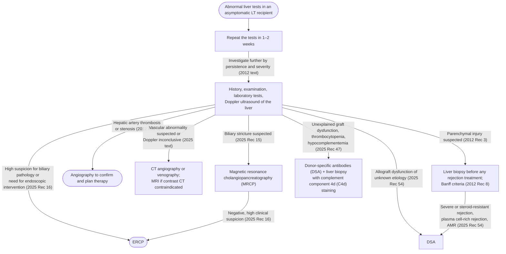

## Contents
- [[#Definition / Scope]]
- [[#Differential Diagnosis]]
  - [[#Causes]]
  - [[#Clues by Cause]]
- [[#Diagnostic Algorithm]]
- [[#Key Tests]]
- [[#Red Flags / Alarm Features]]
- [[#See Also]]
- [[#Sources]]

---

## Definition / Scope

Abnormal liver tests in a [[liver-transplantation|liver transplant (LT)]] recipient. The workup is built around the graft — its vessels, its bile ducts, rejection, and return of the original disease — so it differs from the non-transplant approach on [[abnormal-liver-chemistries]].

- **No established normal ranges:** liver chemistry tests allow routine monitoring of the allograft, but there are no well-established normal ranges for them after LT ([[aasld-ast-2025-liver-transplant-graft-complications]]).
- **Monitoring frequency** is individualized by the transplant center according to the time from LT, the complications from LT, the stability of serial results, and the underlying cause (Rec 1, grade 1, level A; [[aasld-2012-liver-transplant-long-term]]).
- **The course of action depends on the severity and the type of abnormality** — cholestatic, hepatitic, or other. More than one cause may coexist in the same patient ([[aasld-2012-liver-transplant-long-term]]).
- **Normal tests do not exclude graft damage.** In a multicenter study of recipients with normal liver tests more than 3 years after LT (n = 190), biopsy showed portal inflammation in 75.8%, fibrosis in 62.6%, and lobular inflammation in 60.5% ([[aasld-ast-2025-liver-transplant-graft-complications]]).
- Graft function in the first postoperative week is graded separately as early allograft dysfunction: [[liver-transplantation#Severity Assessment]].

## Differential Diagnosis

### Causes

Causes of liver test abnormalities in the asymptomatic recipient ([[aasld-2012-liver-transplant-long-term]], Table 3):

| Category | Causes |
|---|---|
| Allograft parenchymal damage | Immune-mediated disease (rejection and de novo autoimmune hepatitis [AIH]) · recurrent disease (hepatitis C virus [HCV], hepatitis B virus [HBV], primary biliary cholangitis [PBC], primary sclerosing cholangitis [PSC], AIH, and others) · drug toxicity, including immunosuppressive drugs · alcohol and other toxins · de novo infection, including de novo HBV and HCV · space-occupying lesion (recurrent cancer) · de novo or recurrent nonalcoholic fatty liver disease (NAFLD) |
| Biliary damage | Biliary strictures (anastomotic strictures, hepatic artery thrombosis or stenosis, and others) · biliary stones/cast syndrome · recurrent PSC |
| Vascular disease | Hepatic artery thrombosis · portal or hepatic vein thrombosis |
| Metabolic disease in the allograft | Gilbert's syndrome |
| Nonhepatic disease mimicking liver disease | Hemolysis raising indirect bilirubin · bone disease raising alkaline phosphatase |
| Nonhepatic disease causing liver abnormalities | Celiac disease · diabetes |

- "De novo AIH" is now called plasma cell-rich rejection ([[aasld-ast-2025-liver-transplant-graft-complications]]).

### Clues by Cause

| Cause | Liver tests and other clues | Timing |
|---|---|---|
| [[t-cell-mediated-rejection-liver-transplant\|T-cell–mediated rejection (TCMR)]] | Late-onset cellular rejection: nonspecific rise in bilirubin and aminotransferases; asymptomatic until late | Acute: 10%–30% of recipients, usually within the first 3 months. Late: 6 months after LT (others: 3–12 months) |
| [[t-cell-mediated-rejection-liver-transplant#Chronic Ductopenic Rejection\|Chronic ductopenic rejection]] | Insidious, progressive cholestatic rise: alkaline phosphatase and gamma-glutamyl transpeptidase, then bilirubin; pruritus and jaundice in late cases | Most commonly the first year; any time |
| Plasma cell-rich rejection | Histology like "classic" AIH; recipient transplanted for an indication other than AIH ([[liver-transplantation#Graft Rejection]]) | Later than TCMR in 1 study (median 56 vs 15 months) |
| Acute [[antibody-mediated-rejection-liver-transplant\|antibody-mediated rejection (AMR)]] | Unexplained graft dysfunction + thrombocytopenia + hypocomplementemia | — |
| Hepatic artery thrombosis | Elevated liver enzymes, graft dysfunction, bile leak | Most cases detected within 5 days after LT |
| Hepatic artery stenosis | Elevated liver enzymes | — |
| [[portal-vein-thrombosis\|Portal vein thrombosis]] | Elevated liver enzymes, prolonged prothrombin time, graft dysfunction, ascites | Usually diagnosed later than hepatic artery thrombosis |
| Portal vein stenosis | Ascites and elevated liver tests | — |
| Hepatic venous or inferior vena cava outflow obstruction | Ascites, hepatomegaly, renal dysfunction, portal hypertension, lower extremity edema, graft dysfunction | Usually diagnosed later than hepatic artery thrombosis |
| [[biliary-stricture\|Biliary stricture]] (anastomotic or non-anastomotic) | From asymptomatic elevation of liver chemistry tests to overt obstruction with jaundice and/or cholangitis | — |
| Recurrent or de novo [[nafld-masld\|NAFLD]] | May present with elevated aminotransferases | — |
| Recurrent PBC | May occur with normal liver tests; diagnosed by histology | — |

- Rejection timing, plasma cell-rich rejection, AMR, vascular, and biliary stricture rows: [[aasld-ast-2025-liver-transplant-graft-complications]] (text, Table 2, Rec 47). Late-onset cellular rejection liver tests, ductopenic rejection, NAFLD, and PBC rows: [[aasld-2012-liver-transplant-long-term]].
- **"Late" rejection is defined differently:** AASLD/AST 2025 defines late TCMR as occurring 6 months after LT; AASLD/AST 2012 defined late rejection as onset more than 90 days after LT. The 2025 definition is used here.
- **Late arterial disease shows up in the bile ducts.** Hepatic artery thrombosis or stenosis may present after 3 months as intrahepatic non-anastomotic strictures and/or sterile or infected fluid collections (bilomas), ischemic cholangiopathy, or biliary cast syndrome. Elevated alkaline phosphatase, bilirubin, and aminotransferases may arise from late biliary anastomotic strictures due to hepatic artery thrombosis or stenosis, or from recurrent PSC or PBC ([[aasld-2012-liver-transplant-long-term]]).
- **Rejection versus recurrent HCV:** the two can be hard to tell apart on histology and often coexist ([[aasld-2012-liver-transplant-long-term]]).

## Diagnostic Algorithm

Healthy, asymptomatic recipient. Imaging follows the pattern of the liver tests: magnetic resonance imaging (MRI), computed tomography (CT), [[ercp|endoscopic retrograde cholangiopancreatography (ERCP)]], and sonography may be appropriate (Rec 2, grade 1, level A; [[aasld-2012-liver-transplant-long-term]]). Grades of the other statements: [[#Key Tests]].

*Workup of abnormal liver tests in the asymptomatic liver transplant recipient*
*Source: built from AASLD/AST 2012 text and Recs 3, 5 and 8 and AASLD/AST 2025 text and Recs 15, 16, 47 and 54 (neither guideline has a flowchart for this workup)*
*[[aasld-2012-liver-transplant-long-term|AASLD/AST 2012 Long-Term Liver Transplant Guideline]] · [[aasld-ast-2025-liver-transplant-graft-complications|AASLD/AST 2025 Graft Complications Guideline]]*
*LT = liver transplant · MRCP = magnetic resonance cholangiopancreatography · ERCP = endoscopic retrograde cholangiopancreatography · CT = computed tomography · MRI = magnetic resonance imaging · DSA = donor-specific antibodies · C4d = complement component 4d · AMR = antibody-mediated rejection*

- Confirming recurrent or de novo NAFLD, recognizing fibrosis, and excluding alternate causes of elevated liver chemistry tests require liver biopsy (Rec 91, grade 1, level B; [[aasld-2012-liver-transplant-long-term]]).

> [!pitfall] Do not treat for rejection on liver tests alone
> Do not assume, without histological confirmation, that abnormal liver tests represent immune-mediated damage ([[aasld-2012-liver-transplant-long-term]]).

## Key Tests

| Test | Role | Source |
|---|---|---|
| Doppler ultrasound | Part of the initial investigation; hepatic artery thrombosis or stenosis is most readily assessed initially by Doppler, but angiography is usually required to confirm the diagnosis and plan therapy (Rec 5, grade 1, level B). Widely used screening tool for graft vasculature in the immediate postoperative period — noninvasive, no contrast, accessible, lower cost | [[aasld-2012-liver-transplant-long-term]]; [[aasld-ast-2025-liver-transplant-graft-complications]] |
| CT angiography / venography | More detail when a vascular abnormality is suspected or Doppler is inconclusive; MRI when contrast-enhanced CT is contraindicated | [[aasld-ast-2025-liver-transplant-graft-complications]] |
| [[mri-mrcp\|MRCP]] | First-line for anastomotic and non-anastomotic biliary strictures (Rec 15, Strong, Level 2): sensitivity 94%–96%, specificity 94%–95%; also shows bilomas and intraductal biliary casts | [[aasld-ast-2025-liver-transplant-graft-complications]] |
| ERCP | Without a preceding MRCP, or after a negative MRCP, when clinical suspicion for biliary pathology or the need for endoscopic intervention is high (Rec 16, Weak, Level 5) | [[aasld-ast-2025-liver-transplant-graft-complications]] |
| [[liver-biopsy\|Liver biopsy]] | When parenchymal injury is suspected (Rec 3, grade 1, level A); rejection is reliably diagnosed only on histology — biopsy before treatment, classified by the Banff criteria (Rec 8, grade 1, level A). A sample with at least 10 portal tracts is advisable when ductopenia is suspected. Gold standard for the diagnosis of post-LT graft dysfunction, but not as a protocol test in stable recipients (Rec 34, Strong, Level 4). Banff criteria by rejection type: [[t-cell-mediated-rejection-liver-transplant]], [[antibody-mediated-rejection-liver-transplant]] | [[aasld-2012-liver-transplant-long-term]]; [[aasld-ast-2025-liver-transplant-graft-complications]] |
| DSA | Assess in severe or steroid-resistant rejection, plasma cell-rich rejection, AMR, or allograft dysfunction of unknown etiology (Rec 54, Strong, Level 3). Suspected acute AMR: with C4d staining on the biopsy (Rec 47, Strong, Level 3) | [[aasld-ast-2025-liver-transplant-graft-complications]] |
| [[liver-stiffness-measurement\|Transient elastography]] | Routine use to monitor allograft health cannot be recommended — insufficient data (Rec 35, Weak, Level 3) | [[aasld-ast-2025-liver-transplant-graft-complications]] |
| Peripheral blood biomarkers | Not to diagnose or exclude TCMR and other forms of allograft injury on their own (Rec 41, Strong, Level 4) | [[aasld-ast-2025-liver-transplant-graft-complications]] |

## Red Flags / Alarm Features

- **Hepatic artery involvement is the urgent one.** Hepatic artery or portal vein stenosis or thrombosis should be managed in a timely fashion to prevent graft loss, which is particularly urgent with hepatic artery involvement (Rec 13, Strong, Level 4). Early hepatic artery thrombosis with progressive liver failure needs urgent retransplantation ([[aasld-ast-2025-liver-transplant-graft-complications]]).
- **Hepatic artery thrombosis plus biliary complications** usually requires retransplantation ([[aasld-2012-liver-transplant-long-term]]).
- **Jaundice and/or cholangitis** — overt biliary obstruction from a stricture ([[aasld-ast-2025-liver-transplant-graft-complications]]).
- **Late-onset ascites or peripheral edema** may indicate stenosis of the inferior vena cava or portal vein anastomosis ([[aasld-2012-liver-transplant-long-term]]).
- **Late hepatic encephalopathy** in a recipient with a functioning graft suggests clandestine cirrhosis or a persistent portosystemic shunt ([[aasld-2012-liver-transplant-long-term]]).
- **Progressive cholestasis with pruritus and jaundice** — late ductopenic rejection; it progresses to graft failure, especially when fewer than 50% of the portal tracts contain bile ducts ([[aasld-2012-liver-transplant-long-term]]).

---

## See Also

[[liver-transplantation]], [[t-cell-mediated-rejection-liver-transplant]], [[antibody-mediated-rejection-liver-transplant]], [[abnormal-liver-chemistries]], [[biliary-stricture]], [[portal-vein-thrombosis]], [[liver-biopsy]], [[mri-mrcp]], [[ercp]], [[nafld-masld]], [[hepatitis-c]], [[chronic-hepatitis-b]], [[primary-biliary-cholangitis]], [[primary-sclerosing-cholangitis]], [[autoimmune-hepatitis]], [[drug-induced-liver-injury]], [[post-transplant-lymphoproliferative-disorder]], [[tacrolimus]]

---

## Sources

1. [[aasld-2012-liver-transplant-long-term|AASLD/AST 2012: Long-Term Management of the Successful Adult Liver Transplant]]
2. [[aasld-ast-2025-liver-transplant-graft-complications|AASLD/AST 2025: Practice Guideline on Adult Liver Transplantation — Diagnosis and Management of Graft-Related Complications]]
