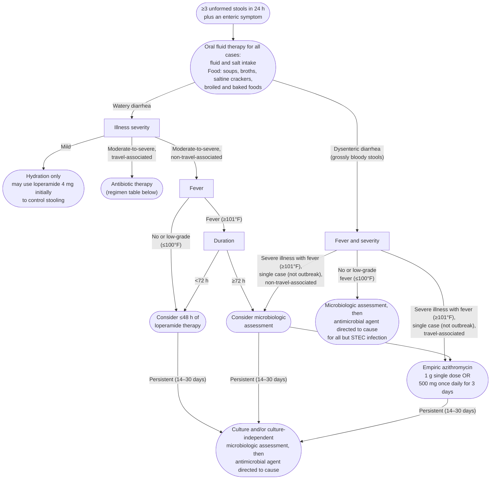

## Contents
- [[#Definition / Scope]]
  - [[#Severity Classification (ACG 2016)]]
- [[#Differential Diagnosis]]
  - [[#Clues by Presentation]]
  - [[#Clues by Exposure]]
  - [[#Noninfectious Causes]]
- [[#Diagnostic Algorithm]]
  - [[#Persistent Diarrhea (14–30 Days)]]
- [[#Key Tests]]
  - [[#Who to Test]]
  - [[#Which Test]]
  - [[#Tests Not to Use]]
- [[#Red Flags / Alarm Features]]
- [[#Therapeutics]]
  - [[#Rehydration]]
  - [[#Symptomatic Agents]]
  - [[#Probiotics]]
  - [[#Empiric Antibiotics]]
  - [[#Traveler's Diarrhea Regimens]]
  - [[#Parasite-Directed Therapy]]
  - [[#Prevention]]
- [[#Postinfectious Complications]]
- [[#See Also]]
- [[#Sources]]

---

## Definition / Scope

- **Acute diarrhea:** ≥3 unformed stools in 24 h (or any increase over the normal pattern) for **<14 days**, with an enteric symptom — nausea, vomiting, abdominal pain/cramps, bloating, flatulence, fever, bloody stools, tenesmus, fecal urgency ([[acg-2016-acute-diarrhea|American College of Gastroenterology (ACG) 2016]]).
- **Stool character** splits the workup: **watery** vs **dysenteric** (passage of grossly bloody stools).
- Scope: immune-competent adults; *Clostridioides difficile* has its own guideline → [[clostridioides-difficile]] ([[acg-2021-cdiff]]).

| Band | ACG 2016 | [[idsa-2017-infectious-diarrhea\|Infectious Diseases Society of America (IDSA) 2017]] |
|---|---|---|
| Acute | <14 days | <7 days |
| Prolonged | — | 7–13 days |
| Persistent | 14–30 days | 14–29 days |
| [[chronic-diarrhea\|Chronic]] | >30 days | ≥30 days |

- This page uses the ACG bands.

### Severity Classification (ACG 2016)

| Grade | Definition |
|---|---|
| Mild | No change in activities |
| Moderate | Able to function, but forced change in activities due to illness |
| Severe | Total disability due to diarrhea |

---

## Differential Diagnosis

- Most acute diarrhea in healthy, immunocompetent people is short, self-resolving, and viral or of unknown cause ([[idsa-2017-infectious-diarrhea]]); most community-acquired diarrhea is viral — [[norovirus]], [[rotavirus]], adenovirus ([[acg-2016-acute-diarrhea]], Recommendation [Rec] 10).
- Traveler's diarrhea (TD): diarrheagenic *E. coli* strains are the most common causes ([[acg-2016-acute-diarrhea]]); see [[enterotoxigenic-e-coli|enterotoxigenic *E. coli* (ETEC)]].
- Norovirus and *Shigella* spread by very low inocula — the most contagious enteric pathogens ([[acg-2016-acute-diarrhea]]).

### Clues by Presentation

| Finding | Likely pathogens |
|---|---|
| Visible blood in stool | [[shiga-toxin-producing-e-coli\|Shiga toxin–producing *E. coli* (STEC)]], [[shigellosis\|*Shigella*]], [[salmonella-infection\|*Salmonella*]], [[campylobacter-infection\|*Campylobacter*]], [[entamoeba-histolytica-infection\|*Entamoeba histolytica*]], noncholera *Vibrio*, *Yersinia*, *Balantidium coli*, *Plesiomonas* |
| Fever | Not highly discriminatory; higher temperatures suggest bacteria or *E. histolytica*; STEC usually **afebrile** at presentation |
| Severe abdominal pain, often grossly bloody stools, minimal or no fever | STEC, *Salmonella*, *Shigella*, *Campylobacter*, *Yersinia enterocolitica* |
| Persistent abdominal pain and fever | *Y. enterocolitica*, *Y. pseudotuberculosis* — may mimic appendicitis |
| Vomiting + nonbloody diarrhea ≤2–3 days | Norovirus (low-grade fever in the first 24 h in 40%) |
| Nausea and vomiting ≤24 h | *Staphylococcus aureus* enterotoxin or *Bacillus cereus* (short-incubation emetic syndrome) |
| Diarrhea and cramping 1–2 days | *Clostridium perfringens* or *B. cereus* |
| Persistent or chronic diarrhea | [[cryptosporidiosis\|*Cryptosporidium*]], [[giardiasis\|*Giardia*]], *Cyclospora cayetanensis*, *Cystoisospora belli*, *E. histolytica* |

*Clinical presentations suggestive of infectious diarrhea etiologies*
*Source: condensed from IDSA 2017 Table 3*
*[[idsa-2017-infectious-diarrhea|IDSA 2017 Infectious Diarrhea Guideline]]*
*STEC = Shiga toxin–producing Escherichia coli*

### Clues by Exposure

| Exposure | Pathogens |
|---|---|
| Travel to resource-challenged countries | *E. coli* (enteroaggregative, enterotoxigenic, enteroinvasive), *Shigella*, Typhi and nontyphoidal *Salmonella*, *Campylobacter*, *Vibrio cholerae*, *E. histolytica*, *Giardia*, *Blastocystis*, *Cyclospora*, *Cystoisospora*, *Cryptosporidium* |
| Recent antimicrobial therapy | *C. difficile*, multidrug-resistant *Salmonella* |
| Raw or undercooked meat/poultry | STEC (beef), *C. perfringens*, *Salmonella* and *Campylobacter* (poultry), *Yersinia* (pork, chitterlings) |
| Raw shellfish | *Vibrio*, norovirus, hepatitis A, *Plesiomonas* |
| Untreated fresh water (swimming or drinking) | *Campylobacter*, *Cryptosporidium*, *Giardia*, *Shigella*, *Salmonella*, STEC, *Plesiomonas shigelloides* |
| Healthcare, long-term care, prison | Norovirus, *C. difficile*, *Shigella*, *Cryptosporidium*, *Giardia*, STEC, rotavirus |
| Acquired immunodeficiency syndrome (AIDS), immunosuppressive therapy | *Cryptosporidium*, *Cyclospora*, *Cystoisospora*, microsporidia, *Mycobacterium avium*–intracellulare complex, cytomegalovirus (CMV) — see [[hiv-aids-related-diarrhea]] |
| Anal-genital, oral-anal, digital-anal contact | *Shigella*, *Salmonella*, *Campylobacter*, *E. histolytica*, *Giardia*, *Cryptosporidium*, sexually transmitted infections |

*Exposures associated with specific diarrheal pathogens (selected rows)*
*Source: condensed from IDSA 2017 Table 2*
*[[idsa-2017-infectious-diarrhea|IDSA 2017 Infectious Diarrhea Guideline]]*
*STEC = Shiga toxin–producing Escherichia coli · AIDS = acquired immunodeficiency syndrome*

### Noninfectious Causes

- [[inflammatory-bowel-disease|Inflammatory bowel disease (IBD)]] and [[irritable-bowel-syndrome|irritable bowel syndrome (IBS)]] — consider when symptoms last ≥14 days without an identified source ([[idsa-2017-infectious-diarrhea]], Rec 28; strong, moderate).
- Lactose intolerance — consider in nonresponders to an initial course of therapy (IDSA Rec 27; weak, low).
- If symptoms become chronic, ACG's chronic-diarrhea differential (outside its scope) includes [[celiac-disease|celiac disease]], [[crohns-disease|Crohn's disease]], eosinophilic gastroenteritis and Whipple's disease ([[acg-2016-acute-diarrhea]]); workup on [[chronic-diarrhea]].

---

## Diagnostic Algorithm

Stool character → severity ([[#Severity Classification (ACG 2016)]]) → travel → fever → duration ([[acg-2016-acute-diarrhea]], Figure 1).

*Empiric therapy and diagnostic-directed management of the adult with acute diarrhea (suspected infectious cause)*
*Source: redrawn from the ACG 2016 acute diarrheal infections algorithm*
*[[acg-2016-acute-diarrhea|ACG 2016 Acute Diarrheal Infections Guideline]]*
*STEC = Shiga toxin-producing Escherichia coli*

> [!pitfall] Fever plus loperamide: the guidelines conflict
> ACG 2016 Figure 1 allows ≤48 h of [[loperamide]] in non-travel watery diarrhea with fever ≥101°F for <72 h. The newer IDSA 2017 says to avoid loperamide at any age with fever, inflammatory diarrhea, or possible [[toxic-megacolon|toxic megacolon]] (Rec 47; strong, low) — IDSA wins ([[idsa-2017-infectious-diarrhea]]).

- ACG branches on "no or low-grade fever (≤100°F)" vs "fever (≥101°F)"; temperatures between those two cutoffs fall on neither branch. The IDSA travel cutoff (≥38.5°C) is a separate rule — don't cross-apply.

### Persistent Diarrhea (14–30 Days)

- Stool culture and/or culture-independent testing, then treatment directed to the cause (ACG Figure 1).
- **Not recommended:** serologic and clinical laboratory testing (ACG Rec 11; strong, very low); endoscopy once the stool workup is negative (ACG Rec 12; strong, very low).
- Travelers with diarrhea ≥14 days → test for intestinal parasites; test for *C. difficile* if antimicrobials in the preceding 8–12 weeks; consider IBD and [[postinfectious-ibs|postinfectious IBS]] (IDSA Rec 13; strong, moderate).
- Reassess fluid/electrolyte balance, nutrition, and antimicrobial dose and duration (IDSA Rec 29; strong, high). No empiric antibiotics for persistent watery diarrhea ≥14 days (IDSA Rec 36; strong, low).
- **Endoscopy or proctoscopy — consider** (IDSA Rec 24; strong, low) in:
  - persistent, unexplained diarrhea with AIDS
  - certain underlying medical conditions
  - acute diarrhea with clinical colitis or proctitis
  - persistent diarrhea with anal intercourse
- Duodenal aspirate — select patients with suspected *Giardia*, *Strongyloides*, *Cystoisospora*, or microsporidia (IDSA Rec 24; weak, low).
- Beyond 30 days → [[chronic-diarrhea]]. ACG notes [[colonoscopy]] yield of 7–32% there (IBD and [[microscopic-colitis|microscopic colitis]] most common), with mucosal biopsies even when the mucosa looks normal ([[acg-2016-acute-diarrhea]]).

---

## Key Tests

### Who to Test

Most uncomplicated acute watery diarrhea needs no testing.

| Situation | Test | Source |
|---|---|---|
| Dysentery, moderate–severe disease, or symptoms **>7 days** | Stool diagnostic studies, if available | ACG Rec 2 (strong, very low) |
| High risk of spreading disease (food handlers, health-care workers, daycare attendees/staff, institutional residents) or known/suspected outbreak | Stool culture + culture-independent methods, if available | ACG Rec 1 (strong, low) |
| Fever, bloody or mucoid stools, severe abdominal cramping or tenderness, or sepsis signs | Stool testing for *Salmonella*, *Shigella*, *Campylobacter*, *Yersinia*, *C. difficile*, STEC | IDSA Rec 8 (strong, moderate) |
| Uncomplicated TD | No testing unless treatment is indicated | IDSA Rec 13 (strong, moderate) |
| Immunocompromised | Broad: culture, viral studies, parasite examination; AIDS with persistent diarrhea → add *Cryptosporidium*, *Cyclospora*, *Cystoisospora*, microsporidia, *M. avium* complex, CMV | IDSA Rec 12 (strong, moderate) |
| Age >2 y with diarrhea after antimicrobials, or healthcare-associated diarrhea | *C. difficile* testing may be considered — one diarrheal specimen; method on [[clostridioides-difficile]] | IDSA Rec 18 (weak, high) |
| Large-volume rice-water stools, salty/brackish water, raw shellfish, or cholera-endemic travel ≤3 days before onset | *Vibrio* | IDSA Rec 10 (strong, low) |
| Persistent abdominal pain (right lower quadrant pain mimicking appendicitis), or fever with raw-pork exposure | *Yersinia enterocolitica* | IDSA Rec 10 (strong, low) |
| Infant <3 mo; septicemia; suspected enteric fever; systemic infection; immunocompromised; hemolytic anemia; febrile illness after travel to (or contact with travelers from) enteric-fever areas | **Blood cultures** | IDSA Rec 9 (strong, moderate) |

- Bloody stools are **not** an expected feature of *C. difficile* (IDSA Rec 8).
- Enteric fever: think of it in a febrile traveler from an endemic area (diarrhea uncommon) or with *Salmonella* Typhi/Paratyphi laboratory exposure (IDSA Rec 4) → workup on [[salmonella-infection]], [[fever-returning-traveler]].

### Which Test

- Culture, microscopy and antigen tests miss the cause in most cases; **Food and Drug Administration (FDA)-approved culture-independent tests** at least as an adjunct (ACG Rec 3; strong, low). Panels give results in hours; culture takes 48–72 h ([[acg-2016-acute-diarrhea]]).
- Multiplex nucleic acid amplification tests (NAAT) detect DNA, not necessarily viable organisms → interpret clinically (IDSA Rec 14; strong, low). A bacterial NAAT positive that public health requires as an isolate → culture it (IDSA Rec 15; strong, low).
- STEC: culture for O157 + Shiga toxin assay for non-O157 (IDSA Rec 8) → [[shiga-toxin-producing-e-coli]].
- Specimen: diarrheal stool (takes the shape of the container); rectal swab for bacteria if no timely stool; fresh stool for viruses, protozoa and *C. difficile* toxin (IDSA Rec 19; weak, low).
- Antibiotic susceptibility testing — not recommended for individual management (ACG Rec 4; strong, very low).

### Tests Not to Use

| Test | Stance | Source |
|---|---|---|
| Fecal leukocytes, stool lactoferrin | Should not be used to establish the cause | IDSA Rec 20 (strong, moderate) |
| Fecal calprotectin | Insufficient data to recommend | IDSA Rec 20 |
| Serology | Not for etiology (Rec 21; strong, low) or enteric fever (Rec 17; strong, moderate); may consider in post-diarrheal hemolytic uremic syndrome (HUS) with a stool culture negative for a Shiga toxin producer (Rec 21; weak, low) | IDSA Rec 17, 21 |
| Peripheral white blood cell (WBC) count and differential | Not for etiology (strong, low); may be useful clinically (weak, low) | IDSA Rec 22 |

---

## Red Flags / Alarm Features

- **Severe dehydration, shock, altered mental status, oral rehydration failure, or ileus** → isotonic intravenous (IV) fluids (IDSA Rec 41; strong, high; ileus strong, moderate).
- **Young children and older adults** → assess for dehydration; highest risk of life-threatening illness and death (IDSA Rec 5; strong, high).
- **Bloody stools, fever, sepsis, immunocompromise, symptoms >7 days** → test ([[#Who to Test]]); empiric antibiotics only per [[#Empiric Antibiotics]].
- **Known STEC** (especially Shiga toxin 2 or bloody diarrhea) → frequent hemoglobin, platelets, electrolytes, blood urea nitrogen, creatinine; smear for red-cell fragments if HUS suspected (IDSA Rec 23; strong, high) → [[shiga-toxin-producing-e-coli]].
- **Food handler, health-care or child-care worker** → follow jurisdictional reporting and infection-control rules (IDSA Rec 2; strong, high).

> [!pitfall] No antibiotics for STEC
> Avoid antimicrobials for STEC O157 and other Shiga toxin 2 producers, or when the toxin genotype is unknown (IDSA Rec 35; strong, moderate) — HUS risk ([[idsa-2017-infectious-diarrhea]]).

---

## Therapeutics

### Rehydration

- Most adults keep up with water, juices, sports drinks, soups and saltine crackers (ACG Rec 5).
- **Balanced oral rehydration solution (ORS)** — sodium 60–75 mEq/L, glucose 75–90 mmol/L — for the elderly with severe diarrhea and any traveler with cholera-like watery diarrhea (ACG Rec 5; strong, moderate).
- Reduced-osmolarity ORS = first line for mild–moderate dehydration at any age, any cause (IDSA Rec 39; strong, moderate); isotonic IV fluids (lactated Ringer's, normal saline) per [[#Red Flags / Alarm Features]] (IDSA Rec 41).
- Resume an age-appropriate usual diet during or right after rehydration (IDSA Rec 45; strong, low).

### Symptomatic Agents

| Agent | Use | Source |
|---|---|---|
| [[loperamide\|Loperamide]] | 4 mg, then 2 mg after each loose stool; ≤8 mg/day (≤16 mg/24 h with a TD antibiotic); not >48 h. Adjunct to antibiotics for TD (Rec 8; strong, moderate). **Not** for age <18 y (strong, moderate) or with fever, inflammatory diarrhea or possible toxic megacolon (strong, low) | ACG Rec 8, Table 4; IDSA Rec 47 |
| Bismuth subsalicylate (BSS) — treatment | 30 mL (525 mg) liquid or 2 tablets (263 mg each), chewed, every 30–60 min; ≤8 doses/24 h. Cuts stools passed by ~40% | ACG Rec 7 (strong, high) |
| BSS — contraindications | Other salicylates already taken; IBD or human immunodeficiency virus (HIV) infection (bismuth encephalopathy). Black stool and tongue are harmless | [[acg-2016-acute-diarrhea]] |
| Adsorbents (kaolin, pectin, charcoal, attapulgite) | Not recommended — change stool form, not duration | [[acg-2016-acute-diarrhea]] |
| Racecadotril | Antisecretory enkephalinase inhibitor; not FDA-approved in the US | [[acg-2016-acute-diarrhea]] |
| Antimotility, antinausea, antiemetic agents | Only once hydrated — never a substitute for fluids | IDSA Rec 46 (weak, low) |

### Probiotics

| Population | Stance | Source |
|---|---|---|
| Adults, acute diarrhea | Not recommended, except postantibiotic-associated illness | ACG 2016 Rec 6 (strong, moderate) |
| Immunocompetent adults and children, infectious or antimicrobial-associated diarrhea | May be offered to reduce severity and duration | IDSA 2017 Rec 49 (weak, moderate) |
| Children, acute infectious gastroenteritis | Suggest against | [[aga-2020-probiotics\|American Gastroenterological Association (AGA) 2020]] Rec 7 (conditional, moderate) |
| Prevention of TD | Not recommended | ACG 2016 Rec 17 (conditional, low) |

- The guidelines conflict: IDSA 2017 (newer) allows [[probiotics]] in adults where ACG 2016 does not; for children, AGA 2020 (newest) recommends against.

### Empiric Antibiotics

| Situation | Empiric antibiotic? | Source |
|---|---|---|
| Routine or community-acquired acute diarrhea | **No** — mostly viral, not shortened by antibiotics | ACG Rec 9 (strong, high), Rec 10 (strong, very low) |
| Acute watery diarrhea without recent international travel | **No** (strong, low); exception possible if immunocompromised or an ill-appearing young infant | IDSA Rec 36 |
| Persistent watery diarrhea ≥14 days | **Avoid** | IDSA Rec 36 (strong, low) |
| Moderate–severe TD; severe travel-associated dysentery with fever | **Yes** — regimens below; dysentery → azithromycin (flowchart) | ACG Rec 9, Figure 1 |
| Bloody diarrhea, immunocompetent, awaiting results | **No** (strong, low), except (weak, low): infant <3 mo with suspected bacterial cause · ill patient with fever documented in a medical setting, abdominal pain, bloody diarrhea and bacillary dysentery (frequent scant bloody stools, fever, cramps, tenesmus) presumed [[shigellosis\|*Shigella*]] · recent international travel with temperature ≥38.5°C and/or sepsis signs | IDSA Rec 30 |
| Immunocompromised, severe illness, bloody diarrhea | **Consider** | IDSA Rec 32 (strong, low) |
| Sepsis with suspected enteric fever | **Broad-spectrum**, after blood, stool and urine cultures; narrow on susceptibilities | IDSA Rec 34 (strong, low; narrowing strong, high) |
| Asymptomatic contacts | **No** — infection-control measures only | IDSA Rec 33, 37 (strong, moderate) |

- **Agent (IDSA Rec 31; strong, moderate):** adults — a fluoroquinolone (FQ) such as ciprofloxacin, or azithromycin, by local susceptibility and travel history; children — third-generation cephalosporin (<3 mo or neurologic involvement) or azithromycin.
- Modify or stop once a plausible organism is identified (IDSA Rec 38; strong, high). Pathogen-specific agents → each pathogen's page.

### Traveler's Diarrhea Regimens

| Antibiotic | Dose | Duration | Notes |
|---|---|---|---|
| Levofloxacin | 500 mg by mouth | Single dose or 3-day course | — |
| Ciprofloxacin | 750 mg by mouth, or 500 mg by mouth | Single dose, or 3-day course | — |
| Ofloxacin | 400 mg by mouth | Single dose or 3-day course | — |
| **Azithromycin** | 1,000 mg by mouth, or 500 mg by mouth | Single dose, or 3-day course | **First line in Southeast Asia and India** (FQ-resistant *Campylobacter*), or elsewhere if *Campylobacter* or resistant ETEC suspected; preferred for dysentery or febrile diarrhea |
| [[rifaximin\|Rifaximin]] | 200 mg by mouth three times daily | 3 days | Not if *Campylobacter*, *Salmonella*, *Shigella* or other invasive diarrhea suspected |

*Antibiotic regimens for traveler's diarrhea*
*Source: recreated from ACG 2016 Table 4*
*[[acg-2016-acute-diarrhea|ACG 2016 Acute Diarrheal Infections Guideline]]*
*FQ = fluoroquinolone · ETEC = enterotoxigenic Escherichia coli*

- Single dose not resolved after 24 h → complete a 3-day course (Table 4). 3-day therapy for fever or dysentery; *Shigella dysenteriae* may need 5 days ([[acg-2016-acute-diarrhea]]).
- Any regimen may be combined with loperamide (≤16 mg/24 h).
- **Chemoprophylaxis** — may be considered in high-risk groups, short term only (ACG Rec 18; strong, high): protective efficacy 67% for rifaximin, 88% for FQs; FQ concerns = resistance, tendinopathy, *C. difficile*.
- BSS prophylaxis (ACG Rec 16; strong, high): 2 tablets four times daily (2.1 g/day) at meals and bedtime, ≥60% protection; trips up to 2 weeks only; for travelers without contraindications who can keep to the dosing.

### Parasite-Directed Therapy

Neither guideline gives doses or durations.

| Pathogen | Agent(s) |
|---|---|
| *Giardia* | **Tinidazole** or **[[nitazoxanide]]** (first choice); **metronidazole** alternative (not FDA-approved for giardiasis) [[idsa-2017-infectious-diarrhea]] |
| *Entamoeba histolytica* | **Metronidazole** or **tinidazole** [[acg-2016-acute-diarrhea]] |
| *Cryptosporidium* | **Nitazoxanide** — in HIV infection, combined with effective combination antiretroviral therapy (cART) [[idsa-2017-infectious-diarrhea]] |
| *Cyclospora cayetanensis* | **Trimethoprim-sulfamethoxazole (TMP-SMX)**; nitazoxanide alternative (limited data) [[idsa-2017-infectious-diarrhea]] |
| *Cystoisospora belli* | **TMP-SMX** (first choice); **pyrimethamine** alternative; potential second-line ciprofloxacin or nitazoxanide [[idsa-2017-infectious-diarrhea]] |
| *Enterocytozoon bieneusi* | **Fumagillin**, recommended in HIV-infected adults; unavailable for systemic use in the United States [[idsa-2017-infectious-diarrhea]]. ACG 2016 names **albendazole** [[acg-2016-acute-diarrhea]]. Other microsporidia: see [[hiv-aids-related-diarrhea]] |
| *Dientamoeba fragilis* | **Iodoquinol** [[acg-2016-acute-diarrhea]] |

### Prevention

| Measure | Stance | Source |
|---|---|---|
| Patient-level counseling on preventing enteric infection | Not routine; may consider for the individual (or close contacts) at high risk of complications | ACG Rec 13 (conditional, very low) |
| Pretravel counseling on high-risk food and beverages | Should be given; evidence of benefit is mixed | ACG Rec 14 (conditional, very low) |
| Hand washing, alcohol-based sanitizers | Limited value against most TD (high-inoculum *E. coli*); useful for low-dose pathogens — norovirus on a cruise ship, institutional outbreak, endemic diarrhea | ACG Rec 15 (conditional, low) |
| Ill people with diarrhea | Avoid swimming, water activities and sexual contact while symptomatic | IDSA Rec 56 (strong, low) |
| Typhoid vaccine | Travelers to moderate–high-risk areas, intimate contacts of a *Salmonella* Typhi chronic carrier, exposed laboratory staff; boosters if still at risk | IDSA Rec 58 (strong, high) |
| Live attenuated oral cholera vaccine | Adults 18–64 y traveling to cholera-affected areas | IDSA Rec 59 (strong, high) |
| Reporting | Report notifiable diseases to the health department, with isolates of e.g. *Salmonella*, STEC, *Shigella*, *Listeria* | IDSA Rec 60 (strong, high) |

---

## Postinfectious Complications

Evaluate for postinfectious and extraintestinal manifestations (IDSA Rec 7; strong, moderate).

| Manifestation | Organism(s) |
|---|---|
| Postinfectious IBS | *Campylobacter*, *Salmonella*, *Shigella*, STEC, *Giardia* |
| Reactive arthritis | *Salmonella*, *Shigella*, *Campylobacter*, *Yersinia*; rarely *Giardia*, *Cyclospora cayetanensis* |
| HUS | STEC, *Shigella dysenteriae* serotype 1 |
| Guillain-Barré syndrome | *Campylobacter* |
| Intestinal perforation | *Salmonella* (incl. Typhi), *Shigella*, *Campylobacter*, *Yersinia*, *E. histolytica* |
| Aortitis, osteomyelitis, deep-tissue focus | *Salmonella*, *Yersinia* |

*Postinfectious manifestations of enteric pathogens (selected rows)*
*Source: recreated from IDSA 2017 Table 4*
*[[idsa-2017-infectious-diarrhea|IDSA 2017 Infectious Diarrhea Guideline]]*
*IBS = irritable bowel syndrome · STEC = Shiga toxin–producing Escherichia coli · HUS = hemolytic uremic syndrome*

- Postinfectious IBS: no serologic or other diagnostic test; diagnosed by conventional symptom criteria (ACG cites Rome III) ([[acg-2016-acute-diarrhea]]).
- Antibiotic self-treatment of TD raises colonization with extended-spectrum β-lactamase (ESBL)- and carbapenemase-producing Enterobacteriaceae — ESBL colonization in 80% of self-medicating travelers vs 21% with travel alone, in one study ([[acg-2016-acute-diarrhea]]).

---

## See Also

[[clostridioides-difficile]], [[fever-returning-traveler]], [[irritable-bowel-syndrome]], [[postinfectious-ibs]], [[chronic-diarrhea]], [[inflammatory-bowel-disease]], [[crohns-disease]], [[ulcerative-colitis]], [[celiac-disease]], [[microscopic-colitis]], [[colon-ischemia]], [[toxic-megacolon]], [[disorders-of-gut-brain-interaction]], [[norovirus]], [[rotavirus]], [[enterotoxigenic-e-coli]], [[shiga-toxin-producing-e-coli]], [[salmonella-infection]], [[shigellosis]], [[campylobacter-infection]], [[giardiasis]], [[cryptosporidiosis]], [[entamoeba-histolytica-infection]], [[hiv-aids-related-diarrhea]], [[colonoscopy]], [[loperamide]], [[nitazoxanide]], [[rifaximin]], [[probiotics]]

---

## Sources

1. [[acg-2016-acute-diarrhea|ACG 2016: Diagnosis, Treatment, and Prevention of Acute Diarrheal Infections in Adults]]
2. [[idsa-2017-infectious-diarrhea|IDSA 2017 Clinical Practice Guidelines for the Diagnosis and Management of Infectious Diarrhea]]
3. [[aga-2020-probiotics|AGA Clinical Practice Guidelines on the Role of Probiotics in the Management of Gastrointestinal Disorders]]
4. [[acg-2021-cdiff|ACG 2021: Prevention, Diagnosis, and Treatment of Clostridioides difficile Infections]]
