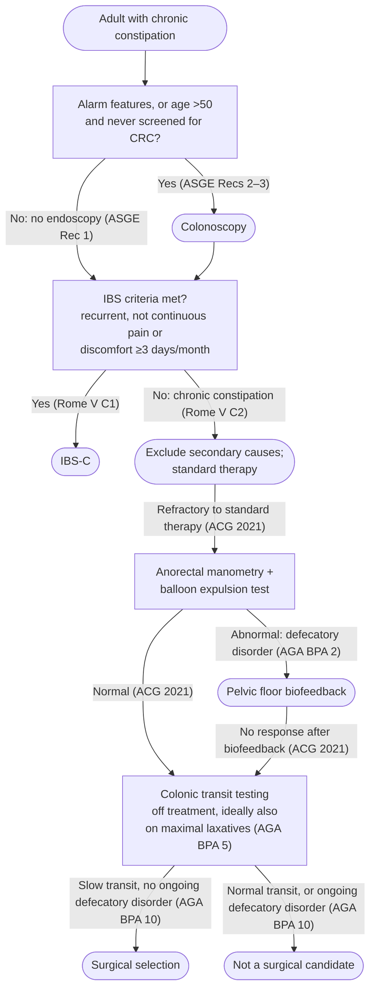

## Contents
- [[#Definition / Scope]]
  - [[#What counts as abnormal]]
  - [[#The three physiologic subtypes]]
- [[#Differential Diagnosis]]
  - [[#Secondary causes to exclude before labelling it primary]]
- [[#Diagnostic Algorithm]]
- [[#Key Tests]]
  - [[#Which test answers which question]]
  - [[#Test conditions that change the answer]]
- [[#Red Flags / Alarm Features]]
- [[#See Also]]
- [[#Sources]]

---

## Definition / Scope

The adult presenting with **infrequent and/or unsatisfactory defecation** — how to separate primary (gut–brain) constipation from a secondary cause, and then which of the three physiologic subtypes is driving it. Not a defined diagnosis; management endpoints live on [[chronic-idiopathic-constipation]] and [[defecation-disorders]].

- **Prevalence:** chronic constipation (CC) affects **8%–12% of the US population**; **3 million patients per year** seek clinical evaluation [[aga-2026-refractory-constipation]]
- **Nomenclature:** *chronic constipation*, *chronic idiopathic constipation*, and *functional constipation* are **interchangeable terms** [[aga-2026-refractory-constipation]]. [[rome-v-2026-dgbi|Rome V]] (2026) formalised this — "chronic constipation" (bowel disorder of gut–brain interaction [DGBI] category **C2**) replaced Rome IV's "functional constipation", dropping the word *functional*
- **Separate Rome V entities that are not C2:** **C6 [[opioid-induced-constipation|opioid-induced constipation]]**; **F3 dyssynergic defecation** (an anorectal disorder). Rome V **removed the umbrella category "functional defecation disorders"** as too broad — it swept in structural conditions such as [[rectal-prolapse|rectal prolapse]] and perineal descent [[rome-v-2026-dgbi]]
- **Refractory constipation (RC)** = infrequent and/or unsatisfactory bowel habits, with or without abdominal pain, **despite an adequate trial of lifestyle, dietary, medical, and/or pelvic floor [[biofeedback-therapy|biofeedback]] therapy when indicated**, in an adult who satisfies criteria for CC or constipation-predominant irritable bowel syndrome (IBS) (American Gastroenterological Association [AGA] 2026 best practice advice [BPA] 1) [[aga-2026-refractory-constipation]]
  - **Operational criteria.** International consensus guidelines quoted by [[aga-2026-refractory-constipation]] define RC as "infrequent and/or unsatisfactory bowel habits" **plus any one** of:
    1. Inadequate number of bowel movements most of the time, **and complete bowel movements on fewer than 3 days/week**
    2. **Straining on most occasions**, or worsening straining
    3. **No improvement in stool consistency on current therapy, and [[bristol-stool-form-scale|Bristol stool scale]] score <3**
    4. Insufficient improvement of another sign or symptom of CC on current treatment
    5. **Poor tolerability** of the current treatment makes the relief it provides unacceptable
  - RC is what opens the refractory arm of the algorithm below — transit testing, defecography, and the surgical question

**Rome V criteria for chronic constipation (C2)** ([[rome-v-2026-bowel-disorders]]) — fulfilled for the past 3 months, symptom onset ≥6 months before diagnosis:

> Must include:
> 1. **Two or more** of:
>    a. Straining during **>25%** of defecations
>    b. Lumpy or hard stools (Bristol 1–2) in **>25%** of defecations
>    c. Sensation of incomplete evacuation in **>25%** of defecations
>    d. Sensation of anorectal obstruction/blockage in **>25%** of defecations
>    e. Manual maneuvers to facilitate **>25%** of defecations (digital evacuation, support of the pelvic floor)
>    f. Fewer than **3 spontaneous bowel movements (SBMs) per week**
> 2. Loose stools are rarely present without the use of laxatives
> 3. **Insufficient criteria for IBS**

- **CC vs IBS with constipation (IBS-C)** turns on whether abdominal pain/discomfort is the *predominant* feature. Pain may occur in CC — it just does not dominate; a patient with CC must not meet IBS criteria ([[rome-v-2026-bowel-disorders]]).
- **Occasional constipation** is a separate Rome Foundation Working Team label for the patient who does *not* meet CC: "at least 1 functional constipation symptom, in the absence of alarm signs or symptoms, occurring at irregular and infrequent intervals, which is bothersome enough to induce a patient to seek management" ([[rome-v-2026-bowel-disorders]]).

### What counts as abnormal

Many patients hold misconceptions about normal bowel habits; normative data guide treatment goals (BPA 4) [[aga-2026-refractory-constipation]]:

| Parameter | Normal range in the US population |
|---|---|
| Stool frequency | **~95%** of individuals fall between **3 bowel movements/day and 3 bowel movements/week** |
| Stool consistency | **90%** have an average **Bristol 3–5 (men)** and **Bristol 2–6 (women)** |

### The three physiologic subtypes

| Subtype | What is wrong | How it is proven | Where it is managed |
|---|---|---|---|
| **Normal-transit** | Neither transit nor evacuation is measurably impaired | Normal [[anorectal-manometry\|anorectal manometry (ARM)]] + balloon expulsion test (BET), and normal colonic transit | [[chronic-idiopathic-constipation]] |
| **Slow-transit** | Delayed colonic transit ("colonic inertia") | **Colonic transit testing** once a defecatory disorder is excluded or treated [[acg-2021-anorectal-disorders]]; in RC **off treatment**, ideally repeated **on a maximal laxative regimen** to document refractoriness [[aga-2026-refractory-constipation]] | [[chronic-idiopathic-constipation]] |
| **Defecatory disorder** | Inadequate rectal propulsive forces and/or impaired relaxation or paradoxical contraction of the external anal sphincter and/or puborectalis [[acg-2021-anorectal-disorders]] | ARM + BET (± defecography) — see [[defecation-disorders]] | [[biofeedback-therapy\|Biofeedback]] [[acg-2021-anorectal-disorders]] |

**Approximately 37%** of CC patients who undergo pelvic floor testing have dyssynergic defecation [[aga-2026-refractory-constipation]]; slow transit in a defecatory disorder often normalizes with successful biofeedback [[acg-2021-anorectal-disorders]] ([[chronic-idiopathic-constipation#Anorectal Physiology Testing (if outlet dysfunction suspected)|treat the pelvic floor first]]).

---

## Differential Diagnosis

**The first fork is IBS-C vs chronic constipation, and Rome V moved it** [[rome-v-2026-dgbi]]:

- **Frequency:** abdominal pain *or discomfort* **≥3 days per month in the last 3 months** qualifies for [[irritable-bowel-syndrome|IBS]] — Rome IV required **1 day per week** over the previous 3 months
- **Discomfort re-included** (removed in Rome IV)
- **Not continuous:** continuous pain points to [[centrally-mediated-abdominal-pain-syndrome|centrally mediated abdominal pain syndrome]]

| Alternative | Discriminating feature |
|---|---|
| [[irritable-bowel-syndrome\|IBS-C]] | Recurrent, not continuous, pain/discomfort on average ≥3 days/month in the past 3 months, with ≥2 of: related to defecation, change in stool frequency, change in stool form (Rome V C1) [[rome-v-2026-bowel-disorders]] |
| Opioid-induced constipation (Rome V **C6**) | **New or worsening** constipation symptoms **when initiating, changing, or increasing opioid therapy** [[rome-v-2026-bowel-disorders]] — criteria and management on [[opioid-induced-constipation]] |
| [[defecation-disorders\|Defecatory disorder]] | Excessive straining, sense of anorectal blockage, manual maneuvers, sense of incomplete evacuation [[acg-2021-anorectal-disorders]]; confirmed on anorectal testing |
| [[colorectal-cancer\|Colorectal cancer (CRC)]] / benign colonic stricture | Alarm features (below); [[colonoscopy]] indicated |
| [[colon-ischemia\|Ischaemic]], post-surgical, or [[inflammatory-bowel-disease\|inflammatory bowel disease (IBD)]]-related stricture | Endoscopically dilatable; identified at colonoscopy [[asge-2014-constipation]] |
| [[rectal-prolapse\|Rectal prolapse]] / [[rectal-prolapse#Solitary Rectal Ulcer Syndrome\|solitary rectal ulcer syndrome]] | Solitary rectal ulcer at endoscopy suggests underlying prolapse [[asge-2014-constipation]] |
| Hirschsprung disease | Suspected cases need [[anorectal-manometry\|ARM]] **plus deep biopsy** for absent myenteric neurons [[asge-2014-constipation]] |

### Secondary causes to exclude before labelling it primary

Patients with RC should be **thoroughly evaluated for secondary causes** (BPA 3) [[aga-2026-refractory-constipation]]:

- **Medications** — among the most common iatrogenic causes. Opioid-induced or opioid-exacerbated constipation; **anticholinergic agents such as antipsychotics**; **iron supplements**. In many patients these *exacerbate* pre-existing constipation rather than cause it
  - **Opioids — first steps** [[aga-2019-opioid-induced-constipation]]: confirm the indication is appropriate, that the patient is in a pain management program (ideally with a pain specialist), and that the **minimum necessary dose** is being taken. **Opioid switching** to an **equianalgesic dose of a less-constipating opioid** may help — oral/parenteral morphine preparations may constipate more than **transdermal opioids such as fentanyl**; combination opioid agonist/antagonist agents (e.g. oxycodone + naloxone) carry a lower risk of constipation
- **Disordered eating** — inadequate caloric intake; eating disorders such as anorexia nervosa may be undiagnosed or unrecognized
- **Comorbid neurological disease** — rarely undiagnosed or early-stage Parkinson's disease or multiple sclerosis without typical neurologic signs; consider autonomic function testing with orthostatic symptoms (off-label pyridostigmine option on [[chronic-idiopathic-constipation]])
- **Endometriosis** occasionally coexists with CC
- **Metabolic/organic conditions excluded from the chronic idiopathic constipation (CIC) evidence base** — hypothyroidism and [[celiac-disease|celiac disease]] were explicit exclusions when the CIC pharmacologic recommendations were derived, as were opioid-induced constipation and IBS-C [[aga-acg-2023-constipation]]

---

## Diagnostic Algorithm

Assembled from the American Society for Gastrointestinal Endoscopy (ASGE) 2014, Rome V, the American College of Gastroenterology (ACG) 2021 anorectal guideline and AGA 2026. Medical escalation and surgical selection in RC: [[chronic-idiopathic-constipation#Refractory Constipation (AGA 2026)]].

*Chronic constipation workup, first visit to the surgical question*
*Source: built from ASGE 2014 Recs 1–3, Rome V criteria C1 and C2, ACG 2021 (anorectal and colonic transit testing text) and AGA 2026 BPA 2, 5 and 10 (no source has a single workup flowchart)*
*[[asge-2014-constipation|ASGE 2014]] · [[rome-v-2026-bowel-disorders|Rome V Bowel Disorders]] · [[acg-2021-anorectal-disorders|ACG 2021 Benign Anorectal Disorders]] · [[aga-2026-refractory-constipation|AGA 2026 Refractory Constipation]]*
*CRC = colorectal cancer · IBS = irritable bowel syndrome · IBS-C = IBS with constipation · ASGE = American Society for Gastrointestinal Endoscopy · ACG = American College of Gastroenterology · AGA = American Gastroenterological Association · BPA = best practice advice*

The ACG 2021 evaluation figure for suspected defecatory disorder lives on [[defecation-disorders]].

---

## Key Tests

### Which test answers which question

| Test | Question it answers | When to order |
|---|---|---|
| **[[colonoscopy]]** | Is there organic colorectal disease? | **Not** in the initial evaluation absent alarm features or suspicion of organic gastrointestinal (GI) disease (ASGE Rec 1, moderate quality). Indications: [[#Red Flags / Alarm Features]] [[asge-2014-constipation]] |
| **[[anorectal-manometry\|ARM]] + BET** | Is this a defecatory disorder? | **Most patients with CC** should have ARM + BET (and complete a biofeedback course when indicated) **before being labelled refractory** (BPA 2) [[aga-2026-refractory-constipation]]; all patients refractory to standard therapy [[acg-2021-anorectal-disorders]]. Careful rectal examination in every patient first [[aga-2026-refractory-constipation]]. Rome V: not at the initial evaluation unless the digital rectal examination strongly suggests a defecatory disorder [[rome-v-2026-bowel-disorders]] |
| **Colonic transit testing** (radiopaque markers, scintigraphy, or wireless motility capsule) | Is transit slow, and is it slow *despite* treatment? | Only after no response to biofeedback, or with normal anorectal testing [[acg-2021-anorectal-disorders]]. In RC: **off treatment** to document slow transit and **ideally again on a maximal laxative regimen** to document refractoriness (BPA 5); wireless motility capsules also measure **regional** gut transit [[aga-2026-refractory-constipation]] |
| **Defecography (barium or magnetic resonance [MR])** | Is there a structural cause, or does imaging resolve a discordant ARM/BET? | Clinical features and initial tests disagree, ARM and BET disagree, and/or pelvic organ prolapse is suspected [[acg-2021-anorectal-disorders]]; should be considered in RC (BPA 6) [[aga-2026-refractory-constipation]] |
| **Gastric emptying / regional gut transit** | Is there upper-gut dysmotility that predicts a poor surgical outcome? | **Before surgery for RC** (BPA 11): regional gut transit testing; gastric emptying in patients with clinically significant upper GI symptoms. Recurrent constipation and poor quality of life after colectomy were more common with pre-existing upper GI dysmotility [[aga-2026-refractory-constipation]]. Rome V likewise recommends upper gut transit evaluation, to exclude a diffuse GI motility disorder, when surgery is considered [[rome-v-2026-bowel-disorders]] |
| **Colonic manometry ± barostat** | Is colonic motility truly impaired? | Before colectomy, if available — especially when colonic transit is equivocal [[aga-2026-refractory-constipation]]. Rome V: not widely available outside academic centers; relevance to CC management uncertain [[rome-v-2026-bowel-disorders]] |

**Testing needed to diagnose a defecatory disorder differs by guideline** (ACG 2021: ARM and BET both required; AGA 2026: typically 2 of 3 tests abnormal; Rome V: any 1 of 3 abnormal) — criteria table on [[defecation-disorders]].

**Defecography:** barium vs MR choice on [[anorectal-manometry#Defecography — Barium vs Magnetic Resonance (MR)]]; findings and when they are clinically relevant on [[defecation-disorders]].

**Labs and imaging (Rome V)** [[rome-v-2026-bowel-disorders]]:

- **Labs:** complete blood count (CBC) to exclude anemia (an alarm feature); **thyroid-stimulating hormone (TSH) and serum calcium only when clinically indicated** — e.g. suspected hypothyroidism or a disease inducing hypercalcemia.
- **Imaging** (barium enema, ultrasound, computed tomography, magnetic resonance) has **minimal diagnostic value in CC** absent alarm features or relevant comorbidities — not generally recommended.

### Test conditions that change the answer

- **Colonic transit:** stop **laxatives for ≥7 days** and **medications that delay colon transit for ≥2 weeks** before testing. Day-to-day reproducibility is poor in dyssynergic defecation and colonic inertia, so **repeat testing may be necessary** — in some patients while taking laxatives [[aga-2026-refractory-constipation]]
- **Each abnormal anorectal test finding is highly specific** for a defecatory disorder — a lower rectoanal gradient on manometry, a prolonged BET, and reduced evacuation on defecography. In select patients defecography may help confirm the diagnosis, particularly with an **abnormal gradient on ARM and a normal BET** [[aga-2026-refractory-constipation]]
- **Normalisation of the BET after biofeedback** suggests the defecatory disorder has resolved [[aga-2026-refractory-constipation]]
- **[[bowel-preparation|Bowel preparation]]:** chronic constipation is an independent risk factor for inadequate prep — consider a more aggressive cleansing regimen [[asge-2014-constipation]]

---

## Red Flags / Alarm Features

**Colonoscopy to exclude organic disease** (ASGE Rec 2, high quality) [[asge-2014-constipation]]:

- **Rectal bleeding**
- **Heme-positive stool**
- **Iron-deficiency anaemia** — see [[iron-deficiency-anemia]]
- **Weight loss**
- **Obstructive symptoms** (ungraded text)
- **Before surgery** for chronic constipation
- Younger patients: flexible sigmoidoscopy may be sufficient to exclude distal disease (ungraded text)

**Screening-driven, not alarm-driven:** ASGE 2014 recommends colonoscopy for patients **>50 years** presenting with constipation who have not previously had CRC screening (Rec 3, high quality) [[asge-2014-constipation]]. **[[acg-2021-crc-screening|ACG 2021]] later suggested average-risk screening at ages 45–49 as well** (Rec 2, conditional, very low-quality evidence) — a general screening recommendation, not specific to constipation; start/stop ages and modalities on [[colorectal-cancer-screening]].

Therapeutic colonoscopy (stricture dilation, percutaneous cecostomy; no role in disimpaction): [[chronic-idiopathic-constipation#Role of Endoscopy (ASGE 2014)]].

---

## See Also

[[chronic-idiopathic-constipation]], [[opioid-induced-constipation]], [[pamoras]], [[defecation-disorders]], [[irritable-bowel-syndrome]], [[fecal-incontinence]], [[proctalgia-syndromes]], [[anorectal-manometry]], [[biofeedback-therapy]], [[sacral-nerve-stimulation]], [[colonoscopy]], [[colorectal-cancer]], [[rectal-prolapse]], [[acute-colonic-pseudo-obstruction]], [[disorders-of-gut-brain-interaction]], [[ostomy-management]]

---

## Sources

1. [[aga-2026-refractory-constipation|AGA Clinical Practice Update on Evaluation and Management of Refractory Constipation: Expert Review]]
2. [[aga-acg-2023-constipation|AGA-ACG 2023 Pharmacologic Management of Chronic Idiopathic Constipation]]
3. [[acg-2021-anorectal-disorders|ACG 2021 Clinical Guidelines: Management of Benign Anorectal Disorders]]
4. [[asge-2014-constipation|ASGE 2014: The Role of Endoscopy in the Management of Constipation]]
5. [[rome-v-2026-bowel-disorders|Bowel Disorders (Rome V, 2026)]]
6. [[rome-v-2026-dgbi|Disorders of Gut–Brain Interaction and the Rome V Process]]
7. [[acg-2021-crc-screening|ACG 2021 Colorectal Cancer Screening Guidelines]]
8. [[aga-2019-opioid-induced-constipation|American Gastroenterological Association Institute Guideline on the Medical Management of Opioid-Induced Constipation]]