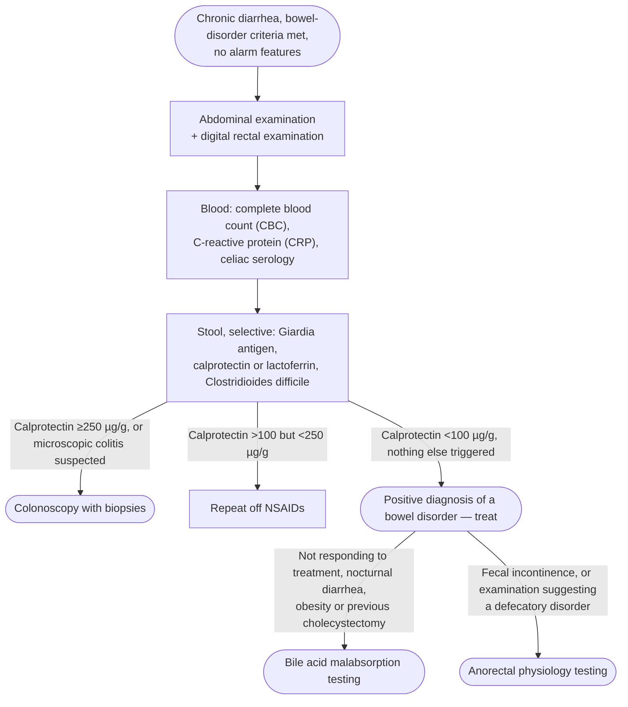

## Contents
- [[#Definition / Scope]]
  - [[#Population for the Laboratory Recommendations]]
  - [[#Mechanistic Classification]]
- [[#Differential Diagnosis]]
  - [[#Watery — Secretory]]
  - [[#Watery — Osmotic]]
  - [[#Inflammatory]]
  - [[#Fatty (Malabsorptive / Steatorrhea)]]
- [[#Diagnostic Algorithm]]
- [[#Key Tests]]
  - [[#Initial Test Panel]]
  - [[#Laboratory Tests to Send and to Skip]]
  - [[#Individual Tests]]
  - [[#Role of Endoscopy]]
- [[#Red Flags / Alarm Features]]

---

## Definition / Scope

- **Definition:** decreased stool consistency (loose or watery) lasting **>4 weeks**. Defined by **stool consistency** ([[bristol-stool-form-scale|Bristol]] 6–7), not frequency alone.
- **Diarrhea in adults** — abnormal stool weight **>200 g/day**, loose or liquid consistency, and/or frequency **>3 times/day** ([[asge-2010-diarrhea]]).
- **Why the duration matters:** it separates chronic diarrhea from [[acute-diarrhea]] (<14 days) and persistent diarrhea (14–30 days), and shifts the differential away from infection toward non-infectious causes.
- **Must be distinguished from:**
  - **Pseudodiarrhea** — frequent small volumes with urgency, as in proctitis or [[irritable-bowel-syndrome|irritable bowel syndrome (IBS)]]
  - **[[fecal-incontinence|Fecal incontinence]]**
- **The guidelines do not agree on the boundary.** [[asge-2010-diarrhea|American Society for Gastrointestinal Endoscopy (ASGE) 2010]] (>4 weeks) and [[aga-2019-lab-evaluation-functional-diarrhea-ibs-d|American Gastroenterological Association (AGA) 2019]] (at least 4 weeks) sit at 4 weeks; [[acg-2016-acute-diarrhea|American College of Gastroenterology (ACG) 2016]] sets chronic at **>30 days**, leaving days 28–30 claimed by both labels. Either way the workup below applies — do not read the boundary as precise.

### Population for the Laboratory Recommendations

[[aga-2019-lab-evaluation-functional-diarrhea-ibs-d|AGA 2019]] writes its laboratory recommendations — including the ones **against** testing — for a single population: the **immunocompetent adult with "watery" diarrhea of at least 4 weeks**. Explicitly excluded:

- Bloody diarrhea
- Diarrhea with signs of fat malabsorption
- Alarm features — weight loss, anemia, hypoalbuminemia
- Family history of [[inflammatory-bowel-disease|inflammatory bowel disease (IBD)]], [[colorectal-cancer|colon cancer]] or [[celiac-disease|celiac disease]]
- Travel to regions with recognised diarrhea-related pathogens

> [!pitfall] The advice not to test covers a narrow group
> Outside that population, AGA 2019's recommendations against erythrocyte sedimentation rate (ESR)/C-reactive protein (CRP) and against stool ova and parasites do not apply — go structural first ([[#Red Flags / Alarm Features]]) ([[aga-2019-lab-evaluation-functional-diarrhea-ibs-d]]).

[[rome-v-2026-bowel-disorders|Rome V (2026)]] frames the same ground as a threshold rather than a list: once bowel-disorder criteria are met and alarm features are absent, **testing should be selective and limited**, and the predictive value of alarm features for organic disease is only **modest**.

The framework below classifies by **stool character** — watery, inflammatory, fatty — which maps onto the underlying mechanism and the workup.

### Mechanistic Classification

*The guidelines cited on this page do not define the secretory/osmotic/inflammatory/fatty scheme, give the stool osmotic-gap formula, or set its cut-points, and none prints a numeric Bristol cut-off for diarrhea. Use the table to organise the differential, not as a decision rule.*

| Type | Mechanism | Stool osmotic gap | Fasting response |
|---|---|---|---|
| **Secretory** | Net ion/fluid secretion | **Low** (<50 mOsm/kg) | Persists with fasting |
| **Osmotic** | Unabsorbed osmotically active solute | **High** (>75 mOsm/kg) | Improves with fasting |
| **Inflammatory** | Mucosal injury/exudation | Variable; blood/leukocytes | Persists |
| **Fatty (malabsorptive)** | Fat maldigestion/malabsorption | High; ↑ fecal fat | Improves with fasting |
| **Dysmotility** | Altered transit (e.g. IBS, hyperthyroidism) | Variable | Variable |

**Stool osmotic gap** = 290 − 2 × (stool Na⁺ + stool K⁺).

---

## Differential Diagnosis

### Watery — Secretory

- **[[microscopic-colitis|Microscopic colitis]]** — collagenous and lymphocytic; older women; normal-appearing [[colonoscopy]] requiring random biopsies; nonsteroidal anti-inflammatory drug (NSAID) / [[proton-pump-inhibitors|proton pump inhibitor (PPI)]] / selective serotonin reuptake inhibitor (SSRI) association
- **[[bile-acid-diarrhea|Bile acid diarrhea]]** — post-cholecystectomy, ileal disease/resection ([[crohns-disease]]), or idiopathic (overlaps IBS with predominant diarrhea [IBS-D])
- **[[irritable-bowel-syndrome|IBS-D]]** — a positive Rome IV/V diagnosis, not pure exclusion; most common overall
- **[[postinfectious-ibs|Post-infectious IBS]]** — new-onset IBS-D following an episode of infectious gastroenteritis
- **[[functional-diarrhea|Functional diarrhea]]** — loose/watery stools in >25% of stools *without* predominant abdominal pain; the formal exclusion from IBS-D ([[rome-v-2026-bowel-disorders]])
- Endocrine — hyperthyroidism, **[[gastroenteropancreatic-neuroendocrine-tumors|carcinoid syndrome]]**, VIPoma, gastrinoma ([[peptic-ulcer-disease|Zollinger-Ellison]]), Addison's disease, medullary thyroid carcinoma
- Drugs/toxins — chronic laxative use, metformin, colchicine, SSRIs, alcohol, PPIs
- **[[alpha-gal-syndrome|Alpha-gal syndrome]]** — immunoglobulin E (IgE)-mediated allergy to galactose-α-1,3-galactose in mammalian meat. Easy to miss because the gastrointestinal (GI)-only phenotype presents **without predominant skin, respiratory or circulatory symptoms** and the reaction is **delayed** (hives typically 3–5 h after eating mammalian meat), so the food link is not obvious. Check serum alpha-gal IgE where the Lone Star tick is prevalent — but a raised titre **alone is not the diagnosis**: it also needs consistent symptoms and improvement on an avoidance diet, because sensitization is common and usually asymptomatic ([[aga-2023-alpha-gal-syndrome]])
- **[[small-intestinal-bacterial-overgrowth|small intestinal bacterial overgrowth (SIBO)]]** — post-surgical/dysmotility risk factors. **Diarrhea, not bloating, is the symptom most strongly associated with SIBO** ([[aga-2020-sibo]]), so chronic diarrhea is a stronger indication to look for it than bloating is. Aspirate-proven risk factors: **older age, steatorrhea, narcotic use**; associated disorders: [[inflammatory-bowel-disease|IBD]], [[chronic-pancreatitis]], jejunal diverticulosis. **In the very elderly, SIBO is an important cause of otherwise unexplained diarrhea and weight loss.**
- Surgical/anatomic — post-cholecystectomy, ileal resection, short bowel

### Watery — Osmotic

- **Carbohydrate malabsorption** — lactose intolerance (most common), fructose, sorbitol/mannitol (sugar-free gum/candy)
- **Osmotic laxatives** — magnesium-, phosphate-, sulfate-containing agents; polyethylene glycol (PEG)
- Factitious diarrhea (surreptitious laxative use)

### Inflammatory

- **[[inflammatory-bowel-disease|Inflammatory bowel disease]]** — [[crohns-disease]], [[ulcerative-colitis]] (bloody, urgency, nocturnal, systemic features)
- **[[microscopic-colitis|Microscopic colitis]]** — watery, *non-bloody*, but histologically inflammatory
- **[[pouchitis]]** — after ileal pouch–anal anastomosis (IPAA); this page is its workup schema
- Chronic infections — [[clostridioides-difficile|C. difficile]], [[giardiasis|Giardia]], [[cryptosporidiosis|Cryptosporidium]], [[entamoeba-histolytica-infection|Entamoeba]], cytomegalovirus (CMV) in the immunocompromised
- Ischemic colitis ([[colon-ischemia]]); [[radiation-proctopathy|radiation enteritis/colitis]]
- **[[colorectal-cancer]]** / colonic neoplasia

### Fatty (Malabsorptive / Steatorrhea)

- **[[celiac-disease]]** — small-bowel villous atrophy; screen with anti-tissue transglutaminase (tTG) immunoglobulin A (IgA)
- **[[exocrine-pancreatic-insufficiency|Exocrine pancreatic insufficiency]]** — [[chronic-pancreatitis]], [[pancreatic-cancer|pancreatic cancer]]; low fecal elastase
- **[[small-intestinal-bacterial-overgrowth|SIBO]]**, Whipple's disease, tropical sprue
- [[short-bowel-syndrome|Short bowel syndrome]], [[acute-mesenteric-ischemia|mesenteric ischemia]], bile acid deficiency (cholestasis)
- **Diagnosing malabsorption itself — no universal test** (European consensus Statement 3.3.2): diagnosis "can be made in case of" clinical and laboratory evidence of **micro- or macronutrient deficiency** in a patient with **adequate eating habits and no increased nutritional needs** explaining it, "and in case of" evidence of a **medical or surgical condition leading to malabsorption**. Malabsorption with no apparent cause → **celiac serology**; [[upper-endoscopy|esophagogastroduodenoscopy (EGD)]] with duodenal biopsies, and in selected cases [[capsule-endoscopy|capsule endoscopy]] and ileocolonoscopy with biopsies, **should be considered** (Statement 4.2.2) ([[lenti-2025-ueg-malabsorption-part-1]])

---

## Diagnostic Algorithm

*Initial evaluation of chronic diarrhea once bowel-disorder criteria are met and alarm features are absent*
*Source: redrawn from the Rome V 2026 stepwise initial evaluation of bowel disorders and its cut-off, colonoscopy and bile-acid boxes*
*[[rome-v-2026-bowel-disorders|Bowel Disorders (Rome V, 2026)]]*
*CBC = complete blood count · CRP = C-reactive protein · NSAIDs = nonsteroidal anti-inflammatory drugs*

What the flowchart cannot carry:

1. **Confirm true diarrhea** — exclude [[fecal-incontinence|fecal incontinence]], pseudodiarrhea and overflow from constipation.
2. **History and medication review** — onset and duration; whether symptoms began after infection, antibiotic use, surgery, or acute/chronic stress; travel; family history; dietary carbohydrates and sugar alcohols; laxatives; alcohol; systemic symptoms ([[rome-v-2026-bowel-disorders]]).
3. **Route by stool category** once the initial tests return:
   - **Inflammatory** (raised calprotectin, blood) → [[colonoscopy]] with biopsies for IBD; biopsy even when the mucosa looks normal, to catch [[microscopic-colitis]].
   - **Fatty** (raised fecal fat) → confirm celiac disease, **fecal elastase** for [[exocrine-pancreatic-insufficiency|exocrine pancreatic insufficiency (EPI)]], small-bowel imaging/biopsy, consider SIBO breath testing.
   - **Watery, secretory** → bile acid sequestrant trial ([[bile-acid-diarrhea]]), microscopic colitis biopsies, endocrine workup (chromogranin A, gastrin, vasoactive intestinal peptide (VIP), urinary 5-hydroxyindoleacetic acid (5-HIAA)) if features suggest.
   - **Watery, osmotic** → dietary elimination (lactose, fructose, sorbitol), screen for surreptitious laxatives (stool magnesium/phosphate).
4. **Make a positive diagnosis** when [[irritable-bowel-syndrome|IBS with predominant diarrhea]] or [[functional-diarrhea|functional diarrhea]] criteria are met with a normal alarm screen, calprotectin and celiac serology. IBS is **not a diagnosis of exclusion**, and negative tests do not reliably reassure ([[rome-v-2026-bowel-disorders]]).

---

## Key Tests

### Initial Test Panel

*[[rome-v-2026-bowel-disorders|Rome V 2026]] — the newest guidance on this page, and the one it follows where sources conflict.*

| Tests | All patients | Selective | Do not check routinely |
|---|---|---|---|
| **Blood** | CBC (to exclude anemia), CRP, celiac serology | complete metabolic profile (CMP), thyroid-stimulating hormone (TSH) | ESR; anti-vinculin / anti-cytolethal distending toxin B (CdtB); malabsorption tests |
| **Stool** | none | *Giardia lamblia* antigen, enteric pathogens, calprotectin, lactoferrin, [[clostridioides-difficile\|*C. difficile*]] | elastase, fecal fat, occult blood, ova and parasites (O&P), culture, microbiota assays |

- **Fecal calprotectin bands** — **<100 µg/g** normal · **>100 but <250 µg/g** indeterminate, repeat off NSAIDs · **≥250 µg/g** abnormal.
- **Colonoscopy** — consider if calprotectin is abnormal, **or** microscopic colitis is suspected: female · age ≥50 y · co-existing autoimmune disease · nocturnal or severe watery diarrhea · duration of diarrhea <12 months · weight loss · use of a potential precipitating drug (NSAIDs or PPIs).
- **Bile acid malabsorption (BAM) testing** — not part of the initial evaluation; consider in chronic diarrhea **not responding to treatment**, with an **atypical presentation** (e.g. nocturnal diarrhea), and/or with **obesity or previous cholecystectomy**.
- **Anorectal physiology testing** — consider with fecal incontinence, or symptoms/digital rectal examination suggesting a defecatory disorder.

### Laboratory Tests to Send and to Skip

*[[aga-2019-lab-evaluation-functional-diarrhea-ibs-d|AGA 2019]], for the immunocompetent adult with watery diarrhea ≥4 weeks defined above. Half of this guideline is about **not** testing.*

| Test | AGA position | Threshold / method | Strength · Quality |
|---|---|---|---|
| Fecal **calprotectin** *or* **lactoferrin** (either, not both) | **Send** — screens for IBD | calprotectin **50 µg/g**; lactoferrin **4.0–7.25 µg/g** | Conditional · Low |
| **Erythrocyte sedimentation rate (ESR)** or **CRP** | **Against** as IBD screen | CRP 5–6 mg/L; ESR 10–15 mm/h | Conditional · Low |
| ***Giardia*** | **Send** | **antigen test or PCR** | **Strong · High** |
| **Ova & parasites** (other than *Giardia*) | **Against** — *only if* no travel to or recent immigration from a high-risk area | — | Conditional · Low |
| **Celiac** | **Send** — IgA-tTG **plus** a second test to cover IgA deficiency | IgA-tTG 7–15 AU/mL range | **Strong · Moderate** |
| **[[bile-acid-diarrhea\|Bile acid diarrhea]]** | **Send** | see modalities below | Conditional · Low |
| **IBS serology** (anti-CdtB / anti-vinculin) | **No recommendation — knowledge gap** | — | None · Knowledge gap |

> [!pitfall] Two guidelines, two calprotectin cut-offs
> AGA 2019 sets **50 µg/g** to maximise sensitivity for IBD (sensitivity [Sn] 0.81, specificity [Sp] 0.87) and warns that **100–164 µg/g** markedly decreases sensitivity without meaningfully improving specificity. Rome V 2026 reads the same test in bands — **<100 normal, ≥250 abnormal** — and reports that **≤50 µg/g** carries a **99.8% negative predictive value (NPV) but only 9% positive predictive value** for IBD vs IBS. Rome V is the newer document and the one this page follows; a result between the two is not an answer either way ([[rome-v-2026-bowel-disorders]], [[aga-2019-lab-evaluation-functional-diarrhea-ibs-d]]).

- **Lactoferrin and ESR are rated differently by the two guidelines.** AGA 2019 offers lactoferrin (4.0–7.25 µg/g: Sn 0.79, Sp 0.93, wide confidence interval [CI] 0.63–0.99) as an equal alternative to calprotectin; Rome V 2026 reports that **ESR and fecal lactoferrin add little** to differentiating IBS from IBD, and that **CRP <0.5 mg/dL** carries a **<1% probability of IBD**. Calprotectin is the marker to send.
- **CRP's one legitimate use:** when calprotectin/lactoferrin are unavailable or not covered by insurance, CRP (Sn 0.73, Sp 0.78) is a reasonable fallback IBD screen. ESR has essentially no such role — it performed worse than CRP.
- **Why only *Giardia* survives the stool-parasite cull:** antigen and PCR assays reach **>95% sensitivity and specificity** and treatment is straightforward. Routine O&P outside a travel context is "highly unlikely to identify important causes of chronic watery diarrhea."
- **Celiac positives still need tissue.** A positive serology warrants duodenal biopsy; in adults, confirm by small-bowel biopsy **before** committing the patient to a gluten-free diet. IgA-deficiency cover = quantitative IgA level (normal confirms the negative), or immunoglobulin G (IgG)-tTG / IgG or IgA deaminated gliadin peptides.
- **The anti-CdtB/anti-vinculin verdict is a gap, not a veto.** Specificity ~90%, sensitivity only **20–40%** — a positive is informative, a negative is not. AGA takes no position either way; Rome V says do not order it routinely.

### Individual tests

- **Stool electrolytes & osmotic gap** — secretory (<50) vs. osmotic (>75 mOsm/kg).
- **Fecal fat** (qualitative Sudan stain / quantitative 72-h) — confirms steatorrhea/malabsorption.
- **Fecal elastase-1** — low in [[exocrine-pancreatic-insufficiency|exocrine pancreatic insufficiency]]; the cutoffs that make the call (**<100 µg/g** = EPI, **100–200 µg/g** = indeterminate, and the semi-solid-stool requirement) live on that page. Commonly secondary to [[chronic-pancreatitis]].
- **Fecal alpha-1 antitrypsin** — resists digestion; raised stool concentration is consistent with **protein-losing enteropathy**. Fecal steatocrit (random spot stool) is a semiquantitative alternative to quantitative fecal fat ([[lenti-2025-ueg-malabsorption-part-1]]).
- **[[clostridioides-difficile|C. difficile]] testing** and **[[giardiasis|Giardia]] / [[cryptosporidiosis|Cryptosporidium]] antigen** — chronic infectious causes. Broad O&P only with travel/immigration history (see table above).
- **Bile acid testing** — availability, not accuracy, picks the test; the assay menu and its limits live on [[bile-acid-diarrhea]]. None is widely available or Food and Drug Administration (FDA)-approved, so an **empiric trial of a bile acid binder** is reasonable, with clinical response taken as support for the diagnosis ([[aga-2019-lab-evaluation-functional-diarrhea-ibs-d]]).
- **Endocrine panel** — TSH; chromogranin A, gastrin, VIP, calcitonin, urinary 5-HIAA when a neuroendocrine secretory cause is suspected.
- **SIBO breath testing** ([[small-intestinal-bacterial-overgrowth]]) and small-bowel imaging (computed tomography enterography [CTE]/magnetic resonance enterography [MRE]) in malabsorptive/post-surgical patients. Interpret cautiously: [[aga-2020-sibo]] gives **no positivity threshold**, notes "wide discrepancies in thresholds," and reports that **lactulose yields more positives than glucose or culture**. Aspirate culture threshold **>10³ colony-forming units (CFU)/mL coliforms on fresh aspirate**.
- **Fecal calprotectin does not detect SIBO** — [[aga-2020-sibo]] **best practice advice (BPA) 3**: insufficient evidence to use inflammatory markers for that purpose. It remains valid for separating inflammatory from functional causes above.

### Role of Endoscopy

*Endoscopy is reserved for chronic, unexplained, or treatment-refractory diarrhea — stool/labs come first. ([[asge-2010-diarrhea]])*

> [!pearl] Biopsy both sides of a normal-looking colon
> Microscopic colitis is patchy; left-sided-only sampling misses it, so take random biopsies from the right **and** left colon even when the mucosa looks normal ([[asge-2010-diarrhea]]).

- **Colonoscopy + random biopsies of BOTH right and left colon** — required even when mucosa is normal.
  - **Flexible sigmoidoscopy is the reasonable first test in three situations** — pregnancy, significant comorbidity, or predominantly left-sided symptoms (tenesmus, urgency) — but may miss right-sided organic disease ([[asge-2010-diarrhea]]).
  - **Escalate to full colonoscopy for any of:** inconclusive findings, persistent symptoms, large-volume blood loss, or suspected inflammatory bowel disease or colorectal cancer ([[asge-2010-diarrhea]]).
- **Intubate the terminal ileum (TI)** during colonoscopy. On routine biopsy of a normal-appearing TI, ASGE 2010 makes **no recommendation either way** — the data are insufficient to decide, and the yield is likely low (0%–4.2%).
- **EGD + small-bowel biopsy** when colonoscopy is inconclusive, malabsorption is suspected, or [[celiac-disease|celiac]] serology is positive; obtain **≥4 duodenal biopsies** for suspected celiac (even if endoscopically normal).
- **Capsule endoscopy and enteroscopy are NOT recommended** for routine chronic-diarrhea evaluation (modest yield, no tissue, retention risk); reserve [[device-assisted-enteroscopy|enteroscopy]] for nondiagnostic small-bowel disease.

---

## Red Flags / Alarm Features

Any of these takes the patient out of the selective-testing pathway above and prompts structural evaluation (colonoscopy ± cross-sectional imaging). Their predictive value for organic disease is **modest**, partly because features such as nocturnal symptoms are imprecisely defined ([[rome-v-2026-bowel-disorders]]):

- **Anemia** (see [[iron-deficiency-anemia]])
- **Rectal bleeding** — clarify the pattern: blood mixed with stool vs only on the toilet paper
- **Unexplained objective weight loss**
- **Nocturnal diarrhea**
- **Onset of symptoms after age 50**
- **Fecal incontinence**
- **Family history of colorectal cancer, IBD or celiac disease**

Also outside the laboratory pathway:

- **Bloody diarrhea, signs of fat malabsorption, hypoalbuminemia, or travel to a region with recognised diarrhea-related pathogens** — the exclusions from the AGA 2019 population ([[aga-2019-lab-evaluation-functional-diarrhea-ibs-d]])
- **Immunocompromise** — wider infectious differential; stool testing first, endoscopy when the illness persists and stool tests find no cause ([[asge-2010-diarrhea]])

---

## See Also

[[acute-diarrhea]], [[irritable-bowel-syndrome]], [[functional-diarrhea]], [[celiac-disease]], [[inflammatory-bowel-disease]], [[crohns-disease]], [[ulcerative-colitis]], [[microscopic-colitis]], [[bile-acid-diarrhea]], [[clostridioides-difficile]], [[small-intestinal-bacterial-overgrowth]], [[exocrine-pancreatic-insufficiency]], [[chronic-pancreatitis]], [[giardiasis]], [[cryptosporidiosis]], [[entamoeba-histolytica-infection]], [[colon-ischemia]], [[colorectal-cancer]], [[gastroenteropancreatic-neuroendocrine-tumors]], [[alpha-gal-syndrome]], [[fecal-incontinence]], [[colonoscopy]], [[upper-endoscopy]], [[capsule-endoscopy]], [[device-assisted-enteroscopy]], [[iron-deficiency-anemia]], [[hiv-aids-related-diarrhea]], [[disorders-of-gut-brain-interaction]], [[acute-mesenteric-ischemia]], [[proton-pump-inhibitors]], [[pouchitis]], [[postinfectious-ibs]], [[radiation-proctopathy]]

---

## Sources

1. [[asge-2010-diarrhea|ASGE Guideline: The Role of Endoscopy in the Management of Patients With Diarrhea (2010)]]
2. [[acg-2016-acute-diarrhea|ACG 2016: Diagnosis, Treatment, and Prevention of Acute Diarrheal Infections in Adults]]
3. [[aga-2020-sibo|AGA 2020 Clinical Practice Update: Small Intestinal Bacterial Overgrowth (Expert Review)]]
4. [[aga-2019-lab-evaluation-functional-diarrhea-ibs-d|AGA Clinical Practice Guidelines on the Laboratory Evaluation of Functional Diarrhea and Diarrhea-Predominant Irritable Bowel Syndrome in Adults (IBS-D) (2019)]]
5. [[aga-2023-alpha-gal-syndrome|AGA Clinical Practice Update on Alpha-Gal Syndrome for the GI Clinician: Commentary]]
6. [[rome-v-2026-bowel-disorders|Bowel Disorders (Rome V, 2026)]]
7. [[lenti-2025-ueg-malabsorption-part-1|European Consensus on Malabsorption (UEG and partner societies) Part 1: Definitions, Clinical Phenotypes, and Diagnostic Testing (2025)]]
