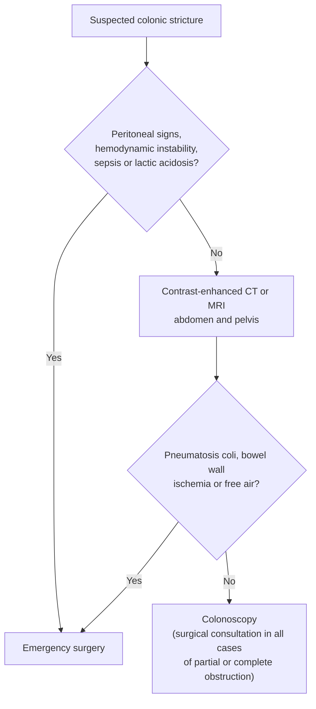

# Colonic Stricture

## Contents
- [[#Definition / Scope]]
- [[#Differential Diagnosis]]
- [[#Diagnostic Algorithm]]
  - [[#Preprocedural Assessment]]
  - [[#Endoscopic Assessment]]
  - [[#Biopsies]]
  - [[#Tattooing]]
- [[#Key Tests]]
- [[#Red Flags / Alarm Features]]
- [[#Management of Benign Colonic Stricture]]
  - [[#Endoscopic Balloon Dilation]]
  - [[#Endoscopic Stricturotomy]]
  - [[#Stents for Benign Stricture]]
  - [[#Etiology-Specific Caveats]]
- [[#See Also]]

## Definition / Scope

Narrowing of the colonic lumen. The management decision turns first on **malignant vs benign**, then on **symptomatic vs not**, then on **partial vs complete obstruction** ([[asge-2026-colonic-strictures]]).

| Term | Definition |
|---|---|
| **Asymptomatic** colorectal stricture | Narrowing that causes no symptoms — found incidentally on endoscopy or cross-sectional imaging |
| **Symptomatic** colorectal stricture | Narrowing of variable severity causing symptoms of partial or complete obstruction, often with diffuse upstream bowel dilation |
| **Partial** colonic obstruction | Subacute to chronic constipation, bloating, cramping, vomiting and/or distension — **still passing gas and stools** |
| **Complete** colonic obstruction | Acute distension, nausea, vomiting and/or pain, typically **unable to pass stools and/or gas**. Fever, tachycardia and hypotension if ischemia, gangrene, perforation or sepsis supervenes |

- **Location** ([[asge-2026-colonic-strictures]]): **left** = rectum to the splenic flexure · **right** = cecum to the transverse colon.
- **Malignant obstruction is covered on [[colonic-stenting]]** (self-expandable metal stent as bridge to surgery or palliation) and [[colorectal-cancer]]. This page owns the **benign** side and the assessment common to both.

## Differential Diagnosis

- **Malignant** — [[colorectal-cancer]] (colonic obstruction occurs in about 10% of patients); extracolonic malignancy causing extrinsic compression, most often gynecologic, also prostate, peritoneal carcinomatosis and lymphoma.
- **[[crohns-disease|Crohn's disease]]** — inflammatory, fibrotic, or mixed.
- **Anastomotic** — postsurgical, most often left-sided colorectal.
- **[[diverticulitis]]-related** — chronic scarring after recurrent episodes.
- **Ischemic** — see [[colon-ischemia]].
- **Radiation** stricture.
- **Post-endoscopic-resection** — rarely, after extensive [[endoscopic-mucosal-resection|endoscopic resection]].
- **[[ulcerative-colitis]]** — a colonic stricture here is treated as malignant until proven otherwise.

## Diagnostic Algorithm

### Preprocedural Assessment

*Figure — initial assessment, from [[asge-2026-colonic-strictures]].*

- **Imaging defines** the site of obstruction, the degree of upstream bowel dilation, and the suspected etiology if not already known.
- **Record the stricture characteristics:** number, location, length, severity, and the presence of an associated mass, inflammation or abscess.
- **Factors that reduce technical success** of endoscopic management: long stricture length, right-sided location, sharp angulation, multifocality, deep ulceration, associated inflammation.
- **Surgical consultation in all cases** of partial and complete obstruction — this is multidisciplinary management, not a referral of last resort.

> [!pitfall] Don't insufflate air proximal to a stricture
> Gas introduced beyond the narrowing creates a **closed-loop system** in an already distended colon and puts it at risk of **proximal perforation**. Advance predominantly with **waterjet** and minimal carbon dioxide ([[asge-2026-colonic-strictures]]).

- **Preparation:** water enemas if there are signs of complete obstruction; **full oral bowel preparation may be given in partial obstruction**.
- **Sedation:** monitored anesthesia care or moderate sedation suffices for most **partial** obstruction; **general anesthesia is strongly preferred for complete obstruction or the critically ill**.
- **Fluoroscopy** is necessary when stent placement is planned, and helpful for balloon dilation of severe strictures.

### Endoscopic Assessment

- **Photo documentation is mandatory.**
- Determine whether the stricture **can be traversed** — this itself informs diameter and severity. If it cannot be and fluoroscopy is available, an **extraction balloon catheter with contrast injection** delineates it.
- Estimate **diameter, length and location including distance from the anal verge**.
- Characterize as **fibrotic, inflammatory, ulcerated, anastomotic**, or associated with a **mass or diverticulum**.

### Biopsies

- **No prior cancer diagnosis:** inspect with white-light high-definition endoscopy and **virtual chromoendoscopy**; take **about 6 targeted biopsy specimens** from any area suspicious for neoplasia or related to [[inflammatory-bowel-disease|inflammatory bowel disease (IBD)]].
- **Anastomotic stricture:** biopsies are **generally not helpful** unless there is endoscopic concern for disease recurrence (malignancy or IBD).
- **Diverticular stricture: avoid biopsies inside the diverticulum** — risk of perforation.

### Tattooing

Consider for suspected or confirmed malignancy **if a colonic stent is not placed**, or for symptomatic strictures of any etiology **if endoscopic treatment is not feasible**.

> [!howto] Placing a colonic tattoo that the surgeon can actually find
> 1. **No tattoo in the cecum or distal rectum.**
> 2. **Carbon black** is the preferred permanent tattoo and is commercially available.
> 3. Place **3 to 5 cm distal to the lesion**, in **2 to 4 quadrants** nearly touching each other around the circumference.
> 4. Insert the needle **tangentially**, then lift it toward the center of the lumen.
> 5. Inject saline or tattoo first and confirm a **submucosal bleb** before committing.
> 6. Inject **0.75 to 1 mL of carbon black** per area; repeat for every area tattooed.

- **Traversable long stricture:** consider a **proximal tattoo** at a similar distance and quadrant number where feasible.
- **The common error is placing the needle too deep** and injecting into the peritoneal cavity or extracolonic tissue — this causes adverse events and can prevent accurate localization during surgery.
- Document the tattoo location in the endoscopy report **and support it with an endoscopic photograph**.

## Key Tests

| Test | Role |
|---|---|
| Contrast-enhanced CT or MRI abdomen/pelvis | Site, upstream dilation, etiology, abscess, extracolonic mass |
| [[colonoscopy]] with virtual chromoendoscopy | Traversability, diameter, length, distance from anal verge, character; targeted biopsies |
| Fluoroscopy with water-soluble contrast | Delineates a non-traversable stricture; required for stent placement |
| Extraction balloon catheter + contrast | Defines a stricture the scope cannot pass |

## Red Flags / Alarm Features

- **Diffuse abdominal tenderness with peritoneal signs**, hemodynamic instability, or laboratory findings consistent with **sepsis and lactic acidosis** → emergency surgery, not endoscopy.
- **Pneumatosis coli or bowel wall ischemia** on imaging, or **perforation with free air** → contraindications to colonoscopy.
- **Inability to pass gas or stool** with acute distension → complete obstruction; general anesthesia preferred, water enema only.
- **Pericolic abscess** → do **not** place a colonic self-expandable metal stent (SEMS).

## Management of Benign Colonic Stricture

**All ASGE 2026 recommendations here are conditional with very low quality of evidence** ([[asge-2026-colonic-strictures]]).

> **Endoscopic balloon dilation (EBD) is first-line** for symptomatic benign **noninflammatory** colonic stricture — over stent placement, and over stricturotomy.

| Option | Where it sits | Evidence |
|---|---|---|
| **EBD** | **First-line** | Pooled clinical success **88%** vs 56% for stents; adverse events **4%** vs 39% |
| **Endoscopic stricturotomy (ES)** | Short (**<3 cm**) strictures **refractory to EBD**, where technical expertise is available | Lower recurrence (risk ratio 0.63) but **~4× the adverse events** and **14× the bleeding** |
| **Fully covered SEMS** | Strictures that **failed EBD**, after multidisciplinary evaluation | Migration is the main problem |
| **[[lumen-apposing-metal-stents\|LAMS]]** | **Anastomotic** strictures **<15 mm** long, refractory to EBD | No better than EBD in the one comparative study; **46% migration** |

- **With active IBD and a colorectal stricture, medical therapy is mandatory** — endoscopic treatment does not substitute for it.
- Evidence comparing EBD and SEMSs for **inflammatory** colorectal stricture is **absent**.
- **Cost:** flexible sigmoidoscopy with balloon dilation **$612–$1124** vs with stent placement **$4016–$5430** (2024 Medicare). No formal cost-effectiveness studies have been conducted.

### Endoscopic Balloon Dilation

Consent should include the **likely need for multiple procedures over time**.

> [!howto] Dilating a colonic stricture
> 1. Pick the **initial balloon diameter from the estimated stricture diameter**; balloon length is usually **5.5 to 8 cm**.
> 2. **Traversable:** cross with the scope, introduce the balloon sheath into the lumen, withdraw the scope until the balloon sits across the stricture. **Not traversable but upstream colon visible:** pass the sheath with or without a wire. **Neither:** pass a wire under endoscopic — ideally fluoroscopic — guidance first, then the balloon over the wire.
> 3. If the balloon is longer than the stricture, **center it**. Inflate with water (add contrast under fluoroscopy), **30 to 60 seconds**.
> 4. Hold **back-tension** on the catheter during inflation to prevent proximal migration.
> 5. Upsize to the next diameter **only if there was no tension at the prior one**; otherwise deflate and inspect for tears, bleeding, perforation or improvement.

- **Stricture longer than the longest available balloon** → overlapping serial dilation.
- **No treatment effect** (no tear, no improvement) → further EBD with upsized diameters until an effect can be **safely** reached.
- **Initially non-traversable** → attempt to traverse, and **document whether it was traversable at the end of the procedure**.
- **Treatment goal: dilate up to 18 to 20 mm** — often not attainable at the first session.
- **Repeat interval:** **1 to 4 weeks** — **1 to 2 weeks for severe** strictures, **3 to 4 weeks for mild to moderate**.

### Endoscopic Stricturotomy

Opening or removing strictured tissue by **electroincision** — radial, horizontal and/or circumferential cuts.

- **Not standardized. Requires significant training, experience, and surgical backup.** Prestricturotomy dilation can be considered.
- **Devices:** needle-knife catheter or insulated-tip knives suitable for endoscopic submucosal dissection.
- **Generator settings:** cutting settings with a **monopolar high-frequency, 2-stage cutting cycle followed by a coagulation cycle**.
- **Best candidates:** strictures **<3 cm**, **refractory to EBD**, **nonangulated and fibrotic** — IBD-related, postsurgical anastomotic, or rarely after extensive endoscopic resection.

> [!pitfall] Stricturotomy trades recurrence for bleeding
> It reduces stricture recurrence (risk ratio 0.63, **fragility index 2**) but raises adverse events nearly 4-fold, driven almost entirely by **postprocedural bleeding (risk ratio 14.08)**. Technical success, clinical success and rate of surgery are no different from EBD ([[asge-2026-colonic-strictures]]).

### Stents for Benign Stricture

- **Technical success 94%, clinical success 88%** for benign colonic stricture — but **adverse events are higher than for malignant strictures, with a perforation risk of 18%**.
- **Uncovered SEMSs should be avoided** in benign strictures — tissue ingrowth can embed them permanently. Use **fully covered** stents, which are not commercially available for the colon in the US (off-label use of fully covered esophageal SEMSs is an alternative).
- **Migration is the central problem** and decreases efficacy despite tissue-anchoring methods such as clips or suturing.
- **LAMS** diameters **15 and 20 mm**, lengths **10 and 15 mm**; **rarely possible in the right colon** (insufficient catheter length for adult colonoscopes). Distal flange **≥2 cm from the anal verge**. Because they are fully covered, **remove or exchange at 2 to 3 months**.

### Etiology-Specific Caveats

- **[[crohns-disease|Crohn's disease]]:** in the one randomized trial in predominantly fibrotic Crohn's disease, fully covered SEMSs gave **lower clinical success at 1 year (51% vs 80%)** than EBD and similar adverse events (8% vs 5%); **stent migration occurred in 97%**. Technical success favoured stents (92% vs 76%).
- **Anastomotic:** in the single comparative study of LAMSs vs EBD in benign left-sided colorectal anastomotic strictures there was **no significant difference** in technical success, clinical success, recurrence or adverse events; 89.7% of these strictures were ≤10 mm.
- **[[diverticulitis]]-related:** SEMS is feasible as a bridge to surgery or as palliation in a non-surgical candidate. In case series, **52% had adverse events** (perforation, reobstruction, migration) but **43% avoided a stoma**. **When placed as a bridge, operate within 7 to 10 days** — migration and adverse-event risk increase afterwards. **Avoid a colonic SEMS if there is a pericolic abscess.**

## See Also

[[colonic-stenting]], [[colorectal-cancer]], [[crohns-disease]], [[diverticulitis]], [[colon-ischemia]], [[colonoscopy]], [[lumen-apposing-metal-stents]], [[esophageal-dilation]], [[acute-colonic-pseudo-obstruction]], [[gastric-outlet-obstruction]], [[inflammatory-bowel-disease]], [[endoscopic-mucosal-resection]], [[ulcerative-colitis]], [[endoscopic-management-of-perforation]]

---

## Sources

1. [[asge-2026-colonic-strictures|American Society for Gastrointestinal Endoscopy Guideline on Endoscopic Management of Benign and Malignant Colonic Strictures]]
