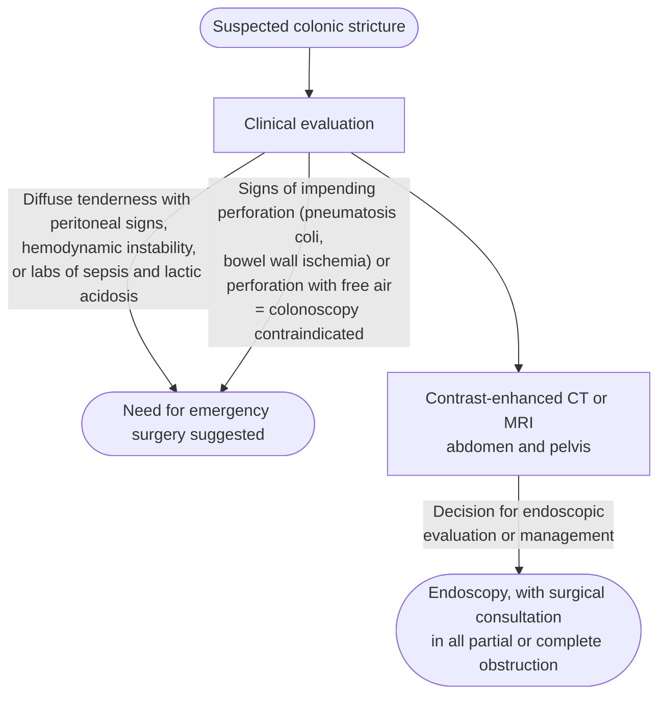

# Colonic Stricture

## Contents
- [[#Definition / Scope]]
- [[#Differential Diagnosis]]
- [[#Diagnostic Algorithm]]
  - [[#Preprocedural Assessment]]
  - [[#Endoscopic Assessment]]
  - [[#Biopsies]]
  - [[#Tattooing]]
- [[#Key Tests]]
- [[#Red Flags / Alarm Features]]
- [[#Management of Benign Colonic Stricture]]
  - [[#Endoscopic Balloon Dilation]]
  - [[#Endoscopic Stricturotomy]]
  - [[#Stents for Benign Stricture]]
  - [[#Etiology-Specific Caveats]]
- [[#See Also]]

## Definition / Scope

Narrowing of the colonic lumen. The American Society for Gastrointestinal Endoscopy (ASGE) 2026 guideline manages it by cause — **malignant** (potentially resectable [[colorectal-cancer|colorectal cancer (CRC)]], unresectable CRC, extracolonic malignancy) vs **benign** — after a common initial assessment ([[asge-2026-colonic-strictures]]).

| Term | Definition |
|---|---|
| **Asymptomatic** colorectal stricture | Narrowing that causes no symptoms — found incidentally on endoscopy or cross-sectional imaging |
| **Symptomatic** colorectal stricture | Narrowing of variable severity causing symptoms of partial or complete obstruction, often with diffuse upstream bowel dilation |
| **Partial** colonic obstruction | Subacute to chronic constipation, bloating, cramping, vomiting and/or distension — **still passing gas and stools** |
| **Complete** colonic obstruction | Acute distension, nausea, vomiting and/or pain, typically **unable to pass stools and/or gas**. Fever, tachycardia and hypotension if ischemia, gangrene, perforation or sepsis supervenes |

- **Location** ([[asge-2026-colonic-strictures]]): **left** = rectum to the splenic flexure · **right** = cecum to the transverse colon.
- **Malignant obstruction is covered on [[colonic-stenting]]** (self-expandable metal stent (SEMS) as bridge to surgery or palliation). This page owns the **benign** side and the assessment common to both.

## Differential Diagnosis

- **Malignant** — CRC (colonic obstruction in about 10% of patients with CRC); **extracolonic malignancy** — e.g. ovarian cancer, prostate cancer, peritoneal carcinomatosis, lymphoma.
- **[[crohns-disease|Crohn's disease]]**
- **Postsurgical anastomotic**
- **[[diverticulitis|Diverticulitis]]-related**
- **Radiation**
- **Ischemic** — see [[colon-ischemia]].
- **After extensive [[endoscopic-mucosal-resection|endoscopic resection]]** — rare.

## Diagnostic Algorithm

### Preprocedural Assessment

- **Clinical evaluation first looks for signs that need emergency surgery**; cross-sectional imaging with contrast-enhanced computed tomography (CT) or magnetic resonance imaging (MRI) of the abdomen and pelvis follows.

*Initial assessment of a suspected colonic stricture*
*Source: built from the ASGE 2026 best practice advice under "Preprocedural assessment" (the guideline has no flowchart)*
*[[asge-2026-colonic-strictures|ASGE 2026 Benign and Malignant Colonic Strictures Guideline]]*
*CT = computed tomography · MRI = magnetic resonance imaging*

- **Imaging defines** the site of obstruction, the degree of upstream bowel dilation, and the suspected etiology if not already known.
- **Record the stricture characteristics:** number, location, length, severity, and the presence of an associated mass, inflammation or abscess.
- **Factors that reduce technical success** of endoscopic management: long stricture length, right-sided location, sharp angulation, multifocality, deep ulceration, associated inflammation.
- **Surgical consultation in all cases** of partial and complete obstruction, for multidisciplinary management.

> [!pitfall] Don't insufflate air proximal to a stricture
> Gas introduced beyond the narrowing creates a **closed-loop system** in an already distended colon and puts it at risk of **proximal perforation**. Advance predominantly with **waterjet** and minimal carbon dioxide ([[asge-2026-colonic-strictures]]).

- **Preparation:** water enemas if there are signs of complete obstruction; **full oral [[bowel-preparation|bowel preparation]] may be given in partial obstruction**.
- **[[endoscopy-sedation|Sedation]]:** monitored anesthesia care or moderate sedation suffices for most **partial** obstruction; **general anesthesia is strongly preferred for complete obstruction or the critically ill**.
- **Fluoroscopy** is necessary when stent placement is planned, and helpful for balloon dilation of severe strictures.

### Endoscopic Assessment

- **Photo documentation is mandatory.**
- Determine whether the stricture **can be traversed** — this itself informs diameter and severity. If it cannot be and fluoroscopy is available, an **extraction balloon catheter with contrast injection** delineates it.
- Estimate **diameter, length and location including distance from the anal verge**.
- Characterize as **fibrotic, inflammatory, ulcerated, anastomotic**, or associated with a **mass or diverticulum**.

### Biopsies

- **No prior cancer diagnosis:** inspect with white-light high-definition endoscopy and **virtual chromoendoscopy**; take **about 6 targeted biopsy specimens** if an area is suspicious for neoplasm or the stricture is related to [[inflammatory-bowel-disease|inflammatory bowel disease (IBD)]].
- **Anastomotic stricture:** biopsies are **generally not helpful** unless there is endoscopic concern for disease recurrence (malignancy or IBD).
- **Diverticular stricture: avoid biopsies inside the diverticulum** — risk of perforation.

### Tattooing

Consider for suspected or confirmed malignancy **if a colonic stent is not placed**, or for symptomatic strictures of any etiology **if endoscopic treatment is not feasible**.

> [!howto] Placing a colonic tattoo that the surgeon can actually find
> 1. **No need to tattoo lesions in the cecum or distal rectum.**
> 2. **Carbon black** is the preferred permanent tattoo and is commercially available.
> 3. Place **3 to 5 cm distal to the lesion**, in **2 to 4 quadrants** nearly touching each other around the circumference.
> 4. Insert the needle **tangentially**, then lift it toward the center of the lumen.
> 5. Inject saline or tattoo first and confirm a **submucosal bleb** before committing.
> 6. Inject **0.75 to 1 mL of carbon black** per area; repeat for every area tattooed.

- **Traversable long stricture:** consider a **proximal tattoo** at a similar distance and quadrant number where feasible.
- **The common error is placing the needle too deep** and injecting into the peritoneal cavity or extracolonic tissue — this can cause adverse events or prevent accurate localization during surgery.
- Document the tattoo location in the endoscopy report **and support it with an endoscopic photograph**.

## Key Tests

| Test | Role |
|---|---|
| Contrast-enhanced CT or MRI abdomen/pelvis | Site of obstruction, degree of upstream dilation, suspected etiology |
| [[colonoscopy]] with virtual chromoendoscopy | Traversability, diameter, length, distance from anal verge, character; targeted biopsies |
| Fluoroscopy | Necessary if stent placement is planned; helpful for balloon dilation of severe strictures |
| Extraction balloon catheter + contrast injection | Delineates a stricture the scope cannot traverse (when fluoroscopy is available) |

## Red Flags / Alarm Features

- **Signs needing emergency surgery** (peritoneal signs, hemodynamic instability, sepsis and lactic acidosis) and **signs of impending or actual perforation** that contraindicate colonoscopy (pneumatosis coli, bowel wall ischemia, free air) — see the [[#Preprocedural Assessment]] flowchart.
- **Inability to pass stools and/or gas** with acute distension → complete obstruction, which changes preparation and sedation ([[#Preprocedural Assessment]]).
- **Pericolic abscess** with an acute diverticulitis-related stricture → avoid a colonic SEMS (higher risk of periprocedural adverse events).

## Management of Benign Colonic Stricture

**Both ASGE 2026 recommendations on benign stricture are conditional, very low quality of evidence**; the technique advice below is ungraded best practice advice ([[asge-2026-colonic-strictures]]).

> In symptomatic benign **noninflammatory** colonic stricture, the ASGE **suggests endoscopic balloon dilation (EBD) as first-line therapy** — over endoscopic stent placement, and over endoscopic stricturotomy (ES).

| Option | Where it sits | Evidence (all very low certainty) |
|---|---|---|
| **EBD** | **First-line** | Pooled single-arm studies (Table 5): clinical success **88%** vs 56% for stents; adverse events **4%** vs 39% |
| **ES** | May be considered for short (**<3 cm**) strictures **refractory to EBD** when technical expertise is available | Adverse events risk ratio 3.95, bleeding risk ratio 14.08 vs EBD; recurrence benefit not robust (below) |
| **Fully covered SEMS** | May be considered for strictures that **failed EBD**, after multidisciplinary evaluation | Stent migration 28% (Table 5) — the main problem |
| **[[lumen-apposing-metal-stents\|Lumen-apposing metal stent (LAMS)]]** | **Anastomotic** strictures of **<15-mm length**, refractory to EBD | **46% migration**; one comparative study vs EBD ([[#Etiology-Specific Caveats]]) |

- **With active IBD and a colorectal stricture, medical therapy is mandatory.**
- Evidence comparing EBD and SEMSs for **inflammatory** colorectal stricture is **absent**.
- **Cost:** flexible sigmoidoscopy with balloon dilation **$612–$1124** vs with stent placement **$4016–$5430** (2024 Medicare). No formal cost-effectiveness studies have been conducted.

### Endoscopic Balloon Dilation

Consent should include the **likely need for multiple procedures over time**.

> [!howto] Dilating a colonic stricture
> 1. Pick the **initial balloon diameter from the estimated stricture diameter**; balloon length is usually **5.5 to 8 cm**.
> 2. **Traversable:** cross with the scope, introduce the balloon sheath into the lumen, withdraw the scope until the balloon sits across the stricture. **Not traversable but upstream colon visible:** pass the sheath with or without a wire. **Neither:** pass a wire under endoscopic — ideally fluoroscopic — guidance first, then the balloon over the wire.
> 3. If the balloon is longer than the stricture, **center it**. Inflate with water (add contrast under fluoroscopy); duration not standardized — **30 to 60 seconds** is common practice.
> 4. Hold **back-tension** on the catheter during inflation to prevent proximal migration.
> 5. Multi-size balloons: may stay inflated and upsize to the next diameter **if there was no tension at the prior one**; if there was tension or the maximal diameter is reached, deflate and inspect for tears, bleeding, perforation or stricture improvement.

- **Stricture longer than the longest available balloon** → overlapping serial dilation.
- **No treatment effect** (no tear, no improvement) → further EBD with upsized diameters until an effect can be **safely** reached.
- **Initially non-traversable** → attempt to traverse, and **document whether it was traversable at the end of the procedure**.
- **Treatment goal: dilate up to 18 to 20 mm** — often not attainable at the first session.
- **Goal not reached → repeat in 1 to 4 weeks** — **1 to 2 weeks for severe** strictures, **3 to 4 weeks for mild to moderate**.

### Endoscopic Stricturotomy

Opening or removing strictured tissue by **electroincision** — radial, horizontal and/or circumferential cuts.

- **Not standardized. Requires significant training, experience, and surgical backup.** Prestricturotomy dilation can be considered.
- **Devices:** needle-knife catheter or insulated-tip knives suitable for [[endoscopic-submucosal-dissection|endoscopic submucosal dissection]].
- **[[electrosurgery|Electrosurgical]] generator settings:** cutting settings with a **monopolar high-frequency, 2-stage cutting cycle followed by a coagulation cycle**.
- **Can be considered for** strictures **<3 cm**, **refractory to EBD**, **nonangulated and fibrotic** — IBD-related, postsurgical anastomotic, or rarely after extensive endoscopic resection.

> [!pitfall] Stricturotomy's recurrence advantage may not be real
> Recurrence was lower than with EBD (risk ratio 0.63, **fragility index 2**), but **not on time-to-event analysis** (incidence rate ratio 1.42, 0.29–6.97) — possibly an artifact of shorter ES follow-up. The excess adverse events, mainly **postprocedural bleeding**, remain ([[asge-2026-colonic-strictures]]).

- Technical success, clinical success, rate of surgery and perforation: no difference from EBD (Table 6).

### Stents for Benign Stricture

- **SEMS in benign stricture: technical success 94%, clinical success 88%** per the guideline's technique section — its own pooled estimate (Table 5) puts stent clinical success at **56%**. **Adverse events are higher than for malignant strictures, with a perforation risk of 18%.**
- **Uncovered metal stents should generally be avoided in benign colonic strictures** (and in malignancy potentially curable with chemotherapy or radiation, e.g. lymphoma) — tissue ingrowth can embed them permanently.
- **Fully covered colonic SEMSs are not commercially available in the United States**; off-label fully covered esophageal SEMSs are an alternative when a covered stent is selected.
- **Migration is the main problem** and decreases efficacy despite tissue-anchoring methods (clips, suturing). Stent choice is individualized by etiology, stricture characteristics, prior EBD attempts and multidisciplinary discussion.
- **Placement technique (SEMS and LAMS sizing and deployment; LAMS removal or exchange at 2 to 3 months):** see [[colonic-stenting#Technique]].

### Etiology-Specific Caveats

- **Crohn's disease:** in the one randomized trial in predominantly fibrotic Crohn's disease, fully covered SEMSs gave **lower clinical success at 1 year (51% vs 80%)** than EBD and similar adverse events (8% vs 5%); **stent migration occurred in 97%**. Technical success favoured stents (92% vs 76%).
- **Anastomotic:** in the single comparative study of LAMSs vs EBD in benign left-sided colorectal anastomotic strictures there was **no significant difference** in technical success, clinical success, recurrence or adverse events; 89.7% of these strictures were ≤10 mm.
- **Diverticulitis-related:** no studies compare SEMS with EBD. In **acute** diverticulitis-related stricture, SEMS is feasible as a bridge to surgery or as palliation in a non-surgical candidate — decided after multidisciplinary discussion with colorectal surgery. In a systematic review of case series, **52% had adverse events** (perforation, reobstruction, migration) but **43% avoided a stoma**. **When placed as a bridge, operate within 7 to 10 days** — migration and adverse-event risk increase afterwards. Pericolic abscess → avoid SEMS ([[#Red Flags / Alarm Features]]).

## See Also

[[colonic-stenting]], [[colorectal-cancer]], [[crohns-disease]], [[diverticulitis]], [[colon-ischemia]], [[colonoscopy]], [[lumen-apposing-metal-stents]], [[esophageal-dilation]], [[acute-colonic-pseudo-obstruction]], [[gastric-outlet-obstruction]], [[inflammatory-bowel-disease]], [[endoscopic-mucosal-resection]], [[ulcerative-colitis]], [[endoscopic-management-of-perforation]], [[bowel-preparation]], [[endoscopy-sedation]], [[endoscopic-submucosal-dissection]], [[electrosurgery]]

---

## Sources

1. [[asge-2026-colonic-strictures|American Society for Gastrointestinal Endoscopy Guideline on Endoscopic Management of Benign and Malignant Colonic Strictures]]
