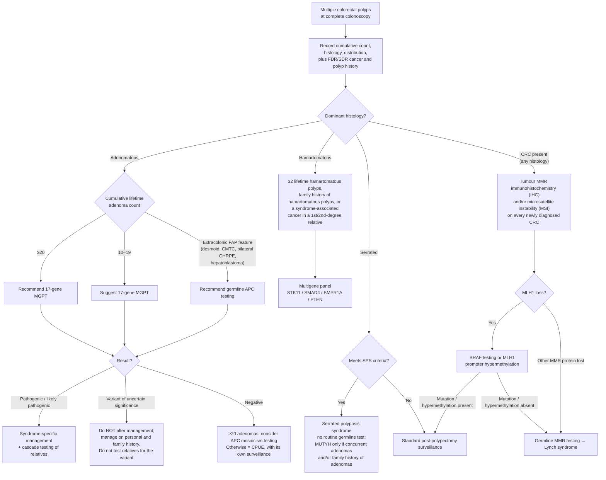

## Contents
- [[#Definition / Scope]]
- [[#Differential Diagnosis]]
  - [[#Adenomatous phenotype]]
  - [[#Hamartomatous phenotype]]
  - [[#Serrated phenotype]]
  - [[#Not a polyposis]]
- [[#Diagnostic Algorithm]]
  - [[#Thresholds that trigger genetic evaluation]]
- [[#Key Tests]]
  - [[#Which genes go on the panel]]
- [[#Red Flags / Alarm Features]]
- [[#See Also]]
- [[#Sources]]

---

## Definition / Scope

The patient found to have **multiple colorectal polyps** — how to sort that phenotype into a syndrome, or out of one. Not a defined diagnosis; each endpoint below has its own disease script.

- Approximately **5–10% of cancers** are attributable to a hereditary cancer predisposition syndrome [[acg-2015-hereditary-gi-cancer]]
- The phenotype is defined by **three variables recorded at a complete [[colonoscopy]]**: cumulative polyp **number**, polyp **histology**, and polyp **distribution** (proximal vs distal, pancolonic)
- **Histology is the primary fork** — adenomatous vs hamartomatous vs serrated. Number then selects the syndrome within that arm
- **Cumulative, not per-exam.** Counts accrue across a lifetime of colonoscopies; a patient below threshold today may cross it at the next exam
- **A negative germline test does not exclude the diagnosis.** Genetic testing in a patient with a striking phenotype but no known family mutation should be comprehensive, and absence of a mutation does not rule out a clinical diagnosis — all close relatives must still be screened as if the syndrome were present [[acg-2015-hereditary-gi-cancer]]. Up to **30%** of clinically diagnosed [[familial-adenomatous-polyposis|familial adenomatous polyposis (FAP)]] patients have no identifiable pathogenic *APC* variant [[asge-2020-fap]]

**Family history is part of the phenotype** [[acg-2015-hereditary-gi-cancer]]:

- Required elements: presence and **type** of cancer in **first- and second-degree relatives**, presence and (ideally) type of **polyps in first-degree relatives**
- **Age at diagnosis and lineage** (maternal vs paternal, assessed separately) noted for every diagnosis
- The three-generation pedigree is the genetics gold standard but is not feasible in general practice; first-degree relative (FDR) / second-degree relative (SDR) history is sufficient for initial risk assessment
- Self-reported family history is **>75% accurate for FDRs** for most cancers, falling to **50–80%** for more distant relatives — review records when the cancer site is in question

---

## Differential Diagnosis

### Adenomatous phenotype

| Syndrome | Defining polyp burden | Gene | Inheritance |
|---|---|---|---|
| [[familial-adenomatous-polyposis\|FAP]] | **≥100 synchronous** colorectal adenomas | *APC* (5q21) | Autosomal dominant, ~100% penetrant; up to **⅓ de novo / mosaic** |
| Attenuated FAP (AFAP) | **10–99 synchronous** adenomas ("oligopolyposis"); **<100 at presentation**; averages ~25–30 polyps; **proximal** predominance | *APC* far 5′ end, far 3′ end, or certain exon-9 locations; whole/partial gene deletions | Autosomal dominant |
| [[mutyh-associated-polyposis\|MUTYH-associated polyposis (MAP)]] | Most commonly **20–99** adenomas; can mimic FAP or AFAP | **Biallelic** *MUTYH* (*Y179C* and *G396D* account for >80% in European ancestry) | Autosomal **recessive** |
| [[polymerase-proofreading-associated-polyposis\|Polymerase proofreading–associated polyposis (PPAP)]] | **30–100** adenomas; duodenal adenomas. Early-onset colorectal **and endometrial** cancer | *POLE*, *POLD1* | Autosomal dominant, high penetrance |
| [[bmmrd-syndrome\|Biallelic mismatch repair deficiency (BMMRD)]] | Colonic adenomatous polyposis **in a child or young adult** not explained by *APC* or *MUTYH* | **Biallelic** mismatch repair (MMR) — *PMS2*, *MSH6* most often | Autosomal recessive |
| ***NTHL1* tumor syndrome** (formerly *NTHL1*-associated polyposis) | **<100** adenomas; hyperplastic polyps and sessile serrated lesions may be present. Breast (55%), endometrial (27%), urothelial (20%) cancers | *NTHL1* (base-excision repair DNA glycosylase) | Autosomal **recessive** |
| ***AXIN2*-associated polyposis** | **<10 to >100** adenomas; colonic polyposis and CRC in the sixth decade | *AXIN2* (negative regulator of Wnt signalling) | Autosomal dominant |
| ***MLH3*-associated polyposis** | **30 to >100** adenomas; CRC, breast and brain cancers | *MLH3* | Autosomal recessive |
| ***MSH3*-associated polyposis** | **20 to >100** adenomas; duodenal polyposis reported in a few. CRC, gastric, astrocytoma | *MSH3* | Autosomal recessive |
| ***MBD4*-associated neoplasia syndrome** | **15 to >100** adenomas. Colorectal cancer, **acute myeloid leukaemia / myelodysplastic syndrome**, **uveal melanoma** | *MBD4* (base-excision repair) | Autosomal recessive |
| [[colonic-polyposis-of-unknown-etiology\|Colonic polyposis of unknown etiology (CPUE)]] | **≥10 cumulative lifetime adenomas with a negative multigene panel.** Not a genetic diagnosis — a named category with its own surveillance | None identified; ***APC* mosaicism** is the commonest hidden cause | — |

*Rows for PPAP through *MBD4* are from [[acg-2026-adenomatous-polyposis]] Table 5. **The six rare syndromes below MAP are all expert-centre referrals** — rarity, evolving cancer risks, multispecialty need ([[acg-2026-adenomatous-polyposis]] KC 5).*

> [!pearl] Oligodontia points at *AXIN2*
> Absence of **>6 adult non-wisdom teeth**, plus hair and cartilage hypoplasia, is the extracolonic signature of ***AXIN2*-associated polyposis** ([[acg-2026-adenomatous-polyposis]] Table 5).

***APC* mosaicism** is the single commonest explanation for an unexplained adenomatous polyposis phenotype — up to **63%** of unexplained FAP with >20 adenomas in a systematic review and meta-analysis. Of mosaic patients with polyposis, **65% had an attenuated phenotype (20–100 adenomas)**, 30% classic, 5% no adenomas ([[acg-2026-adenomatous-polyposis]]).

*Yield by count* — biallelic *MUTYH* is found in **7.5–12.5%** of patients with >100 adenomas in whom no *APC* mutation is found, and in **16–40%** of patients with **15–99** adenomas who do not have FAP. It was found in **0 of 400** individuals with <4 adenomas [[acg-2015-hereditary-gi-cancer]].

*Monoallelic MUTYH* carriers are **1–2% of the general population**, with an estimated **1.5–2×** colorectal cancer (CRC) risk. There is no consensus on management; one option is to manage them as an individual with an FDR with CRC — [[colonoscopy]] **every 5 years, beginning 10 years earlier than the earliest CRC diagnosis** in the family [[acg-2015-hereditary-gi-cancer]].

### Hamartomatous phenotype

| Syndrome | Discriminating feature | Gene |
|---|---|---|
| [[peutz-jeghers-syndrome\|Peutz–Jeghers syndrome]] | Perioral/buccal melanin pigmentation (>95%; lip spots **cross the vermilion border**) + histologically distinctive polyps — arborizing muscularis mucosae, **pseudoinvasion**; small bowel involved in 96% | *STK11* |
| [[juvenile-polyposis-syndrome\|Juvenile polyposis syndrome]] | Juvenile polyps: smooth, rounded, reddish, no fissures/lobulations; colorectum 98%, stomach 14%, jejunum/ileum 7%, duodenum 7% | *SMAD4*, *BMPR1A* |
| [[cowden-syndrome\|Cowden syndrome]] / PTEN hamartoma tumor syndrome (PHTS) (incl. Bannayan–Riley–Ruvalcaba) | **Multiple gastrointestinal (GI) hamartomas or ganglioneuromas**; macrocephaly, mucocutaneous lesions | *PTEN* |
| [[hereditary-mixed-polyposis-syndrome\|Hereditary mixed polyposis syndrome]] (HMPS) | **Attenuated** colonic polyposis with an **admixture of histologies** in one polyp — adenomatous, hyperplastic, juvenile, mixed | *GREM1* (large upstream duplication) |

### Serrated phenotype

- [[serrated-polyposis-syndrome|Serrated polyposis syndrome (SPS)]] — **the most common gastrointestinal polyposis syndrome**, more common than all the others combined (~1 in 250 screening colonoscopies). Diagnose by the **2019 World Health Organization (WHO) criteria**, counting serrated polyps **proximal to the rectum** and **cumulatively across all lifetime colonoscopies**; the criteria table and the superseded older versions are on [[serrated-polyposis-syndrome]] ([[usmstf-2026-serrated-polyposis-syndrome|US Multi-Society Task Force on Colorectal Cancer (USMSTF) 2026]]). **No consistent genetic basis has been identified**, so **SPS itself is not an indication for germline testing** — test only when concurrent non-serrated polyps (>10 conventional adenomas, >2 hamartomatous polyps) or family history independently meet criteria
- Sporadic serrated/hyperplastic polyps — do not meet SPS criteria; follow standard [[colonoscopy-surveillance]]

### Not a polyposis

- [[lynch-syndrome]] — few polyps; the phenotype is **early/right-sided CRC and MMR-deficient tumours**, not polyp number. Enters this schema only because it is the other hereditary CRC syndrome to exclude
- Sporadic multiple adenomas / hyperplastic polyps below any syndrome threshold — surveillance interval only; see [[colonoscopy-surveillance]]

---

## Diagnostic Algorithm

### Thresholds that trigger genetic evaluation

| Phenotype | Threshold | Source |
|---|---|---|
| **Adenomas — ≥20 cumulative lifetime** | **Multigene panel testing (MGPT)** to evaluate for a germline pathogenic variant (GPV) associated with an underlying hereditary adenomatous colorectal polyposis or cancer syndrome *(**Strong**; low certainty)* | [[acg-2026-adenomatous-polyposis]] **Rec 1** |
| **Adenomas — 10–19 cumulative lifetime** | *Suggest* **MGPT**, same purpose *(Conditional; low certainty)*. Favoured in those **<60 years old** and/or with a personal or first-degree-relative history of CRC; may reasonably be **deferred in older patients without such a history** | [[acg-2026-adenomatous-polyposis]] **Rec 2** |
| **Extracolonic features of FAP** | Any one of **desmoid tumors · cribriform morular carcinoma of the thyroid · bilateral and/or multifocal congenital hypertrophy of the retinal pigment epithelium (CHRPE) · hepatoblastoma** → **germline *APC* testing**, with **no adenoma-count requirement** *(**Strong**; low certainty)* | [[acg-2026-adenomatous-polyposis]] **Rec 3** |
| **Early-onset CRC (<50 yr)** | MGPT in **all** patients, minimum *APC, MUTYH, MLH1, MSH2, MSH6, PMS2, EPCAM, BMPR1A, SMAD4, PTEN, STK11, TP53*. In 450 early-onset CRC patients evaluated by MGPT, **16% harboured a GPV** | [[acg-2026-adenomatous-polyposis]] Figure 1 |
| **Known familial GPV, unaffected at-risk relative** | **Single-site testing** for the known variant — unless the single gene does not explain the entire familial phenotype, in which case offer MGPT covering the phenotype | [[acg-2026-adenomatous-polyposis]] KC 2, Figure 1 |
| Adenomas *(superseded)* | **>10 cumulative** colorectal adenomas; **OR** family history of one of the adenomatous polyposis syndromes; **OR** adenomas **+** FAP-type extracolonic manifestations (duodenal/ampullary adenomas, desmoid tumours [abdominal > peripheral], papillary thyroid cancer, CHRPE, epidermal cysts, osteomas) | [[acg-2015-hereditary-gi-cancer]] |
| Adenomas *(superseded)* | **Formal recommendation:** genetic counselling and testing for **"clinical polyposis" = ≥10 adenomas on a single endoscopy *and* ≥20 adenomas during their lifetime** *(low quality)*. The guideline's supporting text lists three *alternative* triggers — ≥10 cumulative adenomatous polyps on a single colonoscopy; **OR** ≥10 adenomas **and** a personal history of CRC; **OR** ≥20 adenomatous polyps in a lifetime | [[asge-2020-fap]] |
| Adenomas *(superseded)* | **>10 adenomas at one exam** or **>10 cumulative lifetime adenomas** → *consider* testing, weighing absolute/cumulative number, patient age, family history of CRC, and personal polyposis features | [[usmstf-2020-followup-colonoscopy]] |
| Hamartomatous — any | **≥2 lifetime hamartomatous polyps**; **OR** a family history of hamartomatous polyps; **OR** a hamartomatous-polyposis-syndrome–associated cancer in a **first- or second-degree relative**. Test with a **multigene panel** *(Strong, low quality)* | [[aga-2022-hamartomatous-polyposis]] |
| Peutz–Jeghers | Four alternative criteria, any one sufficient — polyp count, family history, and mucocutaneous pigmentation in combination *(Strong, low quality)*; stated in full on [[peutz-jeghers-syndrome]] | [[aga-2022-hamartomatous-polyposis]] |
| Juvenile polyposis | Three alternative criteria, any one sufficient — colorectal polyp count, extracolonic polyp count, or any number plus an affected first-degree relative *(Strong, low quality)*; stated in full on [[juvenile-polyposis-syndrome]] | [[aga-2022-hamartomatous-polyposis]] |
| PTEN hamartoma tumor syndrome | **Multiple GI hamartomas or ganglioneuromas** *(Strong, low quality)*. Full clinical criteria (major/minor) on [[cowden-syndrome]] | [[aga-2022-hamartomatous-polyposis]] |
| Serrated | Meets the **2019 WHO** SPS criteria ([[serrated-polyposis-syndrome]]). **Germline testing only when** concurrent non-serrated polyps independently qualify (**>10 conventional adenomas**, **>2 hamartomatous polyps**) **or** family history suggests a hereditary gastrointestinal cancer syndrome *(Strong, Oxford Level 3)*; *MUTYH* may be considered when adenomas are concurrent and/or there is a family history of adenomas | [[usmstf-2026-serrated-polyposis-syndrome]]; [[acg-2015-hereditary-gi-cancer]] |
| Lynch | Tumour showing **MMR deficiency** without a *BRAF* mutation or *MLH1* hypermethylation; **OR** a known family mutation; **OR** **≥5% risk of Lynch** on a risk-prediction model | [[acg-2015-hereditary-gi-cancer]] |
| BMMRD | Any clue in the red-flag list below — the phenotype is a **child or young adult**, and family history is usually **negative** because the parents are young and unaffected | [[usmstf-2017-bmmrd]] |

> **Version note — the adenoma threshold moved three times, and 2026 settles it.** [[acg-2015-hereditary-gi-cancer]] set a **single** trigger: >10 cumulative adenomas. [[asge-2020-fap]] joined ">10 at one exam" **and** "≥20 lifetime" with ***and***; [[usmstf-2020-followup-colonoscopy]] kept them as **alternatives**. **[[acg-2026-adenomatous-polyposis]] replaces all three with two graded bands on cumulative lifetime count alone — ≥20 (strong) and 10–19 (conditional)** — with **no single-exam element and no age cut-off**. Newest same-tier source; it governs the wiki. The older rows are kept only because they are still widely quoted.
>
> **Yield by count** ([[acg-2026-adenomatous-polyposis]] Table 6, Grover 2012, n = 8,676): *APC* GPV in **5%** at 10–19 adenomas, **10%** at 20–99, **56%** at 100–999, **80%** at ≥1,000; biallelic *MUTYH* in 4%, 7%, 7% and 2% across the same bands. Taken together, the largest studies give a GPV yield of **12.3%–20.5% at ≥20** cumulative adenomas and **5.3%–11.3% at 10–19**.

> [!pitfall] A negative panel is a diagnosis, not a discharge
> **≥10 cumulative lifetime adenomas with a negative MGPT meets criteria for [[colonic-polyposis-of-unknown-etiology|colonic polyposis of unknown etiology (CPUE)]]** ([[acg-2026-adenomatous-polyposis]] KC 6), which carries its own colonoscopy, upper endoscopy and thyroid surveillance. Before accepting the negative: confirm the panel covered the **minimum gene set** below, and at **≥20 adenomas** consider referral for ***APC* mosaicism** testing (KC 3, KC 4).

---

## Key Tests

| Test | Question it answers | Operative detail |
|---|---|---|
| **[[colonoscopy]] with complete clearance + [[polypectomy]]** | Cumulative count, distribution, and tissue for histology | Every polyp counts toward the lifetime total; **histology is the fork**, so all polyps need pathology |
| **Family history** | Whether the count threshold is already met by lineage alone | Cancer type in FDRs **and** SDRs; polyps in FDRs; age + maternal/paternal lineage for each [[acg-2015-hereditary-gi-cancer]] |
| **Tumour MMR IHC (MLH1/MSH2/MSH6/PMS2) and/or MSI** | Whether a CRC is mismatch-repair deficient | Perform on **all newly diagnosed CRCs**. **MLH1 loss → reflex *BRAF* testing or *MLH1* promoter hypermethylation** analysis before germline testing [[acg-2015-hereditary-gi-cancer]] |
| **Germline testing** | Confirms the syndrome and enables predictive testing of relatives | Must sit inside **pre- and post-test genetic counselling**. Two settings: comprehensive testing of a suspicious phenotype, vs single-site testing of relatives of a known carrier — where a negative result **rules the syndrome out** [[acg-2015-hereditary-gi-cancer]] |
| **[[upper-endoscopy\|Upper endoscopy]] with duodenoscopy** | Extracolonic polyp burden in adenomatous polyposis | Confirms the FAP-type phenotype; Spigelman staging and surveillance intervals live on [[familial-adenomatous-polyposis]] |
| **Tissue diagnosis in children** | BMMRD | Reasonable to perform **universal IHC and MSI on all small- and large-bowel cancers in children**. In BMMRD the MMR protein is absent in **normal, non-neoplastic tissue as well as tumour** — a pattern pathologists may misread [[usmstf-2017-bmmrd]] |

### Which genes go on the panel

> [!pearl] The minimum panel for adenomatous polyposis is 17 genes
> ***APC, AXIN2, BMPR1A, EPCAM, GREM1, MLH1, MSH2, MSH3, MSH6, MUTYH, NTHL1, POLD1, POLE, PMS2, PTEN, SMAD4, STK11*** ([[acg-2026-adenomatous-polyposis]] KC 1). Adenomatous, serrated and hamartomatous polyps **coexist** in the polyposis syndromes and blur the phenotype, which is why the panel spans all three. Previous testing that **omitted any of these genes, predated 2013, or preceded a change in personal or family cancer history** warrants re-evaluation (KC 3).

| Phenotype | Genes | Source |
|---|---|---|
| **Adenomatous polyposis** | **The 17-gene minimum panel above** | [[acg-2026-adenomatous-polyposis]] KC 1 |
| Adenomatous polyposis *(superseded)* | ***APC* + *MUTYH***. If negative and suspicion remains high, consider other genes (*POLE*, *POLD1*, *GREM1*) | [[acg-2015-hereditary-gi-cancer]], [[asge-2020-fap]] |
| Hamartomatous polyposis | **Multigene panel** (rather than sequential single-gene testing) — *STK11* (PJS), *SMAD4* / *BMPR1A* (JPS), *PTEN* (PHTS) | [[aga-2022-hamartomatous-polyposis]] |
| Suspected Lynch | *MLH1*, *MSH2*, *MSH6*, *PMS2*, and/or *EPCAM* — or the gene indicated by IHC | [[acg-2015-hereditary-gi-cancer]] |
| Serrated polyposis | **None for SPS itself.** Test only if concurrent non-serrated polyps or family history qualify independently; *MUTYH* only with concurrent adenomas and/or family history of adenomas | [[usmstf-2026-serrated-polyposis-syndrome]]; [[acg-2015-hereditary-gi-cancer]] |

---

## Red Flags / Alarm Features

**Push toward a syndrome rather than sporadic polyps:**

- **Early age at onset** of polyps or cancer; unusual **number** or **histology** of polyps/cancers [[acg-2015-hereditary-gi-cancer]]
- **FAP-type extracolonic manifestations** — duodenal/ampullary adenomas, desmoid tumours (abdominal > peripheral), papillary thyroid cancer (cribriform morular variant), CHRPE (multifocal/bilateral), epidermal cysts, osteomas, hepatoblastoma [[acg-2015-hereditary-gi-cancer]], [[usmstf-2020-followup-colonoscopy]]
- **Mucocutaneous pigmentation crossing the vermilion border** → [[peutz-jeghers-syndrome]]
- **Macrocephaly, trichilemmomas, oral papillomatosis** with GI hamartomas → [[cowden-syndrome]]
- ***SMAD4* carrier** — screen for **[[hereditary-hemorrhagic-telangiectasia|hereditary haemorrhagic telangiectasia]]**, including cardiovascular examination (epistaxis, mucocutaneous telangiectasias, arteriovenous malformations [AVMs]) [[acg-2015-hereditary-gi-cancer]], [[aga-2022-hamartomatous-polyposis]]

**Push toward [[bmmrd-syndrome|BMMRD]]** [[usmstf-2017-bmmrd]] — any one of:

- Child or young adult with a **Lynch-syndrome cancer** (colorectal, small bowel, ureter, endometrial)
- Child or young adult with **colonic adenomatous polyposis not explained by FAP or MAP**
- Any child or young adult with cancer **plus parental consanguinity, café-au-lait macules, or neurofibromatosis features** not explained by a confirmed germline variant
- Any cancer with **abnormal MMR IHC in normal *and* tumour tissue**
- History of **brain cancer, lymphoma, or leukaemia without prior radiation**
- Any child or adult with a **hypermutated tumour**

**Push toward surgical referral rather than more testing** — the absolute indications for colectomy are **invasive cancer, multiple adenomas with high-grade dysplasia, endoscopically unresectable adenomas ≥10 mm or with high-grade dysplasia, inability to survey the colon regardless of adenoma number**, or clinically significant symptoms. The full three-column endoscopic/relative/absolute table ([[acg-2026-adenomatous-polyposis]] Table 8) lives on [[familial-adenomatous-polyposis]] and applies to FAP, AFAP, MAP and CPUE alike. *(This supersedes [[acg-2015-hereditary-gi-cancer]]'s "multiple adenomas >6 mm" as the relative indication.)*

---

## See Also

[[familial-adenomatous-polyposis]], [[mutyh-associated-polyposis]], [[polymerase-proofreading-associated-polyposis]], [[colonic-polyposis-of-unknown-etiology]], [[serrated-polyposis-syndrome]], [[peutz-jeghers-syndrome]], [[juvenile-polyposis-syndrome]], [[cowden-syndrome]], [[hereditary-mixed-polyposis-syndrome]], [[bmmrd-syndrome]], [[lynch-syndrome]], [[colorectal-cancer]], [[colorectal-cancer-screening]], [[colonoscopy-surveillance]], [[colonoscopy]], [[polypectomy]], [[gastric-polyps]], [[familial-pancreatic-cancer]], [[hereditary-diffuse-gastric-cancer]], [[hereditary-hemorrhagic-telangiectasia]]

---

## Sources

1. [[acg-2026-adenomatous-polyposis|ACG Clinical Guideline: Diagnosis and Management of Adenomatous Colorectal Polyposis Syndromes (2026)]]
2. [[acg-2015-hereditary-gi-cancer|ACG 2015: Genetic Testing and Management of Hereditary Gastrointestinal Cancer Syndromes]]
3. [[aga-2022-hamartomatous-polyposis|US Multi-Society Task Force Guideline: GI Hamartomatous Polyposis Syndromes (2022)]]
4. [[asge-2020-fap|ASGE Guideline: The Role of Endoscopy in Familial Adenomatous Polyposis Syndromes (2020)]]
5. [[usmstf-2020-followup-colonoscopy|USMSTF 2020: Recommendations for Follow-Up After Colonoscopy and Polypectomy]]
6. [[usmstf-2017-bmmrd|USMSTF 2017: Recommendations on Surveillance and Management of Biallelic Mismatch Repair Deficiency (BMMRD) Syndrome]]
7. [[usmstf-2026-serrated-polyposis-syndrome|Serrated Polyposis Syndrome: A Review and Consensus Statement by the US Multi-Society Task Force on Colorectal Cancer (2026)]]
