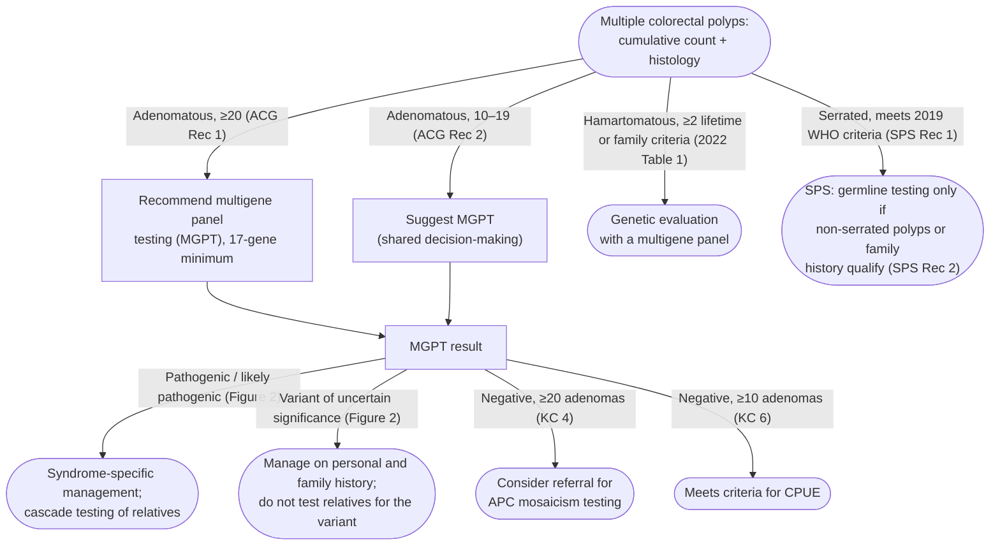
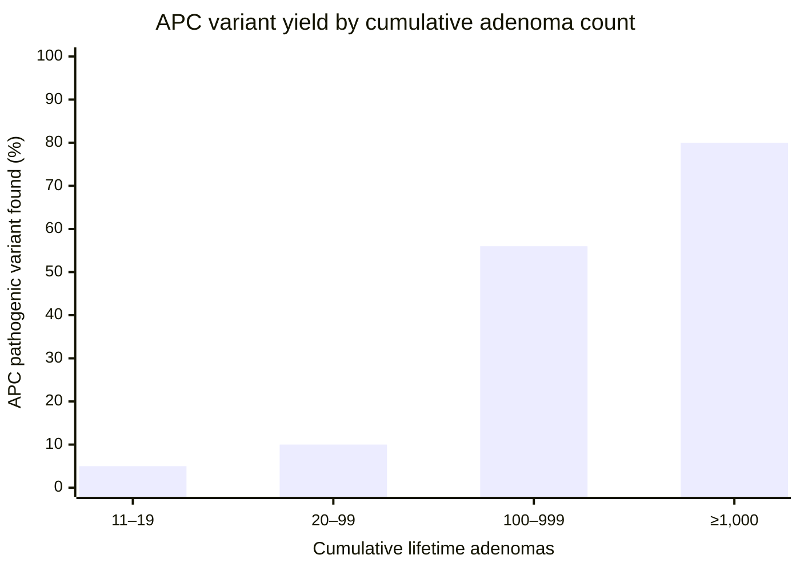

## Contents
- [[#Definition / Scope]]
- [[#Differential Diagnosis]]
  - [[#Adenomatous phenotype]]
  - [[#Hamartomatous phenotype]]
  - [[#Serrated phenotype]]
  - [[#Not a polyposis]]
- [[#Diagnostic Algorithm]]
  - [[#Thresholds that trigger genetic evaluation]]
- [[#Key Tests]]
  - [[#Which genes go on the panel]]
- [[#Red Flags / Alarm Features]]
- [[#See Also]]
- [[#Sources]]

---

## Definition / Scope

The patient found to have **multiple colorectal polyps** — how to sort that phenotype into a syndrome, or out of one. Not a defined diagnosis; each endpoint below has its own disease script.

- ~**10% of colorectal cancer (CRC)** is hereditary; a germline pathogenic variant (GPV) for an adenomatous polyposis syndrome is found in **1–2%** of patients with CRC [[acg-2026-adenomatous-polyposis]]
- **Suspect a hereditary adenomatous syndrome at ≥10 cumulative lifetime adenomas**, especially with early age at onset, personal or family history of CRC, a relative with a known syndrome, early-onset CRC, or a syndrome-specific extraintestinal feature [[acg-2026-adenomatous-polyposis]]
- Phenotype = cumulative polyp **number**, **histology** and **distribution** from [[colonoscopy]]. **Histology is the first fork**; number then selects the syndrome. Counts are **cumulative across all exams**
- **A negative germline test does not exclude the diagnosis** — with a striking phenotype, all close relatives are still screened as if the syndrome were present [[acg-2015-hereditary-gi-cancer]]. Up to **30%** of clinically diagnosed [[familial-adenomatous-polyposis|familial adenomatous polyposis (FAP)]] has no identifiable *APC* variant [[asge-2020-fap]]
- **De novo GPVs** (FAP: up to 25%) — no family history does not exclude a syndrome [[acg-2026-adenomatous-polyposis]]

**Family history is part of the phenotype** — personal and **at least 3-generation** family history [[acg-2026-adenomatous-polyposis]]:

- Required: cancers in patient and relatives (**type, age at diagnosis**); relatives' **age at death**; **age at polyp diagnosis**
- When available: polyp number and histology, cancer histology, extracolonic syndrome features, results and date of prior genetic testing in patient or family
- Self-reported family history is **>75% accurate for first-degree relatives (FDRs)** for most cancers, **50–80%** for more distant relatives — review records when the cancer site is in question [[acg-2015-hereditary-gi-cancer]]
- *Changed:* [[acg-2015-hereditary-gi-cancer]] accepted first- and second-degree relative history as sufficient; the American College of Gastroenterology (ACG) 2026 guideline makes 3 generations the minimum

---

## Differential Diagnosis

### Adenomatous phenotype

| Syndrome | Defining polyp burden | Gene | Inheritance |
|---|---|---|---|
| [[familial-adenomatous-polyposis\|FAP]] | Usually **>100** adenomas; defined by **≥100 synchronous** adenomas ([[acg-2015-hereditary-gi-cancer]]) | *APC* (5q21) | Autosomal dominant; near-complete penetrance for colonic polyposis |
| Attenuated FAP (AFAP) | Usually **10–100** adenomas; **proximal** predominance; averaged 25 in one study ([[acg-2015-hereditary-gi-cancer]]) | *APC* far 5′ or 3′ end, certain exon-9 sites; whole/partial gene deletions | Autosomal dominant |
| [[mutyh-associated-polyposis\|MUTYH-associated polyposis (MAP)]] | Usually **10–100** adenomas; hyperplastic polyps and sessile serrated lesions may be present; can mimic FAP or AFAP ([[acg-2015-hereditary-gi-cancer]]) | **Biallelic** *MUTYH* | Autosomal **recessive** |
| [[polymerase-proofreading-associated-polyposis\|Polymerase proofreading–associated polyposis (PPAP)]] | **30–100** adenomas; duodenal adenomas; early-onset colorectal and endometrial cancer ([[acg-2015-hereditary-gi-cancer]]) | *POLE*, *POLD1* | Autosomal dominant |
| [[bmmrd-syndrome\|Biallelic mismatch repair deficiency (BMMRD)]] | Colonic adenomatous polyposis **in a child or young adult** not explained by FAP or MAP ([[usmstf-2017-bmmrd]]) | **Biallelic** mismatch repair (MMR) gene — *PMS2* most common, *MSH6* over-represented | Autosomal recessive |
| ***NTHL1* tumor syndrome** | **<100** adenomas; hyperplastic polyps / sessile serrated lesions may be present. Breast, endometrial, urothelial cancers | *NTHL1* | Autosomal recessive |
| ***AXIN2*-associated polyposis** | **<10 to >100** adenomas; CRC | *AXIN2* | Autosomal dominant |
| ***MLH3*-associated polyposis** | **30 to >100** adenomas; CRC, breast, brain | *MLH3* | Autosomal recessive |
| ***MSH3*-associated polyposis** | **20 to >100** adenomas; duodenal polyposis in a few. CRC, gastric, astrocytoma | *MSH3* | Autosomal recessive |
| ***MBD4*-associated neoplasia syndrome** | **15 to >100** adenomas. CRC, acute myeloid leukemia, myelodysplastic syndrome, uveal melanoma | *MBD4* | Autosomal recessive |
| [[colonic-polyposis-of-unknown-etiology\|Colonic polyposis of unknown etiology (CPUE)]] | **≥10 cumulative adenomas + negative multigene panel** (Key Concept [KC] 6). Not a genetic diagnosis; own surveillance | None identified | — |

*Polyp counts and inheritance from [[acg-2026-adenomatous-polyposis]] Table 5 unless cited otherwise. **PPAP, NTHL1, AXIN2, MLH3, MSH3 and MBD4 syndromes → expert-center referral** (KC 5).*

> [!pearl] Oligodontia points at *AXIN2*
> Absence of **>6 adult non-wisdom teeth**, plus hair and cartilage hypoplasia, is the extracolonic signature of ***AXIN2*-associated polyposis** ([[acg-2026-adenomatous-polyposis]] Table 5).

- ***APC* mosaicism** explains up to **63%** of unexplained FAP with >20 adenomas; 65% of mosaic patients have an attenuated (20–100 adenoma) phenotype — detail on [[familial-adenomatous-polyposis]] ([[acg-2026-adenomatous-polyposis]])
- **Monoallelic *MUTYH*** carriers (1–2% of the population): management on [[mutyh-associated-polyposis]] [[acg-2015-hereditary-gi-cancer]]

### Hamartomatous phenotype

| Syndrome | Discriminating feature | Gene |
|---|---|---|
| [[peutz-jeghers-syndrome\|Peutz–Jeghers syndrome]] | Perioral/buccal melanin spots (>95%; lip spots **cross the vermilion border**); polyps with **pseudoinvasion** (can be misread as cancer); small bowel in 96% ([[acg-2015-hereditary-gi-cancer]]) | *STK11* |
| [[juvenile-polyposis-syndrome\|Juvenile polyposis syndrome]] | Juvenile polyps in colorectum 98%, stomach 14%, jejunum/ileum 7%, duodenum 7% ([[acg-2015-hereditary-gi-cancer]]) | *SMAD4*, *BMPR1A* |
| [[cowden-syndrome\|Cowden syndrome]] / PTEN hamartoma tumor syndrome (PHTS) | **Multiple gastrointestinal (GI) hamartomas or ganglioneuromas**; macrocephaly, mucocutaneous lesions ([[aga-2022-hamartomatous-polyposis]]) | *PTEN* |
| [[hereditary-mixed-polyposis-syndrome\|Hereditary mixed polyposis syndrome]] (HMPS) | **Attenuated** colonic polyposis; adenomas, hyperplastic polyps, and polyps with an **admixture of histologies** (adenomatous, hyperplastic, juvenile, mixed) ([[aga-2022-hamartomatous-polyposis]]) | *GREM1* (promoter or whole-gene duplication) |

### Serrated phenotype

- [[serrated-polyposis-syndrome|Serrated polyposis syndrome (SPS)]] — **the most common GI polyposis syndrome**, more common than all others combined (~1 in 250 in screening colonoscopy cohorts) ([[usmstf-2026-serrated-polyposis-syndrome|US Multi-Society Task Force on Colorectal Cancer (USMSTF) 2026]])
  - **2019 World Health Organization (WHO) criteria** (Rec 1), counting serrated polyps (hyperplastic, sessile serrated, traditional serrated adenoma) over the **cumulative lifetime**:
    - **Type 1:** ≥5 serrated polyps proximal to the rectum, all ≥5 mm, ≥2 of them ≥10 mm
    - **Type 2:** >20 serrated polyps throughout the colon, ≥5 proximal to the rectum
  - **No consistent genetic basis** → SPS alone is not an indication for germline testing (Rec 2; criteria in the thresholds table below). Older criteria versions: [[serrated-polyposis-syndrome]]

### Not a polyposis

- [[lynch-syndrome]] — formerly "hereditary nonpolyposis colorectal cancer"; found through **MMR-deficient tumours** (Key Tests), not polyp count [[acg-2015-hereditary-gi-cancer]]
- Sporadic multiple adenomas / hyperplastic polyps below any syndrome threshold → [[colonoscopy-surveillance]]

---

## Diagnostic Algorithm

*Genetic evaluation of multiple colorectal polyps, by histology and cumulative count*
*Source: built from ACG 2026 Recs 1–2, KC 4, KC 6 and Figure 2; the 2022 hamartomatous-polyp genetic-evaluation recommendation (Table 1); USMSTF 2026 SPS Recs 1–2 (no single source flowchart)*
*[[acg-2026-adenomatous-polyposis|ACG 2026 Adenomatous Colorectal Polyposis]] · [[aga-2022-hamartomatous-polyposis|USMSTF 2022 Hamartomatous Polyposis]] · [[usmstf-2026-serrated-polyposis-syndrome|USMSTF 2026 Serrated Polyposis]]*
*ACG = American College of Gastroenterology · MGPT = multigene panel testing · WHO = World Health Organization · SPS = serrated polyposis syndrome · KC = key concept · CPUE = colonic polyposis of unknown etiology*

### Thresholds that trigger genetic evaluation

| Phenotype | Threshold → test | Source |
|---|---|---|
| **Adenomas — ≥20 cumulative lifetime** | **Recommend MGPT** for a GPV of an underlying hereditary adenomatous colorectal polyposis or cancer syndrome *(Strong; low certainty)* | [[acg-2026-adenomatous-polyposis]] **Rec 1** |
| **Adenomas — 10–19 cumulative lifetime** | **Suggest MGPT**, same purpose *(Conditional; low certainty)*. Shared decision-making; favored if **<60 years old** and/or personal or FDR history of CRC; may reasonably be **deferred in older patients without such history** | [[acg-2026-adenomatous-polyposis]] **Rec 2** |
| **Extracolonic features of FAP** | Any one of **desmoid tumors · cribriform morular thyroid carcinoma · bilateral and/or multifocal congenital hypertrophy of the retinal pigment epithelium (CHRPE) · hepatoblastoma** → **germline *APC* testing**, no adenoma count needed *(Strong; low certainty)* | [[acg-2026-adenomatous-polyposis]] **Rec 3** |
| **Early-onset CRC (<50 yr)** | MGPT in **all**, minimum *APC, MUTYH, MLH1, MSH2, MSH6, PMS2, EPCAM, BMPR1A, SMAD4, PTEN, STK11, TP53* (GPV in 16% of 450 tested) | [[acg-2026-adenomatous-polyposis]] text, Figure 1 |
| **Known familial GPV, unaffected at-risk relative** | **Single-site testing** for the familial variant — MGPT instead if that gene does not explain the whole familial phenotype | [[acg-2026-adenomatous-polyposis]] KC 2, Figure 1 |
| **Hamartomatous — any** | **≥2 lifetime hamartomatous polyps**; **OR** family history of hamartomatous polyps; **OR** a hamartomatous-syndrome cancer in a **first- or second-degree relative** → genetic evaluation, **multigene panel** *(Strong, low quality)* | [[aga-2022-hamartomatous-polyposis]] |
| Peutz–Jeghers | Any one: **≥2** histologically confirmed Peutz–Jeghers polyps; **any number** + family history of Peutz–Jeghers syndrome in an FDR; characteristic **mucocutaneous pigmentation** + family history of Peutz–Jeghers syndrome; **any number** + characteristic pigmentation *(Strong, low quality)* | [[aga-2022-hamartomatous-polyposis]] |
| Juvenile polyposis | Any one: **≥5** juvenile polyps of colon or rectum; **≥2** juvenile polyps elsewhere in the GI tract; **any number** + **≥1 FDR** with juvenile polyposis syndrome *(Strong, low quality)* | [[aga-2022-hamartomatous-polyposis]] |
| PTEN hamartoma tumor syndrome | **Multiple GI hamartomas or ganglioneuromas** *(Strong, low quality)*; full clinical criteria on [[cowden-syndrome]] | [[aga-2022-hamartomatous-polyposis]] |
| **Serrated (SPS)** | Germline testing **only when** concurrent non-serrated polyps are an established indication (e.g., lifetime **>10 conventional adenomas**, **>2 hamartomatous polyps**) **or** family history suggests a hereditary GI cancer syndrome *(Strong, Oxford Level 3)*. *Changed:* [[acg-2015-hereditary-gi-cancer]] allowed *MUTYH* testing in SPS with any concurrent adenomas and/or family history of adenomas | [[usmstf-2026-serrated-polyposis-syndrome]] **Rec 2** |
| Lynch | Tumor **MMR deficiency** without *BRAF* mutation or *MLH1* hypermethylation; **OR** known family mutation; **OR** **≥5% risk** on a risk-prediction model → genetic evaluation | [[acg-2015-hereditary-gi-cancer]] |
| BMMRD | Any red flag below; family history often **negative** — carrier parents (usually *PMS2*) have low penetrance and later-onset cancers | [[usmstf-2017-bmmrd]] |

**Earlier adenoma thresholds (superseded by ACG 2026, still widely quoted):**

- [[acg-2015-hereditary-gi-cancer|ACG 2015]] — **>10 cumulative** adenomas; **OR** family history of an adenomatous polyposis syndrome; **OR** adenomas + FAP-type extracolonic manifestations → assess for adenomatous polyposis
- [[asge-2020-fap|American Society for Gastrointestinal Endoscopy (ASGE) 2020]] — counseling and testing for "clinical polyposis" = **≥10 adenomas on a single endoscopy *and* ≥20 lifetime** *(low quality)*; its text lists these as alternatives (plus ≥10 + personal CRC)
- [[usmstf-2020-followup-colonoscopy|USMSTF 2020]] — **>10 adenomas at one exam or >10 cumulative lifetime** → *consider* testing (weigh number, age, family history of CRC, polyposis features)
- ACG 2026 uses **cumulative lifetime count only** (≥20 strong, 10–19 conditional), no single-exam element

*Germline APC yield rises steeply with cumulative adenoma count*
*Source: data from 8,676 individuals tested for APC and MUTYH only (Grover 2012), cited in ACG 2026 Table 6*
*[[acg-2026-adenomatous-polyposis|ACG 2026 Adenomatous Colorectal Polyposis Syndromes]]*

- Across the largest MGPT studies, GPV yield is **5.3–11.3% at 10–19** adenomas, **12.3% at 20–99** (one study) and **20.5% at 20–49** / **60% at 50–99** (another) [[acg-2026-adenomatous-polyposis]]

> [!pitfall] A negative panel is a diagnosis, not a discharge
> **≥10 cumulative adenomas + negative MGPT = [[colonic-polyposis-of-unknown-etiology|CPUE]]** (KC 6), with its own colonoscopy, upper endoscopy and thyroid surveillance. First confirm the panel covered the **minimum gene set** below (KC 3); at **≥20 adenomas** consider ***APC* mosaicism** referral (KC 4) ([[acg-2026-adenomatous-polyposis]]).

---

## Key Tests

| Test | Question it answers | Operative detail |
|---|---|---|
| **[[colonoscopy]] + [[polypectomy]]** | Cumulative count, size, distribution; tissue for histology | Record polyp number, size and distribution at every exam [[acg-2015-hereditary-gi-cancer]]; in adenomatous polyposis, report colon and rectal counts separately (KC 9) [[acg-2026-adenomatous-polyposis]]; describe number, size and location of serrated polyps at least until SPS is diagnosed (Rec 3) [[usmstf-2026-serrated-polyposis-syndrome]] |
| **Tumor MMR immunohistochemistry (IHC) (MLH1/MSH2/MSH6/PMS2) and/or microsatellite instability (MSI)** | Is the CRC mismatch-repair deficient? | **All newly diagnosed CRCs**. **MLH1 loss → *BRAF* testing or *MLH1* promoter hypermethylation** before germline testing [[acg-2015-hereditary-gi-cancer]] |
| **Germline testing** | Confirms the syndrome; tests relatives | Within **pre- and post-test genetic counseling** [[acg-2015-hereditary-gi-cancer]], by a genetic counselor or provider with genetic-testing expertise [[acg-2026-adenomatous-polyposis]]. In a relative of a known carrier, a negative single-site test **rules the syndrome out** [[acg-2015-hereditary-gi-cancer]] |
| **[[upper-endoscopy\|Upper endoscopy]]** | Gastric/duodenal polyposis, ampullary adenomas | Baseline at CPUE diagnosis (KC 30) [[acg-2026-adenomatous-polyposis]]; FAP/AFAP/MAP timing and Spigelman staging on [[familial-adenomatous-polyposis]] |
| **IHC/MSI in children** | BMMRD | Reasonable for **all small- and large-bowel cancers in children**. MMR protein usually absent in **normal tissue as well as tumor** — can confuse interpretation [[usmstf-2017-bmmrd]] |

### Which genes go on the panel

> [!pearl] The minimum panel for adenomatous polyposis is 17 genes
> ***APC, AXIN2, BMPR1A, EPCAM, GREM1, MLH1, MSH2, MSH3, MSH6, MUTYH, NTHL1, POLD1, POLE, PMS2, PTEN, SMAD4, STK11*** ([[acg-2026-adenomatous-polyposis]] KC 1) — spans all three histologies because they **coexist** and blur the phenotype. Previous negative testing that **omitted any of these genes** or **preceded a change in personal or family cancer history** warrants further evaluation (KC 3); the text also flags testing done **before 2013**.

| Phenotype | Genes | Source |
|---|---|---|
| **Adenomatous polyposis** | **The 17-gene minimum panel above** | [[acg-2026-adenomatous-polyposis]] KC 1 |
| Adenomatous polyposis *(superseded)* | ***APC* + *MUTYH*** | [[acg-2015-hereditary-gi-cancer]] |
| Hamartomatous polyposis | **Multigene panel** (2022) — *STK11* (Peutz–Jeghers), *SMAD4* / *BMPR1A* (juvenile polyposis), *PTEN* (PHTS) (2015) | [[aga-2022-hamartomatous-polyposis]]; [[acg-2015-hereditary-gi-cancer]] |
| Suspected Lynch | *MLH1*, *MSH2*, *MSH6*, *PMS2*, and/or *EPCAM* — or the gene indicated by IHC | [[acg-2015-hereditary-gi-cancer]] |
| Serrated polyposis | **None for SPS itself** — see thresholds table | [[usmstf-2026-serrated-polyposis-syndrome]] Rec 2 |

---

## Red Flags / Alarm Features

**Push toward a syndrome rather than sporadic polyps:**

- **Early age at onset** of polyps or cancer; unusual **numbers or histologies** of cancers or premalignant conditions [[acg-2015-hereditary-gi-cancer]]
- **FAP-type extracolonic manifestations** (thresholds table, Rec 3) — also duodenal/ampullary adenomas, epidermal cysts, osteomas [[acg-2015-hereditary-gi-cancer]]
- **Mucocutaneous pigmentation crossing the vermilion border** → [[peutz-jeghers-syndrome]]
- **Macrocephaly, trichilemmomas, oral papillomatosis** with GI hamartomas → [[cowden-syndrome]] [[acg-2015-hereditary-gi-cancer]]
- ***SMAD4* carrier** → evaluate for [[hereditary-hemorrhagic-telangiectasia|hereditary hemorrhagic telangiectasia]] at diagnosis, including screening for cerebral and pulmonary arteriovenous malformations *(Weak, low quality)* [[aga-2022-hamartomatous-polyposis]]

**Push toward [[bmmrd-syndrome|BMMRD]]** — any one of [[usmstf-2017-bmmrd]]:

- Child or young adult with a **Lynch-syndrome cancer** (colorectal, small bowel, ureter, endometrial)
- Child or young adult with **colonic adenomatous polyposis not explained by FAP or MAP**
- Child or young adult with cancer **plus parental consanguinity, café-au-lait macules, or neurofibromatosis features** not explained by another confirmed germline mutation
- Any cancer with **abnormal MMR IHC in normal *and* tumor tissue**
- **Brain cancer, lymphoma, or leukemia without prior radiation**
- Any child or adult with a **hypermutated tumor**

**Push toward surgical referral rather than more testing** — absolute colectomy indications in adenomatous polyposis: **>1,000 adenomas**, **invasive cancer**, **multiple adenomas with high-grade dysplasia (HGD)**, **endoscopically unresectable adenomas ≥10 mm or with HGD**, **inability to survey the colon endoscopically regardless of adenoma number**, or clinically significant signs/symptoms ([[acg-2026-adenomatous-polyposis]] Table 8; full table on [[familial-adenomatous-polyposis]]). In CPUE: colectomy for CRC or endoscopically unmanageable polyposis (KC 29). *(ACG 2015 listed multiple adenomas >6 mm as a relative indication.)*

---

## See Also

[[familial-adenomatous-polyposis]], [[mutyh-associated-polyposis]], [[polymerase-proofreading-associated-polyposis]], [[colonic-polyposis-of-unknown-etiology]], [[serrated-polyposis-syndrome]], [[peutz-jeghers-syndrome]], [[juvenile-polyposis-syndrome]], [[cowden-syndrome]], [[hereditary-mixed-polyposis-syndrome]], [[bmmrd-syndrome]], [[lynch-syndrome]], [[colorectal-cancer]], [[colorectal-cancer-screening]], [[colonoscopy-surveillance]], [[colonoscopy]], [[polypectomy]], [[gastric-polyps]], [[familial-pancreatic-cancer]], [[hereditary-diffuse-gastric-cancer]], [[hereditary-hemorrhagic-telangiectasia]]

---

## Sources

1. [[acg-2026-adenomatous-polyposis|ACG Clinical Guideline: Diagnosis and Management of Adenomatous Colorectal Polyposis Syndromes (2026)]]
2. [[acg-2015-hereditary-gi-cancer|ACG 2015: Genetic Testing and Management of Hereditary Gastrointestinal Cancer Syndromes]]
3. [[aga-2022-hamartomatous-polyposis|US Multi-Society Task Force Guideline: GI Hamartomatous Polyposis Syndromes (2022)]]
4. [[asge-2020-fap|ASGE Guideline: The Role of Endoscopy in Familial Adenomatous Polyposis Syndromes (2020)]]
5. [[usmstf-2020-followup-colonoscopy|USMSTF 2020: Recommendations for Follow-Up After Colonoscopy and Polypectomy]]
6. [[usmstf-2017-bmmrd|USMSTF 2017: Recommendations on Surveillance and Management of Biallelic Mismatch Repair Deficiency (BMMRD) Syndrome]]
7. [[usmstf-2026-serrated-polyposis-syndrome|Serrated Polyposis Syndrome: A Review and Consensus Statement by the US Multi-Society Task Force on Colorectal Cancer (2026)]]
