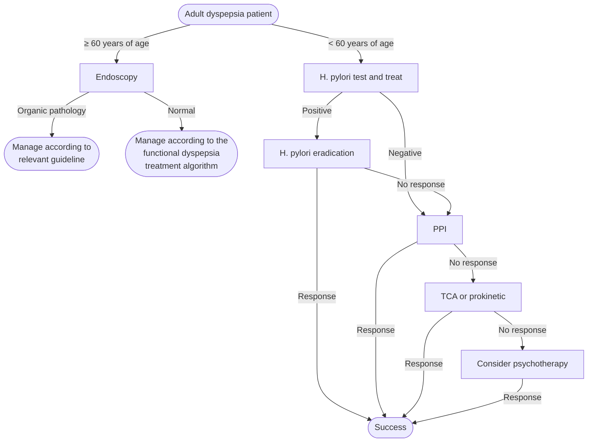
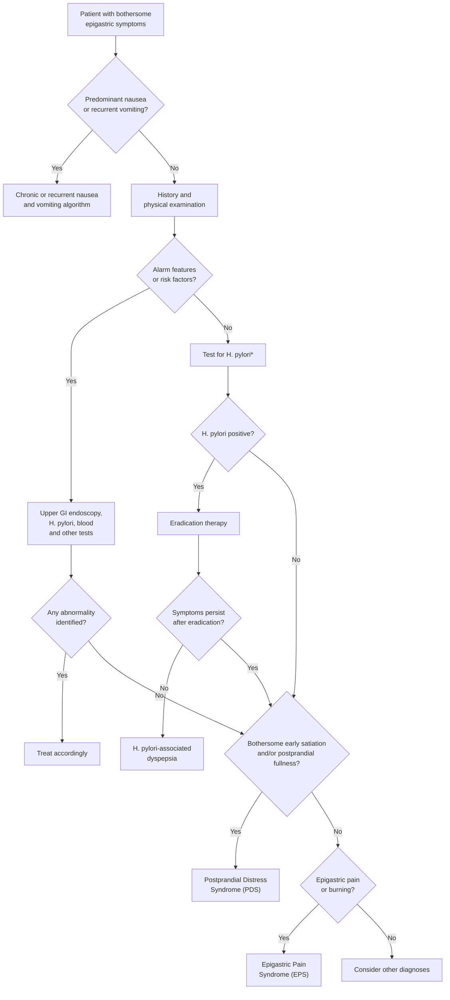

## Contents
- [[#Definition / Scope]]
- [[#Differential Diagnosis]]
- [[#Diagnostic Algorithm]]
  - [[#Functional Dyspepsia (post-EGD with no structural lesion)]]
- [[#Key Tests]]
- [[#Red Flags / Alarm Features]]
- [[#PPI Safety Considerations]]
- [[#See Also]]
- [[#Sources]]

---

## Definition / Scope

Dyspepsia refers to one or more of: postprandial fullness, early satiation, epigastric pain, or epigastric burning — without a causative structural or metabolic lesion. American College of Gastroenterology (ACG)/Canadian Association of Gastroenterology (CAG) 2017 defines it clinically as **predominant epigastric pain lasting ≥1 month**, with or without other upper gastrointestinal (GI) symptoms (fullness, [[nausea-and-vomiting|nausea, vomiting]], heartburn), provided epigastric pain is the patient's primary concern [[acg-cag-2017-dyspepsia]]. When no cause is found after evaluation, the diagnosis is **functional dyspepsia (FD)**, a [[disorders-of-gut-brain-interaction]].

**Uninvestigated dyspepsia:** Symptoms present without prior [[upper-endoscopy|esophagogastroduodenoscopy (EGD)]]. The test-and-treat strategy for H. pylori (see [[test-and-treat]]) applies in patients **<60** without alarm features (ACG/CAG 2017 raised the age threshold from <55 to <60 in older ACG guidance).

**Functional dyspepsia** is the endpoint of this schema, and has its own page: the Rome V **B1 / B1a-PDS / B1b-EPS** criteria boxes with their frequency thresholds and the whole treatment ladder are on [[functional-dyspepsia]]. Subtype-guided therapy is **not recommended** — no evidence that postprandial distress vs epigastric pain predicts treatment response [[acg-cag-2017-dyspepsia]].

- Rome V asks that the **subgroup terms PDS or EPS, or both, be used preferentially** over the umbrella term "functional dyspepsia" [[rome-v-2026-gastroduodenal-disorders]].
- **Epigastric** means the central abdomen above the navel. Epigastric pain or burning **consistently relieved by bowel movements** points to a bowel disorder instead ([[irritable-bowel-syndrome]]).

---

## Differential Diagnosis

- [[helicobacter-pylori-infection]] — most common treatable cause
- [[gastroparesis]] — significant overlap with postprandial-distress-type symptoms, and the two labels are unstable on repeat emptying studies; the reclassification and accommodation data are on [[functional-dyspepsia]]
- [[peptic-ulcer-disease|Peptic ulcer disease]] — structural; detected on EGD
- [[gastric-intestinal-metaplasia]] / [[gastric-premalignant-conditions]] — upper endoscopy if alarm features
- [[gerd|gastroesophageal reflux disease (GERD)]] — heartburn/regurgitation predominant
- Medication-induced — nonsteroidal anti-inflammatory drugs (NSAIDs), iron, metformin
- [[celiac-disease|Celiac disease]] — consider anti-tissue transglutaminase (TTG) immunoglobulin A (IgA)
- Malignancy — red flags trigger prompt EGD

---

## Diagnostic Algorithm

**Undiagnosed dyspepsia (ACG/CAG 2017):**

*Management of undiagnosed dyspepsia*
*Source: redrawn from the ACG/CAG 2017 undiagnosed dyspepsia algorithm*
*[[acg-cag-2017-dyspepsia|ACG/CAG 2017 Dyspepsia Guideline]]*
*H. pylori = Helicobacter pylori · PPI = proton pump inhibitor · TCA = tricyclic antidepressant*

- Functional dyspepsia treatment algorithm → [[functional-dyspepsia#The Sequential Ladder]]

1. **Age ≥60** (ACG/CAG 2017 Statement 1, Cond/Very Low) → EGD to exclude upper GI neoplasia. Lower threshold if high-risk (childhood in high–gastric cancer (GC)–incidence country, family history upper GI malignancy) [[acg-cag-2017-dyspepsia]].
2. **Age <60 + alarm features** (Statement 2, Cond/Moderate) → Do **NOT** automatically scope; alarm features have low positive predictive value (PPV). Pooled across 7 studies / 46,011 patients: **sensitivity 0.67 (0.54–0.83), specificity 0.66 (0.55–0.79)** against a **0.3% pre-test probability** of upper GI cancer; individual features (weight loss, anemia, dysphagia) carry a **positive likelihood ratio (LR) of only 2.74 (1.47–5.24)** — a 2–3× relative risk on a very small baseline, so absolute risk stays **<1%** under 60. Use case-by-case clinical judgment. Prominent features (e.g., weight loss >20 lb, rapidly progressive [[dysphagia]]) or combinations warrant EGD.
3. **Age <60, no high-risk features** (Statement 3, Strong/High) → Non-invasive H. pylori test-and-treat (urea breath test [UBT] or stool antigen; hold [[proton-pump-inhibitors|proton pump inhibitor (PPI)]] ≥2 wk and antibiotics ≥4 wk).
4. **H. pylori negative OR symptomatic post-eradication** (Statement 4, Strong/High) → Empiric standard-dose PPI 4–8 weeks.
5. **PPI/H. pylori (HP)–eradication failure** → second-line **prokinetic** (Statement 5, Cond/Very Low) or **tricyclic antidepressant (TCA)** (Statement 6, Cond/Low). No preferred order specified.

**Rome V 2026 approach to dyspeptic symptoms (Figure 2)** — alarm-feature-driven rather than age-driven, and it ends by assigning a subtype [[rome-v-2026-gastroduodenal-disorders]]:

*\*Whether to test and treat depends on local positivity rates and national guidelines.*

- ***H. pylori* status should be determined in every patient with dyspeptic symptoms** — the one universal step in the Rome V approach.
- **In the absence of alarm features, stop unnecessary drugs and supplements** that could be causing the dyspepsia **before** any further diagnostic testing.
- **Routine laboratory testing, including celiac serology, is not recommended** (low yield), nor is **routine imaging** or **routine motility testing**. **No international consensus recommends routine duodenal biopsies.**
- Upper endoscopy is **not compulsory** without alarm or risk features; it is **mandatory** when alarm features are present (or when symptoms are being investigated for a trial).
- ***H. pylori*-associated dyspepsia** is a retrospective diagnosis: eradication helps ~**30%** of patients with FD symptoms (number needed to treat **15**), and the label applies only once **remission has lasted half a year or longer** after eradication.

> **Where the two algorithms differ:** ACG/CAG 2017 routes by **age ≥60** to endoscopy and test-and-treats everyone younger without alarm features; Rome V 2026 routes by **alarm features/risk factors alone** and gives no age cut-off. Rome V is the newer source but does not address the age threshold, so the ACG/CAG age rule still stands for US practice.

### Functional Dyspepsia (post-EGD with no structural lesion)

A normal EGD closes this schema and opens the FD page. **ACG/CAG 2017 Statements 7–14 — the eradication → PPI → TCA → prokinetic → psychological-therapy ladder, its grades, effect sizes and stopping rules, the treatment flowchart, and the motility-testing rules — are on [[functional-dyspepsia]].**

- One ordering point worth carrying across: **in FD the guideline puts TCA before prokinetic**, whereas Statements 5–6 above state no preference between them in uninvestigated dyspepsia.

---

## Key Tests

- **H. pylori noninvasive testing:** urea breath test or stool antigen — hold [[proton-pump-inhibitors|PPIs]] ≥2 weeks and antibiotics ≥4 weeks before testing. Test operating characteristics live on [[helicobacter-pylori-infection]]
- **Upper endoscopy:** Age ≥60, high-risk demographics, prominent/multiple alarm features, or empiric-therapy failure
- **Gastric emptying scintigraphy:** not part of this workup — it is reserved for selected post-EGD patients, per the rules on [[functional-dyspepsia]]
- **Pancreatic imaging:** Not routinely indicated <60 ([[pancreatic-cancer|pancreatic cancer]] prevalence <0.01% in this group), but consider if pain radiates to back

---

## Red Flags / Alarm Features

Per ACG/CAG 2017, alarm features alone in patients <60 have **low PPV** for upper GI malignancy — see the pooled operating characteristics in [[#Diagnostic Algorithm]]. They should prompt **clinical judgment**, not automatic EGD:

- Age ≥60 with new-onset symptoms (independent threshold)
- Weight loss (unintentional, especially >20 lb)
- Dysphagia or odynophagia (especially progressive)
- Persistent vomiting
- GI bleeding or [[iron-deficiency-anemia|iron deficiency anemia]]
- Palpable abdominal mass
- Family history of gastric or upper GI cancer
- [[jaundice|Jaundice]] (suggests pancreaticobiliary cause — distinct workup)

---

## PPI Safety Considerations

ACG/CAG 2017 reviewed associations between long-term PPI and hip fracture, community-acquired pneumonia (CAP), [[clostridioides-difficile|C. difficile]], electrolyte disturbance, and dementia — concluded most likely residual confounding; even if causal, number needed to harm (NNH) >1,000 in most studies. Continue PPI when benefit is clear; reassess every 6–12 months and discontinue if no longer needed (consistent with FDA guidance).

---

## See Also

[[functional-dyspepsia]], [[disorders-of-gut-brain-interaction]], [[test-and-treat]], [[helicobacter-pylori-infection]], [[peptic-ulcer-disease]], [[gastroparesis]], [[gastric-intestinal-metaplasia]], [[gastric-premalignant-conditions]], [[gerd]], [[celiac-disease]], [[upper-endoscopy]], [[proton-pump-inhibitors]], [[nausea-and-vomiting]], [[dysphagia]], [[jaundice]], [[iron-deficiency-anemia]], [[pancreatic-cancer]], [[clostridioides-difficile]], [[irritable-bowel-syndrome]]

---

## Sources

1. [[acg-cag-2017-dyspepsia|ACG/CAG 2017: Management of Dyspepsia]]
2. [[rome-v-2026-gastroduodenal-disorders|Gastroduodenal Disorders (Rome V, 2026)]]
3. [[rome-v-2026-dgbi|Disorders of Gut–Brain Interaction and the Rome V Process]]
4. [[acg-2022-gastroparesis|ACG 2022: Gastroparesis]]
