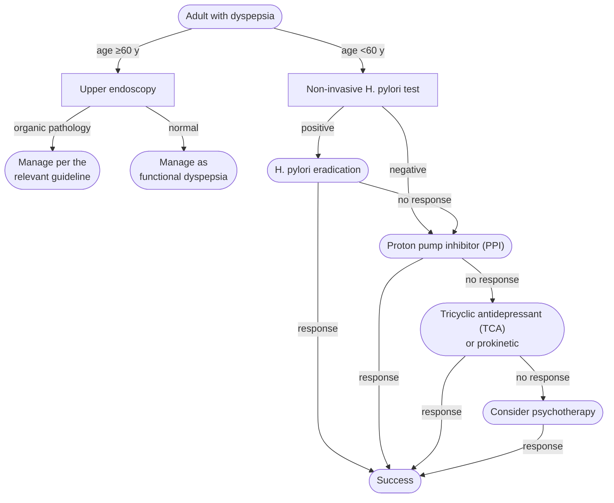
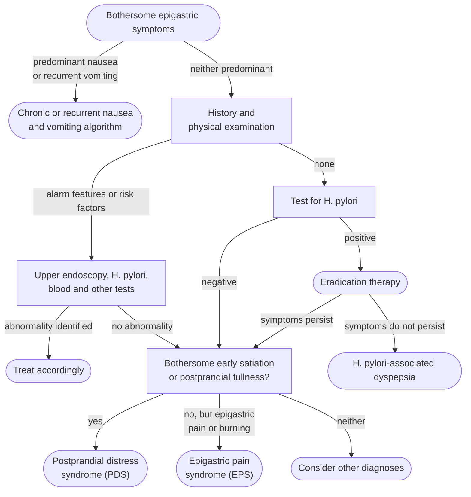

## Contents
- [[#Definition / Scope]]
- [[#Differential Diagnosis]]
- [[#Diagnostic Algorithm]]
  - [[#Age-Based Routing (ACG/CAG 2017)]]
  - [[#Alarm-Feature Routing (Rome V 2026)]]
  - [[#Where the Two Differ]]
  - [[#After a Normal Endoscopy]]
- [[#Key Tests]]
- [[#Red Flags / Alarm Features]]
- [[#See Also]]
- [[#Sources]]

---

## Definition / Scope

Dyspepsia = one or more of postprandial fullness, early satiation, epigastric pain, or epigastric burning. American College of Gastroenterology (ACG)/Canadian Association of Gastroenterology (CAG) 2017 uses a clinical definition: **predominant epigastric pain lasting ≥1 month**, with or without other upper gastrointestinal (GI) symptoms (epigastric fullness, [[nausea-and-vomiting|nausea, vomiting]], heartburn), **provided epigastric pain is the patient's primary concern** [[acg-cag-2017-dyspepsia]].

- **Uninvestigated dyspepsia:** symptoms without prior [[upper-endoscopy|esophagogastroduodenoscopy (EGD)]]. Under 60 without alarm features, the first step is non-invasive [[helicobacter-pylori-infection|*Helicobacter pylori* (H. pylori)]] testing — see [[test-and-treat]]. ACG/CAG 2017 **raised the endoscopy age threshold from ≥55 to ≥60**; readers carrying the older rule will over-scope.
- **Functional dyspepsia (FD):** dyspepsia in whom endoscopy (and other tests where relevant) has ruled out organic pathology explaining the symptoms — a [[disorders-of-gut-brain-interaction|disorder of gut–brain interaction]]. It is the endpoint of this schema; the Rome V criteria boxes, subtype definitions and the whole treatment ladder are on [[functional-dyspepsia]].
- **Epigastric** = the central abdomen above the navel.

**Outside this schema** (ACG/CAG 2017 excludes them from its own scope):

- Alarm features **without** epigastric pain — e.g. progressive [[dysphagia]] or weight loss alone. These patients do not meet the dyspepsia definition; work them up on their own schema.
- Epigastric pain suggesting a pancreatic or biliary source (**pain radiating to the back**) → ultrasound or computed tomography (CT), not this algorithm.
- Alarm features needing non-endoscopic tests, e.g. [[jaundice]].

---

## Differential Diagnosis

- [[helicobacter-pylori-infection|*H. pylori* infection]] — most common treatable cause
- [[functional-dyspepsia|Functional dyspepsia]] — the diagnosis when evaluation finds no causative lesion
- [[peptic-ulcer-disease|Peptic ulcer disease]] — structural; found on EGD
- [[gastroparesis]] — overlaps heavily with postprandial-distress-type symptoms; the two labels are unstable on repeat emptying studies ([[functional-dyspepsia]])
- [[gastric-intestinal-metaplasia]] / [[gastric-premalignant-conditions]] — found on EGD
- [[gerd|Gastroesophageal reflux disease (GERD)]] — heartburn/regurgitation predominant
- Medication-induced — nonsteroidal anti-inflammatory drugs (NSAIDs), iron, metformin
- [[celiac-disease|Celiac disease]] — not tested for routinely (see [[#Key Tests]])
- Upper GI malignancy — the reason the age and alarm-feature rules below exist

---

## Diagnostic Algorithm

Two ingested guidelines route these patients differently: ACG/CAG 2017 by **age**, Rome V 2026 by **alarm features**. Both are given, then contrasted.

### Age-Based Routing (ACG/CAG 2017)

*Management of undiagnosed dyspepsia*
*Source: redrawn from Figure 1 of the ACG/CAG 2017 dyspepsia guideline*
*[[acg-cag-2017-dyspepsia|ACG/CAG 2017: Management of Dyspepsia]]*
*H. pylori = Helicobacter pylori · PPI = proton pump inhibitor · TCA = tricyclic antidepressant*

**What assigns each branch** (statement numbers and grades as printed in the guideline):

1. **Age ≥60 → endoscopy** to exclude upper GI neoplasia (Statement 1, *conditional, very low quality*). **Scope earlier** for childhood spent in a high gastric-cancer–incidence region (South East Asia, some South American countries) or a family history of upper GI malignancy; in borderline cases sex may be weighed — age-adjusted upper GI cancer risk is about **twice as high in men**. A minority over 60 may still be treated empirically where cancer risk is judged low.
2. **Age <60 with alarm features → judgment, not reflex endoscopy** (Statement 2, *conditional, moderate quality*). Pooled across 7 studies / 46,011 dyspepsia patients against a **0.3% pre-test probability** of upper GI cancer: sensitivity **0.67 (95% CI 0.54–0.83)**, specificity **0.66 (0.55–0.79)**; individual features (weight loss, anemia, dysphagia) give a positive likelihood ratio of only **2.74 (1.47–5.24)** — a 2–3-fold relative increase on a baseline so low that absolute risk stays **well under 1%**. Scope anyway for a **prominent** feature (weight loss **>20 lb**, rapidly progressive dysphagia) or a **combination** of features; risk climbs within the band, so the threshold is lower at 58 than at 28.
3. **Age <60, no high-risk features → non-invasive *H. pylori* test, treat if positive** (Statement 3, *strong, high quality*). **Local prevalence does not change this** — the earlier <15%-prevalence rule that put PPI first is dropped ([[test-and-treat]]). Allow **at least 4 weeks** after eradication before judging symptomatic response.
4. ***H. pylori*-negative, or still symptomatic after eradication → empirical [[proton-pump-inhibitors|PPI]]** (Statement 4, *strong, high quality*). Trials used **once-daily standard dosing**; higher doses are unlikely to add benefit. Rome V puts the course at **4–8 weeks**, stopped if improvement is insufficient, with no dose escalation [[rome-v-2026-gastroduodenal-disorders]].
5. **Failure of PPI and eradication → prokinetic** (Statement 5, *conditional, very low quality*) **or TCA** (Statement 6, *conditional, low quality*). **No preferred order** between them in uninvestigated dyspepsia — unlike FD, where the guideline puts TCA first.

- Long-term PPI safety and deprescribing: [[proton-pump-inhibitors]] — ACG/CAG 2017 judged the reported associations (hip fracture, community-acquired pneumonia, [[clostridioides-difficile|*C. difficile*]], electrolyte disturbance, dementia) most likely residual confounding, with number needed to harm >1,000 in most studies.

### Alarm-Feature Routing (Rome V 2026)

*Rome V diagnostic approach to dyspeptic symptoms — routed by alarm features, ending in a subtype*
*Source: redrawn from Figure 2 of the Rome V gastroduodenal disorders chapter*
*[[rome-v-2026-gastroduodenal-disorders|Gastroduodenal Disorders (Rome V, 2026)]]*
*H. pylori = Helicobacter pylori · PDS = postprandial distress syndrome · EPS = epigastric pain syndrome*

- **Whether to test *and treat*** at the no-alarm step **depends on local positivity rates and national guidelines** (the figure's own footnote).
- **Before any further testing, stop unnecessary drugs and supplements** that could be causing the dyspepsia — the first move in a patient without alarm features.
- Upper endoscopy is **not compulsory** without alarm or risk features; it is **mandatory** when alarm features are present, or when symptoms are being investigated for a clinical or mechanistic trial.
- ***H. pylori*-associated dyspepsia** is a retrospective label: eradication helps ~**30%** of patients with FD symptoms (number needed to treat **15**), and the label applies only once remission has lasted **half a year or longer** after eradication.
- Rome V asks that the subtype terms **PDS or EPS, or both**, be used preferentially over the umbrella term. Their criteria, frequency thresholds and the Rome IV → V reassignment of postprandial epigastric pain are on [[functional-dyspepsia]].

### Where the Two Differ

| Decision | [[acg-cag-2017-dyspepsia\|ACG/CAG 2017]] | [[rome-v-2026-gastroduodenal-disorders\|Rome V 2026]] |
|---|---|---|
| What sends a patient to endoscopy | **Age ≥60.** Under 60, alarm features are weighed case-by-case | **Alarm features or risk factors**, with no age cut-off printed |
| *H. pylori* testing | Non-invasive test-and-treat under 60 | **Status determined in every patient** with dyspeptic symptoms |
| Empirical [[proton-pump-inhibitors\|PPI]] | Once-daily standard dose if negative or still symptomatic after eradication | Same indication; **4–8 weeks**, stop if improvement insufficient |
| Routine labs (incl. celiac serology), imaging, duodenal biopsy, motility testing | Not covered | **Not recommended** — low diagnostic yield |
| Where the algorithm ends | Functional dyspepsia; **subtype does not steer therapy** | Assign a subtype — PDS or EPS, or both |

**Which to follow:** Rome V is the newer source but prints no age threshold, so the ACG/CAG **≥60** endoscopy rule stands for US practice; Rome V adds the steps ACG/CAG does not cover (drug withdrawal first, what *not* to test).

### After a Normal Endoscopy

A normal EGD closes this schema and opens [[functional-dyspepsia]] — which holds the eradication → PPI → TCA → prokinetic → psychological-therapy ladder with its grades, effect sizes and stopping rules ([[functional-dyspepsia#The Sequential Ladder]]), and the rules for motility and accommodation testing.

---

## Key Tests

| Test | When | Notes |
|---|---|---|
| Non-invasive *H. pylori* test — urea breath test or stool antigen | Every patient with dyspeptic symptoms (Rome V); the first step under 60 (ACG/CAG) | Acid suppression and antibiotics must be held before testing; hold intervals and test characteristics are on [[helicobacter-pylori-infection]] |
| [[upper-endoscopy\|Upper endoscopy]] | Age ≥60; alarm features or risk factors; high gastric-cancer-risk childhood or family history of upper GI malignancy; failure of empiric therapy | Mandatory with alarm features. ACG/CAG does not address management of the pathology it finds — see the relevant disease page |
| Pancreatic imaging (abdominal ultrasound) | Combine with endoscopy in **new-onset dyspepsia ≥60**; pain radiating to the back at any age | **Not routine under 60** — <0.01% of >57,000 dyspepsia patients had [[pancreatic-cancer\|pancreatic cancer]] |
| Routine labs incl. celiac serology, routine imaging, routine duodenal biopsy, motility studies | **Not recommended** in the routine workup (Rome V) | Low diagnostic yield; no international consensus supports routine duodenal biopsies |
| Gastric emptying scintigraphy | Not part of this workup | Reserved for selected post-EGD patients, per the rules on [[functional-dyspepsia]] |

---

## Red Flags / Alarm Features

- Age ≥60 with new-onset symptoms — an independent threshold, not an alarm feature
- Weight loss (unintentional, especially **>20 lb**)
- Dysphagia or odynophagia, especially rapidly progressive
- Persistent vomiting
- GI bleeding or [[iron-deficiency-anemia|iron deficiency anemia]]
- Palpable abdominal mass
- Family history of gastric or upper GI cancer
- [[jaundice|Jaundice]] — investigate with tests other than endoscopy

> [!pitfall] An alarm feature under 60 is not an automatic endoscopy
> Alarm features have low positive predictive value in this age band — a 2–3-fold relative increase on a 0.3% pre-test probability keeps absolute cancer risk well under 1%. Scope for a **prominent** feature (weight loss >20 lb, rapidly progressive dysphagia), a **combination** of features, or age near 60 ([[acg-cag-2017-dyspepsia]]). Alarm features *without* epigastric pain are not dyspepsia at all and need their own workup.

---

## See Also

[[functional-dyspepsia]], [[disorders-of-gut-brain-interaction]], [[test-and-treat]], [[helicobacter-pylori-infection]], [[peptic-ulcer-disease]], [[gastroparesis]], [[gastric-intestinal-metaplasia]], [[gastric-premalignant-conditions]], [[gerd]], [[celiac-disease]], [[upper-endoscopy]], [[proton-pump-inhibitors]], [[nausea-and-vomiting]], [[dysphagia]], [[jaundice]], [[iron-deficiency-anemia]], [[pancreatic-cancer]], [[clostridioides-difficile]], [[irritable-bowel-syndrome]]

---

## Sources

1. [[acg-cag-2017-dyspepsia|ACG/CAG 2017: Management of Dyspepsia]]
2. [[rome-v-2026-gastroduodenal-disorders|Gastroduodenal Disorders (Rome V, 2026)]]
3. [[rome-v-2026-dgbi|Disorders of Gut–Brain Interaction and the Rome V Process]]
4. [[acg-2022-gastroparesis|ACG 2022: Gastroparesis]]
