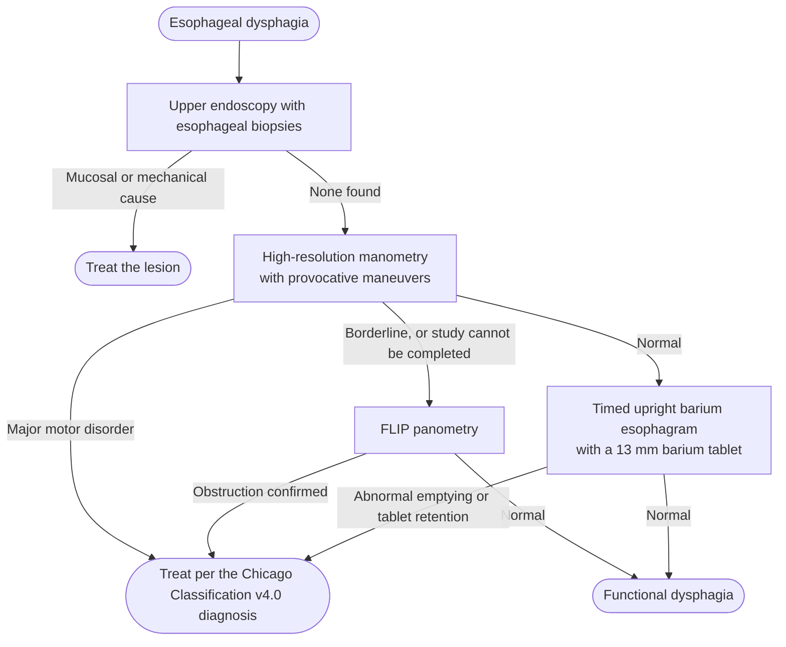

## Contents
- [[#Definition / Scope]]
  - [[#Localizing the Problem]]
  - [[#Bolus Pattern in Esophageal Dysphagia]]
  - [[#Symptoms That Are Not Dysphagia]]
- [[#Differential Diagnosis]]
  - [[#Oropharyngeal]]
  - [[#Esophageal]]
- [[#Diagnostic Algorithm]]
- [[#Key Tests]]
- [[#Red Flags / Alarm Features]]
- [[#See Also]]
- [[#Sources]]

---

## Definition / Scope

**Dysphagia** — impaired passage of food or liquid from the mouth to the stomach. Localize it first, to the oropharynx or to the esophagus: that choice sets the first test and splits the differential.

### Localizing the Problem

| | Oropharyngeal | Esophageal |
|---|---|---|
| **Level** | upper esophageal sphincter (UES) or hypopharynx | esophageal body or esophagogastric junction (EGJ) |
| **How it is separated** | careful history **plus a diagnostic evaluation of the swallowing mechanism** | careful history, then endoscopy before any physiologic test |
| **First test** | **videofluoroscopy** — the test of choice when oropharyngeal dysphagia is suspected | **[[upper-endoscopy\|esophagogastroduodenoscopy (EGD)]] with esophageal biopsies** |
| **What EGD adds** | still perform it, to exclude alternative or additional pathology — and **include a complete examination of the UES and hypopharynx** | excludes structural and mechanical lesions; very low yield as a test of esophageal physiology, so it comes **before** manometry, barium or [[flip-panometry\|functional lumen imaging probe (FLIP)]] studies |

*Oropharyngeal column from [[asge-2014-dysphagia]] and [[rome-v-2026-functional-esophageal-disorders]]; esophageal column from [[acg-2020-esophageal-physiologic-testing]].*

### Bolus Pattern in Esophageal Dysphagia

The single most useful historical discriminator ([[asge-2014-dysphagia]]):

| Pattern | Points to |
|---|---|
| **Solids alone** | structural (mechanical) disorder |
| **Solids *and* liquids** | motility disorder |

- **Ask about opioids every time** — opioid use contributes to esophageal dysmotility, outflow obstruction and heightened symptom reporting ([[rome-v-2026-functional-esophageal-disorders]]).

### Symptoms That Are Not Dysphagia

- **Odynophagia** — painful swallowing. An appropriate indication for EGD in its own right ([[acg-2025-egd-quality]]) and an alarm feature ([[rome-v-2026-functional-esophageal-disorders]]).
- **[[globus|Globus]]** — sensation of a lump in the throat *between* swallows (Rome V esophageal [[disorders-of-gut-brain-interaction|disorder of gut–brain interaction (DGBI)]] **A4**). Diagnosis **requires the absence of dysphagia and of alarm features (odynophagia, weight loss)**; initial evaluation is examination of the neck followed by laryngoscopy ([[rome-v-2026-functional-esophageal-disorders]]).
- **[[functional-dysphagia|Functional dysphagia]]** — Rome V **A5**, and this schema's endpoint once endoscopy with biopsy, a barium study with a solid bolus, [[high-resolution-manometry|high-resolution manometry (HRM)]] and (where available) FLIP are all normal. Full criteria on [[functional-dysphagia]].

---

## Differential Diagnosis

### Oropharyngeal

- **UES dysfunction and cricopharyngeal bar** — endoscopic dilation and injection therapy have been described for both; a cricopharyngeal bar is amenable to [[esophageal-dilation|dilation]] ([[asge-2014-dysphagia]]).
- **Proximal esophageal web** — also amenable to dilation ([[asge-2014-dysphagia]]).

ASGE 2014 does not list the neuromuscular and structural causes of oropharyngeal dysphagia; it addresses only how to separate it from esophageal dysphagia and what endoscopy adds.

### Esophageal

**Mechanical / structural** — all amenable to dilation ([[asge-2014-dysphagia]]):

- **[[esophageal-stricture|Peptic stricture]]** — sequela of [[gerd|gastroesophageal reflux disease (GERD)]]; **up to 80% of all benign esophageal strictures**, though the incidence has fallen with widespread [[proton-pump-inhibitors|proton pump inhibitor (PPI)]] use
- **[[eosinophilic-esophagitis|Eosinophilic esophagitis (EoE)]]** — a common benign cause, with rising reported prevalence
- **Schatzki ring** — diaphragm-like web at the squamocolumnar junction, usually the proximal margin of a [[hiatal-hernia|hiatal hernia]]; **best detected on barium swallow and may disappear with air insufflation at endoscopy**
- **Esophageal web**; caustic injury; pill-induced stricture; radiation injury; anastomotic stricture; post-endoscopic-therapy stricture; congenital anomalies (tracheoesophageal fistula)
- **[[esophageal-cancer|Esophageal cancer]]** — [[esophageal-adenocarcinoma|adenocarcinoma]] or squamous cell carcinoma, from intrinsic luminal tumor growth; **pseudoachalasia**
- **Extrinsic compression** — malignant narrowing from outside the esophagus; **responds poorly to dilation**

**Motility:**

- **[[achalasia]]** — dysphagia to solids *and* liquids; diagnosed on [[high-resolution-manometry|HRM]] ([[chicago-classification-v4|Chicago Classification]] types I–III)
- **[[esophagogastric-junction-outflow-obstruction|EGJ outflow obstruction (EGJOO)]]** — a manometric pattern requiring corroboration with FLIP or timed barium plus symptoms
- **[[distal-esophageal-spasm|Distal (diffuse) esophageal spasm]]** — premature contractions; **does not respond to dilation**
- **[[hypercontractile-esophagus]]** (jackhammer) and **[[ineffective-esophageal-motility]]**
- **[[esophageal-dysfunction-systemic-disease|Hypomotility secondary to connective tissue disease]]** (scleroderma and others) — **does not respond to dilation**

**Mucosal / inflammatory:**

- Erosive esophagitis from [[gerd]]; [[infectious-esophagitis|infectious esophagitis]] (*Candida*, herpes simplex virus [HSV], cytomegalovirus [CMV] — especially the immunocompromised; usually odynophagia); pill esophagitis (doxycycline, bisphosphonates, nonsteroidal anti-inflammatory drugs [NSAIDs], potassium chloride)

**Immune-mediated / systemic** — endoscopy is often nonspecific, so keep a high index of suspicion:

- [[lymphocytic-esophagitis|Lymphocytic esophagitis]]
- [[esophageal-dysfunction-systemic-disease|Esophageal manifestations of systemic disease]] — connective tissue disease (systemic sclerosis [SSc], mixed connective tissue disease [MCTD], systemic lupus erythematosus [SLE], Sjögren's, myositis), esophageal [[crohns-disease|Crohn's disease]], hypereosinophilic syndrome / eosinophilic granulomatosis with polyangiitis (EGPA), and dermatologic disease (esophageal lichen planus, pemphigus vulgaris)

---

## Diagnostic Algorithm

**Oropharyngeal** → videofluoroscopy, plus EGD with a complete examination of the UES and hypopharynx (see *Localizing the Problem*).

**Esophageal:**

*Workup of esophageal dysphagia after endoscopy*
*Source: redrawn from the obstructive-symptom arm of ACG 2020 Figure 1, with the normal-FLIP endpoint as Rome V states it*
*[[acg-2020-esophageal-physiologic-testing|ACG 2020: Clinical Use of Esophageal Physiologic Testing]] · [[rome-v-2026-functional-esophageal-disorders|Functional Esophageal Disorders (Rome V, 2026)]]*
*FLIP = functional lumen imaging probe*

> [!pitfall] A normal-looking esophagus still needs biopsies
> Take **≥6 biopsies from ≥2 levels (proximal/mid *and* distal)** in anyone reporting dysphagia when endoscopy shows no cause — EGD quality indicator 4, performance target **>90%**, grade 2B ([[acg-2025-egd-quality]]). Biopsies taken with dilation confer no extra perforation risk ([[asge-2014-dysphagia]]), and EoE may be missed if biopsies are taken on PPI therapy or in a fibrostenotic phenotype ([[rome-v-2026-functional-esophageal-disorders]]).

---

## Key Tests

- **[[upper-endoscopy|EGD]]** — first-line for esophageal dysphagia: direct visualization, biopsy, and therapeutic [[esophageal-dilation|dilation]]. Retroflex before dilating to look for malignancy or varices in the gastric cardia ([[asge-2014-dysphagia]]).
- **Videofluoroscopy** — test of choice for suspected **oropharyngeal** dysphagia ([[rome-v-2026-functional-esophageal-disorders]]).
- **Barium esophagram** — use a **standardized, upright, timed protocol**, and **include a 13 mm barium tablet**: abnormal tablet passage or retention indicates an obstructive process at the EGJ (Recommendation 4, conditional / very low; Key concept 2 — [[acg-2020-esophageal-physiologic-testing]]). Solid boluses (tablet, cookie, marshmallow) detect subtle strictures, obstructive lesions and paraesophageal hernias missed at endoscopy ([[rome-v-2026-functional-esophageal-disorders]]).
- **[[high-resolution-manometry|HRM]]** — the test for motility disorders; **HRM over conventional line-tracing manometry** (strong / moderate), with **provocative maneuvers added to the protocol** to raise diagnostic yield (conditional / low) — protocol detail on [[high-resolution-manometry]]. Interpreted by the [[chicago-classification-v4|Chicago Classification v4.0]].
- **[[flip-panometry|FLIP]]** — **complements HRM when HRM findings are borderline** (conditional / low), and **FLIP topography may be used when a manometry study cannot be completed** (e.g. catheter placement failure despite endoscopic attempts) ([[acg-2020-esophageal-physiologic-testing]]).
- **Ambulatory [[reflux-testing|reflux testing]]** ([[ambulatory-reflux-monitoring]]) — when [[gerd|GERD]] is the suspected driver of the dysphagia or of a peptic stricture.
- **Symptom questionnaires** — may aid evaluation but **must not be used alone to diagnose** a specific esophageal condition (Key concept 1); the brief esophageal dysphagia questionnaire was only **70% sensitive and 65% specific** for a major motor disorder ([[acg-2020-esophageal-physiologic-testing]]).

> [!pitfall] Barium esophagram is a poor screen for dysmotility
> For detecting esophageal dysmotility it is only **0.69 sensitive and 0.50 specific** (positive predictive value 0.61, negative predictive value 0.58; 281 patients with an esophagram within 90 days of HRM) — a **suboptimal screening test** in esophageal dysphagia. Go to HRM ([[acg-2020-esophageal-physiologic-testing]]).

### Which Causes Dilation Can Fix

The question that decides whether the diagnostic EGD becomes a therapeutic one ([[asge-2014-dysphagia]]):

| | Amenable to [[esophageal-dilation\|dilation]] | **Not** amenable |
|---|---|---|
| **Benign** | peptic stricture · Schatzki ring · esophageal web · [[eosinophilic-esophagitis\|EoE]] · caustic injury · anastomotic stricture · radiation injury · pill-induced stricture · post-endoscopic-therapy stricture · congenital anomalies (tracheoesophageal fistula) · cricopharyngeal bar | — |
| **Malignant** | [[esophageal-adenocarcinoma\|esophageal adenocarcinoma]] · squamous cell carcinoma · pseudoachalasia | extrinsic compression |
| **Motility** | [[achalasia]] | diffuse esophageal spasm · hypomotility secondary to connective tissue disease |

- **Dysphagia begins at a luminal diameter of ≤13 mm**; a modified diet is usually tolerated at **15 mm** and a regular diet at **18 mm** ([[asge-2014-dysphagia]]).

> [!pearl] Empiric large-bore dilation — the newer position reverses the older one
> **Rome V (2026):** empiric bougie dilation to **50–54 Fr** benefited **68%–85%** of patients with unexplained food dysphagia, probably treating subtle proximal abnormalities routine testing misses; balloon dilation at the EGJ had limited utility ([[rome-v-2026-functional-esophageal-disorders]]).
> **ASGE 2014** took the opposite view — several studies of 50 F dilation with a normal endoscopy failed to improve dysphagia scores, and perforation risk may outweigh benefit, **especially with undiagnosed EoE** ([[asge-2014-dysphagia]]).
> Rome V requires EoE and GERD to be excluded, by antisecretory therapy plus endoscopy with biopsy, before functional dysphagia is diagnosed.

---

## Red Flags / Alarm Features

- **Dysphagia is itself an alarm symptom.** Endoscopy is the **first test** for patients presenting with dysphagia or other alarm symptoms — **weight loss** and **gastrointestinal (GI) bleeding** — and for patients with multiple risk factors for [[barretts-esophagus|Barrett's esophagus]]: strong recommendation, low quality evidence ([[acg-2021-gerd]]).
- **Odynophagia** and **food impaction** are appropriate indications for EGD alongside dysphagia ([[acg-2025-egd-quality]]).
- EGD's diagnostic yield was **54%** in patients over 40 presenting with dysphagia together with heartburn, odynophagia and weight loss ([[asge-2014-dysphagia]]).
- **[[ingested-foreign-body|Acute food impaction]]** — see [[ingested-foreign-body]] for the timing of endoscopy; strongly associated with [[eosinophilic-esophagitis|EoE]] and rings.
- **Odynophagia or weight loss excludes a [[globus]] diagnosis** — reassurance is not the answer in a patient with either ([[rome-v-2026-functional-esophageal-disorders]]).
- **Esophageal stasis** from [[achalasia]], a diverticulum or a tight stricture may require a prolonged fast or a nasogastric tube before endoscopy, to minimize aspiration risk ([[asge-2014-dysphagia]]).

---

## See Also

[[eosinophilic-esophagitis]], [[infectious-esophagitis]], [[lymphocytic-esophagitis]], [[esophageal-dysfunction-systemic-disease]], [[achalasia]], [[gerd]], [[esophageal-cancer]], [[barretts-esophagus]], [[distal-esophageal-spasm]], [[hypercontractile-esophagus]], [[ineffective-esophageal-motility]], [[esophagogastric-junction-outflow-obstruction]], [[high-resolution-manometry]], [[chicago-classification-v4]], [[flip-panometry]], [[reflux-testing]], [[ambulatory-reflux-monitoring]], [[upper-endoscopy]], [[laryngopharyngeal-symptoms]], [[globus]], [[functional-dysphagia]], [[disorders-of-gut-brain-interaction]], [[ingested-foreign-body]], [[esophageal-dilation]], [[esophageal-stricture]], [[esophageal-adenocarcinoma]], [[hiatal-hernia]]

---

## Sources

1. [[asge-2014-dysphagia|ASGE 2014: The Role of Endoscopy in the Evaluation and Management of Dysphagia]]
2. [[acg-2020-esophageal-physiologic-testing|ACG 2020: Clinical Use of Esophageal Physiologic Testing]]
3. [[chicago-v4-2021-esophageal-dysmotility|Esophageal Motility Disorders on High-Resolution Manometry: Chicago Classification Version 4.0]]
4. [[acg-2021-gerd|ACG 2021 Clinical Guideline: Diagnosis and Management of GERD]]
5. [[aga-2024-esophageal-immunity-infection|AGA Clinical Practice Update on Esophageal Dysfunction Due to Disordered Immunity and Infection: Expert Review (2024)]]
6. [[acg-2025-egd-quality|ACG/ASGE 2025: Quality Indicators for Upper GI Endoscopy (EGD)]]
7. [[rome-v-2026-functional-esophageal-disorders|Functional Esophageal Disorders (Rome V, 2026)]]
