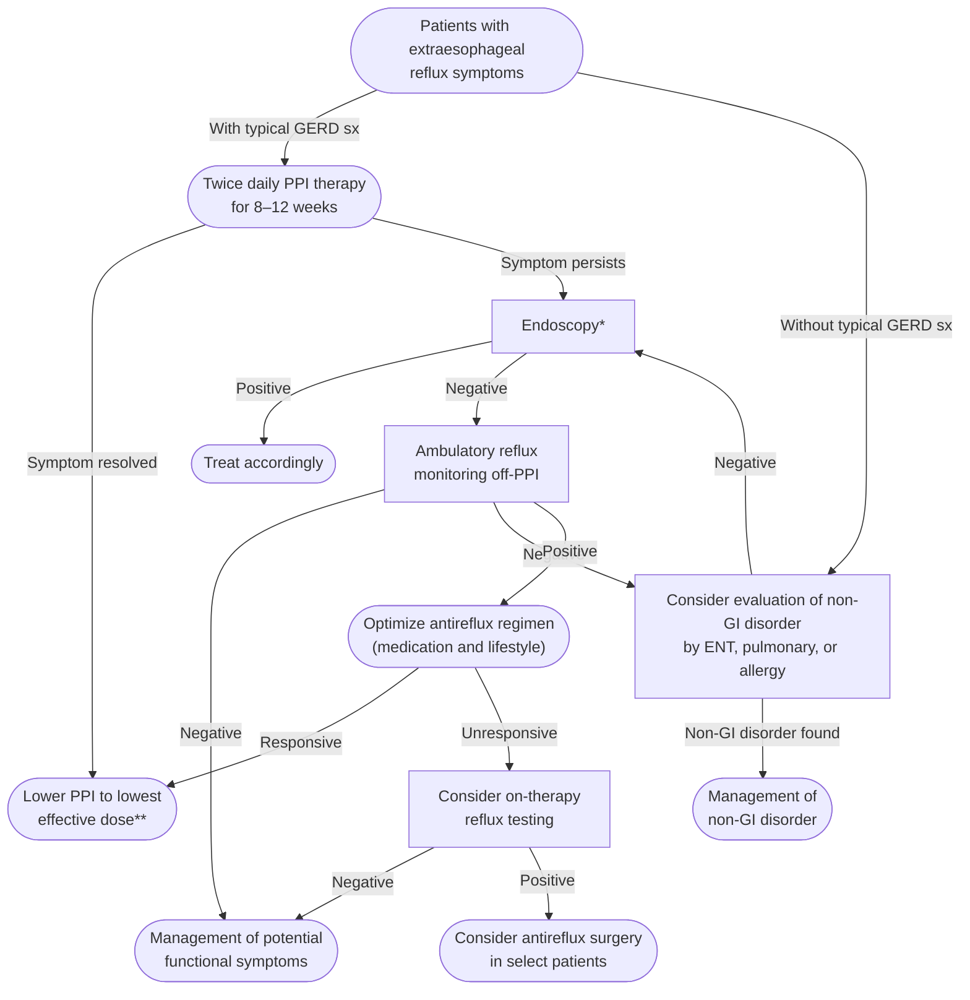

## Contents
- [[#Definition / Scope]]
- [[#Differential Diagnosis]]
- [[#Diagnostic Algorithm]]
  - [[#Off vs On Therapy Testing]]
  - [[#What Changed Since 2018]]
- [[#Key Tests]]
  - [[#Test Performance]]
- [[#Red Flags / Alarm Features]]
- [[#Treatment Framework]]

## Definition / Scope

- **Extraesophageal reflux (EER)** = airway, laryngeal, oropharyngeal or dental symptoms/conditions suspected to be caused or aggravated by gastroesophageal reflux (GER) — classically laryngitis, chronic cough, asthma, dental erosions (American Gastroenterological Association [AGA] 2023 best practice advice [BPA] 1).
- A *suspicion*, not a diagnosis:
  - **No single test conclusively identifies GER as the cause** (BPA 3).
  - **50–60% of patients with EER symptoms do not have [[gerd|gastroesophageal reflux disease (GERD)]]** and will not respond to anti-reflux therapy ([[aga-2023-extraesophageal-gerd]]).
- Postulated mechanisms ([[aga-2023-extraesophageal-gerd]]):
  - **Reflux pathway** — micro-aspiration of acid or non-acid digestive fluid; symptoms may not improve with acid suppression.
  - **Reflex pathway** — vagally mediated airway reactions; neurologic increase in laryngeal/airway inflammation.
- Diagnosis = **global clinical impression**: symptoms, response to GER therapy, endoscopy, reflux testing (BPA 3); multidisciplinary input — pulmonology, otolaryngology, dentistry, allergy (BPA 2).
- **Throat-predominant complaints** → laryngeal-specific workup and terminology on [[laryngopharyngeal-symptoms|laryngopharyngeal symptoms]].

> [!pitfall] PPI response does not prove GERD
> Improvement of EER symptoms on a [[proton-pump-inhibitors|proton pump inhibitor (PPI)]] may come from mechanisms other than acid suppression; do not treat it as confirmation of GERD (AGA 2023 BPA 5).

## Differential Diagnosis

*Workup: this page is the schema. For the laryngeal-specific workup, see [[laryngopharyngeal-symptoms]].*

- **Evaluate non-GERD causes before ascribing symptoms to GERD** — American College of Gastroenterology (ACG) 2021 extraesophageal Rec 1 (Strong, Moderate) ([[acg-2021-gerd]]); AGA 2018 BPA 2: non-gastrointestinal (GI) evaluation by ear, nose, and throat (ENT), pulmonary and/or allergy is essential and often should come first.
- Gastroenterologist's role: assess whether a gastroesophageal cause contributes (AGA 2018 BPA 1).
- Evidence for a reflux link is strongest for asthma, cough and hoarseness; many other attributions rest on association only ([[aga-2018-extraesophageal-gerd]]).

| EER manifestation | Non-reflux differentials to exclude | Collaborating specialty |
|---|---|---|
| **Laryngeal/ENT** — laryngitis/hoarseness, globus, mucus in throat, throat clearing, throat pain, sinus inflammation, post-nasal drip | Postnasal drip, laryngeal allergy, functional dysphonia, laryngeal papilloma, muscle tension dysphonia, vocal cord paralysis, vocal cord polyps, occult sinusitis, gastric inlet patch | Otolaryngology, gastroenterology, allergy/immunology, speech pathology, behavioral psychology |
| **Pulmonary** — asthma, chronic cough, pulmonary fibrosis, allograft failure | Post-nasal drip, asthma, vocal cord dysfunction, medication reaction (e.g., angiotensin-converting enzyme [ACE] inhibitors), lung transplant rejection | Pulmonology, otolaryngology, allergy/immunology, gastroenterology, primary care |
| **Dentition** — dental erosions, dental caries | Poor dietary habits (acidic soft drinks, fruit juices), eating disorders with regurgitation (bulimia), xerostomia (Sjögren's), environmental exposure (acidic fumes) | Dentistry, gastroenterology, nutrition, primary care, psychology |

*Conditions attributed to EER, their non-reflux differentials and the teams involved*
*Source: AGA 2023 Table 1*
*[[aga-2023-extraesophageal-gerd|AGA 2023 Extraesophageal GERD Clinical Practice Update]]*
*ENT = ear, nose, and throat · EER = extraesophageal reflux · ACE = angiotensin-converting enzyme*

- AGA 2018 Table 1 also lists dysphonia and laryngeal cancer (laryngopharyngeal), and otitis (other).

## Diagnostic Algorithm

1. **Screen for typical GERD symptoms** (heartburn, regurgitation) — their presence or absence sets the pathway.
2. **No typical symptoms** → **reflux testing before starting a PPI**:
   - AGA 2023 BPA 4: consideration should be given to testing before PPI.
   - ACG 2021 extraesophageal Rec 2: **recommend** reflux testing before PPI therapy (Strong, Moderate).
   - Cost-effectiveness studies favor early reflux monitoring over an empiric PPI trial ([[aga-2023-extraesophageal-gerd]]).
3. **Typical symptoms present** → empiric PPI trial:
   - AGA 2023 BPA 4: initial **single-dose** PPI, titrating up to twice daily, is reasonable; AGA 2023 Figure 1 and text: up to **twice daily for 8–12 weeks**; a 2- to 3-month trial is considered optimal.
   - ACG 2021 extraesophageal Rec 3: suggest considering **twice-daily PPI for 8–12 weeks** before additional testing (Conditional, Low).
4. **Failed one PPI trial (up to 12 weeks)** → objective testing for pathologic GER; further trials of *different* PPIs are low yield (AGA 2023 BPA 6).
5. **Initial testing, tailored to presentation** (BPA 7): [[upper-endoscopy|upper endoscopy]] + [[ambulatory-reflux-monitoring|ambulatory reflux monitoring]].
   - Endoscopy ideally after holding PPI for 2–4 weeks; normal endoscopy → consider reflux monitoring (ACG 2021 key concept; [[aga-2023-extraesophageal-gerd]]).
   - Reflux monitoring **off** acid suppression unless prior objective evidence of GERD (e.g., positive pH test) exists ([[aga-2023-extraesophageal-gerd]]).
   - Strongest confidence in EER = pathologic acid exposure **plus** a positive symptom–reflux association for the EER symptom.
6. **Established GERD not responding to high-dose acid suppression** → testing can include **pH-impedance on acid suppression** to assess ongoing acid vs non-acid reflux (BPA 8).
7. **Refractory** → alternative treatments; anti-reflux surgery only with objective GERD ([[#Treatment Framework]]).

*Evaluation of suspected EER (\*look for GERD-related injury or complications and rule out alternative esophageal diseases; \*\*consider endoscopy and reflux monitoring to support long-term PPI use)*
*Source: redrawn from AGA 2023 Figure 1, open access (CC BY-NC-ND 4.0)*
*[[aga-2023-extraesophageal-gerd|AGA 2023 Extraesophageal GERD Clinical Practice Update]]*
*EER = extraesophageal reflux · GERD = gastroesophageal reflux disease · sx = symptoms · PPI = proton pump inhibitor · GI = gastrointestinal · ENT = ear, nose, and throat*

- Figure 1 legend: responders are titrated to the lowest effective dose and considered for off-therapy endoscopy or reflux testing; without typical symptoms or after a negative reflux workup, involve multidisciplinary services early.

### Off vs On Therapy Testing

AGA 2018 BPA 6 — choice depends on pretest probability of baseline reflux; both options "may be considered":

| | **Off** therapy | **On** therapy |
|---|---|---|
| Who | **Low** probability — no previously documented or suspected [[gerd\|GERD]] | **High** probability — previous esophagitis, [[barretts-esophagus\|Barrett's esophagus]] or abnormal pH study (BPA 6); text adds significant esophagitis and large [[hiatal-hernia\|hiatal hernia]] |
| Goal | Identify moderate-to-severe reflux at baseline | Assess reflux control and temporal association with persisting symptoms |

- AGA 2018 does not quantify "moderate to severe reflux at baseline."
- **No consensus definition of an abnormal on-therapy pH-impedance study** — proposed: high reflux-event count, low baseline impedance, positive symptom-association analysis ([[aga-2018-extraesophageal-gerd]]).

> [!pearl] A normal study in a PPI non-responder argues against reflux
> No response to aggressive acid suppression **plus** normal pH testing off therapy or normal impedance-pH on therapy significantly reduces the likelihood that reflux contributes (AGA 2018 BPA 7).

### What Changed Since 2018

The 2023 update governs where the two differ:

| | AGA 2018 | AGA 2023 (current) |
|---|---|---|
| Typical GERD symptoms **absent** | Non-GI (ENT/allergy/pulmonary) evaluation first; if negative, empiric PPI | Consider **objective reflux testing before** a PPI |
| Starting PPI dose | **Twice daily** ("aggressive acid suppression") | **Single dose**, titrate up to twice daily |
| Trial length | **6–8 weeks** (text: likely twice daily for 1–2 months) | **Up to 12 weeks**; further trials of different PPIs low yield |
| Meaning of PPI response | Helps assess the reflux–symptom association | **Does not confirm GERD** |
| Monitoring condition | Off or on therapy by pretest probability | **Off** acid suppression unless prior objective evidence of GERD |
| Persistent symptoms on twice-daily PPI | High GERD suspicion (body mass index [BMI] >25) with asthma/lung disease and/or concomitant heartburn/regurgitation → multichannel intraluminal impedance (MII)/pH on therapy; low suspicion (BMI ≤25) → pH testing off therapy and look for other diagnoses (Figure 1) | No BMI step |

## Key Tests

| Test | Role in EER |
|---|---|
| [[upper-endoscopy\|Esophagogastroduodenoscopy (EGD)]] | Looks for GERD injury/complications and alternative diagnoses (e.g., gastric inlet patch, [[eosinophilic-esophagitis\|eosinophilic esophagitis]]); [[reflux-testing\|Los Angeles (LA)]] grade B–D esophagitis or long-segment [[barretts-esophagus\|Barrett's]] is highly specific for GERD, but most GERD patients have a normal EGD and findings do not confirm EER ([[aga-2023-extraesophageal-gerd]]). ACG 2021 Rec 4: EGD should not be used to establish GERD-related asthma, chronic cough or laryngopharyngeal reflux (LPR) (Conditional, Low) |
| Ambulatory reflux monitoring, **off** PPI | Establish/exclude pathologic reflux when GERD is unproven; thresholds on [[ambulatory-reflux-monitoring]] |
| pH-impedance **on** PPI | Established GERD with persistent symptoms — ongoing acid vs non-acid reflux (BPA 8) |
| Laryngoscopy (ENT) | Identifies alternative diagnoses; signs are nonspecific — ACG 2021 Rec 5: suggest against diagnosing LPR from laryngoscopy alone (Conditional, Low); see [[laryngopharyngeal-symptoms]] |
| Empiric PPI trial (as a test) | Meta-analysis in **classic** heartburn/regurgitation: sensitivity 71–78%, specificity 41–54% vs esophagitis or pH monitoring; expected to be substantially lower in EER ([[aga-2023-extraesophageal-gerd]]) |
| Salivary pepsin | **Not recommended** (ACG 2021 key concept) — cannot separate laryngeal-symptom patients from controls |
| Oropharyngeal/pharyngeal pH | **Not routinely recommended** (ACG 2021 key concept); AGA 2023: poor concordance with esophageal monitoring, overlap between controls and patients |
| Barium esophagography | No role — utility limited to [[dysphagia]] and hiatal hernia size/type ([[aga-2018-extraesophageal-gerd]]) |

| | pH impedance | pH catheter | Wireless pH capsule |
|---|---|---|---|
| Distal pH sensor | 5 cm above lower esophageal sphincter (LES), manometric | 5 cm above LES, manometric | 6 cm above squamocolumnar junction (SCJ), endoscopic |
| Duration | 24 hours | 24 hours | 48–96 hours |
| Setting | Placed awake | Placed awake | Typically placed at sedated endoscopy |
| Reflux detected | Acidic, weak-acidic, non-acidic | Acidic | Acidic |
| Proximal reflux | Yes | Possible | No |

*Ambulatory esophageal reflux monitoring modalities*
*Source: AGA 2023 Table 2*
*[[aga-2023-extraesophageal-gerd|AGA 2023 Extraesophageal GERD Clinical Practice Update]]*
*LES = lower esophageal sphincter · SCJ = squamocolumnar junction*

- Proximal reflux can be measured, but there is **no well-established threshold** for clinically relevant "pathologic" proximal reflux ([[aga-2023-extraesophageal-gerd]]).

### Test Performance

AGA 2018 — why no single test settles causation ([[aga-2018-extraesophageal-gerd]]):

| Test | Performance |
|---|---|
| Laryngoscopy | Laryngeal signs in up to **86% of asymptomatic subjects**; poor intra- and interobserver reproducibility; Reflux Finding Score did not predict abnormal reflux in a study of 77 children |
| EGD | Esophagitis in **40%** of asthma and **20%** of primary extraesophageal symptoms, but also in up to **20% of asymptomatic subjects**; does not predict antisecretory response |
| Distal pH monitoring | Abnormal in **30–50%** of suspected LPR and reflux-related asthma; does **not** predict PPI response; up to **90%** of cough events not adequately reported with the event marker |
| Proximal/pharyngeal pH (incl. Restech) | In healthy subjects, **>90%** of pharyngeal pH drops below 4 and 5 were swallow-related; pathologic pharyngeal events seen after total gastrectomy; international consensus: airway/pharyngeal pH cannot be recommended |
| pH-impedance | **<40%** of suspected extraesophageal presentations abnormal. PPI-refractory: **30–40%** of symptoms with nonacid reflux, ~**10%** with acid reflux, **50–60%** with no reflux. Limited added value over pH alone in laryngeal symptoms/globus |
| Pharyngeal pH-impedance | PPI-refractory patients' patterns identical to healthy subjects off and on PPI — cannot detect abnormal pharyngeal reflux |
| Salivary pepsin | Sensitivity **78.6%**, specificity **64.9%** for reflux-related symptoms (**98.2%** specificity at higher pepsin concentration); one-third of controls positive |
| Mucosal impedance | Adds ~1 min to endoscopy, 5 s per reading; initial studies distinguished GERD and non-GERD from normal, and [[eosinophilic-esophagitis\|eosinophilic esophagitis]] from GERD without biopsy; role in EER unresolved |

## Red Flags / Alarm Features

- **[[dysphagia|Dysphagia]] or other alarm symptoms (weight loss, GI bleeding)** → endoscopy as the first test (ACG 2021 Diagnosis Rec 6; Strong, Low) ([[acg-2021-gerd]]).
- **Laryngeal complaint** → ENT evaluation; laryngeal workup on [[laryngopharyngeal-symptoms]].
- **Symptoms refractory to PPI** → revisit the non-reflux differential above; further PPI trials are low yield (BPA 6).

## Treatment Framework

- **Lifestyle** ([[aga-2023-extraesophageal-gerd]]): no food before recumbency, head-of-bed elevation, left lateral decubitus sleeping, weight loss; avoid trigger foods case by case.
  - AGA 2018: lifestyle alone less effective than PPI plus lifestyle; head-of-bed elevation only with concomitant regurgitation or nocturnal heartburn.
- **Acid suppression** — PPI is the mainstay; consider it with concomitant typical reflux symptoms or objectively documented pathologic reflux; with EER symptoms alone there is no clear evidence for empiric PPI ([[aga-2023-extraesophageal-gerd]]).
  - Histamine-2 receptor antagonists (H2RA): use limited to faster onset or nocturnal breakthrough reflux on PPI.
- **Alternatives** (AGA 2023 BPA 9): lifestyle, alginate-containing antacids, external upper esophageal sphincter (UES) compression device, cognitive-behavioral therapy, neuromodulators.
  - UES device applies 20–30 mmHg cricoid pressure; not widely available.
  - Neuromodulation or hypnotherapy may help symptoms driven by laryngeal hypersensitivity and hypervigilance.
- **[[baclofen|Baclofen]]** — not routinely recommended as primary or adjunctive EER therapy because of its side-effect profile ([[aga-2023-extraesophageal-gerd]]).
- **[[antireflux-surgery|Anti-reflux surgery]]** — only with clear, objectively defined GERD, after shared decision-making (AGA 2023 BPA 10; ACG 2021 extraesophageal Rec 6, Conditional, Low).
  - Lack of PPI response predicts lack of surgical response (BPA 10).
  - Select patients: concomitant heartburn/regurgitation, prior PPI response, high acid burden on pH monitoring; in PPI non-responders, heartburn and acid exposure time >12% may predict response ([[aga-2023-extraesophageal-gerd]]).
  - AGA 2018 BPA 9: only with a mechanical defect (e.g., hiatal hernia), moderate-to-severe reflux off PPI, continued reflux despite PPI, and failed non-GI treatments.

---

## See Also

[[gerd]], [[laryngopharyngeal-symptoms]], [[ambulatory-reflux-monitoring]], [[reflux-testing]], [[upper-endoscopy]], [[antireflux-surgery]], [[proton-pump-inhibitors]], [[barretts-esophagus]], [[hiatal-hernia]], [[dysphagia]], [[eosinophilic-esophagitis]], [[baclofen]]

---

## Sources

1. [[aga-2023-extraesophageal-gerd|AGA Clinical Practice Update on the Diagnosis and Management of Extraesophageal Gastroesophageal Reflux Disease: Expert Review (2023)]]
2. [[aga-2018-extraesophageal-gerd|Extraesophageal Symptoms and Diseases Attributed to GERD: Where is the Pendulum Swinging Now? (AGA Clinical Practice Update, 2018)]]
3. [[acg-2021-gerd|ACG 2021 Clinical Guideline: Diagnosis and Management of GERD]]
