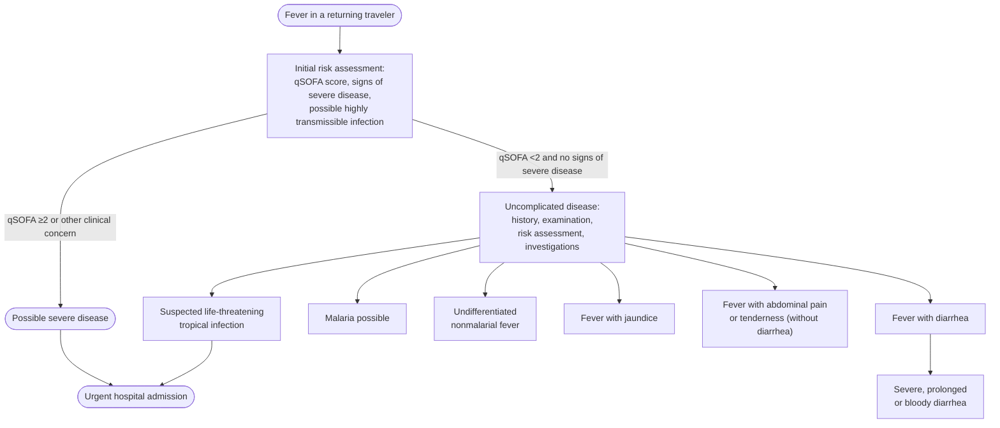

## Contents
- [[#Definition / Scope]]
- [[#Differential Diagnosis]]
  - [[#GI-focused differential by presentation]]
  - [[#Timing and exposure clues]]
- [[#Diagnostic Algorithm]]
  - [[#Initial risk assessment]]
  - [[#Diarrhea and enteric fever]]
  - [[#Viral hemorrhagic fever and isolation]]
- [[#Key Tests]]
- [[#Red Flags / Alarm Features]]
- [[#See Also]]
- [[#Sources]]

---

## Definition / Scope

Any febrile illness arising within days to weeks (occasionally months) of international travel. Gastrointestinal (GI) manifestations — diarrhea, nausea, abdominal pain, [[jaundice]] — run across many etiologies, which makes this a frequent GI consult. Destination, incubation period, exposure history and vaccination status shape the differential.

A narrative review (no graded recommendations) advises a **risk-based approach** — first identify life-threatening causes and those with a high risk of transmission; **falciparum malaria** is the most common serious infection and the main cause of death ([[nejm-2017-fever-returning-traveler]]).

**Scope.** GI-relevant causes: enteric fever and infectious diarrhea ([[idsa-2017-infectious-diarrhea]], [[acg-2016-acute-diarrhea]]), hepatitis in pregnancy ([[acg-2016-liver-disease-pregnancy]]), and the review's triage and GI branches ([[nejm-2017-fever-returning-traveler]]). **Malaria (beyond rule-out and severe-malaria triage), dengue, leptospirosis, schistosomiasis/Katayama fever, visceral leishmaniasis and yellow fever are not worked up here** — use a travel/tropical-medicine reference.

## Differential Diagnosis

*Workup: this page is the schema; for the diarrhea-specific testing threshold see [[acute-diarrhea]], and for the pregnancy hepatitis workup see [[liver-disease-in-pregnancy]].*

### GI-focused differential by presentation

**Fever + diarrhea (acute)** — pathogens the Infectious Diseases Society of America (IDSA) lists for the exposure "travel to resource-challenged countries" ([[idsa-2017-infectious-diarrhea]]):

- Bacterial: [[enterotoxigenic-e-coli|*Escherichia coli*]] (enteroaggregative, enterotoxigenic, enteroinvasive), [[shigellosis|*Shigella*]], Typhi and nontyphoidal [[salmonella-infection|*Salmonella*]], [[campylobacter-infection|*Campylobacter*]], *Vibrio cholerae*
- Parasitic: [[entamoeba-histolytica-infection|*Entamoeba histolytica*]], [[giardiasis|*Giardia*]], *Blastocystis*, *Cyclospora*, *Cystoisospora*, [[cryptosporidiosis|*Cryptosporidium*]]
- Separate exposure, not travel *per se*: [[clostridioides-difficile|*Clostridioides difficile*]] — IDSA's listed trigger is recent antimicrobial therapy, and *C. difficile* is described as an increasing concern among travelers
- Viral: [[norovirus]], [[rotavirus]] — IDSA lists these under other exposures, **not** under the travel row
- **Higher fever favours an invasive etiology:** IDSA notes higher temperatures are suggestive of a bacterial etiology or *E. histolytica*
- **Recent malaria** is among IDSA's risk factors for *invasive* nontyphoidal *Salmonella* (with young/advanced age, human immunodeficiency virus (HIV) infection, cytotoxic chemotherapy, malnutrition, hemoglobinopathies, cirrhosis)
- **Review (Figure 1):** travelers' diarrhea (enterotoxigenic *E. coli* (ETEC), norovirus; IDSA's travel row lists ETEC but not norovirus), giardiasis, cryptosporidiosis, *Campylobacter* infection, shigellosis, nontyphoidal salmonellosis, intestinal amebiasis; usually self-limiting, though empirical antibiotics may reduce symptom duration ([[nejm-2017-fever-returning-traveler]])

**Fever + jaundice:**

- Viral hepatitis E — hepatitis E virus (HEV) in pregnancy carries increased risk of [[acute-liver-failure|acute liver failure]], with high maternal and infant mortality reported in Southeast Asia ([[acg-2016-liver-disease-pregnancy]]). Full pregnancy hepatitis workup: [[liver-disease-in-pregnancy]]
- **Review (Figure 1):** first **rule out life-threatening infections** — leptospirosis, severe malaria, viral hemorrhagic fevers, yellow fever, severe dengue, Carrión's disease; then consider acute viral hepatitis (hepatitis A, B, [[hepatitis-c|C]], [[hepatitis-e|E]]), cytomegalovirus (CMV), Epstein–Barr virus (EBV) (serologic tests) and [[acute-cholangitis|acute cholangitis]] — stones, liver flukes (ultrasound, blood cultures, stool examination) ([[nejm-2017-fever-returning-traveler]])

**Fever + abdominal pain ± hepatosplenomegaly:**

- **Enteric fever (typhoid/paratyphoid)** — incidence is high in parts of South and Southeast Asia, moderate in Central/South America, Africa, Central/East Asia and Oceania; travel was reported in **68%** of US *S.* Typhi and **50%** of *S.* Paratyphi cases (FoodNet 2004–2009). IDSA notes it may be hard to distinguish from other febrile conditions in returned travelers ([[idsa-2017-infectious-diarrhea]])
- [[entamoeba-histolytica-infection|Amoebiasis]] — distinguished from morphologically identical non-pathogenic species only by species-specific immunoassay or nucleic acid amplification test (NAAT) ([[idsa-2017-infectious-diarrhea]])
- **Enteric fever in the review:** multidrug resistance is common. In **undifferentiated nonmalarial fever, prolonged fever (>7 days)** → consider enteric fever (empirical intravenous ceftriaxone) alongside endocarditis, tuberculosis, brucellosis, visceral leishmaniasis, Q fever, abscess and noninfective causes ([[nejm-2017-fever-returning-traveler]])
- **Review (Figure 1), abdominal pain or tenderness without diarrhea:** cosmopolitan causes (e.g., appendicitis, urinary tract infection, [[acute-cholecystitis|cholecystitis]], [[acute-pancreatitis|pancreatitis]]); enteric fever (blood culture); giardiasis (stool microscopy, antigen (Ag) detection, polymerase chain reaction (PCR)); acute cholangitis (as above); **liver abscess — pyogenic or amebic** (blood cultures, ultrasound, serologic tests) ([[nejm-2017-fever-returning-traveler]])

> [!pearl] Enteric fever usually comes without diarrhea
> Fever ± headache, lethargy, malaise and abdominal pain, **followed by hepatosplenomegaly and stupor**; the portal of entry is the GI tract but **diarrhea is an uncommon feature**. Consider it in any febrile person — with or without diarrhea — returning from an endemic area (Rec 4, strong/moderate) ([[idsa-2017-infectious-diarrhea]]).

### Timing and exposure clues

Most travel-related febrile illnesses develop within a month. Selected rows of the review's Table 1 ([[nejm-2017-fever-returning-traveler]]):

| Disease | Incubation | Regions |
|---|---|---|
| Enteric fever | 6–30 days | South and Southeast Asia |
| Falciparum malaria | 7–30 days (can be longer) | Africa, Asia, South America; highest risk in sub-Saharan Africa |
| Leptospirosis | 2–29 days | Widespread, particularly South and Southeast Asia and South America |
| Yellow fever | 3–8 days | South America, Africa |

- Fever beginning **more than 21 days** after return → dengue, rickettsial infections, Zika virus infection and viral hemorrhagic fevers **unlikely**, regardless of exposure history ([[nejm-2017-fever-returning-traveler]])
- **Unclean water, unpasteurized milk, improperly cooked or raw food** → travelers' diarrhea, giardiasis, nontyphoidal salmonellosis, enteric fever, shigellosis, campylobacter infection, hepatitis A and E, amebic dysentery, brucellosis, listeriosis ([[nejm-2017-fever-returning-traveler]])
- **Fresh water** (e.g., swimming in rivers or lakes, floods) → leptospirosis, acute schistosomiasis ([[nejm-2017-fever-returning-traveler]])
- Vaccinations and malaria prophylaxis do not rule out vaccine-preventable diseases or malaria ([[nejm-2017-fever-returning-traveler]])

## Diagnostic Algorithm

### Initial risk assessment

The review first assesses the Quick Sepsis-related Organ Failure Assessment (qSOFA) score, signs of severe disease and possible highly transmissible infection (Figure 1) ([[nejm-2017-fever-returning-traveler]]).

*Risk-based approach to fever in the returning traveler — triage and GI-relevant branches*
*Source: redrawn from Figure 1 of Thwaites and Day 2017 (adapted there from Gherardin and Sisson); arrow labels are the figure's box titles; respiratory, eschar, rash, prolonged-fever and malaria-treatment boxes omitted*
*[[nejm-2017-fever-returning-traveler|Approach to Fever in the Returning Traveler (NEJM 2017)]]*
*qSOFA = Quick Sepsis-related Organ Failure Assessment*

- **qSOFA** (0–3, 1 point each): systolic blood pressure **≤100 mm Hg** · respiratory rate **≥22 breaths per minute** · altered mentation (Glasgow Coma Scale score **<15**). **Two or more** → at risk for severe sepsis, needing high levels of care and urgent empirical antibiotics ([[nejm-2017-fever-returning-traveler]])
- **Signs of severe disease:** cyanosis, meningism, peritonism, digital gangrene ([[nejm-2017-fever-returning-traveler]])
- **Possible severe disease:** resuscitate if in shock; blood cultures; malaria films or rapid diagnostic test (RDT), if appropriate; consider empirical antibiotics → **urgent hospital admission** (if qSOFA ≥2, consider intensive care unit care; isolate if highly transmissible disease suspected) ([[nejm-2017-fever-returning-traveler]])
- **Initial investigations (uncomplicated disease):** complete blood count, biochemical studies (e.g., liver-function tests and creatinine), C-reactive protein, blood cultures, chest film, urine microscopy and culture, baseline serologic tests, whole-blood EDTA sample for PCR, saving of serum for later testing, specific investigations for focal disease; RDTs for diseases endemic in the visited areas ([[nejm-2017-fever-returning-traveler]])
- **Severe malaria** — a patient **with malaria** who is prostrate or comatose; has shock, acidosis, severe anemia, hypoglycemia, evidence of vital organ dysfunction or parasitemia **>10%**; or cannot take oral medications reliably → prompt **parenteral artesunate**, followed by oral artemisinin-based combination therapy (ACT) once oral medication can be taken reliably ([[nejm-2017-fever-returning-traveler]])
- **Empirical sepsis treatment:** if local guidelines omit a carbapenem, give one after travel to an area where extended-spectrum beta-lactamase (ESBL) is highly prevalent, such as South or Southeast Asia; colonization risk is particularly high after hospitalization or **antibiotic treatment for traveler's diarrhea** ([[nejm-2017-fever-returning-traveler]])

> [!pearl] Rule out malaria in every traveler from an endemic region
> Actively and as a priority, **regardless of chemoprophylaxis** — tests in [[#Key Tests]]. Malaria remains the most likely diagnosis even when viral hemorrhagic fever is suspected ([[nejm-2017-fever-returning-traveler]]).

### Diarrhea and enteric fever

Decision points in order. Recommendation numbers and grades *(strength, quality of evidence)* are the guidelines' own; IDSA recommendations unless marked American College of Gastroenterology (ACG).

| Step | Decision point | Action |
|---|---|---|
| 1 | Diarrhea, under any circumstances | Detailed clinical and **exposure** history — the travel row of IDSA's exposure table is **"travel to resource-challenged countries"**; also recent antimicrobial therapy and animal/pet contact (Rec 1, strong/moderate) |
| 2 | Febrile person **with or without diarrhea** + travel to an endemic area, food prepared by someone with recent endemic exposure, or laboratory exposure to *Salmonella* Typhi/Paratyphi | Consider **enteric fever** (Rec 4, strong/moderate) |
| 3 | Febrile illness of unknown etiology after travel to — or contact with a traveler from — an enteric-fever-endemic area. Also: signs of septicemia, systemic manifestations of infection, immunocompromise, hemolytic anemia | **Blood cultures** (Rec 9, strong/moderate) — volume and yield in [[#Key Tests]] |
| 4 | Diarrhea + fever, bloody or mucoid stools, severe abdominal cramping/tenderness, or signs of sepsis | **Stool testing** for *Salmonella*, *Shigella*, *Campylobacter*, *Yersinia*, *C. difficile* and [[shiga-toxin-producing-e-coli\|Shiga toxin–producing *E. coli* (STEC)]] (Rec 8, strong/moderate). ACG is permissive and keyed to severity: stool studies **may be used** in **dysentery, moderate-to-severe disease, or symptoms >7 days** ([[acg-2016-acute-diarrhea]] Rec 2, Strong/very low — full threshold on [[acute-diarrhea]]) |
| 5 | **Uncomplicated** traveler's diarrhea | **No diagnostic testing** unless treatment is indicated (Rec 13, strong/moderate) |
| 6 | Suspected enteric fever, or diarrhea with bacteremia | Culture-independent (panel-based multiplex molecular) testing from **stool and blood**, plus culture-dependent testing when indicated (Rec 17, strong/moderate). Bone marrow, stool, duodenal fluid and urine cultures may add yield (weak/moderate) |
| 7 | Diarrhea lasting **≥14 days** | Evaluate for **intestinal parasites**; also consider [[inflammatory-bowel-disease\|inflammatory bowel disease (IBD)]] and [[postinfectious-ibs\|postinfectious irritable bowel syndrome (IBS)]] (Rec 13, strong/moderate). Do **not** treat persistent watery diarrhea ≥14 days empirically (Rec 36, strong/low) |
| 8 | Antimicrobials within the preceding **8–12 weeks** | Test for ***C. difficile*** (Rec 13; ungraded clause) |
| 9 | **Bloody** diarrhea + recent international travel with temperature **≥38.5°C** and/or signs of sepsis | The one travel exception to withholding empiric antibiotics in bloody diarrhea — **treat empirically** (Rec 30c, weak/low). Adults: a fluoroquinolone (eg, ciprofloxacin) **or** azithromycin, by local susceptibility and travel history (Rec 31, strong/moderate); doses on [[acute-diarrhea]] |
| 10 | **Clinical features of sepsis** + suspected enteric fever | Blood, stool and urine cultures **first**, then **broad-spectrum** empiric antimicrobials (Rec 34, strong/low); narrow when susceptibilities return (strong/high). No isolate available → tailor to susceptibility patterns of the **setting where the infection was acquired** (weak/low). IDSA names a class, not an agent |
| 11 | A clinically plausible organism is identified | **Modify or discontinue** antimicrobial therapy (Rec 38, strong/high) |

**Review's severe, prolonged or bloody diarrhea branch** (Figure 1; ungraded) ([[nejm-2017-fever-returning-traveler]]):

- Stool microscopy and culture, blood cultures, stool PCR or Ag detection; **sigmoidoscopy with biopsy** to rule out IBD
- Rehydration; the figure lists empirical macrolides or fluoroquinolones (tinidazole or metronidazole if amebiasis or giardiasis suspected) and does not define "prolonged"
- **This conflicts with IDSA, whose graded recommendations govern:** no empiric antimicrobials for bloody diarrhea outside IDSA's listed exceptions (step 9), and none for persistent watery diarrhea of 14 days or more (step 7) ([[idsa-2017-infectious-diarrhea]])

### Viral hemorrhagic fever and isolation

- **Suspect viral hemorrhagic fever** (Public Health England and Centers for Disease Control and Prevention algorithms): fever (temperature **≥37.5°C**) or a history of fever in the previous 24 hours, **and** travel within **21 days** to an area where viral hemorrhagic fever is endemic or epidemic. Direct contact with body fluids from people or animals known or suspected to have one = **high risk** ([[nejm-2017-fever-returning-traveler]])
- **Ebola, Marburg, Lassa and Crimean–Congo hemorrhagic fevers (Table 3):** isolate and use strict barrier nursing (masks, gloves, gowns) ([[nejm-2017-fever-returning-traveler]])
- **Do not delay** blood films, blood cultures, complete blood count, and kidney and liver function tests pending viral hemorrhagic fever results; inform the laboratory of the specimens ([[nejm-2017-fever-returning-traveler]])
- **Isolation:** single room immediately if a life-threatening, potentially transmissible infection is possible; inform hospital infection control and public health ([[nejm-2017-fever-returning-traveler]])

## Key Tests

| Test | Diagnoses targeted | Source |
|------|------------------|--------|
| Blood culture — 2–3 × **20 mL** in adults, drawn **before** antimicrobials | Enteric fever, diarrhea with bacteremia. **Sensitivity ≈50%** compared with bone marrow culture; median bacteremia is only **0.3 colony-forming units (CFU)/mL** (enteric fever) and **1.0 CFU/mL** (invasive nontyphoidal *Salmonella*), which is why large volumes matter | [[idsa-2017-infectious-diarrhea]] |
| Bone marrow culture | Enteric fever — more sensitive than blood culture; **particularly valuable once antimicrobials have been given** (weak, moderate) | [[idsa-2017-infectious-diarrhea]] |
| Stool, duodenal fluid, urine culture | Adjunct yield in enteric fever (weak, moderate) | [[idsa-2017-infectious-diarrhea]] |
| Culture-independent multiplex molecular panel (stool + blood) | Perform when enteric fever or bacteremic diarrhea is suspected, with culture-dependent testing when indicated (strong, moderate) | [[idsa-2017-infectious-diarrhea]] |
| **Widal / any serologic test** | **Should NOT be used to diagnose enteric fever (strong, moderate)** — poor performance characteristics. Serology is likewise not recommended to establish an etiology of infectious diarrhea (strong, low) | [[idsa-2017-infectious-diarrhea]] |
| Ova and parasite exam with permanent stained smear, or NAAT | *E. histolytica*, *Blastocystis*, *Dientamoeba fragilis*, *Balantidium coli*, *Giardia*, nematodes, cestodes, trematodes | [[idsa-2017-infectious-diarrhea]] |
| ***E. histolytica* species-specific immunoassay or NAAT** | Amoebiasis — this is the test that distinguishes *E. histolytica* from morphologically identical non-pathogenic species | [[idsa-2017-infectious-diarrhea]] |
| *Giardia* stool **enzyme immunoassay (EIA) or NAAT** | Giardiasis | [[idsa-2017-infectious-diarrhea]] |
| Duodenal aspirate | *Giardia*, *Strongyloides*, *Cystoisospora*, microsporidia — consider in **select** people with recurring diarrhea when stool testing was non-diagnostic (weak, low) | [[idsa-2017-infectious-diarrhea]] |
| Complete blood count (CBC) with differential | A peripheral white blood cell count and differential should **not** be performed to establish an etiology of diarrhea (strong, low), but may be useful clinically (weak, low) — differential clues in [[#Red Flags / Alarm Features]] | [[idsa-2017-infectious-diarrhea]] |
| Thick and thin blood smears; malaria RDT | Malaria — repeat smears twice if negative; a positive RDT should always be confirmed by thick and thin blood films | [[nejm-2017-fever-returning-traveler]] |
| Abdominal or renal tract ultrasonography or computed tomography | Jaundice or acute kidney injury | [[nejm-2017-fever-returning-traveler]] |
| **[[hepatitis-e\|Hepatitis E]] immunoglobulin M (IgM)** | Any pregnant woman with acute hepatitis should be tested for hepatitis A virus (HAV), hepatitis B virus (HBV), **HEV** and herpes simplex virus (HSV) (strong, very low). HEV IgM establishes the diagnosis and prompts anticipation of progression to acute liver failure / transplant evaluation | [[acg-2016-liver-disease-pregnancy]] |

> [!pitfall] A negative blood molecular panel does not exclude enteric fever
> Nucleic acid amplification tests **lack sensitivity** for *S.* Typhi in blood — useful for rapid identification in research settings, not to rule out. Culture remains the diagnostic, and an isolate is still needed for susceptibility testing ([[idsa-2017-infectious-diarrhea]]).

Disease-specific tests for dengue, leptospirosis and schistosomiasis are not covered here — see a travel/tropical-medicine reference. For interpreting the liver panel in a febrile traveler, see [[abnormal-liver-chemistries]].

## Red Flags / Alarm Features

- **Possible severe disease or a possible highly transmissible infection** → urgent admission and isolation as appropriate — criteria in [[#Initial risk assessment]] and [[#Viral hemorrhagic fever and isolation]] ([[nejm-2017-fever-returning-traveler]])
- **Signs of sepsis, or stupor, in a febrile traveler** → cultures first, then broad-spectrum empiric antimicrobials (step 10). Stupor is part of IDSA's own description of the enteric fever syndrome ([[idsa-2017-infectious-diarrhea]])
- **Temperature ≥38.5°C after recent international travel, with bloody diarrhea** → treat empirically (step 9) ([[idsa-2017-infectious-diarrhea]])
- **Suspected STEC O157, or a Shiga-toxin-2 / unknown-toxin-genotype producer** → antimicrobial therapy should be **avoided** (Rec 35, strong/moderate) ([[idsa-2017-infectious-diarrhea]])
- **Hemolytic uremic syndrome (HUS) after travel, or after contact with a traveler** → besides STEC, consider *Shigella dysenteriae* type 1 and, rarely, other Shiga-toxin producers (Rec 6, strong/moderate) ([[idsa-2017-infectious-diarrhea]])
- **Sustained fever or bacteremia despite adequate antimicrobial therapy** in an older person with invasive *Salmonella enterica* or *Yersinia* infection — also new chest/back/abdominal pain or underlying atherosclerosis → image (ultrasonography, computed tomography or magnetic resonance imaging) for **aortitis, mycotic aneurysm**, peritonitis, intra-abdominal free air, [[toxic-megacolon|toxic megacolon]] or extravascular foci of infection (Rec 25, weak/low) ([[idsa-2017-infectious-diarrhea]])
- **[[liver-disease-in-pregnancy|Pregnancy]] + acute hepatitis** → test HAV, HBV, **HEV** and HSV; start **empiric acyclovir** if HSV hepatitis is suspected (both strong recommendation, very low evidence). HEV in pregnancy is associated with acute liver failure and **high maternal and infant mortality** reported in Southeast Asia; ACG gives no HEV mortality percentage ([[acg-2016-liver-disease-pregnancy]])
- **Eosinophilia in a returning traveler** → parasitic infection with a tissue phase; monocyte predominance instead suggests an intracellular pathogen such as *Salmonella*. IDSA gives no numeric eosinophil threshold, only "an increased eosinophil count" ([[idsa-2017-infectious-diarrhea]])

## See Also

[[acute-diarrhea]], [[chronic-diarrhea]], [[entamoeba-histolytica-infection]], [[giardiasis]], [[cryptosporidiosis]], [[enterotoxigenic-e-coli]], [[shiga-toxin-producing-e-coli]], [[campylobacter-infection]], [[salmonella-infection]], [[shigellosis]], [[norovirus]], [[rotavirus]], [[clostridioides-difficile]], [[toxic-megacolon]], [[inflammatory-bowel-disease]], [[postinfectious-ibs]], [[chronic-hepatitis-b]], [[acute-liver-failure]], [[liver-disease-in-pregnancy]], [[hiv-aids-related-diarrhea]], [[jaundice]], [[abnormal-liver-chemistries]], [[acute-cholangitis]], [[acute-cholecystitis]], [[acute-pancreatitis]], [[hepatitis-c]], [[hepatitis-e]]

---

## Sources

1. [[idsa-2017-infectious-diarrhea|IDSA 2017 Clinical Practice Guidelines for the Diagnosis and Management of Infectious Diarrhea]]
2. [[acg-2016-acute-diarrhea|ACG 2016: Diagnosis, Treatment, and Prevention of Acute Diarrheal Infections in Adults]]
3. [[acg-2016-liver-disease-pregnancy|ACG Clinical Guideline: Liver Disease and Pregnancy (2016)]]
4. [[nejm-2017-fever-returning-traveler|Thwaites & Day: Approach to Fever in the Returning Traveler (NEJM 2017)]]
