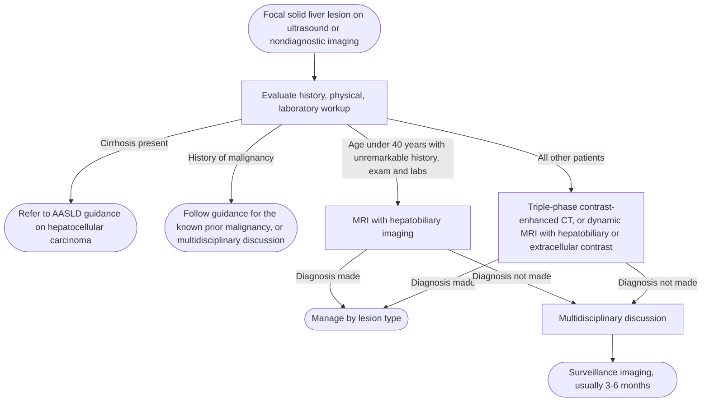

## Contents
- [[#Definition / Scope]]
- [[#Differential Diagnosis]]
- [[#Diagnostic Algorithm]]
  - [[#Initial Evaluation]]
  - [[#Solid Lesions]]
  - [[#Cystic Lesions]]
- [[#Key Tests]]
  - [[#Multiphasic Contrast-Enhanced Imaging]]
  - [[#Contrast-Enhanced Ultrasound]]
  - [[#Imaging Features by Lesion]]
  - [[#Laboratory Tests]]
  - [[#Biopsy]]
- [[#Red Flags / Alarm Features]]

---

## Definition / Scope

- A **focal liver lesion (FLL)** = discrete lesion found on imaging, usually **incidental**. "Lesion" (not "mass") is the preferred term — it covers solid *and* cystic.
- Up to **15%** of patients have an incidental liver lesion on routine non-surveillance imaging.
- Approach pivots on **background liver**:
  - **[[cirrhosis|Cirrhosis]] / chronic liver disease** → assume malignant ([[hepatocellular-carcinoma|hepatocellular carcinoma (HCC)]]) until proven otherwise; characterize with [[li-rads|Liver Imaging Reporting and Data System (LI-RADS)]] and follow [[hcc-surveillance|HCC surveillance]]. **This is out of scope for [[acg-2024-focal-liver-lesions|American College of Gastroenterology (ACG) 2024]]**, which is "focused predominantly on the diagnosis and management of FLLs in people **without** known liver disease" and defers the at-risk population to American Association for the Study of Liver Diseases (AASLD) HCC guidance. LI-RADS criteria therefore live on [[li-rads]], not here.
  - **Non-cirrhotic** → most solid lesions are benign ([[hepatic-hemangioma|hemangioma]], [[hepatocellular-adenoma|adenoma]], [[focal-nodular-hyperplasia|focal nodular hyperplasia (FNH)]]); goal is confident non-invasive characterization to avoid biopsy/surgery *(key concept [KC] 4)*.

---

## Differential Diagnosis

- **Solid, benign:** [[hepatic-hemangioma|hemangioma]] (most common; prevalence up to 20%, 4:1 female predominance), [[focal-nodular-hyperplasia|FNH]] (second most common solid lesion, 0.3–3% at autopsy), [[hepatocellular-adenoma|hepatocellular adenoma]].
- **Solid, malignant / malignant potential:** [[hepatocellular-carcinoma|HCC]], metastasis, [[cholangiocarcinoma|intrahepatic cholangiocarcinoma]], fibrolamellar HCC, hepatic epithelioid hemangioendothelioma (HEHE), hepatic angiosarcoma.
- **Cystic:** [[hepatic-cysts|simple cyst]] (prevalence 2.5–18% on cross-sectional imaging), complex cyst, polycystic liver disease (PCLD), mucinous cystic neoplasm of the liver (MCN-L), hydatid/echinococcal cyst, pyogenic abscess, choledochal cyst, biliary hamartoma, peribiliary cyst, intraductal papillary neoplasm of the bile duct (IPNB).

---

## Diagnostic Algorithm

### Initial Evaluation

- **Context first** *(KC 1)*: prior cancer; constitutional symptoms (weight loss, loss of appetite, fever); medications (**oral contraceptives, anabolic steroids/androgens**); chronic-liver-disease risk factors (viral hepatitis, transfusions, tattoos, intravenous drug use, alcohol excess); metabolic syndrome features; **sex** (drives adenoma management); blood tests ([[abnormal-liver-chemistries|liver enzymes]], tumor markers, viral hepatitis panel).
- **Then multiphasic contrast-enhanced imaging** — computed tomography (CT) or magnetic resonance imaging (MRI) — **recommended for any FLL of uncertain etiology** *(Rec 1, strong recommendation / low quality evidence)*. Which study, by patient:

*Initial workup of an incidentally found solid focal liver lesion*
*Source: redrawn from the upper portion of Figure 1a of the ACG 2024 focal liver lesions guideline*
*[[acg-2024-focal-liver-lesions|ACG Clinical Guideline: Focal Liver Lesions (2024)]]*
*AASLD = American Association for the Study of Liver Diseases · CT = computed tomography · MRI = magnetic resonance imaging*

- **The ultrasound-only exit:** a **small (<2 cm), echogenic, avascular, well-defined** lesion in a **normal liver with no underlying medical history or risk factors for liver disease or malignancy** can be called a hemangioma on ultrasound alone *(KC 24a)*. Anything larger or atypical → multiphasic contrast-enhanced imaging *(KC 24b)*.
- **Inadequately characterized or atypical lesions → multidisciplinary liver tumor board** *(KC 2)*. Still uncharacterizable and not biopsiable → surveillance imaging, interval individualized by suspected diagnosis and risk factors, **generally 3–6 months**.

### Solid Lesions

Once characterized, the management axis differs by entity; thresholds live on the disease-script pages.

| Lesion | What the decision turns on | Home page |
|---|---|---|
| [[hepatic-hemangioma\|Hemangioma]] | Nothing, if the liver is normal — **no follow-up at any size**, including cavernous hemangiomas >10 cm *(KC 27a, 28)*. Exception below for cirrhosis/chronic hepatitis B | [[hepatic-hemangioma]] |
| [[focal-nodular-hyperplasia\|FNH]] | Nothing — **no follow-up once confirmed** *(KC 20)*; no routine oral contraceptive discontinuation *(Rec 10)*; men and pregnancy handled identically *(KC 23)* | [[focal-nodular-hyperplasia]] |
| [[hepatocellular-adenoma\|Hepatocellular adenoma]] | **Sex, size (5 cm), subtype, pregnancy** — β-catenin mutation and male sex drive resection regardless of size | [[hepatocellular-adenoma]] |
| [[hepatocellular-carcinoma\|HCC]] / at-risk liver | [[li-rads\|LI-RADS]] category | [[li-rads]], [[hepatocellular-carcinoma]] |

- **Rarer malignant solid lesions** — resection whenever feasible is the common thread: HEHE should be **resected whenever possible, and [[liver-transplantation|liver transplantation]] offers the best survival when it is not — even with extrahepatic disease** *(KC 35)*; fibrolamellar HCC → resection is the treatment of choice, transplant case-by-case if unresectable and liver-localized *(KC 37)*; hepatic angiosarcoma → resection whenever feasible *(KC 40)*.
- **Refer early to a liver transplant center** experienced in that disease for HCC, [[cholangiocarcinoma|cholangiocarcinoma]], neuroendocrine tumor, or metastatic colon cancer that falls within transplant guidance/consensus criteria *(KC 31)*.

> [!pearl] An at-risk liver cancels the "do not touch" rule for hemangioma
> In [[cirrhosis|cirrhosis]] or [[chronic-hepatitis-b|chronic hepatitis B]] meeting HCC-surveillance criteria, a *suspected hemangioma* still gets **continued imaging surveillance every 3–6 months for at least 1 year** *(Rec 11, strong recommendation / low quality evidence)*.

### Cystic Lesions

- **Asymptomatic simple cyst → expectant management, no routine surveillance, no intervention, regardless of size** *(Rec 12)*. Simple = anechoic, through transmission, smooth margins, no post-contrast enhancement, CT attenuation <20 Hounsfield units; **2.5–5% of simple cysts carry up to 2 septa**.
- **High-risk ultrasound features → CT or MRI** *(Rec 13)*: **septations, fenestrations, calcifications, mural thickening or nodularity, heterogeneity, daughter cysts** — to exclude infected cyst/pyogenic abscess, cystic metastasis, hydatid cyst, or MCN-L.
- **Asymptomatic complex cyst → multidisciplinary tumor board + consider surveillance imaging at 6–12 months** *(KC 41)*.
- **No surveillance** for biliary hamartomas or peribiliary cysts *(KC 47)*; **continued surveillance even after surgical resection** for IPNB *(KC 48)*.
- **Choledochal cysts** — management and treatment keyed to **Todani type** and its malignant potential *(KC 49a)*. **Types I and IV are the ones most commonly associated with malignancy and should undergo surveillance imaging**, at an interval ACG 2024 does not specify *(KC 49b)*. Types IV and V with unfeasible resection → consider liver transplantation *(KC 50)*.

| Todani type | Anatomy |
|---|---|
| **I** | Cystic or fusiform dilation of the extrahepatic bile duct — most common |
| **II** | Extrahepatic (supraduodenal) diverticulum |
| **III** | Intraduodenal diverticulum (choledochocele) — no female predominance, rarely transforms |
| **IV** | Extrahepatic *and* intrahepatic dilation (IVA) or multiple extrahepatic dilations (IVB) — second most common |
| **V** | Intrahepatic ducts only (Caroli disease) — least common |

*Source: [[acg-2024-focal-liver-lesions|ACG Clinical Guideline: Focal Liver Lesions (2024)]].*

---

## Key Tests

### Multiphasic Contrast-Enhanced Imaging

- Must include **late arterial + portal venous + delayed** phases — on CT order a **triple-phase liver protocol** (a routine abdominal CT gives only a single portal venous phase); on [[mri-mrcp|MRI]] order a **dynamic post-contrast liver MRI**.
- **MRI vs CT:** no statistically significant difference in diagnostic accuracy, but MRI confers many advantages *(KC 3)* — advanced techniques improve differentiation, and the absence of ionizing radiation matters in younger patients needing repeat imaging.
- **Hepatobiliary agent (gadoxetate)** when the question is **FNH vs adenoma** *(Rec 9)* — biliary excretion makes FNH hyperintense on the hepatobiliary phase. Otherwise **extracellular agent is favored** (expert opinion): hepatobiliary agents cause acute transient dyspnea and give less adequate dynamic-phase enhancement. Once the diagnosis is confirmed, follow-up may use either.

### Contrast-Enhanced Ultrasound

- Contrast-enhanced ultrasound (CEUS) is a valid alternative for characterizing benign FLLs: **sensitivity 97.8%, specificity 83.9%, positive predictive value 82.2%**.
- No ionizing radiation; real-time. Not specific enough to subtype an adenoma.

### Imaging Features by Lesion

- The **hepatobiliary phase (HBP, 20 min after gadoxetate) is the key discriminator: FNH takes up gadoxetate; hepatocellular adenoma (HCA), hemangioma, and HCC do not.**

| Lesion | T2 signal | Arterial phase | Portal / delayed | HBP (gadoxetate) | Central scar | Malignant potential |
|---|---|---|---|---|---|---|
| **FNH** | Iso (scar hyperintense) | Marked homogeneous arterial phase hyperenhancement (APHE) | Iso / mildly hyper | **Uptake (iso/hyper)** — key | **Yes** (T2-bright) | None |
| **HCA** | Variable (fat in HNF-1α) | Hyperenhancement | Iso/hypo; mild washout | **No uptake** (iso/hypo) | No | Subtype-dependent (β-catenin highest) |
| **Hemangioma** | **Markedly hyper** ("light-bulb") | Peripheral nodular discontinuous | **Centripetal fill-in** | No uptake (hypo) | No | None |
| **HCC** | Mild hyper | APHE | **Washout** | No uptake (hypo) | No (scar in fibrolamellar variant) | Malignant (cirrhosis; [[li-rads\|LI-RADS]]) |

*Source: [[acg-2024-focal-liver-lesions|ACG Clinical Guideline: Focal Liver Lesions (2024)]].*

> [!pitfall] Hepatobiliary-phase uptake does not always mean FNH
> Only **2% of FNH are hypointense** on the 20-minute HBP, but **11% of inflammatory and 59% of β-catenin–mutated adenomas** are iso- to hyperintense through organic anion transporting polypeptide 1B3 (OATP1B3) expression. Atypical dynamic features *plus* HBP hyperintensity → follow closely.

### Laboratory Tests

- **No serum biomarker is diagnostic of HCA.** If malignant transformation is suspected, order alpha-fetoprotein (AFP) — but it has **low sensitivity** for HCC in this setting and ACG 2024 gives no diagnostic cutoff, so a normal AFP does not exclude transformation.
- **Carbohydrate antigen 19-9 (CA 19-9)** is elevated in up to **50%** of patients with simple hepatic cysts, and in **28–73%** of biliary cystadenocarcinomas — serum and cyst-fluid levels **do not discriminate** benign from malignant cysts.

### Biopsy

- [[liver-biopsy|Core biopsy]] only when imaging is indeterminate *and* the result would change management.
- **Do biopsy:** adenoma with uncharacteristic imaging, or interval change concerning for malignant transformation (**rapid increase in size, new intralesional lipid, or new washout on portal venous/delayed phase**) *(KC 8)*; fibrolamellar HCC — biopsy **must** confirm the diagnosis, though molecular analysis to guide systemic therapy is not beneficial *(KC 39)*.
- **Avoid / not needed:** suspected hemangioma (bleeding risk, *KC 26*); FNH confirmed on multiphase MRI with hepatobiliary contrast *(KC 19)*; adenoma in a woman <5 cm unless there is concern for β-catenin mutation; HEHE when imaging is very suspicious and resection is already planned *(KC 33)*; fluid aspiration or biopsy of MCN-L (low sensitivity, *KC 45*).
- Biopsy of a presumed adenoma often returns well-differentiated HCC; when pathology is inconclusive, take it back to multidisciplinary discussion.

---

## Red Flags / Alarm Features

- Background **cirrhosis** or chronic liver disease → the lesion is an HCC problem, not an FLL problem ([[li-rads]]).
- Known extrahepatic **malignancy** (favor metastasis) → **MRI with hepatobiliary contrast + diffusion-weighted imaging** is the recommended modality *(KC 32)*.
- **Arterial hyperenhancement + washout** (HCC pattern) — MRI cannot reliably separate β-catenin–mutated adenoma from well-differentiated HCC, since both show APHE, washout, and capsule; absent chronic liver disease risk factors, adenoma is the more likely diagnosis.
- **Interval growth ≥20%** (extrapolated from Response Evaluation Criteria in Solid Tumours [RECIST]) during adenoma surveillance → consider resection or definitive treatment.
- **Adenoma >5 cm, growth, or exophytic location** — complications typically arise above 5 cm though they can occur in smaller lesions; hemorrhage occurs in up to 15% and malignant transformation in up to 5% of adenomas overall.
- **Male sex with a hepatocellular adenoma** — commonly β-catenin mutated, higher risk of malignant transformation *(KC 12)*.
- **Cyst with septations, mural nodularity, calcification, heterogeneity, or daughter cysts** → not a simple cyst; cross-sectional imaging required *(Rec 13)*.

---

## See Also

[[focal-nodular-hyperplasia]], [[hepatocellular-adenoma]], [[hepatic-hemangioma]], [[hepatocellular-carcinoma]], [[hepatic-cysts]], [[li-rads]], [[cholangiocarcinoma]], [[mri-mrcp]], [[liver-biopsy]], [[hcc-surveillance]], [[cirrhosis]], [[chronic-hepatitis-b]], [[liver-transplantation]], [[abnormal-liver-chemistries]]

---

## Sources

1. [[acg-2024-focal-liver-lesions|ACG Clinical Guideline: Focal Liver Lesions (2024)]]
