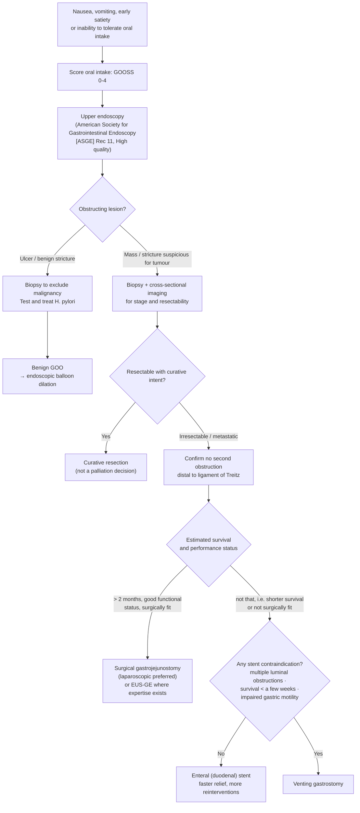

## Contents
- [[#Definition / Scope]]
  - [[#GOOSS — Gastric Outlet Obstruction Scoring System]]
- [[#Differential Diagnosis]]
- [[#Diagnostic Algorithm]]
- [[#Key Tests]]
- [[#Red Flags / Alarm Features]]
- [[#Treatment Selection]]
  - [[#Benign GOO]]
  - [[#Malignant GOO — the prognosis threshold]]
  - [[#Procedural specifications]]
  - [[#After the procedure]]
- [[#See Also]]
- [[#Sources]]

---

## Definition / Scope

- **Mechanical obstruction of gastric outflow.** Anatomically the two trials bound it as obstruction extending from the **distal one third of the stomach to the distal duodenum** ([[jeurnink-2010-sustent-goo|SUSTENT]]) — equivalently, **pyloric region to the third part of the duodenum** ([[kastelijn-2023-enduro-protocol|ENDURO]]).
- **Symptoms scale with severity:** early satiety → nausea → vomiting → complete inability to tolerate oral intake.
- **Why it must be treated, not observed:** poor clinical condition from vomiting, dehydration, and malnutrition develops quickly. The aim of palliation in malignant gastric outlet obstruction (GOO) is to maintain oral intake and stabilize quality of life.
- **How often it complicates pancreatic cancer — the two sources differ slightly:** [[jeurnink-2010-sustent-goo|SUSTENT]] states **10–20%** of patients with pancreatic cancer develop obstructive symptoms during the disease course; [[kastelijn-2023-enduro-protocol|ENDURO]] states **15–20%** will develop GOO. Same tier, and the newer figure sits inside the older range — treat the answer as "roughly one in six".
- **Scope note:** this page is the home of the **Gastric Outlet Obstruction Scoring System (GOOSS) score** and the **malignant-GOO treatment-selection rule**. Benign (peptic) GOO dilation outcomes live on [[peptic-ulcer-disease]]; feeding-route selection lives on [[enteral-access]].

### GOOSS — Gastric Outlet Obstruction Scoring System

The standardized food-intake instrument used to define eligibility, measure response, and time the decision to escalate. **Both trials enrol only GOOSS 0–1 and define treatment success as reaching GOOSS ≥2.**

| Score | Oral intake |
|---|---|
| **0** | No oral intake |
| **1** | Liquids only |
| **2** | **Soft solids** ← threshold for "able to eat"; the primary endpoint in both trials |
| **3** | Almost complete diet |
| **4** | Full diet |

---

## Differential Diagnosis

*This page is itself the workup schema; the entries below are the causes to distinguish.*

**Malignant** — the dominant cause in both trials:

| Cause | Note |
|---|---|
| **[[pancreatic-cancer\|Pancreatic adenocarcinoma]]** | **Most common cause.** 28 of 39 SUSTENT patients |
| **[[gastric-adenocarcinoma\|Distal gastric cancer]]** | |
| Periampullary / papillary carcinoma | Stent across the ampulla may block later biliary access — see below |
| Duodenal carcinoma | |
| [[cholangiocarcinoma\|Bile duct carcinoma]] | |
| Lymphoma | |
| **Extrinsic compression from metastases** to duodenum or jejunum | |
| Gastric and small-intestine **carcinoids**, **pancreatic neuroendocrine tumors** | [[asge-2021-gastroduodenal-obstruction]] Table 1 |
| **Sarcomas**, **GI stromal tumors** | " |
| **Ampulla of Vater cancer**, **gallbladder cancer** | " |

**Benign:**

- **[[peptic-ulcer-disease\|Peptic ulcer disease]]** — the principal benign cause, from nonsteroidal anti-inflammatory drugs (NSAIDs) or [[helicobacter-pylori-infection\|*H. pylori*]]. **Active ulcers are found in up to one third of patients endoscoped for GOO** ([[asge-2010-pud]]). Acid suppression and *H. pylori* eradication are why malignancy, not PUD, is now the leading cause overall ([[asge-2021-gastroduodenal-obstruction]]).
- Also, per [[asge-2021-gastroduodenal-obstruction]] Table 1: **NSAID-induced strictures** · **caustic ingestion** · **[[chronic-pancreatitis\|chronic pancreatitis]]**, pseudocysts and **walled-off pancreatic necrosis** · **surgical anastomotic strictures** · **radiation-induced strictures** · [[gastric-polyps\|GI polyps]] and lipomas · foreign bodies/bezoars · eosinophilic enteritis · tuberculosis.

> [!pitfall] In children, GOO is a surgical diagnosis first
> **Infantile hypertrophic pyloric stenosis** (nonbilious emesis) is the most common pediatric cause and **surgery is the standard management**; endoscopy is used outside infancy only to exclude other diagnoses. Beyond infancy, **peptic and caustic ulceration** dominate; antral webs, duplication cysts and bezoars occur and malignancy is rare ([[asge-2021-gastroduodenal-obstruction]]).

**Must be excluded before committing to a bypass — these change the operation, not just the diagnosis:**

- **Additional or more distal strictures in the gastrointestinal (GI) tract.** Both trials exclude them; ENDURO specifically excludes obstruction **distal to the ligament of Treitz with small-intestinal dilation/ileus**. A gastrojejunostomy or stent proximal to a second downstream obstruction will not restore intake.
- **Ileus / dysmotility masquerading as mechanical obstruction** — ENDURO's post-procedure algorithm requires excluding ileus (distended abdomen, absent or high-pitched peristalsis, no passage of flatus or faeces) before attributing failure to the anastomosis.
- **Prior gastric, periampullary, or duodenal surgery**, or a prior gastrojejunostomy/stent for the same condition — excluded from both trials, so the trial-derived rules below do not transfer to these patients.

---

## Diagnostic Algorithm

*Figure 1 — Workup and treatment-selection pathway (wiki-recreated). Endoscopy step from [[asge-2010-pud]]; the selection rule and the stent contraindications from [[aga-2021-malignant-alimentary-tract-obstruction]] Best Practice Advice (BPA) 6–10; the trial behind the 2-month threshold is [[jeurnink-2010-sustent-goo]], restated as current standard of care in [[kastelijn-2023-enduro-protocol]].*

---

## Key Tests

| Test | Role |
|---|---|
| **[[upper-endoscopy\|Upper endoscopy]]** | **Recommended for the evaluation of GOO — ASGE 2010 Rec 11, High quality of evidence.** Confirms the obstruction, localizes it, and — critically — **biopsies to separate benign from malignant**, which is the branch point of the whole algorithm. Also the therapeutic access for benign dilation. |
| **Biopsy of the obstructing lesion** | Malignant gastric lesions can look endoscopically benign; the benign-vs-malignant call cannot be made on appearance alone ([[asge-2010-pud]]). |
| **Cross-sectional imaging** | Establishes irresectability/metastatic disease — the precondition for treating GOO as a palliative problem at all. Also confirms GOO radiologically (an accepted alternative to endoscopic confirmation in ENDURO) and screens for a second, more distal obstruction. |
| **World Health Organization (WHO) / Eastern Cooperative Oncology Group (ECOG) performance status** | Not a "test" but a required input: performance status plus estimated survival selects the palliative procedure. **WHO 4 (bedbound 100% of the time) was an exclusion** from SUSTENT — such patients were not studied and the rule below does not cover them. |
| **GOOSS score** | Baseline severity, treatment response, and the day-5 escalation trigger. |

---

## Red Flags / Alarm Features

- **GOOSS 0 (no oral intake at all)** — dehydration and malnutrition develop quickly; this is not a watch-and-wait situation.
- **Vomiting more than twice in 24 h**, or still GOOSS 0–1 **five days after** a bypass or stent — trigger for endoscopic jejunal feeding access.
- **Endoscopically benign-looking gastric lesion** — appearance does not exclude malignancy; biopsy is mandatory.
- **New [[jaundice]] or [[acute-cholangitis|cholangitis]] after duodenal stenting** — the stent may have crossed the ampulla and blocked endoscopic retrograde cholangiopancreatography (ERCP) access; anticipate percutaneous drainage.
- **Suspicion of a second, more distal obstruction** (small-bowel dilation, ileus) — a proximal bypass will not work.
- **WHO performance status 4** — outside the evidence base for either palliative procedure.
- **Suspected perforation after balloon dilation or endoscopic ultrasound (EUS)–guided gastroenterostomy (EUS-GE)** — pyloric dilation carries a meaningful perforation rate ([[peptic-ulcer-disease]]); [[lumen-apposing-metal-stents|lumen-apposing metal stent (LAMS)]] misdeployment causes jejunal perforation and peritonitis.

---

## Treatment Selection

### Benign GOO

- **Endoscopic balloon dilation (EBD)** is suggested for benign GOO — [[asge-2010-pud]] Rec 12, **Low** quality of evidence (note the weak grade).
- **No modality is established.** [[asge-2021-gastroduodenal-obstruction]] found **insufficient evidence to support endoscopic over surgical management** of benign GOO (conditional recommendation, low quality) — no comparative study of the two exists. In practice EBD is attempted first and **surgery is salvage** after insufficient endoscopic response or a severe adverse event (e.g. perforation); modern pyloroplasty and laparoscopic GJ carry low morbidity and mortality.
- **The three inputs that pick the modality** ([[asge-2021-gastroduodenal-obstruction]] Rec 3 comment): **etiology**, **stricture length**, and **response to initial EBD**.

| EBD likely to work | EBD likely to fail |
|---|---|
| **PUD with the inflammatory drivers removed** — NSAIDs and smoking stopped, *H. pylori* treated | **Corrosive/caustic** strictures · **chronic pancreatitis** strictures |
| Short strictures | **Long strictures (>3 cm)** |
| First or second dilation | **Needing multiple dilations** — predicts treatment failure and the need for surgery |

- Short-term relief is good but **restenosis is common and about half ultimately need surgery**; patients requiring **more than 2 dilations** are at high risk of endoscopic failure. Full outcome figures, including the perforation rate, are on [[peptic-ulcer-disease]].
- Treat the underlying ulcer diathesis in parallel — *H. pylori* eradication, acid suppression ([[proton-pump-inhibitors|proton pump inhibitor (PPI)]]).

> [!pitfall] Do not stent a benign gastric outlet obstruction with an off-the-shelf enteral stent
> **Every dedicated enteral stent available in the US is uncovered and not removable**, so it should not be used for benign disease. A covered self-expandable metal stent (SEMS) in benign GOO is **off-label**: a 22-patient series showed 81.8% early GOOSS improvement, sustained in 67%, but **migration in 62.5%**. Off-label covered LAMS is described for short benign pyloroduodenal strictures ([[asge-2021-gastroduodenal-obstruction]]).

### Malignant GOO — the prognosis threshold

**The governing rule is [[aga-2021-malignant-alimentary-tract-obstruction]] BPA 6–10** (tier-1 clinical practice update; it supersedes the trial-level framing below, which is the evidence behind it). The decision is keyed to expected survival, because the two options fail in opposite directions and their outcome curves cross at roughly 30–60 days.

| Patient | Procedure |
|---|---|
| Life expectancy **>2 months** + good functional status + **surgically fit** | **Surgical gastrojejunostomy (GJ), laparoscopic preferred** (BPA 6, 7) |
| Same, where the expertise exists | **EUS-GE** is an acceptable alternative to either surgery or stenting (BPA 10) |
| Not that — shorter survival, or not surgically fit | **Enteral stent** (BPA 8) |
| Any stent contraindication below | **Venting gastrostomy** instead of a stent (BPA 9) |

> [!pitfall] Three situations where an enteral stent is the wrong answer
> **Multiple luminal obstructions** (especially distal to the duodenum), life expectancy **less than a few weeks**, and **impaired gastric motility** (e.g. linitis plastica) are stated contraindications to enteral stenting — vent the stomach instead ([[aga-2021-malignant-alimentary-tract-obstruction]] BPA 9).

**The two 2021 tier-1 documents set the survival threshold differently — both are shown, because neither supersedes the other.** [[asge-2021-gastroduodenal-obstruction]] **suggests either SEMS or surgical GJ** and makes no modality preference (conditional recommendation, low quality of evidence); its qualifying comment places the cut-point at **6 months**, not 2:

| [[asge-2021-gastroduodenal-obstruction]] comment | Procedure |
|---|---|
| **Poor surgical candidate with short life expectancy (<6 months)**, or patient who **places high value on resuming oral diet and early discharge** | **SEMS** |
| **Life expectancy >6 months and good performance status** | **Surgical GJ** |

- The AGA CPU's **>2 months** comes from a cost-effectiveness claims analysis (incremental cost-effectiveness ratio $192/day at GOOSS ≥2, survival-adjusted); ASGE cites the same analysis as suggestive but anchors its own advice at 6 months and on performance status. **Between 2 and 6 months the two documents point to different operations** — resolve it on performance status, surgical fitness, and what the patient values, which is what both actually instruct.
- **ASGE's reason for not preferring either:** across 3 RCTs (84 patients, 2 single-centre) there was **no difference in survival, postoperative mortality, re-establishment of oral intake, patency, or serious adverse events**. SEMS gave oral intake **3.07 days sooner** and **6.7 days shorter hospital stay** (moderate certainty), but **serious adverse events requiring reintervention were ~5× more common** (RR 4.71, 95% CI 1.36–16.30) and overall reintervention ~3× (OR 2.95, 1.70–5.14). Observational series favouring surgery for survival are **confounded by selection** — those patients had better albumin and performance status.

- **Enteral stent outcomes:** clinical success **89%**; early adverse events **7%**, late **18%** (migration, or occlusion from tumour ingrowth or food); mean survival **105 days** after placement. Poor outcome predicted by poor functional status, peritoneal dissemination, and no subsequent chemotherapy.
- **Predictors of surgical-GJ clinical failure:** **poor nutritional status, ascites, poor functional status** — the same three inputs that argue for a stent.
- **Delayed gastric emptying follows up to 50% of gastrojejunostomies** when nothing is done at the obstruction site; **gastric partitioning** was developed for this, and its evidence is mixed (one retrospective series as safe as conventional GJ with only a trend toward better solid-diet tolerance; a meta-analysis showed better oral nutrition and emptying).

**Covered vs uncovered enteral stent — a true trade-off, with no winner.** [[asge-2021-gastroduodenal-obstruction]] found **insufficient evidence to preferentially recommend covered over uncovered SEMS** (conditional recommendation, **moderate** quality of evidence); decide on regional stent availability, patient characteristics, and preference. Across 5 RCTs:

| Outcome | Covered | Uncovered |
|---|---|---|
| Tolerance of oral diet | 92.3% | 90.5% (no difference) |
| **Occlusion** (tumour ingrowth, food) | **4.1%** | **25.2%** |
| **Migration** | **11.8%** | **2.7%** |
| Reintervention | 17.3% | 19.9% (no difference) |
| Adverse events | 22.3% | 30.5% (no difference) |

- **Which failure you would rather manage decides it.** Occlusion of an uncovered stent is usually fixable endoscopically (ablation, stent-in-stent); **migration of a covered stent can be harder to treat and may carry higher perforation risk**. Anchoring covered duodenal SEMS with clips or endoscopic suturing is **not of proven benefit**.
- **US constraint: there is no covered enteral stent approved and available in the United States for malignant GOO**, so this comparison is not actionable here — and all 5 RCTs were East Asian, 3 enrolling only gastric cancer (55.8% of patients), so they may not generalize to other etiologies.

**The trial-level comparison the rule rests on** — [[jeurnink-2010-sustent-goo|SUSTENT]] (n = 39):

| | **Enteral (duodenal) stent** | **Surgical gastrojejunostomy** |
|---|---|---|
| Median days to GOOSS ≥2 | **5** | 8 |
| Median days alive with GOOSS ≥2 | 50 | **72** (better intake at 60 days) |
| Median hospital stay | **7 days** | 15 days |
| Recurrent symptoms · reinterventions · late major complications | 8 · 10 · 5 events | 1 · 2 · **0** events |
| Median survival | 56 days | 78 days (**not different**, P = .19) |
| Mean total cost per patient | **$11,720** | $16,536 |

**Three qualifiers:** 39 patients, so descriptive only — after Bonferroni correction only the cost difference survives · quality of life did not differ · the major-complication gap is definitional, and **excluding stent obstruction the rates do not differ** (P = .4) · **16 of 18 bypasses were open**, so the 8-day time-to-eating and 15-day stay **overstate the penalty of a modern laparoscopic GJ**, the one BPA 7 prefers.

**Why stents fail late:** obstruction by **food debris** and by **tumour ingrowth/overgrowth** through uncovered mesh — occurring in **up to 30%** of cases (ENDURO background).

**Biliary access is part of the stent decision.** A duodenal stent **across the ampulla of Vater** may block later [[ercp|ERCP]] access to the bile duct. **Consider placing a common bile duct (CBD) stent up front** if biliary obstruction is anticipated — see [[biliary-stricture]]; the fallbacks are percutaneous transhepatic drainage or [[eus-guided-biliary-drainage|EUS-guided biliary drainage]]. *Sources differ and both are shown:* **85% technical success** for post-stent ERCP drainage in a series cited by the higher-tier [[aga-2021-malignant-alimentary-tract-obstruction]] (governs), vs only 1 of 4 SUSTENT stent-arm patients managed endoscopically ([[jeurnink-2010-sustent-goo]], n = 4).

**[[endoscopic-ultrasound|EUS]]-guided gastroenterostomy.** A **20-mm LAMS** placed endoscopically between the stomach and a jejunal loop distal to the obstruction, combining the speed of stenting with the durability of surgery; an **acceptable alternative to either** where the expertise exists ([[aga-2021-malignant-alimentary-tract-obstruction]] BPA 10).

- **Outcomes** (systematic review/meta-analysis, 12 studies, 285 patients): **technical success 92%, clinical success 90%, adverse events 12%**, most commonly **stent misdeployment**.
- **Versus enteral stent:** lower re-intervention and symptom recurrence across retrospective series. **Versus laparoscopic GJ:** similar efficacy with significantly **lower adverse events**. All of this comparative evidence is **retrospective or pooled, not randomized** — [[kastelijn-2023-enduro-protocol|ENDURO]] is the randomized trial designed to settle it and is a **protocol reporting no results**.
- **Corroborated by [[asge-2021-gastroduodenal-obstruction]]** (5 studies, 199 patients, benign and malignant): technical success **92.6%**, serious adverse events **5.61%** (maldeployment, peritonitis, surgical intervention, hemoperitoneum), reintervention **11.43%**. Versus duodenal SEMS, reintervention was lower (8.3% vs 32%, P = .021); versus surgical GJ, technical success was lower (87% vs 100%, P = .009) with no difference in stay, serious adverse events, recurrent GOO, or time to reintervention.

> [!pitfall] Check four things before attempting EUS-guided gastroenterostomy
> Relative contraindications ([[asge-2021-gastroduodenal-obstruction]]): **tumour or blood vessels — including perigastric varices — at the intended transgastric access site**; **large-volume ascites**; **peritoneal carcinomatosis**; and **bowel obstruction distal to the intended gastroenterostomy site**.

- **Limits:** expertise-limited and not widely available, and there is **no dedicated US Food and Drug Administration (FDA)–approved device** for EUS-GE — LAMS use to create the gastroenterostomy is **off-label**. **LAMS misdeployment can cause jejunal perforation and peritonitis.**

### Procedural specifications

*Techniques as protocolized in [[kastelijn-2023-enduro-protocol]]; stent specification from [[jeurnink-2010-sustent-goo]].*

- **Enteral stent:** uncovered Enteral Wallflex, **22 mm diameter**, 60 / 90 / 120 mm length; over a guidewire under combined endoscopic and fluoroscopic monitoring.
- **EUS-GE:** deep [[endoscopy-sedation|sedation]] with propofol, **preferably two advanced endoscopists**. Clear residual gastric contents; place a feeding tube or nasobiliary drain distal to the stenosis. Identify the post-stenotic loop by flushing **saline mixed with indigo carmine**. **Direct puncture** with an **electrocautery-enhanced delivery system**; deploy a **20 × 10 mm LAMS** (deployment sequence: [[lumen-apposing-metal-stents]]). Confirm by **backflow of dyed saline into the stomach**. **Do not balloon-dilate the stent immediately** — let it expand naturally.
- **Surgical gastrojejunostomy:** laparoscopic, **antecolic side-to-side**, **no Roux-en-Y**; 60-mm stapler; **biliary limb (bile duct to anastomosis) at least 50 cm**; nasogastric tube post-operatively. A feeding jejunostomy is not routinely constructed.
- **Excessive gastric residual volume** preventing safe sedation → **reschedule after extensive gastric decompression**. This is not a technical failure.
- **Do not perform biliary intervention in the same session** as EUS-GE or surgical bypass.

### After the procedure

- **Persistent obstruction** = nausea, **vomiting more than twice in 24 h**, or inability to tolerate at least soft solids. Manage with nil per mouth, nasogastric tube, and prokinetics (metoclopramide, domperidone, or erythromycin).
- **Day-5 escalation trigger:** if intake is still **GOOSS 0–1 on post-procedure day 5**, place a **jejunal feeding tube endoscopically** — after excluding ileus. Endoscopic placement simultaneously assesses anastomotic/stent patency. Parenteral nutrition only if jejunal feeding is not tolerated.
- **Do not re-endoscope through a LAMS within the first 6 weeks** of placement — the fistula tract may not be mature.
- **Recurrent obstructive symptoms → upper endoscopy.** (*Persistent* = within 4 weeks of treatment; *recurrent* = more than 4 weeks after — [[jeurnink-2010-sustent-goo]].)
- **Stop pre-existing tube feeding** after the procedure to give oral intake a fair trial; restart only if the patient demonstrably cannot maintain adequate intake.
- **Feeding route:** GOO is a stated indication for **small-bowel rather than gastric** enteral access ([[aga-2025-endoscopic-enteral-access]]) — see [[enteral-access]]. Small-bowel feeds need reduced and cycled rates to prevent dumping.

---

## See Also

[[peptic-ulcer-disease]], [[pancreatic-cancer]], [[gastric-adenocarcinoma]], [[chronic-pancreatitis]], [[gastric-polyps]], [[enteral-access]], [[endoscopic-ultrasound]], [[lumen-apposing-metal-stents]], [[eus-guided-biliary-drainage]], [[endoscopic-oncology]], [[upper-endoscopy]], [[ercp]], [[biliary-stricture]], [[jaundice]], [[acute-cholangitis]], [[nausea-and-vomiting]], [[gastroparesis]], [[helicobacter-pylori-infection]], [[proton-pump-inhibitors]]

---

## Sources

1. [[aga-2021-malignant-alimentary-tract-obstruction|AGA Clinical Practice Update on Management of Malignant Alimentary Tract Obstruction: Expert Review (2021)]]
2. [[asge-2021-gastroduodenal-obstruction|ASGE Guideline on the Role of Endoscopy in the Management of Benign and Malignant Gastroduodenal Obstruction (2021)]]
3. [[jeurnink-2010-sustent-goo|Surgical gastrojejunostomy or endoscopic stent placement for the palliation of malignant gastric outlet obstruction (SUSTENT study): a multicenter randomized trial]]
4. [[kastelijn-2023-enduro-protocol|EUS-guided gastroenterostomy versus surgical gastrojejunostomy for palliation of malignant gastric outlet obstruction (ENDURO): study protocol for a randomized controlled trial]]
5. [[asge-2010-pud|ASGE Guideline: The Role of Endoscopy in the Management of Patients With Peptic Ulcer Disease (2010)]]
6. [[aga-2025-endoscopic-enteral-access|AGA 2025 Clinical Practice Update on Endoscopic Enteral Access]]
