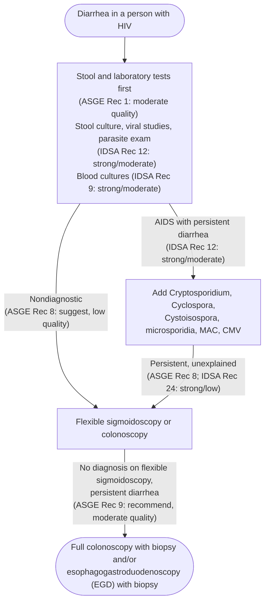

## Contents
- [[#Definition / Scope]]
- [[#Differential Diagnosis]]
- [[#Diagnostic Algorithm]]
  - [[#Suspected GVHD After HSCT]]
- [[#Key Tests]]
- [[#Red Flags / Alarm Features]]
- [[#Therapeutics]]
  - [[#Pathogen-Directed Therapy]]
  - [[#Empiric Antimicrobials]]
  - [[#Antidiarrheals]]

## Definition / Scope

- Diarrhea in a person with human immunodeficiency virus (HIV) infection or acquired immunodeficiency syndrome (AIDS): wider infectious differential than in immunocompetent hosts; endoscopy with biopsy may find a pathogen despite negative stool studies ([[asge-2010-diarrhea|American Society for Gastrointestinal Endoscopy (ASGE) 2010]]).
- Duration terms ([[idsa-2017-infectious-diarrhea|Infectious Diseases Society of America (IDSA) 2017]]): acute <7 days · prolonged 7–13 days · **persistent 14–29 days** · chronic ≥30 days.
- Scope: what the gastrointestinal (GI) infectious-diarrhea guidelines cover. The full CD4-stratified opportunistic-infection differential and its treatment are outside this page's sources.

## Differential Diagnosis

**AIDS + persistent diarrhea — test for these in addition to the routine workup** (IDSA Rec 12, strong/moderate). Methods per IDSA Table 5.

| Organism | Test | Specimen |
|---|---|---|
| [[cryptosporidiosis\|*Cryptosporidium*]] | Direct fluorescent immunoassay, enzyme immunoassay (EIA), or nucleic acid amplification test (NAAT) | Stool |
| *Cyclospora*, *Cystoisospora belli* | Modified acid-fast stain on concentrated specimen, ultraviolet fluorescence microscopy, or NAAT | Stool |
| Microsporidia (classified as a fungus) | Modified trichrome stain on concentrated specimen · histology with electron microscopic confirmation | Stool · small-bowel biopsy |
| *Mycobacterium avium* complex (MAC) | Blood cultures; endoscopy with small-bowel biopsy (IDSA evidence summary) | Blood · biopsy |
| Cytomegalovirus (CMV) | Histopathology; CMV culture | Biopsy |

*Modified acid-fast and trichrome stains may not be routinely available (IDSA Table 5).*

> [!pitfall] Ova and parasites misses Cryptosporidium and Cyclospora
> Routine stool microscopy for ova and parasites is unlikely to include them — request *Cryptosporidium* and/or *Cyclospora* testing specifically ([[idsa-2017-infectious-diarrhea]]).

**Other causes named by the sources:**
- **CMV** — most common pathogen detected at endoscopy in HIV ([[asge-2010-diarrhea]]).
- Enteroaggregative *E. coli* — HIV-associated immune compromise is a risk ([[idsa-2017-infectious-diarrhea]]).
- Conventional bacteria ([[campylobacter-infection|*Campylobacter*]], [[salmonella-infection|*Salmonella*]]) may persist in severe immunocompromise, including AIDS (IDSA).
- Adenovirus and enteropathogenic bacteria — found on histopathology ([[asge-2010-diarrhea]]).
- Lymphoma — proximal-colon yield in [[#Key Tests]].
- Noninfectious ([[idsa-2017-infectious-diarrhea|IDSA]]):
  - Adverse effects of antiretroviral therapy or chemotherapy.
  - No response to initial therapy → reevaluate, including lactose intolerance (Rec 27, weak/low).
  - Symptoms ≥14 days, no source found → consider [[inflammatory-bowel-disease|inflammatory bowel disease (IBD)]] and [[irritable-bowel-syndrome|irritable bowel syndrome (IBS)]] (Rec 28, strong/moderate).
- General causes of [[acute-diarrhea|acute diarrhea]] and [[chronic-diarrhea|chronic diarrhea]] still apply.

## Diagnostic Algorithm

*Workup of diarrhea in HIV/AIDS*
*Source: built from ASGE 2010 Recs 1, 8 and 9 and IDSA 2017 Recs 9, 12 and 24 (neither guideline has a flowchart)*
*[[asge-2010-diarrhea|ASGE 2010 Endoscopy in Diarrhea]] · [[idsa-2017-infectious-diarrhea|IDSA 2017 Infectious Diarrhea]]*
*HIV = human immunodeficiency virus · AIDS = acquired immunodeficiency syndrome · ASGE = American Society for Gastrointestinal Endoscopy · IDSA = Infectious Diseases Society of America · MAC = Mycobacterium avium complex · CMV = cytomegalovirus · EGD = esophagogastroduodenoscopy*

- Severe diarrhea → bowel preparation may be omitted ([[asge-2010-diarrhea]]).
- Persistent diarrhea + anal intercourse → consider endoscopy or proctoscopy (IDSA Rec 24, strong/low).
- Duodenal aspirate may be considered in select people for suspected [[giardiasis|*Giardia*]], *Strongyloides*, *Cystoisospora*, or microsporidia (IDSA Rec 24, weak/low).

### Suspected GVHD After HSCT

Not HIV, but the other immunocompromised host [[asge-2010-diarrhea|ASGE 2010]] addresses:
- Suspected graft-versus-host disease (GVHD) after hematopoietic stem cell transplantation (HSCT) → **flexible sigmoidoscopy with distal-colon biopsies** first (Rec 10, suggest, low quality); distal colon = highest-yield site, sensitivity **82%–95%**.
- Negative colonic histology or predominant upper GI symptoms → **EGD with biopsies** (Rec 10, recommend, moderate quality).
- Biopsy normal- and abnormal-appearing mucosa — appearance does not correlate with histology.
- Duodenal biopsy carries significant duodenal hematoma risk; risk factors acute GVHD and thrombocytopenia.

## Key Tests

| Test | Use / yield (HIV) |
|---|---|
| [[colonoscopy\|Colonoscopy]] vs flexible sigmoidoscopy | Colonoscopy: higher yield (**39% vs 22%**, P = .009) and more cost-effective in 307 patients with unexplained chronic diarrhea. In another report (317 patients), 30% of pathogens and 75% of lymphomas were found only on proximal-colon biopsies. Two other series: 82%–93% of infectious causes found on left-colon biopsies — hence ASGE accepts either first |
| [[upper-endoscopy\|Upper endoscopy]] with small-bowel biopsy and aspirate | Pathogen in **28%** of 442 patients with HIV-related chronic diarrhea; jejunal specimens may out-yield duodenal |
| CMV blood tests (quantitative polymerase chain reaction, viral culture, serology) | Positive result does **not** necessarily mean tissue-invasive disease → endoscopic biopsy may be needed |
| CMV tissue tests | Suspicion high despite nondiagnostic histology → in situ hybridization, immunohistochemistry, tissue CMV culture |
| Blood cultures | Any immunocompromised person (IDSA Rec 9, strong/moderate); diagnoses MAC (IDSA) |

- Most HIV endoscopic data predate highly active antiretroviral therapy ([[asge-2010-diarrhea]]).

## Red Flags / Alarm Features

- **CD4 count <100 cells/mm³** → colonoscopy yield significantly higher; opportunistic infections more common ([[asge-2010-diarrhea]]).
- **Upper GI symptoms** (nausea, vomiting, odynophagia) **or diarrhea persisting despite appropriate therapy** → consider upper endoscopy ([[asge-2010-diarrhea]]).
- **Severe illness with bloody diarrhea** → consider empiric antibacterials (see [[#Empiric Antimicrobials]]).
- **Diarrhea ≥30 days** (HIV status unknown) → HIV testing may be appropriate in some patients ([[idsa-2017-infectious-diarrhea]]).

## Therapeutics

### Pathogen-Directed Therapy

| Organism | First choice | Alternative | Comments |
|---|---|---|---|
| [[cryptosporidiosis\|*Cryptosporidium*]] | [[nitazoxanide\|Nitazoxanide]]; in HIV, combined with effective combination antiretroviral therapy (cART) | Effective cART — immune reconstitution may lead to microbiologic and clinical response | — |
| *Cyclospora cayetanensis* | Trimethoprim-sulfamethoxazole (TMP-SMX) | Nitazoxanide (limited data) | HIV may need higher doses or longer TMP-SMX |
| *Cystoisospora belli* | TMP-SMX | Pyrimethamine; second-line ciprofloxacin or nitazoxanide | — |
| Microsporidia other than *Enterocytozoon bieneusi* / *Vittaforma corneae* (disseminated non-ocular and intestinal) | Albendazole after starting cART and resolution of signs and symptoms | Not applicable | Effective cART — immune reconstitution may lead to response |
| *E. bieneusi* or *V. corneae* | Fumagillin (recommended for *E. bieneusi* in HIV-infected adults) | Not applicable | Systemic fumagillin unavailable in the US |

*Source: IDSA 2017 Table 6 ([[idsa-2017-infectious-diarrhea]]); it gives no doses. Microsporidia: expert consultation recommended.*

- [[acg-2016-acute-diarrhea|American College of Gastroenterology (ACG) 2016]] names albendazole for *E. bieneusi*; the newer IDSA 2017 (fumagillin) is followed here.
- Crofelemer — US Food and Drug Administration–approved for HIV-associated diarrhea ([[acg-2016-acute-diarrhea]]); no dose given.

### Empiric Antimicrobials

Default in [[idsa-2017-infectious-diarrhea|IDSA 2017]] is *no* empiric therapy; immunocompromise is one of the exceptions.

| Situation | Rule |
|---|---|
| Immunocompromised + **severe illness with bloody diarrhea** | Empiric antibacterials **should be considered** (Rec 32, strong/low) |
| Acute **watery** diarrhea, no recent international travel | Not recommended (Rec 36, strong/low) — **exception may be made** if immunocompromised |
| **Persistent watery** diarrhea ≥14 days | Avoid empiric treatment (Rec 36, strong/low). Evidence summary: severe immunocompromise incl. AIDS is an exception — an empiric trial may be considered for symptom relief to optimize tolerance of highly active antiretroviral therapy, though identifying a cause remains preferable |
| Agent, adults | Fluoroquinolone (e.g. ciprofloxacin) or azithromycin, by local susceptibility and travel history (Rec 31, strong/moderate) |
| Plausible organism identified | Modify or discontinue antimicrobials (Rec 38, strong/high) |

### Antidiarrheals

- **Bismuth subsalicylate** — persons with HIV should not receive it: excessive absorption → bismuth encephalopathy ([[acg-2016-acute-diarrhea]]).
- [[loperamide|Loperamide]] may be given to **immunocompetent adults** with acute watery diarrhea (Rec 47, weak/moderate) and [[probiotics]] may be offered to **immunocompetent** adults and children (Rec 49, weak/moderate); loperamide avoided at any age with inflammatory or febrile diarrhea where [[toxic-megacolon|toxic megacolon]] may result (Rec 47, strong/low).

## See Also

[[acute-diarrhea]], [[chronic-diarrhea]], [[cryptosporidiosis]], [[giardiasis]], [[campylobacter-infection]], [[salmonella-infection]], [[nitazoxanide]], [[loperamide]], [[probiotics]], [[colonoscopy]], [[upper-endoscopy]], [[toxic-megacolon]], [[inflammatory-bowel-disease]], [[irritable-bowel-syndrome]], [[infectious-esophagitis]]

---

## Sources

1. [[acg-2016-acute-diarrhea|ACG 2016: Diagnosis, Treatment, and Prevention of Acute Diarrheal Infections in Adults]]
2. [[asge-2010-diarrhea|ASGE Guideline: The Role of Endoscopy in the Management of Patients With Diarrhea (2010)]]
3. [[idsa-2017-infectious-diarrhea|IDSA 2017 Clinical Practice Guidelines for the Diagnosis and Management of Infectious Diarrhea]]
