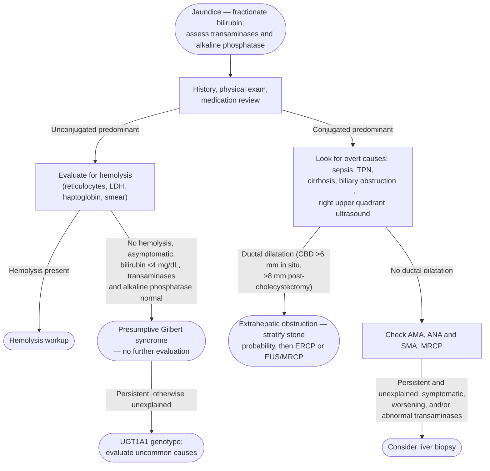

## Contents
- [[#Definition / Scope]]
- [[#Differential Diagnosis]]
  - [[#Unconjugated (Indirect) Hyperbilirubinemia]]
  - [[#Conjugated (Direct) — Hepatocellular]]
  - [[#Conjugated (Direct) — Cholestatic / Obstructive]]
- [[#Diagnostic Algorithm]]
  - [[#Unconjugated Arm]]
  - [[#Conjugated Arm]]
  - [[#When to Biopsy]]
- [[#Key Tests]]
- [[#Red Flags / Alarm Features]]
- [[#See Also]]
- [[#Sources]]

---

## Definition / Scope

**Jaundice** (icterus) = yellow discoloration of skin, sclerae, and mucous membranes from bilirubin deposition. Total serum bilirubin is normally **<1.1 mg/dL**, of which **~70% is unconjugated** ([[acg-2017-liver-chemistries]]).

First branch point = **bilirubin fractionation**:

- **Unconjugated (indirect)** — over-production (hemolysis), decreased hepatic uptake, or decreased hepatic conjugation. Not water-soluble → **not excreted in urine (no bilirubinuria)**. An elevation that is mostly unconjugated makes hepatocellular disease an unlikely explanation.
- **Conjugated (direct)** — hepatocellular dysfunction or impaired excretion / biliary obstruction. Uridine 5′-diphospho-glucuronosyltransferase has made the bilirubin water-soluble → **bilirubinuria (dark urine)**; with impaired bile flow, absent urobilinogen gives **clay-colored stool**, plus pruritus. Total bilirubin may exceed **30 mg/dL** in severe liver injury.

**Fractionation is most helpful when alanine aminotransferase (ALT), aspartate aminotransferase (AST) and alkaline phosphatase (ALP) are normal or near normal** — many laboratories report only the total.

Conjugated cases then split by the **R-ratio** into **hepatocellular** (ALT/AST-predominant) versus **cholestatic** (ALP-predominant) injury:

- **R >5 hepatocellular · <2 cholestatic · 2–5 mixed.** Formula and the full pattern/etiology table live on [[abnormal-liver-chemistries]].

**Isolated hyperbilirubinemia** = bilirubin elevated with **normal ALP *and* normal AST/ALT**. That combination — not the bilirubin alone — is what sends you down the Gilbert/hemolysis branch rather than an injury branch.

> [!pearl] Slow-clearing jaundice after recovery is delta bilirubin
> Delta bilirubin (conjugated bilirubin bound to albumin) decays with albumin's **3-week** half-life, so jaundice lingers after recovery from hepatitis or relief of significant obstruction — not a reason to restart the workup ([[acg-2017-liver-chemistries]]).

---

## Differential Diagnosis

### Unconjugated (Indirect) Hyperbilirubinemia

- **Hemolysis** — hereditary (glucose-6-phosphate dehydrogenase [G6PD] deficiency, spherocytosis, sickle cell) or acquired (autoimmune, microangiopathic); reduced haptoglobin, ↑reticulocytes, ↑lactate dehydrogenase (LDH), smear
- **Gilbert syndrome** — most common cause of unconjugated hyperbilirubinemia; **3–7% of the US population**; UGT1A1 defect → reduced hepatic conjugation. Total bilirubin **almost never exceeds 6 mg/dL and is usually <3 mg/dL**; fasting or significant illness raises the unconjugated fraction **2- to 3-fold** (falls with eating or phenobarbital). See the presumptive-diagnosis criteria below.
- **Crigler-Najjar** (rare), ineffective erythropoiesis, resorption of large hematoma, hyperthyroidism, medications, post-transfusion
- Neonatal/physiologic jaundice (distinct pediatric pathway)

> [!pitfall] Hemolysis rarely explains a bilirubin above 5 mg/dL
> Hemolysis *infrequently* drives total bilirubin **>5 mg/dL** unless there is co-existent renal disease, liver disease, or severe acute hemolysis — a higher bilirubin in isolation argues against pure hemolysis ([[acg-2017-liver-chemistries]]).

**Presumptive Gilbert — all five must hold ([[acg-2017-liver-chemistries]]):**

| # | Criterion |
|---|---|
| 1 | Patient is **asymptomatic and otherwise healthy** |
| 2 | **Mild unconjugated** hyperbilirubinemia — **total bilirubin <4 mg/dL** |
| 3 | **Medications** that cause hyperbilirubinemia excluded |
| 4 | **Evidence of hemolysis** excluded |
| 5 | **Serum transaminases *and* alkaline phosphatase normal** (both — not transaminases alone) |

- All five met → presumptive Gilbert; **additional evaluation is not routinely necessary**.
- If the elevation is **persistent and otherwise unexplained** → confirmatory **UGT1A1 genotype** testing, and evaluate the uncommon causes in American College of Gastroenterology (ACG) 2017 Table 6.

### Conjugated (Direct) — Hepatocellular

- **Viral hepatitis** — [[hepatitis-c]], [[chronic-hepatitis-b]], hepatitis A/E
- **[[alcohol-associated-hepatitis|Alcohol-associated hepatitis]]** — AST:ALT >2, often very high bilirubin ([[alcohol-associated-liver-disease|alcohol-associated liver disease]] spectrum)
- **[[drug-induced-liver-injury]]** — acetaminophen and idiosyncratic drug-induced liver injury (DILI); herbal/dietary supplements
- **[[autoimmune-hepatitis]]**, [[wilson-disease|Wilson disease]] (especially fulminant), ischemic hepatitis ("shock liver"), congestive hepatopathy
- **[[cirrhosis|Cirrhosis]] / decompensation** of any chronic liver disease (e.g. [[nafld-masld|metabolic dysfunction–associated steatotic liver disease (MASLD)]])
- Sickle cell liver crisis, hemophagocytic lymphohistiocytosis
- **Inherited excretion defects — Dubin-Johnson and Rotor:** direct bilirubin **~50% of total** with all other liver tests normal, including ALP and gamma-glutamyl transferase (GGT); **it is not necessary to distinguish the two**

### Conjugated (Direct) — Cholestatic / Obstructive

**Extrahepatic (mechanical) obstruction:**

- **[[choledocholithiasis]]** — most common; ± **[[acute-cholangitis|ascending cholangitis]]** (Tokyo Guidelines 2018 [TG18] diagnostic criteria and severity grading on that page)
- **Malignant biliary obstruction** — [[pancreatic-cancer|pancreatic head cancer]], [[cholangiocarcinoma]], [[ampullary-adenoma|ampullary tumor]], [[gallbladder-cancer|gallbladder cancer]] ([[biliary-stricture|biliary stricture differential]])
- **Benign strictures** — post-surgical, [[chronic-pancreatitis|chronic pancreatitis]], [[igg4-related-cholangitis|immunoglobulin G4 (IgG4)–related cholangitis]]
- Bile duct flukes, AIDS cholangiopathy

**Intrahepatic cholestasis:**

- **[[primary-biliary-cholangitis|Primary biliary cholangitis (PBC)]]** (antimitochondrial antibody [AMA]–positive), **[[primary-sclerosing-cholangitis|primary sclerosing cholangitis (PSC)]]** ([[mri-mrcp|magnetic resonance cholangiopancreatography (MRCP)]] beading; PSC-[[inflammatory-bowel-disease|inflammatory bowel disease (IBD)]])
- Drug-induced cholestasis, sepsis, [[nutrition-in-hospitalized-patients|total parenteral nutrition (TPN)]]
- Infiltrative disease — sarcoidosis, granulomatous hepatitis, tuberculosis, atypical fungal infection, metastatic cancer, lymphoma, [[hepatocellular-carcinoma|hepatocellular carcinoma]]
- Benign post-operative jaundice (isolated, typically resolves), multifactorial intensive care unit (ICU) jaundice, benign recurrent cholestasis, vanishing bile duct syndrome / ductopenia
- [[intrahepatic-cholestasis-of-pregnancy|Cholestasis of pregnancy]] and other [[liver-disease-in-pregnancy|pregnancy-related liver disease]]

---

## Diagnostic Algorithm

*Evaluation of an elevated total bilirubin, by fraction*
*Source: redrawn from the ACG 2017 algorithm for evaluation of elevated serum total bilirubin (Figure 5), with the duct cut-points and the stone-probability step from ASGE 2019*
*[[acg-2017-liver-chemistries|ACG 2017: Evaluation of Abnormal Liver Chemistries]] · [[asge-2019-choledocholithiasis|ASGE Guideline: Endoscopic Management of Choledocholithiasis (2019)]]*
*LDH = lactate dehydrogenase · TPN = total parenteral nutrition · CBD = common bile duct · ERCP = endoscopic retrograde cholangiopancreatography · EUS = endoscopic ultrasound · MRCP = magnetic resonance cholangiopancreatography · AMA = antimitochondrial antibody · ANA = antinuclear antibody · SMA = smooth muscle antibody*

### Unconjugated Arm

- **Review medications** and check **hemolysis labs** (reticulocytes, LDH, haptoglobin, smear).
- Hemolysis labs abnormal → hematology workup.
- Labs clean and the five criteria above met → stop at **presumptive Gilbert syndrome**.

### Conjugated Arm

- **Look for clinically overt causes first** — sepsis, TPN, [[cirrhosis]], biliary obstruction ([[acg-2017-liver-chemistries]] Figure 5).
- **Classify the pattern by R-ratio** ([[abnormal-liver-chemistries]]) into hepatocellular vs cholestatic.
  - **Hepatocellular** → viral serologies (hepatitis C, B, A/E), alcohol history, medication/supplement review ([[drug-induced-liver-injury]]), autoimmune markers (ANA, SMA, immunoglobulin G [IgG]), ceruloplasmin especially in patients **<55 y** (Wilson disease).
  - **Cholestatic** → **right upper quadrant ultrasound first** to assess for **biliary dilation**. **"Dilated" has a number: CBD >6 mm with the gallbladder in situ, >8 mm post-cholecystectomy** ([[asge-2019-choledocholithiasis]]) — full criteria on [[choledocholithiasis]].
- **Ducts dilated → extrahepatic obstruction.** *Do not jump straight to ERCP.* **Which test comes next is set by the [[choledocholithiasis|ASGE 2019 stone-probability strata]]** — **high (>50%)** → direct **[[ercp|ERCP]]**; **intermediate (10–50%)** → **[[endoscopic-ultrasound|EUS]] or [[mri-mrcp|MRCP]]** first; **low (<10%)** → neither. The criteria table (including the combination rule that **total bilirubin >4 mg/dL is high-risk only *with* a dilated duct**, either alone being intermediate) has one home: **[[choledocholithiasis]]**. ERCP then gives therapeutic relief (stone extraction, stent) and tissue sampling ([[biliary-stricture]]). Cholangitis → urgent drainage + antibiotics; **grade it (TG18 I/II/III) before choosing drainage timing — see [[acute-cholangitis]]**.
- **Ducts not dilated → intrahepatic cholestasis:** check **AMA, ANA, *and* SMA** ([[primary-biliary-cholangitis|PBC]], autoimmune hepatitis) — ACG 2017 names all three, not AMA alone; MRCP for [[primary-sclerosing-cholangitis|PSC]]; review drugs.

### When to Biopsy

- Applies to **either fraction**: [[liver-biopsy|liver biopsy]] is considered when the bilirubin elevation is **persistent and otherwise unexplained** *and* is **symptomatic, worsening over time, and/or associated with abnormal transaminases** ([[acg-2017-liver-chemistries]] Figure 5).
- A stable, asymptomatic, isolated elevation with normal transaminases does not meet the bar.

---

## Key Tests

- **Fractionated bilirubin** — conjugated vs. unconjugated; defines the entire pathway.
- **Liver enzymes + R-ratio** — hepatocellular vs. cholestatic pattern ([[abnormal-liver-chemistries]]).
- **GGT** — confirms hepatic origin of an **isolated** ALP elevation; not specific for cholestasis, so not a screening test on its own ([[acg-2017-liver-chemistries]]).
- **Hemolysis panel** — reticulocyte count, LDH, haptoglobin, peripheral smear, Coombs.
- **Urinalysis** — bilirubinuria indicates conjugated hyperbilirubinemia (absent in unconjugated).
- **Pregnancy test** in women of childbearing age — cholestasis of pregnancy.
- **Right upper quadrant ultrasound** — first imaging in cholestasis; detects biliary dilation, stones, masses.
- **MRCP / [[endoscopic-ultrasound|EUS]]** — noninvasive (MRCP) and tissue-capable (EUS–fine-needle biopsy [EUS-FNB]) characterization of biliary/pancreatic obstruction.
- **[[ercp|ERCP]]** — therapeutic for extrahepatic obstruction (stones, stent) with sampling; not for diagnosis alone.
- **Serologies & autoantibodies** — viral hepatitis panel, AMA (PBC), ANA/SMA/IgG (autoimmune hepatitis), IgG4; ceruloplasmin (Wilson disease).
- **Liver biopsy** — only when the criteria above are met.

---

## Red Flags / Alarm Features

- **[[acute-liver-failure|Acute liver failure]]** — illness **<26 weeks** in a patient **without** preexisting liver disease or cirrhosis, with **any degree** of mental status alteration ([[hepatic-encephalopathy|encephalopathy]]) **AND** coagulopathy (**international normalized ratio [INR] ≥1.5**) → urgent [[liver-transplantation|transplant]]-center referral ([[acg-2023-alf]]). Exceptions to the no-underlying-liver-disease requirement — each can present acutely on advanced fibrosis: autoimmune hepatitis, [[budd-chiari-syndrome|Budd-Chiari syndrome]], Wilson disease
- **Acute hepatitis with a prolonged prothrombin time and/or encephalopathy** → immediate referral to a liver specialist ([[acg-2017-liver-chemistries]])
- **Ascending cholangitis** — systemic inflammation (fever/chills or inflammatory labs) **plus** this cholestasis → suspect it, then **grade it before choosing drainage timing**: any one organ dysfunction = Grade III, two of five criteria = Grade II. Full TG18 diagnostic and severity criteria, and the sensitivity limits of Charcot's triad: **[[acute-cholangitis]]**
- **Painless jaundice** — the usual presentation of an extrahepatic biliary stricture from a pancreatic mass; these patients are **minimally symptomatic** (anorexia, dyspepsia, malaise, weight loss rather than severe pain or cholangitis) ([[acg-2023-biliary-strictures]]) → work it up on the biliary-stricture pathway

---

## See Also

[[abnormal-liver-chemistries]], [[choledocholithiasis]], [[acute-cholangitis]], [[biliary-stricture]], [[cholangiocarcinoma]], [[pancreatic-cancer]], [[gallbladder-cancer]], [[primary-biliary-cholangitis]], [[primary-sclerosing-cholangitis]], [[igg4-related-cholangitis]], [[drug-induced-liver-injury]], [[autoimmune-hepatitis]], [[alcohol-associated-hepatitis]], [[alcohol-associated-liver-disease]], [[hepatocellular-carcinoma]], [[hepatitis-c]], [[chronic-hepatitis-b]], [[wilson-disease]], [[budd-chiari-syndrome]], [[nafld-masld]], [[acute-liver-failure]], [[hepatic-encephalopathy]], [[liver-transplantation]], [[chronic-pancreatitis]], [[ercp]], [[endoscopic-ultrasound]], [[mri-mrcp]], [[liver-biopsy]], [[liver-disease-in-pregnancy]], [[intrahepatic-cholestasis-of-pregnancy]], [[ampullary-adenoma]], [[nutrition-in-hospitalized-patients]]

---

## Sources

1. [[acg-2017-liver-chemistries|ACG 2017: Evaluation of Abnormal Liver Chemistries]]
2. [[acg-2023-alf|ACG 2023: Acute Liver Failure]]
3. [[asge-2019-choledocholithiasis|ASGE Guideline: Endoscopic Management of Choledocholithiasis (2019)]]
4. [[tg18-2018-cholangitis-flowchart|Tokyo Guidelines 2018: Initial Management of Acute Biliary Infection and Flowchart for Acute Cholangitis]]
5. [[asge-2021-cholangitis|ASGE Guideline: Management of Acute Cholangitis (2021)]]
6. [[acg-2023-biliary-strictures|ACG 2023: Diagnosis and Management of Biliary Strictures]]
